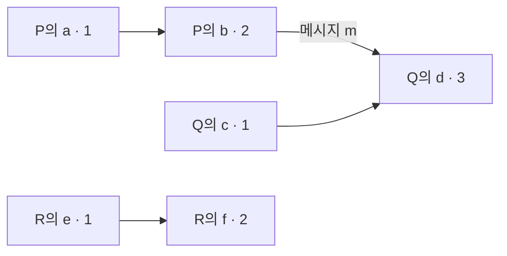

# Lamport: 시계 숫자와 사건의 순서 | Logical clocks

Leslie Lamport의 「Time, Clocks, and the Ordering of Events in a Distributed System」은 Communications of the ACM 21(7), pp.558–565, 1978년 7월에 실렸습니다. [저자 공개 원문](https://lamport.azurewebsites.net/pubs/time-clocks.pdf) 마지막 쪽은 1976년 3월 접수와 1977년 10월 수정을 구분합니다. 핵심은 pp.558–561의 사건 순서·논리 시계·전체 순서이며, 물리 시계 논의는 그 뒤에 이어집니다.

## 메시지 송수신으로 알 수 있는 사건의 순서

서버 P가 보낸 메시지를 서버 Q가 받은 뒤 답했다면, 전송보다 수신이 먼저일 수는 없습니다. 반면 서로 메시지를 주고받지 않은 두 작업의 기록에는 같은 방식으로 순서를 정할 근거가 없을 수 있습니다. 컴퓨터마다 표시한 시각이 있다는 사실만으로 모든 기록을 정확히 한 줄에 세울 수 있는 것은 아닙니다.

논문은 같은 프로세스 내부의 순서, 메시지의 송수신, 그 관계의 연쇄로 happened-before를 정의합니다. 이 관계는 일부 사건끼리만 순서를 정하는 부분 순서입니다. 논리 시계는 그 관계를 보존하는 숫자를 붙이지만, 숫자의 대소에서 인과 관계를 역으로 복원하지는 못합니다. [원문 The Partial Ordering·Logical Clocks](https://lamport.azurewebsites.net/pubs/time-clocks.pdf)

| 용어 | 쉬운 뜻 | 구별할 부분 |
| --- | --- | --- |
| 프로세스 | 자기 사건을 순서대로 진행하는 실행 주체입니다. | 꼭 물리 서버 한 대와 같은 단위는 아닙니다. |
| happened-before | 내부 순서와 실제 메시지 경로로 이어지는 선후 관계입니다. | 실제 영향이 반드시 일어났다는 인과 실험 결과는 아닙니다. |
| 부분 순서 | 비교되는 쌍도 있고 비교되지 않는 쌍도 있는 순서입니다. | 모든 쌍에 먼저와 나중을 강제하지 않습니다. |
| 동시성 | 어느 쪽에서도 다른 쪽으로 그 관계가 이어지지 않는 경우입니다. | 벽시계의 같은 초에 실행되었다는 뜻은 아닙니다. |
| 논리 시계 | 사건의 순서를 보존하도록 붙이는 숫자입니다. | 초나 밀리초를 재는 물리 시계와 다릅니다. |

## 직접 만든 여섯 사건의 계산

교육용으로 각 프로세스의 카운터를 0에서 시작하겠습니다. 자기 사건마다 1을 더하고, 메시지 수신은 `max(현재값, 받은 값)+1`로 정합니다. 이 구체적 규칙은 순서를 확인하기 위한 자체 예입니다.

| 프로세스 | 사건 | 계산 | 붙인 숫자 |
| --- | --- | --- | ---: |
| P | a: 내부 작업 | 0+1 | 1 |
| P | b: 메시지 m 전송 | 1+1 | 2 |
| Q | c: 내부 작업 | 0+1 | 1 |
| Q | d: m 수신 | max(1,2)+1 | 3 |
| R | e: 내부 작업 | 0+1 | 1 |
| R | f: 다음 내부 작업 | 1+1 | 2 |

화살표는 이 예에서 정한 관계입니다. b에서 d로 메시지가 가므로 시계 숫자도 2에서 3으로 증가합니다. 그러나 a의 1이 f의 2보다 작다는 사실만으로 a에서 f로 가는 화살표가 생기지는 않습니다. R과 연결하는 메시지가 없기 때문입니다.

기호로는 $a\to b$이면 $C(a)<C(b)$라는 방향을 보존합니다. 그 역인 $C(a)<C(b)\Rightarrow a\to b$는 일반적으로 성립하지 않습니다. 카운터의 증가를 인과 증거로 사용하면 이 두 방향이 섞입니다.

## 한 줄 정렬은 합의와 같은 일이 아닙니다

숫자가 같을 때 프로세스 이름 같은 규칙으로 순서를 정하면 `(숫자, 프로세스 번호)`를 비교해 전체 순서를 만들 수 있습니다. 이는 원래 부분 순서를 거스르지 않는 한 가지 확장입니다. 서로 독립인 사건에도 순서를 붙이므로 그 순서가 새로 발견한 물리적 사실은 아닙니다.

또 비교 규칙을 정했다는 사실만으로 모든 서버가 언제 같은 기록을 받는지, 장애 뒤 어떤 기록을 채택하는지까지 해결되지는 않습니다. 기록을 보급하는 절차와 실패에 관한 가정이 필요합니다. 원문의 상호 배제 예도 메시지 전달과 순서 등에 대한 가정을 두고 설명합니다. 단순 시계 숫자를 장애에 견디는 합의 알고리즘의 대체품으로 사용하지 않습니다. [원문 Ordering the Events Totally, pp.560–562](https://lamport.azurewebsites.net/pubs/time-clocks.pdf)

## 요청 순서와 사용 허가 사이에 필요한 메시지

원문 인쇄 561쪽의 상호 배제 절차에는 정렬 규칙 외에 요청·응답·해제가 있습니다. 상호 배제는 같은 자원을 한 번에 한 프로세스만 쓰게 하는 성질입니다. 각 프로세스는 자기만 볼 수 있는 요청 목록을 유지하고, 다른 프로세스의 요청도 메시지로 받아 그 목록에 넣습니다. [원문의 다섯 규칙](https://lamport.azurewebsites.net/pubs/time-clocks.pdf)

직접 만든 두 프로세스 P·Q에서 `P<Q`로 동점 우선순위를 정하겠습니다. 초기 보유자를 두는 원문의 시작 절차는 생략하고, 자원이 비어 있으며 두 카운터가 0인 자체 초기 상태를 가정합니다. 한 프로세스가 보낸 메시지는 상대에게 보낸 순서대로 도착하고 모두 결국 전달된다고 가정합니다. 수신과 뒤이은 응답 전송에는 별도의 사건 번호를 붙입니다.

| 단계 | P가 아는 것 | Q가 아는 것 |
|---|---|---|
| 각자 요청합니다. | 자기 요청 `(1,P)`만 목록에 있습니다. | 자기 요청 `(1,Q)`만 목록에 있습니다. |
| 상대 요청을 받습니다. | 수신 시계는 2가 되고 목록은 `[(1,P),(1,Q)]`입니다. | 같은 목록을 얻으며 수신 시계는 2입니다. |
| 응답을 보냅니다. | 다음 사건인 응답 전송에 3을 붙입니다. | 응답 전송에 3을 붙입니다. |
| 상대 응답을 받습니다. | 자기 요청이 맨 앞이고, 상대에게서 1보다 큰 시각의 메시지를 받았으므로 사용합니다. | 응답은 받았지만 자기 요청이 맨 앞이 아니어서 기다립니다. |
| P가 해제를 알립니다. | 자기 요청을 지우고 해제 메시지를 보냅니다. | P의 요청을 지운 뒤 자기 차례가 됩니다. |

첫 행에서 두 사람 모두 자기 요청이 맨 앞입니다. 그 조건 하나만으로 사용하면 충돌합니다. 상대의 더 늦은 메시지를 확인해야 아직 오지 않은 선행 요청을 놓치지 않았다고 판단할 수 있습니다. 이때 같은 발신자 메시지의 순서 보장도 쓰입니다. Q의 응답보다 Q의 앞선 요청이 먼저 도착하므로, 응답만 보고 앞선 요청을 모르는 상황을 막습니다.

응답을 다른 메시지에 합치지 않는 기본 구성에서 참여자가 N명이면 한 번의 요청·응답·해제에 각각 N−1개, 합계 `3(N−1)`개의 점대점 메시지가 필요합니다. N=3이면 6개입니다. 이것은 기본 절차의 개수 계산이며 실제 네트워크의 패킷 수나 지연 측정은 아닙니다. 한 프로세스가 응답하지 않으면 기다림이 계속될 수 있습니다. 순서가 보존되는 조건과 장애 중에도 진행되는 조건을 별도로 설계해야 하는 이유입니다.

## 증명과 실제 시계 측정의 범위

주요 근거는 정의한 선후 관계와 시계 규칙이 만족하는 성질입니다. 뒤의 물리 시계 분석은 추가적인 지연·시계 변화율 가정을 사용합니다. 위의 여섯 사건을 계산했다고 실제 서버 시계를 보정했거나 물리 시간 오차를 측정한 것은 아닙니다.

논리 시계의 숫자가 큰 사건을 보고 ‘그만큼 오래 걸렸습니다’라고 해석하지도 않습니다. 수신한 큰 숫자 때문에 카운터가 한 번에 뛰어도 벽시계의 긴 시간이 경과한 것은 아닙니다. 순서 정보와 소요 시간은 다른 값입니다.

확인 가능한 후속 연결은 Lamport의 [「The Part-Time Parliament」, §4](https://lamport.azurewebsites.net/pubs/lamport-paxos.pdf)입니다. 이 후속 논문은 상태 기계 방식의 선행 작업으로 1978년 논문을 직접 연결합니다. 같은 명령 순서를 복제하는 문제와 장애 중 합의를 나누어 읽으면, 시계 규칙이 제공하는 부분과 추가 알고리즘이 제공하는 부분을 구별할 수 있습니다.

## 자가 점검

1. a와 f는 숫자가 1과 2이므로 a가 f에 인과적으로 앞섭니까?
2. 서로 다른 두 사건의 숫자가 같으면 오류입니까?
3. Q가 현재 7이고 받은 메시지 숫자가 3이면 위 규칙의 수신 숫자는 얼마입니까?

해설 보기

1. 그렇지 않습니다. 이 예에는 그 둘을 연결하는 경로가 없습니다.
2. 반드시 오류는 아닙니다. 비교되지 않는 사건에 같은 숫자가 붙을 수 있습니다.
3. max(7,3)+1이므로 8입니다. 받은 숫자만 복사해 시계를 뒤로 돌리지 않습니다.

[컴퓨팅과 시스템 논문 안내](README.md)
