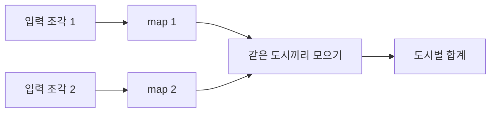

# MapReduce: 계산을 나누고 같은 키를 다시 모으기

Jeffrey Dean과 Sanjay Ghemawat의 「MapReduce: Simplified Data Processing on Large Clusters」는 OSDI 2004에서 발표되었습니다. [USENIX 행사 기록](https://www.usenix.org/legacy/event/osdi04/tech/dean.html)은 proceedings pp.137–150을 안내합니다. 이 해설의 절 위치는 [Google 공개 원문](https://research.google.com/archive/mapreduce-osdi04.pdf)의 §2 프로그래밍 모형, §3 구현·장애 처리, §4.3 combiner, §5 평가입니다.

## 분할 계산의 중간 결과와 작업 관리

자료를 나누어 주는 것만으로 병렬 계산이 끝나지는 않습니다. 같은 대상을 센 결과가 여러 곳에서 나오면 합쳐야 하고, 작업자가 멈추면 다시 맡겨야 합니다. 느린 작업 하나가 전체 완료를 늦추는 문제도 있습니다.

논문은 사용자가 map과 reduce의 계산을 정하고, 구현이 분배·재실행·중간 결과 전달 등을 관리하는 방식을 제시합니다. 여기서 map은 지도라는 뜻이 아니라 입력에서 중간 키·값을 만드는 변환이고, reduce는 같은 키의 값들을 모아 결과를 만드는 함수입니다. [원문 §§2–3](https://research.google.com/archive/mapreduce-osdi04.pdf)

| 용어 | 쉬운 뜻 | 구별할 부분 |
| --- | --- | --- |
| 키·값 | 무엇에 관한 기록인지와 그 내용을 짝지은 것입니다. | 키가 같으면 같은 집계 대상으로 볼 수 있게 설계합니다. |
| map | 입력 조각에서 중간 기록을 만드는 계산입니다. | 입력 하나가 반드시 출력 하나만 내는 것은 아닙니다. |
| shuffle | 같은 키의 중간 기록을 같은 담당 쪽으로 모으는 과정입니다. | 이름과 달리 무작위로 섞자는 뜻이 아닙니다. |
| reduce | 한 키에 모인 값들을 결과로 합치는 계산입니다. | 아무 계산이나 안전하게 조각내서 합칠 수 있는 것은 아닙니다. |
| combiner | 중간 기록을 가까운 곳에서 미리 줄이는 선택적 계산입니다. | 언제나 한 번 실행된다고 가정해서는 안 됩니다. |

## 직접 만든 도시별 합계

입력을 두 작업자에게 나누겠습니다. 첫 작업자는 `(부산,10)`, `(서울,7)`을 받고, 둘째 작업자는 `(부산,5)`, `(서울,3)`, `(대전,4)`를 받습니다. 이번 예의 map은 같은 키·값을 중간 기록으로 냅니다.

| shuffle 후 키 | 모인 값 | reduce의 합계 |
| --- | --- | ---: |
| 부산 | 10, 5 | 15 |
| 서울 | 7, 3 | 10 |
| 대전 | 4 | 4 |

최종 합계 15+10+4=29는 입력 값 전체의 합과 같습니다. 동일한 도시를 어느 작업자가 읽었는지는 최종 키의 의미를 바꾸지 않습니다. 이것은 자체 정수 계산 예이며 실제 클러스터 처리량 실험이 아닙니다.

일부 도시의 기록이 대부분을 차지하면 그 키의 담당 작업이 늦어질 수 있습니다. 컴퓨터 수가 두 배라는 사실만으로 항상 두 배 빨라지지는 않습니다. 중간 데이터의 전송, 입력 읽기, 키의 편중과 마지막 느린 작업이 함께 영향을 줍니다.

## 평균의 평균은 왜 틀릴 수 있습니까

첫 묶음이 10과 20, 둘째 묶음이 100이라고 하겠습니다. 묶음 평균은 15와 100이고, 이 두 평균을 다시 평균하면 57.5입니다. 그러나 원래 세 값의 평균은 $130/3\approx43.3333$입니다. 두 묶음의 원소 수가 다르기 때문입니다.

이 경우 중간 결과를 평균 하나 대신 `(합, 개수)`로 두면 됩니다. `(30,2)`와 `(100,1)`을 합쳐 `(130,3)`을 만들고 마지막에 나눕니다. 결과를 어떻게 표현하느냐가 안전한 분할·결합 가능성을 바꿉니다.

combiner를 쓰려면 한 번만 결합했을 때뿐 아니라 조각을 더 나누거나 여러 번 결합했을 때도 의미가 유지되는지 확인해야 합니다. 함수가 기대하는 중간 값의 형식도 맞아야 합니다. 원문 §4.3의 조건을 읽지 않고 모든 reduce 함수를 combiner로 복사하면 안 됩니다.

## 다시 실행하는 계산과 바깥에 남기는 행동

원문 §3.3은 작업 실패 시 재실행과 결과의 의미를 다룹니다. 결정적인 함수라면 같은 입력에서 같은 결과를 얻는 성질을 활용할 수 있습니다. 그러나 계산 중 외부 서비스에 별도의 기록을 남기면, 재실행 때 그 기록도 다시 생길 수 있습니다. 출력 파일을 채택하는 절차와 외부 부수 효과의 중복은 별개입니다.

데이터 가까이에서 계산하려는 배치와 §3.6의 느린 작업 대응도 구현의 일부입니다. 함수를 두 개 작성했다는 사실만으로 이런 운영 동작까지 직접 구현한 것은 아닙니다. 실제 시스템에는 작업 상태·파일·통신과 실패 탐지가 함께 필요합니다. [원문 §§3.3–3.6](https://research.google.com/archive/mapreduce-osdi04.pdf)

## 평가의 범위와 후속 변화

논문 §5는 대규모 자료에 대한 검색·정렬 작업을 당시 구성에서 평가합니다. 이 글의 다섯 기록 합계는 그 실험을 재현한 결과가 아닙니다. 같은 자료를 반복 사용하는 작업에서는 매 단계의 읽기·중간 저장 부담도 따져야 합니다.

확인 가능한 후속 논문은 Zaharia 등의 [「Spark: Cluster Computing with Working Sets」(2010), §1·§6](https://www.usenix.org/legacy/event/hotcloud10/tech/full_papers/Zaharia.pdf)입니다. 이 글은 MapReduce 계열을 직접 논의하면서 여러 연산에서 작업 자료를 재사용하는 문제를 다룹니다. 후속 구조의 동기를 이해하는 연결이며, 모든 작업에서 어느 시스템이 더 빠르다는 현재 제품 비교는 아닙니다.

## 자가 점검

1. 같은 도시 기록이 서로 다른 map 작업자에서 나와도 합쳐질 수 있습니까?
2. 평균 두 개만 있으면 원래 전체 평균을 언제나 복원할 수 있습니까?
3. 작업 재실행이 있으면 외부 기록도 자동으로 정확히 한 번만 남습니까?

해설 보기

1. 그렇습니다. 같은 키를 모으는 단계가 그 역할을 합니다.
2. 그렇지 않습니다. 각 평균의 원소 수 같은 정보가 더 필요합니다.
3. 그렇지 않습니다. 계산 출력의 관리와 외부 부수 효과의 중복 처리는 구별해야 합니다.

[컴퓨팅과 시스템 논문 안내](README.md)
