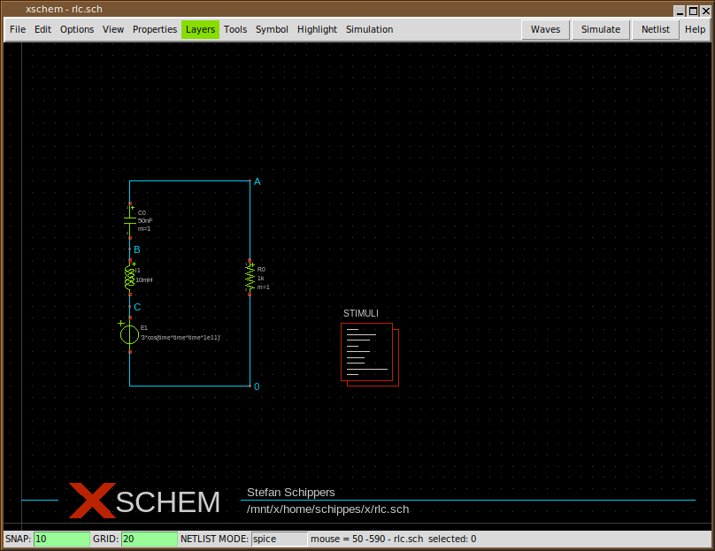

# 반도체 설계 단계별 도구와 공급사

EDA(Electronic Design Automation)는 회로 입력, 검증, 합성, 배치배선과 제작 전 검사를 돕는 도구를 뜻합니다. 설계 분야에 따라 필요한 도구가 다르므로 제품 이름부터 외우기보다 지금 답하려는 질문과 입력·출력을 연결하는 편이 좋습니다.

이 글은 2026년 10월 26일에 열람한 공급사 공식 제품 설명을 바탕으로 대표적인 역할을 정리합니다. 제품군 이름과 실제 실행 프로그램·라이선스 feature는 일대일로 대응하지 않을 수 있습니다. 아래 표는 기능의 위치를 설명하며, 제품의 우열이나 가격·현재 판매 계약·모든 판본의 지원 범위를 평가하지 않습니다.

## 1. 회로 설계와 디지털 구현의 흐름

```text
아날로그·커스텀 경로
사양 → 회로도·소자 선택 → 트랜지스터 수준 시뮬레이션
                         ↓
                  레이아웃 → DRC·LVS → 기생 성분 추출
                         ↑                 ↓
                         └── 배선 후 시뮬레이션과 수정

디지털 경로
사양 → RTL → 기능 검증 → 합성 → 배치·클록 트리·배선
          ↑              ↓                 ↓
          └── 논리 수정과 동등성 확인 ← STA·기생 추출·물리 검증
                                            ↓
                                  제작 데이터와 제출 검토
```

실제 프로젝트에서는 여러 단계를 반복합니다. 시뮬레이션은 입력 자극에 대한 동작을 계산하고, 정적 타이밍 분석(STA)은 타이밍 제약과 셀·배선 모델로 경로의 시간 여유를 계산합니다. DRC는 레이아웃 규칙을, LVS는 레이아웃에서 추출한 회로와 기준 회로의 연결 관계를 검사합니다. 이 검사는 서로 다른 질문에 답합니다.

## 2. Cadence의 대표 도구

| 제품·환경 | 주된 역할 | 입력과 결과의 예 |
|---|---|---|
| Virtuoso Studio 계열 | 아날로그·RF·혼성신호·커스텀 IC의 회로 및 레이아웃 설계 환경 | 회로도·소자·레이아웃 뷰 → 설계 데이터와 netlist |
| Virtuoso ADE 계열 | 테스트벤치, 분석 조건과 시뮬레이션 실행·결과 관리 | 코너·변수·측정 설정 → 실행 구성과 결과 비교 |
| Spectre Simulation Platform | 트랜지스터 수준 아날로그·RF·혼성신호 시뮬레이션 | 소자 모델·netlist·자극 → 전압·전류 파형과 분석 결과 |
| Xcelium Logic Simulation | 디지털 HDL 시뮬레이션과 검증 | RTL·테스트벤치 → 파형·검사·커버리지 결과 |
| Genus Synthesis Solution | RTL 논리 합성 | RTL·타이밍 제약·셀 라이브러리 → 게이트 수준 netlist |
| Innovus Implementation System | 디지털 물리 구현 | netlist·제약·물리 라이브러리 → 배치배선 데이터 |
| Tempus Timing Solution | 정적 타이밍 분석 | netlist·Liberty·제약·배선 기생 정보 → 타이밍 보고서 |
| Quantus Extraction Solution | 배선 등에서 기생 성분 추출 | 레이아웃·공정 추출 정보 → 분석용 기생 성분 |
| Pegasus Verification System | 물리 검증 | 레이아웃·공정 검사 규칙 → 물리 검증 결과 |

Virtuoso는 설계 데이터를 다루는 환경이고 Spectre는 회로 방정식을 계산하는 시뮬레이터입니다. 예를 들어 증폭기 회로를 Virtuoso에서 작성하고 ADE에서 주파수 응답 시험을 설정한 뒤 Spectre로 계산할 수 있습니다. 시뮬레이션이 실패하면 회로 입력, ADE 설정, 시뮬레이터, 모델 파일 중 어느 단계에서 실패했는지 구분합니다. 편집기를 사용할 수 있다는 사실만으로 모든 시뮬레이터 옵션의 사용권까지 확인된 것은 아닙니다.

Spectre 안에서도 X, FX, RF·AMS 등의 명칭은 대상과 해석 기능에 따라 구분됩니다. `FastSPICE`라는 이름은 대규모 회로 해석을 위한 접근을 가리키며 모든 해석 조건에서 같은 정확도·설정을 뜻하지 않습니다. 디지털 HDL 검증은 Xcelium, 아날로그 소자 수준 해석은 Spectre라는 기본 역할을 이해한 뒤 혼성신호 연결 방식을 살펴봅니다.

근거는 Cadence [Virtuoso Studio의 Custom IC 설명](https://www.cadence.com/en_US/home/tools/custom-ic-analog-rf-design/virtuoso-studio.html), [Circuit Design의 ADE Explorer·Assembler 설명](https://www.cadence.com/en_US/home/tools/custom-ic-analog-rf-design/circuit-design.html), [Circuit Simulation의 Spectre·AMS 설명](https://www.cadence.com/en_US/home/tools/custom-ic-analog-rf-design/circuit-simulation.html), [Xcelium의 언어·검증 기능](https://www.cadence.com/en_US/home/tools/system-design-and-verification/simulation-and-testbench-verification/xcelium-simulator.html)입니다. 디지털 제품 역할은 [Cadence Solutions on Arm의 제품 설명 표](https://www.cadence.com/en_US/home/solutions/arm-based-solutions.html)를 참고했습니다. 해당 표의 플랫폼 제공 시점은 이 글의 일반적인 설치 조건으로 옮기지 않았습니다.

### Virtuoso·ADE의 공식 제품 화면

| 공식 자료 | 화면과 함께 볼 부분 |
| --- | --- |
| [Virtuoso Layout Suite, Overview의 Figure 1](https://www.cadence.com/en_US/home/resources/datasheets/virtuoso-layout-suite-ds.html) | 실제 레이아웃 편집 환경과 연결 기반 편집 기능을 함께 살펴봅니다. |
| [Circuit Design의 Schematic Editor·ADE Explorer·Assembler](https://www.cadence.com/en_US/home/tools/custom-ic-analog-rf-design/circuit-design.html) | 회로도 입력, 시험 조건·측정값 설정, 여러 시험 결과 관리가 어떻게 나뉘는지 살펴봅니다. |

화면을 읽을 때에는 회로를 편집하는 창, 실행 조건을 정하는 창, 결과를 표시하는 창을 구분합니다. Spectre는 그 구성에서 넷리스트와 소자 모델을 계산하는 엔진입니다.

## 3. Synopsys의 대표 도구

| 제품·환경 | 주된 역할 | 입력과 결과의 예 |
|---|---|---|
| Custom Compiler | 커스텀 IC의 회로 입력·레이아웃·분석 환경 | 회로·레이아웃과 시뮬레이션 구성 → 설계 데이터 |
| PrimeWave Design Environment | PrimeSim 엔진과 연결한 시뮬레이션 설정·분석 | 테스트벤치·코너·변수 → 실행과 결과 관리 |
| PrimeSim HSPICE 등 PrimeSim 계열 | 소자 수준 회로 시뮬레이션 | netlist·소자 모델·자극 → 파형·회로 특성 |
| Design Compiler | 디지털 RTL 합성 | RTL·제약·셀 특성 → 게이트 수준 netlist |
| Fusion Compiler | RTL부터 물리 구현까지 연결한 디지털 설계 흐름 | RTL·라이브러리·공정·제약 → 물리 구현 결과 |
| PrimeTime | 정적 타이밍과 관련 signoff 분석 | netlist·Liberty·SDC·기생 정보 → 타이밍·제약 보고서 |
| StarRC | 기생 성분 추출 | 레이아웃과 공정 추출 정보 → 회로·타이밍 해석용 기생 정보 |
| IC Validator | DRC·LVS 등 물리 검증 | 레이아웃·기준 회로·규칙 → 검사 결과 |

Custom Compiler와 PrimeSim의 관계는 설계 환경과 계산 엔진을 구분하는 사례입니다. PrimeSim 계열에는 서로 다른 목적의 시뮬레이터가 있으므로 `HSPICE`라는 익숙한 이름을 모든 Synopsys 시뮬레이션 실행 파일의 총칭으로 사용하지 않습니다. [Custom Compiler 공식 설명](https://www.synopsys.com/implementation-and-signoff/custom-design-platform/custom-compiler.html)과 [PrimeSim 공식 설명](https://www.synopsys.com/implementation-and-signoff/ams-simulation.html)에서 설계 환경·실행 관리·해석 엔진의 관계를 확인할 수 있습니다.

[Design Compiler](https://www.synopsys.com/implementation-and-signoff/rtl-synthesis-test/design-compiler.html)는 합성을, [Fusion Compiler](https://www.synopsys.com/implementation-and-signoff/physical-implementation/fusion-compiler.html)는 RTL-to-GDSII 통합 구현을 설명합니다. 통합 제품에서 분석 기능을 제공하더라도 프로젝트의 최종 승인에 요구되는 도구 판본과 조건은 별도로 맞춰야 합니다. [PrimeTime](https://www.synopsys.com/implementation-and-signoff/signoff/primetime.html), [StarRC](https://www.synopsys.com/implementation-and-signoff/signoff/starrc.html), [IC Validator](https://www.synopsys.com/implementation-and-signoff/physical-verification.html)는 각각 타이밍·기생 추출·물리 검증 역할의 근거입니다.

## 4. Siemens EDA의 대표 도구

| 제품·계열 | 주된 역할 | 입력과 결과의 예 |
|---|---|---|
| Questa 계열, Questa One Sim | 디지털 기능 시뮬레이션과 디버깅 | RTL·게이트 netlist·테스트벤치 → 파형·검증 결과 |
| Aprisa | 디지털 RTL-to-GDS 물리 구현 | RTL·셀·공정·제약 → 구현 데이터와 보고서 |
| Calibre nmDRC | 레이아웃 설계 규칙 검사 | 레이아웃·DRC deck → 위반 위치와 규칙 보고서 |
| Calibre nmLVS | 레이아웃과 기준 회로의 연결·소자 비교 | 레이아웃·기준 netlist·LVS 설정 → 일치·불일치 결과 |
| Calibre xACT·xRC | 기생 저항·정전용량 추출 | 레이아웃·기준 회로·공정 추출 deck → 기생 망과 회로 해석용 출력 |

Questa에서 RTL 시뮬레이션이 통과해도 레이아웃 규칙과 아날로그 소자 특성이 검증된 것은 아닙니다. Calibre의 DRC와 LVS도 같은 검사가 아닙니다. 예를 들어 금속 최소 간격을 만족하면서 잘못된 두 신호를 연결한 회로는 DRC만으로 발견되지 않을 수 있습니다. 이런 오류는 연결 비교와 기능 검증 등 다른 관점에서 찾아야 합니다.

[Siemens의 Calibre PEX 안내](https://blogs.sw.siemens.com/calibre/2026/02/17/how-to-use-calibre-parasitic-extraction-tools-step-by-step-guide/)는 xACT·xRC와 출력 형식 DSPF·SPEF·Spectre·Virtuoso 추출 뷰 등의 관계를 설명합니다. PEX 결과를 Spectre로 다시 계산하는 흐름에서도 편집기·추출 도구·시뮬레이터의 공급사가 반드시 같을 필요는 없습니다. 해당 PDK가 지원하는 deck·출력 형식·도구 판본을 맞추어 연결합니다.

Siemens의 [Questa One Sim 공식 설명](https://www.siemens.com/en-us/products/ic/questa-one/simulation/questa-one-sim/), [Aprisa RTL-to-GDS 자료](https://resources.sw.siemens.com/en-GB/fact-sheet-aprisa-rtl-to-gds-digital-implementation-solution-factsheet/), [Calibre nmDRC 데이터시트](https://static.sw.cdn.siemens.com/siemens-disw-assets/public/1e0BnjDXlgGEezdKWH3Wbn/en-US/Siemens-SW-Calibre-nmDRC-FS-82858-C2.pdf), [Calibre nmLVS 설명](https://resources.sw.siemens.com/en-US/fact-sheet-calibre-nmlvs/)을 참고했습니다. 구판 교육 자료에 등장하는 Mentor Graphics라는 이름과 현재 Siemens EDA의 제품 문서가 연결될 수 있지만, 이름이 바뀌었다는 이유만으로 실행 명령이나 라이선스 설정도 같다고 가정하지 않습니다.

DRC·LVS·기생 추출의 역할 구분은 Siemens의 [2021년 Calibre 백서 2쪽](https://static.sw.cdn.siemens.com/siemens-disw-assets/public/3sUlxERjZFcpkKb2V4kIXg/en-US/Siemens-SW-Transforming-IC-design-flows-Calibre-WP-81443-C4.pdf)에서도 확인할 수 있습니다. 이 자료는 역할 설명의 근거이며 현재 제품 판본별 설치 방법의 근거로 사용하지 않습니다.

## 5. 공개 도구와 흐름 관리자의 관계

| 도구·프로젝트 | 역할 | 학습에서 확인할 점 |
|---|---|---|
| Yosys | RTL 합성과 논리 처리 | 합성 전후의 논리·셀 매핑과 경고를 확인합니다. |
| OpenROAD | 플로어플랜·배치·클록 트리·배선 등 물리 구현 | 단계별 배치·배선 상태와 제약의 영향을 확인합니다. |
| OpenSTA | 게이트 수준 정적 타이밍 분석 | Liberty·SDC·SPEF 등 서로 다른 입력의 역할을 확인합니다. |
| KLayout·Magic | 레이아웃 보기·처리와 흐름에 구성된 물리 검사 | 검사 도구와 읽은 deck의 범위를 확인합니다. |
| Netgen | 회로 연결 비교를 위한 LVS | 기준 회로·추출 회로·공정 설정을 함께 확인합니다. |
| LibreLane | 여러 도구의 실행 순서·설정·산출물을 연결하는 기반과 참조 흐름 | 개별 엔진의 로그와 흐름 전체 상태를 구분합니다. |

이 역할 구분은 [LibreLane Classic의 실제 단계 목록](https://librelane.readthedocs.io/en/stable/reference/flows.html)과 [OpenSTA의 입력 형식 설명](https://openroad.readthedocs.io/en/latest/main/src/sta/README.html)에 근거합니다. LibreLane을 설치했다는 것은 제품 이름 하나의 단일 엔진을 설치한 것과 다릅니다. 합성 오류는 Yosys 단계에서, 배치 문제는 OpenROAD 단계에서, LVS 불일치는 Netgen 단계에서 원인을 찾아야 할 수 있습니다.

OpenLane 2 자료의 `openlane`, LibreLane의 `librelane`, OpenROAD 자체 명령과 OpenROAD-flow-scripts의 실행 방식은 구분합니다. 비슷한 흐름을 다뤄도 서로 다른 프로젝트의 명령·설정 파일을 섞지 않습니다. 이 카테고리의 [공개 실습](12-공개도구로RTL에서GDS까지_open-rtl-to-gds.md)은 LibreLane 3.0.16 한 경로를 사용합니다.

### 실제 Xschem 작업 창



출처: Stefan Schippers, [Xschem 공식 튜토리얼의 원본 화면](https://github.com/StefanSchippers/xschem/blob/6066ee9ddbd925c1533f814a8444be997c779622/doc/xschem_man/tutorial_run_simulation_09.png). 중앙에는 저항·인덕터·커패시터와 전원이 연결되어 있고, 위쪽에는 `Netlist`, `Simulate`, `Waves` 버튼이 보입니다. 회로 입력, 해석 실행, 결과 열기가 서로 다른 작업이라는 점을 읽을 수 있습니다. 아래 상태줄의 `NETLIST MODE: spice`도 확인할 수 있습니다.

RLC 예제의 [ngspice 파형 창](04-회로설계와Spectre_custom-circuit-simulation.md), JKU 인버터의 [커스텀 레이아웃](14-아날로그풀커스텀레이아웃_full-custom-layout.md), OpenROAD의 [디지털 배치배선 창](09-배치배선과전력설계_physical-implementation.md)을 함께 보면 단계별 화면의 차이를 알 수 있습니다. [원본·이용 조건](사진과화면_images/README.md)

## 6. 도구를 고르는 순서

1. 설계 대상이 디지털 논리, 아날로그·RF, 메모리, 혼성신호 중 어디에 속하는지 정합니다.
2. 답할 질문을 정합니다. 논리 기능, 소자 동작, 타이밍, 배선 규칙, 연결 비교는 입력과 검사 방식이 다릅니다.
3. 사용할 공정의 PDK와 라이브러리가 해당 도구·판본에 맞는 뷰와 deck을 제공하는지 확인합니다.
4. 기관의 사용권·컴퓨팅 환경과 파운드리가 요구하는 제출·승인 조건을 확인합니다.
5. 작은 설계에서 입력·로그·중간 산출물·최종 보고서가 연결되는지 확인합니다.

예를 들어 디지털 블록의 타이밍이 맞지 않을 때 먼저 필요한 것은 회로도 편집기 이름이 아니라 클록·I/O 제약, 셀 코너, 배선 RC와 경로 보고서입니다. 아날로그 회로의 배선 후 대역폭이 줄어들었다면 소자 모델, 추출된 기생 성분과 시험 조건을 살펴봅니다. 도구 지도를 읽는 목적은 공급사 이름을 맞히는 것이 아니라 실패한 질문에 맞는 자료를 찾는 데 있습니다.

## 7. 다음 학습

- [TCAD와 소자 모델](02A-공정과소자모델_tcad-device-modeling.md): Sentaurus·Silvaco의 공정·소자 해석과 회로용 모델의 연결
- [Linux와 라이선스](01-Linux설치와라이선스_linux-eda-setup.md): 실행 파일, 셸 환경과 사용권의 구분
- [PDK와 라이브러리](02-공정노드와PDK및라이브러리_process-pdk-libraries.md): 합성·물리 구현·검증에서 읽는 파일
- [LibreLane RTL-to-GDS 실습](12-공개도구로RTL에서GDS까지_open-rtl-to-gds.md): 공식 PM32 예제를 이용한 단계별 산출물 확인
