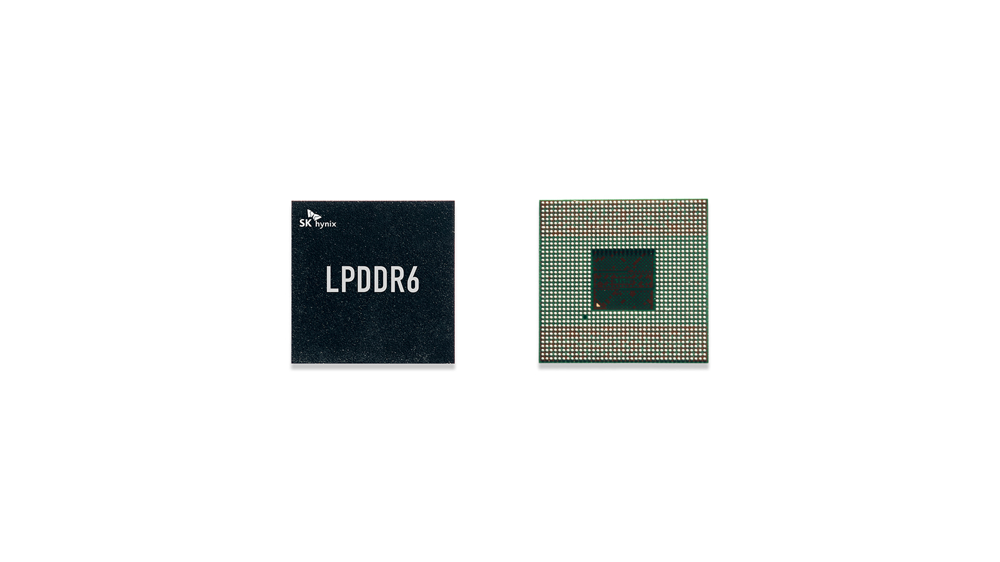
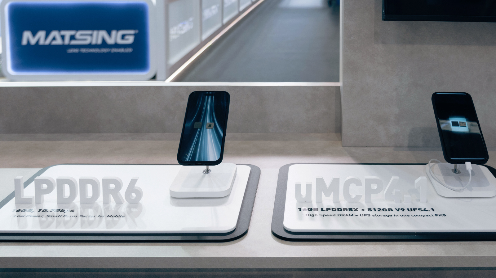
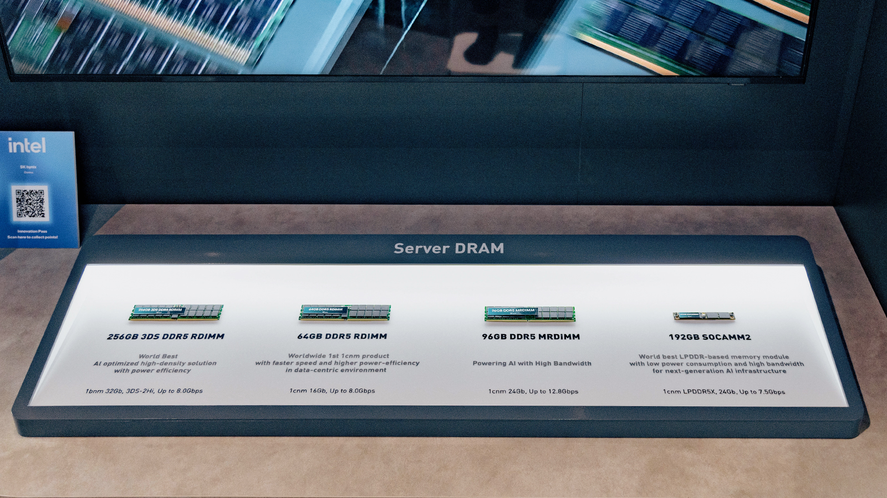
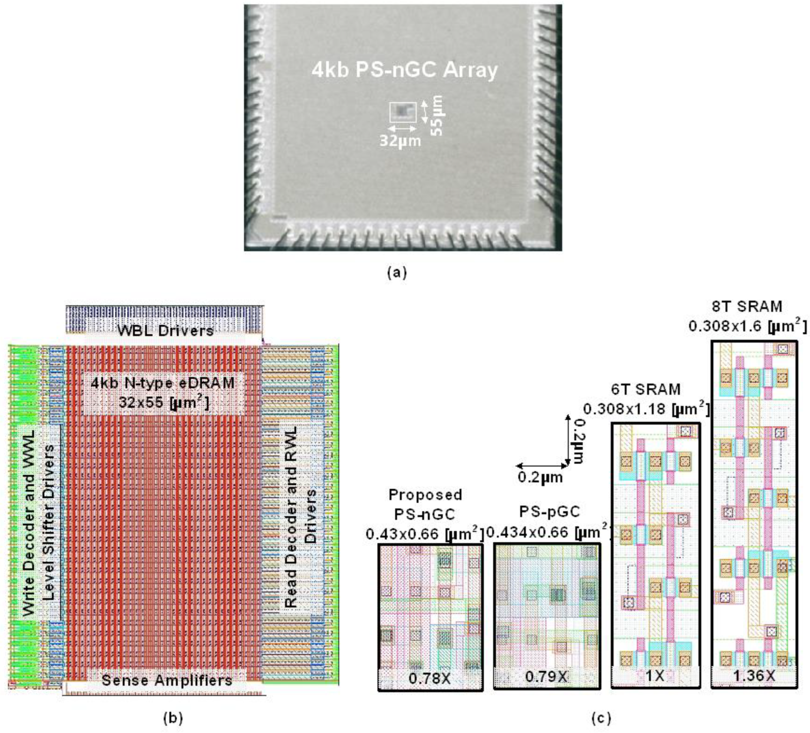
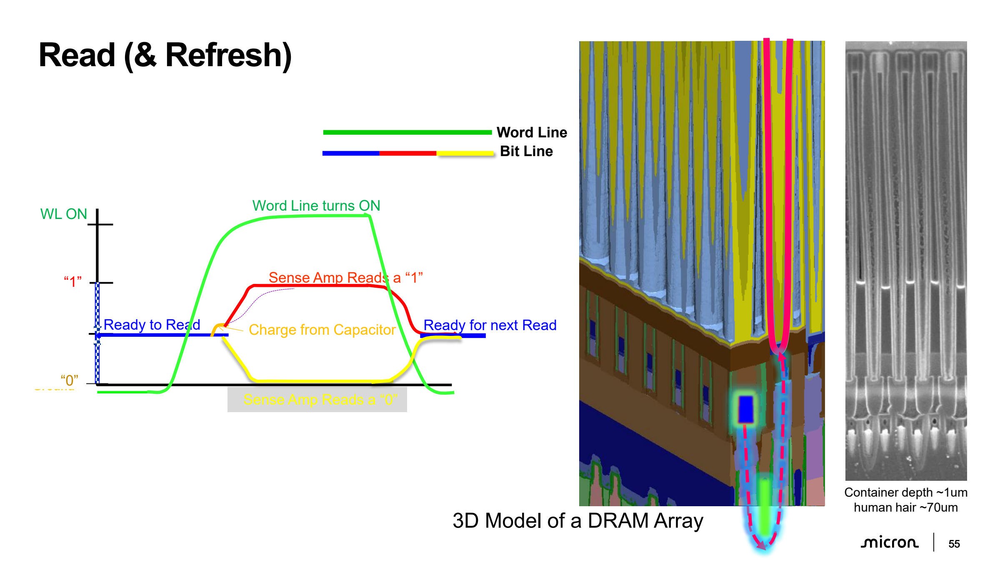
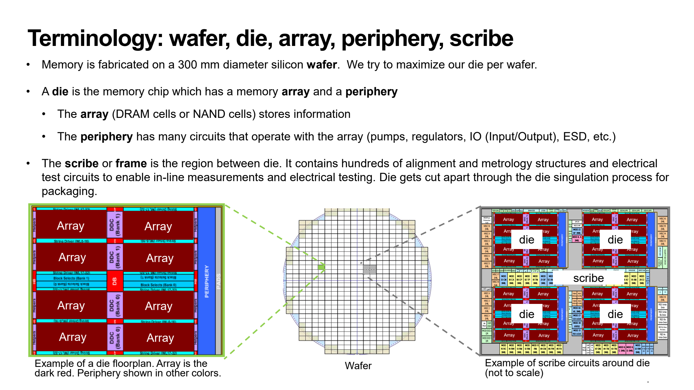
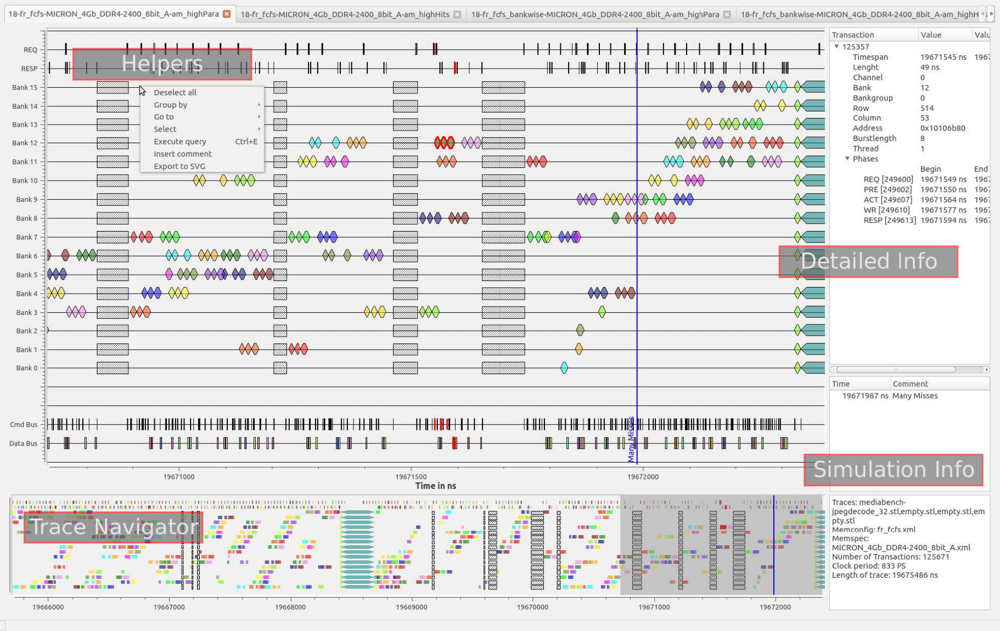

# 1T1C DRAM 셀의 감지·복원과 주변 회로 설계

확인일: 2026-10-26

DRAM은 작은 커패시터에 저장한 전하를 읽는 메모리입니다. 셀은 단순하지만 읽을 수 있는 전압 차이가 작고 시간이 지나면 전하가 새므로, 감지 증폭기·복원·주기적인 refresh가 필요합니다. 한 셀의 전하 변화에서 출발하여 배열과 외부 명령 타이밍을 연결하면 DRAM 회로가 수행하는 일을 구분할 수 있습니다.

이 글의 수치 계산과 시험 조건은 원리를 설명하기 위해 직접 구성한 예입니다. 특정 DRAM 공정의 모델, 제품 사양이나 실제 제작·측정 결과가 아닙니다. 상용 DRAM의 셀 치수·내부 회로·공정 조건을 공개된 인터페이스 자료만으로 추정하지 않습니다.

## 최근 DRAM의 패키지와 모듈

출처: SK하이닉스 뉴스룸, [2026-01-06 CES 공개 자료](https://news.skhynix.co.kr/ces2026/). LPDDR6의 패키지 외관과 뒤쪽 접점 배열을 보여 줍니다. 검은 패키지 안의 다이와, 바깥 장치에 연결하는 접점은 서로 다른 수준의 구조입니다. 내부의 저장 셀·뱅크 구성은 아래에서 따로 설명합니다.

출처: SK하이닉스 뉴스룸, [2026-03-05 MWC 전시 자료](https://news.skhynix.co.kr/mwc-2026/). 왼쪽의 LPDDR6 부품과 오른쪽의 uMCP 4.1를 비교합니다. uMCP 4.1 표시판에는 LPDDR5X와 UFS가 함께 적혀 있습니다. 같은 패키지 외형이라도 DRAM 단품과 DRAM·저장장치를 결합한 패키지는 구성이 다를 수 있다는 사례입니다. 이 사진이 보여 주는 상태는 당시 전시품입니다.

출처: SK하이닉스 뉴스룸, [같은 MWC 공식 기사](https://news.skhynix.co.kr/mwc-2026/). 기판 위에 여러 패키지를 올린 모듈과 개별 DRAM 다이를 구분해 봅니다. 표시판의 RDIMM·MRDIMM·SOCAMM2는 모듈 구성을 설명합니다. 특정 모듈의 용량·전송률을 셀 하나의 용량·접근 시간으로 읽지 않습니다. [사진·화면의 원본과 이용 조건](사진과화면_images/메모리_memory/README.md)

## 회로와 셀 레이아웃을 함께 보는 연구 사례

Subin Kim·Ingu Jeong·Jun-Eun Park의 [2023년 eDRAM 논문](https://www.mdpi.com/1424-8220/23/23/9329), Figure 15입니다. © 2023 저자들, [CC BY 4.0](https://creativecommons.org/licenses/by/4.0/). 시험 칩 사진, 4 kb 매크로, 셀의 실제 레이아웃을 차례로 볼 수 있습니다. 이 연구의 gain-cell eDRAM은 아래에서 설명하는 1T1C DRAM과 셀 구성이 다릅니다. [실제 회로와 레이아웃 읽기](18-실제회로와레이아웃읽기_circuit-layout-walkthrough.md)에 같은 논문의 저장 셀·감지기 회로도를 연결했습니다.

## 1. 1T1C 셀과 저장 전하

1T1C는 접근 트랜지스터 하나와 저장 커패시터 하나를 뜻합니다. 워드라인 WL이 트랜지스터를 켜면 저장 노드가 비트라인 BL에 연결됩니다. WL이 꺼지면 저장 노드는 분리되어 전하를 보유합니다. 커패시터의 다른 쪽 단자인 plate도 회로의 일부이며, 전하의 의미는 저장 노드와 plate 사이 전압으로 정해집니다. CMU의 DRAM 강의는 이 셀과 누설, 읽기·복원 과정을 설명합니다. [CMU 18-322, Memory III: Dynamic Random Access, 2003, 슬라이드 3–14](https://course.ece.cmu.edu/~ece322/LECTURES/Lecture24/L24b.pdf)

$$
Q=C_{cell}(V_{storage}-V_{plate})
$$

여기서 $Q$는 저장 전하, $C_{cell}$은 셀 정전용량입니다. 높은 저장 노드 전압을 논리 1로 쓰는 설명은 이해를 위한 한 가지 매핑입니다. 실제 논리값과 물리 저장 상태의 대응, true/anti cell 구성은 제품의 내부 구현에 따라 달라질 수 있습니다.

SRAM은 두 인버터의 되먹임이 값을 계속 지지하지만, DRAM 셀은 분리된 저장 노드의 전하에 의존합니다. 접근 트랜지스터를 꺼도 누설은 완전히 사라지지 않습니다. 커패시터를 회로도에 놓았다는 사실만으로 생산용 DRAM의 밀도와 유지 특성이 확보되는 것은 아닙니다.

## 2. 사전 충전과 전하 공유

전형적인 설명에서는 읽기 전 비트라인을 $V_{DD}/2$ 근처로 사전 충전하고 비교할 비트라인과 같은 전압으로 맞춥니다. WL을 올려 셀을 연결하면 작은 셀 정전용량과 더 큰 비트라인 정전용량 사이에서 전하가 재분배됩니다. 비트라인을 바로 전원이나 접지까지 움직이는 대신, 우선 작은 차이를 만드는 과정입니다.

Plate 전압이 일정하고, 스위치의 전하 주입·누설과 다른 기생 성분을 생략한 집중 정전용량 모형에서는 다음과 같습니다.

$$
V_{share}=\frac{C_{BL}V_{pre}+C_{cell}V_{cell}}{C_{BL}+C_{cell}}
$$

$$
\Delta V_{BL}=V_{share}-V_{pre}
=\frac{C_{cell}}{C_{BL}+C_{cell}}(V_{cell}-V_{pre})
$$

전하 보존을 이용한 이 모형의 출발점은 CMU 강의의 charge sharing 설명입니다. 아래 수치는 해당 강의나 제품에서 가져온 값이 아닙니다. [CMU 18-322, 2003, 슬라이드 13–16](https://course.ece.cmu.edu/~ece322/LECTURES/Lecture24/L24b.pdf)

직접 구성한 예로 $V_{DD}=1.0\,\mathrm{V}$, $V_{pre}=0.5\,\mathrm{V}$, $C_{cell}=20\,\mathrm{fF}$, $C_{BL}=200\,\mathrm{fF}$를 가정합니다. 셀 전압이 1.0 V이면 $V_{share}\approx0.5455\,\mathrm{V}$이고 차이는 약 +45.5 mV입니다. 셀 전압이 0 V이면 약 0.4545 V로, 차이는 약 −45.5 mV입니다. 이는 감지 전의 작은 신호를 보여 주는 계산이며 실제 전원·정전용량의 허용값을 제안하지 않습니다.

같은 조건에서 저장 전하가 이미 줄어 셀 전압이 0.7 V라면 차이는 약 +18.2 mV로 작아집니다. 정전용량 비가 같아도 유지 중의 누설이 읽기 여유를 줄일 수 있습니다. 실제 회로에서는 비트라인 저항, 접근 소자의 비선형 전류, plate 결합과 감지기 오프셋을 더 고려해야 합니다.

### 제조사 자료의 전하 공유·복원과 실제 단면

출처: Micron Educator Hub, [2025 검토판 전체 자료의 PDF 54페이지, 인쇄 슬라이드 55](https://courses.cs.washington.edu/courses/cse470/26sp/readings/micron-intro-to-memory-presentation.pdf#page=54), University of Washington 공식 수업 배포본입니다. 왼쪽 파형은 WL이 켜진 뒤 작은 비트라인 차이가 감지·복원되는 원리를 설명합니다. 가운데는 배열의 3D 모형이며, 오른쪽 회색 부분이 커패시터 구조의 전자현미경 단면입니다. 본문의 전하 공유 식과, 감지 후 셀 전압을 되돌리는 과정을 연결해 읽습니다. 이 교육 슬라이드에는 최신 1c·1γ 제품의 공정명이나 치수가 지정되어 있지 않습니다.

© 2020-2025 Micron Technology, Inc. All Rights Reserved. Used with permission.

## 3. 감지 증폭기와 복원

감지 증폭기는 두 비트라인의 작은 전압 차이를 양의 되먹임으로 키웁니다. 시작 시점에는 사전 충전 회로가 신호를 억누르지 않아야 하고, 셀에 의해 생긴 차이가 감지기의 불일치와 잡음에 비해 충분해야 합니다. 감지 회로가 먼저 한쪽으로 기울면 셀의 값과 반대 방향으로 증폭될 수 있습니다.

전형적인 행 활성화는 사전 충전 상태에서 WL을 올리고, 전하를 공유한 뒤 감지하고, 비트라인을 높은 값·낮은 값으로 구동하는 순서입니다. WL이 켜져 있는 동안 증폭된 비트라인이 셀의 전하도 다시 채웁니다. Liu 등의 원논문 Figure 2와 §2는 이 행 활성화 과정을 설명합니다. [Liu et al., An Experimental Study of Data Retention Behavior in Modern DRAM Devices, ISCA 2013, §2·Figure 2](https://users.ece.cmu.edu/~yoonguk/papers/liu-isca13.pdf)

DRAM의 읽기를 ‘파괴적’이라고 부르는 이유는 처음 저장했던 셀 전압을 전하 공유가 바꾸기 때문입니다. 읽는 순간 모든 전하가 무조건 0이 된다는 뜻은 아닙니다. 올바른 값을 감지한 다음, WL을 닫기 전에 필요한 전하를 복원해야 한다는 뜻입니다. 디지털 출력이 맞게 나왔더라도 복원이 불충분하면 다음 접근 전에 값이 사라질 수 있습니다.

셀 전압을 충분히 높게 전달하려면 접근 소자의 문턱전압과 게이트 전압도 중요합니다. 일부 DRAM 구조에서는 WL을 셀 전원보다 높게 구동하는 방식이 필요할 수 있지만, 범용 MOSFET에 임의의 승압을 적용하면 안 됩니다. 해당 소자의 허용 단자 전압과 구동·신뢰성 모델이 전제되어야 합니다.

## 4. 쓰기와 닫기

쓰기에서는 선택한 열의 데이터가 내부 비트라인과 감지 회로의 상태를 원하는 방향으로 바꾸고, WL이 열린 동안 셀을 충전하거나 방전합니다. 외부 핀에서 데이터 한 비트가 수신된 시점과 셀 전하의 기록이 끝난 시점이 같다고 가정하지 않습니다. 내부 데이터 경로와 버스트, 쓰기 회복 시간이 있습니다.

행을 닫을 때는 셀 복원 또는 쓰기를 끝내고 WL을 내려 셀을 분리한 다음 비트라인을 다시 사전 충전·등화합니다. 전하를 충분히 저장하기 전에 닫거나, 다음 행을 열기 전에 비트라인 기준 상태가 맞지 않으면 오류가 생길 수 있습니다. 실제 제어 신호의 겹침·분리 시간은 회로 구현과 PVT에 맞추어 확인합니다.

한 행을 활성화하면 그 행에 대응하는 여러 감지기가 상태를 유지하고, 컬럼 선택으로 그중 일부 데이터를 외부로 전달합니다. 이때 감지기 집합을 row buffer라고 부릅니다. Row buffer는 별도로 주소를 붙여 둔 범용 SRAM 캐시와 같은 구조를 뜻하지 않습니다. 열린 행에 대한 연속 접근과 다른 행을 다시 여는 접근의 지연이 다른 이유도 이 과정에서 생깁니다.

## 5. Retention과 refresh

Retention time은 셀을 복원하지 않고 두었을 때 여전히 올바르게 읽을 수 있는 시간입니다. 이 시간은 저장 전압이 정확히 0이나 전원까지 내려가는 데 걸리는 시간이 아닙니다. 감지 시의 전압 차이와 오프셋·잡음·불일치를 고려했을 때 판정 여유를 잃는 시점이 중요합니다.

누설 전류가 일정하다고 가정하면 전압 변화의 크기는 다음과 같이 근사할 수 있습니다.

$$
|\Delta V_{cell}|\approx\frac{|I_{leak}|t}{C_{cell}},\qquad
t\approx\frac{C_{cell}|\Delta V_{cell}|}{|I_{leak}|}
$$

직접 구성한 예로 $C_{cell}=20\,\mathrm{fF}$, 허용 전압 감소 0.1 V, 일정한 누설 100 fA를 가정하면 시간은 20 ms입니다. 이는 실제 refresh 간격이나 셀의 보증 유지 시간이 아닙니다. 실제 누설은 전압·온도·저장 패턴·소자 상태에 따라 변하고, 허용 전압 감소 자체도 감지 회로의 여유에서 정해야 합니다.

Refresh는 내부적으로 셀의 값을 감지하고 다시 복원하는 일을 반복하여 전하 손실을 보충합니다. 컨트롤러가 각 비트를 외부로 읽어 다시 쓰는 것과는 다릅니다. Refresh 명령 하나가 반드시 물리 행 하나에 일대일로 대응한다고 가정하지 않으며, 내부 행 묶음·뱅크·명령 모드는 해당 제품 규격에 따릅니다.

온도가 바뀌면 누설 경로와 유지 분포도 달라질 수 있습니다. 한 번의 유지 시간 측정으로 모든 데이터 패턴과 장시간의 약한 셀을 찾았다고 판단하지 않습니다. Liu 등의 ISCA 2013 연구는 온도 제어 시험 환경에서 5개 업체의 DDR3 칩 248개를 조사하여 데이터 패턴 의존성과 variable retention time, 즉 시간에 따라 유지 특성이 바뀌는 현상을 보고했습니다. 이 결과를 현재의 모든 DRAM·HBM의 수치로 일반화하지는 않습니다. [Liu et al., ISCA 2013, Abstract·§1](https://users.ece.cmu.edu/~yoonguk/papers/liu-isca13.pdf)

## 6. 배열, 뱅크와 주변 회로

DRAM의 전체 면적과 속도는 1T1C 셀만으로 결정되지 않습니다. 많은 셀을 연결하면 배선 부하가 커지므로 작은 배열을 묶고, 지역 데이터 경로와 더 큰 데이터 경로를 연결하는 계층이 필요합니다. 정확한 계층과 공유 방식은 설계마다 다릅니다.

| 부분 | 담당하는 일 | 주요 확인 대상 |
| --- | --- | --- |
| 행 디코더·WL 구동 | 행 주소를 선택 워드라인으로 바꿉니다. | 선택 지연, 먼 위치의 전압과 전원 부담입니다. |
| 로컬 비트라인·감지기 | 작은 전하 신호를 감지하고 복원합니다. | 정전용량, 저항, 감지 오프셋과 복원 시간입니다. |
| 사전 충전·등화 | 다음 접근의 비트라인 기준을 만듭니다. | 두 선의 잔류 차이와 완료 시간입니다. |
| 컬럼 선택·데이터 경로 | 열린 행의 일부를 입출력 경로에 연결합니다. | 선택 오류, 전송 부하와 버스트 제어입니다. |
| 내부 전압·기준 회로 | 필요한 전압과 기준을 공급합니다. | 전압 변동, 안정화, 허용 전압과 신뢰성입니다. |
| Refresh 제어 | 정해진 모드의 내부 복원을 진행합니다. | 온도·시간 조건, 주소 진행과 접근 충돌입니다. |
| 여분 행·열·검사 회로 | 결함 위치의 대체와 시험을 지원합니다. | 수리 범위와 실제 검출 가능한 실패입니다. |
| I/O·클록·PHY 관련 회로 | 외부와 데이터를 주고받습니다. | 핀 타이밍, 전압 기준과 신호 무결성입니다. |

이 기능이 모두 셀과 같은 소자로 구현되는 것은 아닙니다. 셀 접근 소자는 누설과 면적이 중요하고, 주변 회로 소자는 구동력과 여러 전압 조건을 만족해야 합니다. 감지기·디코더의 국소 전원 강하와 대량 활성화 때의 전류도 셀의 명목 전원과 다를 수 있습니다.

### 배열과 주변 회로가 차지하는 위치

출처: Micron Educator Hub, [같은 자료의 PDF 79페이지, 인쇄 슬라이드 80](https://courses.cs.washington.edu/courses/cse470/26sp/readings/micron-intro-to-memory-presentation.pdf#page=79). 짙은 빨간색 `Array`와 그 사이·바깥쪽의 주변 회로를 먼저 봅니다. 오른쪽의 `scribe`는 다이 사이의 측정·시험 구조가 들어가는 영역입니다. 앞에서 설명한 배열·감지·제어 회로가 하나의 다이를 이루는 관계를 보여 주는 교육용 floorplan 예이며, 최신 상용 DRAM의 실제 마스크 배선 공개본과는 구분합니다.

© 2020-2025 Micron Technology, Inc. All Rights Reserved. Used with permission.

## 7. 외부 타이밍과 내부 회로 시간

외부 타이밍 규격은 컨트롤러가 어떤 명령을 언제 보낼 수 있는지 정합니다. 셀 내부의 WL·감지 활성화 파형을 그대로 핀의 타이밍 이름 하나와 동일시하지 않습니다. Microchip의 컨트롤러 문서 Table 20-23은 DDR3·DDR3L의 tRAS, tRCD, tRP, tRC, tREFI와 tRFC를 설명합니다. 다음 표는 그 기본 관계를 중심으로 정리하며, 적용 수치는 실제 메모리의 세대·밀도·속도 등급·온도·모드에 따라 확인합니다. [Microchip, DDR Memory, DDR Memory Timing·Table 20-23](https://onlinedocs.microchip.com/oxy/GUID-AFCB5DCC-964F-4BE7-AA46-C756FA87ED7B-en-US-21/GUID-A29420D1-4E36-4920-B9BB-DD0B63F5E787.html)

| 타이밍 | 구분할 내용 |
| --- | --- |
| tRCD | ACTIVATE로 행을 연 뒤 READ·WRITE 명령을 허용하기까지의 간격입니다. |
| tRAS | 행을 활성화한 뒤 닫기 전까지 필요한 최소 활성 시간입니다. |
| tRP | PRECHARGE 이후 다음 행 활성화에 필요한 준비 시간입니다. |
| tRC | 같은 뱅크의 행 활성화 사이에 필요한 행 주기입니다. 일반적인 관계는 tRAS+tRP입니다. |
| 읽기 지연 | 읽기 명령·내부 지연 설정에서 출력 데이터까지의 관계입니다. 기준 에지와 추가 지연 설정을 확인합니다. |
| tREFI | Refresh 명령 사이의 평균 간격입니다. |
| tRFC | 지정한 refresh 동작에 필요한 시간입니다. |

쓰기 회복 시간 tWR는 WRITE 명령을 보낸 시점만으로 세면 안 됩니다. 데이터 버스트의 완료와 규격에서 정한 기준 에지를 확인해야 합니다. 예를 들어 Micron 16Gb DDR4 데이터시트 Figure 190·191 주석은 마지막 쓰기 데이터 뒤의 첫 상승 클록 에지를 기준으로 tWR를 설명합니다. 이 예의 버스트·모드 조건을 다른 세대에 그대로 적용하지 않습니다. [Micron, 16Gb DDR4 SDRAM, WRITE Operation·Figures 190–191, TI 보관 원문](https://e2echina.ti.com/cfs-file/__key/communityserver-discussions-components-files/120/MT40A1G16-16gb_5F00_ddr4_5F00_sdram.pdf)

시간과 사이클 수의 변환도 따로 확인합니다. 직접 구성한 예로 최소 대기 시간이 14 ns이고 $t_{CK}=1.25\,\mathrm{ns}$라면 단순 시간 조건을 만족하는 사이클 수는 $\lceil14/1.25\rceil=12$입니다. 실제 규격에 최소 nCK 조건이나 허용 모드가 추가되면 그것도 함께 만족해야 합니다. 이 값은 특정 DRAM의 tRCD를 제시한 것이 아닙니다.

DDR의 높은 핀 전송률은 한 셀을 그 전송 간격마다 새로 활성화한다는 뜻이 아닙니다. 내부의 넓은 데이터 경로, 버스트와 뱅크 병렬성이 외부 전송을 지원합니다. 마찬가지로 tREFI는 한 셀의 retention time과 같은 값이 아닙니다. Refresh 전체 일정과 내부적으로 복원하는 범위를 거쳐 관계를 판단합니다.

단순히 뱅크 전체가 refresh 동안 막히는 모형에서는 $t_{RFC}/t_{REFI}$로 시간 부담의 한 요소를 가늠할 수 있습니다. 이는 자체 구성한 단순 모형입니다. 다른 뱅크의 작업, refresh 모드, 스케줄링과 실제 요청 패턴을 생략하므로 시스템 성능 손실의 보편적인 비율로 사용하지 않습니다.

### DRAMSys의 실제 명령·뱅크 분석 화면

출처: RPTU Kaiserslautern-Landau·Fraunhofer IESE 등 DRAMSys 개발진, [공식 README의 Trace Analyzer 화면](https://github.com/tukl-msd/DRAMSys/blob/80e302354cdd0d64a02040e98c61e6d90dd3dc31/README.md). 위쪽 `REQ`·`RESP`, 가운데 `Bank 0`~`15`, 아래 `Cmd Bus`·`Data Bus`를 같은 시간축으로 읽습니다. 오른쪽 거래 정보에는 `PRE`, `ACT`, `WR` 등의 단계가 보입니다. 요청 하나의 처리 시간과 실제 데이터버스를 쓰는 시간이 다르다는 점을 확인할 수 있습니다.

이 화면의 예시는 DDR4 모델입니다. DRAMSys는 SystemC TLM 기반의 메모리 시스템 분석 도구로, 앞의 셀 전하·커패시터 단면을 계산하는 트랜지스터 시뮬레이터와 역할이 다릅니다. 공개 기본판과 추가 기능의 범위는 해당 README에서 구분합니다. 전기적 DDR5 인터페이스의 설계 화면은 [Keysight Memory Designer 공식 예시의 Figures 2–4](https://www.keysight.com/blogs/en/tech/sim-des/how-to-build-ami-models-for-ddr5-memory-interfaces)에서 별도로 볼 수 있습니다. [사진·화면의 원본과 이용 조건](사진과화면_images/메모리_memory/README.md)

## 8. DRAM 공정과 일반 논리 PDK의 차이

DRAM의 셀 정전용량은 작은 평면 면적 안에서 충분한 전하를 저장해야 합니다. 그래서 저장 커패시터의 입체 구조·유전체·누설과 접근 소자의 특성이 핵심입니다. 주변 CMOS와 셀 제조 순서의 열 공정 조건도 함께 맞아야 합니다. IEEE IRDS 2024 More Moore의 §5.1은 이런 DRAM 소자·정전용량·공정 통합 과제를 다룹니다. 이는 기술 로드맵이며 특정 업체의 현행 제조법이나 제품 보증서가 아닙니다. [IEEE IRDS 2024, More Moore, §5.1 DRAM, p. 22](https://irds.ieee.org/images/files/pdf/2024/2024IRDS_MM.pdf)

범용 교육용 PDK에 MOSFET과 MIM 커패시터가 있다고 해도 생산용 DRAM 셀을 제공하는 것은 아닙니다. ‘MIM’은 금속·절연체·금속이라는 구조 분류입니다. 같은 이름을 써도 커패시터의 밀도, 입체 형상, 배치 규칙, 접촉, 누설 모델과 제조 통합 조건이 다를 수 있습니다.

교육용 회로에서는 다음 범위를 구분합니다.

| 가능한 설명·시험 | 별도 공정 자료 없이는 주장할 수 없는 내용 |
| --- | --- |
| MOS 스위치와 이상적 커패시터로 전하 공유를 설명합니다. | 생산용 DRAM 셀의 면적과 저장 정전용량입니다. |
| 지정한 누설원으로 전하 감소의 경향을 계산합니다. | 실제 셀의 유지 분포와 variable retention time입니다. |
| 감지 회로의 오프셋과 제어 타이밍을 시험합니다. | 제품 전체의 감지 여유와 제조 수율입니다. |
| 허용된 논리 PDK 소자의 레이아웃과 PEX를 확인합니다. | 전용 DRAM 공정 규칙과 생산 승인을 만족하는 셀입니다. |
| 외부 동작 모델로 명령 순서를 검증합니다. | 내부 커패시터·접근 소자의 물리적 타당성입니다. |

TCAD는 소자와 공정의 물리를 다루는 계산이고, 회로 시뮬레이션은 준비된 소자 모델을 연결하여 회로 동작을 계산합니다. 회로 모델에 없는 결함·트랩의 시간 변화를 임의의 누설 전류 하나로 넣었다면 그 효과만 가정해 살피는 것입니다. 모델을 추가한 이유와 보정 근거가 없으면 실제 DRAM 공정의 재현이라고 부르지 않습니다.

## 9. 회로 시험의 입력·출력 파일

다음 파일 이름은 설계 자료를 구분하기 위한 예입니다. 실제 도구가 이 이름으로 자동 생성한다는 뜻은 아닙니다.

| 자료 | 예시 | 확인할 내용 |
| --- | --- | --- |
| 셀·감지 회로 | `dram_cell.sp`, `sense_amp.sp` 같은 넷리스트입니다. | 저장·비트라인·plate·전원 노드와 소자 모델입니다. |
| 공정·소자 자료 | 허용된 PDK 모델과 코너 정의입니다. | 접근·주변 소자, 누설·정전용량과 전압 범위입니다. |
| 자극·측정 | `read_restore_test.sp` 같은 시험 입력입니다. | 사전 충전, WL, 감지, 쓰기와 측정 구간입니다. |
| 추출 회로 | 배열·주변 회로의 PEX 넷리스트입니다. | 배선 RC, 결합과 추출 경계입니다. |
| 회로 결과 | 로그, 파형, 감지 차이·복원 전압·지연 CSV입니다. | 수렴, 단위, 초기 상태와 통과 기준입니다. |
| 외부 동작 모델 | 공급사가 제공한 Verilog·SystemVerilog 모델과 설명입니다. | 지원하는 세대·모드·타이밍 검사 범위입니다. |
| 시스템 기록 | 컨트롤러 설정과 명령 추적입니다. | 초기화, refresh 일정과 위반 명령입니다. |

외부 동작 모델은 READ·WRITE·REFRESH 등의 명령과 타이밍 규칙을 시험하는 데 사용합니다. 그 모델이 모든 물리 오류를 재현하는지는 문서에서 따로 확인해야 합니다. 규칙을 어겼을 때 모델이 오류를 출력하지 않았다는 사실도, 검사 자체가 없었다면 통과 근거가 되지 않습니다.

## 10. 작은 시험에서 배열 시험으로

먼저 셀 한 개에 두 저장 상태를 기록한 뒤 사전 충전·전하 공유·감지·복원 순서를 확인합니다. 그 다음 비트라인 부하와 배선, 감지 오프셋, 전원·온도를 바꿉니다. 이 순서는 설명용 시험 계획이며 여기서 실행한 실험이 아닙니다.

1. 쓰기 뒤의 저장 전압과 WL이 꺼진 뒤의 상태를 확인합니다.
2. 감지 직전의 비트라인 차이와 감지 활성화 시점을 확인합니다.
3. 출력 판정뿐 아니라 읽기 뒤 저장 전압이 복원됐는지 확인합니다.
4. 보존 시간을 늘린 뒤 처음 읽기의 신호 여유를 확인합니다.
5. 다른 저장 패턴과 인접 WL·BL 활동에서 비선택 셀도 확인합니다.
6. 배선 기생 성분과 전원 부담을 포함하여 가까운 셀·먼 셀을 비교합니다.
7. 지원되는 공정·전원·온도와 불일치 모델에서 실패 조건을 분류합니다.

중간 노드를 관찰할 수 있는 회로 계산과, 외부 명령으로만 접근하는 실제 칩 시험의 관측 범위는 다릅니다. 실제 칩에서 한 비트가 틀렸다고 해서 외부 출력만으로 셀 누설과 감지기·데이터 경로·인터페이스 오류를 즉시 구별할 수는 없습니다.

## 11. 실패를 구분하는 관찰 지점

| 증상 | 우선 확인할 내용 |
| --- | --- |
| 감지 전 비트라인 차이가 너무 작습니다. | 셀 전압, 정전용량 비, WL 도달과 사전 충전 해제를 확인합니다. |
| 작은 차이는 있지만 반대 값으로 감지합니다. | 감지기의 극성, 오프셋, 활성화 순서와 기준 전압을 확인합니다. |
| 처음 읽기는 맞고 다음 읽기는 틀립니다. | 첫 읽기 뒤 복원 전압과 WL 종료·사전 충전 순서를 확인합니다. |
| 일정 보존 시간 뒤에만 실패합니다. | 누설·온도·저장 패턴과 초기 쓰기의 충분성을 확인합니다. |
| 이웃 행 활동에 따라 값이 바뀝니다. | 결합·교란 모델과 접근 횟수·패턴을 확인합니다. |
| 특정 위치에서만 느립니다. | 지역 배선 RC, 디코더·감지기 위치와 전원 강하를 확인합니다. |
| 회로 시험은 통과하나 보드에서 오류가 납니다. | 초기화·명령 타이밍·PHY 훈련·핀 신호 무결성과 refresh 설정을 구분합니다. |
| 전송률을 낮추면 오류가 사라집니다. | 외부 I/O 여유와 내부 명령 간격을 따로 확인합니다. 원인을 셀 속도로 단정하지 않습니다. |

## 12. GDS와 적층 메모리로 이어지는 조건

DRAM 회로가 GDS로 이어지려면 전용 소자·레이어·검사 규칙, 배열과 주변 회로의 물리 구현, 연결 검사와 추출 후 동작 확인이 필요합니다. 논리 PDK에서 만든 교육용 1T1C 도형을 GDS로 저장했다는 사실은 생산용 DRAM 제조 자료를 완성했다는 뜻이 아닙니다.

HBM 같은 적층 메모리에서도 셀의 저장·감지·복원 요구는 남아 있습니다. 그 위에 여러 다이의 연결, 전원, 열, 검사·수리와 외부 인터페이스 조건이 더해집니다. 적층 구조의 총 대역폭과 셀 유지 시간, TSV 연결과 셀 커패시터의 역할을 구분해야 합니다. 특정 HBM 세대의 구조·인터페이스는 그 세대의 공식 규격과 제품 자료에서 확인합니다.

회로 해석의 공통 절차는 [회로 설계와 Spectre](04-회로설계와Spectre_custom-circuit-simulation.md), 되먹임으로 값을 유지하는 메모리는 [SRAM 셀과 메모리 매크로](05-SRAM셀과메모리매크로_sram-design.md)에서 설명합니다. 이후 물리 설계·제조 인계·적층 설계는 [반도체 설계 목차](README.md)에서 연결합니다.
