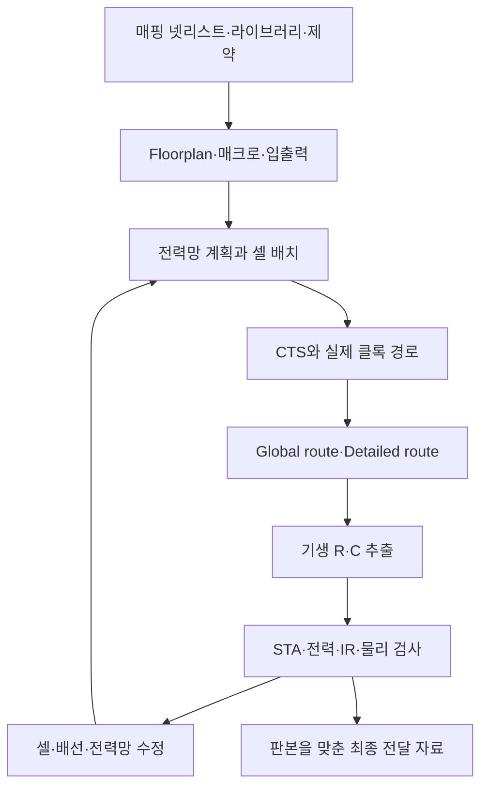
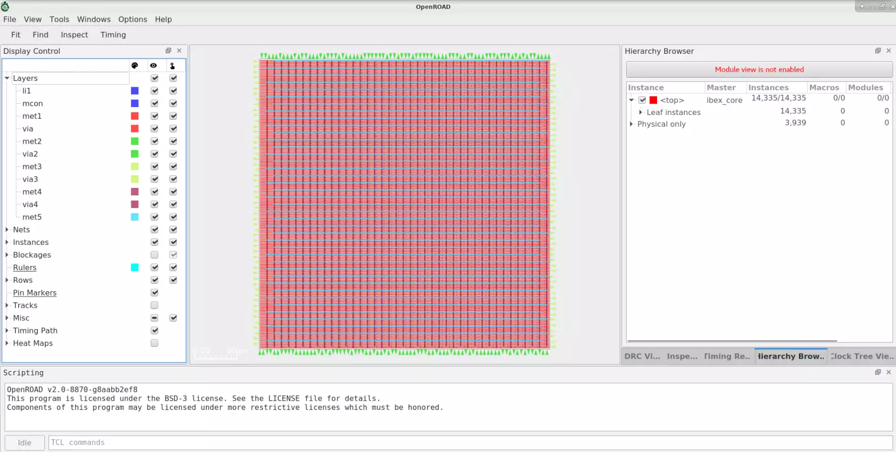
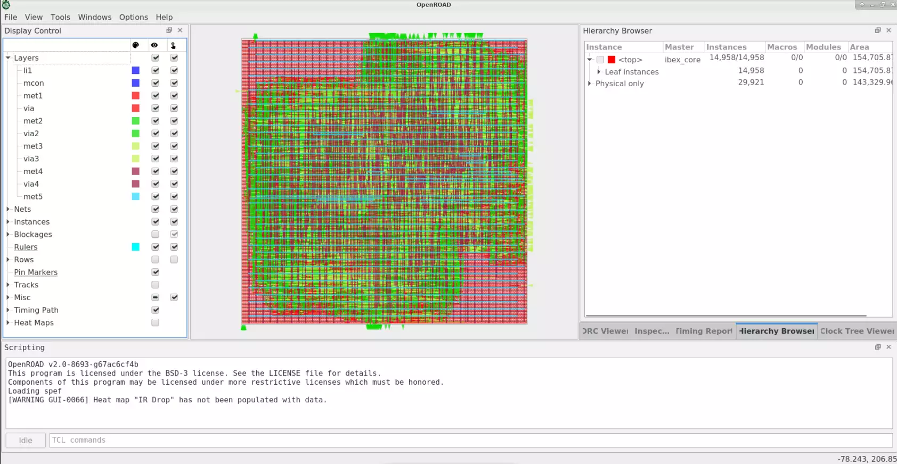

# 배치·배선·클록과 전력망 설계 / Physical implementation and power integrity

매핑 넷리스트는 셀의 연결을 설명하지만 셀이 놓일 좌표와 배선 경로까지 정하지는 않습니다. 물리 구현은 셀·메모리·입출력을 배치하고, 클록·전원·신호를 실제 배선층으로 연결하는 과정입니다. 타이밍·전력·면적은 이 과정에서 서로 영향을 줍니다. 공개 자료 확인일은 2026-10-26이며, 아래 산술은 특정 칩을 배치·배선하거나 측정한 결과가 아닙니다.

## 1. 입력 파일의 역할부터 나눕니다

| 입력 | 담는 정보 | 먼저 맞출 조건 |
|---|---|---|
| 매핑 넷리스트 | 사용할 셀·매크로 인스턴스와 논리 연결입니다. | top·셀 이름·버스 폭·전원 핀과 합성 판본을 맞춥니다. |
| 기술 LEF·셀 LEF | 배선층·via·배치 격자와 셀의 외형·핀·장애물 등입니다. | PDK·단위·핀 위치·셀 방향·허용 층을 맞춥니다. |
| Liberty `.lib` | 셀의 기능·타이밍·전력 특성입니다. | PVT·단위·타이밍 아크·사용 가능한 셀을 맞춥니다. |
| SDC·전원 의도 | 클록·입출력·예외·전원 영역 등의 요구입니다. | 모드와 영역 경계, isolation·level shifter 요구를 맞춥니다. |
| 메모리·IP 뷰 | 기능·타이밍·물리 외형과 최종 레이아웃입니다. | 기능 모델·LEF·GDS·라이브러리의 이름과 판본을 함께 맞춥니다. |
| RC 기술 자료 | 배선 형상과 주변 조건에서 R·C를 얻는 모델입니다. | 배선 코너·층·via와 추출 설정을 맞춥니다. |

LEF는 배치배선용 물리 추상 정보이며 GDS의 상세 도형 전체를 담지는 않습니다. 예를 들어 매크로의 외형은 보이지만 내부 트랜지스터가 모두 그려져 있지는 않을 수 있습니다. DEF는 인스턴스 위치·핀·배선 등 설계별 물리 정보를 전달하는 형식입니다. 도구의 내부 데이터베이스와 LEF·DEF·GDS의 역할을 구분합니다. [ORFS 튜토리얼의 입력과 결과 디렉터리 설명](https://openroad-flow-scripts.readthedocs.io/en/latest/tutorials/FlowTutorial.html)은 실제 공개 흐름에서 이 관계를 살펴볼 수 있는 자료입니다.



이 그림은 설명용 흐름입니다. 실제 도구에서는 전력망·배치·클록·최적화가 여러 차례 반복되며, 각 단계의 중간 결과도 검토합니다.

### OpenROAD의 실제 배치·배선 창



출처: OpenROAD contributors, [공식 README의 Ibex floorplan 원본](https://github.com/The-OpenROAD-Project/OpenROAD/blob/79eaac151c5b65925cc24226a8a116cfd2651f4a/docs/images/ibex_floorplan.webp). 왼쪽 `Display Control`은 표시할 배선층·인스턴스·핀 등을 고르는 곳이고, 중앙은 현재 설계의 물리 정보를 표시합니다. 오른쪽 `Hierarchy Browser`에서는 `ibex_core` 아래의 인스턴스를 살펴볼 수 있습니다. 이 캡처의 아래 콘솔에는 `v2.0-8870-gaaabb2ef8`이 표시되어 있습니다.



출처: OpenROAD contributors, [공식 README의 Ibex routing 원본](https://github.com/The-OpenROAD-Project/OpenROAD/blob/79eaac151c5b65925cc24226a8a116cfd2651f4a/docs/images/ibex_routing.webp). 중앙의 여러 색 선은 왼쪽 `Layers`에 표시된 금속층 등의 도형을 겹쳐 본 모습입니다. 금속층별 도형이 레이어 설정에 따라 다른 색으로 표시됩니다. 이 캡처는 `v2.0-8693-g67ac6cf4b`입니다. 두 이미지는 공식 README에 별도로 실린 예시이며, 각 화면의 판본과 표시 상태를 함께 읽습니다.

`Floorplan`에서는 외곽·매크로·핀·배치 영역을, 배선 단계에서는 실제 경로·층·혼잡을 관찰합니다. 화면이 채워진 모습과 타이밍·전원·DRC 보고서의 통과 여부는 각각 확인합니다. [원본·이용 조건](사진과화면_images/README.md)

## 2. Floorplan은 셀을 넣을 빈 사각형만 정하는 일이 아닙니다

Die는 잘라낼 칩의 전체 영역이고 core는 주로 논리 셀과 매크로를 배치하는 내부 영역입니다. Floorplan에서는 SRAM·아날로그 IP·입출력·전원 영역의 위치와 방향, 매크로 주변의 여유 공간, 배선 통로와 배치 금지 영역을 정합니다. 기능상 연결이 강한 두 블록을 멀리 놓으면 긴 배선과 반복 버퍼가 필요할 수 있습니다.

Utilization은 지정한 배치 가능 면적 중 셀이 차지하는 비율입니다. 도구가 매크로·차단 영역·여유 공간을 분모에서 어떻게 처리하는지 확인해야 같은 수치를 비교할 수 있습니다. 전체 die의 빈 면적 비율과 같은 값으로 가정하지 않습니다.

자체 예로 표준 셀 면적 합이 100,000 µm²이고, 이 셀에 할당한 배치 가능 면적의 목표 utilization을 60%로 잡겠습니다.

```math
A_{placeable}=\frac{100{,}000}{0.60}\approx166{,}667\ \mu m^2
```

정사각형이라면 한 변은 약 408.25 µm입니다. 이 계산은 매크로·입출력·전원·배선 여유까지 포함한 최종 die 크기 예측이 아닙니다. 셀 면적을 단순 합산한 하한과 실제 필요한 공간 사이의 차이를 보여 줍니다. 국소적으로 핀이 몰린 지역은 전체 utilization이 낮아도 혼잡할 수 있습니다.

Placement에서는 셀을 배치하면서 연결 길이와 타이밍·혼잡을 조절합니다. Legalization은 셀을 허용된 줄·격자·방향에 놓고 겹침을 없애는 단계입니다. 겹침이 없다는 결과만으로 모든 핀에 배선을 접근시킬 수 있다는 뜻은 아닙니다. 큰 매크로의 핀 방향, 좁은 통로와 국소 배선 수요를 함께 확인합니다.

## 3. CTS는 클록의 도착 시간을 물리적으로 만듭니다

CTS(clock-tree synthesis)는 클록 버퍼와 배선 구조를 만들어 여러 레지스터에 클록을 전달하는 작업입니다. Insertion delay는 클록이 지정한 시작점에서 도착점까지 전달되는 시간이고, skew는 비교하는 도착점 사이의 시간 차이입니다. 서로 다른 지표이므로 한 숫자로 합치지 않습니다.

합성·초기 배치의 ideal clock과 CTS 이후의 실제 전파 클록은 다릅니다. Capture 클록을 상대적으로 늦추면 어떤 setup 경로에는 여유가 생기지만 같은 관계의 hold에는 더 불리할 수 있습니다. [합성·타이밍 문서의 부호를 정한 식](08-합성과타이밍및DFT_synthesis-sta-dft.md#3-setup과-hold는-최대최소-지연을-각각-봅니다)과 함께 읽습니다. 클록 버퍼를 늘리면 부하 분산이 가능하지만 면적·동적 전력·배선 자원도 사용합니다.

[Cadence Innovus 데이터시트](https://www.cadence.com/en_US/home/resources/datasheets/innovus-implementation-system-ds.html)의 placement·clock concurrent optimization 설명은 실제 구현 도구가 클록과 데이터 경로를 함께 다루는 사례입니다. 공개 자료의 성능 배수나 우월성 표현을 자체 검증 결과로 옮기지 않습니다.

## 4. 배선 경로가 생기면 지연 모델도 달라집니다

Global routing은 필요한 연결을 대략 어느 통로와 층으로 보낼지 계획합니다. Detailed routing은 실제 배선·via 형상을 정하고 규칙을 만족시키는 연결을 만듭니다. Global route의 계획 성공과 최종 레이아웃의 DRC 통과는 같은 결과가 아닙니다.

배선의 저항은 단순한 균일 도체 모형에서 `R=ρL/(wt)`로 볼 수 있습니다. ρ는 비저항, L은 길이, w와 t는 폭과 두께입니다. 길이가 늘면 저항도 늘지만 실제 칩에는 층별 재료·단면·via 저항·주변 배선의 결합이 있습니다. 폭을 두 배로 넓히는 변경도 정전용량·간격·혼잡·가능한 경로를 함께 바꿉니다.

기생 성분은 회로 의도와 별개로 형상에서 생기는 저항·정전용량 등입니다. 배선에 연결한 집중 R·C 하나와 분포된 RC 망은 정확도가 다릅니다. 초기 배치 추정치, global route 추정치, 최종 배선에서 추출한 값의 결과를 같은 단계의 수치처럼 비교하지 않습니다.

[OpenROAD OpenRCX 문서](https://openroad.readthedocs.io/en/latest/main/src/rcx/README.html)는 배선·via의 저항, 대지·결합 정전용량과 코너별 추출 규칙을 설명합니다. 추출한 SPEF와 변경된 넷리스트의 신호 이름이 맞아야 후속 STA가 그 RC를 제대로 사용할 수 있습니다. 배선 수정 뒤 예전 SPEF를 읽으면 도구가 정상 종료해도 분석 대상은 최신 회로와 다를 수 있습니다.

## 5. 전력망은 전류가 돌아갈 경로까지 연결합니다

PDN(power distribution network)은 외부 전원에서 셀·매크로까지 공급과 귀환 경로를 제공하는 전력 배선망입니다. 전원 줄·stripe·ring·via·패드·범프와 매크로 전원 핀의 연결이 중요합니다. 전원망을 지나치게 넓히면 신호 배선 자원이 줄고, 너무 약하게 만들면 전압 강하와 전류 밀도 문제가 생길 수 있습니다. [OpenROAD PDN generator](https://openroad.readthedocs.io/en/latest/main/src/pdn/README.html)는 전력망 생성과 매크로·층별 연결을 다루는 공개 도구의 예입니다.

정적인 자체 예에서 공급 경로 저항을 0.12 Ω, 전류를 0.15 A라고 두면 다음과 같습니다.

```math
\Delta V=IR=0.15\times0.12=0.018\ \mathrm V
```

0.90 V 전원에 대해서는 2%이고, 그 단순 경로 끝의 전압은 0.882 V입니다. 여러 경로가 있는 실제 전력망의 최악 지점, 동시 스위칭에 따른 동적 전압 강하, 패키지의 유도성 영향을 계산한 값은 아닙니다.

IR drop 분석에는 전원 공급 위치·전압, 셀과 매크로의 전류 모델, 배치·배선과 모드가 필요합니다. 평균 소비전력만으로 순간적으로 어느 영역에서 전류가 몰리는지 알 수는 없습니다. [OpenROAD의 IR drop 문서](https://openroad.readthedocs.io/en/latest/main/src/psm/README.html)는 해당 모듈을 정적 분석기로 설명하고, 전압 강하·전류 밀도·연결되지 않은 전력 stripe 검사를 구분합니다. 이를 모든 동적 전원 무결성 검증으로 확대하지 않습니다.

EM(electromigration)은 전류에 의해 배선 재료가 이동하며 신뢰성이 달라지는 현상입니다. 전류 밀도의 단순 정의는 `J=I/A`이지만 합격 한계는 재료·층·via·온도·시간·파형과 요구 수명에 따라 달라집니다. 같은 총전류라도 좁은 via 한곳에 집중되면 넓은 전원선의 평균값과 다른 문제가 생깁니다. [Synopsys의 EM 설명](https://www.synopsys.com/glossary/what-is-electromigration.html)은 전류 밀도·온도·배선 폭과 via의 허용 조건을 연결합니다. 이 글에서는 실제 공정의 허용 전류를 추정하지 않습니다.

전압 강하를 줄이려는 배선 추가, 클록 전력, 신호 버퍼와 혼잡은 서로 연결됩니다. 소비전력을 줄이려고 작은 셀을 사용하면 지연이 늘 수 있고, 타이밍을 맞추려고 셀을 키우면 전력망 전류와 부하가 늘 수 있습니다. PPA 최적화는 세 숫자를 독립적으로 낮추는 작업이 아닙니다.

## 6. 중간 결과를 읽고 수정하는 순서

| 문제 | 위치·조건과 함께 확인할 내용 |
|---|---|
| 일부 지역만 심하게 혼잡합니다. | 매크로 핀·통로·배치 밀도·전원 stripe와 배선층 제한을 비교합니다. |
| CTS 뒤 hold가 악화됩니다. | launch·capture 클록 도착과 최소 데이터 경로를 확인합니다. |
| 배선 뒤 setup이 악화됩니다. | 추출 RC·우회 경로·fanout·slew·결합 조건을 비교합니다. |
| 전원망 일부가 연결되지 않습니다. | 전원 net 이름·핀·via·매크로 방향과 공급 위치를 확인합니다. |
| IR은 작지만 전류 밀도가 큽니다. | 전류가 집중된 가지·via와 해당 신뢰성 규칙을 확인합니다. |
| 레이아웃 변경 뒤 보고서가 좋아집니다. | 같은 넷리스트·제약·RC·코너를 읽었는지부터 확인합니다. |

ECO(engineering change order)는 이미 진행한 설계를 제한된 범위에서 바꾸는 작업입니다. 셀이나 배선을 조금만 바꾸어도 연결·타이밍·전원·물리 규칙 검사가 다시 필요할 수 있습니다. 변경 부위만 보면 영향이 작아 보여도 클록·공통 전원·긴 연결을 통해 다른 영역에 영향을 줄 수 있습니다.

## 7. 도구와 최종 전달 범위

[Synopsys IC Compiler II의 공개 설명](https://www.synopsys.com/implementation-and-signoff/physical-implementation/ic-compiler.html)은 설계 계획·배치·CTS·배선·마무리 분석을 물리 구현의 대상으로 제시합니다. Cadence Innovus와 OpenROAD도 관련 단계를 다루지만 지원 공정·라이브러리·해석·인증 범위는 각 도구·판본과 PDK에 따라 확인해야 합니다. 이 글은 상용 명령이나 공정별 설정을 추측해 제공하지 않습니다.

최종 전달에는 변경된 넷리스트·물리 데이터베이스·DEF·레이아웃, 사용한 SDC·라이브러리·RC 자료, 모드·코너별 타이밍과 전력 분석, 적용한 ECO와 모델 판본을 연결합니다. 파일 이름만 같아도 내용이 다를 수 있으므로 체크섬과 생성 시점을 남깁니다. 마지막으로 전달할 GDS/OASIS와 실제 검사한 파일이 같은지 확인하는 과정은 [DRC·LVS·PEX](10-DRC와LVS및PEX_physical-verification.md)에서 이어집니다.

[RTL·검증·모델](07-Verilog와SystemVerilog의연결_rtl-verification-ams.md) · [합성·타이밍·DFT](08-합성과타이밍및DFT_synthesis-sta-dft.md) · [반도체 설계 목차](README.md)
