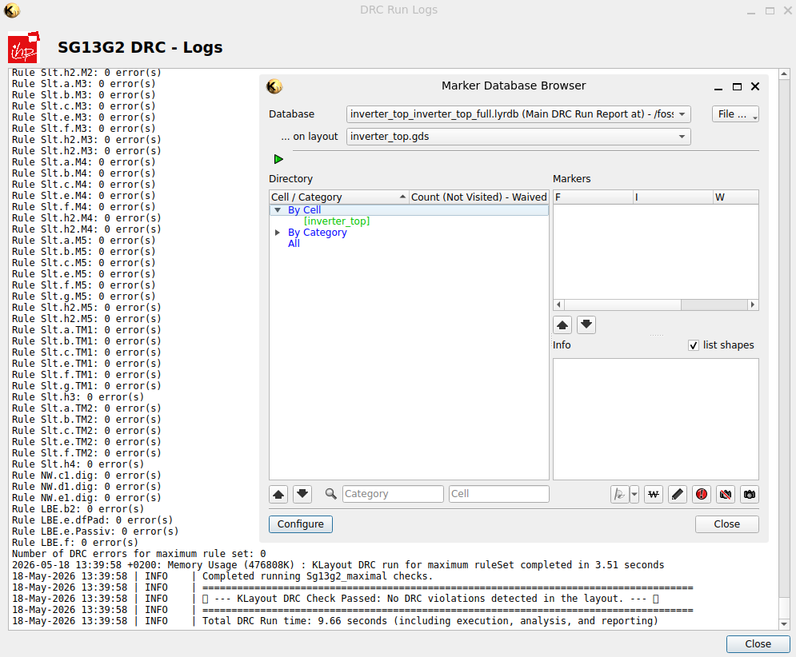
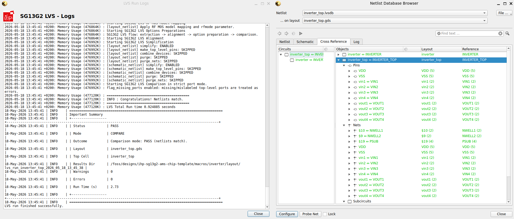

# DRC·LVS·PEX와 제조 데이터의 확인 / Geometry, connectivity and parasitic extraction

레이아웃이 화면에 그려지고 GDS 파일이 저장되어도 설계 검사가 끝난 것은 아닙니다. DRC는 형상 규칙을, LVS는 회로 연결과 소자 대응을, PEX는 형상에서 생기는 기생 성분을 다룹니다. 세 작업의 입력·규칙·비교 대상을 함께 알아야 통과 보고서의 의미를 읽을 수 있습니다. 공개 자료 확인일은 2026-10-26입니다. 본문의 산술·코드 예는 실제 PDK의 승인 규칙이나 제작·측정 결과가 아닙니다. 공개 튜토리얼의 검사 화면은 출처에 기록된 결과로 따로 설명합니다.

## 1. 서로 다른 세 질문

| 작업 | 묻는 내용 | 주된 입력과 출력 |
|---|---|---|
| DRC, design rule checking | 그린 형상이 지정한 제조·레이아웃 규칙을 지키는지 확인합니다. | 레이아웃·layer map·rule deck에서 위반 위치·규칙 보고서를 얻습니다. |
| LVS, layout versus schematic | 레이아웃에서 읽은 회로가 기준 회로와 맞는지 비교합니다. | 레이아웃 추출 회로·기준 넷리스트·소자 대응 규칙에서 연결·소자 차이를 얻습니다. |
| PEX, parasitic extraction | 배선·소자 주변 형상이 어떤 기생 R·C를 만드는지 추출합니다. | 레이아웃·기술 모델·코너에서 RC 망이나 기생 성분을 포함한 넷리스트를 얻습니다. |

폭과 간격이 맞는 두 금속선을 잘못 연결했다면 연결 문제는 남을 수 있습니다. 연결이 맞는 회로라도 긴 배선 때문에 시간을 못 지킬 수 있습니다. 따라서 DRC 통과, LVS 일치, 추출 이후의 타이밍·회로 성능 만족을 같은 결과로 쓰지 않습니다.

Rule deck은 도구가 실행할 검사 규칙과 설정의 묶음입니다. 문서로 된 설계 규칙과 실행 가능한 deck의 판본, 적용 공정 옵션이 맞는지 확인합니다. 규칙이 아예 실행되지 않거나 검사 대상 층이 비어 있을 때도 위반 수가 0일 수 있습니다.

## 2. DRC의 폭·간격 예를 읽습니다

아래 코드는 [KLayout 공식 DRC Basics의 금속층 예](https://www.klayout.de/doc/manual/drc_basic.html)에서 layer/datatype와 임계값을 유지하고, 보고서 문구·범주명과 줄별 설명을 바꾼 학습용 발췌입니다. 공식 예의 숫자는 대상 PDK의 금속 규칙이 아닙니다. 이 글에서는 스크립트를 실행하지 않았습니다.

```ruby
report("폭과 간격의 학습 예")                 # report는 검사 결과를 보낼 보고서 데이터베이스를 지정합니다.
metal1 = input(17, 0)                        # input은 GDS layer 17, datatype 0의 형상을 읽습니다.
metal1.width(0.7).output("width", "폭 위반")   # width는 0.7 µm보다 좁은 형상의 위반을 보고합니다.
metal1.space(0.4).output("space", "간격 위반") # space는 0.4 µm 기준의 간격 위반을 보고합니다.
```

자체 형상에서 폭 0.8 µm인 선 두 개가 0.35 µm 간격으로 나란히 있다면 위 두 단순 조건에서는 폭은 기준 이상이고 간격은 기준보다 0.05 µm 작습니다. 면적·끝점·via·겹침·둘러쌈 같은 다른 조건은 검사하지 않은 예입니다. 한 규칙의 결과를 전체 레이아웃 적합성으로 확대하지 않습니다.

검출 위치를 고칠 때에는 마커가 가리킨 형상과 실제 검사 규칙을 함께 봅니다. 간격을 벌리면 다른 선과 가까워질 수 있고, 폭을 넓히면 핀 주변의 공간이 줄어들 수 있습니다. 단순히 마커를 숨기는 것과 형상을 고치는 것은 다른 작업입니다.

### 실제 KLayout DRC 결과 창



출처: Simon Dorrer·Harald Pretl, [공개 인버터 튜토리얼의 DRC 원본 화면](https://github.com/iic-jku/ihp-sg13g2-ams-chip-template/blob/b1d4a98d0ec8ad71c57f8ec4c33344340f911dad/tutorial/fig/inverter_top/KLayout_DRC_Output.png). 뒤쪽 로그에는 실행한 규칙과 결과가, 앞쪽 `Marker Database Browser`에는 검사한 셀과 마커 목록이 나타납니다. 공개 캡처에는 `inverter_top.gds`와 2026-05-18의 오류 0건·DRC 통과 기록이 보입니다. 해당 튜토리얼에서 공개한 검사 기록입니다. [같은 예제의 실제 레이아웃](14-아날로그풀커스텀레이아웃_full-custom-layout.md) · [원본·이용 조건](사진과화면_images/README.md)

## 3. LVS는 그림을 회로로 읽은 뒤 비교합니다

먼저 도체층·접촉·via의 연결을 해석하고, 겹친 영역에서 트랜지스터·저항·정전용량 등 소자를 인식합니다. 그 결과의 단자와 연결을 기준 회로의 net·pin·device와 대응시킵니다. [KLayout LVS Overview](https://www.klayout.de/doc/manual/lvs_overview.html)는 레이아웃에서 넷리스트를 추출하고 기준 넷리스트와 비교하는 구조를 설명합니다.

Net은 같은 전기적 연결에 속하는 단자들의 묶음입니다. 같은 이름의 글자가 보인다는 것과 도체가 실제로 이어져 있다는 것은 다릅니다. 반대로 도체가 하나로 붙었는데 서로 다른 이름이 붙었다면 short나 명명 충돌을 조사해야 합니다. 기준 넷리스트가 틀렸거나 이전 판본이라면 ‘일치’도 잘못된 기준에 대한 결과가 됩니다.

| 차이 | 먼저 확인할 내용 |
|---|---|
| Short | 서로 다른 net이 금속·via·전원 처리 때문에 합쳐졌는지 확인합니다. |
| Open | 이어져야 할 핀과 배선 사이에 접촉·via·층 연결이 빠졌는지 확인합니다. |
| 소자 수 차이 | 소자 인식층·모델명·병렬 병합·계층·실제 누락을 구분합니다. |
| 소자 매개변수 차이 | 폭·길이·배율·단위와 허용 오차·축약 규칙을 확인합니다. |
| 포트·계층 차이 | top cell, 핀 순서·이름, 공급 net과 hierarchy 대응을 확인합니다. |

Black box 처리는 내부 회로를 비교하지 않고 외부 단자 수준으로 다루는 선택입니다. 예를 들어 큰 SRAM을 별도 검증한 IP로 연결할 수 있지만, black box 내부가 이 실행에서 검증되었다고 쓸 수는 없습니다. 제외 범위, 별도 확인한 판본과 외부 연결을 남겨야 합니다.

[Netgen 공식 저장소](https://github.com/RTimothyEdwards/netgen)는 넷리스트 비교와 계층·소자 속성 처리를 설명합니다. Netgen이 레이아웃 그림에서 모든 소자를 직접 읽는 도구라고 생각하지 않습니다. Magic 등 추출 도구가 만든 회로와 기준 회로, 공정별 비교 설정을 연결해 사용하는 흐름에서 각 단계의 역할을 구분합니다.

### 실제 KLayout LVS 비교 창



출처: Simon Dorrer·Harald Pretl, [LVS 원본 화면](https://github.com/iic-jku/ihp-sg13g2-ams-chip-template/blob/b1d4a98d0ec8ad71c57f8ec4c33344340f911dad/tutorial/fig/inverter_top/KLayout_LVS_Output.png). 왼쪽에는 `Status PASS`와 `Netlists match`가, 오른쪽에는 `Layout`·`Reference` 사이의 회로·핀 대응이 보입니다. `VDD`, `VSS`, `vin1`~`vin4`, `vout1`~`vout4`가 어떻게 대응하는지 살펴보시면 됩니다. 기준 회로와 추출 회로를 비교하는 창이므로, 앞의 DRC 마커 창과 읽는 대상이 다릅니다. 이 역시 2026-05-18로 표시된 튜토리얼 원본 기록입니다. [원본·이용 조건](사진과화면_images/README.md)

## 4. PEX 결과를 회로·타이밍에 다시 연결합니다

PEX는 원래 회로도에 직접 그리지 않았던 배선 저항과 대지·결합 정전용량 등을 모델에 넣는 작업입니다. 아날로그·혼합 신호에서는 추출 회로로 SPICE 해석을 다시 하고, 디지털에서는 SPEF 등으로 전달한 기생 정보를 STA·전력·신호 무결성 분석에 연결할 수 있습니다. 출력 형식과 포함하는 소자·기생 성분은 추출 도구·설정·코너에 따라 확인합니다.

자체 한 단 저역통과 모형에서 R=1 kΩ, C=20 fF이면 시정수는 다음과 같습니다.

```math
\tau=RC=1000\times20\times10^{-15}=20\ \mathrm{ps}
```

이 한 단 회로의 이상적인 계단 응답이 최종값의 50%에 도달하는 시간은 `ln(2)RC≈13.86 ps`입니다. 실제 칩의 분포 RC·드라이버 비선형·결합 잡음과 다단 경로 전체를 이 숫자로 대신하지 않습니다. 같은 연결을 가진 회로라도 기생 성분과 부하가 바뀌면 파형·지연·안정성이 달라질 수 있음을 보이는 예입니다.

[OpenRCX 문서의 추출 규칙·SPEF 설명](https://openroad.readthedocs.io/en/latest/main/src/rcx/README.html)은 저항·대지 정전용량·결합 정전용량과 코너를 구별합니다. [Magic의 `extract` 공식 참조](https://github.com/RTimothyEdwards/magic/blob/master/doc/html/extract.html)는 기본 추출과 저항의 근사·상세 추출 설정을 나눕니다. `extract`라는 이름만 보고 언제나 같은 수준의 전체 RC 망이 만들어진다고 가정하지 않습니다.

추출 뒤에는 미연결·미주석 net 수, 이름 대응, 단위, 사용한 RC 코너와 제외한 작은 기생 성분을 확인합니다. 넷리스트·레이아웃·SPEF가 서로 다른 변경판이면 계산은 수행되어도 원하는 설계의 결과가 아닐 수 있습니다.

## 5. 안테나·ERC·밀도·DFM을 구분합니다

안테나 검사는 제조 중 특정 공정 단계에서 도체에 모인 전하가 게이트 절연막 등에 주는 위험을 다룹니다. 완성된 회로에서 보이는 긴 금속 면적만으로 단일 보편 임계값을 만들지 않습니다. 어떤 층·단계·연결을 계산하고 어떤 보호 구조를 허용하는지는 공정 규칙에 따릅니다. [OpenROAD Antenna Rule Checker](https://openroad.readthedocs.io/en/latest/main/src/ant/README.html)는 배선에서 안테나 위반을 확인하는 공개 도구의 예입니다.

ERC(electrical rule checking)는 부유 단자·전원 관계·well 연결·전압 영역 등 정한 전기 규칙을 검사합니다. 그 범위는 deck과 흐름에 따라 달라집니다. LVS가 일치한다는 결과만으로 모든 전기적 안전 조건이 검사되었다고 보지 않습니다.

밀도 검사는 지정한 창 안에 금속 등 형상이 어느 비율로 들어 있는지 봅니다. Dummy fill을 넣어 밀도를 맞추면 주변 정전용량도 달라질 수 있으므로 필요한 추출·타이밍·아날로그 해석을 다시 연결합니다. DFM(design for manufacturability)은 제조 변동·공정 민감도와 수율을 고려한 설계 검토입니다. DRC 위반이 없다는 사실과 모든 제조 변동에서 높은 수율이 보장된다는 주장은 다릅니다.

[Siemens의 Calibre nmDRC/nmLVS 공식 교육 개요](https://training.plm.automation.siemens.com/ilt/iltdescription.cfm?pID=239705-US_____EDA__2024.2_1201)는 DRC·LVS·ERC, short·open·부유 net·소자·명명 문제를 구분합니다. 이는 공개된 역할 설명의 근거이며, 해당 교육을 이수하거나 상용 도구를 실행한 기록은 아닙니다. Magic·Netgen·KLayout의 공개 기능이 어떤 공정의 승인된 상용 signoff 흐름과 자동으로 같아지는 것도 아닙니다.

## 6. Waiver는 검사 결과를 지우는 버튼과 다릅니다

Waiver는 특정 위반에 예외를 인정하는 기록입니다. 예외를 저장하거나 마커를 숨기는 도구 기능과, 그 예외를 제조·품질 기준에서 받아들일 권한은 구분해야 합니다. 실제 적용에서는 위반 규칙·좌표·셀·발생 이유·영향, 사용한 레이아웃·deck 판본, 검토자와 해당 프로젝트·공정에서 요구하는 승인 주체를 연결합니다. 공정 제공자의 승인 대상인지 설계 내부의 판단 대상인지도 확인합니다.

다른 칩에서 인정된 예외를 이름만 복사해 쓰거나, 레이아웃을 바꾼 뒤 이전 예외가 계속 유효하다고 가정하지 않습니다. [KLayout의 DRC waiving 설명](https://www.klayout.de/doc/manual/drc_basic.html)처럼 도구가 제공하는 처리 절차를 읽더라도 최종 수용 기준은 해당 제조 흐름의 요구와 맞춰야 합니다.

## 7. GDS/OASIS 전달에서 함께 확인할 것

GDSII와 OASIS는 레이아웃 형상·셀 계층 등을 전달하는 형식입니다. [KLayout의 저장 문서](https://www.klayout.org/downloads/master/doc-qt5/manual/save.html)는 전체 레이아웃·선택한 셀과 층, database unit·스케일을 구별합니다. 저장이 성공했다는 사실만으로 모든 층과 하위 셀이 의도대로 포함되었다고 단정하지 않습니다.

| 확인 대상 | 실제로 맞출 내용 |
|---|---|
| Top cell·hierarchy | 최상위 셀과 필요한 하위 셀·매크로가 포함되고 참조가 해결되는지 확인합니다. |
| 단위·격자·좌표 | database unit, 실제 길이와 변환 배율·격자가 맞는지 확인합니다. |
| Layer map | layer/datatype 번호가 공정의 어떤 층과 목적에 해당하는지 맞춥니다. |
| 기준 회로·전원 | 비교한 넷리스트, 핀·net·모델과 전원 이름을 맞춥니다. |
| 검사 조건 | PDK·deck·추출 코너·도구 판본과 제외·예외 범위를 연결합니다. |
| 파일 동일성 | 최종 스트림과 실제 검사한 파일의 체크섬·생성 시점을 연결합니다. |

자체 단위 예로 database unit이 0.001 µm이면 정수 좌표 차이 1000은 1 µm입니다. 같은 정수 1000을 1 µm 단위로 해석하면 1000 µm가 되어 길이가 1000배 달라집니다. 도형이 화면에 보인다는 사실보다 좌표와 단위가 무엇인지가 중요합니다.

잘못된 top이나 layer map으로 빈 영역만 검사했다면 ‘오류 0개’도 유효한 결과가 아닙니다. 최종 파일에는 필요한 매크로의 상세 뷰·seal ring·fill·칩 경계 등 해당 전달 규약이 요구하는 내용이 포함되어야 하며, 무엇을 어느 단계에서 병합하는지 확인합니다.

검사된 제조 데이터의 전달은 칩이 이미 제작·패키징·시험되었다는 뜻이 아닙니다. 제조 접수, 마스크·공정 처리, 웨이퍼 시험과 패키지·제품 검증은 후속 단계입니다. 이 문서의 예제와 공개 도구 설명을 실제 tapeout 승인이나 제작 성과로 표시하지 않습니다.

[RTL·검증·모델](07-Verilog와SystemVerilog의연결_rtl-verification-ams.md) · [합성·STA·DFT](08-합성과타이밍및DFT_synthesis-sta-dft.md) · [배치·배선·전력](09-배치배선과전력설계_physical-implementation.md) · [반도체 설계 목차](README.md)
