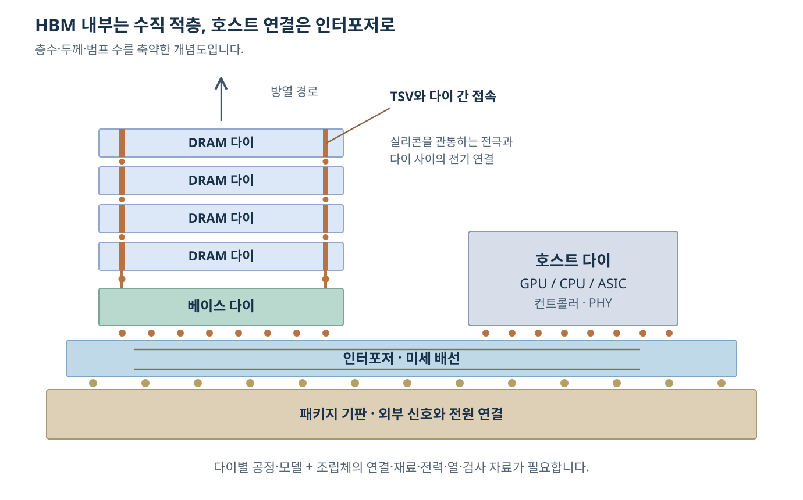
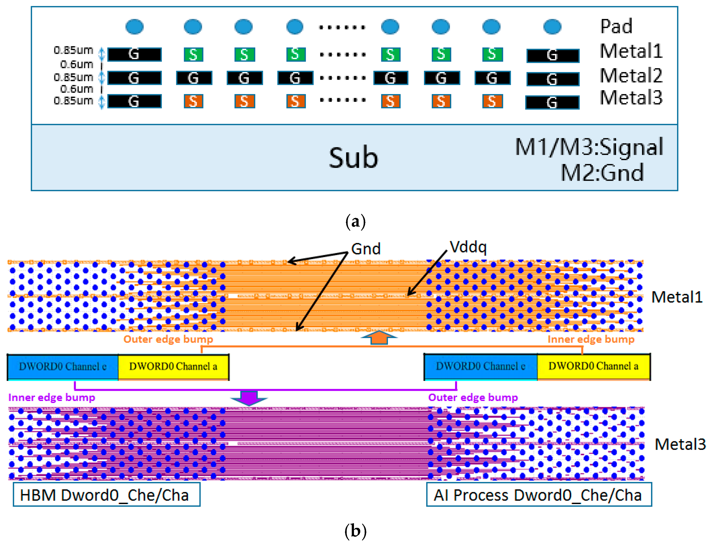
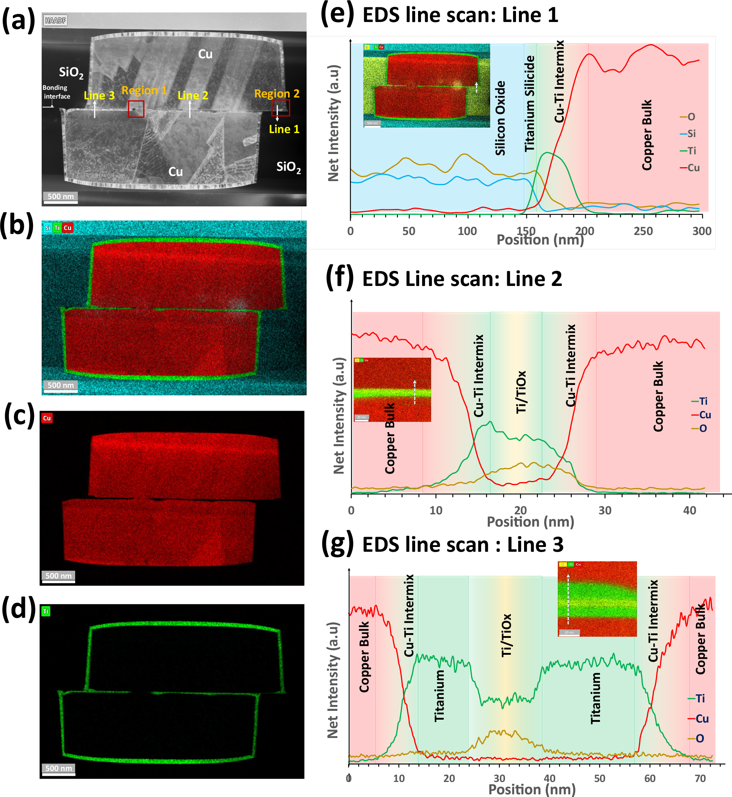
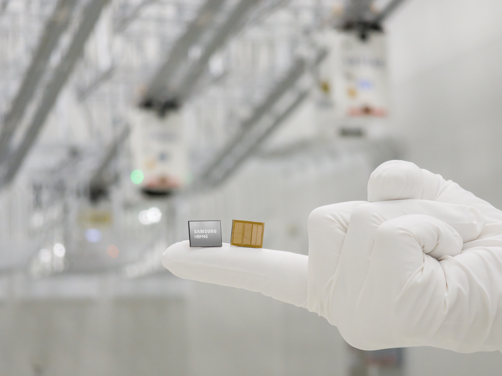
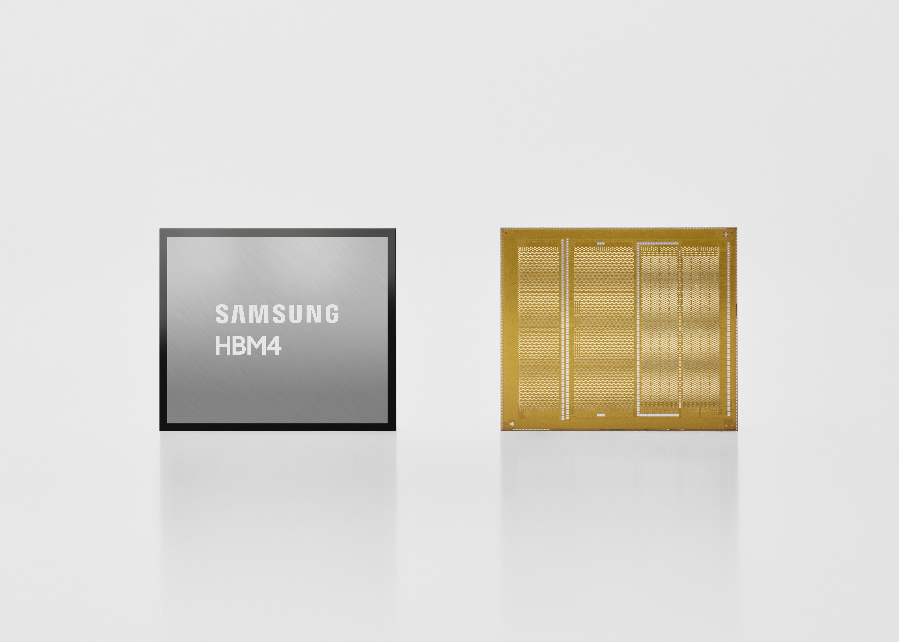
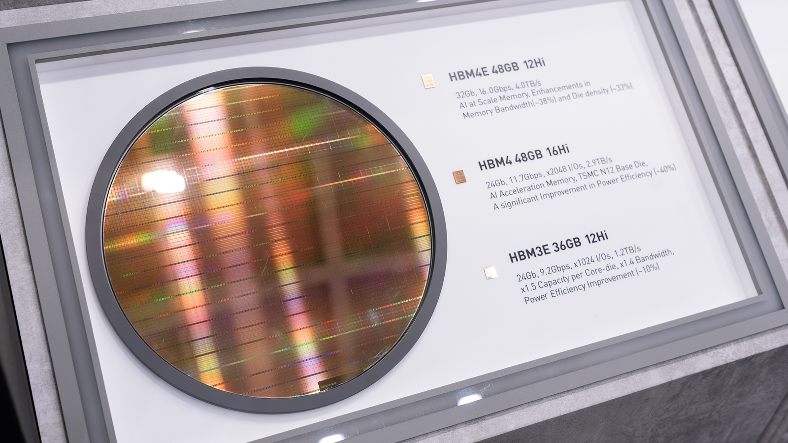
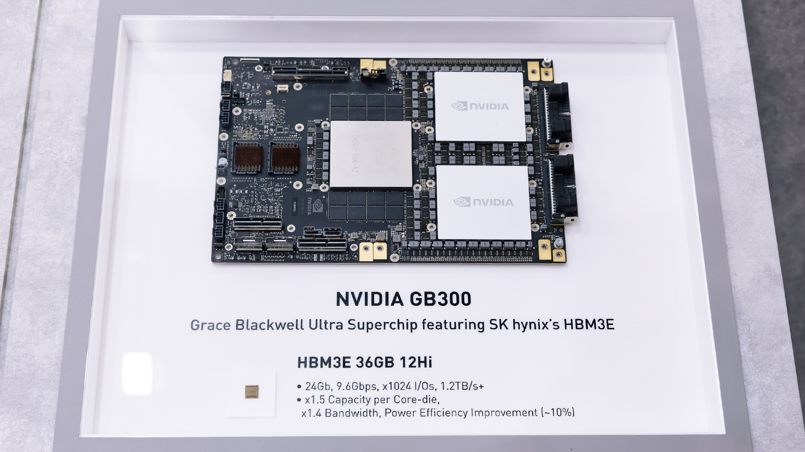
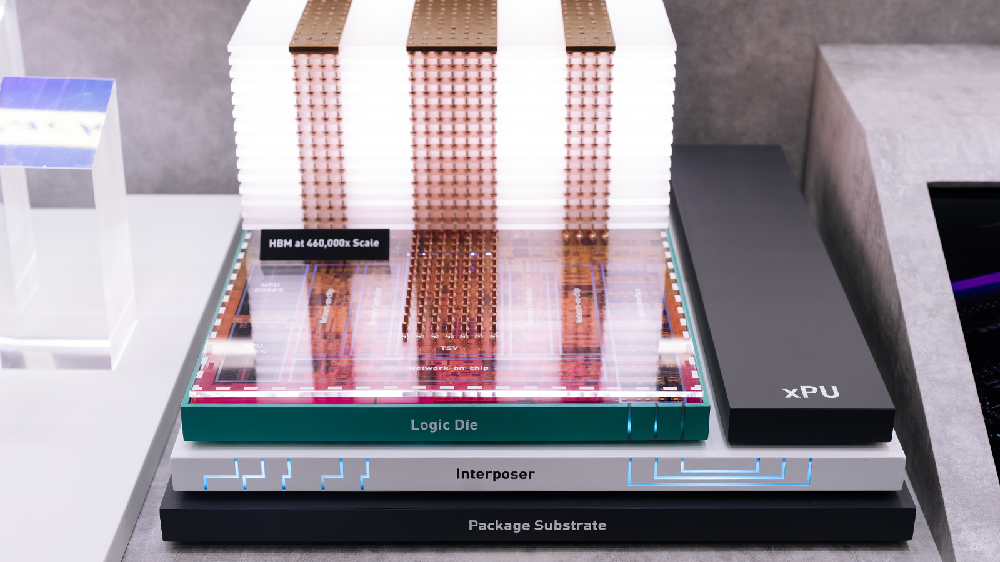

# HBM과 2.5D·3D 집적 설계 | HBM and multi-die integration

[설계 목차](README.md) · [DRAM](06-DRAM셀과주변회로_dram-design.md) · [배치배선](09-배치배선과전력설계_physical-implementation.md) · [최종 인계](13-최종파일과제조인계_tapeout-deliverables.md)

## HBM에서 설계 대상이 늘어나는 이유

HBM은 여러 DRAM 다이를 수직으로 연결하여 넓은 데이터 경로를 구성하는 메모리입니다. [Micron의 HBM 소개 중 구조 설명](https://www.micron.com/products/memory/hbm)은 DRAM 적층과 TSV·미세 접속을 설명합니다. TSV는 실리콘을 관통하는 전극입니다. 미세 접속은 위아래 다이의 대응하는 지점을 전기적으로 연결합니다. 메모리 셀의 설계와 이 접속의 설계는 서로 연결되지만 다른 작업입니다.

직접 작성한 구조 개념도입니다. 층수·두께·범프 수·배선 비율은 설명을 위해 축약했습니다. 일반적인 인터포저 기반 배치의 예이며, 특정 제품의 설계도는 아닙니다. HBM 내부가 3D 적층이어도 호스트와 HBM을 옆으로 배치한 조립체는 2.5D로 분류할 수 있습니다. [TSMC 3DFabric의 HPC 설명과 공식 구조 그림](https://www.tsmc.com/english/dedicatedFoundry/technology/platform_HPC_tech_WLSI)은 SoIC의 다이 적층과 CoWoS의 인터포저 통합을 나누어 보여 줍니다.

## 범프 배열과 실제 인터포저 배선

Wen-Xue Tang 등의 [2025년 HBM 인터포저 연결 연구](https://www.mdpi.com/2072-666X/16/8/896), Figure 3입니다. © 2025 저자들, [CC BY 4.0](https://creativecommons.org/licenses/by/4.0/). 위쪽 단면과 아래쪽 금속 배선 설계를 함께 봅니다. Metal1·Metal3 신호 경로와 Metal2 접지층이 구분됩니다. 이는 논문의 연구 배선 구조이며 상용 HBM4 코어 다이 전체의 마스크는 아닙니다. [회로·레이아웃 본문](18-실제회로와레이아웃읽기_circuit-layout-walkthrough.md)에서 범프·배선·층의 관계를 더 자세히 읽습니다.

## 실제 접합면의 구조와 원소 분석

Cheemalamarri 외, A*STAR, [Communications Engineering 5, 104, 2026, Figure 4](https://doi.org/10.1038/s44172-026-00649-w)입니다. © 2026 저자, [CC BY-NC-ND 4.0](https://creativecommons.org/licenses/by-nc-nd/4.0/). 비상업적 이용을 위해 원본 전체 그림을 변경 없이 실었습니다. 실제 구리 접점과 접합 계면의 연구 시료이며 상용 HBM 제품의 단면은 아닙니다. [단면·원소 지도·위치별 신호의 해석](19-칩전체구조와동작특성_chip-structure-and-characteristics.md)에서 설계상의 다이 간 연결과 실제 접합 구조를 이어 봅니다.

## 최근 HBM 제품과 실제 사용 형태

2026-10-26에 확인한 최근 공개 자료입니다. 제품·샘플·전시품은 각 자료의 발표 상태에 따라 구분합니다.

### 2026년 HBM4E 샘플

출처: 삼성전자 뉴스룸, [2026-05-29 HBM4E 12단 샘플 공급 발표](https://news.samsung.com/kr/삼성전자-세계-최초-hbm4e-12단-샘플-출하). 장갑과 비교해 스택 제품의 크기를 보고, 표시 면과 금색 접속면의 차이를 살펴봅니다. 원문은 12단·48 GB 샘플과 1c DRAM·4 nm 로직 다이를 설명합니다. 제품 외관에서 셀 배열·TSV·층 경계를 직접 판독하는 대신, 아래 적층 설명과 공정 자료로 연결합니다.

### HBM4의 외관과 접속면

출처: 삼성전자 뉴스룸, [2026-02-12 HBM4 양산 출하 발표](https://news.samsung.com/kr/삼성전자-세계-최초-업계-최고-성능의-hbm4-양산-출하). 금색 면에 모여 있는 접속 영역을 보면, 넓은 인터페이스와 전원·접지 접속을 받아 줄 호스트·인터포저 배치가 필요한 이유를 생각할 수 있습니다. 보이는 접점 무늬를 저장 셀의 배열로 읽지는 않습니다. 원문이 밝힌 HBM4 상업 출하와 위의 HBM4E 샘플 공급은 서로 다른 상태입니다.

### 여러 세대를 한 전시판에서 비교하기

출처: SK하이닉스 뉴스룸, [2026-06-02 COMPUTEX 전시](https://news.skhynix.co.kr/computex-2026/). 왼쪽 웨이퍼와 오른쪽 개별 스택을 구분하고, 표시판의 코어 다이 용량·적층수·전체 용량을 함께 봅니다. 전시 라벨에는 HBM3E `24 Gb·12Hi·36 GB`, HBM4 `24 Gb·16Hi·48 GB`, HBM4E `32 Gb·12Hi·48 GB`가 적혀 있습니다. 라벨 기준의 산술은 `24 Gb × 16 ÷ 8 = 48 GB`, `32 Gb × 12 ÷ 8 = 48 GB`로, 같은 총용량도 다이 용량과 적층수의 조합이 다를 수 있습니다. 전시품의 구성을 읽는 비교이며 16단 제품의 양산 출하 여부는 별도 발표로 확인합니다.

### HBM이 연결되는 실제 가속기 모듈

출처: SK하이닉스 뉴스룸, [같은 공식 전시 기사](https://news.skhynix.co.kr/computex-2026/). 큰 보드 위의 조립체와 아래쪽에 따로 놓인 HBM3E 부품을 비교합니다. 메모리 스택, 가속기 패키지와 보드는 서로 다른 크기·연결 수준입니다. 사진에서는 금속 덮개가 있는 실제 조립 상태를 보며, 인터포저 내부 배치는 앞의 구조 개념도와 이어 읽습니다. [사진·화면의 원본과 이용 조건](사진과화면_images/메모리_memory/README.md)

## 서로 다른 다이와 회로의 역할

| 구성 | 설계하는 내용 | 연결할 자료 |
| --- | --- | --- |
| DRAM 코어 다이 | 저장 셀·배열·행/열 선택·센스 앰프·복원·검사 | DRAM 공정 모델·규칙·배열과 타이밍 자료 |
| 베이스 다이 | 제품에 따라 인터페이스·배선·제어·검사 등의 기능 | 해당 다이의 PDK·RTL·회로·범프와 연결 자료 |
| 호스트의 메모리 컨트롤러 | 명령 순서·대기 시간·주소 매핑·스케줄링 | 해당 HBM 규격·동작 모델·검증 IP |
| 호스트 PHY | 논리 신호와 실제 입출력 전기 신호의 연결 | I/O 모델·타이밍·훈련 절차·물리 배치 조건 |
| 인터포저·브리지·기판 | 다이 사이와 외부 전원의 실제 연결 | 패키지 기술 파일·재료·층 구조·범프 맵 |

베이스 다이가 있다는 이유만으로 호스트의 메모리 컨트롤러 전체가 그곳으로 이동했다고 해석하지 않습니다. 기능의 배분은 제품 구조와 IP에 따라 확인합니다. HBM 인터페이스와 UCIe도 서로 다른 규격입니다. 3D 설계 도구가 두 인터페이스를 모두 지원한다고 해서 같은 포트나 검증 모델을 쓰는 것은 아닙니다.

공정도 하나로 고정되지 않습니다. 예를 들어 삼성전자는 [2026-02-12 HBM4 발표](https://news.samsung.com/global/samsung-ships-industry-first-commercial-hbm4-with-ultimate-performance-for-ai-computing)에서 1c DRAM과 4nm 로직 베이스 다이를 구분했습니다. 이는 해당 제품에 대한 제조사의 발표입니다. 모든 HBM 세대가 같은 공정 조합을 사용한다는 뜻이 아닙니다. 설계 시에는 각 다이에 맞는 PDK·소자·라이브러리와 접합 구조를 연결합니다.

### 전시 모형에서 보는 적층 연결

출처: SK하이닉스 뉴스룸, [COMPUTEX 2026 공식 기사](https://news.skhynix.co.kr/computex-2026/). 사진 속 대상은 `460,000x Scale`이라고 표시된 확대 전시 모형입니다. 위쪽의 메모리 층에서 `TSV`를 거쳐 `Logic Die`, `Interposer`, `Package Substrate`로 내려가는 관계와 옆의 `XPU`를 봅니다. 이는 실물 제품 사진에서 보이지 않는 연결 관계를 설명하는 모형이며, 절단 단면이나 실제 마스크 레이아웃과는 구분합니다. 모형에 표시된 NPU·Network-on-chip 명칭도 개별 HBM 제품의 확정된 내부 회로도로 확대 해석하지 않습니다.

## 설계는 적층 구조를 정하는 단계에서 시작합니다

1. 필요한 용량·대역폭·전력·온도·패키지 크기를 정합니다.
2. 어떤 기능을 어느 다이에 둘지 결정하고 다이 크기·방향·접합 면을 정의합니다.
3. 신호·전원·접지·검사 접속의 위치와 개수를 배분합니다.
4. 초기 전력 지도와 열 경로를 분석하여 뜨거운 블록·전원 공급·검사 접근이 가능한지 확인합니다.
5. 각 다이의 회로·RTL·물리 설계를 진행하며 조립체의 배선과 분석을 반복합니다.
6. 다이 자체와 다이 사이의 연결을 모두 검사한 뒤 다이별 제조 데이터와 조립 데이터를 인계합니다.

3D 전용 도구의 역할은 여러 도구에서 나온 자료를 이 순서로 함께 다루는 것입니다. [Cadence Integrity 3D-IC 자료](https://www.cadence.com/en_US/home/resources/datasheets/integrity-3d-ic-platform-ds.html)의 Flow Manager·Multi-Die STA·Inter-Die Connectivity 절은 초기 분석, 다이 간 타이밍과 접속 검사를 설명합니다. [Synopsys 3DIC Compiler 공식 소개](https://www.synopsys.com/implementation-and-signoff/3dic-design.html)는 다이 분할·시제품 배치·배선과 열·전력·신호·응력 분석의 연계를 설명합니다. 이는 공급사가 설명한 기능 범위이며, 두 제품의 성능을 직접 비교한 결과는 아닙니다.

### 상용 3D 설계 도구의 공식 화면

| 공식 자료의 위치 | 화면에서 살펴볼 내용 |
| --- | --- |
| [Synopsys Multi-die Signoff 백서, PDF 5페이지 Figure 6](https://www.synopsys.com/content/dam/synopsys/resources/multi-die/multi-die-signoff-wp.pdf#page=5) | 다이 간 연결·정렬 오류를 DRC/LVS 관점에서 확인하는 화면입니다. |
| [Cadence Integrity 3D-IC 자료, PDF 1페이지 Figure 1·4페이지 Figure 7](https://www.cadence.com/content/dam/cadence-www/global/en_US/documents/tools/digital-design-signoff/Integrity-3D-IC-DS-v1.pdf) | 여러 다이의 설계 환경과 열 분석 표시를 비교합니다. |
| [Siemens 3D IC Designer Workflow](https://eda.sw.siemens.com/en-US/eda-cloud-solutions/ic-packaging/3d-ic-design/designer-workflow/) | 패키지·다이 배치와 전기·열·검증 흐름의 관계를 살펴봅니다. |

각 화면은 도구 공급사가 공개한 예제입니다. 위 제품 사진의 HBM4·HBM4E 내부 GDS가 공개된 것으로 보지는 않으며, 도구의 표시 영역과 필요한 입력 파일을 연결해 읽습니다. Micron의 제품 외관 자료도 [공식 HBM4 이미지 갤러리](https://www.micron.com/about/press/image-gallery/products-technology/hbm/hbm4)로 연결합니다.

## 3D 설계에 필요한 파일

| 자료 | 담겨야 할 내용 | 일치하지 않으면 생기는 문제 |
| --- | --- | --- |
| 다이별 GDS/OASIS와 물리 추상 | 좌표·경계·핀·금속·허용 배선 영역 | 실제 핀과 추상 핀의 위치가 달라집니다. |
| 범프·TSV 맵 | 접속 이름·좌표·역할·크기·피치·방향 | 신호끼리 바뀌거나 전원·접지가 뒤바뀔 수 있습니다. |
| 조립 구조 | 다이의 높이·두께·앞/뒤 면·회전·반전·배치 | 단일 다이에서는 맞던 좌표가 적층 후 어긋날 수 있습니다. |
| 패키지 기술·재료 | 도체·유전체·접합·열전도·기계 물성 | 전기·열·응력 해석의 전제가 달라집니다. |
| 인터페이스 모델 | 기능·전기 특성·타이밍·훈련과 검사 조건 | 디지털 기능 통과와 실제 접속 동작이 달라집니다. |
| 전력 지도와 냉각 조건 | 블록별 소비 전력·시간 변화·외기·방열 구조 | 칩 평균 전력만으로 국소 고온을 놓칠 수 있습니다. |

이 표는 필요한 정보를 업무별로 분류한 것입니다. 모든 공급사가 같은 확장자·폴더를 쓰는 것은 아닙니다. 3Dblox는 이 중 구성 요소·물리 속성·연결을 기술하는 공개 언어의 한 예입니다. [Siemens의 3Dblox 자료](https://www.siemens.com/en-us/3dblox-resources/)에는 언어 설명과 FOWLP 예제 파일의 배포 경로가 있습니다. 3Dblox 파일이 트랜지스터 모델·전체 GDS·모든 열 재료 값을 대신하지는 않습니다.

서로 다른 공정의 다이를 하나의 2D PDK로 검증하지 않습니다. 다이 내부에는 해당 다이의 공정 규칙을 적용하고, 다이 사이에는 조립·접합·인터포저의 규칙과 연결 정의를 적용합니다. 공정 제공기관이 지원하는 도구·판본·검증 범위는 [TSMC EDA Alliance의 공정 및 3DFabric 인증 표](https://www.tsmc.com/english/dedicatedFoundry/oip/eda_alliance)처럼 해당 제공기관 자료에서 확인합니다.

## 대역폭과 열을 함께 보는 계산

다음은 설계 변수의 관계를 설명하기 위해 직접 구성한 가정입니다. 특정 HBM의 실측이나 사양은 아닙니다.

데이터 선 1,024개가 각각 8 Gb/s를 전달한다고 가정하면 이론적인 데이터 대역폭은 다음과 같습니다. 8 Gb/s는 선 하나의 전송률이므로 DDR 계수를 다시 곱하지 않습니다.

\[
B=\frac{1024\times8\times10^9}{8}
=1.024\times10^{12}\ \mathrm{bytes/s}=1.024\ \mathrm{TB/s}
\]

명령·대기·리프레시·접근 패턴 때문에 유효 이용률을 65%로 가정하면 유효 대역폭은 `665.6 GB/s`입니다. 실제 이용률은 작업과 컨트롤러·메모리 조건으로 측정해야 합니다. 선 수를 늘렸을 때 PHY 면적·전력·접속 공간도 함께 늘어나는지 검토합니다.

단일 열 저항을 가정한 설명용 모델에서 `ΔT = P × Rθ`입니다. 5 W와 3 K/W를 가정하면 온도 상승은 15 K입니다. 실제 적층체는 주변 다이의 발열과 여러 방향의 열 경로가 있으므로 이 한 식만으로 접합 온도를 예측하지 않습니다. [Siemens의 3D IC 열 설계 설명](https://blogs.sw.siemens.com/semiconductor-packaging/2026/02/27/3d-ic-thermal-design-packaging-strategies/)은 다이 간 열 결합·접합·TSV·인터포저와 시스템 냉각을 연결합니다.

열 설계에서 얻은 온도는 다시 누설·지연·리프레시·전력 조건에 반영됩니다. 전원 강하로 전압이 낮아지면 지연과 메모리 안정성도 달라집니다. 따라서 ‘다이별 설계 완료 → 마지막에 열 그림 한 장’으로 끝내기보다 전기와 열을 반복해서 확인합니다.

## Verilog와 회로·패키지 해석의 연결

Verilog·SystemVerilog에서는 컨트롤러의 명령, 주소, 데이터와 오류 상황을 검사합니다. 공급받은 HBM 기능 모델·검증 IP에 명령을 넣고 규정된 순서와 지연을 지키는지 봅니다. 실제 셀의 전하 보존이나 TSV의 전기장은 이 기능 모델만으로 계산하지 않습니다.

회로 해석에는 입출력 드라이버·수신기·센스 앰프 등의 전기 모델을 사용합니다. 연결 구조의 RC·결합·고주파 특성은 적절한 추출·전자기 해석으로 구합니다. 그 결과를 인터페이스의 타이밍·신호 품질·전력 검토에 사용합니다. 동기식 다이 간 경로는 다이별 타이밍 모델과 연결 지연을 조합할 수 있지만, 비동기·훈련형 인터페이스에는 해당 프로토콜의 검사도 필요합니다.

## 적층 후에도 검사할 수 있도록 설계합니다

이미 적층된 내부 다이의 핀에는 직접 프로브를 대기 어렵습니다. 적층 전 검사, 부분 적층 검사, 최종 적층 검사를 위한 접근 경로를 설계 단계에서 마련합니다. 메모리 배열 검사와 다이 사이 접속의 open·short 검사는 목적이 다릅니다.

[IEEE 1838-2019 공개 범위 설명](https://standards.ieee.org/ieee/1838/5073/)은 다이 내부 회로와 다이 사이 접속의 검사 신호를 적층 전·후에 전달하는 구조를 다룹니다. [imec의 표준 소개](https://www.imec-int.com/en/articles/new-standard-allows-stacked-dies-in-3d-integrated-circuits-to-connect-with-test-equipment)는 여러 다이의 검사 접근이 적층체 수준에서 이어지는 이유를 설명합니다. 여기서는 공개 개요를 확인했으며 유료 표준 전문의 명령·세부 필드를 옮기지 않았습니다.

최종적으로는 다이별 DRC·LVS·타이밍뿐 아니라 범프 대응, 방향·정렬, 다이 간 연결, 전력·열, 적층 검사 계획을 함께 확인합니다. [최종 파일과 제조 인계](13-최종파일과제조인계_tapeout-deliverables.md)에서 이를 단일 다이의 제출 데이터와 나누어 정리합니다.
