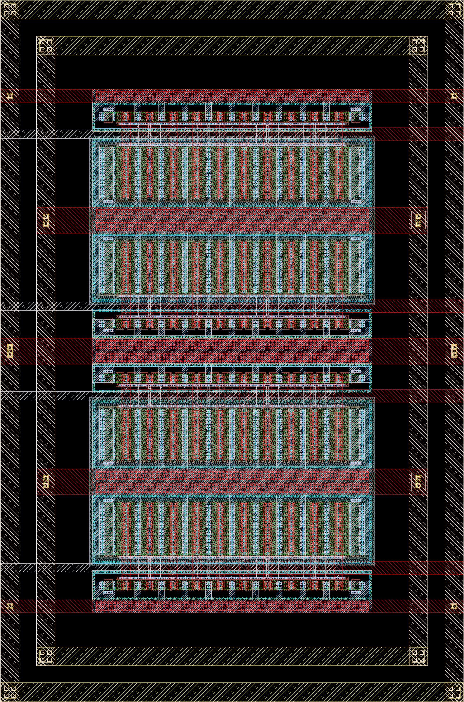

# 아날로그 풀커스텀 레이아웃과 SoC 매크로 인계 | Full-custom layout and SoC macro handoff

확인일: 2026-10-26

풀커스텀 레이아웃은 회로의 소자와 연결을 공정 레이어의 실제 도형으로 구현하는 설계 방식입니다. 회로도에서 MOSFET 두 개를 같은 크기로 정했더라도 위치, 웰 경계, 배선과 주변 발열이 다르면 실제 동작이 달라질 수 있습니다. 그래서 소자 배치와 배선은 회로의 전기적 조건을 유지하는 작업입니다.

이 글은 회로도에서 출발하여 소자 배치, 매칭, 배선, 물리 검증과 추출 후 시뮬레이션을 거쳐 SoC의 고정된 물리 블록으로 넘기는 과정을 설명합니다. 본문의 설계 절차는 공식 문서를 바탕으로 설명하며, 실제 레이아웃 그림은 공개된 원본 GDS를 열어 출력한 자료입니다. 새 레이아웃의 설계·검증 결과를 보고하는 글은 아닙니다. 계산과 소자 배열은 별도로 표시한 설명용 예이며 생산용 치수·배치 지침을 제시하지 않습니다.

## 회로도와 원본 레이아웃을 나란히 보기

© 2026 Simon Dorrer and Harald Pretl의 [JKU IHP 공개 인버터 GDS](https://github.com/iic-jku/ihp-sg13g2-ams-chip-template/blob/b1d4a98d0ec8ad71c57f8ec4c33344340f911dad/macros/inverter/layout/inverter.gds)를 출력했습니다. Apache-2.0 WITH SHL-2.1. 이 그림은 인버터 한 채널이며, 아래에서 다루는 네 채널 `inverter_top` 매크로와 구분합니다. [실제 회로와 레이아웃 읽기](18-실제회로와레이아웃읽기_circuit-layout-walkthrough.md)에서 원본 회로도, 핑거·더미 소자와 배선을 대조하고 ADC 비교기까지 확대해 볼 수 있습니다.

## 1. 풀커스텀과 표준셀 설계의 관계

풀커스텀은 아날로그 전용이라는 뜻이 아닙니다. 증폭기·비교기·PLL 같은 아날로그·혼성신호 회로뿐 아니라 표준셀 라이브러리의 논리 게이트, 고속 디지털 회로와 SRAM 셀도 소자 수준에서 설계할 수 있습니다. Cadence의 Layout Suite 문서도 적용 대상을 아날로그·디지털·RF·혼성신호로 구분합니다. [Cadence, Virtuoso Layout Suite, 소개·Overview](https://www.cadence.com/en_US/home/resources/datasheets/virtuoso-layout-suite-ds.html)

| 관점 | 회로도에서 출발하는 풀커스텀 | RTL·표준셀을 이용하는 디지털 구현 |
| --- | --- | --- |
| 주된 입력 | 트랜지스터·수동 소자·핀과 전기적 설계 조건입니다. | Verilog·SystemVerilog RTL, 제약과 표준셀 라이브러리입니다. |
| 물리 구현의 단위 | 개별 소자, 핑거, 접촉, 배선과 셀 계층입니다. | 미리 물리 구현된 표준셀과 하드 매크로입니다. |
| 설계에서 결정할 내용 | 소자 치수·배치, 매칭·격리, 민감한 배선과 기생 성분입니다. | 셀 선택, 배치, 클록망·신호 배선과 전력망입니다. |
| 자동화 | PCell·연결 확인·배열 생성·보조 배선 등을 사용할 수 있습니다. | 합성·자동 배치·배선과 타이밍 수정을 사용합니다. |
| 만나는 지점 | 검증된 물리 매크로와 인터페이스 모델을 제공합니다. | 그 매크로를 배치하고 전원·신호를 연결합니다. |

풀커스텀이 모든 도형을 손으로 그린다는 뜻도 아닙니다. 연결 관계를 따라 소자를 생성하는 기능이나 자동 배선이 있어도, 어떤 소자를 묶고 어떤 배선 기생을 허용할지 정하는 설계 문제는 남습니다. 반대로 RTL에서 표준셀로 구현한 블록도 최종적으로는 트랜지스터와 금속 도형으로 제조됩니다. 차이는 추상화 수준과 물리 구현을 만드는 방법입니다.

## 2. 회로 심벌, 물리 소자와 PDK

MOSFET 심벌의 선 모양만 보고 실제 소자가 평면형인지 FinFET인지 판단하지 않습니다. 심벌은 전기적 단자와 모델·속성을 연결하는 표현입니다. 실제 구조는 공정과 소자 종류, PCell, 모델 문서와 단면 자료에서 확인합니다. 평면형 MOS의 W/L 설명을 다른 구조의 핀(fin) 수·나노시트 수와 동일하게 해석해서도 안 됩니다.

레이아웃에서 active 영역, 게이트와 접촉을 배치하는 규칙은 공정에 따라 달라집니다. 어떤 공정에서는 격자, 허용된 방향과 소자 종류가 엄격하게 제한됩니다. Cadence 문서가 FinFET·GAAFET 등의 배치와 기생 피드백을 언급한다고 해서, 특정 설치 환경에 해당 PDK나 소자 생성기가 포함된다고 판단하지 않습니다. [Cadence, Virtuoso Layout Suite, Overview](https://www.cadence.com/en_US/home/resources/datasheets/virtuoso-layout-suite-ds.html)

시작할 때에는 다음 자료가 같은 공정 옵션과 판본을 가리키는지 확인합니다.

- 회로도 심벌과 시뮬레이션 모델입니다.
- 소자 PCell과 레이어·목적 구분을 정의한 기술 파일입니다.
- DRC·LVS 규칙과 기생 성분 추출 자료입니다.
- 허용 전압·치수·전류와 소자 사용 조건입니다.
- 작업 라이브러리, 넷리스트와 최종 레이아웃의 단위입니다.

예를 들어 IHP의 공개 SG13G2 자료에는 MOS·수동 소자 모델과 KLayout 기술 파일·PyCell·DRC·LVS 자료가 구분되어 있습니다. 열람한 공개 문서는 experimental preview와 작업 중인 문서임을 명시하므로, 공개 예제의 존재를 제조 승인이나 모든 검사 지원의 증거로 바꾸지 않습니다. [IHP Open PDK, PDK Contents](https://github.com/IHP-GmbH/IHP-Open-PDK), [IHP 공식 문서의 Current Status](https://ihp-open-pdk-docs.readthedocs.io/en/latest/)

## 3. PCell, 핑거와 반복 소자

PCell은 parameterized cell의 약자로, 지정한 속성에 따라 도형을 생성하는 셀입니다. 소자의 폭·길이·핑거 수, 접촉과 주변 구조를 허용된 범위에서 바꿀 수 있습니다. 일반적인 PCell의 매개변수와 도형 생성 관계는 KLayout의 공식 PCell 문서에서도 설명합니다. 임의의 PCell을 직접 작성했다는 사실만으로 공정 규칙이나 소자 모델과의 일치가 확보되지는 않습니다. [KLayout, Coding PCells In Ruby, The PCell Class](https://www.klayout.org/downloads/master/doc-qt5/programming/ruby_pcells.html)

넓은 MOS를 여러 개의 게이트 줄로 나눈 multi-finger 구조는 접촉·배선과 게이트 저항, 확산 공유를 조절하는 데 쓰입니다. 다만 폭을 나누기 전후의 총 폭만 같다고 접합 면적·둘레·게이트 저항까지 같아지지는 않습니다. 확산을 공유할 수 있는 단자 조합과 소자 방향도 확인해야 합니다.

`w`, `nf`, `ng`, `m` 같은 이름은 PDK 정의를 먼저 읽습니다. IHP 문서의 해당 MOS 심벌은 `w`를 총 폭, `l`을 채널 길이, `ng`를 게이트·핑거 수, `m`을 반복 수로 정의합니다. 다른 PDK의 같은 이름에 그대로 적용할 규칙은 아닙니다. [IHP OpenPDK 11181f4 문서, MOSFETs, §3.1.2–3.1.4](https://ihp-open-pdk-docs.readthedocs.io/en/latest/contents/device_libraries/mosfets.html)

직접 구성한 산술 예로, 총 폭이 20 µm이고 같은 폭의 핑거 4개로 나눈다는 정의라면 핑거당 폭은 5 µm입니다. 이 값은 특정 소자의 허용 치수나 추천 크기가 아닙니다. 반복 수 `m=4`가 레이아웃에서 네 개의 별도 소자로 생성되는지, 합쳐진 구조인지, 통계 모델에서 어떻게 취급되는지는 별도로 확인합니다.

배치 뒤에는 회로도 속성, PCell 속성과 추출한 유효 치수를 대조합니다. PCell 이름과 겉모양이 비슷해도 고전압·저전압 소자, RF 모델과 일반 모델이 다를 수 있습니다. 치수를 바꾼 뒤 예전 추출 결과만 남아 있지 않은지도 확인합니다.

## 4. 회로도 기반 레이아웃 도구가 돕는 부분

Virtuoso Layout XL의 연결 기반 편집은 회로도의 소자·넷과 레이아웃의 소자·도형을 연결하여 확인하는 방식입니다. Cadence 문서는 schematic assistant의 교차 강조, 열린 연결과 단락 확인, 소자 배치와 배선 보조를 설명합니다. 이는 잘못된 연결을 찾는 수단이며, 모든 바이어스·매칭·잡음 조건을 자동으로 충족한다는 뜻은 아닙니다. [Cadence, Virtuoso Layout Suite XL, Connectivity-driven functions·Assisted placement functions](https://www.cadence.com/en_US/home/resources/datasheets/virtuoso-layout-suite-ds.html)

독자는 화면상의 두 가지 질문을 구분해야 합니다. 첫째는 ‘이 도형이 어떤 소자·넷에 해당하는가’이고, 둘째는 ‘그 도형의 위치와 배선이 필요한 전기적 성능을 주는가’입니다. 연결 표시가 모두 사라져도 차동 입력의 배선 정전용량이 다르거나 전원 배선이 좁을 수 있습니다.

다른 도구에서는 구성 방식이 달라집니다. IHP의 공식 KLayout 안내는 기술 파일·PyCell·검사 규칙을 별도 자료로 설명합니다. JKU의 공개 실습은 Xschem 회로도와 KLayout 레이아웃, Magic·Netgen 등을 연결하는 한 예입니다. 특정 환경의 단축키나 메뉴가 모든 설치에서 제공되는 것은 아닙니다. [IHP, Analog design using KLayout, 도입부](https://ihp-open-pdk-docs.readthedocs.io/en/latest/analog/klayout.html), [Dorrer·Pretl, 공개 AMS 설계 실습, 2026-10-17, §5.7–5.9](https://iic-jku.github.io/ihp-sg13g2-ams-chip-template/index.html)

### 공개 인버터 매크로의 실제 레이아웃

출처: Simon Dorrer·Harald Pretl, [inverter_top 레이아웃 원본](https://github.com/iic-jku/ihp-sg13g2-ams-chip-template/blob/b1d4a98d0ec8ad71c57f8ec4c33344340f911dad/tutorial/fig/inverter_top/inverter_top_black.png). 공개 튜토리얼의 4채널 인버터 매크로입니다. 작은 소자 도형이 반복되는 영역, 이를 연결하는 배선과 바깥쪽 고리 모양 구조를 함께 볼 수 있습니다. 레이어를 여러 개 겹쳐 표시했기 때문에 한 색이나 무늬만 보고 소자·단자의 종류를 확정하지 않고 PDK의 레이어 목록과 함께 읽습니다.

원본 설계 데이터에서 출력한 평면 레이아웃이며, 색과 무늬는 도구의 레이어 표시 설정에 따릅니다. 해당 예제의 [DRC·LVS 검사 창](10-DRC와LVS및PEX_physical-verification.md)을 함께 보시면 도형 작성과 검사 결과가 어떻게 연결되는지 확인할 수 있습니다. [원본·이용 조건](사진과화면_images/README.md)

## 5. 배치 전에 회로의 제약을 적습니다

Floorplan은 소자를 빈 공간에 채우기 전에 면적·핀·전원·민감한 경로와 격리를 배분하는 단계입니다. 다음은 차동 입력 증폭기를 설명하기 위해 구성한 제약 표입니다. 실제 회로의 성능 기준은 설계 요구와 모델로 정합니다.

| 회로 부분 | 배치·배선에서 유지할 조건 | 검토하는 이유 |
| --- | --- | --- |
| 입력 차동쌍 | 같은 단위 소자와 유사한 방향·주변 환경, 균형 잡힌 입력 경로입니다. | 작은 입력 차이를 소자·배선 차이가 가리지 않도록 합니다. |
| 전류 미러 | 비율에 맞춘 단위 소자 수, 유사한 접촉과 소스 기준입니다. | 치수 비율 외의 전압·저항 차이가 전류 비율에 들어갑니다. |
| 고임피던스 노드 | 짧은 경로와 제한한 부하·결합입니다. | 작은 정전용량도 극점과 정착 시간을 바꿀 수 있습니다. |
| 보상 커패시터 | 연결할 노드와 plate 방향, 주변 배선 조건입니다. | 의도한 보상과 추가 결합을 구분해야 합니다. |
| 출력 구동부 | 전류 경로와 발열을 고려한 배선·배치입니다. | 출력 부하 전류와 열이 입력부에 영향을 줄 수 있습니다. |
| 전원·기준·격리 | 전원·접지·웰 연결과 잡음 유입 경로입니다. | 같은 이름의 넷도 실제 위치에서 같은 전압은 아닐 수 있습니다. |

공간을 배분할 때에는 guard ring, 웰·기판 접촉, 배선 통로와 상위 블록이 접근할 핀도 포함합니다. 소자 면적만 더한 외곽 크기로 시작하면 배선을 연결할 공간이 부족해질 수 있습니다. 출력 드라이버·클록 회로처럼 큰 전류가 변하는 부분과 미세 신호 입력부의 거리는 전기적·열적 조건을 함께 보고 정합니다.

## 6. 매칭과 interdigitation

매칭은 두 소자의 절대값이 이상적인 수치에 맞는지보다, 두 소자가 필요한 비율이나 차이를 유지하는지에 관한 문제입니다. 같은 도형도 국소 공정 변동 때문에 달라질 수 있고, 서로 다른 위치의 공정·온도 변화도 영향을 줍니다. 면적, 근접성, 방향, 주변 도형과 배선을 나누어 봅니다.

Interdigitation은 A와 B에 속한 단위 소자를 사이사이에 배치하는 방법입니다. 한쪽에 A를 몰고 반대쪽에 B를 모으는 배치보다 공간 변화의 영향을 비슷하게 받을 수 있습니다. 그러나 단순히 `A B A B`로 놓았다고 두 그룹의 중심까지 일치하는 것은 아닙니다. 단위 수, 위치와 연결을 확인해야 합니다.

Iowa State EE501 강의는 단위 소자 배열, interdigitation, common centroid, 방향·대칭, edge·corner와 dummy를 서로 관련되지만 구별되는 기법으로 설명합니다. 따라서 한 배열 이름을 적용했다는 이유로 다른 조건도 해결됐다고 판단하지 않습니다. [Iowa State EE501, Layout 강의, 2011, PDF pp. 4–5·14–17](https://class.ece.iastate.edu/djchen/EE501/2011/EE501LectureLayout.pdf)

## 7. Common centroid의 효과와 한계

Common centroid는 비교할 소자 그룹의 중심을 일치시키는 배치입니다. 다음은 같은 가중치의 단위 소자 A 두 개와 B 두 개를 가정한 자체 개념 배열입니다. 표의 칸은 전기적 연결이나 실제 레이어를 나타내지 않습니다.

| 위치 | 왼쪽 | 오른쪽 |
| --- | --- | --- |
| 위쪽 | A | B |
| 아래쪽 | B | A |

각 단위의 중심 좌표가 $(-a,+b)$, $(+a,+b)$, $(-a,-b)$, $(+a,-b)$이고 크기·가중치가 같다면 A와 B 모두 평균 좌표가 $(0,0)$입니다. 단순히 공간적으로 더해지는 특성 $p$에 다음의 선형 변화만 있다고 가정합니다.

$$
p(x,y)=p_0+g_x x+g_y y
$$

이 모형에서는 $\bar p_A=p_0+g_x\bar x_A+g_y\bar y_A$이고 B에도 같은 식이 성립하므로 선형 항의 평균 차이가 0입니다. 이는 왜 중심을 맞추는지 보여 주는 자체 유도입니다. MOS 전류 전체가 위치의 선형 평균으로 계산된다는 가정이나 모든 동작점의 전류 일치를 증명한 식은 아닙니다.

실제 소자의 특성이 비선형으로 변하거나 각 단위에 국소적인 랜덤 오차가 있으면 중심만으로 그 차이가 없어지지 않습니다. 단위의 치수·방향·가중치가 다르거나 배선·열 조건이 비대칭이어도 마찬가지입니다. Iowa State 강의 역시 선형 gradient의 상쇄와 비선형·국소 random error의 한계를 구분합니다. [Iowa State EE501, 2011, PDF p. 5·pp. 24–26](https://class.ece.iastate.edu/djchen/EE501/2011/EE501LectureLayout.pdf)

배열을 더 잘게 나누면 배선과 접촉이 늘어 면적·저항·정전용량이 달라집니다. 매칭을 위해 선택한 배열이 고속 노드의 부하나 면적 요구와 충돌할 수도 있습니다. 소자 배열, 배선과 추출 후 결과를 함께 비교해야 합니다.

## 8. 방향, dummy와 레이아웃 의존 효과

두 소자를 회전·반전하면 도형은 대칭으로 보이지만 공정 방향성이나 소스·드레인의 주변 조건은 달라질 수 있습니다. 무조건 반전 배치하거나 무조건 같은 방향만 고집하기보다, 소자 모델과 허용 방향, 맞추려는 물리적 영향을 확인합니다.

Dummy는 배열 끝단에서도 유사한 주변 도형을 제공하기 위한 소자·패턴입니다. 활성 소자와 같은 방식으로 신호를 처리하는 소자라고 가정하지 않습니다. 게이트·확산을 어떤 전압에 연결해야 하는지, LVS에서 어떻게 인식되는지와 기생 부하를 확인합니다. 연결하지 않은 dummy가 부유 노드나 누설 경로를 만들지 않도록 합니다.

레이아웃 의존 효과 LDE에는 절연 구조와 웰 경계까지의 거리 등에서 생기는 특성 변화가 있습니다. Berkeley BSIM4 v4.7 매뉴얼의 §14.1은 얕은 트렌치 절연 구조에 의한 응력인 STI stress와 기하 매개변수 SA·SB를, §15.1은 웰 경계의 근접 효과인 well proximity effect를 설명합니다. 이 역사적 모델의 설명을 모든 PDK가 같은 방식으로 추출·활성화한다는 뜻으로 사용하지 않습니다. [BSIM4 v4.7 매뉴얼, 2011, §14.1·§15.1, 인쇄면 114–121](https://class.ece.iastate.edu/djchen/ee501/BSIM470_Manual.pdf)

W/L과 소자 수를 맞춘 뒤에도 웰 경계, 확산의 끝, 인접 큰 소자와 채움 도형이 양쪽에서 비슷한지 확인합니다. PEX에 배선 RC가 들어갔다고 모든 LDE·열·불일치가 자동으로 포함되는 것은 아닙니다. 해당 모델과 추출 설정이 제공하는 효과를 구분합니다.

## 9. 대칭 배선과 실제 전기적 균형

차동 입력 두 선의 길이가 같아도 전기적 부하가 같다고 단정하지 않습니다. 금속층·폭, 비아 수, 아래의 도형, 나란히 지나는 신호와 핀 부하가 다르면 저항·정전용량·결합이 달라집니다. 교차나 우회를 피하려고 한쪽만 비아를 추가했다면 그 차이도 확인합니다.

Shield는 민감한 배선 옆이나 아래에 기준 도체를 두어 결합 경로를 조절하는 방법입니다. 기준 도체의 전압이 충분히 안정적인지와 추가 정전용량을 함께 봅니다. 잡음이 큰 접지에 연결한 shield나 부유 금속을 놓은 결과를 자동적인 잡음 감소로 설명하지 않습니다.

고임피던스 노드의 간단한 자체 계산 예로, 저항 100 kΩ과 총 정전용량 100 fF만 있는 단일 극점 모형에서는 $\tau=RC=10\,\mathrm{ns}$입니다. 배선으로 50 fF가 더해지면 $\tau$는 15 ns가 됩니다. 실제 증폭기의 전체 대역폭을 계산한 결과는 아니지만, 작은 배선 부하를 무시할 수 없는 이유를 보여 줍니다.

대칭 배선의 목표는 도형을 보기 좋게 맞추는 데 있지 않습니다. 두 신호의 지연, 부하와 주변 잡음 전달이 허용한 차이 안에 드는지 확인하는 데 있습니다. 필요한 경우 추출한 두 경로의 RC와 과도 응답, 공통 모드·차동 자극을 비교합니다.

## 10. 웰·기판 접촉과 guard ring

Well contact와 substrate contact는 웰·기판의 전위를 정하고 전류가 돌아가는 경로를 제공합니다. MOS 심벌의 몸체 핀과 실제 접촉 구조를 연결해서 봐야 합니다. 회로도에서 몸체를 전원에 연결했다고 해서 레이아웃에 필요한 접촉과 금속 연결이 자동으로 생기는 것은 아닙니다.

IC의 guard ring은 웰·기판과 도핑·접촉·금속으로 구성하여 전류 수집과 격리에 사용하는 구조입니다. PCB 표면 누설을 줄이려고 고임피던스 노드 주변에 만드는 guard 배선과는 구현과 역할이 다릅니다. IC에서도 링 하나가 모든 기판·전원·배선·자기 결합을 차단하지는 않습니다.

링의 도핑, 연속성, 접촉 간격과 연결 전원은 공정과 소자 조건에 따릅니다. GF180MCU의 core·I/O latch-up 규칙은 접촉과 링의 종류·접속을 나누어 설명합니다. 따라서 모든 링을 무조건 GND에 연결한다거나 임의의 간격을 다른 PDK에도 적용하는 설명은 부정확합니다. [GF180MCU, §14.3.1 Core Latch-up Rules](https://gf180mcu-pdk.readthedocs.io/en/latest/physical_verification/design_manual/drm_14_3_1.html), [§14.3.2 I/O Latch-up Rules](https://gf180mcu-pdk.readthedocs.io/en/latest/physical_verification/design_manual/drm_14_3_2.html)

Body bias나 고전압·저전압 영역, 격리된 웰이 있으면 접속 조건이 더 달라집니다. 해당 공정은 별도의 규칙을 제공하므로, 낮은 잡음과 latch-up 방지, 역바이어스·허용 전압을 함께 확인합니다. [GF180MCU, §14.3.4 Additional Guidelines](https://gf180mcu-pdk.readthedocs.io/en/latest/physical_verification/design_manual/drm_14_3_4.html)

## 11. 전원·접지와 발열

전원은 이름이 같은 선을 연결하는 것에서 끝나지 않습니다. 소자까지의 금속·접촉·비아 저항에 전류가 흐르면 전압이 달라집니다. 전류 미러의 두 분기에서 소스 전압이 다르면 게이트 전압이 같아도 전류 비율이 달라질 수 있습니다. 큰 출력 전류가 입력 기준과 같은 좁은 귀환 경로를 지나면 입력 기준도 흔들릴 수 있습니다.

직접 구성한 예로 공통 전원 경로에 2 Ω이 있고 10 mA가 흐르면 DC 전압 강하는 20 mV입니다. 이는 특정 공정의 배선 저항이나 허용 강하가 아닙니다. 단면·비아 배열·평균 전류와 순간 전류는 PDK의 전류 밀도·신뢰성 조건에서 확인해야 합니다. 금속 폭을 넓히면 저항은 줄일 수 있지만 면적과 인접 노드 부하도 달라집니다.

출력 구동부나 저항의 발열은 인접 매칭 소자의 온도를 다르게 만들 수 있습니다. 평균 칩 온도 하나만 지정한 회로 계산으로 국소 온도 차이를 모두 반영했다고 판단하지 않습니다. 매칭 그룹을 열원에 대해 배치하는 조건과, 실제로 사용한 열 모델의 범위를 나누어 기록합니다.

## 12. 저항·커패시터·인덕터의 레이아웃

수동 소자도 이상적인 값 하나로 끝나지 않습니다. 소자 모델이 전압·주파수·온도 의존성과 기판 결합 중 무엇을 포함하는지 확인합니다. 다음은 소자별로 물리 구현에서 추가로 살펴볼 내용입니다.

| 대상 | 레이아웃에서 확인할 내용 | 회로에서 드러나는 영향 |
| --- | --- | --- |
| 저항 | 저항층, 유효 폭·길이, 접촉, 꺾임과 주변 온도입니다. | 저항값·비율, 기생 정전용량과 열잡음·자기 발열입니다. |
| 커패시터 | 전극인 plate의 연결, 단위 소자 배열, 가장자리 전기장과 아래 배선·기판 결합입니다. | 총 용량·비율, 아래쪽 전극인 bottom plate의 기생 성분과 신호 결합입니다. |
| 인덕터 | 금속 두께·폭·회전 수·간격, 접촉·비아와 주변 도체입니다. | 인덕턴스, 직렬 손실, 기판 손실과 자기 결합입니다. |

저항의 첫 근사는 $R\approx R_{sheet}L/W$이지만 실제 PDK 모델에는 접촉·끝단·온도 등의 항이 더해질 수 있습니다. 커패시터도 면적 항만으로 충분하지 않을 수 있습니다. 두 저항이나 커패시터의 비율이 중요하면 같은 단위 소자를 사용한 배열과 주변 조건을 검토하며, 결과는 실제 소자 모델과 추출값으로 비교합니다.

인덕터에서는 일반적인 RC 추출만으로 필요한 고주파 손실과 결합을 다뤘다고 판단하지 않습니다. Carsten Wulff의 수동 소자 강의는 공정 모델과 주변 구조, 전자기 해석의 필요성을 설명합니다. IHP의 공식 EM 안내도 openEMS·Palace의 전자기 계산과 S-parameter에서 회로 모델을 구성하는 흐름을 나누어 설명합니다. 모델의 주파수 범위·포트·기준면과 인접 구조를 확인해야 합니다. [Wulff, Advanced Integrated Circuits, 2026, Integrated Passives·Inductors](https://analogicus.com/aic2026/integrated_passives), [IHP, EM Simulation Overview, 2026-02-04, Solver methods·Lumped model and SPICE model extraction](https://ihp-open-pdk-docs.readthedocs.io/en/latest/em_simulation/em_simulation_overview.html)

## 13. 실제로 확인할 입력·출력 자료

다음 이름은 파일의 역할을 보여 주는 예입니다. 특정 도구가 이 이름을 자동으로 생성한다고 제시한 것이 아닙니다.

| 단계 | 주요 입력 | 주요 출력 |
| --- | --- | --- |
| 회로 정의 | PDK 모델·심벌, 설계 요구입니다. | 회로도·심벌, SPICE/CDL 계열 기준 넷리스트와 시험 회로입니다. |
| 물리 구현 | PCell·기술 파일, 회로 연결과 배치 조건입니다. | 작업용 레이아웃 데이터, 도형·핀·계층입니다. |
| DRC | 레이아웃과 해당 공정의 규칙입니다. | 오류 위치·규칙명·적용 범위를 포함한 보고서입니다. |
| LVS | 레이아웃, 기준 넷리스트와 소자 인식·비교 규칙입니다. | 추출 연결·치수와 불일치 보고서입니다. |
| PEX | 연결이 확인된 레이아웃과 추출 규칙입니다. | 기생 소자·모델 정보가 포함된 넷리스트와 추출 로그입니다. |
| 추출 후 시험 | 추출 회로, 동일 자극·부하·PVT·측정식입니다. | 파형·성능 수치와 추출 전후 비교입니다. |
| 매크로 인계 | 고정한 회로·레이아웃 판본과 확인 기록입니다. | GDS/OASIS, LEF, 기능·전기·타이밍 모델과 사용 조건입니다. |

Virtuoso 라이브러리의 `schematic`·`symbol`·`layout` 같은 뷰와, 교환용 GDS/OASIS·SPICE 파일은 역할이 다릅니다. 공개 도구 흐름에서는 `.sch`·`.sym`, `.mag`, GDS와 별도의 기술·설정 파일로 나뉠 수 있습니다. 편집용 데이터와 내보낸 도형, 사용한 도구·PDK 판본을 함께 보관해야 수정 후 같은 결과를 다시 연결할 수 있습니다.

GDS가 열렸다는 사실만으로 원래 PCell의 생성 코드·매개변수·회로도 대응이 모두 복원되는 것은 아닙니다. 또한 셀 경계와 실제 도형·핀 위치가 같아야 상위 배치에서 다른 블록과 겹치지 않습니다. 내부 도형을 숨기는 표시 설정과 실제로 누락된 도형도 구분합니다.

## 14. DRC·LVS·PEX는 다른 질문입니다

DRC는 폭·간격·둘러싸는 길이·레이어 조합 등 기하 규칙을 확인합니다. LVS는 레이아웃에서 인식한 소자와 연결·속성을 기준 회로와 대조합니다. PEX는 배선과 소자 주변의 기생 성분을 계산합니다. DRC가 통과한 잘못된 회로도 가능하고, LVS가 맞아도 전기적 성능이 부족한 레이아웃도 가능합니다.

핀 이름만 붙였다고 모든 층이 연결되는 것은 아닙니다. 금속 교차부에는 필요한 비아가 있어야 하고, 핀·텍스트·도형 레이어의 역할은 PDK 검사 규칙에 맞아야 합니다. 두 층이 화면에서 겹쳐 보이는 것과 추출기가 같은 넷으로 인식하는 것은 다릅니다.

Magic의 공식 Tutorial #8은 도형에서 트랜지스터·연결·저항·기생 정전용량을 추출하고, `.mag`에 대응하는 `.ext` 자료를 다음 형식으로 변환하는 과정을 설명합니다. 문서는 version 7의 역사적 튜토리얼이므로 현재 도구·PDK의 명령·정확도·지원 범위를 대신하지 않습니다. 특히 추출 방식과 기술 파일이 포함하는 항목을 확인해야 합니다. [Magic Tutorial #8: Circuit Extraction, 2001-09-26, §1·§5–7](https://opencircuitdesign.com/magic/archive/papers/tut8.pdf)

검사 보고서에는 오류 수 외에 top cell, 입력 판본, 규칙 파일, 추출·비교 범위와 예외를 남깁니다. 연결 비교에서 허용하는 소자 병합·허용 오차 때문에 다른 구조가 같은 것으로 보일 수도 있으므로, 원하는 치수·모델과 비교됐는지 확인합니다. 규칙을 끈 결과와 승인된 예외도 구분합니다.

## 15. 추출 후 시뮬레이션으로 닫는 설계 반복

추출 전후에는 같은 시험 회로와 측정식을 사용하고 비교할 회로 뷰만 명확하게 바꿉니다. JKU의 실습도 추출한 회로를 같은 시험 회로에 연결하는 방법을 설명합니다. 원래 회로와 PEX 회로가 동시에 연결되어 있거나 예전 추출 파일을 읽으면 비교의 전제가 달라집니다. [Dorrer·Pretl, 공개 AMS 설계 실습, §5.9.4 Post-Layout Simulation](https://iic-jku.github.io/ihp-sg13g2-ams-chip-template/index.html)

| 비교 대상 | 관찰할 변화 |
| --- | --- |
| 동작점·가지 전류 | 전원·접촉 저항과 소자 인식, 몸체·웰 연결의 영향입니다. |
| 이득·위상·정착 | 고임피던스 노드의 추가 부하와 피드백 배선의 영향입니다. |
| 입력 환산 잡음·오프셋 | 모델이 지원하는 잡음·불일치와 비대칭 경로의 영향입니다. |
| 클록·출력 전환 | 입력 slew, 제어 순서, 전원 강하와 부하의 영향입니다. |
| PVT·통계 시험 | 명목 조건에서 가려진 배치·배선 여유입니다. |

명목 이득 하나가 비슷하다고 추출 전후의 모든 성능이 같은 것은 아닙니다. 오프셋을 확인하는 시험과 큰 신호 정착·안정성·전력 시험을 구분합니다. 모델에 없는 기판 잡음·국소 열·소자 열화를 결과에 포함했다고 쓰지 않습니다.

레이아웃을 고칠 때에는 무엇을 줄이려는지 연결합니다. 예를 들어 고임피던스 노드의 긴 우회를 줄였다면 해당 넷의 추출 정전용량과 정착 시간을 비교합니다. 전원 경로를 넓혔다면 전압 강하와 신뢰성 조건을 다시 확인합니다. 바뀐 도형·연결에 영향을 받는 검사를 다시 수행하고 이전 보고서를 최종 결과로 사용하지 않습니다.

## 16. 하드 매크로를 디지털 SoC에 넘깁니다

Hard macro는 물리 크기와 내부 구현을 고정하여 상위 설계에 넣는 블록입니다. 상위 디지털 도구는 내부 트랜지스터를 다시 합성하지 않고 매크로의 외곽·핀·배선 제한과 모델을 이용합니다. 아날로그 블록을 Verilog 모듈 이름으로 참조한다고 해서 그 내부 회로가 RTL 합성으로 만들어지는 것은 아닙니다.

| 인계 자료 | 필요한 내용과 확인 |
| --- | --- |
| GDS/OASIS | 실제 내부 도형, 레이어·단위·계층과 고정한 top cell입니다. |
| LEF | 크기·원점·핀 위치와 배선 제한 영역입니다. 상위에서 허용할 배선 층과 영역을 정의합니다. |
| SPICE/CDL | 회로 연결·포트 순서와 소자 모델의 기준입니다. LVS·전기 시험에 필요한 범위를 구분합니다. |
| Verilog/SystemVerilog 모델 | 논리 핀·제어·데이터와 지원하는 기능 동작입니다. 선언만 있는 빈 모듈과 기능 모델을 구분합니다. |
| 아날로그·혼성신호 모델 | 연속 전압·전류 또는 필요한 행동 모델과 정확도·적용 범위입니다. |
| Liberty·타이밍 조건 | 실제로 특성화한 디지털 핀·경로·PVT·부하 범위와 제약입니다. 아날로그 특성을 모두 대신하지 않습니다. |
| 사용 설명·검사 기록 | 전원, 초기화·리셋, 클록·제어 순서, 부하·배선·격리 조건과 검증 판본입니다. |

공개 JKU 실습의 §5.10은 아날로그 매크로의 상위 배치를 위해 LEF와 Verilog·Liberty stub을 만드는 예를 보여 줍니다. Stub은 흐름을 연결하기 위한 골격일 수 있으므로 실제 기능·지연·전력을 검증한 모델로 간주하지 않습니다. 특정 아날로그 핀을 디지털 STA에서 검사하지 않는다면, 그 핀을 통해 오가는 전기적 요구는 별도의 회로·혼성신호 시험에서 다뤄야 합니다. [Dorrer·Pretl, 공개 AMS 설계 실습, §5.10 Build Deliverables for Top-Level Integration](https://iic-jku.github.io/ihp-sg13g2-ams-chip-template/index.html)

매크로 내부 LVS 통과 이후에도 상위 연결 확인은 필요합니다. 상위의 전원 이름·전압, 핀 극성·비트 순서와 실제 LEF·GDS 핀이 맞아야 합니다. 매크로 위의 배선·채움 도형과 인접 열원이 내부 추출 때 가정한 환경을 바꾸는지도 검토합니다. 내부 PEX와 상위 배선 추출의 경계를 정하여 부하를 빠뜨리거나 두 번 더하지 않습니다.

## 17. 구체적인 연결 사례: 비교기와 디지털 제어

다음은 설계 검토를 설명하기 위해 구성한 사례이며 실제 제작 사례가 아닙니다. 아날로그 비교기가 두 입력 전압을 비교하고, Verilog 제어기가 비교 시작 신호를 보낸 뒤 결과를 받는 블록을 가정합니다.

비교기 레이아웃에서는 입력쌍의 매칭과 입력 배선 부하, 클록에 의해 큰 전류가 변하는 경로, 출력 부하와 전원 귀환을 확인합니다. 회로 시험에서는 입력 공통 모드·차이 전압·부하·클록 slew·PVT에 따라 판정 결과와 결정 시간이 어떻게 바뀌는지 확인합니다. 이 결정 시간을 이상적인 조합 논리 게이트 지연 하나로 가정하지 않습니다.

상위 제어기에서는 비교기 초기화, 입력 안정 시간, 시작 펄스와 결과가 유효한 시점을 규정합니다. 결과를 동기식으로 받는지, 비동기 결과에 별도의 수신 구조가 필요한지도 정합니다. 입력 차이가 작을 때 판정이 늦어지거나 불확정한 상태가 길어지는 조건을 모델에서 생략했다면, 논리 시뮬레이션 통과를 해당 조건의 아날로그 판정 보증으로 바꾸지 않습니다.

인계에서는 비교기 GDS·LEF·포트 정의와 행동 모델, 허용 전압·클록·부하·결정 시간 조건을 연결합니다. 아날로그 핀을 단순 `wire`로 연결한 코드만으로 연속 전압이 계산되지는 않습니다. 필요한 정확도에 맞는 회로 해석·혼성신호 모델과 디지털 시험을 조합합니다.

## 18. 실패를 좁히는 표

| 증상 | 먼저 확인할 자료 | 구분할 원인 |
| --- | --- | --- |
| PCell이 보이지 않거나 빈 셀입니다. | 기술·PCell 라이브러리, 도구 로그와 생성 속성입니다. | 로딩·호환 문제와 실제 도형 누락을 구분합니다. |
| W/L은 같은데 LVS가 다릅니다. | 소자 종류·몸체, 핑거·반복 수와 추출 치수입니다. | 다른 모델·단자·치수 정의인지 확인합니다. |
| 화면에서 연결했지만 open입니다. | 해당 층의 도형·비아·핀·텍스트 규칙입니다. | 단순 겹침과 추출된 전기적 연결을 구분합니다. |
| 대칭 배열인데 오프셋이 큽니다. | 랜덤 불일치, 방향·웰·경계·배선·열 조건입니다. | 배열의 선형 가정 밖의 원인과 모델 범위를 확인합니다. |
| 추출 후 이득은 비슷하지만 정착이 느립니다. | 고임피던스·보상·출력 넷의 RC와 파형입니다. | 추가 극점·결합과 부하를 확인합니다. |
| 출력 동작 때 입력 기준이 흔들립니다. | 전원·접지 귀환과 기판·배선 결합 경로입니다. | 공통 임피던스와 결합 모델의 영향을 구분합니다. |
| 단독 매크로는 맞고 칩에서 실패합니다. | 상위 부하·핀·전원·배선·초기화입니다. | 인계 조건과 통합된 조건이 같은지 확인합니다. |
| 배치 도구가 매크로를 잘못 놓습니다. | 경계·원점·단위·허용 방향과 LEF·GDS입니다. | 추상 정보와 실제 도형의 불일치를 확인합니다. |
| STA가 통과했지만 아날로그 기능이 틀립니다. | 모델·검사한 경로와 별도 전기 요구입니다. | 검사하지 않은 아날로그 조건을 통과로 해석했는지 확인합니다. |

회로 해석은 [회로 설계와 Spectre](04-회로설계와Spectre_custom-circuit-simulation.md), RTL과 혼성신호 모델의 관계는 [Verilog와 SystemVerilog의 연결](07-Verilog와SystemVerilog의연결_rtl-verification-ams.md), 상위 구현은 [배치·배선과 전력 설계](09-배치배선과전력설계_physical-implementation.md)에서 이어집니다. [DRC·LVS·PEX](10-DRC와LVS및PEX_physical-verification.md)와 [최종 파일·제조 인계](13-최종파일과제조인계_tapeout-deliverables.md)는 매크로에서 칩 전체로 검증 범위를 연결합니다. 전체 흐름은 [설계 목차](README.md)에서 확인합니다.
