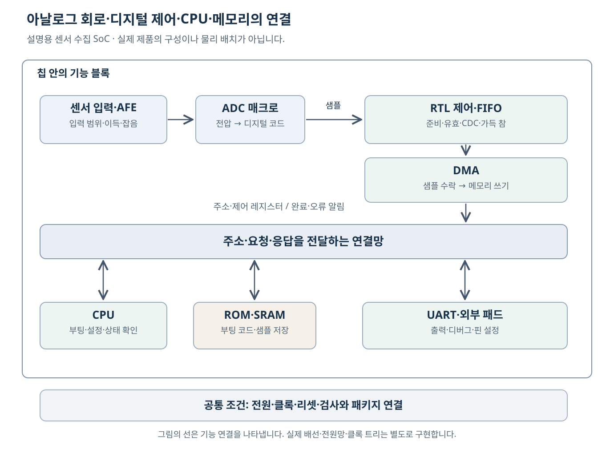

# SoC 구조와 IP 통합 | SoC architecture and IP integration

[설계 목차](README.md) · [아날로그·RTL 통합](15-아날로그와RTL의혼합신호통합_analog-digital-integration.md) · [칩 최상위 검증](17-칩최상위검증과제조인계_chip-top-signoff.md)

## 회로 블록이 시스템이 되는 과정

SoC(System-on-Chip)는 연산·메모리·통신·제어 등의 기능을 칩 안에서 하나의 시스템으로 연결한 설계입니다. CPU 코어 하나와 SoC 전체는 다릅니다. CPU가 명령을 실행할 수 있도록 명령·데이터 경로와 메모리, 클록·리셋·전원을 연결합니다. 외부 신호나 장치와 통신하려면 그에 맞는 주변 회로와 인터페이스도 필요합니다. 반대로 모든 IC가 CPU를 가진 SoC인 것은 아닙니다. 아날로그 증폭기 IC나 특정 기능만 수행하는 디지털 ASIC도 있습니다.

IP는 재사용하는 설계 블록입니다. RTL 소스로 제공되는 soft IP, 물리 도형과 특성 모델이 정해진 hard macro 등을 구분합니다. 같은 SoC 안에서도 CPU·버스·제어기는 RTL로 구현하고 SRAM·ADC·PLL·I/O는 공정에 맞는 매크로로 연결할 수 있습니다. SRAM이나 표준셀 자체도 트랜지스터와 레이아웃으로 설계된 회로입니다.

위 그림과 아래 주소·속도는 설명을 위해 직접 구성한 센서 수집 SoC의 예입니다. 특정 제품이나 OpenTitan의 구조·사양을 복제한 것이 아니며 실제 구현 결과도 아닙니다. 공개 프로젝트는 통합 방법과 자료 구조의 근거로 따로 연결합니다.

## 기능 블록을 나누는 기준

| 구성 | 담당하는 일 | 설계·검증에서 연결할 조건 |
| --- | --- | --- |
| 센서 입력·AFE | 외부 신호를 ADC가 받을 범위로 조정합니다. | 입력 범위·이득·잡음·부하·정착·보호 조건입니다. |
| ADC hard macro | 아날로그 입력을 디지털 코드로 변환합니다. | 기준 전압·클록·기동·데이터 유효 시점과 실제 레이아웃입니다. |
| ADC 디지털 제어·FIFO | 명령을 보내고 완성된 샘플을 안전하게 전달합니다. | 프로토콜·CDC·가득 참·샘플 유실 처리입니다. |
| CPU·ROM | 초기 설정과 제어 프로그램을 실행합니다. | reset vector·명령 인터페이스·부팅 코드와 오류 처리입니다. |
| SRAM | 프로그램의 데이터와 수집 샘플을 저장합니다. | 포트·접근 지연·쓰기 마스크·초기화·ECC 유무입니다. |
| 연결망·DMA | CPU와 주변 장치가 주소로 접근하고 데이터를 옮기게 합니다. | 주소 해석·중재·응답·순서·접근 권한입니다. |
| UART·디버그 | 결과를 내보내고 상태를 관찰합니다. | 핀·클록·보율·부팅 모드·시험 접근입니다. |
| 클록·리셋·전원 제어 | 회로가 사용할 수 있는 조건과 순서를 만듭니다. | 전원 정상·클록 유효·리셋 해제·저전력 복귀입니다. |

이 분류는 설계 출발점입니다. ADC의 기동 시간과 데이터 유효 신호가 정의되지 않았다면 디지털 제어기의 상태 전이도 정할 수 없습니다. SRAM의 실제 읽기 지연이 정해지지 않았다면 버스 응답과 CPU 대기 동작도 함께 정해야 합니다.

## 공개 SoC에서 확인할 수 있는 연결

[OpenTitan의 Earl Grey 최상위 설명](https://opentitan.org/book/hw/top_earlgrey/)은 논리 top, 전원 영역 wrapper, ASIC·FPGA·시뮬레이션 대상별 chip wrapper를 구분합니다. ASIC용 wrapper에는 공정에 맞는 패드·클록원 등이 연결됩니다. 동일한 논리 블록을 사용해도 최종 대상에 따라 바깥 연결이 달라지는 실제 예입니다.

이 공식 페이지의 `master` 설명은 개발 중인 Earl Grey 2를 대상으로 합니다. 이전 제작 설계의 문서는 [earlgrey_1.0.0](https://opentitan.org/earlgrey_1.0.0/book/hw/top_earlgrey/index.html)으로 구분되어 있습니다. 여기서는 두 판본의 메모리·공정·포트·성과를 섞지 않고 통합 자료의 구조를 읽습니다.

[OpenTitan AST](https://opentitan.org/book/hw/top_earlgrey/ip/ast/)는 클록·전압 조정·센서 등의 아날로그 기능과 디지털 제어 사이의 인터페이스를 설명합니다. 전원 정상 신호와 클록 유효 신호도 시스템의 입력입니다. 이 신호를 단순히 1로 묶은 시뮬레이션에서는 기동 실패와 전원 상태 전환을 확인할 수 없습니다.

## 주소 지도는 RTL·검증·소프트웨어가 공유하는 계약입니다

아래 예는 바이트 주소를 사용하는 자체 설계 가정입니다. 각 범위는 시작 주소를 포함하고 끝 주소까지 사용합니다.

| 영역 | 시작 주소 | 크기 | 마지막 주소 |
| --- | --- | --- | --- |
| 부팅 ROM | `0x0000_0000` | 16 KiB | `0x0000_3FFF` |
| SRAM | `0x2000_0000` | 64 KiB | `0x2000_FFFF` |
| ADC 제어 레지스터 | `0x4000_0000` | 4 KiB | `0x4000_0FFF` |
| UART 제어 레지스터 | `0x4000_1000` | 4 KiB | `0x4000_1FFF` |

연결망은 주소를 해석해 목적지를 고릅니다. 주소 범위가 겹치면 같은 요청에 두 블록이 선택될 수 있습니다. 어떤 블록도 선택되지 않는 주소에는 정의한 오류 응답을 보내야 하며, 응답 없이 영원히 기다리게 해서는 안 됩니다. 폭·정렬·읽기/쓰기 권한과 부분 쓰기의 byte enable도 정합니다.

자체 ADC 레지스터를 예로 들면 시작·설정을 담는 `CTRL`, 동작 상태의 `STATUS`, 완료 알림의 `IRQ_STATUS`를 구분할 수 있습니다. 완료 비트가 W1C(write-one-to-clear)라면 1을 쓴 비트만 해제됩니다. 일반적인 읽기-수정-쓰기와 같은 동작이 아니므로 RTL·시험 코드·드라이버의 의미가 같아야 합니다.

[OpenTitan reggen](https://opentitan.org/book/util/reggen/index.html)은 Hjson 설명에서 레지스터 RTL·문서·C 헤더 등을 생성하는 실제 도구입니다. `ro`, `rw`, `rw1c` 등의 접근 의미를 구분합니다. 이처럼 한 명세를 여러 결과물로 연결하면 수동으로 주소를 옮기며 생기는 차이를 줄일 수 있습니다. 자동 생성 자체가 설계 의도의 정확성까지 입증하는 것은 아니므로 reset 값과 부작용도 검사합니다.

## 버스는 선을 연결하는 일과 거래를 완료하는 일을 함께 정합니다

CPU와 DMA처럼 요청을 보내는 쪽과, SRAM·레지스터처럼 요청에 응답하는 쪽을 구분합니다. 연결망은 동시에 들어온 요청을 중재하고 올바른 응답을 돌려줍니다. 요청을 받아들인 사건과 응답을 완료한 사건을 각각 관찰해야 중복 쓰기·응답 유실을 찾을 수 있습니다.

| 통합 조건 | 놓치면 나타날 수 있는 문제 |
| --- | --- |
| 대기 중의 주소·데이터 유지와 수락 사건 | 같은 쓰기가 여러 번 실행되거나 다른 주소에 적용됩니다. |
| 응답의 목적지·거래 식별·순서 | CPU 요청의 응답이 DMA에 전달되거나 순서가 바뀝니다. |
| byte enable·정렬·크기 | 일부 바이트만 쓰려다 주변 데이터를 지웁니다. |
| 잘못된 주소·권한의 오류 응답 | 접근이 멈추거나 보호 영역이 노출됩니다. |
| reset 중의 미완료 요청 | 이전 요청의 응답이 새 동작으로 섞입니다. |

서로 다른 버스 규격은 같은 이름의 신호가 있더라도 사건과 순서가 다를 수 있습니다. [OpenTitan TL-UL 규격](https://opentitan.org/book/hw/ip/tlul/index.html)은 요청·응답 채널과 byte mask를 설명하고 burst를 지원하지 않는 범위를 명시합니다. 따라서 DMA가 있다고 무조건 AXI burst가 존재한다고 가정하지 않습니다. 어떤 버스·어댑터를 채택했는지는 해당 설계에서 확인합니다.

## 데이터율과 버퍼를 함께 계산합니다

이 예에서는 12비트 ADC가 초당 100만 샘플을 내고, 샘플 하나를 32비트 워드 하나에 담는다고 가정합니다. 전송률은 `1,000,000 × 4 = 4,000,000 bytes/s`, 즉 4 MB/s입니다. 12비트만 세거나 두 샘플을 빈틈없이 묶는 방식과 저장량이 다릅니다.

4 KiB의 비어 있는 샘플 버퍼에는 1,024개가 들어가므로, 데이터를 전혀 꺼내지 못하는 시간은 이상적으로 1.024 ms입니다. 전체 64 KiB SRAM을 샘플에만 사용한다면 16.384 ms이지만, 실제 시스템에서는 stack·프로그램 데이터·DMA 설명자 등이 공간을 함께 사용합니다. 버스·SRAM의 평균 처리율뿐 아니라 다른 요청 때문에 오래 기다리는 경우도 확인합니다.

ADC 데이터를 비동기 FIFO로 받아 DMA가 SRAM에 쓰는 구성에서는 샘플 생성, FIFO 입력 수락, 메모리 쓰기 완료를 별개 사건으로 셉니다. 샘플 번호를 넣어 관찰하면 값이 그럴듯해 보여도 중복·누락이 있는지 찾기 쉽습니다. FIFO가 가득 찼을 때 새 샘플 폐기·정지·오류 중 어느 정책을 따를지도 정합니다.

## 부팅과 전원 상태의 순서

초기 상태에서는 프로그램이 아직 실행되지 않습니다. 그래서 펌웨어가 켜 줄 장치와, 펌웨어 실행 전에 스스로 준비되어야 할 전원·클록·메모리를 구분합니다. ‘CPU가 PLL을 설정해야 하지만 CPU는 그 PLL이 켜져야 실행된다’는 순환이 생기지 않도록 초기 클록 경로와 전환 조건을 설계합니다.

설명용 기동 순서는 ‘전원 안정 → 초기 클록 사용 가능 → 리셋 해제 → ROM 실행 → 메모리·주변 장치 설정 → ADC 기동 확인 → 수집 시작’입니다. 실제 순서와 항상 켜 두는 영역은 설계마다 달라집니다. [OpenTitan ROM 설명](https://opentitan.org/book/sw/device/silicon_creator/rom/)은 리셋 후 처음 실행되는 코드가 다음 실행 단계를 준비하는 사례입니다.

클록 영역을 넘는 단일 상태 신호와 여러 비트의 샘플 데이터는 같은 방식으로 동기화하지 않습니다. 전원이 꺼지는 영역의 출력은 isolation과 전원 인가 순서까지 정합니다. 동기화·리셋·전원 검토는 [혼합신호 통합](15-아날로그와RTL의혼합신호통합_analog-digital-integration.md)과 [합성·타이밍·DFT](08-합성과타이밍및DFT_synthesis-sta-dft.md)로 연결됩니다.

DMA 메모리와 CPU 캐시가 함께 있다면 소유권·메모리 속성·캐시 일관성도 정합니다. [GCC의 `volatile` 설명](https://gcc.gnu.org/onlinedocs/gcc/Volatiles.html)은 일반 메모리 접근과 `volatile` 접근 사이의 순서를 보장하는 메모리 장벽으로 사용할 수 없다고 설명합니다. `volatile`은 하드웨어 캐시 일관성이나 버스 순서를 대신하는 기능도 아닙니다. [Linux DMA 안내의 Types of DMA mappings](https://docs.kernel.org/core-api/dma-api-howto.html#types-of-dma-mappings)에서는 coherent 메모리에서도 필요한 메모리 장벽을 별도로 둡니다. 이 자료는 Linux 드라이버의 사례이며, 자체 SoC에서는 채택한 CPU·캐시·메모리 속성과 실행 환경에 맞춰 접근 방법을 정합니다.

## 생성 도구와 사람이 정할 경계

[OpenTitan topgen](https://opentitan.org/book/util/topgen/index.html)은 블록·클록·리셋·주소·연결망·인터럽트·pinmux 정보를 모아 최상위 RTL과 검증 자료 등을 구성합니다. 입력 명세와 IP별 정보를 함께 사용하므로, 자동 생성된 RTL 한 파일만 고치면 다시 생성할 때 변경이 사라지거나 다른 결과물과 달라질 수 있습니다.

다음은 SoC에서 판본을 함께 관리할 자료의 분류입니다.

| 분류 | 자료 |
| --- | --- |
| 시스템 명세 | 블록 목록·주소·버스·클록·리셋·전원·핀과 인터럽트 지도입니다. |
| 논리 구현 | top·wrapper·IP RTL·라이브러리·생성기와 설정입니다. |
| 매크로 구현 | 아날로그·메모리의 모델·핀·Liberty·LEF·GDS·LVS 기준입니다. |
| 소프트웨어 | 레지스터 헤더·링커 설정·ROM·초기화·드라이버·시험 코드입니다. |
| 검증 | IP·연결·프로토콜·CDC/RDC·전원·시스템 시나리오와 기대값입니다. |
| 물리 구현 | floorplan·전원망·SDC·패드·배선·추출·검증 결과입니다. |

프로세서의 명령어가 맞아도 ADC의 상태 비트를 잘못 읽으면 시스템은 동작하지 않습니다. RTL에서 모든 포트가 연결되어도 ADC 입력을 디지털 출력 패드에 연결하면 의도와 다릅니다. SoC 통합은 논리 명세·물리 연결·기동 순서·소프트웨어의 의미를 함께 맞추는 작업입니다.

## 시스템 수준에서 남길 확인

[OpenTitan 칩 DV 문서의 Goals](https://opentitan.org/book/hw/top_earlgrey/dv/index.html)는 개별 IP 검증에 더해 IP 통합·시스템 시나리오·전체 주소 공간과 연결망을 검사 대상으로 둡니다. 이 글에서도 개별 블록의 통과 기록과 칩 전체 시험을 구분합니다.

자체 수집 SoC라면 정상 데이터 흐름 외에 CPU·DMA 동시 접근, UART 정체, FIFO 가득 참, 수집 중 리셋, ADC 준비 지연과 잘못된 주소를 함께 시험합니다. 기대값은 데이터 내용뿐 아니라 수락·저장·보고된 샘플 수와 완료 순서까지 포함합니다. 실제 레이아웃과 패키지로 연결하는 마지막 단계는 [칩 최상위 검증과 제조 인계](17-칩최상위검증과제조인계_chip-top-signoff.md)에서 설명합니다.

확인일은 2026-10-26입니다. 이 글은 공개 구조를 대조한 학습 안내이며, 위 자체 SoC를 실행·배치배선·제작한 기록은 아닙니다.
