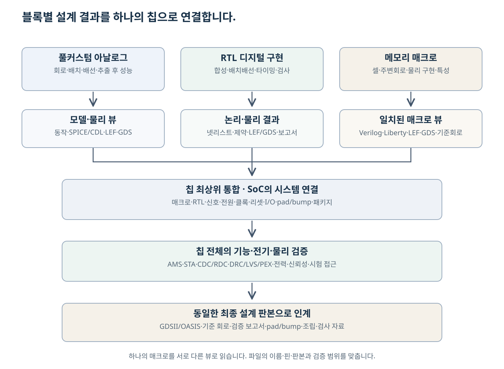

# 칩 최상위 통합·검증과 제조 인계 | Chip-level integration and signoff

[설계 목차](README.md) · [풀커스텀 레이아웃](14-아날로그풀커스텀레이아웃_full-custom-layout.md) · [혼합신호 통합](15-아날로그와RTL의혼합신호통합_analog-digital-integration.md) · [SoC 구조](16-SoC구조와IP통합_soc-architecture-integration.md)

## 블록의 완성과 칩의 완성 사이

아날로그 매크로의 레이아웃과 디지털 블록의 배치배선이 각각 끝나도, 최상위 전원·신호·외부 접속을 연결하는 작업이 남습니다. 칩에는 요구한 아날로그 회로만, 디지털 회로만, 또는 두 종류가 함께 들어갈 수 있습니다. 시스템 기능을 집적한 경우에는 CPU·메모리·버스·주변 장치를 포함하는 SoC 통합도 수행합니다.

직접 작성한 데이터 인계 개념도입니다. 위아래 화살표는 자료의 연결을 나타냅니다. 실제 프로젝트에서는 패드·전력·패키지 조건을 초기부터 함께 정하고 검증 결과에 따라 블록 설계로 돌아갑니다.

## 논리 top과 물리 chip top

논리 top은 IP 사이의 데이터·제어·주소·클록·리셋 연결을 설명합니다. 물리적인 칩 경계에는 공정에 맞는 I/O 셀·전원 셀·pad/bump·보호 구조 등이 더해집니다. 시뮬레이션이나 FPGA용 wrapper가 실제 ASIC 패드와 아날로그 전원 구조를 모두 포함한다고 가정하지 않습니다.

실제 공개 사례인 [OpenTitan의 최상위 계층 설명](https://opentitan.org/book/hw/top_earlgrey/)은 논리 설계와 대상별 chip wrapper를 나누어 설명합니다. ASIC용에는 패드·클록 생성 같은 대상 전용 요소가 연결됩니다. 모든 설계가 같은 이름의 파일이나 계층을 쓰지는 않지만, 기능 블록과 최종 칩 경계가 다르다는 점은 공통으로 확인할 수 있습니다.

| 경계 | 맞출 내용 | 잘못 연결하면 나타나는 예 |
| --- | --- | --- |
| 아날로그 매크로 ↔ 디지털 제어 | 핀·극성·기동·전압·클록·샘플 유효 조건입니다. | 준비 전에 샘플을 읽거나 제어 전압이 허용 범위를 벗어납니다. |
| 메모리 ↔ 연결망 | 주소·데이터 폭·지연·byte enable·전원 모드입니다. | 값이 한 사이클 어긋나거나 부분 쓰기가 깨집니다. |
| 블록 ↔ 전력망 | 실제 전원 핀·전압 영역·귀환 경로입니다. | RTL에서 보이지 않던 공급 연결이 빠집니다. |
| chip top ↔ 패키지 | pad/bump 위치·이름·전원·방향·핀 번호입니다. | 논리 핀은 맞지만 외부 패키지 핀으로 다르게 연결됩니다. |
| 하드웨어 ↔ 부팅·시험 코드 | reset 값·메모리 지도·핀 설정·시험 모드입니다. | 회로는 준비됐지만 핀 설정 때문에 밖에서 관찰하지 못합니다. |

## 패드·전원·ESD를 회로와 연결합니다

I/O 셀은 내부 논리와 외부 전기 신호를 연결하는 회로이고, bond pad는 와이어를 접합하는 금속 영역입니다. Bump는 플립칩 등의 접속점입니다. 셀에 pad가 포함된 경우도 있으므로 이름과 제공 뷰를 확인합니다. 논리 포트 하나를 선언했다고 이 구조가 자동으로 만들어지는 것은 아닙니다.

[OpenROAD Chip-level Connections](https://openroad.readthedocs.io/en/latest/main/src/pad/README.html)는 I/O ring·bond pad·bump array와 배치·연결을 다룹니다. 실제 설계에는 PDK·I/O 라이브러리가 제공하는 셀과 패키지의 접속 조건을 함께 사용합니다. 블록 핀의 위치를 정하는 기능과 외부 패드 회로를 배치하는 기능도 구분합니다.

ESD 보호 회로는 외부 정전기 방전에 대한 경로를 제공하도록 설계합니다. 신호 패드의 보호 소자·전원 클램프·전원/접지 경로가 연결되어야 합니다. 민감한 아날로그 핀에서는 보호 구조의 정전용량·누설·저항도 신호에 영향을 줍니다. 임의의 다이오드를 추가하는 방식 대신 해당 공정의 I/O 셀·전압 영역·신뢰성 규칙을 적용합니다. [GF180MCU의 ESD 지침](https://gf180mcu-pdk.readthedocs.io/en/latest/physical_verification/design_manual/drm_14_4.html)은 칩 전체의 의도한 경로와 기생 전류 경로를 함께 검토하도록 설명합니다. [Bond Pad 규칙](https://gf180mcu-pdk.readthedocs.io/en/latest/physical_verification/design_manual/drm_09.html)은 pad 구조와 조립·검사의 제약을 다루는 별도 자료입니다.

Seal ring·scribe 경계·fill·well/substrate 접속·패드 주변 금속은 최상위 범위에서 확인합니다. 일부 구조는 IP 내부에, 일부는 칩 조립 단계에 들어갑니다. 공정·패키지에 따라 요구가 달라지므로 어느 단계에서 누가 넣었는지와 최종 도형의 포함 여부를 함께 기록합니다.

## 매크로의 여러 뷰를 하나의 실물 블록으로 맞춥니다

아날로그 매크로는 기능 모델, SPICE/CDL, LEF와 GDS를 통해 서로 다른 도구에 나타납니다. STA에 사용할 디지털 경계가 있다면 해당 조건의 타이밍 자료도 필요합니다. 아날로그 입력 전압의 정확성을 Liberty 하나로 표현하는 것은 아닙니다.

최상위 배치에서는 LEF의 크기·핀·장애물로 자리를 확보합니다. GDS를 합칠 때에는 같은 매크로의 실제 도형을 사용합니다. LVS는 상위 연결과 매크로의 기준 회로·추출 회로를 대응시킵니다. Blockage는 다른 회로가 내부 자원을 침범하지 않도록 하는 조건이지, 잘못된 회로를 검증에서 제외하는 설정이 아닙니다.

LVS에서 매크로를 black box로 처리하면 내부 비교 범위는 생략됩니다. 그래서 별도 검증한 매크로의 식별자·핀·판본과 칩에서 사용한 인스턴스가 맞아야 합니다. 내부를 따로 검증했다고 해도 top의 전원·접지·핀 연결까지 자동으로 맞는 것은 아닙니다. 이 경계는 [DRC·LVS·PEX](10-DRC와LVS및PEX_physical-verification.md)와 연결됩니다.

## 칩 수준에서 다시 검사하는 항목

| 검사 | 블록 단위에서 추가되는 질문 |
| --- | --- |
| 기능·연결 검증 | 실제 칩 wrapper와 핀 설정에서 끝까지 데이터가 전달되는지 봅니다. |
| AMS·회로 해석 | 전원 인가·기동·전압 변환·아날로그 부하와 제어 순서가 맞는지 봅니다. |
| STA·CDC/RDC | 블록 사이의 실제 클록·입출력 예산·비동기 전달·리셋 관계를 봅니다. |
| DRC·LVS·ERC | 블록 경계와 최상위 배선·전원·패드가 추가된 도형과 연결을 봅니다. |
| PEX·신호·전원 분석 | 매크로 밖의 긴 배선·결합·공통 전원과 패키지 모델의 경계를 봅니다. |
| 밀도·안테나·신뢰성 | 최종 fill·배선·via·패드 구조를 포함한 공정 규칙을 봅니다. |
| DFT·MBIST·시험 모드 | 외부 핀에서 실제 시험 상태를 설정하고 결과를 읽을 수 있는지 봅니다. |
| 패키지·보드 인계 | 칩의 연결 정의가 bondplan·기판·시험 보드와 같은지 봅니다. |

LVS가 맞아도 회로의 이득·잡음·기동 시간이 요구와 다를 수 있습니다. RTL 시험이 맞아도 실제 전원 인가가 재현되지 않을 수 있습니다. 이 표는 각각 무엇을 확인해야 하는지 분류한 것이며, 모든 칩에 같은 도구·판본·명령을 적용하는 승인 절차는 아닙니다.

## 공개 예 1: Caravel의 아날로그 회로와 관리 SoC

[Caravel Analog User Project의 Verilog Integration·Analog Design Flow](https://caravel-user-project-analog.readthedocs.io/en/latest/)는 손으로 설계한 power-on-reset 회로와 wrapper를 관리 SoC에 연결하는 예입니다. 아날로그 회로도·ngspice 해석·Magic 레이아웃·Netgen LVS, Verilog의 동작 모델, GPIO를 설정하는 C 시험 코드의 역할이 나뉩니다.

이 사례에서 Verilog의 POR 모델은 칩 전체의 연결과 예상 순서를 시험하는 표현입니다. 실제 아날로그 지연과 온도·전압 특성을 모두 계산하는 회로 모델과 같지 않습니다. 관리 SoC의 전원과 시험 코드가 먼저 준비되어야 관찰 핀을 설정할 수 있다는 조건도 문서에 설명되어 있습니다. 아날로그 블록만 떼어 시험했을 때와 최상위 칩에서 관찰할 때의 조건이 다른 실제 예입니다.

코드와 회로는 해당 프로젝트의 [공식 저장소](https://github.com/efabless/caravel_user_project_analog)로 연결합니다. 문서에 있던 과거 MPW의 접수 명령을 현재 제작 일정이나 호환성 보증으로 제시하지 않습니다. 여기서는 자료가 설명하는 통합 구조와 관측 조건을 읽습니다.

## 공개 예 2: JKU의 혼합신호 칩 템플릿

Johannes Kepler University의 [IHP SG13G2 AMS 템플릿](https://github.com/iic-jku/ihp-sg13g2-ams-chip-template/tree/b1d4a98d0ec8ad71c57f8ec4c33344340f911dad)은 아날로그·디지털 매크로, padframe, 최상위 조립과 bondplan의 자료를 한 저장소에 배치한 예입니다. 2026-10-26에 확인한 커밋 `b1d4a98d…`로 링크를 고정했습니다.

| 실제 파일 | 읽을 내용 |
| --- | --- |
| [칩 명세](https://github.com/iic-jku/ihp-sg13g2-ams-chip-template/blob/b1d4a98d0ec8ad71c57f8ec4c33344340f911dad/doc/specifications.md) | 블록 목록·핀·설정 파일이 어디에 있는지 읽습니다. |
| [최상위 chip_top.sv](https://github.com/iic-jku/ihp-sg13g2-ams-chip-template/blob/b1d4a98d0ec8ad71c57f8ec4c33344340f911dad/rtl/chip_top.sv) | 칩 경계와 padframe의 구조를 읽습니다. |
| [내부 chip_core.sv](https://github.com/iic-jku/ihp-sg13g2-ams-chip-template/blob/b1d4a98d0ec8ad71c57f8ec4c33344340f911dad/rtl/chip_core.sv) | 매크로 인스턴스와 내부 연결을 읽습니다. |
| [LibreLane 설정](https://github.com/iic-jku/ihp-sg13g2-ams-chip-template/blob/b1d4a98d0ec8ad71c57f8ec4c33344340f911dad/flow/librelane/config.yaml) | 소스·매크로 뷰·위치·전원·구현 설정을 읽습니다. |
| [PDN 설정](https://github.com/iic-jku/ihp-sg13g2-ams-chip-template/blob/b1d4a98d0ec8ad71c57f8ec4c33344340f911dad/flow/librelane/pdn_cfg.tcl) | 최상위 전력망과 매크로 공급 연결을 읽습니다. |

이 저장소를 인용한 것은 파일의 연결을 설명하기 위해서입니다. 열람한 README에는 최상위 LVS와 일부 release 산출물이 아직 끝나지 않았다는 설명도 있습니다. `make all`이라는 목표가 있다는 사실을 모든 검증의 실제 완료나 제조 승인으로 옮기지 않습니다. 이 글에서도 해당 저장소를 빌드하거나 칩을 제작하지 않았습니다.

## 하나의 최종 판본으로 인계합니다

마지막에는 최상위 GDS/OASIS, 필요한 모든 매크로 도형, 기준 넷리스트, 제약·모드·코너, 검증 결과, 예외 승인, pad/bump·패키지 연결을 같은 설계 판본으로 묶습니다. ECO로 상위 배선만 바꾸어도 기생 성분·타이밍·전원·물리 규칙에 미치는 영향을 다시 확인합니다.

제조 인계가 끝난 뒤에는 웨이퍼 검사·패키지·실리콘 초기 구동이 이어집니다. 초기 구동에서는 전원 전류·리셋·클록·디버그·ROM 진행·메모리·주변 장치 순으로 관찰 지점을 마련합니다. 측정 계획과 설계 단계의 기대 조건을 연결하되, 아직 측정하지 않은 값을 결과로 적지 않습니다. 세부 자료 묶음은 [최종 파일과 제조 인계](13-최종파일과제조인계_tapeout-deliverables.md)에서 이어집니다.

확인일은 2026-10-26입니다. 공개 자료와 통합 원리를 설명한 본문이며, 상용 툴 실행·칩 전체 signoff·실리콘 제작 성과를 새로 보고한 문서는 아닙니다.
