# 실제 회로와 GDS 레이아웃 읽기 | Circuits and GDS layouts

[설계 목차](README.md) · [SRAM 원리](05-SRAM셀과메모리매크로_sram-design.md) · [풀커스텀 설계](14-아날로그풀커스텀레이아웃_full-custom-layout.md) · [원본·출처·이용 조건](사진과화면_images/회로와레이아웃_layout-detail/README.md)

회로도의 선은 전기적 연결을 나타내고, 레이아웃은 그 연결을 소자·접촉·배선층의 도형으로 구현합니다. 이 글에서는 공개된 원본 GDS를 셀, 배열, 매크로, 칩 전체 순서로 확대해 봅니다. 그림을 누르면 큰 이미지로 볼 수 있으며, 각 절의 GDS를 내려받으면 같은 도형을 직접 확대할 수 있습니다.

GDS 그림은 원본 설계 데이터를 KLayout 0.30.12로 출력했습니다. 도형과 배치는 그대로 두고 표시 색·무늬와 확대 범위를 설정했습니다. 색은 재료의 실제 색이 아니라 레이어를 구별하는 표시입니다. 논문의 회로도·칩 사진·레이아웃 그림은 원본 그림 번호를 별도로 표시했습니다. 자료 확인일은 2026-10-27입니다.

| 대상 | 그림에서 이어서 볼 부분 | 직접 열어 볼 자료 |
| --- | --- | --- |
| SRAM 6T 셀 | 여섯 MOS, 저장 노드와 비트라인 | OpenRAM GDS·SPICE·레이어 표 |
| SRAM 주변회로 | 감지 증폭기, 쓰기 구동기와 핀 | 각 회로의 GDS·SPICE |
| SRAM 매크로 | 전체 배열 → 하위 배열 → 반복 셀 | IHP 공식 GDS·CDL |
| 풀커스텀 인버터 | 회로 심벌 → 여러 핑거 → 전원·입출력 배선 | JKU 회로도·GDS·CDL |
| SAR ADC | 전체 ADC → 비교기·래치 → 입력 소자 | JKU 전체·하위 블록 GDS와 회로 자료 |
| 혼합신호 칩 | 패드 링, 전원망, SRAM·아날로그·디지털 매크로 | JKU 칩 전체 GDS |
| 연구용 eDRAM | 저장 회로 → 셀 레이아웃 → 시험 칩 사진 | 원논문 Figures 7·14·15 |
| HBM 인터포저 | 범프 배열과 금속층별 실제 배선 설계 | 원논문 Figure 3 |

완성 실리콘의 칩 전체 배치와 상용 CPU의 실제 다이, CPU·GPU 기능 구조, 클록·전압·전력 그래프와 전자현미경 단면은 [칩 전체 구조와 동작 특성](19-칩전체구조와동작특성_chip-structure-and-characteristics.md)에서 함께 읽으실 수 있습니다.

## 1. 6T SRAM: 회로의 여섯 소자를 레이아웃에서 찾기

아래 두 그림은 OpenRAM의 같은 `cell_1rw.gds`입니다. 왼쪽은 배선까지 겹쳐 보고, 오른쪽은 금속층을 숨겨 게이트와 활성 영역을 살펴봅니다. 이 예제는 FreePDK45 연구용 기술 자료입니다. 최근 상용 SRAM의 마스크를 나타내는 자료는 아닙니다. [OpenRAM 원본 기술 폴더](https://github.com/VLSIDA/OpenRAM/tree/b2b069ce119d1488cbe6883b2240bceb5c7ce29a/technology/freepdk45)

| 소자와 배선을 함께 보기 | 금속층을 숨겨 소자 보기 |
| --- | --- |
| [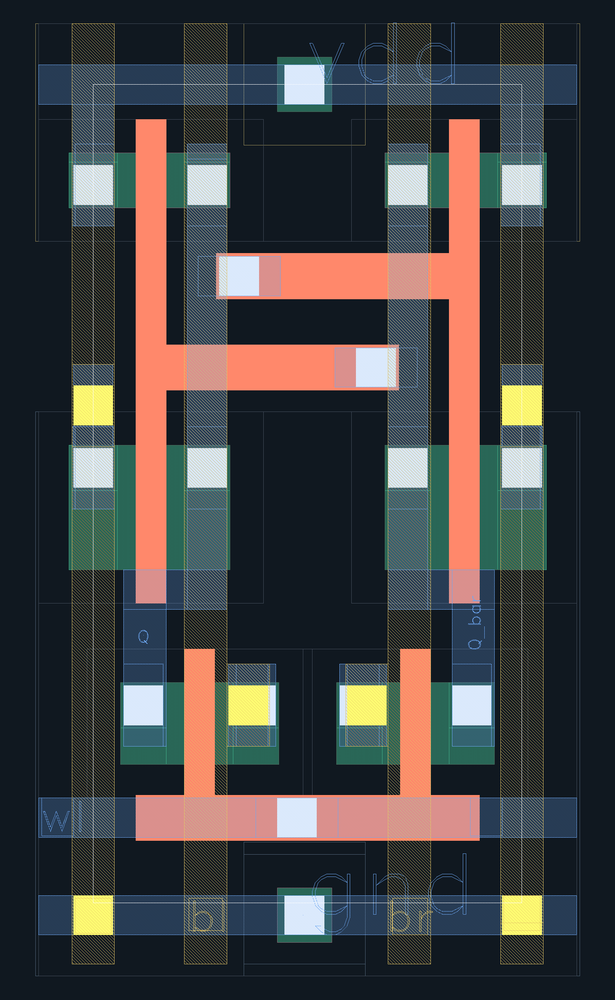](사진과화면_images/회로와레이아웃_layout-detail/openram-cell_1rw-all-layers.png) | [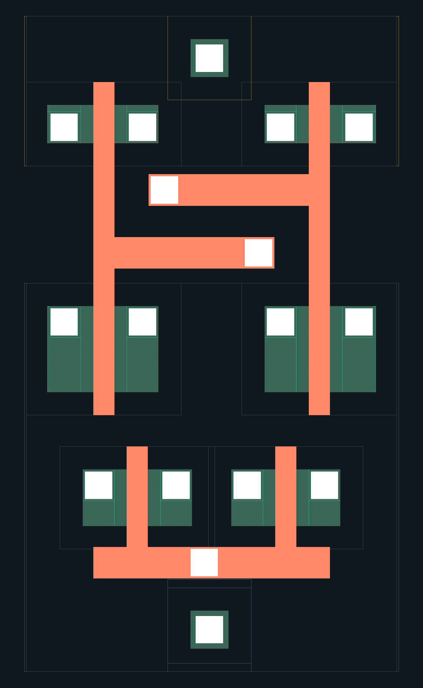](사진과화면_images/회로와레이아웃_layout-detail/openram-cell_1rw-devices.png) |

출처: OpenRAM, 고정 커밋 `b2b069c`, `technology/freepdk45/gds_lib/cell_1rw.gds`. BSD-3-Clause. 원본 GDS에서 출력했으며 오른쪽은 레이어 1·2·3·4·5·6·9·10만 표시했습니다. [GDS 사본](사진과화면_images/회로와레이아웃_layout-detail/원본_sources/openram/cell_1rw.gds) · [대응 SPICE](사진과화면_images/회로와레이아웃_layout-detail/원본_sources/openram/cell_1rw.sp)

| 이 그림의 표시 | 원본 GDS 레이어 | 읽는 방법 |
| --- | --- | --- |
| 초록색 활성 영역 | 1, `active` | 이 영역과 게이트가 겹치는 부분에서 MOS 채널을 찾습니다. |
| 주황색 폴리 | 9, `poly` | 활성 영역 위를 지나는 게이트와, 게이트를 잇는 도형을 구분합니다. |
| 흰색 접촉 | 10, `contact` | 아래 소자·폴리와 금속1을 연결하는 위치입니다. |
| 파란색 금속1 | 11, `metal1` | `Q`, `Q_bar`, `wl` 등의 연결을 따라갑니다. |
| 노란색 비아1·금색 금속2 | 12, `via1` · 13, `metal2` | 금속1↔금속2 연결과 `bl`, `br` 비트라인을 살펴봅니다. |

레이어 이름은 [원본 layers.map](사진과화면_images/회로와레이아웃_layout-detail/원본_sources/openram/layers.map)에 따릅니다. 위 색은 이 글의 보기 설정입니다. 다른 PDK에서 같은 번호·색을 그대로 사용하지 않습니다.

대응 SPICE에는 아래 여섯 MOS가 있습니다. `Q`와 `Q_bar`는 서로 반대 상태를 유지하는 내부 저장 노드입니다. [원본 cell_1rw.sp](https://github.com/VLSIDA/OpenRAM/blob/b2b069ce119d1488cbe6883b2240bceb5c7ce29a/technology/freepdk45/sp_lib/cell_1rw.sp)

| 회로의 소자 | 연결과 역할 | 그림과 연결할 부분 |
| --- | --- | --- |
| `MM0`, `MM4` | 입력 `Q`, 출력 `Q_bar`인 NMOS·PMOS 인버터입니다. | 한 저장 노드가 반대쪽 게이트로 이어지는 배선을 봅니다. |
| `MM1`, `MM5` | 입력 `Q_bar`, 출력 `Q`인 반대쪽 인버터입니다. | 두 인버터가 서로 연결된 되먹임 경로를 봅니다. |
| `MM3` | 게이트 `wl`, 양쪽 연결 `bl`·`Q`인 접근 NMOS입니다. | 아래쪽 접근 소자와 왼쪽 비트라인 연결을 봅니다. |
| `MM2` | 게이트 `wl`, 양쪽 연결 `br`·`Q_bar`인 접근 NMOS입니다. | 같은 워드라인과 오른쪽 비트라인 연결을 봅니다. |

오른쪽 그림에서 폴리가 활성 영역을 가로지르는 여섯 곳을 먼저 찾고, 왼쪽에서 접촉·배선을 이어 읽으면 회로의 역할을 따라가기 쉽습니다. 겹쳐 보이는 두 금속선이 항상 연결되는 것은 아닙니다. 서로 다른 금속층 사이에는 해당 비아가 있어야 합니다. 읽기·쓰기 때 이 노드들이 어떻게 움직이는지는 [SRAM 셀의 원리](05-SRAM셀과메모리매크로_sram-design.md)와 연결됩니다.

## 2. SRAM 주변회로: 감지 증폭기와 쓰기 구동기

| 감지 증폭기 `sense_amp` | 쓰기 구동기 `write_driver` |
| --- | --- |
| [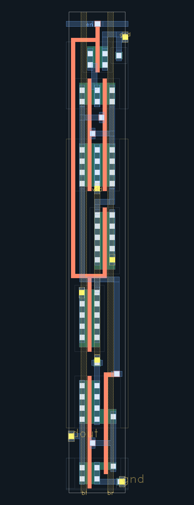](사진과화면_images/회로와레이아웃_layout-detail/openram-sense_amp-all-layers.png) | [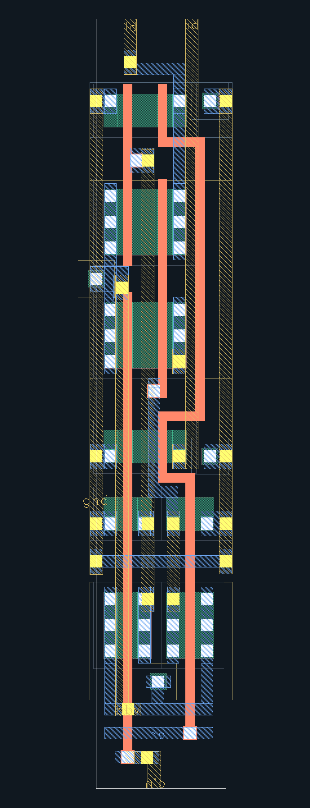](사진과화면_images/회로와레이아웃_layout-detail/openram-write_driver-all-layers.png) |

출처: 같은 OpenRAM FreePDK45 판본의 `sense_amp.gds`와 `write_driver.gds`, BSD-3-Clause. 전체 셀을 출력했습니다. [감지기 GDS](사진과화면_images/회로와레이아웃_layout-detail/원본_sources/openram/sense_amp.gds) · [감지기 SPICE](사진과화면_images/회로와레이아웃_layout-detail/원본_sources/openram/sense_amp.sp) · [쓰기 구동기 GDS](사진과화면_images/회로와레이아웃_layout-detail/원본_sources/openram/write_driver.gds) · [쓰기 구동기 SPICE](사진과화면_images/회로와레이아웃_layout-detail/원본_sources/openram/write_driver.sp)

감지기는 배열의 `bl`·`br`을 입력으로 받아 `en`에 따라 판정하고 `dout`으로 전달합니다. 원본 SPICE의 MOS는 11개입니다. 먼저 그림 아래쪽 두 비트라인을 찾고, 중앙 소자 묶음과 출력 쪽 배선을 순서대로 봅니다. 작은 셀 하나보다 소자·배선이 길게 이어지는 이유를 출력 단계까지 포함한 넷리스트에서 확인할 수 있습니다. [원본 sense_amp.sp](https://github.com/VLSIDA/OpenRAM/blob/b2b069ce119d1488cbe6883b2240bceb5c7ce29a/technology/freepdk45/sp_lib/sense_amp.sp)

쓰기 구동기는 `din`과 `en`을 받아 비트라인을 구동합니다. 원본 SPICE의 MOS는 12개입니다. 그림 위쪽 `bl`·`br`, 아래쪽 `din`·`en`을 연결해 읽습니다. 저장 셀은 값을 유지하고, 이 주변회로는 선택한 순간에 배열로 데이터를 밀어 넣는 역할을 한다는 차이가 중요합니다. 실제 배열에서는 구동기의 전류와 비트라인 부하도 함께 확인합니다. [원본 write_driver.sp](https://github.com/VLSIDA/OpenRAM/blob/b2b069ce119d1488cbe6883b2240bceb5c7ce29a/technology/freepdk45/sp_lib/write_driver.sp)

## 3. IHP SRAM: 전체 매크로에서 반복 셀까지

[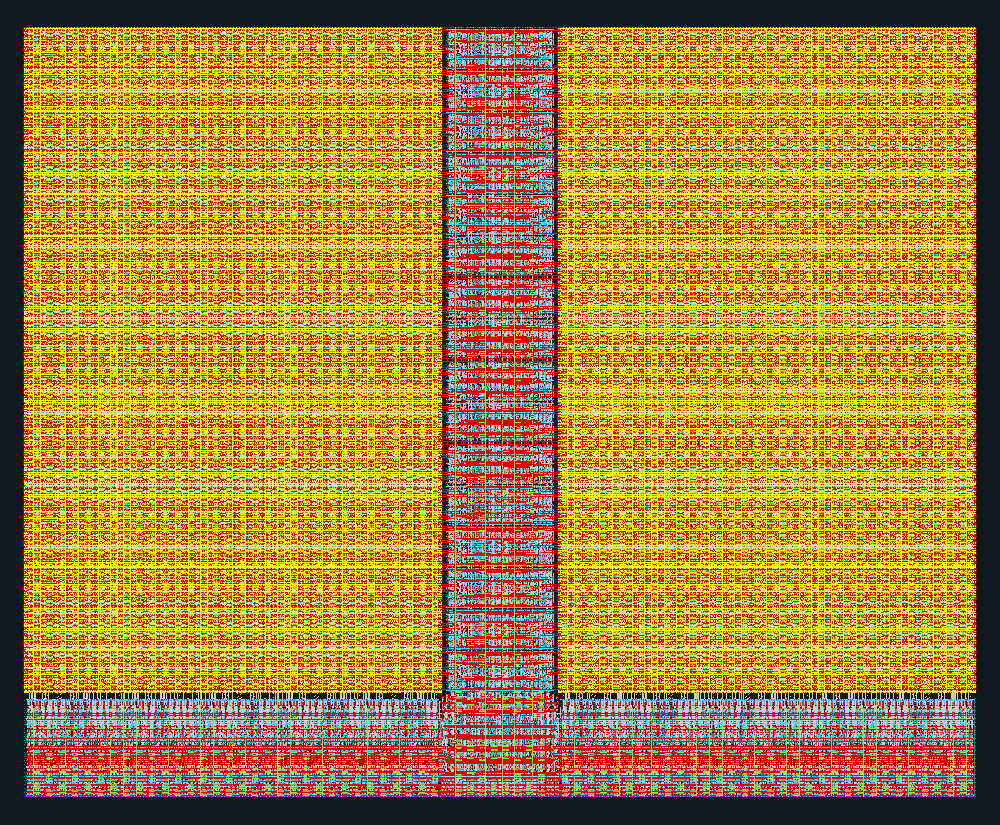](사진과화면_images/회로와레이아웃_layout-detail/ihp-sram1024x32-full.png)

출처: IHP PDK Authors, IHP-Open-PDK 커밋 `5e6d592`, `RM_IHPSG13_1P_1024x32_c2_bm_bist.gds`, Apache-2.0. IHP의 레이어 표시 파일을 사용해 전체 계층을 출력했습니다. [공식 GDS 경로](https://github.com/IHP-GmbH/IHP-Open-PDK/blob/5e6d592e4002946a4616f798c357f0f3c06cf3b6/ihp-sg13g2/libs.ref/sg13g2_sram/gds/RM_IHPSG13_1P_1024x32_c2_bm_bist.gds) · [GDS 사본](사진과화면_images/회로와레이아웃_layout-detail/원본_sources/ihp/sram1024x32.gds) · [CDL 사본](사진과화면_images/회로와레이아웃_layout-detail/원본_sources/ihp/sram1024x32.cdl)

논리 용량은 `1024 × 32 = 32768 bit = 4 KiB`입니다. 위에서 넓게 반복되는 두 영역, 가운데 세로 영역과 아래쪽 주변회로의 배치 차이를 먼저 봅니다. 규칙적으로 반복되는 저장부와 주소·데이터를 처리하는 주변부가 서로 다른 밀도와 배선 형태를 갖습니다. 각 도형의 정확한 기능은 셀 계층과 CDL을 함께 보며 확인합니다.

| 하위 배열 | 반복 셀 확대 |
| --- | --- |
| [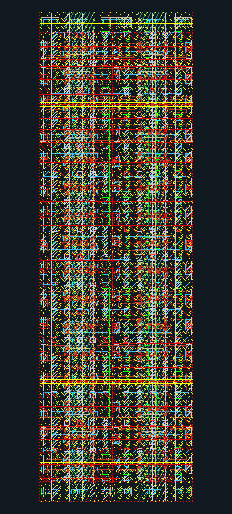](사진과화면_images/회로와레이아웃_layout-detail/ihp-sram-16x2-array.png) | [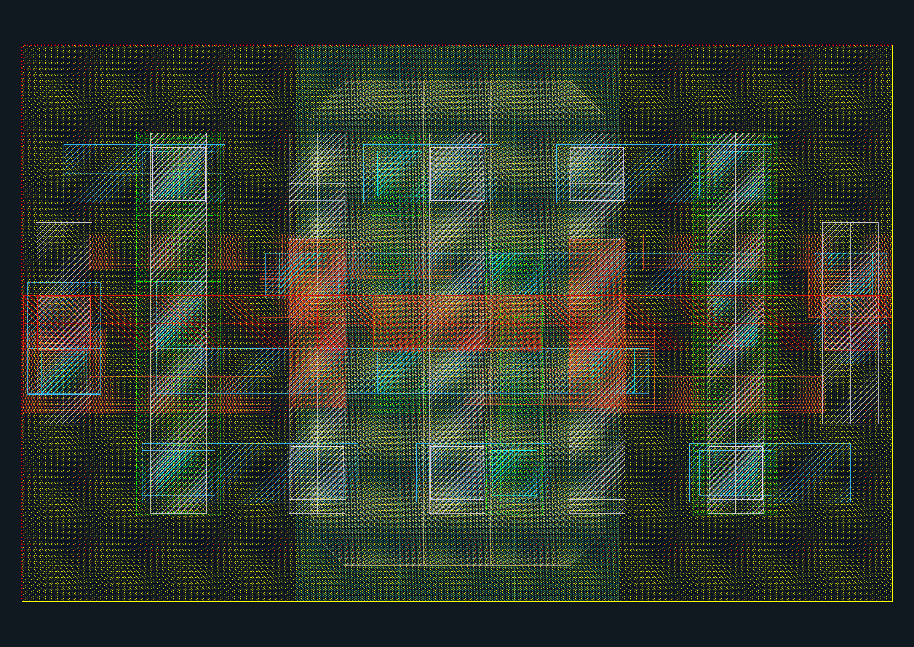](사진과화면_images/회로와레이아웃_layout-detail/ihp-sram-bitkit-cell.png) |

같은 GDS에서 각각 `RM_IHPSG13_1P_BITKIT_16x2_SRAM`과 `RM_IHPSG13_1P_BITKIT_CELL`을 선택했습니다. 겹치는 글자를 숨기고 도형은 모두 유지했습니다. 하위 배열에서 반복 간격과 접속을 보고, 셀 확대에서 게이트·접촉·배선의 겹침을 살펴봅니다. 이름의 `16x2`나 `CELL`만으로 저장 비트 수·트랜지스터 수를 정하지 않고, 실제 인스턴스와 연결 정의를 읽습니다.

GDS는 여러 셀을 반복 배치하는 계층을 보존합니다. 따라서 전체 매크로의 도형을 한 번에 보는 방법과, 관심 있는 하위 셀을 골라 보는 방법이 모두 필요합니다. 이 IHP 자료와 앞의 OpenRAM FreePDK45 자료는 서로 다른 공정·설계입니다. 모양이나 배선 밀도의 차이를 같은 조건에서의 성능 비교로 해석하지 않습니다.

## 4. 풀커스텀 인버터: 심벌 두 개가 많은 줄무늬가 되는 이유

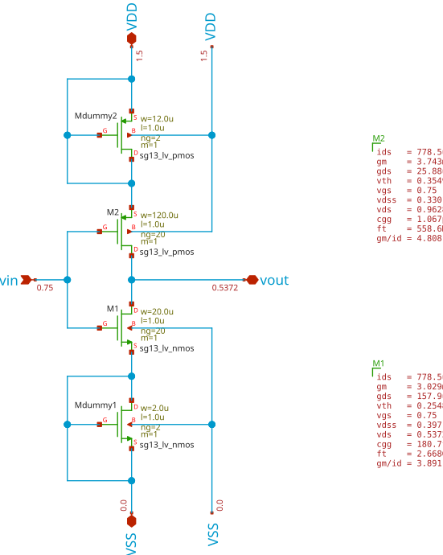

출처: © 2026 Simon Dorrer and Harald Pretl, JKU IHP SG13G2 AMS 템플릿 커밋 `b1d4a98`, [원본 회로도 SVG](https://github.com/iic-jku/ihp-sg13g2-ams-chip-template/blob/b1d4a98d0ec8ad71c57f8ec4c33344340f911dad/tutorial/fig/inverter_top/inverter_schematic.svg), Apache-2.0 WITH SHL-2.1. 그림의 OP 동작점 주석은 원저자가 표시한 값입니다.

[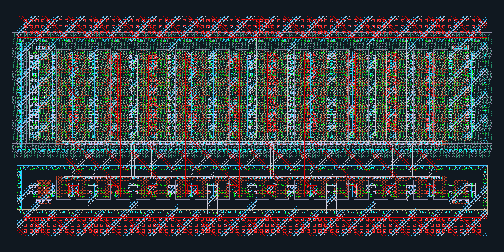](사진과화면_images/회로와레이아웃_layout-detail/jku-ihp-inverter-cell.png)

같은 프로젝트의 `macros/inverter/layout/inverter.gds`를 IHP 레이어 설정으로 출력했습니다. [원본 GDS](https://github.com/iic-jku/ihp-sg13g2-ams-chip-template/blob/b1d4a98d0ec8ad71c57f8ec4c33344340f911dad/macros/inverter/layout/inverter.gds) · [GDS 사본](사진과화면_images/회로와레이아웃_layout-detail/원본_sources/jku-ihp/inverter.gds) · [회로도 원본](사진과화면_images/회로와레이아웃_layout-detail/원본_sources/jku-ihp/inverter.sch) · [CDL](사진과화면_images/회로와레이아웃_layout-detail/원본_sources/jku-ihp/inverter.cdl)

| 회로 자료의 항목 | 레이아웃에서 볼 내용 |
| --- | --- |
| `MM1`: NMOS, `ng=20` | 작은 쪽 소자 열에서 여러 게이트 핑거와 반복 접촉을 봅니다. |
| `MM2`: PMOS, `ng=20` | 더 넓은 소자 영역과 전원·출력 접촉을 봅니다. |
| `vin`, `vout`, `VDD`, `VSS` | 게이트 입력, 드레인 출력, 전원·접지를 넷리스트와 대조합니다. |
| `MMdummy1`, `MMdummy2` | 실제 신호용 소자 외에 주변 조건을 맞추는 더미 소자도 포함됩니다. |

핑거는 넓은 트랜지스터를 여러 개의 평행한 게이트 부분으로 나누어 배치하는 형태입니다. 이 회로의 CDL은 신호용 NMOS·PMOS에 각각 `ng=20`을 지정합니다. 그러므로 줄무늬 하나하나를 독립된 논리 인버터로 세면 회로를 잘못 읽게 됩니다. 소자 폭·길이, 핑거 수와 넷 연결을 함께 봅니다. [대응 원본 CDL](https://github.com/iic-jku/ihp-sg13g2-ams-chip-template/blob/b1d4a98d0ec8ad71c57f8ec4c33344340f911dad/macros/inverter/netlist/schematic/inverter_klayout.cdl)

## 5. SAR ADC: 전체 배치와 비교기 소자 확대

[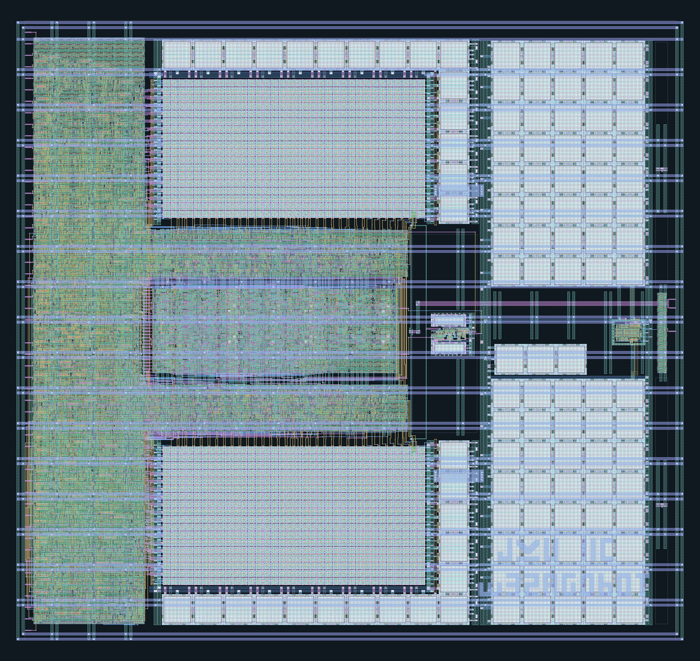](사진과화면_images/회로와레이아웃_layout-detail/jku-sar-adc-full.png)

출처: Manuel Moser, JKU `SKY130_SAR-ADC1`, 커밋 `3cec582`, Apache-2.0. `adc_top.gds.gz`의 전체 계층입니다. [원본 프로젝트](https://github.com/iic-jku/SKY130_SAR-ADC1/tree/3cec5823e64cf1ea5c625615ad71f2a505cf27bc) · [GDS 사본](사진과화면_images/회로와레이아웃_layout-detail/원본_sources/jku-sar/adc_top.gds.gz) · [최상위 회로도 원본](사진과화면_images/회로와레이아웃_layout-detail/원본_sources/jku-sar/adc_top.sch)

SAR ADC는 입력 전압과 내부 DAC의 비교 결과를 이용해 디지털 코드를 순차적으로 정하는 회로입니다. 위 그림에서 규칙적인 커패시터 배열, 작은 비교기 블록, 조밀한 제어 회로와 그 사이 배선을 구분해 봅니다. 회로도에서 기능 블록으로 표현한 대상이 실제로는 서로 다른 면적과 배치 형태를 갖습니다. 블록의 이름과 위치는 GDS의 셀 계층과 최상위 회로도를 함께 보며 찾습니다.

[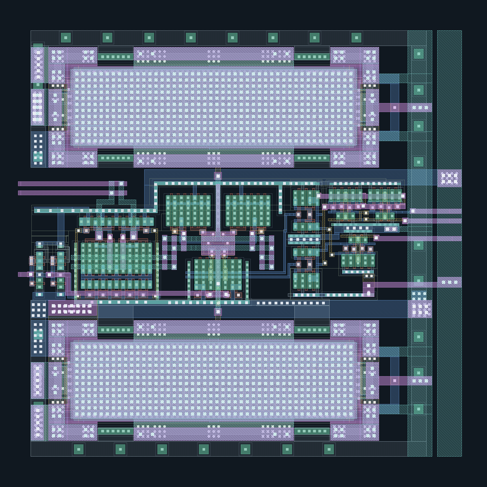](사진과화면_images/회로와레이아웃_layout-detail/jku-sar-comparator-detail.png)

같은 프로젝트의 `adc_comp_latch.gds.gz`에서 x=10–42 µm, y=48–80 µm 영역을 확대했습니다. 원본의 넓은 경계 여백 대신 실제 소자와 배선을 보여 줍니다. [하위 블록 GDS](사진과화면_images/회로와레이아웃_layout-detail/원본_sources/jku-sar/adc_comp_latch.gds.gz) · [비교기 회로도](사진과화면_images/회로와레이아웃_layout-detail/원본_sources/jku-sar/adc_comp_circuit.sch) · [비교기·래치 회로도](사진과화면_images/회로와레이아웃_layout-detail/원본_sources/jku-sar/adc_comp_latch.sch) · [전개된 SPICE](사진과화면_images/회로와레이아웃_layout-detail/원본_sources/jku-sar/adc_comp_latch.sch.spice)

원본 넷리스트에서 `adc_comp_circuit`의 `XM3`·`XM4` 게이트는 각각 `inp`·`inn`에 연결됩니다. 입력 쌍이 비슷한 전기적 조건을 갖도록 배치하는 문제를 이 두 경로에서 살펴볼 수 있습니다. `adc_comp_latch`에는 이 비교기 외에 두 인버터, NOR 회로와 래치가 연결됩니다. 확대 그림 전체를 입력 쌍 하나로 보지 않고 하위 셀별로 나누어 읽습니다. 위아래의 큰 직사각형 부품은 원본 `adc_noise_decoup_cell2`의 커패시터 도형과 연결해 확인할 수 있습니다. [원본 비교기·래치 SPICE](https://github.com/iic-jku/SKY130_SAR-ADC1/blob/3cec5823e64cf1ea5c625615ad71f2a505cf27bc/spice/adc_comp_latch.sch.spice)

## 6. 혼합신호 칩: 매크로와 패드 링을 한 화면에서 보기

출처: © 2026 Simon Dorrer and Harald Pretl, JKU IHP SG13G2 AMS 템플릿, 같은 커밋 `b1d4a98`의 `layout/chip_top.gds.gz`. Apache-2.0 WITH SHL-2.1이며 PDK 유래 부분의 IHP 고지도 함께 보관했습니다. [원본 GDS](https://github.com/iic-jku/ihp-sg13g2-ams-chip-template/blob/b1d4a98d0ec8ad71c57f8ec4c33344340f911dad/layout/chip_top.gds.gz) · [GDS 사본](사진과화면_images/회로와레이아웃_layout-detail/원본_sources/jku-ihp/chip_top.gds.gz) · [원저자 설명](https://iic-jku.github.io/ihp-sg13g2-ams-chip-template/)

아래쪽 왼편의 큰 SRAM, 오른쪽의 작은 인버터·카운터 매크로, 바깥쪽 패드와 내부 전원 배선을 차례로 봅니다. 작은 회로를 만들 때와 달리, 칩 전체에서는 각 매크로까지 전원과 신호를 전달하는 구조가 크게 보입니다. 금속층을 모두 켜면 전원망이 아래 소자를 가릴 수 있으므로 GDS에서 층을 차례로 숨기며 읽는 것이 좋습니다.

이 칩에 내장된 SRAM과 3절에서 별도로 가져온 IHP PDK의 SRAM은 서로 다른 판본에서 확보한 파일입니다. 이름이 같아도 동일한 파일로 취급하지 않습니다. 또한 원저자의 칩 전체 회로도에는 SRAM이 생략되어 있어, 이 칩의 모든 소자를 회로도 그림 한 장과 일대일 대응시킬 수는 없습니다. 통합·검증 상태는 [칩 최상위 검증 본문](17-칩최상위검증과제조인계_chip-top-signoff.md)의 원저자 기록과 함께 읽습니다.

## 7. 연구용 eDRAM: 회로·레이아웃·칩 사진을 함께 보기

출처: Subin Kim, Ingu Jeong, Jun-Eun Park, 2023, [An N-Type Pseudo-Static eDRAM Macro…](https://www.mdpi.com/1424-8220/23/23/9329), Sensors 23(23), 9329, Figure 15. © 2023 저자들, [CC BY 4.0](https://creativecommons.org/licenses/by/4.0/). 출판사 PNG 원본입니다.

(a)의 시험 칩 사진, (b)의 4 kb 매크로, (c)의 셀 레이아웃은 서로 다른 확대 수준입니다. 셀 그림의 저장 회로와 읽기·쓰기 배선을 먼저 찾고, 그 모양이 매크로에서 반복되는 관계를 봅니다. 이는 gain-cell 방식의 연구용 eDRAM이며, [앞서 설명한 상용 DRAM의 1T1C 원리](06-DRAM셀과주변회로_dram-design.md)와 셀 구성이 다릅니다.

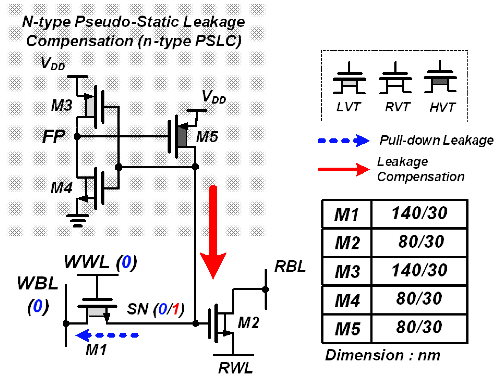

같은 논문 Figure 7, 저자들·CC BY 4.0. `SN`은 값을 저장하는 노드이고 `WWL`·`WBL`은 쓰기, `RWL`·`RBL`은 읽기 경로와 연결됩니다. 저장 노드의 누설을 다루는 추가 소자 때문에 앞의 6T SRAM이나 1T1C DRAM과 다른 회로·레이아웃이 됩니다.

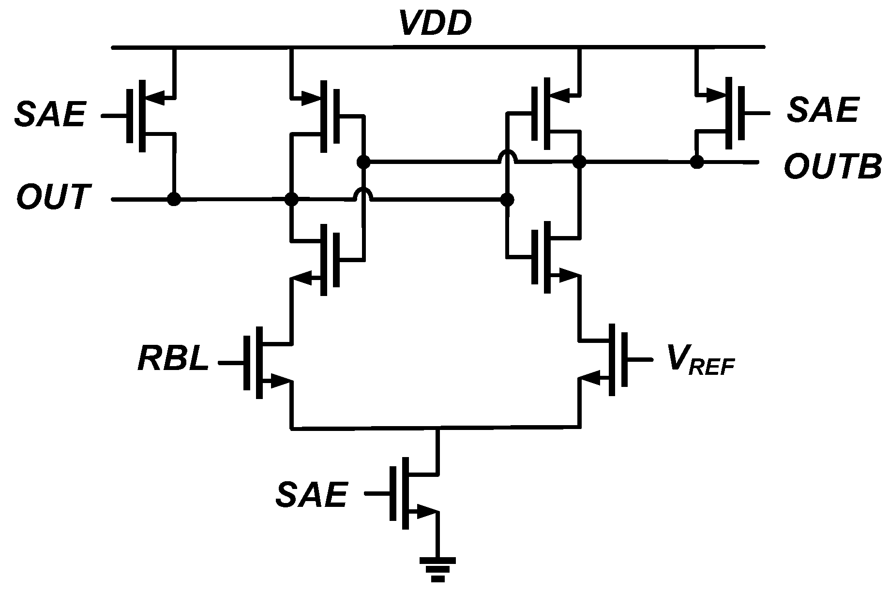

같은 논문 Figure 14, 저자들·CC BY 4.0. 셀 회로만 보지 않고 읽기 결과를 판정하는 감지 회로까지 이어 봅니다. Figures 7·14·15를 함께 읽으면 저장 원리, 주변회로와 실제 배치의 관계를 비교할 수 있습니다. 이 그림에는 편집 주석이나 도형을 추가하지 않았습니다.

## 8. HBM: 범프에서 인터포저 금속 배선까지

출처: Wen-Xue Tang et al., 2025, [HBM Package Interconnection Pseudo All-Channel Signal Integrity Simulation…](https://www.mdpi.com/2072-666X/16/8/896), Micromachines 16(8), 896, Figure 3(a)–(b). © 2025 저자들, [CC BY 4.0](https://creativecommons.org/licenses/by/4.0/). 출판사 PNG 원본입니다.

위쪽은 금속층과 기판의 단면이고, 아래쪽은 HBM 쪽 범프에서 AI 칩 쪽 범프까지 이어지는 배선 설계입니다. 점 배열만 보던 외관 사진에서 한 단계 들어가, 각 접점 사이에 실제 배선 경로와 전원·접지 구조가 필요하다는 점을 읽을 수 있습니다.

이 연구는 Metal1·Metal3의 신호 경로와 Metal2의 접지층을 구분합니다. 아래쪽의 안쪽·바깥쪽 범프를 따라가며 선들이 어떤 층에서 지나가는지 봅니다. 논문의 분석 대상은 HBM 패키지 연결을 위한 연구 배선 구조입니다. 상용 HBM4·HBM4E 코어 다이 전체의 공개 마스크나 직접 내려받을 수 있는 전체 GDS를 의미하지 않습니다. [HBM 다이·PHY·인터포저의 역할](11-HBM과3D집적설계_hbm-3d-integration.md)과 연결하면 셀 설계와 다이 간 배선 설계를 구별할 수 있습니다.

## 9. 원본 GDS를 직접 확대하는 순서

1. 위 링크의 `.gds` 또는 `.gds.gz` 파일을 내려받아 KLayout에서 엽니다. GitHub 파일 화면에서는 `Download raw file`을 사용합니다. 압축 파일을 읽지 못하는 환경에서는 사본의 gzip 압축을 먼저 풉니다.
2. 셀 목록에서 관심 있는 셀을 선택합니다. 전체 칩과 `BITKIT_CELL`, `adc_comp_circuit` 같은 하위 셀을 번갈아 보면 반복 구조와 연결을 읽기 쉽습니다.
3. 전체 계층을 펼쳐 하위 셀의 도형을 표시합니다. 셀 경계 상자만 보일 때는 계층 표시 깊이를 확인합니다.
4. IHP 자료에는 보관한 [공식 sg13g2.lyp](사진과화면_images/회로와레이아웃_layout-detail/원본_sources/ihp/sg13g2.lyp)를 읽습니다. OpenRAM 예제에는 이 글의 [FreePDK45 보기 설정](사진과화면_images/회로와레이아웃_layout-detail/원본_sources/보기설정_display/freepdk45-reading.lyp)을 사용할 수 있습니다.
5. 먼저 소자층을 보고, 금속1·비아·상위 금속을 차례로 켭니다. 핀 이름은 대응 SPICE·CDL의 서브회로 단자와 대조합니다.
6. 거리 측정이 필요하면 GDS 좌표 단위와 PDK 정의를 확인합니다. PNG의 픽셀 수를 공정 치수로 직접 환산하지 않습니다.

KLayout의 계층 보기와 레이어 설정은 [공식 기본 사용법](https://www.klayout.de/doc/manual/basic.html)에서 이어 읽으실 수 있습니다. SKY130 그림에 사용한 [보기 설정](사진과화면_images/회로와레이아웃_layout-detail/원본_sources/보기설정_display/sky130-reading.lyp)은 이 글에서 정한 색·무늬이며, 레이어 의미는 [공식 SKY130 레이어 표](https://skywater-pdk.readthedocs.io/en/main/rules/layers.html)와 대조합니다.

이미지의 셀 이름·표시 레이어·확대 좌표와 원본 파일의 SHA-256은 [출처 기록](사진과화면_images/회로와레이아웃_layout-detail/README.md)에 연결했습니다. 이 글의 작업은 기존 설계 데이터의 열람·출력과 연결 설명입니다. 새 회로의 시뮬레이션, DRC·LVS·PEX 통과나 실물 측정을 수행한 결과로 읽지는 않습니다.

## English

Inspect original public layouts from a 6T SRAM bitcell through peripheral circuits, an IHP SRAM macro, a full-custom inverter, a SKY130 SAR ADC and an IHP mixed-signal chip. Downloadable GDS and matching circuit sources accompany the images. Research figures separately show gain-cell eDRAM circuits and layout, and HBM interposer routing. The GDS images preserve source geometry; only viewing settings and framing were changed. Source revisions, licenses and hashes are recorded with the assets.
