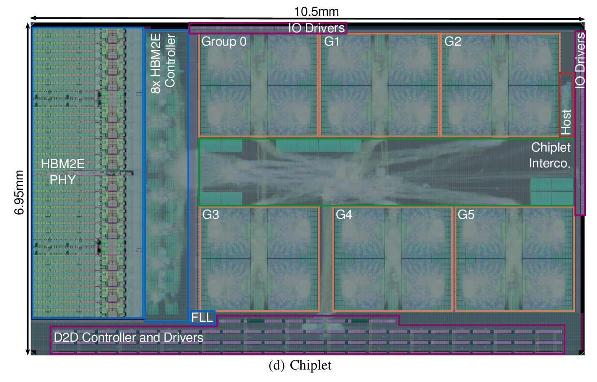
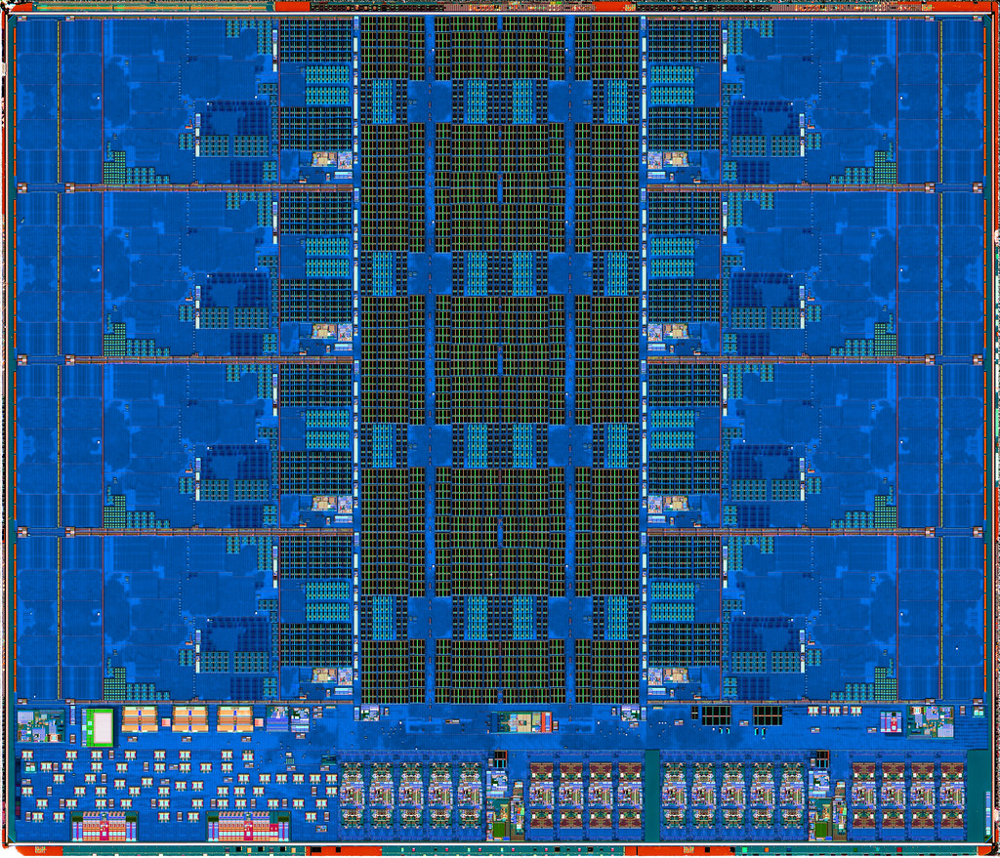
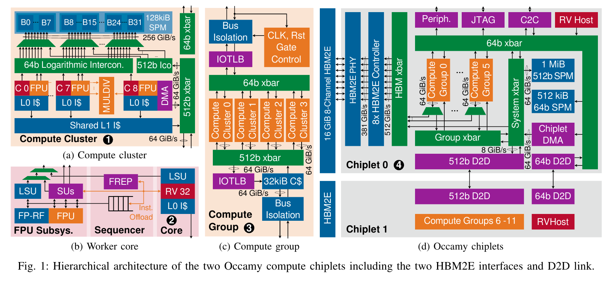
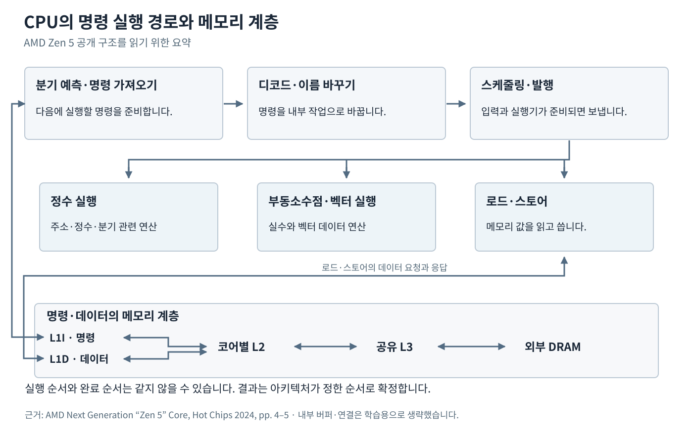
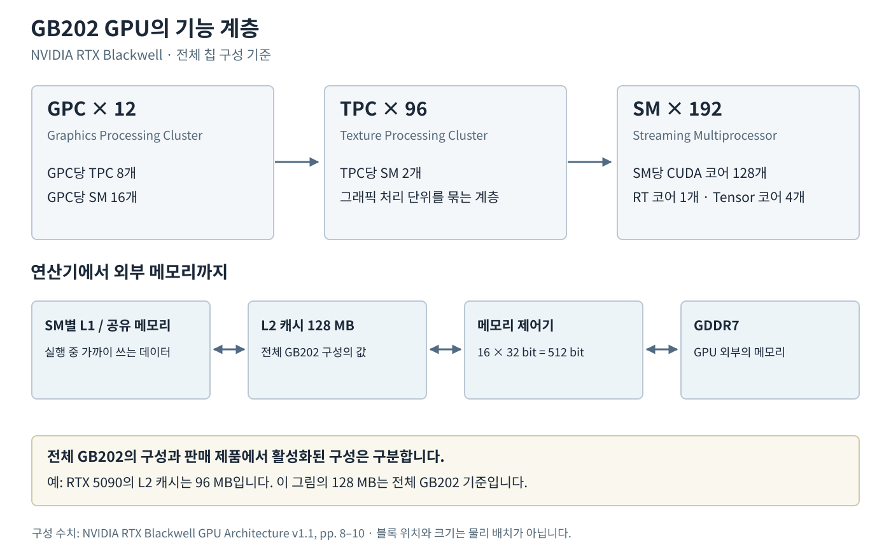
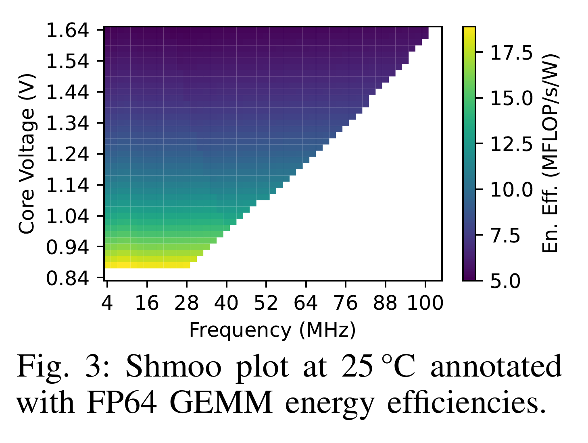
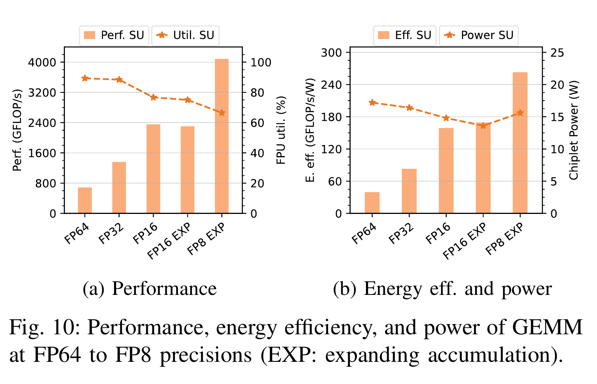
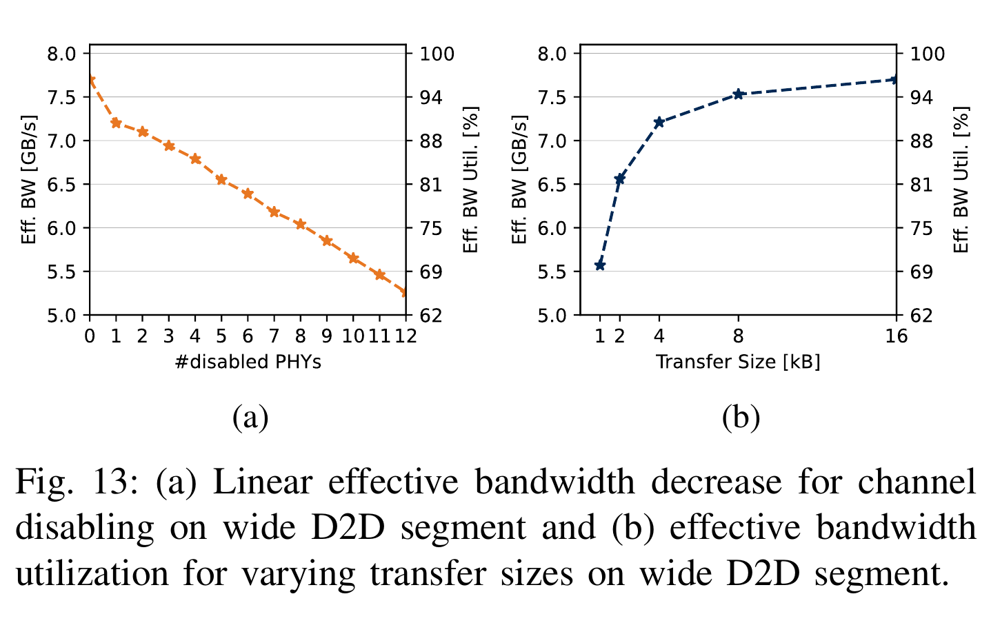
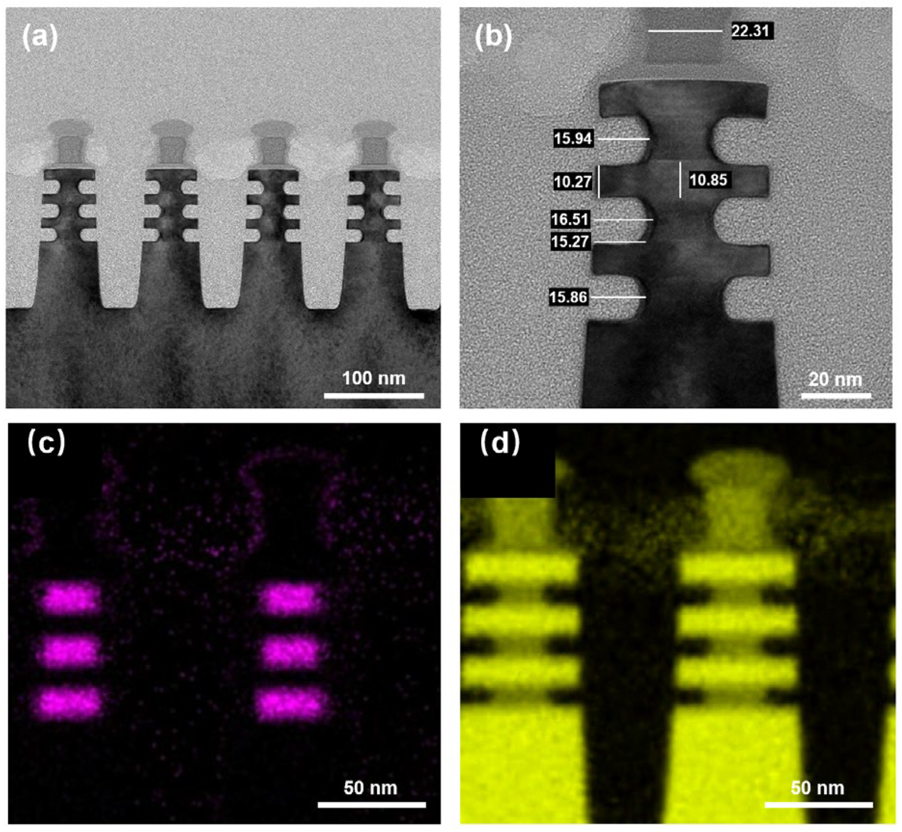
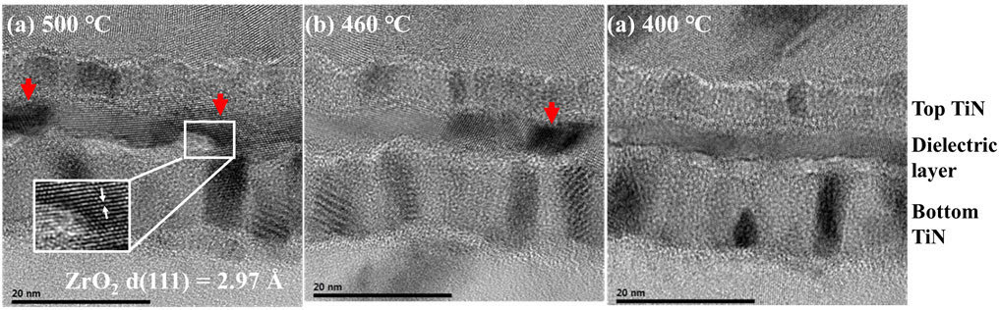

# 칩 전체 구조와 동작 특성 읽기 | Whole-chip structure and operating characteristics

[설계 목차](README.md) · [셀과 회로의 GDS 확대](18-실제회로와레이아웃읽기_circuit-layout-walkthrough.md) · [그림의 원본·판본·이용 조건](사진과화면_images/칩전체와동작특성_chip-atlas/README.md)

출처: Paul Scheffler 외, ETH Zurich·University of Bologna 등의 Occamy 연구, 2025, Figure 7(d). [ETH 기관 보관판](https://doi.org/10.3929/ethz-b-000714898)의 PDF 8쪽에서 전체 계산 칩렛 부분을 출력했습니다. © 2025 IEEE. 기관의 [비상업 이용 허용 표시](https://rightsstatements.org/page/InC-NC/1.0/)에 따라 학습 분석에 인용했습니다.

위 그림은 완성 실리콘을 구현한 연구 프로젝트의 칩렛 전체 물리 배치입니다. 셀 하나를 확대한 모습에서 벗어나, 계산기·메모리 인터페이스·연결망·입출력이 한 다이에 들어가는 모습을 볼 수 있습니다. 전체 마스크 층의 GDS를 제공하는 자료와는 구별합니다. 그림을 누르면 큰 파일로 볼 수 있습니다.

이 글은 전체 배치에서 출발해 실물 다이, CPU·GPU 구조, 전압·클록·전력 그래프와 실제 소자 단면을 연결합니다. 각 사례의 제품·공정·시험 조건은 다르며, 해당 그림의 출처와 함께 설명합니다. 확인일은 2026-10-27입니다.

## 1. 전체 칩 그림에서 먼저 구별할 것

| 자료 | 보여 주는 내용 | 함께 읽을 정보 |
| --- | --- | --- |
| 물리 레이아웃 | 소자·셀·매크로와 배선의 구현입니다. | 공정, 계층, 전원·클록·신호 배선과 DRC·LVS 결과입니다. |
| 실물 다이 사진 | 실제 실리콘을 준비하고 관찰한 결과입니다. | 관찰한 표면·층, 촬영 배율과 시료 처리 방법입니다. |
| Floorplan | 큰 블록이 차지하는 영역과 배치 관계입니다. | 실제 배치에서 가져온 것인지, 단순화한 계획인지 확인합니다. |
| 기능 블록도 | 계산·제어·메모리·입출력의 역할과 연결입니다. | 화살표의 의미, 데이터 폭과 블록의 포함 관계입니다. |
| 특성 그래프 | 정해진 조건에서의 동작영역·성능·전력 등입니다. | 축·단위·범례, 측정과 시뮬레이션의 구분입니다. |
| 전자현미경 단면 | 실제 재료·형상·계면의 국소 구조입니다. | 눈금, 관찰 방향, 완성 소자인지 공정 시료인지 확인합니다. |

같은 다이도 위에서 찍으면 넓은 반복 무늬로 보이고, 얇게 잘라 보면 층과 접점이 보입니다. 기능 블록도는 이 둘의 전기적 역할을 설명합니다. 따라서 여러 종류의 그림을 함께 읽어야 칩의 크기와 동작을 연결할 수 있습니다.

## 2. Occamy: 계산 영역 외에도 필요한 회로

첫 그림의 왼쪽에는 `HBM2E PHY`와 컨트롤러, 가운데와 오른쪽에는 여섯 계산 그룹과 연결망, 아래에는 `D2D Controller and Drivers`가 있습니다. PHY는 디지털 데이터와 실제 입출력 신호 사이를 연결하는 물리 인터페이스 회로입니다. D2D는 die-to-die, 즉 다이 사이 통신을 뜻합니다. [Occamy 원논문, Figure 7·§IV](https://doi.org/10.1109/JSSC.2025.3529249)

| 그림의 영역 | 기능을 읽는 관점 |
| --- | --- |
| 반복되는 Group 0–5 | 계산 블록을 여러 번 배치한 영역입니다. |
| HBM2E PHY·Controller | 메모리와 신호를 주고받고 접근을 제어합니다. |
| Chiplet Interconnect | 계산 그룹과 메모리·다른 장치 사이의 경로입니다. |
| D2D·Host·I/O | 다른 다이, 제어 코어와 외부 장치까지 연결합니다. |

그림에 적힌 외곽 치수로 직접 계산하면 `10.5 mm × 6.95 mm ≈ 73.0 mm²`입니다. 면적의 단위는 길이의 제곱입니다. 이 값은 그림의 계산 칩렛 하나에 대한 값이며 HBM과 인터포저까지 포함한 패키지 면적은 아닙니다.

설계할 때는 연산기 수뿐 아니라 그 연산기에 데이터를 공급할 배선, 전원, 메모리와 통신 회로의 자리도 확보해야 합니다. 작은 셀의 동작을 확인한 뒤 전체 칩에서 배치·배선·타이밍·전력망을 다시 검사하는 이유가 여기서 드러납니다. [배치배선과 전력 설계](09-배치배선과전력설계_physical-implementation.md) · [칩 최상위 검증](17-칩최상위검증과제조인계_chip-top-signoff.md)

## 3. 상용 CPU의 실제 다이: Zen 5 CCD

사진: Fritzchens Fritz, [Ryzen 5 9600X / Zen 5 CCD](https://www.flickr.com/photos/130561288@N04/54046905459/), 2024-10-06 공개, [CC0 1.0](https://creativecommons.org/publicdomain/zero/1.0/). 독립 실리콘 촬영자가 제품에서 분리해 관찰한 사진입니다. 원저작자가 `Poly`로 표시한 층의 1024px 제공본이며 제조사 공식 촬영본과 구별합니다.

CCD는 Core Complex Die의 약자로, CPU 코어와 캐시 등을 담은 계산 다이입니다. 사진의 반복 영역과 가운데 규칙적인 메모리 무늬를 먼저 살펴봅니다. 기능을 대응할 때는 [AMD Hot Chips 2024 발표의 11쪽 “Zen 5 Cache Hierarchy”](https://hc2024.hotchips.org/assets/program/conference/day2/24_HC2024.AMD.Cohen.Subramony.final.pdf#page=11)를 함께 읽습니다. 공식 그림은 코어·L2·L3·I/O 다이 연결 등을 구분합니다.

이 사진에는 CCD 하나가 나옵니다. CPU 패키지의 다른 I/O 다이와 외부 DRAM은 포함하지 않습니다. 또한 실리콘에 존재하는 코어 자리와 특정 제품에서 활성화된 코어 수는 구별합니다. 사진의 반복 무늬를 센 결과만으로 제품의 활성 코어 수나 동작 클록을 정하지 않습니다.

## 4. 물리 배치를 기능 구조로 바꾸어 읽기

출처: Scheffler 외, Occamy, Figure 1, [ETH 기관 보관판 PDF 3쪽](https://www.research-collection.ethz.ch/server/api/core/bitstreams/c1570793-aa19-472b-aab9-f9496f3463e6/content#page=3). © 2025 IEEE, 기관의 비상업 이용 허용 표시에 따라 인용했습니다. 원본 그림과 캡션을 유지했습니다.

작은 코어에서 계산 클러스터, 계산 그룹, 칩렛으로 올라가는 포함 관계를 읽습니다. 오른쪽의 두 칩렛은 D2D로 연결되고 각각 HBM 경로를 갖습니다. 첫 레이아웃에서 본 영역이 기능도에서는 어떤 장치와 통로로 표현되는지 비교합니다.

그림의 `SPM`은 scratchpad memory입니다. 프로그램이 데이터의 위치와 이동을 관리하는 메모리이며, 자동 교체 정책으로 데이터를 보관하는 일반적인 캐시와 구별합니다. `xbar`는 여러 입출력 경로를 연결하는 crossbar이고, `DMA`는 정해진 데이터 이동을 수행하는 장치입니다. 이 용어를 알면 계산 블록 사이에 메모리와 연결망이 큰 비중으로 나타나는 이유를 읽기 쉽습니다.

### CPU의 명령 실행과 캐시 경로

[AMD Zen 5 공식 발표 4–5쪽](https://hc2024.hotchips.org/assets/program/conference/day2/24_HC2024.AMD.Cohen.Subramony.final.pdf#page=4)의 기능 관계를 바탕으로 이 저장소에서 작성한 설명 그림입니다. 원본 그림의 복제나 실제 다이 배치가 아닙니다. 내부 버퍼와 일부 연결은 생략했습니다.

명령을 가져와 내부 작업으로 바꾸고, 입력값과 실행기가 준비되면 연산을 시작합니다. 이름 바꾸기(register renaming)는 소스코드의 변수명을 수정한다는 뜻이 아니라, 아키텍처 레지스터를 내부 물리 레지스터에 대응시키는 과정입니다. 실행이 먼저 끝난 작업이 있어도 프로그램의 의미에 맞는 순서로 결과를 확정해야 합니다. 데이터가 가까운 캐시에 없으면 더 먼 메모리 계층으로 요청이 이어집니다.

### GPU의 반복 계산 계층과 외부 메모리

[NVIDIA RTX Blackwell GPU Architecture v1.1, 8–10쪽](https://images.nvidia.com/aem-dam/Solutions/geforce/blackwell/nvidia-rtx-blackwell-gpu-architecture.pdf#page=8)의 구성 수치를 바탕으로 작성한 기능 계층도입니다. 블록 크기와 위치를 실제 다이 면적으로 해석하지 않습니다.

전체 GB202은 GPC 12개, TPC 96개, SM 192개로 설명됩니다. SM은 GPU가 여러 스레드를 묶어 실행하는 주요 단위입니다. CPU 코어와 SM, SM 안의 CUDA 코어를 모두 같은 뜻의 ‘코어’로 세지 않습니다. 바깥쪽 메모리 제어기와 GDDR7까지 연결해야 계산기에 데이터가 공급됩니다.

칩 설계의 전체 구성과 판매 제품의 활성 구성도 구별합니다. 예를 들어 백서는 전체 GB202의 L2를 128 MB, RTX 5090의 L2를 96 MB로 따로 적습니다. 이 글의 그림은 전체 GB202 기준입니다. 데이터센터 Blackwell 제품의 구성표와도 섞지 않습니다.

## 5. 전압과 클록: 실제 동작영역 그래프

출처: Philippe Sauter 외, Basilisk, 2025, Figure 3, [ETH 기관 보관판](https://doi.org/10.3929/ethz-b-000735663) PDF 3쪽입니다. 기관의 비상업 이용 허용 표시에 따라 인용했습니다. 축·범례·캡션을 유지했으며 데이터를 다시 그리지 않았습니다.

| 표시 | 이 그림에서의 뜻 |
| --- | --- |
| 가로축 MHz | 초당 클록 주기 수입니다. 1 MHz는 초당 백만 주기입니다. |
| 세로축 V | 코어에 공급한 전압입니다. |
| 색 MFLOP/s/W | 전력 1 W당 부동소수점 연산 처리량입니다. 전력 자체의 색상표가 아닙니다. |
| 색이 표시된 격자 | 이 시험 조건에서 동작하고 효율을 산정한 전압·주파수 조합입니다. |

이는 130 nm Basilisk 연구 시제품에서 25 °C, 48×48 FP64 행렬곱을 실행한 실측 shmoo plot입니다. Shmoo는 전압·주파수 같은 두 조건을 바꾸며 동작영역을 그린 시험 지도를 뜻합니다. 원문은 1.2 V에서 최대 62 MHz, 1.64 V에서 102 MHz를 보고합니다. 0.88 V·10 MHz에서는 높은 에너지 효율을 보고합니다. 이 경계는 해당 온도·프로그램의 시험 결과로 읽습니다.

일반적인 CMOS 동적 전력의 개념식은 $P_{dyn}\approx\alpha C V^2 f$입니다. $\alpha$는 신호가 바뀌는 활동도, $C$는 충·방전하는 유효 정전용량, $V$는 전압, $f$는 주파수입니다. 활동도·정전용량·주파수를 고정하면 전압을 10% 올릴 때 동적 전력이 약 21% 증가합니다. 이는 식으로 계산한 설명용 예이며 위 시제품의 측정값이 아닙니다. 실제 전력에는 누설과 메모리·입출력 등도 들어갑니다.

전압을 높이면 더 빠른 동작이 가능해질 수 있지만 전력·온도·신뢰성 조건도 함께 확인해야 합니다. DVFS는 dynamic voltage and frequency scaling의 약자로, 필요한 성능에 맞춰 전압과 주파수의 조합을 바꾸는 방법입니다. 제품에 표시된 최대 부스트 클록만으로 모든 작업에서의 지속 클록과 소비전력을 알 수는 없습니다.

## 6. 처리량과 전력: 그래프의 양쪽 눈금 읽기

출처: Scheffler 외, Occamy Figure 10, ETH 기관판 PDF 11쪽입니다. © 2025 IEEE, 비상업 이용 허용 표시에 따라 인용했습니다. 실칩 실행시간·전류 측정과 해석·사이클 단위 시뮬레이션으로 구한 연산 수를 사용합니다. 명목 계산 클록 1 GHz, 25 °C 조건입니다. [원문 §V·Figure 10](https://doi.org/10.3929/ethz-b-000714898)

왼쪽 막대는 GFLOP/s, 별표 점선은 오른쪽 축의 FPU 이용률입니다. 오른쪽 막대는 GFLOP/s/W, 별표 점선은 오른쪽 축의 칩렛 전력입니다. 막대와 점선의 높이를 같은 단위로 비교하면 의미가 달라집니다.

FP64·FP32·FP16·FP8은 표현에 쓰는 비트 수와 수치 형식이 다릅니다. 더 작은 형식에서 처리량이 커져도 같은 응용 정확도가 보장되는 것은 아닙니다. 그림의 EXP는 더 넓은 형식으로 누적한다는 뜻으로, FP16 EXP는 FP32에, FP8 EXP는 FP16에 누적합니다. 전력의 범위도 그래프의 `Chiplet Power` 그대로 읽으며 서버 전체 소비전력으로 확대하지 않습니다.

에너지는 전력과 시간을 함께 봅니다. 직접 구성한 예로, 작업 A가 2 W로 0.5초 걸리면 1 J, 작업 B가 3 W로 0.2초 걸리면 0.6 J입니다. 같은 결과를 얻는다는 전제에서 B의 순간 전력은 높지만 작업당 에너지는 작습니다. 위 그림에서 읽은 실측 수치가 아니라 단위를 익히는 계산 예입니다.

## 7. 패키지 안의 통신: 폭·전송률·유효 대역폭

출처: Scheffler 외, Occamy Figure 13, ETH 기관판 PDF 12쪽입니다. © 2025 IEEE, 비상업 이용 허용 표시에 따라 인용했습니다. 이 곡선은 사이클 단위 RTL 시뮬레이션이며 실측 eye diagram이 아닙니다. [원문 §V-D·Figure 13](https://doi.org/10.3929/ethz-b-000714898)

왼쪽은 비활성화한 PHY가 늘 때의 유효 대역폭, 오른쪽은 전송 크기가 커질 때의 유효 대역폭입니다. 같은 링크도 실제 데이터에 쓰는 시간과 제어·전송 준비에 쓰는 시간이 함께 존재합니다. 오른쪽에서 큰 전송이 높은 이용률을 보이는 현상을 이 관점에서 읽습니다. 축의 GB/s와 오른쪽 이용률(%)을 구분합니다. 앞의 구조도에 적힌 GiB/s와도 표기 단위를 그대로 비교합니다.

대역폭 계산 연습으로, 데이터선 64개가 전송마다 각각 1 bit를 전달하고 초당 전송 횟수가 6.4 G회라고 가정하면 다음과 같습니다.

$$B_{raw}=64\ \mathrm{bit}\times6.4\times10^9\ \mathrm{s^{-1}}\div8=51.2\ \mathrm{GB/s}$$

이는 가정한 단방향 원시 대역폭입니다. 송신·수신이 각각 독립적으로 같은 속도를 낼 수 있다면 양방향 합은 102.4 GB/s로 표시할 수 있습니다. 응용이 한쪽으로 읽는 속도는 이 합과 구별합니다. DDR처럼 양쪽 클록 에지를 사용하는 경우 클록 주파수와 전송률도 다릅니다. 인코딩·명령·흐름제어·유휴 시간이 있으면 유효 데이터 대역폭은 원시 계산과 달라집니다. 위 계산을 Occamy의 실제 인터페이스 사양으로 옮기지 않습니다.

과거 사례는 [Intel 저자의 Haswell IEEE Micro 2014 설명 중 OPIO·eDRAM](https://pages.cs.wisc.edu/~rajwar/papers/ieee_micro_haswell.pdf)에서 이어 읽을 수 있습니다. OPIO는 on-package I/O로, 패키지 안의 다이 사이 연결을 다룹니다. 원문 구조도와 개념적인 전력·성능 곡선, 실제 전압·주파수 측정 그래프는 각각의 성격에 맞게 읽습니다.

## 8. 실제 단면: GAA 공정에서 만드는 공간

출처: Meng Wang 외, Fudan University, [Nanomaterials 16(2), 145, 2026, Figure 7](https://doi.org/10.3390/nano16020145). © 2026 저자, [CC BY 4.0](https://creativecommons.org/licenses/by/4.0/). 출판사의 전체 원본 PNG입니다.

위쪽 (a)·(b)는 실제 TEM 단면, 아래쪽 (c)·(d)는 Ge·Si의 EDX 원소 지도입니다. TEM은 얇은 시료에 전자를 통과시켜 내부 구조를 관찰합니다. EDX 지도는 원소별 분석 신호를 색으로 표시하므로 실제 재료가 그 색으로 보인다는 뜻은 아닙니다. 100·20·50 nm 눈금을 함께 봅니다.

안쪽 스페이서는 게이트와 소스·드레인 사이에 절연 구조를 만들기 위한 공정 요소입니다. 이 그림은 SiGe를 옆으로 선택 식각한 뒤의 연구 시료이며, 게이트 금속까지 완성한 판매용 GAA 칩의 사진은 아닙니다. 위에서 보는 레이아웃의 도형을 실제 적층 형상으로 구현하려면 이런 공정 단면도 확인해야 한다는 사례입니다.

## 9. 실제 단면: DRAM 커패시터 유전체

출처: Dong-Sik Park 외, 삼성전자 DRAM Process Architecture Team·성균관대학교, [IEEE Access 13, 35019–35028, 2025 판본, Figure 11, p.35025](https://doi.org/10.1109/ACCESS.2024.3502036). 최초 공개일은 2024-11-19입니다. © 2024 저자, [CC BY 4.0](https://creativecommons.org/licenses/by/4.0/). 공식 PDF의 전체 내장 그림을 그대로 추출했습니다.

위 TiN 전극, 유전체, 아래 TiN 전극을 차례로 봅니다. MIM은 metal–insulator–metal로, 금속 사이에 절연막을 둔 커패시터 구조를 뜻합니다. 왼쪽부터 500·460·400 °C 열처리 조건이며 눈금은 20 nm입니다. 원본 세 번째 패널에는 문자 표기 중복이 있어 온도와 캡션으로 구분합니다.

이는 18 nm DRAM 기술의 커패시터와 같은 공정·두께로 만든 평면 시료입니다. 원통형 커패시터와 접근 트랜지스터 전체를 잘라 보여 주는 사진은 아닙니다. 원저자는 열처리와 추가 결정화·누설의 관계를 전기적 결과와 함께 해석합니다. 사진에서 보이는 결정 구조와 실제 누설 전류 측정을 연결하는 연구 사례로 읽습니다. 저장 전하·감지·복원의 역할은 [DRAM 셀과 주변회로](06-DRAM셀과주변회로_dram-design.md)에서 이어집니다.

## 10. 실제 접합면: 구리 접점과 산화막

출처: Hemanth Kumar Cheemalamarri 외, A*STAR IME·IMRE, [Communications Engineering 5, 104, 2026, Figure 4](https://doi.org/10.1038/s44172-026-00649-w). © 2026 저자, [CC BY-NC-ND 4.0](https://creativecommons.org/licenses/by-nc-nd/4.0/). 비상업적 학습 설명에 전체 원본 그림을 변경 없이 실었습니다.

왼쪽 위 (a)는 실제 HAADF 단면 영상으로, 위아래 구리 접점과 접합면을 보여 줍니다. HAADF는 전자를 높은 각도에서 검출해 구조를 관찰하는 STEM 영상 방식입니다. 아래의 EDS 원소 지도, 오른쪽의 위치별 원소 신호를 같은 계면과 대조합니다. 곡선의 가로축은 위치(nm)이며 클록·시간 축이 아닙니다.

이 연구는 Ti 보호층을 사용한 Cu·산화막 접합 시료를 분석합니다. 상온 접합 뒤 250 °C에서 2시간 열처리한 공정과 연결됩니다. 다이의 회로가 완성되어도 위아래 접점의 정렬·계면·재료 상태가 맞아야 칩 사이 연결을 만들 수 있습니다. 상용 HBM 내부 사진으로 부르지 않고, [HBM과 3D 집적 설계](11-HBM과3D집적설계_hbm-3d-integration.md)의 접속·검증 개념과 연결합니다.

## 11. 더 살펴볼 공식 구조 자료

| 공식 자료 | 원문에서 볼 내용 | 사례의 범위 |
| --- | --- | --- |
| [imec 나노시트·포크시트](https://www.imec-int.com/en/articles/entering-nanosheet-transistor-era-0) | 같은 웨이퍼에 만든 소자의 실제 TEM 단면입니다. | 연구용 소자 구조입니다. |
| [imec CFET, 2026](https://www.imec-int.com/en/articles/advancing-cfet-based-device-roadmap-novel-integration-modules-and-standard-cell) | 위아래 소자 적층, 후면 접점과 공정 연구를 연결합니다. | 미래 소자 통합을 위한 연구입니다. |
| [Kioxia·Nanya OCTRAM, 2024](https://www.kioxia.com/en-jp/about/news/2024/20241210-1.html) | 수직 산화물 반도체 트랜지스터의 TEM과 커패시터 위 구조의 SEM입니다. | 연구 시제품의 메모리 구조입니다. |
| [JEOL IB2025-03, 3D NAND 관찰](https://www.jeol.com/solutions/applications/details/ib2025-03.php) | SEM·STEM·TEM의 세 방향 영상과 시료 관찰 방향입니다. | 실제 3D NAND 구조의 관찰 방법입니다. |
| [AMD Zen 5 공식 발표](https://hc2024.hotchips.org/assets/program/conference/day2/24_HC2024.AMD.Cohen.Subramony.final.pdf) | 11쪽 캐시 계층, 12쪽 CCX·CCD, 20쪽 Strix Point SoC 구조입니다. | 제조사가 공개한 2024년 제품 구조 설명입니다. |
| [NVIDIA RTX Blackwell 공식 백서](https://images.nvidia.com/aem-dam/Solutions/geforce/blackwell/nvidia-rtx-blackwell-gpu-architecture.pdf) | 8쪽 전체 GB202, 9쪽 GPC, 10쪽 이후 SM과 메모리 구조입니다. | v1.1에 공개된 RTX 계열 구성입니다. |

이 자료들을 앞의 사진과 비교할 때는 먼저 관찰한 대상의 크기를 맞춥니다. 패키지·다이·기능 블록·소자·재료 계면은 서로 다른 크기의 대상입니다. 각 단계에서 사진과 구조도를 대응한 뒤, 해당 조건의 측정·시뮬레이션 그래프를 읽는 순서가 좋습니다.

## English

Read whole-chip physical layout, a commercial Zen 5 CCD photograph, CPU/GPU functional relationships, voltage–frequency operating maps, power and chiplet-bandwidth plots, and actual process cross-sections. Each image identifies its specimen, revision, evidence type and reuse conditions. Measured results, RTL simulations, original explanatory diagrams and separate research samples remain distinct.
