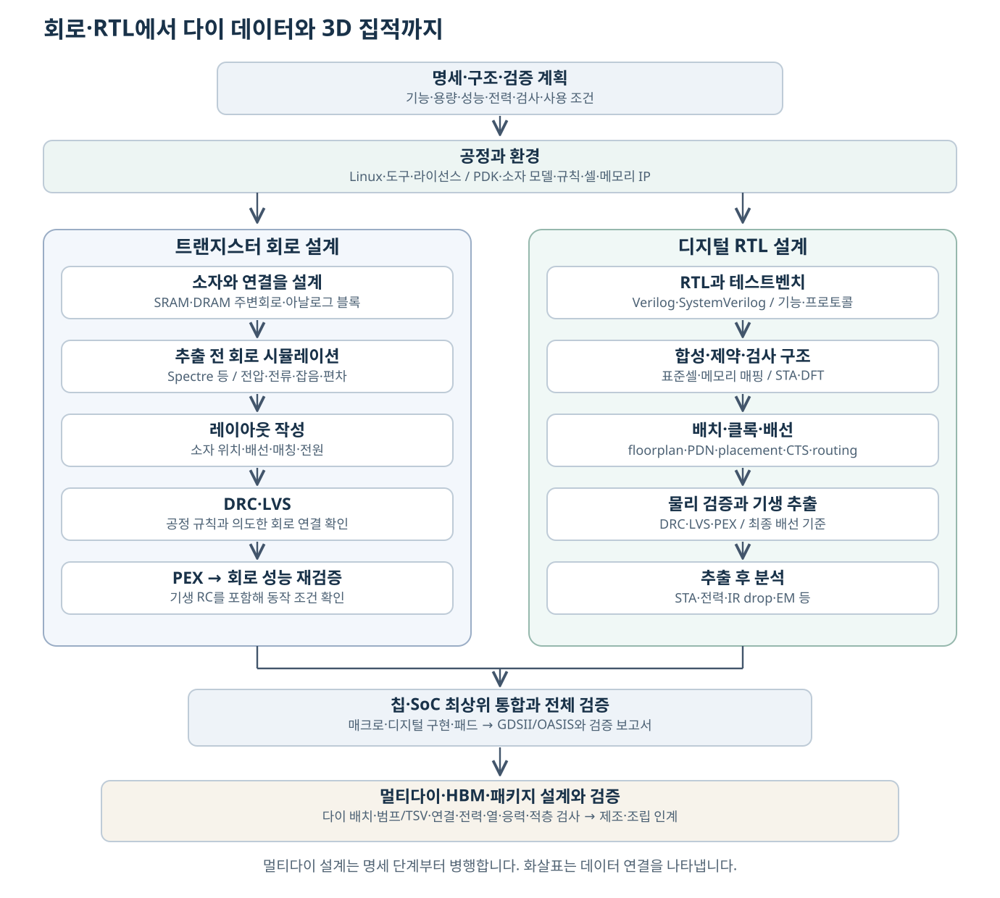
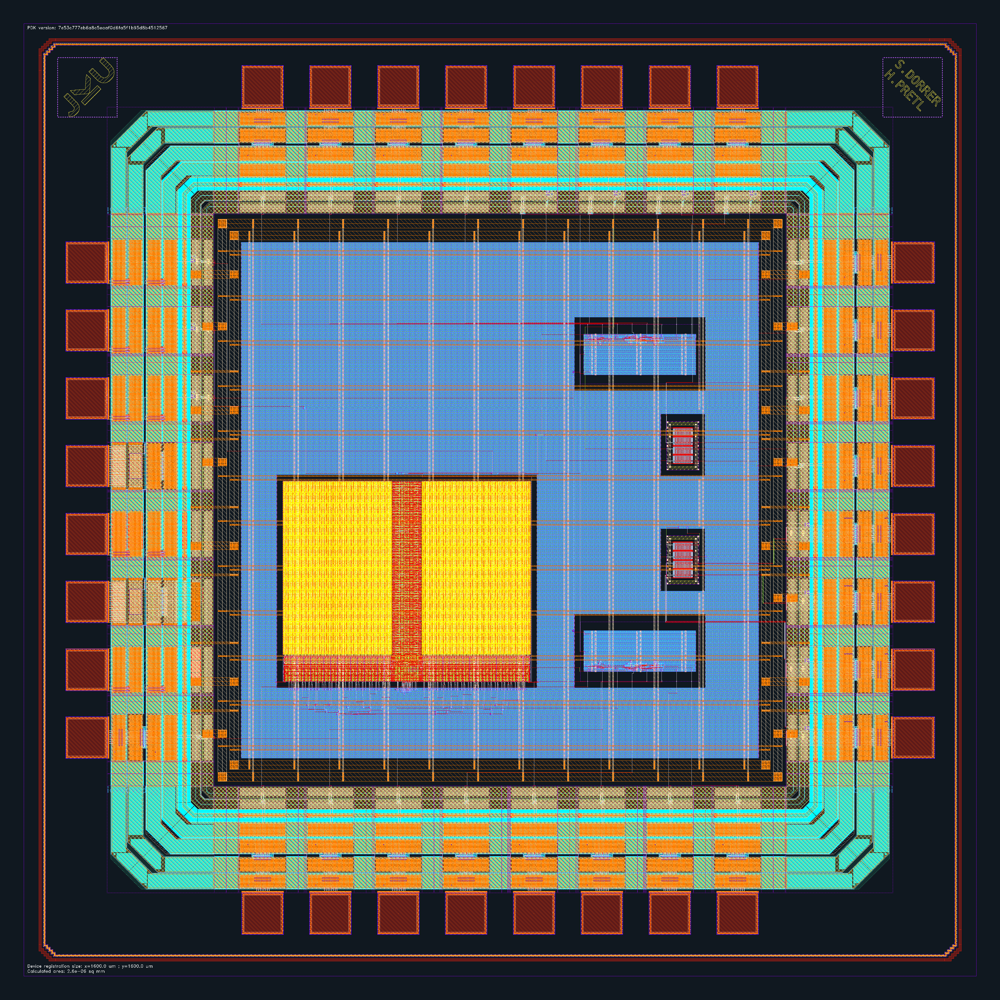

# 반도체 설계: 풀커스텀·RTL·SoC와 제조 데이터 | Semiconductor design

Linux와 공정 자료를 준비하는 단계부터 아날로그 풀커스텀 레이아웃, Verilog·SystemVerilog 기반 디지털 구현, 혼합신호 칩·SoC 통합과 제조 인계까지 설명합니다. SRAM·DRAM의 셀·주변회로를 설계하고, 아날로그·메모리 매크로를 RTL과 연결하여 칩 전체를 검증하는 과정을 다룹니다. HBM·멀티다이에서는 적층·전력·열·조립 검증으로 이어집니다.

[처음으로](../README.md) · [전체 분야별 목차](../분야별목차_CATALOG.md) · [반도체 제조 공정](../반도체제조공정_semiconductor-fabrication/README.md)

## 전체 설계 흐름

위 그림은 본문을 위해 직접 작성한 개념도입니다. 화살표는 주요 데이터의 연결을 나타내며, 멀티다이의 기능 분할·전력·열·접속 계획은 명세 단계부터 병행합니다. 실제 프로젝트에서는 검증 결과에 따라 앞 단계로 반복해서 돌아갑니다. GDSII·OASIS는 레이아웃 도형을 전달하는 형식이며, 완성된 칩이나 모든 검증 결과를 담은 단일 파일은 아닙니다. 마지막에는 해당 공정의 제출 규칙에 맞춰 설계 데이터와 검증 기록을 함께 인계합니다. 예를 들어 [GF180MCU의 제출 점검표](https://gf180mcu-pdk.readthedocs.io/en/latest/physical_verification/design_manual/drm_06.html)는 계층형 GDSII, 필요한 모든 레이어와 DRC 통과를 요구합니다.

## 실제 칩과 설계 화면

출처: © 2026 Simon Dorrer and Harald Pretl, [JKU IHP 공개 칩의 원본 GDS](https://github.com/iic-jku/ihp-sg13g2-ams-chip-template/blob/b1d4a98d0ec8ad71c57f8ec4c33344340f911dad/layout/chip_top.gds.gz). 원본 설계 데이터를 KLayout으로 출력한 전체 다층 레이아웃입니다. 바깥의 패드 링, 왼쪽 아래 SRAM과 오른쪽 매크로, 내부 전원 배선을 살펴봅니다. [실제 회로와 레이아웃 읽기](18-실제회로와레이아웃읽기_circuit-layout-walkthrough.md)에서는 셀·주변회로·매크로를 확대하고 대응 회로도와 GDS 원본을 연결합니다.

| 보고 싶은 대상 | 연결할 본문 |
| --- | --- |
| SRAM 셀·감지 증폭기·쓰기 구동기와 원본 GDS | [실제 회로와 레이아웃 읽기](18-실제회로와레이아웃읽기_circuit-layout-walkthrough.md) |
| SRAM 전체 배열과 반복 셀 | [IHP 매크로의 전체·하위 셀](18-실제회로와레이아웃읽기_circuit-layout-walkthrough.md) |
| 인버터 회로도와 실제 소자 배치, ADC 비교기 | [풀커스텀 회로·레이아웃 확대](18-실제회로와레이아웃읽기_circuit-layout-walkthrough.md) |
| 회로도 편집기와 시뮬레이터 창 | [도구의 실제 작업 화면](03-설계도구와공급사_eda-tool-map.md), [회로와 파형](04-회로설계와Spectre_custom-circuit-simulation.md) |
| 디지털 배치·배선 화면 | [OpenROAD의 Ibex 예시](09-배치배선과전력설계_physical-implementation.md) |
| 실제 DRC·LVS 검사 창 | [규칙 검사와 회로 비교](10-DRC와LVS및PEX_physical-verification.md) |
| 최근 메모리 제품의 실물 | [SRAM과 SoC](05-SRAM셀과메모리매크로_sram-design.md), [DRAM](06-DRAM셀과주변회로_dram-design.md), [HBM](11-HBM과3D집적설계_hbm-3d-integration.md) |

사진·화면의 원본은 [출처 목록](사진과화면_images/README.md), GDS와 회로 파일의 판본·이용 조건은 [레이아웃 원본 목록](사진과화면_images/회로와레이아웃_layout-detail/README.md)에 모았습니다.

## 읽는 순서

| 순서 | 본문 | 읽고 나면 구분할 수 있는 내용 |
| --- | --- | --- |
| 0 | [설계 대상과 전체 흐름](00-설계대상과전체흐름_design-map.md) | 셀·메모리·SoC·다이·패키지, 회로 설계와 RTL 설계의 역할 |
| 1 | [Linux 설치와 라이선스](01-Linux설치와라이선스_linux-eda-setup.md) | 운영체제·셸·설치 경로·라이선스 서버·프로젝트 환경 |
| 2 | [공정 노드·PDK·라이브러리](02-공정노드와PDK및라이브러리_process-pdk-libraries.md) | nm의 의미, 소자 모델·설계 규칙·표준셀·메모리 자료의 확보와 연결 |
| 2-1 | [공정·소자 설계와 회로 모델](02A-공정과소자모델_tcad-device-modeling.md) | TCAD·Sentaurus·Silvaco, 물리 구조와 BSIM·Verilog-A 모델의 연결 |
| 3 | [설계 도구와 공급사](03-설계도구와공급사_eda-tool-map.md) | Spectre·Virtuoso·합성·배치배선·물리 검증 도구와 공개 대안 |
| 4 | [회로 설계와 Spectre](04-회로설계와Spectre_custom-circuit-simulation.md) | 회로도·넷리스트, 동작점·과도 응답·잡음·공정 편차와 추출 후 분석 |
| 5 | [SRAM 셀과 메모리 매크로](05-SRAM셀과메모리매크로_sram-design.md) | 6T 셀의 읽기·쓰기·유지, 배열·주변회로·컴파일러와 여러 모델 파일 |
| 6 | [DRAM 셀과 주변회로](06-DRAM셀과주변회로_dram-design.md) | 1T1C·센스 앰프·복원·리프레시·타이밍과 전용 공정 |
| 7 | [Verilog·SystemVerilog와 회로 모델](07-Verilog와SystemVerilog의연결_rtl-verification-ams.md) | 합성용 RTL, 테스트벤치, 메모리 모델, Verilog-A·AMS의 연결 |
| 8 | [합성·타이밍·DFT](08-합성과타이밍및DFT_synthesis-sta-dft.md) | 게이트 매핑, SDC·STA·전력 상태, scan·ATPG·메모리 검사 |
| 9 | [배치배선과 전력 설계](09-배치배선과전력설계_physical-implementation.md) | floorplan·PDN·배치·클록 트리·배선·IR drop과 기생 성분 |
| 10 | [DRC·LVS·PEX](10-DRC와LVS및PEX_physical-verification.md) | 도형 규칙·회로 연결·기생 추출의 차이와 최종 검증 |
| 11 | [HBM과 2.5D·3D 설계](11-HBM과3D집적설계_hbm-3d-integration.md) | 다이별 설계와 적층·인터포저·범프·전력·열·적층 검사 |
| 12 | [공개 도구로 RTL에서 GDS까지](12-공개도구로RTL에서GDS까지_open-rtl-to-gds.md) | 공식 공개 예제로 설치·실행·결과 파일을 따라가는 경로 |
| 13 | [최종 파일과 제조 인계](13-최종파일과제조인계_tapeout-deliverables.md) | top cell·레이어·계층·모델 판본·검증 보고서와 제출 자료의 일치 |
| 14 | [아날로그 풀커스텀 레이아웃](14-아날로그풀커스텀레이아웃_full-custom-layout.md) | 소자·PCell·매칭·배선·웰·기판·전원과 검증 후 매크로 인계 |
| 15 | [아날로그와 RTL의 혼합신호 통합](15-아날로그와RTL의혼합신호통합_analog-digital-integration.md) | 기능·전기·물리 뷰, wrapper·모델 바인딩·샘플 유효·전압·클록 경계 |
| 16 | [SoC 구조와 IP 통합](16-SoC구조와IP통합_soc-architecture-integration.md) | CPU·메모리·주소·연결망·DMA·부팅과 아날로그 매크로의 시스템 연결 |
| 17 | [칩 최상위 검증과 제조 인계](17-칩최상위검증과제조인계_chip-top-signoff.md) | pad/bump·전력·ESD·패키지, 블록 경계와 칩 전체 검사·공개 통합 사례 |
| 18 | [실제 회로와 GDS 레이아웃 읽기](18-실제회로와레이아웃읽기_circuit-layout-walkthrough.md) | SRAM 셀·주변회로·배열, 인버터·ADC·전체 칩의 실제 도형과 회로·원본 파일 |

처음 시작하시면 0~4장에서 환경·소자·회로 해석을 익힌 뒤 아래 경로를 선택하시면 됩니다.

| 목표 | 이어서 읽는 순서 |
| --- | --- |
| 아날로그·메모리 풀커스텀 | 14장 레이아웃 → 5·6장 메모리 → 10장 물리 검증 → 17장 칩 전체 검증 |
| Verilog 기반 디지털 ASIC | 7장 RTL → 8장 합성·타이밍·DFT → 9장 배치배선 → 16장 SoC → 17장 칩 전체 검증 |
| 아날로그·디지털을 함께 넣은 칩 | 14장 풀커스텀 → 15장 혼합신호 통합 → 16장 시스템 연결 → 17장 칩 전체 검증 |
| 실제 파일과 공개 도구의 관계 | 12장 공식 블록 실습 → 17장 공개 칩 통합 사례 → 13장 최종 인계 |

SoC에 해당하지 않는 단일 아날로그 IC나 디지털 ASIC도 최상위 핀·전원·물리 검증과 제조 인계가 필요합니다. HBM·멀티다이는 11장에서 다이 간 연결과 조립 조건을 추가로 읽습니다.

## 설계 흐름을 구별하는 기준

| 설계 흐름 | 직접 결정하는 대상 | 대표 결과물 | 다음 설계자가 사용하는 방법 |
| --- | --- | --- | --- |
| 트랜지스터 회로 | MOS·저항·커패시터의 크기와 연결 | 회로도·SPICE 계열 넷리스트·검증된 레이아웃 | 아날로그 블록이나 메모리 매크로로 사용합니다. |
| 디지털 RTL | 클록마다 일어나는 데이터 이동과 상태 변화 | RTL·제약·검증 환경·합성 넷리스트 | 표준셀과 매크로를 배치·배선합니다. |
| 메모리 매크로 통합 | 메모리의 용량·포트·지연·전원·물리 위치 | 동작 모델·타이밍·물리 추상·실제 레이아웃의 일치된 묶음 | 같은 매크로를 시뮬레이션·STA·배치·LVS에서 서로 다른 표현으로 읽습니다. |
| 혼합신호 칩·SoC | 아날로그·메모리·RTL의 시스템 연결과 칩 경계 | 최상위 논리·물리 구현, 전원·핀·검증 자료 | 기능·전기·물리 뷰와 부팅·소프트웨어의 의미를 함께 맞춥니다. |
| 멀티다이·패키지 | 다이 배치·방향·접속·재료·열 경로 | 다이별 데이터와 조립·배선·분석 데이터 | 각 다이와 조립체를 함께 검증합니다. |

도구 하나를 설치했다고 모든 공정을 사용할 수 있는 것은 아닙니다. 실행 권한인 도구 라이선스, 제조 공정의 설계 자료인 PDK, 사용하려는 표준셀·메모리·인터페이스 IP의 제공 조건은 각각 확인합니다. 공개 도구의 지원 범위와 실제 제조에 제출할 때 필요한 자료는 각 장에서 구체적으로 연결합니다.

## 기존 자료와 연결

- [MOSFET의 동작 원리](../전자컴퓨터공학_ece/10-반도체소자_semiconductors/해설_notes/MOSFET의동작원리_mos-electrostatics-switching.md): 게이트 전압이 전류를 제어하는 원리입니다.
- [RTL 설계](../전자컴퓨터공학_ece/13-RTL설계_verilog-systemverilog/README.md)와 [하드웨어 검증](../전자컴퓨터공학_ece/14-하드웨어검증_hardware-verification/README.md): 회로의 기능과 검사 환경을 공부합니다.
- [FPGA·ASIC 설계](../전자컴퓨터공학_ece/15-FPGA-ASIC설계_fpga-asic/README.md): 재구성 소자와 제조용 설계의 차이를 연결합니다.
- [로직·DRAM·NAND의 공정 차이](../반도체제조공정_semiconductor-fabrication/10-로직과메모리의공정차이_logic-memory-integration.md): 설계에서 정한 구조를 공정으로 만드는 방법입니다.
- [HBM의 적층과 접합](../반도체제조공정_semiconductor-fabrication/README.md): 제조 공정 목차에서 TSV·박막화·적층 본문으로 이어집니다.
- [하드웨어 코딩 문제와 예제](../하드웨어코딩_hardware-coding/README.md): 작은 RTL 회로와 테스트벤치를 직접 실행한 기존 기록입니다.

## 자료와 확인 범위

공급사·공정 제공기관·공개 프로젝트의 문서를 근거로 작성했습니다. 출처는 설명 가까이에 연결하며, 공식 코드·명령을 옮긴 부분과 직접 구성한 설명·계산을 구분합니다. 자료 확인일은 2026-10-27입니다. 상용 도구의 설치·라이선스 안내는 적법하게 받은 설치 매체와 기관별 설정을 사용하는 절차입니다. 이 문서 작성 과정에서 상용 도구로 DRAM·SRAM을 제작하거나 GDS를 제출한 실적을 새로 만든 것은 아닙니다.

## English

An end-to-end guide to semiconductor design, from Linux environments, licenses and PDKs to full-custom analog layout, transistor-level memory design, RTL implementation, mixed-signal chip and SoC integration, physical verification and tapeout handoff. Separate chapters explain SRAM, DRAM, HBM and multi-die integration. Official tool and foundry documentation is linked near the relevant claims; educational calculations and installation instructions are distinguished from executed design results.
