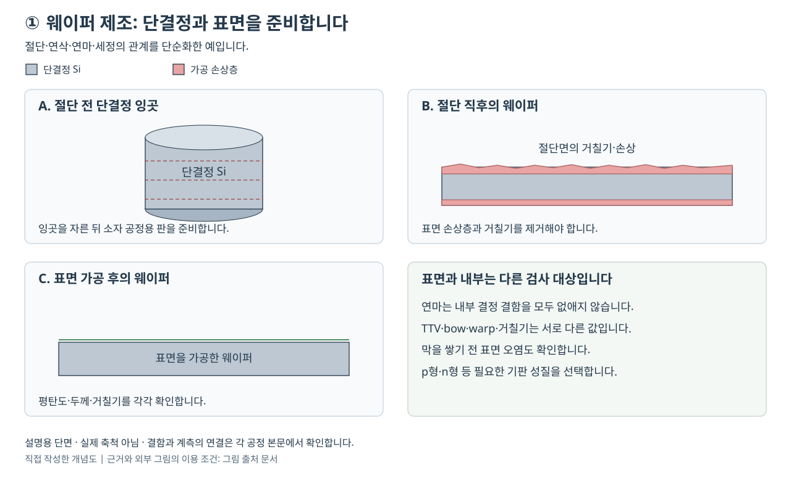

# 웨이퍼 제조: 원료 정제에서 단결정 기판의 품질까지 | Silicon Wafer Manufacturing

[공정 목차](README.md) · 다음: [산화와 게이트 절연막](02-산화와게이트절연막_oxidation-gate-dielectrics.md)

기준일: 2026-10-26. 이 글의 대상은 집적회로를 만들기 위한 실리콘 기판입니다. 원료의 순도를 높이는 일, 원자 배열을 한 방향으로 맞추는 일, 얇은 원판의 표면과 형상을 맞추는 일을 구분하여 설명합니다. 계산에 쓰는 가정은 교육용이며, 특정 회사의 생산 조건이나 실측값이 아닙니다.

## 공정 전후 단면



그림은 공정 사이에 남는 구조를 비교하기 위한 자체 원리도이며, 실제 현미경 영상이나 비례 축척 도면이 아닙니다. A의 잉곳에서는 결정 배열이 이어지더라도 성장 위치별 도핑·산소·결함이 다를 수 있습니다. B에서는 절단으로 새 표면을 만들면서 그 아래에 균열·변형 등의 손상이 생깁니다. C는 손상층 제거·연마·세정 후의 기판이며, 표면을 평평하게 만드는 일과 벌크 결함을 바꾸는 일을 구분합니다. 절단에서 연마까지의 구분은 [SUMCO의 Wafer forming process](https://www.sumcosi.com/english/products/process/)를 근거로 구성했습니다.

B에서 C로 넘어갈 때에는 손상 제거량만 보지 않고 남은 두께와 형상도 다시 측정합니다. 표면 결함 검사에서 점이 줄어도 두께·가장자리 형상이나 내부의 전기적 성질까지 자동으로 좋아진 것은 아닙니다. 반대로 산란점이 보인다는 이유만으로 그것이 외부에서 붙은 입자라고 단정하지 않습니다.

### 실제 가공·검사 장비와 재료의 연결

잉곳을 자르는 가공 장비와 출하 품질을 판정하는 검사·계측 장비는 역할이 다릅니다. 아래 제품은 제조사 공식 자료에 공개된 실제 제품이며, 제품 사진도 연결한 공식 페이지에서 확인할 수 있습니다.

| 실제 장비·플랫폼 | 이 단면에서 가공·확인하는 대상 | 선택·해석 조건 |
|---|---|---|
| [Komatsu NTC MWM3050nQ](https://ntc.komatsu/en/product/wiresaw) | A의 잉곳을 B의 원판으로 나누는 슬러리 방식 와이어쏘입니다. | 공개 목록의 최대 가공물은 지름 300 mm·길이 450 mm입니다. 와이어 장력·열 제어와 절단 후 물결 모양의 요철을 연결하며, 최대 가공물 크기를 완성 웨이퍼의 두께·평탄도 사양으로 읽지 않습니다. |
| [KLA Surfscan SP7XP](https://www.kla.com/products/wafer-manufacturing/wafer-defect-inspection-review) | C 표면의 결함·표면 상태와 가공 전후 결함 좌표를 검사합니다. | DUV 레이저와 여러 검출 모드의 신호를 이용합니다. 검출 크기와 결함 분류를 고정하여 비교하며, 산란 신호만으로 원소 조성을 정하지 않습니다. |
| [KLA WaferSight 2+](https://www.kla.com/products/wafer-manufacturing/wafer-metrology) | C의 평탄도, 양면의 미세 형상, 가장자리에서의 높이 감소인 edge roll-off를 측정합니다. | 표면 입자 수와 다른 합격 항목입니다. 연마·에피 웨이퍼의 형상 관리에 쓰이는 제품이며, 내부 균열을 모두 검출한다는 뜻은 아닙니다. |

| 재료 | 실제 역할 | 선택할 때 연결할 품질 항목 |
|---|---|---|
| 고순도 다결정 Si와 종결정 | 녹일 원료와 결정 방향의 출발점입니다. | 원료의 우발 불순물, 종결정 방향과 성장 후 비저항·결함 분포를 연결합니다. |
| 석영 도가니 | CZ의 용탕을 담는 SiO₂ 부품입니다. | 용탕과의 접촉에서 산소가 유입될 수 있으므로 산소 요구와 성장 방식을 함께 검토합니다. |
| 붕소·인 등 도펀트 | 최종 기판의 전기적 성질을 조절합니다. | 이름뿐 아니라 p/n형, 비저항 범위와 잉곳 위치별 균일도를 맞춥니다. |
| 알루미나 연마재·콜로이달 실리카 | SUMCO 설명에서 각각 래핑과 최종 화학·기계 연마에 등장합니다. | 재료 제거율만 높이지 않고 손상·긁힘·잔류 입자와 형상을 함께 평가합니다. 두 연마 단계를 같은 소모재 조건으로 취급하지 않습니다. |

재료의 공정상 위치는 [SUMCO의 CZ·Lapping·Polishing 설명](https://www.sumcosi.com/english/products/process/)에서 확인했습니다. 표의 선택 조건은 이 글의 원리적 비교 기준이며 특정 공급사가 공개한 구매 규격이 아닙니다.

### 사례 1: 결정 결함과 재가공 가능한 결함을 구분한 공급사 보고

KLA-Tencor의 2007-01-30 Surfscan SP2XP 발표는 당시 45 nm 세대의 prime·에피·SOI 웨이퍼에서 결정 기원의 결함과 연마·부착 결함을 분류하여, 재가공할 수 있는 웨이퍼를 폐기 대상과 나누는 사례를 보고합니다. Soitec을 포함한 베타 평가를 언급하지만 공개된 공장별 회수율이나 독립 재현 자료는 제시하지 않습니다. SP2XP의 역사적 보고를 현재 SP7XP의 동일 성능 수치로 옮기지 않습니다. [KLA, 발표 본문과 Technology Summary](https://ir.kla.com/news-events/press-releases/detail/387/kla-tencors-new-surfscan-sp2xp-wafer-inspection-system)

| 진단 순서 | 증거와 판단 |
|---|---|
| 증상 | 연마 기판에 큰 산란 결함이 검출되어 폐기 여부를 판단해야 합니다. |
| 경쟁 원인 | 기판 자체의 패임·공동, 연마 중 생긴 자국, 떨어져 붙은 입자가 후보입니다. 겉보기 크기가 비슷해도 재가공 가능성은 다릅니다. |
| 확인 계측 | 공급사 보고에서는 명시야·암시야 등 다중 채널의 응답을 비교하여 결함을 분류했습니다. 실제 판정에서는 대표 좌표의 추가 관찰로 분류 오류도 확인해야 합니다. |
| 해결 방향 | 재가공 가능한 종류를 선별하여 해당 세정·연마 경로로 돌리는 판단을 지원합니다. 이 검사가 결정 결함 자체를 치료한다는 뜻은 아닙니다. |
| 다시 볼 지표 | 재가공 뒤 같은 검출 조건의 결함 종류·개수와 두께·평탄도를 함께 봅니다. 이 재검사 항목은 본문의 진단 제안이며 발표의 회수 실측값이 아닙니다. |

### 사례 2: 절단 손상층의 제거량을 수명 측정과 연결한 연구

Sopori·Devayajanam·Basnyat의 2016년 논문은 얇은 표면층을 단계적으로 제거하면서 소수 운반자 수명(MCLT)을 측정하고, 수명이 최대가 되는 제거 두께로 평균 손상 깊이를 판단합니다. 수명은 과잉 전자·정공이 재결합하기 전까지 남는 시간이며, 짧아지면 표면 손상 외에 벌크·오염·표면 상태도 검토해야 합니다. 확인 범위는 [NJIT 공식 저장소의 논문 초록과 서지](https://digitalcommons.njit.edu/fac_pubs/10592/)이며, 여기서는 원문 그림의 제거량이나 수치까지 읽었다고 주장하지 않습니다.

| 진단 순서 | 연구 결과와 교육용 적용의 구분 |
|---|---|
| 증상 | 절단면을 가진 Si에서 손상이 얼마나 깊게 남았는지 외관만으로 정하기 어렵습니다. |
| 경쟁 원인 | 절단 손상, 벌크 재결합, 표면 처리 차이가 모두 수명을 낮출 수 있습니다. |
| 확인 계측 | 연구는 제거 두께에 따른 MCLT와 이를 환산한 유효 표면 재결합 속도를 사용합니다. 국소 사진 하나보다 넓은 영역의 평균 손상 분포를 다루는 접근입니다. |
| 해결 방향 | 연구에서 보고한 단계 제거–측정의 관계를 이용하여 손상층 제거에 필요한 범위를 판단합니다. 실제 IC 기판에 적용할 때에는 수명만으로 결론 내리지 않고 잔류 손상·오염과 최종 형상도 확인해야 합니다. |
| 다시 볼 지표 | 제거량 대비 수명 곡선, 남은 두께, 표면 거칠기와 결함 분포입니다. 이 항목들은 연구 방법을 바탕으로 정리한 판단 기준이며 자체 실험 결과가 아닙니다. |

이 연구는 독립 연구자의 손상 평가 방법입니다. 앞의 KLA 자료는 공급사·고객 평가 보고이며, 두 자료를 동일한 웨이퍼나 동일한 검출 한계에서 수행한 비교 실험으로 읽지 않습니다.

## 1. 웨이퍼는 회로를 받치는 판이면서 소자의 재료입니다

웨이퍼(wafer)는 반도체 소자를 만들기 위한 얇은 기판입니다. 실리콘 웨이퍼에서는 표면 가까운 실리콘이 트랜지스터의 전류 통로가 되기도 합니다. 따라서 판이 깨지지 않는지만 검사해서는 부족합니다. 원자 배열, 전기적 성질, 내부 불순물, 표면 오염, 두께와 휨이 뒤 공정에 영향을 줍니다.

단결정(single crystal)은 결정 방향이 연속적으로 이어진 고체입니다. 여러 결정 알갱이가 모인 다결정(polycrystal)은 알갱이 사이에 결정립계가 있습니다. 순도와 결정성은 다른 개념입니다. 불순물을 거의 없앤 다결정 실리콘도 있을 수 있고, 한 방향으로 잘 자란 단결정에 의도한 도펀트를 넣을 수도 있습니다. SK실트론의 제조 흐름도 원료인 고순도 다결정 실리콘과 성장 후의 단결정 잉곳을 구분합니다. [SK실트론, Manufacturing Process의 적재·성장 단계](https://www.sksiltron.com/en/wafer/process.do)

잉곳(ingot)은 성장시킨 굵은 결정 덩어리이며, 이를 절단하여 웨이퍼를 만듭니다. 잉곳에 회로를 먼저 만든 다음 얇게 자르는 순서가 아닙니다. 공급받은 웨이퍼 위에서 산화, 증착, 포토, 식각, 도핑 등이 여러 번 반복됩니다. 웨이퍼 제조는 소자 제조의 출발 재료를 준비하는 과정이며, 이후 반복되는 박막 평탄화 공정과도 구분합니다.

### 실리콘, 이산화규소, 실리콘 고분자의 차이

| 이름 | 화학적 의미 | 이 글에서의 역할 |
|---|---|---|
| 실리콘, silicon | 원소 Si입니다. | 단결정 반도체 기판과 전류 통로의 재료입니다. |
| 이산화규소, silicon dioxide | SiO₂라는 화합물입니다. | 석영 원료, 도가니, 산화 절연막 등으로 등장합니다. |
| 실리카, silica | 보통 SiO₂를 가리킵니다. | 석영이나 연마 입자 등을 설명할 때 사용합니다. |
| 실리콘 고분자, silicone | Si–O 골격 등을 가진 고분자 계열입니다. | 생활용 실리콘 고무 등을 뜻하며 반도체 원소와 다릅니다. |

모래에 SiO₂가 많다는 사실은 모래가 곧 전자급 단결정 Si라는 뜻이 아닙니다. 산소와 다른 원소를 제거하는 화학 공정이 먼저 필요합니다. 미국 Jefferson Lab의 원소 자료도 Si와 SiO₂를 구별하고 Si의 녹는점을 1414 °C로 제시합니다. 이 온도는 실리콘 자체의 융점이며, 석영을 환원하는 모든 공정의 온도나 잉곳 성장 장비의 고정 설정값이 아닙니다. [Jefferson Lab, Silicon의 물성·History and Uses](https://stem-tools.jlab.org/itselemental/ele014)

## 2. p형과 n형 웨이퍼는 모두 사용합니다

도핑(doping)은 전기적 성질을 조절하기 위하여 소량의 원소를 의도적으로 넣는 일입니다. 실리콘의 결합을 기준으로 붕소(B) 같은 억셉터(acceptor)는 정공을 다수 운반자로 만드는 p형을, 인(P) 같은 도너(donor)는 전자를 다수 운반자로 만드는 n형을 만듭니다. 정공은 양전하를 가진 새로운 원자가 돌아다닌다는 뜻이 아니라, 전자가 비어 있는 상태의 이동을 양전하 운반자로 기술하는 개념입니다.

p형 웨이퍼 전체가 양전하로 대전되거나 n형 웨이퍼 전체가 음전하로 대전되는 것은 아닙니다. 이동 전하와 이온화한 도펀트의 전하를 함께 고려하면 보통 거시적으로 거의 중성입니다. 또한 p형 기판으로 시작했다고 칩 전체에 p형 영역만 생기는 것도 아닙니다. 뒤 공정에서 웰(well)과 소스·드레인 등을 따로 만듭니다. EPFL의 실제 기판 목록에는 붕소 도핑 p형과 인 도핑 n형이 함께 제시되어 있습니다. [EPFL CMi, Materials의 Silicon Wafers 표](https://www.epfl.ch/research/facilities/cmi/process/materials/)

비저항(resistivity) ρ는 재료 자체가 전류 흐름을 얼마나 방해하는지를 나타내며 단위는 Ω·cm 등을 사용합니다. 특정 조각의 저항 R은 길이 L과 단면적 A에 따라 R = ρL/A로 달라집니다. 따라서 웨이퍼의 재료 사양인 Ω·cm를 단순한 Ω 또는 Ω/cm²로 적으면 의미가 달라집니다. 얇고 균일한 도전층의 면저항(sheet resistance)은 Ω/□로 나타내며, 두께 t를 알고 있을 때 이상적인 관계 Rₛ = ρ/t를 적용할 수 있습니다.

희박한 도핑에서 한 종류의 운반자가 지배하고 충분히 이온화했다고 가정하면 다음 근사가 유용합니다.

\[
\rho=\frac{1}{q(\mu_n n+\mu_p p)},\qquad
\rho\simeq\frac{1}{q\mu_p N_A}\;\text{(p형)}
\]

q는 기본전하, μ는 이동도, n과 p는 전자·정공 농도, Nₐ는 억셉터 농도입니다. 이동도는 전기장에 대한 이동 속도의 비율이며 cm²/(V·s) 같은 단위를 씁니다. 이 식의 의미는 도펀트가 많으면 대체로 전도도가 커진다는 것입니다. 고농도에서는 이동도 변화, 보상 도핑, 축퇴와 불완전 이온화 등을 검토해야 하므로 농도와 비저항을 고정 비례로 환산하지 않습니다.

## 3. 원료 정제와 결정 성장을 나누어 읽습니다

### 3.1 산화물에서 전자급 다결정 실리콘으로

원료 경로는 개념적으로 다음과 같습니다.

```text
석영 등의 SiO₂ → 환원으로 얻은 실리콘 → 휘발성 화합물로 전환
              → 정제·증류 → 고순도 실리콘 재석출 → 다결정 원료
```

환원은 산소를 제거하여 Si를 얻는 화학적 변화입니다. 얻은 실리콘을 단순히 한 번 녹여서 모든 불순물이 사라지는 것은 아닙니다. 원소마다 화학 반응과 휘발성이 다르므로, 실리콘을 정제하기 쉬운 화합물로 바꾸고 분리한 뒤 다시 실리콘으로 만드는 경로를 사용합니다. WACKER는 자사 설명에서 금속급 실리콘의 트리클로로실란 전환, 증류, 가열한 실리콘 봉 위의 석출을 구분합니다. 그 자료는 태양광도 함께 다루므로 태양전지용 사양을 집적회로용 출하 사양으로 옮기지는 않습니다. [WACKER, Polysilicon 브로슈어 pp. 8–9](https://www.wacker.com/h/medias/7416-EN.pdf)

전자급 재료를 평가할 때에는 ‘몇 N의 순도’라는 한 숫자만으로 충분하지 않습니다. N은 99.99…%처럼 9의 수로 순도를 요약하는 표기지만, 질량 기준인지 원자 수 기준인지, 어떤 불순물을 측정했는지에 따라 의미가 달라집니다. 총불순물이 같더라도 전기적으로 작용하는 도펀트, 금속 재결합 중심, 탄소와 산소의 영향은 다릅니다. 의도한 도펀트와 우발 오염도 구분해야 합니다.

정제 단계의 핵심 질문은 ‘불순물이 어느 상으로 이동하는가’입니다. 증류에서는 액체와 기체 사이의 분배가, 재석출에서는 기체 반응과 표면에서의 석출이 중요합니다. 단결정 성장에서는 다시 액체와 고체 사이의 분배가 중요해집니다. 같은 실리콘을 다루더라도 지배 원리가 바뀝니다.

### 3.2 CZ 성장: 액체에서 원자 배열을 이어 갑니다

초크랄스키(Czochralski, CZ) 방식에서는 고순도 다결정 원료를 도가니에서 녹이고, 원하는 결정 방향을 가진 종결정(seed crystal)을 접촉시킨 다음 끌어 올려 성장시킵니다. 종결정은 고체가 어느 방향으로 이어질지 정하는 출발점입니다. SUMCO는 석영 도가니, 약 1420 °C의 용융 설명, 회전하며 끌어 올리는 종결정, 미량 도펀트 첨가를 소개합니다. 이 수치는 제조사의 개요이며 재현용 운전 조건이 아닙니다. [SUMCO, Production Processes의 Monocrystalline pulling process](https://www.sumcosi.com/english/products/process/)

성장에서는 열을 공급하여 액체를 유지하는 일과, 고체가 되는 경계에서 응고열을 빼내는 일이 동시에 필요합니다. 경계면이 너무 불안정하면 지름이나 결함 분포가 흔들립니다. 따라서 ‘세게 가열할수록 더 좋은 결정’이라는 단순 관계가 성립하지 않습니다. 계면 형상, 열구배, 용탕 흐름과 인상 속도가 서로 얽혀 있습니다.

인상 속도(pulling rate)는 결정을 위로 이동시키는 속도입니다. 회전은 용탕의 열과 물질 전달에 영향을 줍니다. 지름 제어는 냉각과 응고의 결과로 결정 반지름이 어떻게 변하는지 감시하고 열 입력·이동을 조절하는 문제입니다. 고체를 통과한 열이 빠져나가는 경로, 도가니와 용탕의 상태가 성장 시간에 따라 변하므로 시작 때의 설정 하나로 전 구간이 같아지지는 않습니다.

성장한 원통의 머리와 꼬리, 지름이 안정되지 않은 부분 등을 제외하고 제품 사양에 맞는 부분을 사용합니다. 잉곳을 굵고 길게 만드는 능력과 그 전체에서 비저항·결함을 만족시키는 능력은 다른 평가 항목입니다.

### 3.3 분배계수로 보는 도핑 불균일

고체 계면의 도펀트 농도를 Cₛ, 인접 액체의 농도를 Cₗ이라고 하면 평형 분배계수 k₀ = Cₛ/Cₗ로 정의합니다. k₀가 1보다 작으면 도펀트가 상대적으로 액체에 남으려는 경향이 있습니다. 결정이 자라면서 남은 액체의 조성이 변할 수 있으므로, 잉곳의 앞뒤에서 농도가 달라지는 원인을 이해할 수 있습니다.

설명용으로 액체가 완전히 섞이고 고체에서의 재확산을 무시하는 모형을 세우면, 고화 분율 f에 대해 Cₛ = k₀C₀(1−f)^(k₀−1) 형태를 얻습니다. 이 식은 조건을 단순화한 분배 모형이며 실제 CZ의 농도 프로파일을 보증하지 않습니다. 유효 분배는 계면 주변의 흐름과 성장 속도에도 영향을 받습니다. 성장 위치별 사양을 확인해야 한다는 결론이 핵심입니다. [Simon Fraser University, E495 강의자료의 Movement of Impurities from Melt to Crystal](https://www.sfu.ca/~gchapman/e495/e495l2ia.pdf)

## 4. 성장 장비의 선택은 산소와 결함에도 영향을 줍니다

CZ의 석영 도가니는 액체를 담지만, 동시에 재료와 접촉하는 물체입니다. 도가니에서 유래한 산소의 거동도 관리 대상입니다. 산소를 포함한다는 사실과 전기적으로 n형이라는 결론을 곧바로 연결하면 안 됩니다. 산소의 상태와 뒤 열이력에 따라 다른 역할이 생기며, 붕소·인처럼 의도한 도핑과도 구분해야 합니다.

자기장을 적용한 MCZ(magnetic CZ)는 용탕의 전자기적 거동을 이용하여 흐름을 조절합니다. FZ(float zone)는 국소적으로 녹인 영역을 이동시키며 성장시키는 방식으로, 용탕을 담는 석영 도가니 없이 성장시킬 수 있습니다. SUMCO는 MCZ와 FZ를 고객 요구에 따른 별도 경로로 설명하며 FZ의 낮은 산소 수준을 언급합니다. [SUMCO, Other processes can be used on request](https://www.sumcosi.com/english/products/process/)

| 선택 | 이해할 물리적 차이 | 사양을 비교할 때의 질문 |
|---|---|---|
| CZ | 도가니 속 큰 용탕에서 결정이 자랍니다. | 지름, 비저항 균일도, 산소·결함 범위가 맞습니까? |
| MCZ | 자기장으로 용탕 흐름에 영향을 줍니다. | 조성·산소 분포를 어느 범위로 제어합니까? |
| FZ | 국소 용융부를 이동시키며 성장합니다. | 낮은 산소, 높은 비저항 등의 요구와 가능한 지름·비용이 맞습니까? |

결함(defect)은 이상적인 결정·표면에서 벗어난 상태를 넓게 가리킵니다. 원자 하나가 빠진 공공(vacancy), 원자가 정상 위치 사이에 있는 격자간 원자(interstitial), 원자 배열의 선 모양 어긋남인 전위(dislocation), 응집한 결함은 서로 다릅니다. 표면 입자도 결함 검사에 잡힐 수 있지만 내부 원자 결함과 생성 원인·검출법이 같지는 않습니다. SK실트론이 결정 결함·화학 조성·산소와 표면 형상·입자를 별도 관리 대상으로 제시하는 이유를 이 구분으로 이해할 수 있습니다. [SK실트론, Si Wafer의 Core Technology](https://www.sksiltron.com/en/wafer/wafer.do)

산소 석출물을 벌크 쪽에 유도하여 금속 오염을 잡는 내부 게터링(internal gettering)처럼 내부 결함을 목적에 맞게 다루는 경우도 있습니다. 게터링은 원하지 않는 불순물을 소자 영역에서 다른 곳으로 모으는 개념입니다. 따라서 ‘모든 곳의 모든 결함과 모든 산소를 무조건 0으로 한다’가 공통 목표는 아닙니다. 표면 소자 영역과 내부 영역의 요구를 나누고, 제품의 열이력까지 함께 보아야 합니다. [MIT 6.774, 강의 4의 산소 석출·intrinsic gettering 설명](https://ocw.mit.edu/courses/6-774-physics-of-microfabrication-front-end-processing-fall-2004/1RhMlsWln7tVtc_3WeIdSblNinAm7UP8N_transcript.pdf)

## 5. 원통을 얇고 평평한 원판으로 바꾸는 순서

SK실트론은 절단·가장자리 가공·래핑·식각·양면 연삭·연마·세정·검사 등을 구분합니다. 실제 공급사의 세부 순서와 명칭은 다를 수 있습니다. 아래 표는 각 단계가 무엇을 바꾸는지 비교하기 위한 설명입니다. [SK실트론, Manufacturing Process의 3–12단계](https://www.sksiltron.com/en/wafer/process.do)

| 단계 | 바꾸는 대상 | 앞 단계만으로 해결되지 않는 이유 |
|---|---|---|
| 잉곳 외경 가공·크로핑 | 원통의 지름과 사용 구간입니다. | 성장한 모든 부분이 동일 사양은 아닙니다. |
| 와이어 절단, sawing | 잉곳을 얇은 판으로 나눕니다. | 절단면에는 요철·손상층이 남습니다. |
| 가장자리 가공 | 가장자리의 단면 모양을 만듭니다. | 날카로운 모서리는 깨짐과 입자 발생에 취약합니다. |
| 래핑·연삭 | 두께와 양면의 기하 형상을 맞춥니다. | 빠른 재료 제거는 미세 손상을 남길 수 있습니다. |
| 손상층 제거 식각 | 가공 중 손상된 표면층을 제거합니다. | 거울처럼 보이는지와 결정 손상 유무는 다릅니다. |
| 정밀 연마 | 작은 요철과 표면 거칠기를 줄입니다. | 기계 가공만으로 필요한 표면 상태를 얻기 어렵습니다. |
| 세정·건조 | 잔류 입자·이온·유기물 등을 줄입니다. | 연마가 오염까지 자동으로 제거하지는 않습니다. |
| 검사·포장 | 출하 적합성과 운송 중 표면 보존을 확인합니다. | 만들어진 표면을 보호하지 않으면 다시 오염될 수 있습니다. |

와이어가 지나간 자리에는 절단 손실(kerf loss)이 생깁니다. 잉곳 길이를 웨이퍼 최종 두께로만 나누면 장수를 과대평가합니다. 절단 손실과 이후 제거량, 불합격·제외 구간을 각각 따져야 합니다. 얇게 자르면 재료 사용량은 줄지만, 휨과 취급·파손 문제의 부담이 커질 수 있습니다.

연마에서는 패드와 웨이퍼의 접촉, 액체 속 입자, 표면 화학 반응이 함께 재료를 제거합니다. CMP(chemical mechanical polishing/planarization)는 화학·기계 작용을 함께 사용하는 개념입니다. 원판 표면을 출하 상태로 만드는 연마와, 소자 제조 중 여러 재료가 드러난 표면을 평탄화하는 CMP는 목적과 선택성이 다릅니다. 예를 들어 뒤 배선 공정에서는 구리와 절연막의 제거율 차이가 중요해집니다. 여기서의 연마 설명을 금속 CMP 조건으로 옮기면 안 됩니다.

세정의 성공 여부는 제거 대상마다 확인해야 합니다. 입자를 떼는 기작과 용해한 금속 이온을 줄이는 기작, 자연산화막을 제거하는 기작은 다릅니다. 표면을 바꾸는 세정은 다음 막과의 접착·계면에도 영향을 줍니다. 어느 약품을 사용했다는 사실보다 처리 후 입자·금속·표면 상태와 재오염까지 확인하는 것이 중요합니다. 이 글은 산·산화제 혼합비나 처리 절차를 제시하지 않습니다.

## 6. 평탄도, 두께, 거칠기는 서로 다른 측정값입니다

책상 위에 종이를 놓았다고 생각해 봅니다. 종이 두께가 균일해도 전체가 휘어 있을 수 있고, 종이를 눌러 편 상태에서도 표면에 작은 돌기가 있을 수 있습니다. 웨이퍼도 같은 구분이 필요합니다.

| 항목 | 무엇을 보는가 | 단위·조건에서 확인할 점 |
|---|---|---|
| 평균 두께 | 양 표면 사이 거리의 평균입니다. | μm, 표본 위치와 제외 가장자리입니다. |
| TTV, total thickness variation | 지정 영역에서 두께 최댓값과 최솟값의 차이입니다. | μm, 측정 영역과 고정 상태입니다. |
| bow·warp | 기준면에 대한 전체 휨과 형상입니다. | 정의, 지지 방법, 자유 상태인지 여부입니다. |
| 국소 평탄도 | 한 노광 영역 등 작은 구간의 높이 변화입니다. | 영역 크기, 기준면을 정한 방법입니다. |
| 거칠기 | 작은 길이 척도의 미세 높이 변화입니다. | nm RMS 등과 주사 면적·필터입니다. |
| 입자 수 | 지정 임계값을 넘는 산란 결함의 수입니다. | 검출 크기, 분류 기준과 검사 면적입니다. |

RMS 거칠기는 높이 편차의 제곱을 평균한 뒤 제곱근을 취한 값입니다. 긴 파장의 휨과 짧은 파장의 거칠기를 어느 필터로 나누었는지에 따라 값이 바뀝니다. 따라서 서로 다른 주사 면적의 AFM 값이나 서로 다른 장비의 입자 수를 조건 없이 비교하지 않습니다.

기판의 높이 변화는 뒤 포토 공정의 초점 여유를 사용합니다. 높이 오차가 초점 허용 범위에 가까워지면 설계와 같은 선폭을 만들 수 있는 노광 조건이 줄어듭니다. 다만 자유 상태의 휨이 그대로 노광 중 표면 높이가 되는 것은 아닙니다. 웨이퍼를 잡는 척(chuck), 뒷면 입자, 막 응력과 장비의 높이 보정까지 영향을 줍니다.

비저항 맵은 평균만으로 요약하지 않습니다. 중심과 가장자리, 성장 축 방향의 차이를 분리하면 결정 성장과 후속 가공 문제를 구별하기 쉽습니다. 결정 방향은 X선 회절 등으로, 표면 형상은 광학적 높이 측정 등으로, 국소 거칠기는 AFM 등으로 관찰할 수 있습니다. 오염은 원소별 분석을 추가합니다. MIT 강의는 TXRF와 SIMS가 조사하는 표면·깊이와 검출 민감도를 나누어 설명하므로, ‘표면이 깨끗해 보인다’를 원소 분석 결과로 바꾸어 말하지 않아야 합니다. [MIT 6.774, 강의 5 transcript pp. 1–6의 불순물 분석](https://ocw.mit.edu/courses/6-774-physics-of-microfabrication-front-end-processing-fall-2004/1vZLyiCE8HStKcB-OhsSgkv2wprhZhXCB_transcript.pdf)

## 7. 연마 웨이퍼, 에피 웨이퍼, SOI를 고르는 기준

연마 웨이퍼(polished wafer)는 표면을 정밀하게 가공한 기판입니다. 에피택시(epitaxy)는 아래 결정의 배열을 이어 가는 결정 성장입니다. 에피 웨이퍼는 연마된 기판 위에 별도의 단결정층을 성장시켜 표면층의 두께·도핑 등을 설계합니다. 에피층을 올려도 기판의 모든 결함과 오염이 무조건 사라지는 것은 아닙니다. [Siltronic, Products의 Polished·Epitaxial wafer 설명](https://www.siltronic.com/en/products.html)

SOI(silicon on insulator)는 위쪽 실리콘층과 지지 기판 사이에 매몰 절연층을 둔 구조입니다. BOX(buried oxide)는 그 매몰 산화막을 뜻합니다. 같은 ‘실리콘 웨이퍼’라도 소자가 쓰는 상부 실리콘 두께, BOX 두께, 기판의 비저항이 각각 별도 사양이 됩니다. EPFL의 SOI 목록도 상부층과 매몰 산화막 두께를 분리합니다. [EPFL CMi, Materials의 SOI Wafers 표](https://www.epfl.ch/research/facilities/cmi/process/materials/)

| 요구의 예 | 후보를 고를 때의 출발점 | 추가로 확인할 비용과 한계 |
|---|---|---|
| 표면 활성층과 벌크의 도핑을 다르게 설계합니다. | 에피층 구조를 검토합니다. | 에피 두께·결함·자동 도핑과 추가 공정 비용입니다. |
| 상부 소자층을 아래 기판과 절연합니다. | SOI의 상부 Si와 BOX를 검토합니다. | 열 방출, 계면, 막 두께와 소자 구조의 호환성입니다. |
| 낮은 산소·높은 비저항이 중요합니다. | FZ 등을 포함한 재료 사양을 검토합니다. | 공급 지름, 균일도, 가공과 비용입니다. |
| 기존 공정과 넓은 면적의 호환성이 중요합니다. | 해당 공정이 검증한 CZ·MCZ 기판을 비교합니다. | 결함·오염과 형상 사양의 실제 허용 범위입니다. |

지름이 커지면 원판 한 장에서 확보하는 면적은 지름의 제곱으로 늘어납니다. 그러나 장비, 운송 용기, 열·응력 제어, 검사 처리량도 함께 맞아야 합니다. 특정 제품의 경제성은 원판 면적 하나로 결정하지 않습니다. SK실트론은 공식 제품 설명에서 200 mm와 300 mm 실리콘 웨이퍼를 구분합니다. 이것을 ‘모든 반도체는 300 mm로 만든다’는 뜻으로 확대하지 않습니다. [SK실트론, Si Wafer 제품 설명](https://www.sksiltron.com/en/wafer/wafer.do)

SiC와 GaN 같은 화합물 반도체는 고전력·고주파 등 다른 요구에서 중요합니다. SiC를 Si와 같은 결정 성장·가공 조건으로 다루면 안 됩니다. 결정 구조, 결함, 경도와 성장 방식이 달라 재료 선택은 뒤 소자의 전압·주파수·열 조건과 연결해야 합니다. Si 웨이퍼의 공정 개요가 모든 반도체 기판의 공통 레시피는 아닙니다.

## 8. 가정으로 계산하는 면적·도핑·절단 손실

아래 값은 자체 구성한 이상화 예제입니다. 출하 사양, 수율 측정, 특정 업체 원가를 뜻하지 않습니다.

### 계산 A: 지름과 가장자리 제외 영역

지름 300 mm의 원판에서 가장자리 3 mm 폭을 사용하지 않는다고 가정합니다.

1. 전체 반지름은 150 mm이므로 면적은 π×150² = 70,685.8 mm²입니다.
2. 사용 반지름은 150−3 = 147 mm입니다.
3. 사용 면적은 π×147² = 67,886.7 mm²입니다.
4. 사용 면적 비율은 (147/150)² = 0.9604, 즉 96.04%입니다.
5. 제외된 면적은 3.96%입니다. 폭이 지름의 1%라고 해서 면적 손실도 1%가 되지는 않습니다.

지름 200 mm와 300 mm의 전체 면적 비는 (300/200)² = 2.25입니다. 다만 다이는 직사각형이고 가장자리에서 잘리며 스크라이브 영역도 필요하므로, 다이 장수를 면적 비만으로 정확히 예측하지 않습니다.

### 계산 B: 비저항과 도핑 농도의 근사

실온의 희박한 p형 실리콘을 가정하고 μₚ = 450 cm²/(V·s), Nₐ = 1.0×10¹⁵ cm⁻³, q = 1.602×10⁻¹⁹ C를 사용합니다. 이동도는 설명을 위한 고정 가정입니다.

1. 전도도는 σ ≈ qμₚNₐ입니다.
2. σ = 1.602×10⁻¹⁹×450×10¹⁵ = 0.07209 (Ω·cm)⁻¹입니다.
3. ρ = 1/σ ≈ 13.87 Ω·cm입니다.
4. 다른 조건이 같고 농도만 두 배라면 이 단순 모형의 비저항은 6.94 Ω·cm입니다.

q의 C와 이동도의 cm²/(V·s), 농도의 cm⁻³를 곱하면 C/(V·s·cm) = S/cm가 되어 단위가 맞습니다. 실제 시료에서 농도 두 배를 비저항 절반으로 단정하기 전에는 이동도와 보상 도핑을 확인합니다.

### 계산 C: 잉곳 길이와 웨이퍼 수

사용할 수 있는 잉곳 길이 500 mm, 절단 직후 판 두께 0.85 mm, 판 한 장마다 배정할 절단 손실 0.15 mm를 가정합니다.

1. 한 장에 배정하는 잉곳 길이는 0.85+0.15 = 1.00 mm입니다.
2. 단순 장수는 floor(500/1.00) = 500장입니다.
3. 손실을 무시하고 500/0.85로 계산하면 약 588장으로 과대평가합니다.
4. 뒤 연마로 두께를 더 줄여도 이미 절단된 판 수가 늘지는 않습니다.

끝부분 처리와 절단 배치, 불합격 판은 생략했습니다. 계산 결과는 이 단순 배정 모형 안에서의 장수입니다.

### 계산 D: 분배 모형의 농도 변화

k₀ = 0.5, C₀ = 1.0×10¹⁵ cm⁻³로 가정하고 앞의 완전 혼합 모형을 사용합니다.

1. f = 0.2에서 Cₛ = 0.5×10¹⁵/√0.8 ≈ 5.59×10¹⁴ cm⁻³입니다.
2. f = 0.8에서 Cₛ = 0.5×10¹⁵/√0.2 ≈ 1.12×10¹⁵ cm⁻³입니다.
3. 두 위치의 비는 √(0.8/0.2) = 2입니다.

f가 1에 가까워질 때 식의 값이 크게 증가하는 것은 모형의 외삽 경고이기도 합니다. 실제 끝부분에서는 완전 혼합 등의 가정과 제품 사용 범위를 다시 확인해야 합니다.

## 9. 이상을 발견하면 측정과 원인을 연결합니다

다음은 실제 공장 사례가 아닌 원인 분리 연습입니다. 입고 기판에서 가장자리 결함 수가 증가했고, 뒤 포토 공정에서도 일부 영역의 초점 이탈이 늘었다고 가정합니다. 두 현상이 동시에 생겼다고 하나의 원인으로 확정하지 않습니다.

1. 같은 웨이퍼의 앞면·뒷면과 위치 좌표를 맞춥니다. 뒷면 입자가 척과의 접촉을 바꾸었는지 확인할 출발점입니다.
2. 검사기의 검출 임계값과 분류 설정이 바뀌었는지 확인합니다. 설정 변경은 재료 불량 증가와 다릅니다.
3. 자유 상태 형상과 척에 올린 뒤의 높이 맵을 구분합니다. 원래 휨과 장비 접촉의 기여를 나눕니다.
4. 같은 공급 로트, 다른 로트, 다른 보관·운송 이력을 비교합니다. 로트는 함께 관리하는 묶음이며 같은 원인에 노출되었을 가능성을 찾는 단위입니다.
5. 결함이 긁힘인지 입자인지 화학 잔류물인지 추가 분석합니다. 산란 신호만으로 원소를 확정하지 않습니다.
6. 세정 전후를 비교할 때에는 세정이 표면 상태까지 바꾸었는지 따로 봅니다. 결과가 좋아졌어도 원래 원인이 무엇이었는지는 추가 증거가 필요합니다.

| 관찰 | 가능한 원인 후보 | 후보를 가르는 자료 |
|---|---|---|
| 비저항이 잉곳 위치에 따라 변합니다. | 분배, 열·흐름 변화, 측정 조건입니다. | 성장 위치와 온도·교정 조건을 맞춘 비저항 맵입니다. |
| 원형 자국의 표면 결함이 반복됩니다. | 접촉·연마·이송 경로입니다. | 장비 좌표와 웨이퍼 좌표의 대응입니다. |
| TTV는 일정하지만 노광 높이가 흔들립니다. | 뒷면 입자, 척 접촉, 막 응력입니다. | 뒷면 검사와 척 상태별 높이 맵입니다. |
| 입자 수는 낮지만 전기 특성이 나쁩니다. | 금속·계면·벌크 결함입니다. | 원소 분석, 수명·전기적 검사입니다. |

계측은 보이지 않는 문제를 각각 다른 신호로 바꿉니다. 한 검사가 합격했다고 다른 성질까지 합격했다고 해석하지 않는 것이 웨이퍼 품질을 읽는 기본입니다.

## 10. 연습문제와 해답

### 문제

1. 고순도 다결정 실리콘과 도핑한 단결정 실리콘 중 어느 쪽이 언제나 더 순수합니까?
2. 1414 °C라는 수치만으로 석영 환원 온도와 CZ 장비의 운전 설정을 정할 수 있습니까?
3. n형 웨이퍼라는 말이 웨이퍼 전체가 음전하를 띤다는 뜻입니까?
4. 지름 200 mm, 가장자리 제외 폭 2 mm인 원판의 사용 면적 비율을 계산합니다.
5. TTV가 작은데도 포토 초점 문제가 생길 수 있는 이유를 두 가지 듭니다.
6. 표면 입자 검사가 합격했는데 금속 오염 문제가 없다고 결론 내릴 수 있습니까?
7. 소자 활성층의 도핑을 벌크와 다르게 설계하려고 합니다. 검토할 기판 구조와 별도 관리 항목을 적습니다.

### 해답

1. 언제나 더 순수한 쪽을 정할 수 없습니다. 고순도는 불순물 수준을, 단결정은 원자 배열의 연속성을 말합니다. 의도한 도핑을 순도 사양에서 어떻게 취급하는지도 확인해야 합니다.
2. 정할 수 없습니다. 1414 °C는 Si의 융점입니다. SiO₂ 환원의 화학 반응과 결정 성장 장비의 열·흐름 조건은 별도 문제입니다.
3. 아닙니다. 전자가 다수 운반자라는 뜻입니다. 이온화 도너 등까지 합하면 거시적으로 거의 중성을 유지할 수 있습니다.
4. 사용 반지름은 98 mm이므로 비율은 (98/100)² = 0.9604, 즉 96.04%입니다.
5. 뒷면 입자가 척 접촉을 바꿀 수 있고, 후속 막의 응력이 휨을 만들 수 있습니다. TTV와 국소 높이·척 고정 상태는 같은 측정값이 아닙니다.
6. 결론 내릴 수 없습니다. 입자 검사의 산란 신호와 원소별 금속 오염 농도는 별도로 측정해야 합니다.
7. 에피 웨이퍼를 검토할 수 있습니다. 에피층 두께·도핑·결함과 기판의 특성, 계면·자동 도핑을 따로 확인합니다. 아래 기판과의 절연이 필요하면 SOI도 별도 후보입니다.

## 11. 출처와 확인 범위

아래 자료는 공정 원리와 공개 제품 구조의 근거입니다. 회사 소개의 ‘무결함’·‘최고’ 등의 표현을 검사 한계가 없는 절대적 성질로 사용하지 않았습니다. 자체 계산과 원인 분리 예제는 위에서 별도로 표시했습니다.

| 출처 | 읽은 절·범위 | 이 글에서 확인한 내용 | 자료 시점·확인일 |
|---|---|---|---|
| [Komatsu NTC, Wafer manufacturing equipment](https://ntc.komatsu/en/product/wiresaw) | 제어 기술 소개·Wire saw 제품 표의 MWM3050nQ 행입니다. | 실제 잉곳 절단 장비, 슬러리 방식과 최대 가공물 크기입니다. | 현재 제품 목록, 2026-10-26 확인입니다. |
| [KLA, Wafer Defect Inspection and Review](https://www.kla.com/products/wafer-manufacturing/wafer-defect-inspection-review) | Surfscan SP7XP의 소개·검출 모드·용도입니다. | 비패턴 기판의 결함 검사와 출하·입고 관리 기능입니다. | 현재 제품 기능 소개, 2026-10-26 확인입니다. |
| [KLA, Wafer Metrology](https://www.kla.com/products/wafer-manufacturing/wafer-metrology) | WaferSight 2+ 소개입니다. | 연마·에피 기판의 평탄도·양면 미세 형상·edge roll-off 계측입니다. | 현재 제품 기능 소개, 2026-10-26 확인입니다. |
| [KLA, Surfscan SP2XP 출시 발표](https://ir.kla.com/news-events/press-releases/detail/387/kla-tencors-new-surfscan-sp2xp-wafer-inspection-system) | 본문·Technology Summary·Soitec 평가 언급입니다. | 결정 결함과 재가공 가능한 결함의 분류 사례입니다. 회수율 수치는 공개하지 않았습니다. | 2007-01-30 공급사 발표, 2026-10-26 확인입니다. |
| [Sopori 등, NJIT 논문 저장소](https://digitalcommons.njit.edu/fac_pubs/10592/) | 초록·서지입니다. 전문은 이 저장소에서 제공하지 않습니다. | 단계별 제거 두께와 MCLT로 평균 절단 손상 깊이를 판단하는 연구입니다. | Review of Scientific Instruments 87, 045104, 2016, DOI 10.1063/1.4944792, 2026-10-26 확인입니다. |
| [SK실트론, Manufacturing Process](https://www.sksiltron.com/en/wafer/process.do) | 1–14단계 설명입니다. | 다결정 적재부터 성장·절단·형상·세정·검사·에피·포장 흐름입니다. | 게시일 미표시, 2026-10-26 확인입니다. |
| [SK실트론, Si Wafer](https://www.sksiltron.com/en/wafer/wafer.do) | Polished·Epitaxial Wafer, Core Technology입니다. | 200/300 mm 제품과 결정·산소·오염·표면 제어 항목입니다. | 게시일 미표시, 2026-10-26 확인입니다. |
| [SUMCO, Production Processes](https://www.sumcosi.com/english/products/process/) | Monocrystalline pulling·Wafer forming·Specialized processing입니다. | CZ·MCZ·FZ와 가공·에피·SOI의 구분입니다. | 게시일 미표시, 2026-10-26 확인입니다. |
| [WACKER, Polysilicon](https://www.wacker.com/h/medias/7416-EN.pdf) | 인쇄면 pp. 8–9, From Sand to Polysilicon입니다. | 화합물 전환·증류·재석출의 구분입니다. 태양광 사양은 전용하지 않았습니다. | 문서의 과거 기업 수치는 사용하지 않았으며 2026-10-26 확인입니다. |
| [Jefferson Lab, Silicon](https://stem-tools.jlab.org/itselemental/ele014) | 물성 표, History and Uses입니다. | Si의 융점 1414 °C와 Si/SiO₂ 구분입니다. | 갱신일 미표시, 2026-10-26 확인입니다. |
| [EPFL CMi, Materials](https://www.epfl.ch/research/facilities/cmi/process/materials/) | Silicon Wafers·SOI Wafers 표입니다. | p/n형 실제 목록과 비저항·상부층·BOX의 별도 사양입니다. | 목록 확인일 2026-10-26입니다. |
| [SFU, E495 Crystal Growth 강의자료](https://www.sfu.ca/~gchapman/e495/e495l2ia.pdf) | Movement of Impurities from Melt to Crystal입니다. | 고체·액체 분배와 성장 위치에 따른 도핑 변화입니다. | 강의자료의 최신 출하 사양 주장은 없으며 2026-10-26 확인입니다. |
| [MIT 6.774, Lecture 4 transcript](https://ocw.mit.edu/courses/6-774-physics-of-microfabrication-front-end-processing-fall-2004/1RhMlsWln7tVtc_3WeIdSblNinAm7UP8N_transcript.pdf) | 산소 석출·intrinsic gettering·denuded zone 설명입니다. | 내부 게터링과 표면 소자 영역을 나누는 개념입니다. | 2004년 강의, 2026-10-26 확인입니다. |
| [MIT 6.774, Lecture 5 transcript](https://ocw.mit.edu/courses/6-774-physics-of-microfabrication-front-end-processing-fall-2004/1vZLyiCE8HStKcB-OhsSgkv2wprhZhXCB_transcript.pdf) | PDF pp. 1–6의 분석 기법입니다. | TXRF·SIMS 등 측정 대상과 깊이의 구분입니다. | 2004년 강의, 2026-10-26 확인입니다. |
| [Siltronic, Products](https://www.siltronic.com/en/products.html) | Polished·Epitaxial wafer 설명입니다. | 연마 기판과 표면 단결정층의 구분입니다. | 페이지 확인일 2026-10-26입니다. |

[공정 목차](README.md) · 다음: [산화와 게이트 절연막](02-산화와게이트절연막_oxidation-gate-dielectrics.md)
