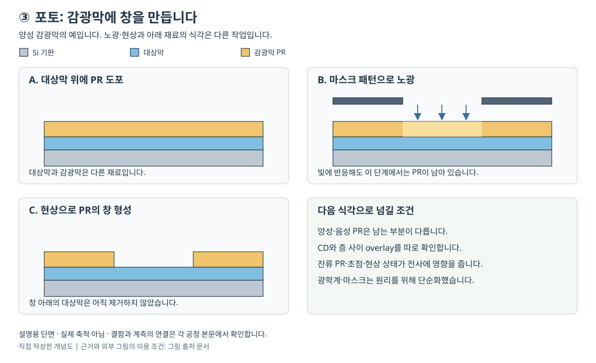

# 포토와 노광: 빛의 회절에서 DUV·EUV 패턴 전사까지 | Photolithography and Pattern Transfer

[공정 목차](README.md) · 이전: [산화와 게이트 절연막](02-산화와게이트절연막_oxidation-gate-dielectrics.md) · 다음: [식각](04-식각과선택비_etching.md)

기준일: 2026-10-26. 포토 공정이 감광막에 패턴을 만드는 원리와 그 패턴을 다음 공정에 전달하는 조건을 설명합니다. 193 nm DUV, 13.5 nm EUV와 NA 0.55 High-NA EUV를 구분하며, 공식 발표의 연구 결과·장비 출하·선택 층 양산을 따로 표시합니다.

## 공정 전후 단면



그림은 양성 PR의 패턴 형성을 설명하는 자체 원리도이며 실제 노광기의 광학 배치나 비례 축척 도면이 아닙니다. A에는 기판 위 가공할 대상막과 PR이 연속해서 남아 있습니다. B에서는 마스크를 거친 빛이 PR에 공간적인 반응 차이를 만듭니다. C에서는 현상으로 양성 PR의 개구부가 열렸지만 그 아래 대상막은 아직 남아 있습니다. 마스크를 통과하는 그림은 개념 설명이며, 반사 마스크를 쓰는 EUV 광학계를 그대로 그린 것은 아닙니다. [EPFL CMi, Introduction to Photolithography](https://www.epfl.ch/research/facilities/cmi/process/photolithography/introductiontophotolithography/)

A에서 생긴 도포 결함은 B의 빛 분포를 바꾸지 않아도 C의 패턴 결함으로 이어질 수 있습니다. C에서의 폭·잔류막·무너짐을 먼저 확인하고, 다음 식각 후 같은 좌표와 비교하면 PR 형성 문제와 대상막 전사 문제를 나눌 수 있습니다. 그림에 대상막이 남은 이유가 바로 이 검사 시점의 차이입니다.

### 실제 노광기·도포 현상기와 재료의 연결

| 실제 장비·플랫폼 | 이 단면에서 맡는 역할 | 선택·해석 조건 |
|---|---|---|
| [ASML TWINSCAN NXE:3800E](https://www.asml.com/en/products/euv-lithography-systems/twinscan-nxe-3800e) | B에 해당하는 EUV 패턴 노광을 수행하는 제품입니다. | 공식 자료는 2 nm 로직·첨단 DRAM 양산을 지원하는 제품 설계와 웨이퍼별 계측·보정을 설명합니다. 제품 지원 범위가 특정 고객의 모든 층 적용을 뜻하지 않습니다. |
| [TEL CLEAN TRACK LITHIUS Pro DICE](https://www.tel.com/product/lithius.html) | A의 도포와 C를 만드는 현상을 담당하는 300 mm coater/developer입니다. | 2025-12-15 출시 발표와 2026년 제품 설명이 있으며 High-NA EUV부터 DUV까지 지원한다고 설명합니다. 노광기의 역할과 분리하여 도포·현상 결함을 평가합니다. |

장비 사진은 연결한 공식 제품 페이지에서 확인할 수 있습니다. 두 제품을 나란히 소개한 것은 역할 비교이며, 특정 고객 라인에서 이 조합으로 운용된 실적을 새로 주장하는 것이 아닙니다.

| 재료·구조 | 역할 | 선택할 때 연결할 지표 |
|---|---|---|
| PR | 빛의 분포를 선택적으로 남는 임시 패턴으로 바꿉니다. | 파장·톤·감도·거칠기·결함과 식각 중 두께 여유를 함께 봅니다. CAR와 MOR을 같은 화학 반응으로 취급하지 않습니다. |
| 하부층·하드마스크 | PR의 접착·광학 응답·후속 전사 조건을 조절하는 별도 층입니다. | PR이 잘 서 있어도 계면이 약하거나 전사 선택비가 맞지 않으면 최종 형상이 달라집니다. |
| 현상액·후속 세정 매질 | 반응한 막의 용해 차이를 실제 개구부로 바꿉니다. | 재료별 용해 선택성, 잔류막·팽윤·건조 중 기계적 안정성을 확인합니다. |
| 마스크 | 반복할 공간 정보를 제공합니다. | 투과형과 EUV 반사형을 구분하고, 결함의 필드 내 반복 여부와 실제 PR 패턴을 연결합니다. |

재료와 후속 단계의 기본 구분은 [EPFL CMi의 포토리소그래피 설명](https://www.epfl.ch/research/facilities/cmi/process/photolithography/introductiontophotolithography/), 실제 트랙의 적용 범위는 [TEL의 LITHIUS 제품 설명](https://www.tel.com/product/lithius.html)을 근거로 합니다. 표의 선택 항목은 특정 PR의 인증 사양이나 현상 레시피가 아닙니다.

### 사례 1: 도포 불량의 감시를 바꾼 실제 제품 발표

TEL은 2025-12-15 LITHIUS Pro DICE 발표에서 이전 모델 대비 PR 도포 불량으로 생기는 웨이퍼 결함과 관련 비용을 50% 이상 줄일 수 있다고 설명했습니다. 각주상 결함 성능·약품 소비량 비교에 따른 TEL 추정이며, 모든 포토 결함률이나 고객 제품 수율이 50% 줄었다는 실측 보고는 아닙니다. 2026-04-28 기술 글은 장비 내부 센서의 연속 감시와 이상 시 경고·정지 기능을 설명합니다. [TEL 출시 발표와 각주 1](https://www.tel.com/news/product/2025/20251215_002.html), [TEL 기술 글의 Defect Control Technology](https://www.tel.com/blog/all/20260428_001.html)

| 진단 순서 | 공개 사례와 적용할 때의 판단 |
|---|---|
| 증상 | A의 PR 도포 불량이 후속 패턴 결함과 웨이퍼 손실로 연결됩니다. |
| 경쟁 원인 | 약품 공급·도포·모듈 상태 외에도 시작 표면의 입자·젖음성 등이 후보입니다. 장비 경보 하나만으로 물리적 결함 원인을 확정하지 않습니다. |
| 확인 계측 | 공급사는 내부 센서·연속 데이터 수집을 공개했습니다. 실제 평가에서는 도포 직후 두께·피복·결함 맵과 해당 모듈·처리 시각을 연결해야 합니다. 이 추가 평가 항목은 본문의 진단 제안입니다. |
| 해결 방향 | 공급사는 이상을 조기에 감지하는 기능으로 불량 처리가 계속되는 범위를 줄이는 방향을 제시합니다. 이미 틀어진 모든 PR 패턴을 센서가 복구한다는 의미는 아닙니다. |
| 다시 볼 지표 | 도포 기인 결함과 기타 결함을 나눈 변화, 잘못된 경보, 재작업·약품 소비와 처리량입니다. 공급사가 공개하지 않은 고객별 수치는 제시하지 않습니다. |

이 수치는 공급사 비교 추정입니다. 여기서 원자료·표본 수·고객별 공정 조건을 확보하여 독립 검증한 것은 아니며, 더 촘촘한 빛의 패턴을 만드는 노광기 해상도 성과와도 구분합니다.

### 사례 2: 현상 뒤 가는 PR 선이 붙는 자체 진단 예시

아래는 실제 생산 기록이 아닌 교육용 상황입니다. C에 있어야 할 가는 PR 선들이 이웃 선에 붙어 보인다고 가정합니다. 이는 3.5절의 패턴 붕괴 원리를 원인 분리 순서로 연결한 예입니다.

| 진단 순서 | 비교할 자료와 해결 방향 |
|---|---|
| 증상 | 현상·건조 뒤 높은 PR 선이 기울거나 서로 붙고, 일부 공간이 닫혀 보입니다. |
| 경쟁 원인 | 건조 중 모세관력, 약한 접착·재료 강성, 과도한 종횡비, 애초에 충분히 열리지 않은 공간과 브리지를 구분합니다. |
| 확인 계측 | 평면 SEM만 보지 않고 기울어진 옆면·접힌 높이와 바닥 잔류막을 단면에서 확인합니다. 동일 패턴의 막 두께·접착·건조 조건별 비교에서는 노광량과 초점을 함께 기록합니다. |
| 해결 방향 | 붕괴가 확인되면 PR 높이·재료·하부층과 건조 조건을 함께 검토합니다. 높이를 줄일 때에는 아래 하드마스크로 전사할 두께 여유도 다시 계산합니다. 단순히 현상 시간을 늘리면 남겨야 할 선을 더 약하게 할 수 있습니다. |
| 다시 볼 지표 | 붕괴한 구조의 비율과 검사 면적, ADI CD·잔류막, AEI 선폭·단선 및 전기적 연결입니다. SEM 한 장에서 선이 서 있다는 관찰을 전 웨이퍼 합격으로 바꾸지 않습니다. |

포토 패턴을 후속 공정 전에 검사하고 재작업 여부를 결정하는 원칙은 [EPFL CMi의 inspection·rework 설명](https://www.epfl.ch/research/facilities/cmi/process/photolithography/photolithography-inspection-stripping-and-descum/)과 연결됩니다. 재작업은 아래막을 이미 식각한 뒤의 손상까지 되돌린다는 뜻이 아니므로 C 단계의 검사가 중요합니다.

## 1. 노광은 실리콘에 회로를 직접 조각하는 일이 아닙니다

포토리소그래피(photolithography)는 빛에 반응하는 얇은 막에 공간적인 정보를 기록하여 선택적으로 남기는 공정입니다. 감광막(photoresist, PR)은 노광 후 용해도 등이 달라지는 재료입니다. 마스크(mask) 또는 레티클(reticle)은 전사할 패턴 정보를 가진 물체입니다. 노광(exposure)은 그 정보를 빛의 분포로 전달하는 단계이며, 현상(development)은 재료가 용해되는 차이를 이용하여 실제 빈 공간과 남는 막을 만드는 단계입니다.

보통 포토 직후의 패턴은 임시 마스크입니다. 아래 산화막을 식각하거나, 다른 막을 가공하거나, 선택 영역에 이온을 주입할 때 이 임시 패턴을 이용합니다. 감광막 자체가 최종 금속 배선이나 실리콘 채널이 된다고 이해하면 안 됩니다. EPFL은 PR 패턴 형성과 후속 식각·리프트오프, 마지막 제거를 나누어 설명합니다. [EPFL CMi, Introduction to Photolithography의 Introduction](https://www.epfl.ch/research/facilities/cmi/process/photolithography/introductiontophotolithography/)

```text
설계 패턴 → 마스크 패턴 → 광학적 밝기 분포 → 감광막의 화학적 변화
         → 현상 후 감광막 모양 → 하드마스크·아래막으로 전사 → 감광막 제거
```

각 화살표에서 모양이 달라질 수 있습니다. 빛이 회절하고, 반응물이 퍼지고, 현상액이 막을 용해하며, 식각 중 옆면이 변하기 때문입니다. 최종 패턴의 정확성을 평가하려면 어느 단계에서 측정한 치수인지 먼저 밝혀야 합니다.

하드마스크(hard mask)는 얇은 감광막보다 뒤 식각을 잘 견디도록 사용하는 무기막 등의 중간 마스크입니다. 얇은 PR로 정교한 이미지를 만든 뒤 이를 하드마스크로 옮기면 깊은 식각과 연결할 수 있습니다. 다만 중간 전사 단계가 추가되므로 선택비와 선폭 변화, 결함도 새로 관리해야 합니다.

## 2. 감광막의 양성·음성과 반응 기작을 구분합니다

양성(positive tone)은 노광된 영역이 선택적으로 제거되는 방향, 음성(negative tone)은 노광된 영역이 남는 방향입니다. 이것은 최종 패턴의 톤(tone)을 말합니다. 모든 양성 재료가 같은 분자를 쓰거나 모든 음성 재료가 같은 반응을 하는 것은 아닙니다. 전통적인 음성 고분자에서는 가교(cross-linking), 즉 분자 사이 연결 증가가 용해를 어렵게 만들 수 있습니다.

일반적인 액상 유기 PR은 막의 뼈대가 되는 고분자, 빛에 반응하는 성분, 도포를 돕는 용매와 첨가제 등을 포함합니다. 화학증폭형 감광막(CAR, chemically amplified resist)에서는 광산발생제(PAG, photoacid generator) 등이 빛을 받아 산을 만들고 그 산이 여러 후속 반응을 촉진합니다. 촉매는 자신이 반복해서 작용하여 적은 초기 반응으로 많은 화학 변화를 일으키게 합니다. 빛의 에너지를 공짜로 늘린다는 뜻은 아닙니다. [EPFL CMi, Photoresist chemistry의 성분·chemical amplification](https://www.epfl.ch/research/facilities/cmi/process/photolithography/introductiontophotolithography/)

산의 확산은 거친 반응 분포를 매끈하게 할 수 있지만 패턴 경계도 흐리게 할 수 있습니다. 중화제(quencher)는 산 반응의 공간적 범위와 감도에 영향을 줍니다. 따라서 ‘민감하게 반응할수록 해상도도 언제나 좋아진다’는 관계가 성립하지 않습니다. 광자 흡수, 반응 효율, 공간적 퍼짐과 현상 응답을 함께 다뤄야 합니다.

EUV에서는 금속산화물 감광막(MOR, metal oxide resist)과 건식 도포·현상 같은 다른 재료 경로도 연구·적용합니다. MOR을 기존 고분자 CAR와 완전히 같은 산 촉매 기작으로 설명하지 않습니다. TEL은 금속 함유 재료의 패턴 제어 외에 웨이퍼 뒷면·베벨의 금속 오염 관리가 필요하다고 설명합니다. 재료를 바꾸면 노광기 외의 도포·현상·세정·검사까지 함께 바뀔 수 있습니다. [TEL, 2021-06-08 High NA 연구소 협력 발표의 metal-containing resists 설명](https://www.tel.com/news/topics/2021/20210608_001.html)

## 3. 도포부터 현상까지, 각 단계가 패턴을 결정합니다

### 3.1 표면 준비와 도포

표면의 입자·물기·유기물과 표면 에너지는 PR의 퍼짐과 접착에 영향을 줍니다. 접착을 돕는 표면 처리는 모든 재료에서 같은 효과를 내지 않으며, 아래막의 종류와 다음 공정에 맞추어 검증합니다. 감광막을 회전 도포(spin coating)하면 액체의 흐름과 용매 증발로 얇은 막이 형성됩니다. 회전수만으로 두께가 결정되는 것은 아닙니다. 점도, 고형분, 용매, 기판 형상과 증발 조건도 영향을 줍니다.

가장자리에 두꺼운 고리가 남는 edge bead는 유효 노광 영역과 접촉·오염에 문제를 만들 수 있습니다. 뒷면의 잔류막은 웨이퍼를 잡는 척과 높이 측정에 영향을 줄 수 있습니다. 도포 균일도는 평균 두께와 중심·가장자리 분포를 나누어 확인합니다.

### 3.2 소프트베이크는 남은 용매를 다룹니다

소프트베이크(soft bake, prebake)는 주로 도포막에 남은 용매를 줄여 다음 공정에 맞는 막 상태를 만드는 단계입니다. 용매는 막 안에서 표면으로 확산한 다음 증발하고, 위 기체로 운반됩니다. 표면만 빨리 마르면 깊은 부분의 용매가 빠져나가는 경로도 변합니다. MicroChemicals는 이 확산·증발·기체 이동을 나누어 설명합니다. [MicroChemicals, Softbake의 Some Physics](https://www.microchemicals.com/dokumente/application_notes/softbake_photoresist.pdf)

베이크가 부족하면 잔류 용매가 접착·현상·후속 가열에 영향을 줄 수 있고, 과도하면 감광 성분이나 막 응력이 달라질 수 있습니다. 베이크를 단순히 ‘PR을 단단하게 굳히는 가열’로만 설명하지 않습니다. 막 조성·두께에 따른 상태 변화가 목적입니다. 서로 다른 PR에 하나의 온도·시간을 보편 조건으로 적용하지 않습니다.

### 3.3 정렬과 초점 맞춤 뒤 노광합니다

정렬(alignment)은 웨이퍼에 있는 표식을 측정하여 좌표를 찾는 과정입니다. 이전 층과 현재 층의 최종 상대 위치 오차인 오버레이(overlay)와 연결되지만, 정렬 센서가 좌표를 찾았다고 현상 후 오버레이까지 자동으로 보장되지는 않습니다. 막에 의한 표식 변형, 스테이지·광학 오차와 웨이퍼 변형이 남습니다.

노광에서는 조명 분포, 마스크, 투영 광학계와 웨이퍼의 높이·이동을 함께 제어합니다. 스테퍼(stepper)는 영역마다 이동하여 노광하고, 스캐너(scanner)는 슬릿 형태의 광학 영역을 이용하여 마스크와 웨이퍼를 동기화해 움직이며 전사합니다. 축소 투영 방식에서는 웨이퍼 위의 패턴을 마스크보다 작게 만듭니다.

노광량(dose)은 보통 단위 면적에 전달한 에너지로 나타내며 mJ/cm² 등을 사용합니다. 광원의 출력 W와 단위가 다릅니다. 같은 출력이라도 광학 손실, 노광 면적과 속도에 따라 웨이퍼가 받은 에너지가 달라집니다. 단위 시간당 밝기와 총 노광량도 구별해야 합니다.

### 3.4 PEB는 노광 후의 화학 반응을 이어 갑니다

노광 후 베이크(PEB, post-exposure bake)는 노광과 현상 사이에 수행합니다. CAR의 촉매 반응이나 일부 음성 PR의 가교를 진행하는 등 재료마다 목적이 다릅니다. 노광 전 용매를 다루는 소프트베이크와 순서·기능이 같지 않습니다. [MicroChemicals, Post Exposure Bake의 Chemically Amplified Positive Resists·Cross-linking Negative Resists](https://www.microchemicals.com/dokumente/application_notes/photoresist_post_exposure_bake_peb.pdf)

확산 길이를 단순하게 L≈√(2Dt)로 보면 반응종의 확산계수 D와 시간 t가 공간적 퍼짐에 연결됩니다. 이 식은 한 방향 자유확산의 길이 척도이며 실제 PR에서는 반응·중화·농도와 온도에 따라 달라집니다. 베이크 시간만 길게 하면 작은 패턴이 무조건 좋아지지는 않습니다. 웨이퍼 위치별 온도 차, 노광에서 PEB까지의 지연도 결과를 바꿀 수 있습니다.

### 3.5 현상·세정·건조와 검사

현상은 용해 속도의 차이를 이용합니다. 양성 패턴에서 빛을 받은 곳은 더 잘 제거되지만, 남겨야 할 곳의 용해가 완전히 0인 이상적인 과정은 아닙니다. 현상액의 조성·상태, 시간, 온도, 공급·배출과 PR의 반응 상태가 선폭과 옆면에 영향을 줍니다.

세정·건조 중에는 좁고 긴 패턴이 기울거나 붙는 패턴 붕괴(pattern collapse)가 생길 수 있습니다. 종횡비(aspect ratio)는 예를 들어 높이/폭처럼 정의하며, 높고 좁은 패턴은 기계적으로 취약할 수 있습니다. 얇은 PR은 이를 줄이는 데 유리할 수 있지만 뒤 식각을 견디는 두께 여유는 줄어듭니다. 두께를 줄이는 선택은 하드마스크와 전사 공정을 함께 검토해야 합니다.

현상 후 검사(ADI, after-develop inspection)와 식각 후 검사(AEI, after-etch inspection)를 구분합니다. 현상 후에는 맞았던 선폭이 식각 뒤 달라졌다면 전사 중 변화도 원인 후보입니다. 필요한 경우 후베이크·descum 등을 적용하지만 모든 공정에 같은 후처리가 들어가는 것은 아닙니다. descum은 개구부 등에 남은 얇은 잔류물을 제거하는 개념이며 의도한 PR 치수도 바꿀 수 있습니다.

## 4. 회절이 만드는 해상도와 Rayleigh 관계

빛이 마스크의 작은 구조를 지나거나 반사되면 여러 방향으로 퍼지는 회절(diffraction)이 일어납니다. 투영 광학계가 그 중 일부 성분을 모아 패턴의 상(image)을 만듭니다. 작은 구조를 구분하는 데 필요한 성분을 충분히 모으지 못하면 서로 붙거나 흐려집니다. 파장이 짧거나 더 넓은 각도의 빛을 수집하면 더 작은 구조를 구분할 가능성이 커집니다.

수치개구수(NA, numerical aperture)는 웨이퍼 쪽 매질의 굴절률 n과 모으는 빛의 반각 θ에 대해 NA = n sinθ로 정의합니다. 단순히 렌즈 지름의 숫자가 아니며, 광학 설계와 매질을 함께 반영합니다. 대표적인 해상도 관계는 다음과 같습니다.

\[
\mathrm{CD}\approx k_1\frac{\lambda}{\mathrm{NA}}
\]

CD(critical dimension)는 공정에서 관리하는 중요한 치수입니다. 문맥에 따라 선폭, 공간 폭, 구멍 지름 등을 뜻하므로 정의가 필요합니다. λ는 노광 파장, k₁은 조명·마스크·감광막·공정과 패턴 조건을 반영하는 계수입니다. ASML은 이 관계와 세 변수를 설명합니다. [ASML, The Rayleigh criterion](https://www.asml.com/en/technology/lithography-principles/rayleigh-criterion)

피치(pitch)는 반복 구조의 주기입니다. 같은 폭의 선과 공간이 반복될 때에는 피치가 선폭의 두 배이고 하프피치(half pitch)는 선폭과 같습니다. 그러나 고립선과 구멍 배열, 서로 마주 보는 선 끝의 간격(T2T, tip-to-tip)은 동일한 측정 대상이 아닙니다. ‘8 nm 해상도’와 ‘8 nm 피치’를 서로 바꾸어 쓰지 않습니다.

‘2 nm 공정’ 같은 노드 이름도 특정 트랜지스터의 게이트 길이, 배선 폭, 노광 파장 하나와 동일한 숫자가 아닙니다. 실제 제품에는 서로 다른 치수와 여러 노광 방식이 함께 사용됩니다. Rayleigh 관계에 NA 하나를 넣어 제품 노드의 모든 치수를 계산하는 것은 불가능합니다.

## 5. 초점 심도와 공정 여유

초점 심도(DOF, depth of focus)는 웨이퍼 높이가 최적 초점에서 벗어나도 허용할 수 있는 패턴이 만들어지는 범위를 말합니다. ‘선명하다’의 판정 조건이 필요하므로 재료·패턴과 허용 치수에 따라 값이 달라집니다. 대표적인 스케일 관계는 다음과 같습니다.

\[
\mathrm{DOF}\approx k_2\frac{\lambda}{\mathrm{NA}^2}
\]

k₂는 공정과 판정에 의존하는 계수입니다. NA를 키우면 가로 방향 해상도는 좋아질 수 있지만 초점 여유는 제곱에 반비례하여 줄어듭니다. imec 등이 수행한 초박막 PR 계측 논문은 이 관계와 두께·패턴 붕괴·계측 신호의 상호 제약을 다룹니다. [Lorusso 등, Metrology of Thin Resist for High NA EUVL, 2022의 Introduction](https://novami.com/wp-content/uploads/2023/04/120530o-metrology-of-thin-resist-for-high-na-euvl-imec-spie-alp-2022-1.pdf)

초점은 노광기의 조절 문제이면서 웨이퍼 표면의 문제입니다. 기판 형상, 뒷면 입자, 척, 앞 공정의 단차와 막 두께가 모두 높이를 바꿀 수 있습니다. CMP가 단차를 줄이면 뒤 포토의 초점 조건을 확보하는 데 도움이 됩니다. 반대로 노광기에서 평균 높이를 보정해도 PR 두께 안의 모든 높이와 국소 요철을 완전히 보정하지는 못합니다.

공정창(process window)은 원하는 결과를 만족하는 여러 변수의 조합 범위입니다. 보통 초점과 노광량을 변화시킨 focus–exposure matrix를 만들어 치수·옆면·결함이 모두 허용되는 영역을 찾습니다. 최적 초점 한 점에서 아주 작은 패턴이 보인 것과 생산 변동을 견디는 넓은 공정창을 얻은 것은 다른 성과입니다.

공정창을 정의할 때 CD 평균만 보지 않습니다. 치수 분포의 꼬리, 구멍 누락, 선 끊김, 연결되지 말아야 할 곳의 브리지, 식각 후 전기적 연결까지 평가 기준에 넣어야 합니다. 단면 사진 한 장은 이런 모든 조건의 수율을 보여 주지 않습니다.

## 6. DUV와 액침: 193 nm 빛으로 더 작은 패턴을 만듭니다

DUV(deep ultraviolet)는 심자외선 영역을 이용하는 노광입니다. KrF는 248 nm, ArF는 193 nm가 대표적입니다. 액침(immersion)은 최종 렌즈와 웨이퍼 사이에 물 등을 두어 굴절률을 이용하는 방식입니다. ArF 액침은 193 nm 광원을 계속 사용하면서 NA를 키웁니다. 파장이 193 nm에서 1 nm로 바뀌는 공정이 아닙니다. ASML은 물을 이용하여 NA 1.35에 도달하는 광학계를 설명합니다. [ASML, Lenses & mirrors의 Numerical aperture·Immersion lithography](https://www.asml.com/en/technology/lithography-principles/lenses-and-mirrors)

건식 환경에서 n≈1이면 NA = n sinθ는 1을 넘기 어렵습니다. 액침은 n을 높이는 경로입니다. 다만 물의 흐름·기포·오염과 PR 상호작용 등을 관리해야 하며, 높은 NA만으로 원하는 모든 패턴을 확보하지는 못합니다.

회절 한계 가까이에서는 원래 설계와 똑같은 모양을 마스크에 그려도 웨이퍼에 같은 모양이 생기지 않습니다. OPC(optical proximity correction)는 주변 구조와 광학·공정 효과를 계산하여 마스크 모양을 보정하는 방법입니다. 예를 들어 모서리가 둥글어지는 경향을 고려하여 마스크의 끝과 모서리 모양을 바꿀 수 있습니다. 설계의 전기적 기능을 바꾸려는 것이 아니라 제조 후 원하는 경계를 얻기 위한 조정입니다. [ASML, Computational lithography의 모델·마스크 최적화 설명](https://www.asml.com/en/products/computational-lithography)

다중 패터닝(multiple patterning)은 작은 간격의 구조를 여러 전사 단계로 나누어 만드는 방법입니다. 서로 다른 패턴을 여러 번 노광하는 방식과, 옆벽 스페이서를 이용하여 간격을 만드는 자기정렬 방식은 오차가 생기는 위치가 다릅니다. 자기정렬(self-aligned)은 어떤 경계를 앞 구조가 정한다는 뜻이며 모든 절단·접점까지 오버레이가 사라진다는 뜻은 아닙니다.

한 번의 노광에서 가능한 피치가 최종 회로의 피치와 항상 같지 않은 이유가 여기에 있습니다. 추가 마스크, 증착·식각·세정과 계측이 필요하므로 공정 수와 오차 예산도 늘어날 수 있습니다. EUV를 도입하더라도 모든 층을 EUV로 바꾸기보다 요구 치수와 비용·처리량에 맞추어 DUV와 함께 사용합니다.

## 7. EUV는 13.5 nm와 반사 광학계를 사용합니다

EUV(extreme ultraviolet)는 극자외선입니다. 현재 산업용 EUV 노광의 대표 파장은 13.5 nm입니다. 빛의 파장이 짧아지면 광원·마스크·광학계·진공·감광막까지 새로 맞춰야 합니다. 많은 재료와 공기가 EUV를 흡수하므로 투과 렌즈를 그대로 쓰기 어렵고, 진공 중 다층 반사경으로 빛을 전달합니다. [ASML, Lenses & mirrors의 EUV needs mirrors](https://www.asml.com/en/technology/lithography-principles/lenses-and-mirrors)

EUV 마스크도 빛이 통과하는 단순 투명 필름이 아니라 반사 구조를 바탕으로 패턴을 만듭니다. 다층 반사막 위 흡수체와 입사각의 영향 때문에 마스크는 이상적인 두께 0의 그림과 다릅니다. 마스크의 결함·거칠기·입사 방향에 따른 영상 효과가 웨이퍼 패턴에 영향을 줄 수 있습니다. High-NA 광학계에서 마스크 입사각이 설계 문제로 등장하는 이유도 여기에 연결됩니다. [ASML, 5 things you should know about High NA EUV의 anamorphic optics 설명](https://www.asml.com/en/company/stories/2024/5-things-high-na-euv)

광원에서는 레이저로 주석 방울을 플라즈마 상태로 만들어 EUV를 냅니다. 플라즈마(plasma)는 전자와 이온 등이 존재하는 이온화된 기체 상태입니다. 발생한 에너지 전부가 웨이퍼의 유효 노광으로 이어지지는 않습니다. 수집 광학계·여러 반사경과 마스크의 손실, 광학 오염과 열부하도 장비 설계에 영향을 줍니다. [ASML, Light & lasers의 Creating EUV light](https://www.asml.com/en/technology/lithography-principles/light-and-lasers)

DUV보다 한 광자의 에너지가 큰 EUV에서는 흡수 뒤 전자가 만들어지는 과정과 2차 전자의 이동, 국소 화학 반응이 패턴 형성에 중요합니다. 같은 단위 면적 에너지라면 광자의 수는 더 적습니다. 따라서 밝기 분포가 같게 설계되어도 작은 부피에서 반응한 사건 수는 흔들릴 수 있습니다.

확률적 결함(stochastic defect)은 원래 같아야 할 구조에서 국소적·불규칙하게 나타나는 결함입니다. 구멍 누락, 작은 브리지와 선 끊김 등이 예입니다. 선 가장자리 거칠기(LER, line-edge roughness)와 선폭 거칠기(LWR, line-width roughness)도 변동을 나타내지만, 어느 값이 작다고 희귀 결함이 없다는 뜻은 아닙니다. imec는 노광량·치수·재료와 이런 결함의 관계를 연구합니다. [imec, 2018-03 EUV single exposure 글의 Stochastic printing failures](https://www.imec-int.com/en/imec-magazine/imec-magazine-march-2018/imec-pushes-the-limits-of-euv-lithography-single-exposure-for-future-logic-and-memory-applications)

노광량을 늘리면 광자 수의 상대 변동을 줄이는 방향으로 작용할 수 있지만, 감광막 반응과 처리량·열·선폭을 함께 바꿉니다. 해상도·거칠기·감도 사이에서 선택이 생깁니다. 단순 광자 포아송 모형 하나가 모든 EUV 결함률을 예측하지는 않습니다.

## 8. High-NA 0.55: 해상도, 초점, 노광 영역이 함께 달라집니다

ASML의 NXE 계열 EUV는 NA 0.33, EXE 계열 High-NA EUV는 NA 0.55를 사용합니다. 파장은 둘 다 13.5 nm입니다. High-NA라는 말은 EUV보다 다시 짧은 파장을 사용한다는 뜻이 아닙니다. [ASML, EUV lithography systems의 NXE·EXE 설명](https://www.asml.com/en/products/euv-lithography-systems)

NA를 키우면 마스크에서 빛이 입사하는 각도와 반사 특성도 설계해야 합니다. EXE는 한 방향 4배, 다른 방향 8배로 서로 다른 축소율을 사용하는 아나모픽(anamorphic) 광학계를 사용합니다. 기존 마스크 형식을 유지하는 조건에서 웨이퍼의 노광 영역은 NXE의 절반이 됩니다. 마스크의 원형 점을 그대로 두면 축소 뒤 같은 모양이 된다는 뜻이 아니므로 설계·마스크의 좌표 변환도 필요합니다. [ASML, 2024-01-25 High NA 소개의 Larger, anamorphic optics·Faster stages](https://www.asml.com/en/company/stories/2024/5-things-high-na-euv)

큰 다이가 한 영역에 들어가지 않으면 영역을 나누어 이어 붙이는 스티칭(stitching)을 검토할 수 있습니다. 경계를 넘는 배선은 두 노광의 위치·선폭이 맞아야 하며, 설계 규칙과 마스크·검사도 이를 지원해야 합니다. 노광 영역이 작아졌다고 웨이퍼 처리량이 정확히 절반이 되는 것은 아닙니다. 스테이지 이동, 노광량, 소스 출력, 필드 수와 장비 운영이 함께 결정합니다.

고해상도는 얇은 PR·하드마스크·정밀 계측과 연결됩니다. 얇은 막에서는 CD-SEM 신호가 약해지고 측정 노이즈가 거칠기처럼 보일 수도 있습니다. 해당 논문이 특정 얇은 PR과 하부층에서 계측 조건을 다시 비교한 결과를, 모든 얇은 막이 측정 불가능하다는 결론으로 확대하지 않습니다. [Lorusso 등, 2022의 Abstract·Results and Discussion](https://novami.com/wp-content/uploads/2023/04/120530o-metrology-of-thin-resist-for-high-na-euvl-imec-spie-alp-2022-1.pdf)

### 2026-10-26에 구분해서 읽을 공식 성과

| 공식 자료 | 공개한 단계·대상 | 확대해서 해석하면 안 되는 내용 |
|---|---|---|
| ASML 2024-01-25 소개입니다. | 첫 EXE:5000 모듈을 2023년 12월 Intel에 출하했다고 설명합니다. | 모듈 출하가 그날 완성칩 양산을 뜻하지 않습니다. 당시 미래 일정은 당시의 계획입니다. |
| imec 2025-09-22 발표입니다. | 단일 노광의 20 nm 피치·13 nm T2T 구조와 Ru 직접 식각 등의 연구 성과입니다. | 연구 시험 구조의 전기 시험 수율을 완성 CPU 전체 수율로 옮기지 않습니다. |
| Intel·ASML 2026-09-07 발표입니다. | Intel Core Ultra Series 3, Panther Lake 일부 제품의 선택 층에서 High-NA 양산을 사용한다고 설명합니다. | 모든 Panther Lake의 모든 층, 모든 업체의 공정에 적용되었다는 뜻이 아닙니다. |

imec의 성과는 MOR·하부층·조명·마스크를 함께 최적화한 결과로 설명됩니다. Intel의 100만 장 초과 누적 처리량은 초기 장비 인증·시험, 연구개발, 선택 층 양산을 합한 수치입니다. 전부 양품인 완성 웨이퍼 100만 장으로 바꾸어 쓰지 않습니다. [imec, 2025-09-22 공식 발표](https://www.imec-int.com/en/press/imec-achieves-new-milestones-single-patterning-high-na-euv-lithography-both-damascene-and), [Intel·ASML, 2026-09-07 공식 발표](https://www.intel.com/content/www/us/en/newsroom/news/intel-foundry/intel-foundry-asml-accelerate-industry-readiness-for-high-na-euv.html)

## 9. CD, 오버레이, 경계 위치 오차를 따로 봅니다

CD가 맞아도 위치가 틀릴 수 있습니다. 예를 들어 접점 구멍 지름이 목표와 같더라도 아래 배선 가장자리에 걸치면 연결이 나빠질 수 있습니다. 반대로 중심이 잘 맞아도 구멍이 지나치게 크면 옆 구조와 연결될 수 있습니다.

| 지표 | 측정 대상 | 대표적인 원인 후보 |
|---|---|---|
| CD·CDU | 치수와 그 균일도입니다. | 노광량·초점·막 두께·현상·식각입니다. |
| overlay | 서로 다른 층 사이의 상대 위치입니다. | 정렬·광학 왜곡·웨이퍼 변형·표식 영향입니다. |
| LER·LWR | 가장자리 위치 또는 선폭의 국소 변동입니다. | 광자·재료·반응·전사·측정 노이즈입니다. |
| EPE, edge placement error | 목표 경계에서 실제 경계까지의 오차입니다. | 위치·치수·거칠기 등 여러 기여입니다. |
| 결함 밀도·발생 확률 | 누락·브리지·단선 등입니다. | 입자·마스크·확률적 반응·현상·전사입니다. |

CDU(critical dimension uniformity)는 위치에 따른 치수 균일도를 말합니다. 평균뿐 아니라 웨이퍼 내·필드 내·국소 구조 사이 변동을 나누면 원인을 찾기 쉽습니다. EPE에는 오버레이와 치수 오차가 함께 들어갈 수 있지만, 상관된 성분을 독립 오차로 두 번 더하지 않습니다.

광학 산란 계측은 반복 타깃의 반사·회절 응답을 모형과 비교하여 오버레이·형상 등을 추정할 수 있습니다. 전자빔 검사·CD-SEM은 작은 구조를 관찰하지만 측정 범위·시간·전자빔 영향과 노이즈를 고려해야 합니다. ASML도 회절 기반 광학 계측과 전자빔 검사를 서로 다른 수단으로 설명합니다. [ASML, Measuring accuracy의 Types of metrology and inspection·Optical metrology](https://www.asml.com/en/technology/lithography-principles/measuring-accuracy)

오차 맵에서 모든 필드가 한 방향으로 밀리는지, 중심에서 바깥으로 벌어지는지, 특정 필드 위치에서 반복되는지 구분하면 후보가 달라집니다. 이동·회전·배율 같은 체계적 성분을 추정하여 보정할 수 있지만, 국소 결함이나 무작위 변동까지 같은 방식으로 제거되지는 않습니다.

## 10. 대안을 비교할 때의 기준

| 선택 | 유리한 방향 | 함께 검토할 조건 |
|---|---|---|
| DUV 단일 패터닝 | 요구 치수가 허용하면 공정 부담을 줄일 수 있습니다. | 해당 층의 실제 피치·형상과 공정창입니다. |
| DUV 다중 패터닝 | 기존 광학계의 단일 패턴 간격보다 촘촘하게 만들 수 있습니다. | 추가 공정·마스크·오버레이·절단 패턴입니다. |
| 0.33 NA EUV | 짧은 파장으로 중요한 층의 패터닝을 구성합니다. | 노광량·PR·결함·마스크·전사입니다. |
| 0.55 NA EUV | 더 작은 단일 노광 구조의 가능성을 넓힙니다. | 초점·얇은 PR·반필드·스티칭·장비와 재료 비용입니다. |
| 전자빔 직접쓰기 | 마스크 없이 유연하게 작은 패턴을 기록할 수 있습니다. | 넓은 면적을 처리할 때의 시간과 산란·보정입니다. |
| 다른 PR 도포·현상 방식 | 재료·높이 방향 조성 등 다른 제어 수단을 제공합니다. | 결함·선폭·하드마스크·오염과 장비 호환성입니다. |

장비 가격이나 해상도 하나를 제품 원가로 바로 바꾸지 않습니다. 장비 이용률, 실효 처리량, 필요한 패터닝 횟수, 결함에 따른 손실과 설계 제약을 포함해야 합니다. 노광기만 빨라도 도포·PEB·현상·검사가 병목이면 전체 처리량은 제한됩니다. 실제 제품으로 판매되는 coater/developer가 별도 장비군인 이유를 TEL의 제품 목록에서도 확인할 수 있습니다. [TEL, Products의 Coater/Developer 목록](https://www.tel.com/product/all/)

## 11. 가정으로 계산하는 해상도·초점·광자 수·오차

아래 계산은 자체 구성한 교육용 비교입니다. k₁·k₂·흡수율·오차 성분을 고정했으며 장비 보증 성능이나 특정 양산층의 실제 결과가 아닙니다.

### 계산 A: 파장과 NA를 함께 대입합니다

k₁ = 0.30을 동일하게 놓고 같은 종류의 CD 척도를 비교합니다.

1. ArF 액침, λ = 193 nm, NA = 1.35이면 CD≈0.30×193/1.35 = 42.89 nm입니다.
2. EUV, λ = 13.5 nm, NA = 0.33이면 CD≈12.27 nm입니다.
3. High-NA EUV, λ = 13.5 nm, NA = 0.55이면 CD≈7.36 nm입니다.
4. EUV 두 경우의 비는 0.33/0.55 = 0.60입니다.

DUV의 NA가 더 크더라도 EUV의 짧은 파장이 전체 비율에 작용합니다. 이 값은 동일한 k₁과 치수 정의를 둔 단순 비교입니다. ‘7.36 nm 선을 만들었으므로 7.36 nm 노드’라는 결론은 나오지 않습니다. 실제 마스크·조명·PR와 패턴 전사 조건이 서로 달라 k₁도 동일하다고 보장되지 않습니다.

### 계산 B: NA 증가에 따른 DOF

k₂ = 0.50, λ = 13.5 nm로 가정합니다.

1. NA 0.33에서 DOF≈0.50×13.5/0.33² = 61.98 nm입니다.
2. NA 0.55에서 DOF≈0.50×13.5/0.55² = 22.31 nm입니다.
3. 비율은 (0.33/0.55)² = 0.36입니다.
4. 같은 정의에서는 DOF가 이전의 36%로 줄어드는 가정입니다.

계산한 DOF를 곧바로 ‘±22.31 nm’라고 쓰지 않습니다. 사용한 문헌이나 측정 규약이 전체 허용 폭을 뜻하는지 한쪽 변위를 뜻하는지 확인해야 합니다. 실제 초점 예산에서는 막·단차·장비·계측 오차가 함께 이 여유를 사용합니다.

### 계산 C: 같은 에너지에서 EUV 광자가 더 적은 이유

광자 에너지는 E = hc/λ이며 hc≈1239.84 eV·nm를 사용합니다.

1. 193 nm 광자 에너지는 1239.84/193≈6.42 eV입니다.
2. 13.5 nm 광자는 약 91.84 eV입니다.
3. 비율은 193/13.5≈14.30입니다. 같은 에너지라면 입사 EUV 광자 수는 약 1/14.30입니다.

이제 10 nm×10 nm 면적에 20 mJ/cm²를 입사시키고, 그중 20%를 흡수한다고 가정합니다. 이 노광량과 흡수율은 임의의 설명 값입니다.

1. 10 nm = 10⁻⁶ cm이므로 면적은 10⁻¹² cm²입니다.
2. 입사 에너지는 0.020 J/cm²×10⁻¹² cm² = 2.0×10⁻¹⁴ J입니다.
3. EUV 광자 하나는 약 1.471×10⁻¹⁷ J이므로 입사 수는 약 1,359개입니다.
4. 흡수 수의 평균을 20%로 두면 약 272개입니다.
5. 독립 사건의 단순 포아송 모형에서 표준편차는 √272≈16.5개이고 상대값은 약 6.1%입니다.

이 값은 선폭 오차 6.1%나 결함률 6.1%를 뜻하지 않습니다. 2차 전자와 반응·확산·현상까지 연결하는 모형이 추가로 필요합니다. 노광량을 두 배로 하면 단순 광자 모형의 상대 변동은 1/√2배가 되지만, 실제 패턴의 모든 변동이 그 비율로 줄어들지는 않습니다.

### 계산 D: 접점의 위치와 크기 오차를 함께 봅니다

폭 30 nm의 아래 배선 한가운데 폭 20 nm인 접점을 놓는 1차원 단면을 가정합니다.

1. 중심이 정확할 때 한쪽 여유는 (30−20)/2 = 5 nm입니다.
2. 오버레이가 3 nm 밀리면 가까운 쪽 여유는 2 nm입니다.
3. 접점 폭이 2 nm 커져 22 nm라면 중심 기준 여유는 4 nm입니다.
4. 같은 3 nm 이동까지 있으면 가까운 쪽 여유는 1 nm입니다.

선폭과 위치가 각각 허용치 근처에 있어도 조합은 여유를 크게 줄일 수 있습니다. 실제 설계에서는 단면 밖의 2차원 모양·모서리·옆면과 전기적 접촉 조건까지 고려합니다.

### 계산 E: 오차는 조건에 따라 더하는 방법이 다릅니다

평균을 제거한 독립적인 오버레이 오차 성분의 표준편차를 0.6 nm, 0.8 nm, 1.0 nm로 가정합니다.

1. 분산의 합은 0.6²+0.8²+1.0² = 2.0 nm²입니다.
2. 합성 표준편차는 √2≈1.414 nm입니다.
3. 단순 최악 방향 합은 0.6+0.8+1.0 = 2.4 nm이지만, 각 수가 표준편차라면 이것을 엄밀한 최댓값이라고 부를 수는 없습니다.
4. 성분이 상관되면 공분산 항이 필요하며, 고정 오프셋이 남아 있으면 평균도 따로 합쳐야 합니다.

평균·1σ·3σ·최대값을 섞어 같은 오차 예산표에 넣지 않는 것이 핵심입니다.

## 12. 패턴 이상을 발견했을 때의 원인 분리

가상 상황으로 특정 로트에서 작은 구멍의 누락이 늘었다고 가정합니다. 노광량을 일괄 증가시키기 전에 어느 단계의 어떤 종류 결함인지 확인해야 합니다.

| 관찰 | 구분할 후보 | 필요한 비교 |
|---|---|---|
| 현상 후부터 구멍이 없습니다. | 노광·PEB·현상·입자입니다. | 초점–노광량 맵, PR 두께, 잔류막과 결함 좌표입니다. |
| 현상 후에는 있고 식각 후에 없습니다. | 하드마스크·식각 중 막힘과 전사입니다. | 같은 좌표의 ADI/AEI와 단면입니다. |
| 모든 필드의 같은 곳에 반복됩니다. | 마스크·광학계·필드별 체계적 영향입니다. | 필드 좌표로 정렬한 결함 맵입니다. |
| 웨이퍼의 특정 원형 영역에 모입니다. | 도포·베이크·높이·척 영향입니다. | 웨이퍼 좌표와 막 두께·온도·높이 맵입니다. |
| 드물고 불규칙하게 나타납니다. | 확률적 반응 또는 랜덤 오염입니다. | 충분한 검사 면적·재료·노광량별 결함 통계입니다. |

같은 필드의 같은 곳에 반복되는 패턴과 무작위 위치의 패턴을 분리하면 원인 후보를 줄일 수 있지만, 지도 모양만으로 원인을 확정하지는 않습니다. 한 표본에서 결함 0개를 보았다고 전체 웨이퍼 결함률이 0이라고 보고하지도 않습니다. 검사 면적과 최소 검출 크기, 표본 수를 함께 밝혀야 합니다.

PR이 벗겨지는 현상에서는 접착·표면 준비·베이크뿐 아니라 뒤 화학 공정과 기계적 힘도 봅니다. 선폭이 넓어진 현상에서는 양성/음성, 선/공간 중 무엇을 측정했는지 먼저 구별합니다. 양성 PR의 노광량 증가가 어떤 개구를 넓히는 방향이라고 해도 모든 구조의 CD가 같은 부호로 바뀌는 것은 아닙니다. MicroChemicals의 문제 해결 자료도 여러 후보를 나누어 설명하므로 특정 증상을 하나의 원인과 일대일로 연결하지 않습니다. [MicroChemicals, Photolithography Trouble Shooter](https://www.microchemicals.com/dokumente/application_notes/lithography_trouble_shooting.pdf)

## 13. 연습문제와 해답

### 문제

1. 노광 직후 PR 아래 실리콘이 설계 모양으로 이미 깎여 있습니까?
2. 소프트베이크와 PEB를 서로 바꾸어도 같은 결과입니까?
3. NA 1.35 DUV보다 NA 0.33 EUV의 단순 해상도가 작아질 수 있는 이유를 식으로 설명합니다.
4. 같은 파장과 k₁에서 NA를 20% 높이면 CD는 몇 배입니까? 같은 k₂에서 DOF는 몇 배입니까?
5. 20 nm 피치의 같은 폭 선·공간 배열에서 하프피치는 얼마입니까? T2T가 자동으로 같은 값입니까?
6. High-NA의 4배·8배 아나모픽 축소가 기존 마스크 형식에서 만드는 노광 영역의 변화는 무엇입니까?
7. Intel의 누적 100만 장 초과 발표를 ‘High-NA로 만든 완성 양품 웨이퍼 100만 장’이라고 요약해도 됩니까?
8. CD-SEM 영상의 거칠기가 증가했습니다. 실제 PR 거칠기 증가 외에 확인할 항목을 듭니다.

### 해답

1. 보통 그렇지 않습니다. 빛이 PR의 화학 상태를 바꾸었으며, 현상과 식각 등 후속 단계가 필요합니다.
2. 다릅니다. 소프트베이크는 주로 도포 후 용매 상태를, PEB는 노광으로 시작한 반응 등을 다룹니다. 재료별 목적과 위치가 다릅니다.
3. CD≈k₁λ/NA이므로 파장이 함께 들어갑니다. 13.5 nm와 193 nm의 차이를 NA만으로 비교할 수 없습니다.
4. CD는 1/1.2≈0.833배, DOF는 1/1.2²≈0.694배입니다. 실제 k₁·k₂와 공정창이 같다는 가정입니다.
5. 하프피치는 10 nm입니다. T2T는 선 끝 사이 거리이며 별도 설계·측정값입니다.
6. 한 축의 축소율을 추가로 높여 노광 영역이 기존 NXE의 절반이 됩니다. 큰 다이는 설계 분할·스티칭 등을 별도로 검토합니다.
7. 안 됩니다. 공식 발표에는 초기 장비 인증·시험, 연구개발과 선택 층 양산이 함께 포함되어 있습니다.
8. PR 두께·하부층에 따른 전자 신호, 측정 노이즈, 대전·빔 영향, 분석 알고리즘과 표본 조건을 확인합니다. 다른 계측과 비교할 수 있습니다.

## 14. 출처와 확인 범위

자료의 수치를 전체 공장이나 모든 패턴으로 확대하지 않았습니다. 아래의 최신 성과는 발표 주체가 공개한 범위이며, 자체 계산은 앞 절에서 가정과 함께 구분했습니다.

| 출처 | 읽은 절·범위 | 이 글에서 확인한 내용 | 자료 시점·확인일 |
|---|---|---|---|
| [ASML, TWINSCAN NXE:3800E](https://www.asml.com/en/products/euv-lithography-systems/twinscan-nxe-3800e) | Key features & benefits입니다. | 제품의 양산 지원 대상과 웨이퍼별 계측·보정 기능입니다. 특정 고객의 채택 실적은 추정하지 않았습니다. | 현재 제품 기능 소개, 2026-10-26 확인입니다. |
| [TEL, LITHIUS Series](https://www.tel.com/product/lithius.html) | LITHIUS Pro DICE·Pro Z 설명입니다. | 노광기와 별개인 실제 도포·현상 장비와 적용 범위입니다. | 현재 제품 기능 소개, 2026-10-26 확인입니다. |
| [TEL, LITHIUS Pro DICE 출시](https://www.tel.com/news/product/2025/20251215_002.html) | 본문·각주 1입니다. | 도포 불량 기인 결함·관련 비용의 50% 이상 감소 가능성은 이전 모델 대비 TEL 추정입니다. | 2025-12-15 발표, 2026-10-26 확인입니다. |
| [TEL, LITHIUS Pro DICE 기술 글](https://www.tel.com/blog/all/20260428_001.html) | Defect Control Technology입니다. | 내부 센서·연속 감시·이상 경고와 정지 기능입니다. | 2026-04-28 게시, 2026-10-26 확인입니다. |
| [EPFL CMi, Inspection·rework·descum·stripping](https://www.epfl.ch/research/facilities/cmi/process/photolithography/photolithography-inspection-stripping-and-descum/) | Photolithography inspection의 도포 전·현상 후 검사와 재작업 구분입니다. | 대상막 전사 전에 PR 품질을 판단하는 이유입니다. 개별 처리 절차는 옮기지 않았습니다. | 페이지 확인일 2026-10-26입니다. |
| [EPFL CMi, Introduction to Photolithography](https://www.epfl.ch/research/facilities/cmi/process/photolithography/introductiontophotolithography/) | Introduction·Photoresist chemistry·Photolithography steps입니다. | PR 패턴·톤·CAR 성분과 단계 구분입니다. 현대 노드명을 단일 물리 길이로 보지는 않았습니다. | 페이지 확인일 2026-10-26입니다. |
| [MicroChemicals, Softbake](https://www.microchemicals.com/dokumente/application_notes/softbake_photoresist.pdf) | 첫 부분의 목적·Diffusion·Evaporation입니다. | 용매가 이동·증발하는 원리와 과도/부족 베이크의 구분입니다. | 문서의 개별 재료 조건은 전용하지 않았으며 2026-10-26 확인입니다. |
| [MicroChemicals, PEB](https://www.microchemicals.com/dokumente/application_notes/photoresist_post_exposure_bake_peb.pdf) | Chemically Amplified Positive Resists·Cross-linking Negative Resists입니다. | 노광 후 촉매·가교 반응과 재료별 목적입니다. | 일부 제품 목록은 2017년 기준인 자료이며 2026-10-26 확인입니다. |
| [ASML, Rayleigh criterion](https://www.asml.com/en/technology/lithography-principles/rayleigh-criterion) | 식과 λ·NA·k₁ 설명입니다. | 해상도 스케일과 공정계수입니다. | 페이지 확인일 2026-10-26입니다. |
| [ASML, Lenses & mirrors](https://www.asml.com/en/technology/lithography-principles/lenses-and-mirrors) | NA·Immersion·EUV needs mirrors입니다. | DUV NA 1.35, 액침과 EUV 반사 광학계입니다. | 페이지 확인일 2026-10-26입니다. |
| [ASML, Light & lasers](https://www.asml.com/en/technology/lithography-principles/light-and-lasers) | Creating EUV light입니다. | 13.5 nm와 주석 플라즈마 광원입니다. | 페이지 확인일 2026-10-26입니다. |
| [ASML, Computational lithography](https://www.asml.com/en/products/computational-lithography) | 모델·마스크 최적화 설명입니다. | 광학·공정 효과를 반영한 패턴 보정입니다. | 페이지 확인일 2026-10-26입니다. |
| [ASML, Measuring accuracy](https://www.asml.com/en/technology/lithography-principles/measuring-accuracy) | Optical metrology·E-beam metrology입니다. | 오버레이·초점과 광학/전자 계측 역할입니다. | 페이지 확인일 2026-10-26입니다. |
| [ASML, EUV systems](https://www.asml.com/en/products/euv-lithography-systems) | NXE·EXE 구분입니다. | 0.33·0.55 NA 제품 계열입니다. | 페이지 확인일 2026-10-26입니다. |
| [ASML, 5 things about High NA EUV](https://www.asml.com/en/company/stories/2024/5-things-high-na-euv) | 출하 설명·anamorphic optics·half field입니다. | 4배/8배 축소, 기존 마스크 형식과 반필드입니다. | 2024-01-25 자료입니다. 미래 양산 일정을 현재 사실로 쓰지 않았으며 2026-10-26 확인입니다. |
| [Lorusso 등, Metrology of Thin Resist for High NA EUVL](https://novami.com/wp-content/uploads/2023/04/120530o-metrology-of-thin-resist-for-high-na-euvl-imec-spie-alp-2022-1.pdf) | Abstract·Introduction·E-beam Results입니다. | DOF 관계와 PR 두께·기계적 안정성·계측 신호의 연결입니다. | Proc. SPIE 12053, 120530O, 2022, DOI 10.1117/12.2614046입니다. 2026-10-26 확인입니다. |
| [imec, EUV single exposure](https://www.imec-int.com/en/imec-magazine/imec-magazine-march-2018/imec-pushes-the-limits-of-euv-lithography-single-exposure-for-future-logic-and-memory-applications) | Stochastic printing failures입니다. | 국소 브리지·단선·누락과 노광량·치수 의존성입니다. | 2018년 3월 자료, 2026-10-26 확인입니다. |
| [imec, single patterning High NA milestones](https://www.imec-int.com/en/press/imec-achieves-new-milestones-single-patterning-high-na-euv-lithography-both-damascene-and) | 20 nm 피치·T2T·MOR·Ru DME 연구 결과입니다. | 단일 노광 시험 구조 성과와 완성 제품 양산의 구분입니다. | 2025-09-22 발표, 2026-10-26 확인입니다. |
| [Intel·ASML, High NA industry readiness](https://www.intel.com/content/www/us/en/newsroom/news/intel-foundry/intel-foundry-asml-accelerate-industry-readiness-for-high-na-euv.html) | 선택 층 양산·누적 처리량·mask format·stitching입니다. | Panther Lake 일부 제품과 누적 100만 장 초과의 합산 범위입니다. | 2026-09-07 발표, 2026-10-26 확인입니다. |
| [TEL, High NA 연구소 협력](https://www.tel.com/news/topics/2021/20210608_001.html) | CAR·금속 함유 PR·뒷면/베벨 오염입니다. | 재료 변경과 도포·현상·오염 제어의 연결입니다. | 2021-06-08 발표, 당시 설치 계획을 현재 일정으로 사용하지 않았습니다. 2026-10-26 확인입니다. |
| [TEL, Products](https://www.tel.com/product/all/) | Coater/Developer 목록입니다. | 도포·현상 장비군과 EUV 지원 공개 목록입니다. | 페이지 확인일 2026-10-26입니다. |
| [MicroChemicals, Trouble Shooter](https://www.microchemicals.com/dokumente/application_notes/lithography_trouble_shooting.pdf) | 코팅·접착·노광·현상 문제의 원인 후보입니다. | 같은 증상의 여러 원인을 나누는 접근입니다. | 개별 레시피는 인용하지 않았으며 2026-10-26 확인입니다. |

[공정 목차](README.md) · 다음: [식각](04-식각과선택비_etching.md)
