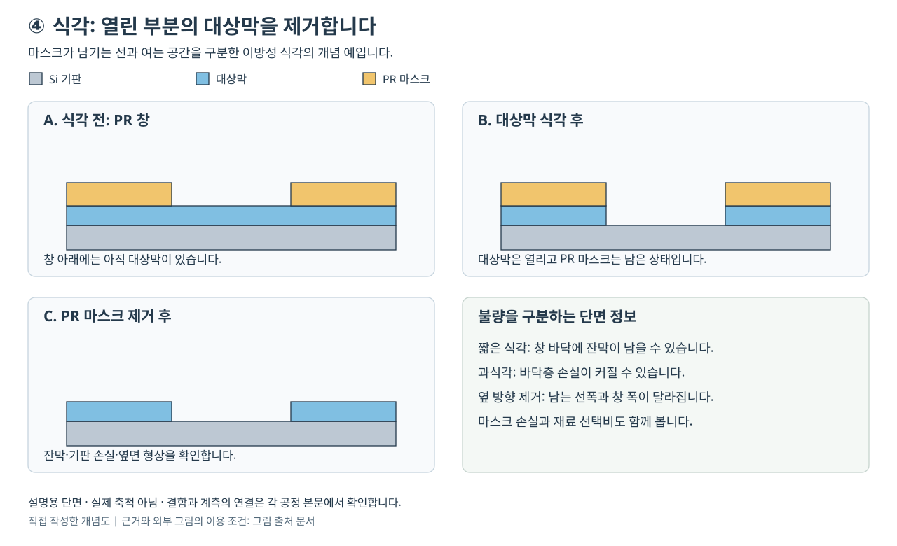

# 식각과 선택비 | Etching and Selectivity

[공정 목차](README.md)

식각은 필요한 부분의 재료를 제거하여 모양과 연결 통로를 만드는 공정입니다. 포토 공정이 감광막에 그린 무늬를 산화막·질화막·실리콘·금속으로 옮길 때에도 쓰고, 나노시트 사이의 희생층만 꺼낼 때에도 씁니다. 따라서 식각의 목표를 단순히 ‘아래로 깊게 파기’라고 정하면 게이트 올 어라운드(GAA)의 핵심 공정을 설명할 수 없습니다. 어떤 재료를 어느 방향으로 얼마나 제거하고, 주변 재료에 어떤 손실과 손상을 허용할지를 함께 정해야 합니다.

이 글은 표면 반응과 입자 수송을 이용하여 식각 결과를 이해하는 학습 자료입니다. 계산에 사용하는 두께·속도·허용 손실은 별도 표시한 설명용 가정입니다. 특정 제품의 공정 조건이나 실제 장비의 운전 절차를 제시하지 않습니다. 기술 사례는 2026년 10월 26일에 확인한 공개 자료의 범위로 한정합니다.

## 공정 전후 단면



그림은 평평한 목표막에 구멍을 여는 경우를 단순화한 자체 개념도이며 실제 현미경 사진이나 축척 도면이 아닙니다. A에서는 감광막(PR)의 창만 열려 있고 그 아래 목표막은 아직 남아 있습니다. B에서는 창 아래 목표막이 제거되어 바닥층이 노출되지만 윗면 마스크는 남아 있습니다. C에서는 마스크를 제거한 뒤 목표막과 통로가 드러납니다. 실제로 의도한 형상이 만들어졌는지는 잔막·바닥 손실·측벽 치수를 측정하여 판단합니다. B의 바닥 노출과 C의 마스크 제거는 서로 다른 확인 항목입니다. 이 순서의 공정 연결은 [7절](#7-실제-통합-공정에서의-역할)에서 설명합니다.

구멍 깊이가 맞아도 바닥에 잔막이 남으면 연결이 막힐 수 있고, 마스크 아래까지 옆으로 깎이면 남길 선의 폭이 달라집니다. 이 그림의 수직 제거를 모든 식각에 적용하지는 않습니다. GAA의 SiGe 희생층 제거처럼 옆 방향 반응이 필요한 경우는 [8절](#8-ale와-gaa-선택-식각)의 별도 목적입니다.

## 1. 식각 결과를 읽는 기본 용어

막 두께가 100 nm 줄어드는 데 2분이 걸리면 평균 식각 속도는 50 nm/min입니다. 이 수치에는 어느 재료인지, 평평한 시험막인지 실제 구멍의 바닥인지, 어느 온도와 표면 상태인지가 붙어야 합니다. 평평한 산화막에서 얻은 속도를 깊고 좁은 구멍에 그대로 적용할 수는 없습니다.

| 용어 | 뜻과 읽는 방법 |
|---|---|
| 마스크(mask) | 남겨야 할 부분을 덮는 보호막입니다. 감광막 외에 산화막·질화막·탄소계 하드 마스크 등을 사용합니다. |
| 임계 치수(CD, critical dimension) | 성능과 연결 여부에 중요한 선폭·공간 폭·구멍 지름입니다. 목표 CD와 실제 CD의 차이를 측정합니다. |
| 식각 깊이(depth) | 기준 표면에서 제거한 수직 거리입니다. nm 또는 μm로 표시합니다. |
| 종횡비(AR, aspect ratio) | 구멍의 깊이/폭입니다. 깊이 2 μm, 폭 0.1 μm이면 20입니다. |
| 언더컷(undercut) | 마스크 아래로 옆 방향 식각이 진행한 부분입니다. |
| 측벽 각도 | 바닥면에 대한 벽의 각도입니다. 수직 벽은 90°이지만 측정 기준을 먼저 확인해야 합니다. |
| 선택비(selectivity) | 목표 재료 식각 속도를 보호 대상 재료 식각 속도로 나눈 값입니다. |
| 잔사(residue) | 제거되지 않은 목표막 또는 표면에 남은 반응 부산물입니다. 두 가지를 구별해야 원인을 찾을 수 있습니다. |

하드 마스크는 감광막보다 단단한 물질이라는 뜻만으로 선택하지 않습니다. 목표막에 대한 식각 저항, 아래층을 오염시키는지, 후속 제거가 가능한지, 필요한 두께를 만들고 무늬를 옮길 수 있는지를 함께 봅니다. MIT의 습식 식각 강의는 감광막과 하드 마스크를 구분하고 이전 공정에서 이미 존재하는 재료까지 고려하도록 설명합니다. [MIT 6.152J, Lecture 16, 슬라이드 4~9](https://ocw.mit.edu/courses/6-152j-micro-nano-processing-technology-fall-2005/83b8c6a46af5214061af4f03542cec40_lecture16.pdf)

## 2. 습식·건식과 등방성·이방성은 다른 분류입니다

습식과 건식은 주로 반응물을 공급하는 상태를 구분합니다. 등방성은 방향별 식각 속도가 비슷하다는 뜻이고, 이방성은 방향별 속도가 다르다는 뜻입니다. 서로 다른 두 질문이므로 ‘습식=등방성, 건식=이방성’이라는 등식으로 외우면 예외를 놓칩니다.

| 방식 | 작동 원리 | 유리한 목적 | 함께 검토할 제한 |
|---|---|---|---|
| 습식 화학 식각 | 액체가 표면과 반응하고 생성물을 용액으로 운반합니다. | 특정 막 제거, 세정과 연결된 표면 처리, 희생층 제거 | 언더컷, 액체 침투, 기포, 건조 중 구조물 변형을 검토합니다. |
| 결정 방향 의존 습식 식각 | 결정면마다 표면 원자의 결합과 반응 속도가 다릅니다. | 실리콘의 경사진 면과 미세 기계 구조 형성 | 마스크 방향과 결정 방향에 따라 형상이 제한됩니다. |
| 기상 화학 식각 | 중성 기체와 표면의 반응으로 휘발성 생성물을 만듭니다. | 옆으로 들어가 희생층을 꺼내는 선택적 제거 | 이온 방향성 없이 재료별 반응 차이를 확보해야 합니다. |
| 이온 빔·스퍼터 식각 | 입자의 운동량 전달로 표면 원자를 밀어냅니다. | 화학적으로 휘발시키기 어려운 재료의 패터닝 | 재부착, 마스크 소모, 표면 손상을 검토합니다. |
| 반응성 이온 식각(RIE) | 반응성 입자의 화학 반응과 이온의 표면 활성화를 결합합니다. | 미세한 수직 패턴 전사 | 반응·보호막·입자 에너지를 함께 맞춰야 합니다. |

예를 들어 결정 방향에 따라 실리콘을 다르게 제거하는 KOH 계열 습식 식각은 이방성의 대표적인 예입니다. 반대로 기상 선택 식각은 건식이면서 옆 방향 제거에 사용할 수 있습니다. EPFL은 건식 안에서도 이온 빔, 기상 반응, 플라스마 식각을 나누어 설명하며, Michigan LNF는 습식 식각에서 결정면 의존성이 나타나는 예를 제시합니다. [EPFL, Etch definitions의 Wet/Dry etching](https://www.epfl.ch/research/facilities/cmi/process/etching/etch-definitions/), [University of Michigan LNF, Wet etching의 Applications](https://lnf-wiki.eecs.umich.edu/wiki/Wet_etching)

등방 식각의 옆 방향 진행은 결함일 때도 있고 목적일 때도 있습니다. 좁은 배선을 그대로 남겨야 하는 경우에는 언더컷이 선을 가늘게 만듭니다. 떠 있는 구조물 아래의 희생층을 꺼낼 때에는 옆 방향 진행이 필요합니다. 먼저 필요한 최종 구조를 그린 뒤 방향성을 선택해야 합니다.

## 3. 플라스마에서 이온과 라디칼이 하는 일

플라스마는 전자·이온·중성 입자가 함께 있는 부분적으로 이온화된 기체입니다. 라디칼(radical)은 홀전자를 가져 반응성이 큰 원자나 분자입니다. 이 글에서 다루는 일반적인 식각 플라스마의 라디칼은 전하가 없는 입자이며, 전기장에 의해 이온처럼 직접 가속되지 않습니다. 이온은 전하를 가진 원자 또는 분자입니다. ‘플라스마 입자가 모두 전기를 띠고 아래로 떨어진다’는 설명은 맞지 않습니다.

표면 근처에는 시스(sheath)라는 전위 변화 영역이 형성됩니다. 적절한 기판 바이어스가 있으면 양이온이 이 영역에서 웨이퍼 쪽으로 가속됩니다. 이온이 표면 결합을 약하게 하거나 표면 보호막을 제거하고, 반응성 중성종이 휘발 가능한 생성물을 만드는 경우가 있습니다. 이처럼 물리적·화학적 작용이 결합한 속도는 두 효과를 별개로 더한 값과 같지 않을 수 있습니다. Lam의 식각 기초 자료는 이를 ion-neutral synergy로 설명합니다. [Lam Research, Etch Essentials의 Etch Mechanisms](https://newsroom.lamresearch.com/etch-essentials-semiconductor-manufacturing)

측벽은 이온을 정면으로 덜 받기 때문에 바닥과 다른 상태를 유지할 수 있습니다. 측벽에 보호막(passivation)이 남고 바닥에서는 이온이 이를 제거하면, 화학 반응이 옆으로 퍼지는 것을 줄이면서 아래 방향 식각을 진행할 수 있습니다. 그러나 이온의 입사 각도는 하나의 값이 아니며 충돌·전하 축적·형상에 영향을 받습니다. ‘이온이 수직으로 들어간다’는 그림은 평균 방향을 보여 주는 단순화입니다.

### RIE와 ICP를 구분하는 방법

RIE는 반응성 이온 식각이라는 공정 방식입니다. ICP(inductively coupled plasma)는 코일의 전자기 유도로 플라스마에 에너지를 공급하는 발생 방식입니다. 따라서 ICP-RIE라는 조합이 가능합니다. 두 용어를 서로 대체하는 차세대 공정 이름처럼 이해하면 안 됩니다.

ICP 장비는 플라스마를 만드는 전원과 기판 바이어스 전원을 나누어 입자 공급과 이온 에너지를 조절할 여지를 제공합니다. 실제로는 전원·플라스마·표면이 결합되어 있으므로 한 변수를 바꿀 때 다른 결과가 완전히 고정되지는 않습니다. Oxford Instruments는 별도의 RF 발생기로 기판 바이어스를 제어하는 구성을 설명합니다. 최근 방전 진단 연구도 두 전원 사이의 결합 때문에 이온 플럭스와 에너지가 완전히 독립적이지 않음을 명시합니다. [Oxford Instruments, ICP Etching](https://plasma.oxinst.com/products/icp-etching/), [IOP, Multi-diagnostic characterization, 서론의 전원 결합 설명](https://doi.org/10.1088/1361-6595/ae2158)

## 4. 선택비는 어느 두 재료의 비율인지 써야 합니다

목표막 A, 보호막 B의 식각 속도를 각각 R_A, R_B라고 하면 다음과 같습니다.

```text
S_A:B = R_A / R_B
```

두 속도의 단위를 같게 쓰면 선택비에는 단위가 없습니다. ‘선택비 30’이라고만 쓰면 불완전합니다. 산화막:감광막이 30인지, 산화막:실리콘이 30인지에 따라 의미가 달라집니다. 하나의 식각 단계에서도 마스크 선택비, 측벽 보호막 선택비, 바닥 정지막 선택비가 각각 필요합니다.

선택비 30:1은 보호 재료가 전혀 깎이지 않는다는 뜻이 아닙니다. 목표 재료가 같은 조건에서 300 nm 제거되는 시간 동안 계속 노출된 보호 재료는 이상적인 일정 속도 모형에서 10 nm 손실됩니다. 바닥 재료는 목표막이 뚫린 뒤에야 노출되므로 노출 시작 시각도 계산해야 합니다. 반면 마스크는 처음부터 노출될 수 있습니다. 이 차이가 마스크 두께와 바닥 허용 손실을 같은 식으로 계산할 수 없는 이유입니다.

정지막(etch-stop layer)은 식각 속도가 상대적으로 느려 공정 종료의 여유를 주는 층입니다. 이름에 ‘stop’이 있다고 시간이 무한히 늘어나도 손실이 없는 층은 아닙니다. 표면 거칠기, 조성, 손상, 막 두께에 따라 보호 기능도 달라집니다.

마스크가 얇아지면서 모서리가 둥글어지면 남는 패턴의 폭도 바뀔 수 있습니다. 필요한 초기 두께는 평균 소모량에 잔여 두께와 균일도 여유를 더해 정합니다. 무조건 두껍게 만들면 포토 공정의 종횡비, 패턴 흔들림, 하드 마스크 전사 난도가 높아질 수 있습니다. 따라서 선택비는 단독으로 최대화하는 숫자가 아니라 패턴 전사의 전체 오차를 줄이는 조건 중 하나입니다.

## 5. 깊은 구멍에서 생기는 ARDE와 패턴 밀도 효과

ARDE(aspect-ratio-dependent etching)는 구조의 종횡비에 따라 식각 속도나 형상이 달라지는 현상입니다. 깊고 좁은 통로에서는 반응물이 바닥에 도달하기 어렵고 부산물이 빠져나오는 길도 길어집니다. 입구나 측벽에서 소모되는 입자도 있습니다. 흔히 좁은 구조가 늦게 파이지만, 어떤 크기 범위와 반응 조건에서는 다른 경향도 나타나므로 항상 ‘폭이 작을수록 느림’ 하나로 정의하지는 않습니다.

마이크로로딩(microloading)은 주변의 노출 면적과 패턴 밀도에 따라 국소 식각이 달라지는 효과입니다. 폭과 깊이가 같은 구멍이라도 주변에 반응물을 소비하는 패턴이 많이 있는지에 따라 결과가 달라질 수 있습니다. 웨이퍼 전체의 총 노출 면적에 따른 로딩과도 구별합니다. MIT 건식 식각 강의는 장거리 가스 수송에 해당하는 macro-loading과 국소적인 반응물 경쟁인 micro-loading을 나누어 설명합니다. [MIT 6.152J, Lecture 17, 슬라이드 22](https://ocw.mit.edu/courses/6-152j-micro-nano-processing-technology-fall-2005/59b9f31d836355a3380aa156925508bc_lecture17.pdf)

두 효과를 구분하려면 폭만 바꾸는 시험과 밀도만 바꾸는 시험이 필요합니다. 폭이 좁아지면 밀도도 함께 높아지는 시험 패턴만 사용하면 어느 요인이 원인인지 구분하기 어렵습니다. 다음 비교는 실제 실험 결과가 아니라 원인 분리 설계의 예입니다.

| 비교 | 고정할 항목 | 바꿀 항목 | 알 수 있는 내용 |
|---|---|---|---|
| A | 깊이 목표, 주변 노출 비율 | 구멍 폭 | 형상과 수송 경로의 영향 |
| B | 구멍 폭과 목표 깊이 | 주변 패턴 밀도 | 국소 반응물 경쟁의 영향 |
| C | 동일한 시험 구조 | 웨이퍼 반경 위치 | 공급·온도·플라스마 분포의 영향 |
| D | 동일한 시험 구조와 위치 | 처리한 웨이퍼 순서 | 챔버 상태 변화와 누적 효과 |

깊은 구멍의 바닥이 덜 파였다고 곧바로 전체 식각 시간을 늘리면 넓은 구멍의 바닥층이 더 손상될 수 있습니다. 먼저 ARDE인지, 입구 막힘인지, 바닥 보호막이 남았는지, 온도 분포인지 확인해야 합니다.

## 6. 종료점 검출과 과식각

종료점(endpoint)은 공정이 필요한 층에 도달했다는 신호를 뜻합니다. 광학 방출 분광법(OES)은 플라스마에서 나오는 특정 파장의 빛이 변하는지 관찰합니다. 목표 재료의 반응 부산물이나 기체 성분이 바뀌면 빛의 세기에도 변화가 생길 수 있습니다. 레이저 간섭·반사 신호를 사용하여 막 두께 변화를 추적하는 방법도 있습니다. [Oxford Instruments, Optical end point detectors의 OES와 laser interferometry 설명](https://plasma.oxinst.cn/support/upgrades/optical-end-point-detectors)

신호가 변했다고 웨이퍼의 모든 구멍이 같은 순간에 완전히 열렸다는 뜻은 아닙니다. OES는 여러 위치에서 나온 빛을 합쳐 보며, 노출 면적이 작거나 제거되는 양이 적으면 신호가 약해질 수 있습니다. 간섭법도 측정 위치의 막과 광학 모형을 반영합니다. 신호와 실제 단면을 연결하는 사전 확인이 필요합니다.

과식각(overetch)은 가장 늦게 열리는 위치의 잔막까지 없애기 위해 기준 종료 이후 추가하는 제거입니다. 이는 두께와 속도 분포를 감당하기 위한 개념이며, 결함을 임의로 더 깎아 해결한다는 뜻이 아닙니다. 시간 기준 과식각률을 쓸 때에는 기준이 명목 제거 시간인지 검출된 종료 시간인지도 적어야 합니다. 보호층의 손실과 손상이 허용 범위 안에 있는지가 최종 제약입니다.

## 7. 실제 통합 공정에서의 역할

### 절연막에 연결 구멍을 여는 경우

1. 아래 금속 또는 접촉 대상 위에 절연막과 필요한 보호·정지막을 형성합니다.
2. 포토 패턴을 감광막 또는 하드 마스크로 옮깁니다.
3. 절연막을 식각하여 연결 대상까지 통로를 만듭니다.
4. 바닥 손실을 관리하면서 늦게 열린 통로의 잔막을 제거합니다.
5. 마스크와 부산물을 제거하고 바닥 표면을 다음 금속 형성에 적합하게 준비합니다.
6. 막힘·폭·깊이·바닥 손실을 확인한 뒤 배리어와 금속을 형성합니다.

바닥에 얇은 잔막이 남으면 전기적으로 열린 회로가 될 수 있습니다. 그렇다고 바닥 금속을 과도하게 깎으면 접촉 면적과 신뢰성이 나빠집니다. 후속 세정은 단순한 마무리가 아니라 식각으로 만든 표면을 다음 증착과 연결하는 단계입니다.

### 3D NAND의 높은 종횡비 식각

여러 층이 쌓인 막을 관통하는 통로에서는 깊이가 증가할수록 수송과 측벽 형상 제어가 어려워집니다. 입구가 넓어지는 보잉(bowing), 아래로 갈수록 좁아지는 테이퍼, 구멍이 기울거나 옆으로 휘는 현상을 구분해야 합니다. 하나의 수직 단면에서 정상처럼 보여도 다른 방향에서는 치우칠 수 있습니다. Lam의 제품 설명은 유전체 식각에 ALE·RIE·극저온 식각을 포함하고, 높은 종횡비 구조를 별도 과제로 다룹니다. 특정 장비의 홍보 성능을 모든 재료와 구조에 일반화해서는 안 됩니다. [Lam Research, Etch의 공정 및 제품 분류](https://www.lamresearch.com/products/our-processes/etch/)

### 실제 장비와 재료를 연결하기

같은 식각 장비라는 이름 아래에서도 깊은 절연막 구멍과 SiGe의 옆 방향 제거는 다른 문제입니다. 다음은 2026-10-26에 공식 본문에서 확인한 제품 기능이며, 고객별 채택 범위나 모든 재료에서의 동일한 성능을 뜻하지 않습니다. 실제 장비 외관은 각 공식 페이지의 사진으로 확인할 수 있습니다.

| 장비·플랫폼 | 실제 재료와 역할 | 적용 구조·확인할 조건 | 공식 자료의 위치 |
|---|---|---|---|
| Lam Vantex | 절연막 적층을 관통하는 채널·접촉 구멍을 만듭니다. | 3D NAND의 깊은 구멍·트렌치와 메모리 커패시터 구조를 대상으로 합니다. 깊이뿐 아니라 높이별 CD와 이온 방향성을 봅니다. | [Vantex의 Industry Challenges·Key Applications](https://www.lamresearch.com/product/vantex/) |
| Lam Selis | 실리콘저마늄(SiGe)을 제거하고 인접 Si를 남기는 GAA 선택 식각을 다룹니다. | 저에너지 라디칼 공급과 등방성 제거가 목적입니다. 수직 구멍용 공정의 대체 이름으로 쓰지 않습니다. | [2022년 발표의 Introducing Argos, Prevos and Selis](https://newsroom.lamresearch.com/accelerating-the-path-to-3d-introducing-lam-precision-selective-etch-solutions) |

## 8. ALE와 GAA 선택 식각

원자층 식각(ALE, atomic layer etching)은 표면을 바꾸는 단계와 바뀐 층을 제거하는 단계를 분리하여 작은 양을 반복 제거하는 방식입니다. 대표적인 설명 모형은 표면 반응 → 남은 반응물 제거 → 변형층 제거 → 부산물 배출입니다. 자기 제한적(self-limiting) 반응은 이용 가능한 반응 자리가 소진되거나 변형층이 사라지면 반응이 더 진행하기 어려운 성질입니다. [Lam Research, All About ALE의 Atomic Layer Etching](https://newsroom.lamresearch.com/Tech-Brief-All-About-ALE)

명칭에 ‘원자층’이 있어도 모든 재료에서 한 주기마다 정확히 원자 한 층이 제거된다는 보장은 없습니다. 주기당 제거량(EPC, etch per cycle)은 실제 재료·표면·조건에 대해 확인해야 합니다. 흡착이 충분하지 않거나 제거 입자가 바닥에 도달하지 않으면 높은 종횡비 구조에서는 포화에 도달하지 못할 수 있습니다. 에너지가 지나치게 높아 변형하지 않은 바탕 재료까지 제거하면 자기 제한성이 무너집니다.

ALE는 이온을 사용하는 방향성 방식과 중성 반응을 사용하는 등방성 방식이 모두 가능합니다. 깊은 막을 빠르게 제거하는 단계와 표면 근처를 조금씩 정밀하게 제거하는 단계를 결합할 수도 있습니다. Oxford Instruments는 자사 플라스마 ALE에서 변형층을 제거하면서 바탕막의 스퍼터링을 피하는 에너지 조건과 ARDE 감소를 설명합니다. 이는 가능한 작동 구간을 뜻하며 수송 한계가 사라진다는 뜻은 아닙니다. [Oxford Instruments, Atomic layer etching의 How does ALE work 및 Benefits](https://plasma.oxinst.com/technologies/atomic-layer-etching)

GAA 나노시트에서는 실리콘과 실리콘저마늄(SiGe)을 번갈아 성장시킨 구조를 활용할 수 있습니다. 실리콘을 채널로 남기면서 사이의 SiGe를 옆으로 제거하면 채널 주변에 게이트를 둘 공간이 생깁니다. 채널 릴리스(channel release)는 이처럼 희생층을 제거하여 채널을 드러내는 과정입니다. 일부만 후퇴시키는 내부 스페이서 형성용 식각과 전체 채널 릴리스는 필요한 제거 거리와 보호 대상이 다릅니다. Lam의 2022년 공식 발표는 GAA에서 SiGe 희생층의 부분 또는 전체 등방 제거를 요구하는 이유를 설명합니다. [Lam Research, Precision selective etch의 The need for precision](https://newsroom.lamresearch.com/accelerating-the-path-to-3d-introducing-lam-precision-selective-etch-solutions)

이 공정의 질문은 ‘SiGe가 얼마나 빨리 없어지는가’에서 끝나지 않습니다. 얇은 Si 채널 양쪽 표면이 얼마나 줄어드는지, 표면 거칠기와 응력이 어떻게 달라지는지, 구석의 SiGe가 남는지, 위아래 시트에서 제거량이 같은지 확인해야 합니다. SiGe의 Ge 조성, 열처리에 따른 계면 혼합, 표면 반응성도 선택성에 영향을 줍니다. 2025년 Lam 연구진의 논문은 불소계 반응물이 SiGe와 Si 표면에서 다른 반응 경로를 갖는 이유를 계산합니다. 이 논문의 기구 계산을 특정 팹의 양산 레시피나 보편적인 선택비로 해석하지 않습니다. [Huang·Mathur, J. Phys. Chem. C 2025, Abstract](https://pubs.acs.org/doi/10.1021/acs.jpcc.5c01736)

## 9. 변수·결함·계측을 연결하는 방법

| 변수 또는 결과 | 단위·정의 | 해석할 때 주의할 점 |
|---|---|---|
| 압력 | Pa, Torr, mTorr | 1 Torr ≈ 133.322 Pa입니다. 충돌과 수송이 바뀌며 모든 구조에 같은 방향의 효과를 보장하지 않습니다. |
| 가스 유량 | sccm | 정해진 표준 상태로 환산한 부피 유량입니다. 실제 챔버 안의 부피 유량과 다릅니다. |
| RF 전력 | W | 소스·바이어스 전력인지 구별합니다. 전력값 자체가 입자 하나의 에너지는 아닙니다. |
| 이온 에너지 | eV | 평균값 외에 분포와 입사 각도도 결과에 영향을 줍니다. |
| 온도 | °C 또는 K | 반응·흡착·보호막 유지가 함께 변합니다. 장비 설정값과 실제 웨이퍼 표면 온도를 구별합니다. |
| 깊이·CD·거칠기 | nm, μm | 평균과 분포, 측정 위치, 측정 오차를 함께 기록합니다. |
| 주기당 제거량 | nm/cycle, Å/cycle | 1 Å=0.1 nm입니다. 정상상태까지의 초기 주기와 구분합니다. |

다음 표는 원인 후보를 나열한 학습용 진단 틀입니다. 한 결함에 여러 원인이 있으므로 표의 첫 후보를 바로 확정하지 않습니다.

| 관찰 | 원인 후보 | 분리에 도움이 되는 측정 |
|---|---|---|
| 바닥 잔막 | ARDE, 입구 막힘, 짧은 유효 반응 시간 | 폭별 단면 SEM/TEM, 바닥 조성 분석, 종료 신호 |
| 넓은 구조만 바닥 손실 | 조기 개방 후 긴 노출, 보호층 선택비 부족 | 개방 시점 차이와 바닥 두께의 위치별 비교 |
| 측벽 보잉 | 보호막 균형, 이온 각도·충돌, 마스크 형상 | 높이별 CD와 입구 마스크 단면 |
| 미세 기둥·잔돌기 | 국소 오염 또는 재부착에 의한 미세 마스킹 | 표면 SEM, 원소·화학 조성 분석 |
| 같은 모양이 반경별로 달라짐 | 온도, 반응물 공급, 플라스마·챔버 분포 | 웨이퍼 지도와 반복 처리 순서 비교 |
| 누설 증가, 모양은 정상 | 플라스마 전하·격자 손상·표면 결함 | 전기 시험, 계면 분석, 표면 손상 평가 |

평면 CD-SEM은 위에서 보이는 폭을 주로 보여 줍니다. 단면 SEM/TEM은 깊이와 측벽을 볼 수 있지만 관찰 위치가 제한적이며 시료 준비에 따른 영향을 검토해야 합니다. 타원계측이나 반사계측으로 평평한 막의 잔여 두께를 추정할 때에는 광학 상수와 층 구조를 가정합니다. 전기 시험은 구조가 실제로 연결되고 절연되는지를 확인하지만 그 결과 하나만으로 원인 공정을 특정하기는 어렵습니다. 서로 다른 계측이 같은 질문을 보는지부터 정리해야 합니다.

### 사례 1: 깊은 채널 구멍의 형상 편차와 극저온 식각

Lam은 Cryo 3.0에서 저온 표면 화학과 플라스마를 공간적으로 가두는 고출력 반응기, Vantex의 펄스 제어를 결합해 깊은 메모리 채널의 형상을 제어한다고 보고합니다. 2024년 발표의 깊이 최대 10 μm와 형상 편차 0.1% 미만은 공급사의 공개 성능 사례입니다. 여기서 편차의 분모는 구멍 폭이 아니라 채널 깊이이며, 정의는 `(최대 CD−최소 CD)/깊이`입니다. 기존 극저온 공정의 양산 이력과 이 제품 발표를 구분하며, 1,000단 NAND는 당시의 확장 목표입니다. [Lam, 2024-07-31 발표의 기술 설명과 각주](https://newsroom.lamresearch.com/2024-07-31-Lam-Research-Introduces-Lam-Cryo-TM-3-0-Cryogenic-Etch-Technology-to-Accelerate-Scaling-of-3D-NAND-for-the-AI-Era)

아래의 경쟁 원인과 확인 순서는 그 보고에 연결한 자체 진단 예시입니다. 공개 자료에는 개별 고객의 불량 웨이퍼 원인 분석과 수정 전후 수율이 제시되어 있지 않습니다.

| 단계 | 확인 내용 |
|---|---|
| 증상 | 깊이는 확보했지만 중간 높이가 부풀거나 바닥 폭이 작아집니다. |
| 경쟁 원인 | 측벽 보호·표면 반응 불균형, 이온 입사각 분포, 마스크 모양, 깊이에 따른 공급 부족이 같은 CD 편차를 만들 수 있습니다. |
| 계측 | 입구·중간·바닥의 CD와 깊이를 같은 단면에서 읽고, 반경·패턴 폭·밀도별로 비교합니다. 입구 마스크 형상도 함께 확인합니다. |
| 조치 방향 | 깊이만 늘리는 조치에 앞서 표면 반응과 방향성을 분리해 평가합니다. 보고 사례의 해결 원리는 저온 화학과 펄스 플라스마의 결합이며 단순한 온도 하강 하나로 환원하지 않습니다. |
| 재검증 지표 | 높이별 CD 분포, 위 정의의 형상 편차, 바닥 개방률, 마스크 잔여량과 반복 웨이퍼의 분포를 확인합니다. 전기 결과와의 연결은 별도 시험이 필요합니다. |

### 사례 2: SiGe는 남고 Si 채널도 얇아지는 경우

다음은 [Lam의 SiGe 선택 제거 요구와 Selis 제품 원리](https://newsroom.lamresearch.com/accelerating-the-path-to-3d-introducing-lam-precision-selective-etch-solutions)를 이용해 구성한 자체 진단 예시입니다. 직접 제조한 결과나 공급사가 보고한 특정 불량 해결 기록은 아닙니다.

| 단계 | 확인 내용 |
|---|---|
| 증상 | 일부 시트 사이에 SiGe가 남는데 노출된 Si의 두께도 줄거나 표면이 거칠어집니다. |
| 경쟁 원인 | 깊은 위치의 반응물 공급 부족, SiGe 조성·계면 혼합 차이, 표면 산화막, Si에 대한 선택성 부족을 나눕니다. 단일 선택비 수치만으로 원인을 확정하지 않습니다. |
| 계측 | 위·중간·아래 시트의 단면과 Ge 조성 분포를 연결하고, 잔류 SiGe 위치·Si 두께·거칠기를 각각 비교합니다. 평면 시험막 결과와 구조 내부 결과도 나눕니다. |
| 조치 방향 | 공급 부족이면 구조 내부의 반응 도달성을, 선택성 부족이면 표면 상태와 선택 반응 구간을 검토합니다. 적층 조성이 달랐다면 에피택시까지 되짚습니다. 처리 시간을 늘리는 한 가지 조치로 두 문제를 함께 해결했다고 판단하지 않습니다. |
| 재검증 지표 | 잔류 Ge 분포, 시트별 Si 두께와 거칠기, 구조 균일도, 후속 게이트의 누설·특성 분포를 확인합니다. 형상이 같아도 전기적 손상이 남을 수 있습니다. |

## 10. 자체 계산 예제

이 절의 값은 모두 원리 설명을 위한 가정입니다. 측정값·권장 운전값·업체 성능값이 아닙니다.

### 예제 1: 두께와 속도 분포에서 필요한 시간과 바닥 손실 구하기

목표막의 명목 두께는 400 nm이고 위치별 두께가 ±4%입니다. 목표막 속도는 명목 80 nm/min, 위치별 ±6%이며, 보호 바닥층의 식각 속도 상한을 2 nm/min으로 가정합니다. 위치 간 두께와 속도는 독립적으로 최악 조합이 가능하며, 열린 뒤 바닥층 속도는 일정하다고 단순화합니다.

1. 가장 늦게 열리는 위치는 두께 416 nm, 속도 75.2 nm/min입니다. 필요한 시간은 416/75.2=5.5319분입니다.
2. 명목 시간은 400/80=5분입니다. 명목 대비 추가 시간은 약 0.5319분, 시간 증가율은 10.64%입니다.
3. 가장 빨리 열리는 위치는 두께 384 nm, 속도 84.8 nm/min입니다. 개방 시간은 384/84.8=4.5283분입니다.
4. 빠른 위치의 바닥층은 5.5319−4.5283=1.0036분 노출됩니다. 손실 상한은 약 2.007 nm입니다.
5. 허용 바닥 손실이 1 nm라면 이 단순 모형의 속도 상한 2 nm/min은 충분하지 않습니다. 시간만 줄이면 늦은 위치에 잔막이 남습니다. 두께·속도 분포 또는 바닥 반응 속도 중 하나 이상을 바꿔야 합니다.

추가로 목표막:마스크 선택비가 명목 10:1이고 마스크 속도를 8 nm/min으로 일정하게 가정하면, 전체 시간의 마스크 소모는 44.26 nm입니다. 식각 후 20 nm를 남겨야 한다면 초기 두께는 최소 64.26 nm보다 커야 합니다. 실제 설계에는 마스크 속도의 분포와 모서리 소모를 추가해야 합니다. 이 예제는 모든 분포를 반영한 공정 승인 계산이 아닙니다.

### 예제 2: 옆 방향 식각이 남는 선폭에 주는 영향

마스크로 보호한 선의 폭을 120 nm, 수직 제거 깊이를 200 nm로 둡니다. 일정 속도와 마스크 소모 무시를 가정하고, 옆/수직 식각 속도 비가 0.08이라고 하겠습니다.

```text
한쪽 언더컷 = 200 × 0.08 = 16 nm
남는 선폭 = 120 − 2 × 16 = 88 nm
```

깊이를 맞추더라도 양쪽에서 깎이기 때문에 남는 폭은 32 nm 줄어듭니다. 반대로 ‘구멍의 폭’을 계산한다면 옆 방향 식각이 폭을 늘립니다. 선과 공간을 혼동하면 CD 변화의 부호가 바뀝니다.

### 예제 3: 나노시트의 두 표면 손실

SiGe를 옆으로 30 nm 제거하고, 같은 노출 조건에서의 유효 SiGe:Si 선택비를 100:1로 가정합니다. 모든 Si 표면이 전체 시간 노출되고 속도가 일정하다는 보수적 단순화에서는 한쪽 Si 손실이 30/100=0.30 nm입니다. 두께 6 nm인 Si 시트의 위아래 면이 같은 양만큼 줄면 최종 두께는 5.40 nm이고 두께 감소율은 10%입니다.

선택비가 100이라는 큰 수치만 보고 손실이 작다고 판단할 수 없는 이유입니다. 실제 구조에서는 위치별 노출 시작 시점, 조성 변화, 반응 포화, 두 표면의 상태가 다릅니다. 이 계산은 선택비 요구가 구조 치수에 따라 달라짐을 보여 주며, 실제 채널 손실을 예측하는 모형은 아닙니다.

### 예제 4: ALE 주기 수와 시간의 절충

정상상태 EPC를 0.12 nm/cycle, 목표 제거량을 7.2 nm로 가정합니다. 초기 지연은 무시합니다. 필요한 주기는 7.2/0.12=60 cycle입니다. 한 주기 시간이 4초라면 순수 반복 시간은 240초입니다. EPC를 유지한 채 주기 시간을 3초로 줄일 수 있다면 180초가 되지만, 공급·배출 시간이 짧아 포화에 도달하지 못하면 EPC와 균일도가 함께 바뀔 수 있습니다. 주기 시간을 줄였다는 사실만으로 처리량과 품질을 모두 확보했다고 결론 내리지 않습니다.

## 11. 연습문제와 해답

### 문제

1. 목표막 속도 90 nm/min, 마스크 속도 3 nm/min, 바닥층 속도 0.5 nm/min입니다. 두 선택비를 각각 표시하고, 둘 중 하나만 말하면 어떤 정보가 빠지는지 설명해 보십시오.
2. 폭 50 nm인 구멍 두 개가 같은 깊이로 설계되어 있습니다. 밀집 영역의 구멍이 고립 영역보다 덜 파였습니다. 이것만으로 ARDE라고 확정할 수 있는지 판단해 보십시오.
3. 가정한 ALE에서 EPC 0.08 nm/cycle로 4 nm를 제거하려 합니다. 필요한 주기 수와, 10주기 이후에야 성장이 아닌 제거가 시작되는 초기 지연이 있다면 총 주기 수를 구해 보십시오.
4. 목표막이 평균적으로 제거되었다는 OES 신호와 일부 구멍의 바닥 잔막이 동시에 관찰됩니다. 두 관찰이 모순되는지 설명해 보십시오.
5. GAA에서 채널 사이 SiGe만 제거해야 합니다. ‘가장 수직인 식각이 언제나 가장 좋은 식각’이라는 주장에 대한 반례를 설명해 보십시오.

### 해답

1. 목표막:마스크 선택비는 30:1, 목표막:바닥층 선택비는 180:1입니다. 마스크 수명과 바닥층 손실은 서로 다른 보호 조건입니다.
2. 확정할 수 없습니다. 두 구멍의 폭과 목표 깊이가 같으므로 밀도에 따른 마이크로로딩을 우선 분리해야 합니다. 실제 진행 깊이 차이 때문에 나중에 AR도 달라질 수 있어 시간별 단면 비교가 도움이 됩니다.
3. 정상상태 계산은 4/0.08=50주기입니다. 지연 10주기 동안 제거량이 정확히 0이라고 추가 가정하면 총 60주기입니다. 지연 중 일부 제거가 있었다면 그 양을 별도로 반영합니다.
4. 모순이 아닙니다. 전체 신호가 특정 작은 영역의 최후 잔막까지 대표하지 못할 수 있습니다. 노출 면적·패턴별 지연·계측 민감도를 함께 확인합니다.
5. Si 시트를 남기고 그 사이의 SiGe를 옆으로 꺼내는 채널 릴리스에는 등방성이 필요할 수 있습니다. 목적은 수직성 자체가 아니라 필요한 재료와 형상을 남기는 것입니다.

## 12. 출처와 확인 범위

아래 자료의 표시한 부분을 직접 확인했습니다. 공식 교육 자료와 제조사 설명을 기초 원리 확인에 사용했고, 공급사 제품의 수치·보편적 우월성은 검증 없이 확대하지 않았습니다. 계산 예제와 원인 분리 표는 이 글에서 구성한 설명입니다. 확인일은 모두 2026-10-26입니다.

| 출처 | 읽은 부분과 사용 범위 | URL |
|---|---|---|
| MIT OCW, 6.152J, 2005 Lecture 16 | 슬라이드 4~9, 12~13, 18, 21~24: 마스크·선택비·수송·방향성의 기초 | [원문 PDF](https://ocw.mit.edu/courses/6-152j-micro-nano-processing-technology-fall-2005/83b8c6a46af5214061af4f03542cec40_lecture16.pdf) |
| MIT OCW, 6.152J, 2005 Lecture 17 | 슬라이드 3, 22, 24~25: 물리·화학 작용, 로딩, 변수의 결합 | [원문 PDF](https://ocw.mit.edu/courses/6-152j-micro-nano-processing-technology-fall-2005/59b9f31d836355a3380aa156925508bc_lecture17.pdf) |
| EPFL CMi, Etch definitions | Wet/Dry etching, 용어 표: 건식 내부 구분과 선택비 정의 | [공식 교육 페이지](https://www.epfl.ch/research/facilities/cmi/process/etching/etch-definitions/) |
| University of Michigan LNF, Wet etching | Applications: 결정면 의존 습식 식각의 예외 | [공식 시설 자료](https://lnf-wiki.eecs.umich.edu/wiki/Wet_etching) |
| Lam Research, Etch Essentials, 2024-06-12 | Etch Mechanisms: 이온·중성종의 역할 | [공식 설명](https://newsroom.lamresearch.com/etch-essentials-semiconductor-manufacturing) |
| Oxford Instruments, ICP Etching | ICP-RIE와 별도 RF 바이어스 전원 설명 | [공식 제품·원리 설명](https://plasma.oxinst.com/products/icp-etching/) |
| Multi-diagnostic characterization of inductively coupled discharges with tailored waveform substrate bias | 서론: 소스·바이어스 사이 결합의 한계 | [연구 논문 DOI](https://doi.org/10.1088/1361-6595/ae2158) |
| Oxford Instruments, Optical end point detectors | OES, 레이저 간섭 검출과 작은 노출 면적의 제약 | [공식 계측 설명](https://plasma.oxinst.cn/support/upgrades/optical-end-point-detectors) |
| Lam Research, Etch | 공정 소개와 제품 분류: 높은 종횡비·유전체 식각 | [공식 공정 설명](https://www.lamresearch.com/products/our-processes/etch/) |
| Lam Research, Vantex | Industry Challenges, Key Applications: 깊은 메모리 구멍·트렌치, 이온 방향성과 CD 요구를 확인했습니다. | [공식 장비·사진](https://www.lamresearch.com/product/vantex/) |
| Lam Research, Cryo 3.0, 2024-07-31 | 기술 설명, Vantex 결합, 깊이 최대 10 μm와 형상 편차의 각주 정의를 확인했습니다. 공급사 성능 보고이며 고객별 수율 검증 자료는 아닙니다. | [공식 발표](https://newsroom.lamresearch.com/2024-07-31-Lam-Research-Introduces-Lam-Cryo-TM-3-0-Cryogenic-Etch-Technology-to-Accelerate-Scaling-of-3D-NAND-for-the-AI-Era) |
| Lam Research, All About ALE, 2016-11-14 | Atomic Layer Etching, Benefits: 수정·제거 분리 | [공식 기술 설명](https://newsroom.lamresearch.com/Tech-Brief-All-About-ALE) |
| Oxford Instruments, Atomic layer etching | How does ALE work, Benefits: 에너지 구간과 ARDE 감소 | [공식 원리 설명](https://plasma.oxinst.com/technologies/atomic-layer-etching) |
| Lam Research, Precision selective etch, 2022-02-09 | The need for precision, Introducing Argos, Prevos and Selis: SiGe·Si의 제거·보존 관계와 Selis의 저에너지 라디칼 설명을 확인했습니다. | [공식 발표](https://newsroom.lamresearch.com/accelerating-the-path-to-3d-introducing-lam-precision-selective-etch-solutions) |
| Yihan Huang·Monica Sawkar Mathur, J. Phys. Chem. C 129, 12502–12511, 2025 | Abstract와 서지정보: SiGe·Si 불소계 열적 선택 식각의 기구 계산이며 전문 전체를 검토한 것은 아닙니다. | [원 논문](https://pubs.acs.org/doi/10.1021/acs.jpcc.5c01736) |

다음 글: [증착과 이온 주입](05-증착과이온주입_deposition-implantation.md)
