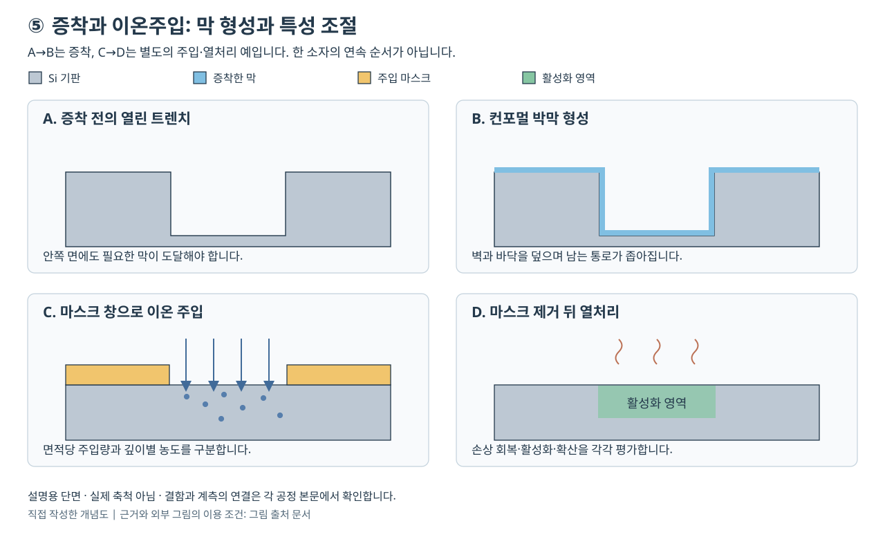

# 증착과 이온 주입 | Thin-Film Deposition and Ion Implantation

[공정 목차](README.md)

증착은 표면에 새 재료를 쌓는 일이고, 이온 주입은 이온을 재료 안으로 넣어 조성과 성질을 바꾸는 일입니다. 두 공정 모두 원자나 분자를 다루지만 목적·깊이 분포·결함·측정값이 다릅니다. 절연막을 5 nm 쌓았다는 말과 붕소를 10¹⁴ cm⁻² 주입했다는 말은 같은 양을 다른 단위로 표시한 것이 아닙니다.

얇은 막을 만드는 방법에는 물리적 기상 증착(PVD), 화학 기상 증착(CVD), 원자층 증착(ALD), 에피택시가 있습니다. 플라스마를 활용하는 방식도 있지만 모든 증착이 플라스마 공정은 아닙니다. 이 글에서는 표면 반응·입자 수송·결정 성장·도핑 분포를 연결해 각 방법을 선택하는 이유를 설명합니다. 자체 계산은 설명용 가정이며, 장비 운전 조건이나 제품의 실측 결과가 아닙니다. 공개 기술의 확인 기준일은 2026-10-26입니다.

## 공정 전후 단면



그림은 두 종류 공정을 나란히 보여 주는 자체 개념도이며 실제 단면 사진이나 축척 도면이 아닙니다. A는 좁은 트렌치이고 B는 윗면·측벽·바닥에 박막을 쌓은 상태입니다. 굴곡을 따라 막을 덮어도 중앙 통로는 좁아질 뿐 반드시 채워지지는 않습니다. [6절](#6-컨포멀-피복과-빈틈-없는-채움은-다릅니다)의 피복과 갭필 차이에 해당합니다.

C는 별도의 평탄한 Si 시료에서 마스크 창을 통해 이온을 주입하는 경우입니다. D는 마스크를 제거하고 열처리한 뒤 활성 도핑 영역을 나타냅니다. C의 주입 원자 분포와 D의 전기적 활성 영역은 동일한 측정량이 아닙니다. 열처리 과정에서 손상 회복·활성화·확산이 함께 일어날 수 있습니다. B와 C는 같은 소자에서 연속으로 수행한 단계가 아니며, 그림의 색 영역도 실제 농도 프로파일이나 접합 깊이를 정량적으로 나타내지 않습니다. [8절](#8-이온-주입-도스와-농도를-구분하기)과 [9절](#9-어닐링-회복활성화확산은-다른-결과입니다)에서 두 분포를 구분합니다.

## 1. 막을 쌓는다는 것의 의미

원자가 표면에 도착하면 반드시 그 자리에 고정되어 연속적인 막이 되는 것은 아닙니다. 일부는 다시 떨어져 나가고, 일부는 표면을 이동하다가 다른 원자와 모여 핵을 만듭니다. 이 핵이 자라 서로 연결되면 연속막이 형성됩니다. 핵생성(nucleation)은 새로운 막이 자랄 출발점을 만드는 과정이고, 표면 확산은 표면에 붙은 원자가 자리를 바꾸는 과정입니다.

두께가 같아도 원자의 배치가 다르면 전기적·기계적 성질이 달라집니다. 비정질(amorphous)은 긴 거리의 규칙적 배열이 없는 상태이고, 다결정(polycrystalline)은 방향이 다른 결정 알갱이가 모인 상태입니다. 단결정(single crystal)은 일정한 결정 배열이 이어지는 상태입니다. 금속 배선의 결정립 경계, 절연막의 불순물과 빈 공간, 반도체 결정의 결함은 각각 다른 방식으로 성능에 영향을 줍니다.

증착 결과는 두께 하나로 평가하지 않습니다. 다음 질문을 함께 봅니다.

| 질문 | 확인할 결과 |
|---|---|
| 얼마를 쌓았습니까? | 평균 두께, 위치별 분포, 주기당 성장량 |
| 어디에 쌓였습니까? | 윗면·측벽·바닥 피복, 선택 성장, 입구 막힘 |
| 무엇이 쌓였습니까? | 조성, 불순물, 화학 결합, 결정성 |
| 아래 재료와 어떻게 이어집니까? | 계면 산화막, 접착력, 접촉 저항, 계면 결함 |
| 다음 공정을 견딥니까? | 열 안정성, 응력, 박리, 식각·연마 저항 |

MIT의 PVD 강의는 입자 도착 이후의 흡착·표면 확산·반응·핵생성·성장을 구분합니다. 이 구분을 이용하면 ‘입자를 많이 보내면 좋은 막이 된다’는 설명이 충분하지 않은 이유를 이해할 수 있습니다. [MIT 6.152J, PVD 강의, 슬라이드 27](https://ocw.mit.edu/courses/6-152j-micro-nano-processing-technology-fall-2005/8a19f6228fc08e9f9fb07393eabe5d67_pvd_1.pdf)

## 2. PVD·CVD·ALD·에피택시 비교

| 방법 | 재료를 공급하고 고정하는 원리 | 주로 검토할 장점 | 함께 검토할 한계 |
|---|---|---|---|
| PVD | 원료를 증발시키거나 타깃에서 튀어나오게 하여 기판에 보냅니다. | 금속·합금 형성, 원료와 막 조성의 연결, 비교적 직접적인 공급 | 방향성이 커 깊은 구조의 측벽·바닥을 고르게 덮기 어렵습니다. |
| CVD | 기체 전구체가 표면에서 반응하여 고체막을 만듭니다. | 여러 재료와 막 두께에 적용하고 생산성을 확보할 여지가 큽니다. | 기체 수송과 표면 반응의 균형, 온도, 부산물·불순물 관리가 필요합니다. |
| ALD | 반응물을 순서대로 공급하고 표면에서 포화되는 반쪽 반응을 반복합니다. | 얇은 막의 두께 제어와 복잡한 표면의 피복에 유리합니다. | 포화까지 필요한 공급·배출 시간과 초기 핵생성을 검토합니다. |
| 에피택시 | 아래 결정의 배열과 관계를 유지하며 결정막을 성장시킵니다. | 채널·소스/드레인·응력·조성·도핑을 설계할 수 있습니다. | 깨끗한 표면, 격자 차이, 결함·선택 성장·열 이력 관리가 필요합니다. |

이 표의 분류는 서로 완전히 배타적이지 않습니다. ALD는 표면 반응을 순차적으로 제한하는 기상 화학 증착의 한 계열로 볼 수 있습니다. 에피택시는 성장한 결정의 관계를 나타내므로 CVD를 이용한 에피택시도 있고 분자선 에피택시(MBE)도 있습니다. ‘에피택시=특정 가스 공급 장비’라고 정의하지 않습니다. TEL의 공정 분류는 열처리·CVD·ALD·PVD를 별도로 소개하며, ASM은 에피택시의 결정 성장과 도핑을 설명합니다. [TEL, Deposition 공정 분류](https://www.tel.com/product/index.html), [ASM, Epitaxy의 About epitaxy](https://www.asm.com/our-technology-products/epitaxy)

## 3. PVD: 증발과 스퍼터링

증발 증착(evaporation)은 원료를 가열하여 기상으로 만든 뒤 상대적으로 차가운 기판에 응축시킵니다. 저항 가열이나 전자빔 가열 등을 사용할 수 있습니다. 낮은 압력에서 원자가 큰 충돌 없이 이동하면 원료가 보이는 방향에 잘 쌓이고 가려진 측벽에는 덜 도달합니다. 이 방향성은 어떤 패턴에는 유용하지만 높은 종횡비 구조를 균일하게 덮을 때에는 제한입니다. [University of Michigan LNF, Physical vapor deposition의 Evaporation](https://lnf-wiki.eecs.umich.edu/wiki/Physical_vapor_deposition)

스퍼터링(sputtering)은 타깃에 입자를 충돌시켜 원자를 방출시킵니다. 일반적인 스퍼터 증착에서는 플라스마에서 생성한 이온으로 타깃을 때립니다. 타깃에서 나온 물질이 웨이퍼 표면에 쌓이는 것이 증착이고, 웨이퍼 자체를 때려 제거하는 스퍼터 식각과는 목표가 반대입니다. 방출된 원자가 모두 이온인 것도 아닙니다.

반응성 스퍼터링은 금속 원료에 질소·산소 같은 반응 기체를 결합하여 질화물·산화물 등을 형성하는 방법입니다. 합금 타깃이나 여러 타깃을 이용해 조성을 조절할 수도 있습니다. 다만 원소마다 방출·이동·재증발이 달라 타깃 조성이 항상 막 조성과 정확히 같지는 않습니다. MIT PVD 강의는 DC/RF 방식, 조성 제어와 반응성 스퍼터링을 구분합니다. [MIT 6.152J, PVD, 슬라이드 18~25](https://ocw.mit.edu/courses/6-152j-micro-nano-processing-technology-fall-2005/8a19f6228fc08e9f9fb07393eabe5d67_pvd_1.pdf)

입구에 돌출된 막(overhang)이 빨리 자라면 구멍의 입구를 좁혀 이후 공급을 막습니다. 입사 방향을 바꾸거나 일부를 이온화하여 방향을 제어하고, 재배치·리플로 같은 후속 과정을 결합하는 이유가 여기에 있습니다. 따라서 ‘PVD는 깊은 곳을 절대 덮을 수 없다’도 지나친 단정입니다. 장비와 통합 공정이 피복의 한계를 바꿀 수 있지만, 어떤 형상에서 연속막을 확보했는지 확인해야 합니다.

## 4. CVD: 반응 속도와 수송 속도의 경쟁

전구체(precursor)는 막을 만들 원소를 운반하는 출발 물질입니다. 전구체가 기체로 공급된다고 그 기체가 그대로 굳는 것은 아닙니다. 표면 흡착과 반응으로 필요한 원소가 막에 남고 나머지는 부산물로 빠져나갈 수 있습니다. 기판의 온도·표면 반응 자리·기체 분해·부산물 제거가 모두 성장에 영향을 줍니다.

원리 이해를 위해 공급과 반응을 두 개의 연속 단계로 단순화할 수 있습니다. 기체가 표면에 충분히 도착해도 반응이 느리면 반응 제한(reaction-limited)이고, 표면 반응이 빨라도 공급이 느리면 수송 제한(transport-limited)입니다. 반응 제한 영역에서는 온도의 작은 차이가 속도 차이로 크게 나타날 수 있습니다. 수송 제한 영역에서는 기체 분포와 표면 근처 경계층 차이가 중요할 수 있습니다. MIT CVD 강의는 두 속도 중 느린 단계가 성장 속도를 제한하는 모형을 제시합니다. [MIT 6.152J, CVD, 슬라이드 9~13](https://ocw.mit.edu/courses/6-152j-micro-nano-processing-technology-fall-2005/cad5227ddbdf120be10a0c372f2ccedd_cvd.pdf)

저압 CVD(LPCVD)는 낮은 압력을 활용하는 CVD 계열이고, 플라스마 강화 CVD(PECVD)는 플라스마를 반응 활성화에 사용하는 계열입니다. 열 CVD는 열에너지로 반응을 진행시킬 수 있으며 플라스마가 필수적이지 않습니다. PECVD는 비교 대상 열 공정에 비해 낮은 기판 온도에서 필요한 반응을 진행하도록 설계할 수 있습니다. 이미 형성한 소자나 금속이 견딜 수 있는 열 이력이 제한될 때 유용합니다. [ASM, PECVD의 What is it 및 Plasma CVD](https://www.asm.com/our-technology-products/pecvd)

온도가 낮다는 이유만으로 막의 품질이 항상 좋아지는 것은 아닙니다. 표면의 잔여 리간드, 수소 함유량, 막 밀도, 응력, 전하 손상 등을 함께 확인해야 합니다. 리간드(ligand)는 전구체의 중심 원자에 붙어 있는 화학적 부분으로, 막 형성 후 제거되지 않고 남으면 불순물 또는 결합 상태에 영향을 줄 수 있습니다. 공정 선택의 목표는 최저 온도 자체가 아니라 필요한 막 성질과 아래 구조의 보존을 동시에 만족시키는 것입니다.

## 5. ALD: 순서를 나누는 이유와 자기 제한의 조건

ALD의 대표 모형은 A 반응물 공급 → 남은 A와 부산물 배출 → B 반응물 공급 → 남은 B와 부산물 배출입니다. 반쪽 반응(half-reaction)은 한 종류 반응물과 표면 사이의 한 단계 반응입니다. 이용 가능한 표면 자리가 충분히 반응한 뒤에는 같은 반응물을 더 보내도 성장이 계속되지 않는 포화 성질을 활용합니다. ASM은 열 ALD와 플라스마 ALD를 별도 방식으로 설명합니다. [ASM, ALD의 From ALD to PEALD 및 Pulsing and purging](https://www.asm.com/our-technology-products/ald)

배출(purge)은 단순한 기다림이 아닙니다. 반응물끼리 기체 상태에서 계속 반응하면 표면에서만 제한된 성장을 기대하기 어렵습니다. 충분한 공급은 가장 깊은 표면까지 반응시키기 위해 필요하고, 충분한 배출은 반응을 단계별로 분리하기 위해 필요합니다. 높은 종횡비에서는 두 조건을 만족시키는 데 더 많은 시간이 필요할 수 있습니다.

주기당 성장량(GPC, growth per cycle)은 보통 nm/cycle 또는 Å/cycle로 표시합니다. 이름에 ‘원자층’이 있다고 모든 주기에서 정확히 원자 한 층의 두께가 자라는 것은 아닙니다. 표면 반응 자리의 밀도와 분자의 크기, 입체적 방해, 초기 핵생성 지연이 다르기 때문입니다. Oxford Instruments는 자사 ALD 설명에서 주기당 (sub)angstrom 두께와 열·플라스마 산화 반응의 차이를 명시합니다. [Oxford Instruments, Atomic layer deposition의 ALD process 설명](https://plasma.oxinst.com/technologies/atomic-layer-deposition)

컨포멀(conformal)하다는 말은 굴곡을 따라 비슷한 두께로 덮는다는 뜻입니다. 윗면의 절대 두께가 같다고 곧바로 컨포멀한 것은 아닙니다. 바닥과 측벽까지 재료 공급과 표면 반응이 충분했는지 확인해야 합니다. 표면 반응이 자기 제한적이어도 공급 시간이 부족하면 깊은 구멍의 바닥은 포화되지 않습니다. 플라스마 방식에서는 반응성 입자의 재결합과 전달 범위도 검토할 수 있습니다.

## 6. 컨포멀 피복과 빈틈 없는 채움은 다릅니다

계단 피복률(step coverage)을 바닥 또는 측벽 두께/윗면 두께로 정의하는 경우가 많습니다. 어느 위치를 분자로 썼는지 적어야 비교할 수 있습니다. 얇은 게이트 절연막이나 배리어는 내부 표면을 고르게 덮는 것이 목적입니다. 반대로 금속 연결부나 절연막 갭필(gap fill)은 내부 공간을 빈틈 없이 채워야 합니다.

양쪽 측벽에 같은 두께로 막이 자라면 남는 폭은 대략 원래 폭에서 두 배의 막 두께를 뺀 값입니다. 입구가 먼저 닫히면 그 아래 빈 공간에 재료를 더 공급하기 어렵습니다. 컨포멀 피복만으로 항상 빈틈 없는 채움이 되는 것은 아닙니다. 바닥에서 더 빠르게 자라도록 반응을 조절하는 선택 성장, 유동성 재료, 증착·제거 반복, 열에 의한 재배치를 사용하는 이유입니다.

표면에 선택적으로 자라는 영역 선택 증착(area-selective deposition)과 결정면에서 선택적으로 자라는 에피택시는 이름이 비슷해도 동일한 공정이 아닙니다. 선택성에는 유한한 범위가 있고 비성장 표면에서도 시간이 지나면 원치 않는 핵이 생길 수 있습니다. 선택성을 평가할 때에는 막 두께와 공정 시간을 함께 확인해야 합니다.

## 7. 에피택시와 성장 중 도핑

에피택시는 아래 결정 배열과 일정한 방향 관계를 유지하는 결정 성장입니다. 아래와 같은 물질을 쌓는 동종 에피택시와 다른 물질을 쌓는 이종 에피택시를 구분할 수 있습니다. 서로 다른 격자 간격을 가진 재료가 이어지면 변형(strain)이 생길 수 있고, 그 변형이 완화되는 과정에서 전위(dislocation) 같은 결정 결함이 형성될 수 있습니다.

변형이 언제나 나쁜 것은 아닙니다. 채널 또는 소스/드레인의 재료와 응력을 설계하여 전하 운반자의 이동 특성을 바꿀 수 있습니다. 그러나 유리한 변형과 결함으로 풀린 변형은 다릅니다. 두께·조성·결정 결함·전기 특성을 함께 확인해야 합니다. ASM은 실리콘·SiGe·인 도핑 실리콘의 에피택시와 선택적 소스/드레인 성장, 성장 기체를 통한 도핑을 설명합니다. [ASM, Epitaxy의 Epitaxy for advanced transistors와 Selective epitaxy](https://www.asm.com/our-technology-products/epitaxy)

성장 중 도핑(in-situ doping)은 결정막을 자라게 하면서 도펀트도 함께 넣는 방식입니다. 도펀트(dopant)는 전기적 성질을 조절하기 위해 의도적으로 넣는 불순물입니다. 원하지 않는 오염과 구별합니다. 성장 중 도핑은 별도 주입에 의한 충돌 손상을 피할 여지가 있지만, 도펀트가 표면 반응·성장 속도·결정성·편석에 영향을 줄 수 있습니다. 편석(segregation)은 특정 원소가 계면이나 표면 쪽에 더 모이는 현상입니다.

GAA용 Si/SiGe 적층에서는 각 층의 두께·조성·계면이 후속 선택 식각과 이어집니다. 원하는 SiGe만 제거하려면 먼저 조성과 계면이 적절하게 형성되어 있어야 합니다. 식각 결과만 보고 증착·성장 단계의 영향을 지워 버릴 수 없습니다.

## 8. 이온 주입: 도스와 농도를 구분하기

이온 주입은 이온을 가속해 고체 안에 넣는 공정입니다. 붕소·인·비소 등으로 실리콘의 도핑을 조절할 수 있고, 다른 이온을 사용해 결함·표면·재료 성질을 바꾸는 데에도 활용할 수 있습니다. 따라서 모든 이온 주입을 전기적 도핑 하나로 정의하지는 않습니다. Applied Materials는 이온 주입에 의한 전기적·재료적 수정과 후속 열처리를 구분합니다. [Applied Materials, Modify Materials](https://www.appliedmaterials.com/eu/en/semiconductor/semiconductor-capabilities/modify.html)

도스(dose, 면적당 주입량) Q의 단위는 ions/cm² 또는 cm⁻²입니다. 농도 C의 단위는 atoms/cm³ 또는 cm⁻³입니다. 깊이 x를 cm로 쓸 때 관계는 다음과 같습니다.

```text
Q = ∫ C(x) dx
```

즉 깊이에 따른 농도 곡선 아래 면적이 도스입니다. 같은 도스를 좁은 깊이 구간에 몰아넣으면 최고 농도가 높아지고 넓게 분포시키면 낮아집니다. ‘도스가 10¹⁵ cm⁻³’라고 쓰면 면적당 양과 부피당 양을 혼동한 것입니다.

장비는 보통 이온 소스, 원하는 질량·전하 상태를 고르는 부분, 가속·감속과 빔 수송 부분, 빔 또는 웨이퍼 주사 부분을 포함합니다. 이온 전류를 적분하여 전하량을 구할 수 있지만, 실제 도스를 구하려면 전하 상태·주사 면적·전류 보정 등을 반영해야 합니다. 이온 하나가 운반하는 전하가 e인지 2e인지에 따라 같은 전하량의 이온 수가 달라집니다. MIT 강의는 이온 도스와 침투 깊이를 독립적으로 제어하는 장점을 설명합니다. [MIT 6.152J, Lecture 6, 슬라이드 5~8](https://ocw.mit.edu/courses/6-152j-micro-nano-processing-technology-fall-2005/fa6170fba10bd1341251791563a18fc2_lecture6.pdf)

### 에너지와 깊이의 관계

주입 에너지는 eV·keV·MeV로 표시합니다. 이온은 재료 안에서 원자핵과 전자에 에너지를 전달하며 멈춥니다. 평균 투영 비정 R_p(projected range)는 표면 수직 방향으로 본 평균 도달 깊이이고, 스트래글(straggle)은 깊이 분포의 퍼짐입니다. 같은 에너지라도 이온 종·기판 재료·표면막·입사 방향이 다르면 깊이가 다릅니다. 따라서 ‘1 keV당 몇 nm’라는 하나의 환산식은 모든 주입에 적용할 수 없습니다.

채널링(channeling)은 이온이 결정의 특정 축·면 방향을 따라 원자와 적게 충돌하며 예상보다 깊이 들어가는 현상입니다. 결정 방향·입사 각도·표면막·사전 비정질화 등이 분포에 영향을 줍니다. 3차원 구조에서는 돌출된 부분이 다른 면으로 향하는 이온을 가리는 그림자 효과도 검토해야 합니다. TU Wien의 이온 주입 설명은 채널링과 충돌 손상, 열처리의 역할을 구분합니다. [TU Wien, 1.1.3 Ion Implantation](https://www.iue.tuwien.ac.at/phd/radi/node10.html)

## 9. 어닐링: 회복·활성화·확산은 다른 결과입니다

주입된 원자가 들어간 사실과 전기적으로 역할을 하는 사실은 다릅니다. 격자 사이에 머물거나 결함과 묶인 도펀트는 원하는 전하 운반자를 충분히 제공하지 않을 수 있습니다. 어닐링(annealing)은 열을 가해 손상을 회복하고 도펀트를 적절한 격자 자리에 넣어 활성화하는 데 쓰입니다. 그러나 열처리 중 도펀트가 이동하고 결함이 재배열되므로 처음의 농도 분포도 달라질 수 있습니다.

| 결과 | 의미 | 다른 결과와의 차이 |
|---|---|---|
| 손상 회복 | 주입으로 생긴 결함과 흐트러진 결정 상태를 줄이는 일입니다. | 손상이 줄어도 모든 도펀트가 활성화되지는 않을 수 있습니다. |
| 도펀트 활성화 | 전기적으로 기여하는 상태로 만드는 일입니다. | 총 원자 농도와 전하 운반자 농도가 같다는 뜻은 아닙니다. |
| 확산 | 원자가 위치를 바꾸어 농도 분포가 변하는 일입니다. | 활성화에 유리한 열이 얕은 접합을 퍼뜨릴 수도 있습니다. |
| 계면·결함 반응 | 원소가 계면으로 모이거나 결함과 결합·분리하는 일입니다. | 단순한 일정 확산계수 모형만으로 설명하기 어렵습니다. |

열 예산(thermal budget)은 최대 온도 하나가 아니라 온도와 시간의 이력을 함께 고려하는 개념입니다. 짧고 높은 온도의 급속 열처리, 더 짧은 광·레이저 기반 처리 등은 필요한 반응과 불필요한 확산을 분리하려는 접근입니다. 어떤 방식이 적합한지는 재료와 구조에 달려 있습니다. MIT의 후속 이온 주입 강의는 주입 프로파일의 근사 모형과 과잉 격자간 원자에 의한 일시적 확산 증가를 설명합니다. [MIT 6.774, Lecture 15 transcript, 도입부의 implanted profiles 및 transient enhanced diffusion](https://ocw.mit.edu/courses/6-774-physics-of-microfabrication-front-end-processing-fall-2004/1SYQFQEvgDtfhesvI1gnlrNLzHpjv3kUB_transcript.pdf)

성장 중 도핑은 이온 주입의 대안 중 하나이지만 모든 깊이·영역 선택 요구를 대신하지는 않습니다. 이온 주입은 마스크와 에너지 조합으로 기존 기판 안에 분포를 만들 수 있고, 성장 중 도핑은 새로 성장하는 영역의 조성을 함께 설계합니다. 두 방법을 같은 칩에서 서로 다른 목적으로 사용할 수 있습니다.

## 10. 통합 공정의 예

게이트 절연막을 만드는 경우에는 표면 준비 → 얇은 절연막 증착 → 필요한 열·표면 처리 → 금속 게이트 형성 → 전기 특성 확인이 이어집니다. 극도로 얇은 막에서는 평균 두께가 맞아도 핀홀·계면 결함·조성 차이가 누설 전류와 문턱전압에 영향을 줄 수 있습니다. ALD의 두께 제어만으로 계면 품질까지 자동 보장되는 것은 아닙니다.

도핑 영역을 만드는 경우에는 마스크 형성 → 주입 → 마스크 제거 및 필요한 표면 처리 → 활성화 열처리 → 농도·저항·누설 확인처럼 이해할 수 있습니다. 실제 순서와 포함 단계는 소자에 따라 다릅니다. 마스크를 뚫고 들어간 이온, 측방 퍼짐, 후속 열처리의 분포 변화도 설계와 맞아야 합니다.

선택 에피택시 소스/드레인의 경우에는 노출 결정면 준비 → 필요한 조성과 도핑을 가진 결정 성장 → 계면과 결함 관리 → 접촉 구조 형성이 이어집니다. 표면에 남은 산화막은 결정 성장과 접촉 저항에 영향을 줄 수 있습니다. 이 때문에 증착과 식각·세정·열처리를 각각 따로 최적화한 결과를 단순 합산해서 전체 공정의 성공으로 판단하기 어렵습니다.

### 실제 장비·재료와 적용 구조

아래 제품은 공식 페이지에서 확인한 장비·플랫폼입니다. 제품 기능, 공급사가 보고한 적용 경험, 이 글의 진단 예시를 구분합니다. 장비 사진은 각 공식 제품 페이지에서 확인할 수 있습니다.

| 장비·플랫폼 | 실제 재료와 역할 | 적용 조건·읽을 때의 경계 | 공식 본문의 위치 |
|---|---|---|---|
| ASM XP4 Pulsar | 산화하프늄(HfO₂)·하프늄 실리케이트 같은 high-k 게이트 절연막을 ALD로 형성합니다. | high-k는 유전율이 높은 재료라는 뜻입니다. 300 mm XP 플랫폼의 모듈 구성과 FinFET 적용을 설명합니다. 특정 GAA 고객의 양산 채택이나 모든 형상의 바닥 포화까지 확인한 자료는 아닙니다. | [Major features·Major applications](https://www.asm.com/our-technology-products/ald/xp4-pulsar) |
| Applied Producer HARP | 오존·TEOS 계열 반응으로 산화막을 형성하는 열 CVD입니다. TEOS는 Si를 공급하는 전구체입니다. | STI와 PMD의 갭필을 대상으로 하며 플라스마를 사용하지 않습니다. 컨포멀 절연막과 내부 공간 채움의 목적을 구분합니다. | [Producer HARP의 공정·플랫폼 설명](https://www.appliedmaterials.com/us/en/product-library/producer-harp.html) |
| Applied Varian VIISta 900 3D | 도펀트의 위치·도스·각도 분포를 제어하는 중전류 이온 주입 장비입니다. | Si 기반 3차원 소자용 기능과 150·200 mm 탄화규소(SiC)용 고온 주입 구성을 나누어 읽습니다. 이름이 같다고 같은 시료·선택 사양·조건은 아닙니다. | [VIISta 900 3D 본문의 빔 제어·hot implant 설명](https://www.appliedmaterials.com/us/en/product-library/viista-900-3d.html) |

| 재료 | 맡는 역할 | 적용 조건과 확인할 결과 |
|---|---|---|
| HfO₂·하프늄 실리케이트 | 게이트가 채널을 제어하는 high-k 절연막입니다. | 얇은 막의 연속성·조성·계면 누설을 확인합니다. Pulsar의 공식 적용 재료이며 배선 사이 low-k와 목적이 다릅니다. [ASM, Major applications](https://www.asm.com/our-technology-products/ald/xp4-pulsar) |
| TEOS 유래 산화막 | STI 또는 소자 위 PMD 공간을 절연재로 채웁니다. | PMD는 첫 금속 배선 아래의 절연막입니다. 표면 두께와 내부 보이드·응력을 나누어 평가합니다. [Applied, Producer HARP](https://www.appliedmaterials.com/us/en/product-library/producer-harp.html) |
| Si·SiGe와 도펀트 | 결정막 성장과 소스/드레인의 조성·응력을 설계합니다. | 성장 중 도핑은 새로 자라는 결정막에 적용합니다. 기존 기판에 선택적으로 주입한 분포와 구별합니다. [ASM, Epitaxy의 Selective epitaxy](https://www.asm.com/our-technology-products/epitaxy) |
| SiC와 Al 도펀트 | SiC 전력 소자의 도핑 영역을 형성할 때 사용합니다. | SiC에서는 주입 손상과 활성화를 별도로 확인합니다. Applied의 VIISta Trident XP2는 Al 소스를 쓰는 별도 고전류 제품입니다. 이를 VIISta 900 3D의 동일 구성으로 옮기지 않습니다. [Applied, 2024년 글의 제품 구분](https://www.appliedmaterials.com/us/en/newsroom/blogs/implant-innovation-enables-the-compound-semiconductor-roadmap.html) |

## 11. 변수와 계측으로 원인을 분리하기

| 변수 | 단위·표현 | 해석의 핵심 |
|---|---|---|
| 성장 속도 | nm/min | 증착 초기와 정상 성장, 평면과 구조 내부를 구분합니다. |
| GPC | Å/cycle, nm/cycle | 주기 수와 막 두께의 직선성이 모든 구간에서 성립하는지 확인합니다. |
| 컨포멀 피복률 | % 또는 두께 비 | 바닥/윗면인지 측벽/윗면인지 표시합니다. |
| 막 응력 | Pa, MPa, GPa | 인장·압축 부호와 기판 휨을 구분합니다. |
| 도스 | cm⁻² | 깊이 적분한 양이며 부피 농도와 다릅니다. |
| 주입 에너지 | keV 등 | 이온 종·전하 상태·입사 방향을 함께 확인합니다. |
| 활성 농도·운반자 농도 | cm⁻³ | 총 화학 농도와 구별하고 보상 도핑·이동도도 검토합니다. |
| 면저항 | Ω/□ | 정사각형 개수에 따른 저항 표현입니다. 도스 자체를 직접 읽는 단위가 아닙니다. |

타원계측은 반사광의 편광 변화를 측정한 뒤 막 두께와 광학 상수를 모형으로 추정합니다. 두께를 자로 직접 읽는 측정이 아니므로 층 구성이나 굴절률 가정이 틀리면 피팅이 그럴듯해도 결과가 틀릴 수 있습니다. 단면 분석, 다른 파장·각도, 알려진 표준 시료와 비교하는 이유입니다. [EPFL CMi, Woollam RC2의 The ellipsometry in few words](https://www.epfl.ch/research/facilities/cmi/equipment/metrology/woollam-rc2/)

이차 이온 질량 분석(SIMS)은 표면을 조금씩 제거하며 나온 이온을 분석해 원소의 깊이 분포를 구합니다. 농도 정량에는 표준 시료와 상대 감도 보정이 필요합니다. SIMS가 보여 주는 것은 원소의 양이며, 그 원자가 모두 전기적으로 활성인지까지 직접 말해 주지는 않습니다. NIST는 SIMS의 깊이 분석과 표준을 이용한 정량, 얕은 주입·도펀트 분석을 설명합니다. [NIST, Magnetic Sector SIMS의 Description 및 Current Activities](https://www.nist.gov/programs-projects/magnetic-sector-secondary-ion-mass-spectrometry)

| 관찰 | 원인 후보 | 구분에 필요한 자료 |
|---|---|---|
| 평면 두께는 맞지만 바닥막이 얇음 | 수송 부족, 반응물 소모, 핵생성 차이 | 구조 깊이별 단면 두께와 공급량 의존성 |
| 절연막 두께는 맞지만 누설이 큼 | 핀홀, 불순물, 계면 결함, 전하 손상 | 조성·계면 분석과 전기 시험 |
| 웨이퍼가 휘거나 막이 벗겨짐 | 응력, 접착 불량, 열팽창 차이 | 휨 지도, 열 이력, 계면 상태 |
| SIMS 도스는 유사하지만 면저항이 큼 | 활성화 부족, 이동도 저하, 보상 도핑 | 전기적 농도·이동도, 열처리·결함 자료 |
| 주입 분포에 깊은 꼬리가 있음 | 채널링, 표면막 차이, 에너지 분포 | 결정 방향·각도 비교와 깊이 프로파일 |
| 에피택시 거칠기·결함이 증가함 | 표면 오염, 격자 차이, 조성·성장 변화 | 표면·회절·단면 결정 결함 분석 |

### 사례 1: SiC 주입 손상과 고온 주입

Applied의 2024년 공식 글은 VIISta 900 3D의 SiC용 중전류 고온 주입 사례에서 500 °C 조건을 설명합니다. 해결 원리는 주입 중 결정 격자의 심한 손상을 줄여 이동도와 저항에 미치는 영향을 낮추는 것입니다. 이는 공급사의 제품·적용 보고이며 이 글에서 직접 주입하거나 측정한 결과는 아닙니다. 이 온도는 보고 조건의 식별자이며 다른 재료·마스크의 권장 조건으로 사용하지 않습니다. [Applied, 2024-09-05, Harnessing High-Temperature Implant](https://www.appliedmaterials.com/us/en/newsroom/blogs/implant-innovation-enables-the-compound-semiconductor-roadmap.html)

아래 표의 경쟁 원인과 재검증 순서는 자체 진단 예시입니다. 공급사 공개 글에는 모든 도스·에너지·후속 열처리 조건이 제시되어 있지 않으므로 저항 감소를 같은 주입량에서의 활성화율 증가로 환산하지 않습니다.

| 단계 | 확인 내용 |
|---|---|
| 증상 | 주입한 SiC 영역의 저항이 높고 결정 손상도 관찰됩니다. |
| 경쟁 원인 | 충돌 손상에 따른 이동도 저하, 활성화 부족, 화학적 주입량·깊이 차이, 접촉 저항이 경쟁합니다. |
| 계측 | SIMS의 총 도펀트 분포와 전기적 운반자 농도·이동도, 면저항, 접촉 저항을 나누어 측정하고 단면 결정 상태와 연결합니다. |
| 조치 방향 | 공개 사례는 주입 단계의 고온 처리로 손상을 줄이는 접근입니다. 비교 시험에서는 이온 종·도스·에너지·후속 열 이력을 함께 맞추거나 차이를 명시해야 합니다. |
| 재검증 지표 | 저항과 이동도뿐 아니라 깊이 프로파일, 결정 손상, 누설, 웨이퍼 내 분포를 확인합니다. SiC의 결과를 평탄 Si 도핑 그림에 그대로 적용하지 않습니다. |

### 사례 2: 윗면 두께는 맞는데 트렌치 바닥막이 얇은 경우

다음은 ALD의 공급·포화 원리와 초기 핵생성을 이용해 구성한 자체 진단 예시입니다. 특정 Pulsar 장비에서 실제 발생한 불량이나 해결 실험으로 제시하지 않습니다. 반응물 공급과 배출을 나누어야 하는 근거는 [ASM의 ALD 설명, Pulsing and purging](https://www.asm.com/our-technology-products/ald)에 있습니다.

| 단계 | 확인 내용 |
|---|---|
| 증상 | 평면 두께 계측은 목표에 가깝지만 깊은 트렌치 바닥의 절연막이 얇거나 끊겨 있습니다. |
| 경쟁 원인 | 깊이 방향 공급 부족, 바닥 표면의 핵생성 지연, 선행 식각 잔사, 평면 광학 계측의 잘못된 모형을 나눕니다. 입구가 닫힌 구조도 별도로 확인합니다. |
| 계측 | 윗면·입구·중간·바닥의 단면 두께와 조성, 초기 주기별 성장, 표면 잔사를 확인합니다. 동일 표면 상태의 평면 시료와 구조 시료를 함께 비교합니다. |
| 조치 방향 | 공급량 변화에만 바닥 두께가 반응하는지와 표면 준비에 반응하는지를 따로 봅니다. 전체 주기 수만 늘리면 윗면이 두꺼워지고 통로가 더 좁아질 수 있으므로 원인별 비교가 필요합니다. |
| 재검증 지표 | 바닥/윗면·측벽/윗면 피복률, 국소 연속막 여부, 반복 시료의 분포, 절연 누설을 함께 확인합니다. 피복이 목표라면 빈틈 없는 완전 채움까지 요구하지 않습니다. |

## 12. 자체 계산 예제

아래 값은 모두 설명용 가정입니다. 실제 공정의 권장 조건이나 특정 장비의 성능을 나타내지 않습니다.

### 예제 1: ALD 성장량과 초기 지연

정상 성장 GPC를 0.09 nm/cycle, 처음 8주기는 핵생성 지연 때문에 성장량이 0이라고 단순화합니다. 목표 두께는 4.5 nm입니다.

1. 정상 성장에 필요한 주기는 4.5/0.09=50주기입니다.
2. 초기 지연 8주기를 더하면 총 58주기입니다.
3. 처음부터 50주기만 처리했다면 성장하는 주기는 42주기이고 두께는 3.78 nm입니다.
4. 지연은 실제로 완전한 0이 아닐 수 있습니다. 이 계산을 적용하려면 초기 주기별 두께를 확인해야 합니다.

주기 수와 두께가 직선 관계인 정상 구간에서도 직선의 절편이 0일 필요는 없다는 점을 보여 줍니다.

### 예제 2: 피복률과 남는 통로 폭

폭 40 nm인 수직 통로에 윗면 두께 6 nm인 막을 형성했다고 가정합니다. 측벽 두께는 5.4 nm, 바닥 두께는 4.8 nm입니다.

```text
측벽/윗면 피복률 = 5.4 / 6 = 90%
바닥/윗면 피복률 = 4.8 / 6 = 80%
측벽 사이 남는 폭 = 40 − 2 × 5.4 = 29.2 nm
```

피복률 90% 하나만 제시하면 바닥 피복이 80%라는 정보가 사라집니다. 같은 두께로 반복 성장한다고 가정해도 입구가 닫힌 뒤의 공급은 달라지므로, 열린 구조의 비율을 막힌 뒤까지 외삽하면 안 됩니다.

### 예제 3: 도스를 평균 농도로 바꾸기

Q=2×10¹⁴ cm⁻²가 두께 40 nm에 균일하게 들어 있다고 가정합니다. 40 nm=4×10⁻⁶ cm이므로 평균 농도는 다음과 같습니다.

```text
C_avg = Q / 두께
      = 2×10¹⁴ / (4×10⁻⁶)
      = 5×10¹⁹ cm⁻³
```

같은 도스를 80 nm에 균일하게 분포시키면 평균 농도는 절반인 2.5×10¹⁹ cm⁻³입니다. 도스가 같다는 말만으로 최고 농도와 접합 깊이가 같다고 결론 내릴 수 없습니다.

### 예제 4: 가우스 분포의 최고 농도

주입 프로파일을 다음과 같이 근사합니다. Q는 깊이 전체 적분량, σ는 깊이 분포의 표준편차입니다.

```text
C(x) = Q / (√(2π) σ) × exp[−(x − Rp)² / (2σ²)]
```

Q=2×10¹⁴ cm⁻², R_p=50 nm, σ=15 nm로 가정합니다. 가우스 함수의 음의 깊이 꼬리를 무시하는 근사이며, 이 값에서는 그 비율이 약 0.043%입니다. 실제 주입의 비대칭·채널링·표면막 효과는 포함하지 않습니다.

1. σ=15 nm=1.5×10⁻⁶ cm로 바꿉니다.
2. x=R_p에서 지수항은 1입니다.
3. 최고 농도는 2×10¹⁴/(2.5066×1.5×10⁻⁶)≈5.32×10¹⁹ cm⁻³입니다.
4. 중심에서 σ만큼 떨어진 지점의 농도는 최고 농도의 exp(−1/2)≈0.6065배입니다.
5. σ가 30 nm로 두 배가 되고 Q가 그대로라면 최고 농도는 절반이 됩니다. 이는 적분 면적을 유지한 채 분포가 퍼지기 때문입니다.

MIT는 가우스 분포를 단순 근사로 다루고, 더 정확한 비대칭 분포 또는 수치 모형이 필요할 수 있음을 설명합니다. 이 예제는 특정 이온의 에너지로부터 실제 R_p를 구한 결과가 아닙니다. [MIT 6.152J, Lecture 6, 슬라이드 17~18](https://ocw.mit.edu/courses/6-152j-micro-nano-processing-technology-fall-2005/fa6170fba10bd1341251791563a18fc2_lecture6.pdf)

### 예제 5: 활성화와 면저항

전체 도스 2×10¹⁴ cm⁻² 중 60%가 활성화되고, 하나의 운반자만 지배하며 이동도 μ=60 cm²/(V·s)가 깊이에 무관하다고 가정합니다. 보상 도핑과 접촉 저항은 무시합니다. 활성 면밀도는 1.2×10¹⁴ cm⁻²이고, 전자 전하량 크기를 q=1.602×10⁻¹⁹ C로 쓰면 다음과 같습니다.

```text
시트 컨덕턴스 Gs = q μ Q_active
                = 1.602×10⁻¹⁹ × 60 × 1.2×10¹⁴
                = 1.15344×10⁻³ S/□
면저항 Rs = 1/Gs ≈ 867 Ω/□
```

활성화율만 80%로 바꾸고 다른 조건이 그대로라면 약 650 Ω/□가 됩니다. 실제로는 도핑과 손상에 따라 이동도도 변하므로 면저항 감소를 활성화 증가 하나로 확정할 수 없습니다. 더 일반적인 식은 G_s=∫qμ(x)n(x)dx이며, 원자 농도 C(x)와 운반자 농도 n(x)를 구분합니다.

## 13. 연습문제와 해답

### 문제

1. 플라스마 없이 열 ALD로 막을 만들었습니다. 이를 ‘증착이 아니다’라고 할 수 있는지 판단해 보십시오.
2. 윗면 10 nm, 측벽 9 nm, 바닥 7 nm인 막에서 측벽·바닥 피복률을 각각 구해 보십시오.
3. Q=3×10¹³ cm⁻²를 두께 60 nm에 균일하게 분포시켰다고 가정합니다. 평균 농도를 구해 보십시오.
4. SIMS에서 도펀트 농도가 같지만 전기 저항이 다릅니다. 가능한 원인 두 가지와 추가로 필요한 측정을 제시해 보십시오.
5. 성장 중 도핑과 이온 주입을 각각 ‘새 막을 성장시키는 영역’과 ‘기존 기판 안의 선택 영역’이라는 조건에 연결해 설명해 보십시오.
6. 같은 도스에서 가우스 σ를 절반으로 줄이고 다른 조건을 고정하면 최고 농도와 깊이 적분량이 어떻게 변하는지 답해 보십시오.

### 해답

1. 증착입니다. ALD는 표면 반응을 순차적으로 제한하는 방식이며 열 ALD에는 플라스마가 필수적이지 않습니다.
2. 측벽 피복률은 90%, 바닥 피복률은 70%입니다. 피복률을 하나의 수치로만 쓰면 위치 차이를 놓칩니다.
3. 60 nm=6×10⁻⁶ cm이므로 평균 농도는 5×10¹⁸ cm⁻³입니다.
4. 활성화율 또는 이동도가 다를 수 있고, 보상 도핑·결함·접촉 상태도 후보입니다. 운반자 농도·이동도와 접촉 저항을 구분하는 전기 측정 및 결함 분석이 필요합니다.
5. 성장 중 도핑은 새로 성장하는 막의 도펀트를 함께 넣는 데 적합합니다. 주입은 마스크와 에너지 등을 이용해 기존 재료 안에 분포를 만들 수 있습니다. 실제 선택에는 결정 결함·형상·열 이력도 필요합니다.
6. 무한 깊이 적분을 사용하는 같은 가우스 근사에서 최고 농도는 두 배가 되고 적분량 Q는 유지됩니다. 표면 가까이 놓인 분포라면 양의 깊이 적분의 보정도 검토해야 합니다.

## 14. 출처와 확인 범위

표시한 절과 강의 슬라이드를 직접 확인했습니다. 공급사 설명에서 원리와 공정 분류를 확인했으며, 제품의 홍보 표현을 모든 재료의 성능으로 옮기지 않았습니다. 예제의 숫자·계산·진단 표는 이 글의 설명용 구성입니다. 확인일은 모두 2026-10-26입니다.

| 출처 | 읽은 부분과 사용 범위 | URL |
|---|---|---|
| MIT OCW, 6.152J, 2005 PVD 강의 | 슬라이드 18~27: 스퍼터링, 반응성 증착, 표면 성장 단계 | [원문 PDF](https://ocw.mit.edu/courses/6-152j-micro-nano-processing-technology-fall-2005/8a19f6228fc08e9f9fb07393eabe5d67_pvd_1.pdf) |
| University of Michigan LNF, Physical vapor deposition | Evaporation: 가열 원료의 공급과 line-of-sight 피복 | [공식 교육 본문](https://lnf-wiki.eecs.umich.edu/wiki/Physical_vapor_deposition) |
| TEL, Products and Services | Deposition 분류: 열·CVD·ALD·PVD 장비 계열 | [공식 분류](https://www.tel.com/product/index.html) |
| MIT OCW, 6.152J, 2005 CVD | 슬라이드 9~13: 수송 제한과 반응 제한 모형 | [원문 PDF](https://ocw.mit.edu/courses/6-152j-micro-nano-processing-technology-fall-2005/cad5227ddbdf120be10a0c372f2ccedd_cvd.pdf) |
| ASM, PECVD | What is it, How it works, Plasma CVD: 플라스마와 열 예산 | [공식 설명](https://www.asm.com/our-technology-products/pecvd) |
| ASM, ALD | 열 ALD/PEALD, Pulsing and purging: 순차 반응 | [공식 설명](https://www.asm.com/our-technology-products/ald) |
| ASM, XP4 Pulsar | Major features, Major applications: 300 mm 플랫폼과 HfO₂·하프늄 실리케이트의 high-k ALD 적용을 확인했습니다. | [공식 장비 설명](https://www.asm.com/our-technology-products/ald/xp4-pulsar) |
| Applied Materials, Producer HARP | 공정·플랫폼 본문: 오존/TEOS 열 CVD, STI·PMD 산화막 갭필을 확인했습니다. | [공식 장비·사진](https://www.appliedmaterials.com/us/en/product-library/producer-harp.html) |
| Oxford Instruments, ALD | ALD process, 열·플라스마 반응 및 subangstrom 성장 설명 | [공식 설명](https://plasma.oxinst.com/technologies/atomic-layer-deposition) |
| ASM, Epitaxy | Epitaxy for advanced transistors, Selective epitaxy, Surface preclean | [공식 설명](https://www.asm.com/our-technology-products/epitaxy) |
| Applied Materials, Modify Materials | 주입과 어닐링의 물성 수정·손상 회복 목적 | [공식 설명](https://www.appliedmaterials.com/eu/en/semiconductor/semiconductor-capabilities/modify.html) |
| Applied Materials, VIISta 900 3D | 빔 각도·도스 제어, 선택 사양의 hot implant, SiC 웨이퍼 적용을 확인했습니다. | [공식 장비·사진](https://www.appliedmaterials.com/us/en/product-library/viista-900-3d.html) |
| Applied Materials, Implant Innovation Enables the Compound Semiconductor Roadmap, 2024-09-05 | Harnessing High-Temperature Implant: SiC용 VIISta 900 3D의 500 °C 설명, Trident XP2의 Al 소스와 별도 제품 구분을 확인했습니다. 고객별 전체 조건과 독립 측정은 확인한 범위에 없습니다. | [공식 적용 사례](https://www.appliedmaterials.com/us/en/newsroom/blogs/implant-innovation-enables-the-compound-semiconductor-roadmap.html) |
| MIT OCW, 6.152J, Lecture 6, 2005 | 슬라이드 5~8, 17~18: 도스·에너지·주입 농도 근사 | [원문 PDF](https://ocw.mit.edu/courses/6-152j-micro-nano-processing-technology-fall-2005/fa6170fba10bd1341251791563a18fc2_lecture6.pdf) |
| TU Wien, 1.1.3 Ion Implantation | 채널링, 격자 손상, 활성화와 열처리 | [대학 공개 본문](https://www.iue.tuwien.ac.at/phd/radi/node10.html) |
| MIT OCW, 6.774, Lecture 15 | 도입부의 프로파일 근사·과잉 격자간 원자·일시적 확산 증가 설명을 읽었습니다. 강의를 전부 시청한 것은 아닙니다. | [공식 전사문 PDF](https://ocw.mit.edu/courses/6-774-physics-of-microfabrication-front-end-processing-fall-2004/1SYQFQEvgDtfhesvI1gnlrNLzHpjv3kUB_transcript.pdf) |
| EPFL CMi, Woollam RC2 | The ellipsometry in few words: 편광 신호와 모형에 의한 두께 추정 | [공식 계측 설명](https://www.epfl.ch/research/facilities/cmi/equipment/metrology/woollam-rc2/) |
| NIST, Magnetic Sector SIMS, 2026-02-05 갱신 | Summary, Description, Current Activities: 원소 깊이 분포와 표준 기반 정량 | [공식 계측 설명](https://www.nist.gov/programs-projects/magnetic-sector-secondary-ion-mass-spectrometry) |

이전 글: [식각과 선택비](04-식각과선택비_etching.md) · 다음 글: [금속 배선과 평탄화](06-금속배선과평탄화_interconnect-cmp.md)
