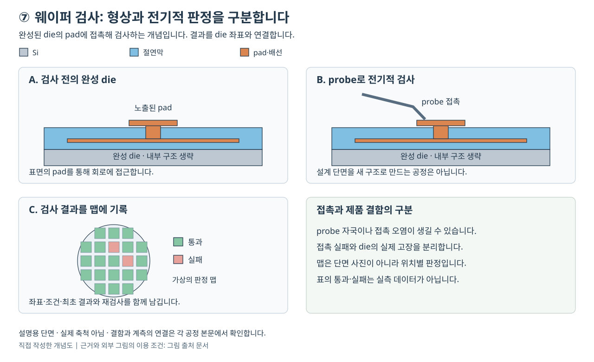
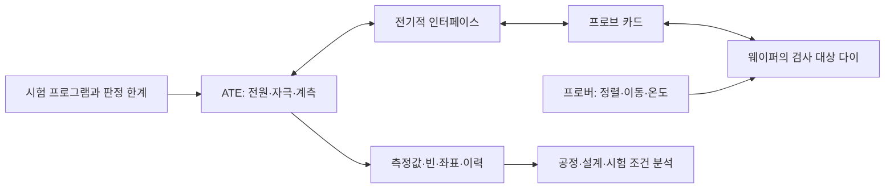

# 웨이퍼 검사와 수율: 전기적 선별에서 출하 품질까지 | Wafer Test, Yield, and Outgoing Quality

[공정 목차](README.md) · [다음: 패키징과 첨단 집적](08-패키징과첨단집적_packaging.md)

웨이퍼에 회로가 만들어졌다고 해서 모든 칩이 같은 속도와 전력으로 동작하지는 않습니다. 회로의 단선·단락, 소자 특성의 편차, 누설전류, 메모리 셀의 불량 등을 전기적으로 확인하고, 다음 조립 단계에 보낼 다이를 결정해야 합니다. 다이(die)는 웨이퍼에 반복해서 만들어진 개별 반도체 회로의 단위입니다. EDS(Electrical Die Sorting)는 이러한 웨이퍼 상태의 전기적 선별을 가리키는 용어입니다. wafer sort, wafer probe, chip probe라는 이름도 사용하지만, 회사마다 포함하는 시험과 단계가 다를 수 있습니다.

이 글은 웨이퍼의 전기적 검사에서 패키지 검사로 이어지는 판단 과정을 설명합니다. 수치 예제는 개념을 설명하기 위해 직접 구성한 가정입니다. 특정 회사의 수율·불량률·출하 판정값이나 실제 제조 결과를 뜻하지 않습니다.

## 공정 전후 단면: 회로를 바꾸지 않고 접촉하여 판정합니다



그림은 웨이퍼 다이 검사의 접촉 위치와 결과를 설명하기 위해 직접 그린 개념도입니다. 실제 소자의 층수·두께·프로브 크기 비율을 나타내지 않습니다.

| 패널 | 단면과 데이터에서 확인할 내용 |
|---|---|
| A. 접촉 전 | 회로와 배선이 완성되어 있고 보호막의 개구부에 검사할 금속 패드가 드러나 있습니다. 범프를 검사하는 제품이라면 접촉 대상의 형상도 달라집니다. |
| B. 전기적 검사 | 위에서 프로브가 패드에 접촉하고 아래의 척이 웨이퍼를 지지합니다. 전원·시험 신호·측정 전류가 접촉 경로를 지나므로 회로 이상과 접촉 이상을 구분해야 합니다. |
| C. 접촉 후 | 의도한 결과는 설계 단면의 변경보다 다이 좌표별 측정값과 판정 데이터입니다. 프로브를 떼어도 웨이퍼 맵은 후속 다이 선택에 사용합니다. |

일반적인 전기적 선별 자체는 새 막을 쌓거나 회로를 식각하는 공정이 아닙니다. 다만 패드에 작은 접촉 자국이 남을 수 있고 과도한 접촉은 손상을 만들 수 있습니다. 그림의 패드가 제품 내부 트랜지스터 전체를 드러낸다는 뜻도 아닙니다. 별도의 공정 관리용 구조는 스크라이브 영역이나 시험 다이에 있을 수 있으며, 제품 다이의 기능 시험과 관측 대상이 다릅니다. [Tektronix, Probe Card Tutorial의 Introduction·Scrub Alignment](https://www.tek.com.cn/documents/whitepaper/probe-card-tutorial), [FormFactor, Parametric 프로브 카드 설명](https://www.formfactor.com/products/probe-cards/?FC=1)

## 1. 검사하는 것은 무엇이고, 언제 검사할까요

물리적 결함(defect)은 원하지 않는 재료·형상·접속의 변화입니다. 예를 들어 금속선 사이에 전도성 이물이 끼는 현상입니다. 고장 모형(fault model)은 이러한 결함의 전기적 효과를 시험에 사용할 수 있도록 단순화한 표현입니다. 신호가 계속 0에 머문다는 stuck-at-0 모형이 한 예입니다. 오류(error)는 기대한 값과 관측한 값이 달라진 상태이며, 고장(failure)은 제품이 요구 기능을 수행하지 못하는 사건입니다. 결함 하나가 모든 입력에서 오류를 일으키는 것은 아니므로 시험 자극과 관측 조건이 필요합니다.

검사는 제조 끝에 한 번만 수행하는 절차가 아닙니다. 공정 중의 소자·배선 특성 검사, 완성 웨이퍼의 다이 검사, 조립 중의 접속 검사, 패키지 최종 검사, 필요한 제품의 시스템 수준 시험이 서로 다른 문제를 찾습니다. Advantest는 설계 평가·양산 웨이퍼 시험·패키지 이후 최종 시험을 구분하며, Amkor는 2.5D·3D 제품에 웨이퍼 검사와 주요 조립 단계 사이의 검사, 최종 ATE·SLT를 배치한다고 설명합니다. [Advantest의 제조 흐름과 시험 종류](https://www.advantest.com/en/about/business/), [Amkor의 Test Services, HPC & AI 항목](https://amkor.com/test-services/)

| 단계 | 주로 묻는 질문 | 결과의 예와 한계 |
|---|---|---|
| 공정 중 전기적 특성 검사 | 이 공정의 트랜지스터·저항·절연막 특성이 관리 범위 안에 있습니까 | 시험 구조의 분포를 얻습니다. 완성 제품의 모든 기능을 대신하지 않습니다. |
| 웨이퍼 다이 검사 | 이 다이는 주어진 전압·온도·패턴에서 조건을 만족합니까 | 다이별 통과·실패·등급 정보를 얻습니다. 이후 조립 결함까지 알 수는 없습니다. |
| 조립 중 검사 | 새로 연결한 범프·TSV·다이 간 링크가 동작합니까 | 고가의 추가 조립 전에 접속 불량을 찾습니다. 제품마다 삽입 위치가 다릅니다. |
| 패키지 최종 검사 | 조립을 마친 제품의 전기적 특성과 기능이 출하 조건을 만족합니까 | 조립 이후의 변화도 확인합니다. 장기 수명을 전수 보증하는 시험은 아닙니다. |
| 시스템 수준 시험, SLT | 부팅·소프트웨어·메모리·인터페이스가 함께 동작합니까 | 실제 사용과 가까운 상호작용을 확인합니다. 모든 사용 시나리오를 다 실행하지는 않습니다. |

## 2. ATE, 프로버, 프로브 카드의 역할

ATE(Automatic Test Equipment)는 정해진 자극을 인가하고 응답을 측정하여 판정하는 자동 시험 장비입니다. 전원 공급·전류 측정·디지털 패턴·시간 측정·아날로그·RF 계측 등 필요한 자원을 조합합니다. DUT(Device Under Test)는 지금 검사하는 소자입니다.

프로버(prober)는 웨이퍼를 지지하고 좌표를 이동하며, 접촉 위치와 온도 조건을 관리하는 장비입니다. 프로브 카드(probe card)는 시험 장비와 웨이퍼의 미세한 패드 또는 범프 사이에 전기적 접촉을 만드는 부품입니다. 프로브 카드 자체가 모든 시험 알고리즘을 수행하는 독립 테스터라는 뜻은 아닙니다. FormFactor의 제품 분류에서도 로직·메모리·RF·이미지센서·파라미터 검사에 서로 다른 접촉 구성을 사용합니다. [FormFactor, Probe Cards의 제품별 용도](https://www.formfactor.com/products/probe-cards/?FC=1)



웨이퍼를 척(chuck)에 고정한 뒤 정렬 표식과 패드를 확인하고, 시험할 좌표로 이동하여 접촉합니다. 한 번 접촉하는 동작을 touchdown이라고 부릅니다. 한 다이씩 시험할 수도 있고 여러 다이를 병렬로 시험할 수도 있습니다. 병렬 시험의 단위를 site라고 부르며, site마다 접촉과 계측 조건이 동등한지 확인해야 합니다.

프로브 팁은 패드 표면의 산화막·오염층을 통과하여 안정적인 접촉을 만들어야 합니다. 이때 생기는 미세한 접촉 흔적을 scrub mark라고 합니다. 처음 접촉한 뒤 추가로 이동하는 overtravel이 너무 작으면 접촉이 불안정하고, 너무 크면 패드 손상과 팁 마모가 커질 수 있습니다. 팁에 쌓인 찌꺼기 제거도 접촉저항과 수명 사이의 절충입니다. 이러한 접촉·청소 문제는 칩의 실제 불량과 분리하여 조사해야 합니다. [FormFactor, DRAM·Flash 프로브의 찌꺼기와 청소](https://www.formfactor.com/blog/2022/removing-probing-debris-from-springs-dram-flash-applications/), [Tektronix, Probe Card Tutorial의 Scrub Alignment](https://www.tek.com.cn/documents/whitepaper/probe-card-tutorial)

### 2.1 실제 시험 장비에서 나누어 맡는 일

다음은 2026-10-26에 공식 제품 본문에서 확인한 상용 플랫폼의 예입니다. 두 장비를 함께 소개한다는 이유로 특정 고객의 실제 조합이나 호환성을 확인한 것은 아닙니다. 장비 외형 사진은 표의 공식 페이지에서 볼 수 있습니다.

| 장비·플랫폼 | 해당 장비가 맡는 일 | 적용할 때 따로 확인할 조건 |
|---|---|---|
| [Advantest V93000 EXA Scale](https://www.advantest.com/en/products/semiconductor-test-system/soc/v93000/) | SoC용 ATE 계열입니다. 장착한 계측 자원과 프로그램으로 디지털·전원·아날로그·RF 시험을 구성합니다. 공식 페이지는 웨이퍼 sort와 final test 구성을 함께 설명합니다. | 필요한 핀 수·전류·패턴 메모리·계측 대역과 인터페이스를 선택해야 합니다. 같은 플랫폼 이름이라도 모든 장비가 같은 자원을 갖지는 않습니다. |
| [Tokyo Electron Precio XL](https://www.tel.com/product/precio.html) | 웨이퍼 위치·접촉·온도를 관리하는 자동 프로버입니다. 공식 페이지는 TELPADS-I 접촉 자국 검사와 프로브 카드 평행도 자동 조정 등의 옵션을 설명합니다. | 웨이퍼 크기·척·프로브 카드와 실제 설치 옵션을 맞춰야 합니다. 패드에 잘 닿았다는 사실만으로 칩 기능을 통과 판정하지 않습니다. |

### 2.2 검사에서 사용하는 금속과 청소 재료

검사 재료에는 웨이퍼에 남는 패드 금속뿐 아니라 반복 접촉하는 프로브와 소모성 청소재가 있습니다. 아래 구분은 재료의 역할을 설명하며, 특정 제품의 재료 조성을 추정한 목록은 아닙니다.

| 재료 | 위치와 역할 | 선택·사용 조건 |
|---|---|---|
| 알루미늄 패드 | 프로브가 접촉하는 전극의 한 예입니다. 접촉 중 떨어진 패드 물질은 팁의 찌꺼기가 될 수 있습니다. | 재료의 경도·접촉저항·찌꺼기를 함께 봅니다. [Ellis, 알루미늄 패드와 청소 매체 평가, 4–6·9–12쪽](https://www.swtest.org/swtw_library/2018proc/PDF/S07_02_Ellis_SWTW2018.pdf)입니다. |
| 텅스텐·텅스텐-레늄·베릴륨-구리 | 전류를 전달하면서 탄성 변형하는 프로브 바늘 재료의 예입니다. | 경도·마모·접촉저항·필요 전류를 함께 봅니다. 이 바늘 재료 목록을 모든 MEMS 프로브의 조성으로 일반화하지 않습니다. [Tektronix, Probe Materials](https://www.tek.com.cn/documents/whitepaper/probe-card-tutorial)입니다. |
| 부드러운 점착성 폴리머 청소재 | 프로브가 들어갈 때 느슨한 찌꺼기를 붙잡는 청소 방식입니다. | 단단히 부착된 산화물까지 모두 제거한다고 가정하지 않습니다. 수직 진입량과 팁 형상에 맞는 재료가 필요합니다. [FormFactor, 청소 방식 1](https://www.formfactor.com/blog/2022/removing-probing-debris-from-springs-dram-flash-applications/)입니다. |
| 단단한 연마성 실리콘 청소재 | 팁 표면을 문질러 잘 떨어지지 않는 오염층을 제거하는 방식입니다. | 청소 후 접촉저항뿐 아니라 팁의 재료 손실·형상·정렬을 확인합니다. 청소재는 다이 위에 남기기 위한 막이 아닙니다. [FormFactor, 청소 방식 2](https://www.formfactor.com/blog/2022/removing-probing-debris-from-springs-dram-flash-applications/)입니다. |

## 3. 파라미터·구조·기능 시험은 서로 다릅니다

파라미터 시험(parametric test)은 전압·전류·저항·정전용량처럼 연속적인 물리량을 측정합니다. 예를 들어 트랜지스터의 문턱전압, 절연막 누설전류, 배선 저항을 확인합니다. 공정 관리용 시험 구조는 절단될 스크라이브 영역이나 별도 시험 다이에 배치할 수 있습니다. 제품 다이의 핀 누설전류나 소비전류를 측정하는 시험도 파라미터 시험이므로, 이 용어가 반드시 공정 관리용 구조만 뜻하는 것은 아닙니다. FormFactor는 공정 중과 공정 말의 파라미터 검사용 프로브 카드를 별도로 소개합니다. [FormFactor, Parametric 항목](https://www.formfactor.com/products/probe-cards/?FC=1)

구조 시험(structural test)은 회로 내부의 고장 모형을 겨냥합니다. DFT(Design for Testability)는 내부 상태에 값을 넣거나 결과를 읽기 쉽게 만드는 설계입니다. scan chain은 내부 플립플롭을 시험 때 길게 연결해 상태를 넣고 읽는 방식이며, ATPG(Automatic Test Pattern Generation)는 선택한 고장을 검출할 패턴을 만드는 과정입니다. 메모리 BIST(Built-In Self-Test)는 메모리 검사 동작을 칩 내부 회로가 수행하도록 하는 방식입니다. 이러한 기능은 설계 단계에서 준비해야 합니다. [Synopsys, What is Design for Test?의 Definition·How Does DFT Work?](https://www.synopsys.com/glossary/what-is-design-for-test.html)

기능 시험(functional test)은 사양에 있는 동작을 실행합니다. 덧셈 결과, 메모리 쓰기·읽기, 인터페이스 응답 등이 예입니다. 기능 하나가 맞게 실행되었다고 해서 그 기능에 참여하는 모든 내부 경로를 시험했다는 뜻은 아닙니다. 반대로 구조 시험의 검출률이 높아도 전체 소프트웨어나 모든 아날로그 동작을 검증했다고 할 수 없습니다. NYCU의 강의 자료는 기능 시험·구조 시험, 고장 모형, DFT·ATPG·BIST를 구분합니다. [Introduction to VLSI Testing, PDF 인쇄 쪽 35–38·48·55](https://tiger.iee.nycu.edu.tw/course/Testing2024Fall/notes/pdf/ch1.introduction.pdf)

| 시험 예 | 인가·측정하는 내용 | 놓칠 수 있는 내용 |
|---|---|---|
| 핀 연속성·단락 시험 | 제한된 전류·전압에서 접속 이상을 확인합니다. | 정상 접촉처럼 보이는 조건부 결함이나 고속 동작 문제입니다. |
| DC 파라미터 시험 | 누설전류·출력 전압·전원 전류 등을 측정합니다. | 모든 논리 경로의 타이밍과 복합 동작입니다. |
| scan 기반 구조 시험 | 내부 상태를 제어하고 고장 효과를 관측합니다. | 선택하지 않은 고장 모형과 시험 모드 밖의 상호작용입니다. |
| 메모리 패턴 시험 | 주소·데이터·쓰기·읽기 순서를 바꿉니다. | 충분히 긴 보존 시간이나 모든 온도 이력입니다. |
| at-speed 시험 | 목표 속도에 가까운 조건에서 경로·인터페이스를 확인합니다. | 모든 전압·온도 조합과 실제 보드 조건입니다. |
| 아날로그·RF 시험 | 이득·오프셋·왜곡·주파수 응답 등을 측정합니다. | 시험하지 않은 주파수·부하·환경 조건입니다. |

## 4. 웨이퍼 검사 흐름과 수리의 실제 의미

대표적인 판단 순서는 다음과 같습니다. 제품·설계·공정에 따라 순서와 시험 삽입 횟수는 바뀝니다.

1. 웨이퍼·로트·제품·시험 프로그램 판본과 좌표 방향을 확인합니다.
2. 접촉·전원·기본 연속성을 점검합니다. 접촉 실패에 전압을 무작정 높여 대응해서는 안 됩니다.
3. 필요한 파라미터·구조·기능·속도 시험을 수행합니다. 온도가 바뀌면 충분한 안정화 시간과 실제 소자의 자기 발열을 고려합니다.
4. 수리가 가능한 설계라면 고장 위치를 분석하고 예비 자원으로 대체할 수 있는지 판단합니다.
5. 수리한 구성을 다시 시험하고 성능 등급 또는 불합격 사유를 기록합니다.
6. 승인된 재검사 규칙을 적용하고, 다음 공정으로 넘길 웨이퍼 맵과 이력을 확정합니다.

메모리 수리(repair)는 찢어진 배선을 사람이 이어 붙인다는 의미가 아닙니다. 대표적으로 설계에 준비한 예비 행·열 등으로 불량 자원을 대체하도록 정보를 설정합니다. 예비 자원보다 불량이 많거나 대체 불가능한 회로가 고장 나면 수리할 수 없습니다. 모든 로직 칩과 모든 불량에 이 방법이 적용되는 것도 아닙니다. 수리 이후 검사는 대체한 부분뿐 아니라 제품 조건을 다시 확인하는 절차입니다. [Siemens EDA, 메모리의 예비 행·열과 수리 논리 설명](https://blogs.sw.siemens.com/eda-support/2026/08/04/abracadabra-using-tessent-magic-to-repair-non-repairable-memories/)

삼성의 EDS 입문 자료는 ET·웨이퍼 번인·고온/저온·수리 후 재검사·불량 표시의 흐름을 소개합니다. 이는 해당 설명의 흐름이며 모든 제품에 그대로 적용되는 보편적 레시피가 아닙니다. 그 자료에서 수리 뒤에 사용하는 “Final Test”라는 이름은 EDS 안의 최종 확인을 뜻합니다. 산업에서 패키지 조립 뒤의 출하 검사를 가리키는 final test와 단계가 같다고 읽으면 안 됩니다. 또한 불량 표시에는 잉크뿐 아니라 데이터 기반 맵이 사용됩니다. [삼성반도체, EDS의 4단계](https://semiconductor.samsung.com/kr/support/tools-resources/fabrication-process/eight-essential-semiconductor-fabrication-processes-part-8-eds-electrical-die-sorting-for-the-perfect-chips/)

## 5. 웨이퍼 맵, 빈, 추적 정보

웨이퍼 맵(wafer map)은 각 다이의 좌표와 검사 결과를 연결한 데이터입니다. binning은 결과를 목적에 맞게 분류하는 작업입니다. bin은 정상/불량 두 종류만 있을 필요가 없습니다. 통과한 칩을 속도·전력·허용 동작 범위에 따라 나눌 수도 있고, 실패한 칩을 누설·메모리·타이밍 등으로 분류할 수도 있습니다. 분류 코드는 회사와 프로그램마다 다르므로 숫자 자체만으로 의미를 판단할 수 없습니다.

다음은 직접 만든 작은 지도이며 실제 웨이퍼의 결함 패턴이 아닙니다. `P`는 통과, `L`은 누설 한계 실패, `C`는 접촉 의심으로 재검사가 필요한 다이, `-`는 대상 밖의 영역입니다.

```text
       x=0 1 2 3 4
y=0     - P P P -
y=1     P P L P P
y=2     P C L P P
y=3     P P L P P
y=4     - P P P -
```

세로로 이어진 `L`만 보고 특정 노광·식각 장비의 고장이라고 확정할 수는 없습니다. 같은 패턴이 여러 웨이퍼·로트에 반복되는지, 장비·시간·레시피와 연관되는지, 계측 자료와 일치하는지를 살핍니다. 한 site에서만 실패가 많다면 프로브·전원·인터페이스 문제도 후보입니다. 관측된 공간 패턴은 원인 분석의 단서이며 원인 그 자체는 아닙니다.

수율 분석에 사용할 기록에는 로트·웨이퍼 ID, 다이 좌표, 프로그램과 한계값 판본, 장비·프로브 카드·site, 온도 조건, 최초 결과와 재검사 결과, 수리 여부가 필요합니다. 웨이퍼의 노치 방향이나 좌표 원점이 조립 장비와 다르면 양품을 버리거나 불량을 조립할 수 있습니다. 따라서 전기적 정확도와 별개로 데이터 전달의 정확도가 중요합니다.

## 6. 관리 변수와 단위

아래 표는 무엇을 기록해야 하는지 정리한 것입니다. 특정 수치를 모든 제품의 권장값으로 제시하지 않습니다.

| 변수 | 흔한 단위 | 판정에 미치는 영향 |
|---|---|---|
| 전원·입출력 전압 | V, mV | 동작 여유와 과전압 위험을 바꿉니다. 인가값과 다이 도달값의 차이를 확인합니다. |
| 전류·누설전류 | A, mA, µA, nA | 부하 능력·정상 소비전력·절연 상태를 구분합니다. 계측 범위와 안정화 시간이 중요합니다. |
| 접촉·배선 저항 | Ω, mΩ | 전압 강하와 발열을 만듭니다. 필요하면 4선식 측정 등으로 경로 영향을 분리합니다. |
| 주파수·시간 여유 | Hz, MHz, GHz, ns, ps | 동작 속도와 시간 기준의 오차가 합격 판정에 영향을 줍니다. |
| 온도 | °C | 척·케이스·접합 온도가 서로 다를 수 있습니다. 온도 안정화와 자기 발열을 관리합니다. |
| 접촉 이동·정렬 | µm | 접촉 성공률·패드 손상·팁 수명 사이의 절충을 결정합니다. |
| 병렬 site 수 | 개 | 처리량을 늘릴 수 있지만 전원·채널·열·균일성 제약이 커집니다. |
| 시험·이동·대기 시간 | s, ms | 한 다이의 시험 시간만으로 웨이퍼 처리량을 계산할 수 없습니다. |
| 측정 불확도·반복성 | 측정량과 같은 단위 | 경계 근처의 오판 가능성을 평가하는 데 필요합니다. |

예를 들어 1 A가 흐르는 공급 경로의 접촉저항이 0.10 Ω이면 전압 강하는 `IR = 0.10 V`입니다. 테스터가 0.80 V를 출력해도 단순한 직렬 경로 모형에서는 다이에 0.70 V만 남습니다. 실제 장비는 센싱·보상 회로와 병렬 전원 경로를 사용할 수 있으므로 이 계산을 그대로 실제 장비의 오류값으로 사용해서는 안 됩니다. 이 예는 전압·전류·접촉을 함께 살펴야 하는 이유를 보여 줍니다.

## 7. 재검사와 가드밴드의 판단

재검사(retest)는 접촉 실패·계측 이상 같은 일시적 문제를 구분하거나 정해진 품질 절차를 수행하기 위해 사용합니다. 처음 실패한 제품이 나중에 통과하면 원인·시험 조건·반복 횟수를 남겨야 합니다. 통과할 때까지 무제한 반복하면 경계 불량이 우연히 통과할 가능성이 커지고 최초 수율의 의미도 사라집니다. 실패 종류별로 재검사 허용 여부와 횟수를 정하고, 서로 다른 결과를 별도로 분석해야 합니다.

가드밴드(guardband)는 측정 오차·조건 변화 등을 고려하여 출하 사양보다 안쪽에 시험 한계를 두는 여유입니다. 여유를 크게 하면 불량 유출을 줄일 수 있지만 정상 제품을 불필요하게 탈락시킬 수 있습니다. 여유를 작게 하면 시험 수율은 높아질 수 있지만 경계 제품에 대한 위험이 커질 수 있습니다. 한계 변경 전후를 비교할 때에는 수율뿐 아니라 반복성·재현성·후속 시험 실패·고객 불량도 함께 확인해야 합니다.

자체 예제로, 실제 저항이 110 Ω 이하여야 하고 측정값 `m`에 대해 실제값이 `m ± 2 Ω` 안에 있다는 보수적 오차 경계만 안다고 가정합니다. 상한 쪽만 고려하면 `m ≤ 108 Ω`일 때 실제 저항의 최대값이 110 Ω을 넘지 않습니다. 측정값이 109 Ω이면 실제값이 107–111 Ω 범위일 수 있어 이 가정만으로 출하 조건을 확정할 수 없습니다. 실제 불확도가 확률 분포로 주어지면 신뢰수준·위험 배분을 정해야 하며, 이 단순 경계 예제와 같은 규칙을 자동으로 쓰지 않습니다.

### 7.1 보고된 사례: 청소 매체를 바꾼 뒤 접촉저항과 팁을 함께 확인했습니다

Vincent Ellis의 SWTest 2018 발표는 FormFactor T11 MEMS 캔틸레버 프로브의 청소 매체를 폴리머에서 lapping film으로 바꾼 평가를 보고합니다. lapping film은 표면에 연마 입자가 있는 필름입니다. 시험용 알루미늄 웨이퍼 평가에 이어 실제 소자 한 로트에서 접촉저항 최대값의 관리 상태를 살폈고, 양품 다이와 접촉에 민감한 bin의 결과, 시험 후 팁 마모를 함께 확인했습니다. 이 자료는 해당 평가의 보고이며 모든 프로브에서 연마 필름이 더 낫다는 결론이나 이 글의 직접 측정값은 아닙니다. [Ellis, Cleaning Material Evaluations…, 발표 9–15쪽](https://www.swtest.org/swtw_library/2018proc/PDF/S07_02_Ellis_SWTW2018.pdf)

이 사례를 접촉 불량 조사에 연결하면 다음과 같습니다. 아래의 원인 분리와 재검증 순서는 설명용으로 구성한 것이며 발표자가 수행한 전체 절차를 재현한 기록은 아닙니다.

| 순서 | 접촉을 의심하는 실패를 조사하는 방법 |
|---|---|
| 증상 | 접촉 반복에 따라 연속성 실패나 접촉저항의 상단 꼬리가 늘어납니다. 최초 실패와 청소 직후 결과를 따로 보존합니다. |
| 서로 다른 원인 | 팁의 금속 찌꺼기·산화물, 팁 높이·평행도 차이, 실제 패드 손상·회로 단선이 후보입니다. 같은 실패 코드가 같은 원인을 뜻하지는 않습니다. |
| 확인 방법 | 표준 구조의 접촉저항, 팁 영상, 패드 자국, 접촉 횟수에 따른 추세를 대조합니다. 청소 뒤 저항만 회복되는지와 실제 소자의 실패가 남는지를 나누어 봅니다. |
| 조치 방향 | 공급사가 허용한 청소 매체·진입량·주기를 평가합니다. 오염이 원인일 때의 청소와 높이 차이가 원인일 때의 평행도 조정을 구별합니다. |
| 재검증 | 저항의 평균뿐 아니라 최대값·변동·접촉 민감 bin·팁 손상을 확인합니다. 최초 수율과 정해진 규칙으로 재검사한 결과를 모두 남깁니다. |

### 7.2 자체 진단 예: 한 site만 고전류 패턴에서 실패합니다

다음은 실제 고객 사례가 아니라 site별 원인을 분리하는 가상 진단 경로입니다. 정상 다이를 시험 문제로 탈락시키는 현상을 false fail이라고 합니다. 다만 site 편차가 보인다는 이유만으로 모두 false fail이라고 판정하지 않습니다.

| 순서 | 증거를 나누어 확인하는 방법 |
|---|---|
| 증상 | 저전류 시험은 통과하지만 전류가 큰 패턴에서 특정 site의 저전압·타이밍 실패가 많다고 가정합니다. 최초 실패 시각·좌표·패턴·site를 연결합니다. |
| 서로 다른 원인 | 그 site의 전원 접촉·배선 저항, 센스선 연결 오류, 병렬 시험 중 전원 자원 부족, 열 안정화 차이, 실제 다이의 속도·누설 편차가 후보입니다. |
| 확인 방법 | 승인된 진단 조건에서 같은 기준 다이를 다른 site로 옮기고 같은 site에는 다른 기준 다이를 놓아 봅니다. 실패가 site를 따라가는지 다이를 따라가는지 확인하고, 부하 순간의 다이 가까운 전압과 온도 이력을 비교합니다. |
| 조치 방향 | 접촉·인터페이스가 원인이면 해당 경로를 정비하고 센싱·보상 설정을 확인합니다. 병렬 부하가 원인이면 전원 자원과 패턴 동시 실행을 조정하며, 온도 문제이면 안정화 조건을 바로잡습니다. 한계값 완화만으로 통과시키지 않습니다. |
| 재검증 | 같은 다이·site·온도·패턴의 교차 비교를 반복하고, 병렬 시험과 단일 site 시험의 상관관계를 확인합니다. 후속 패키지 시험과의 일치 여부도 살펴야 시험 문제와 실제 소자 편차를 더 분명히 구분할 수 있습니다. |

전원 경로의 전압 강하는 6절의 단순 계산으로 설명할 수 있지만 실제 과도 현상과 보상 성능은 계측이 필요합니다. V93000 공식 페이지가 고전력·다중 site를 시험 과제로 설명한다는 사실은 위 가상 실패가 그 장비에서 발생했다는 증거가 아닙니다. [Advantest, V93000 EXA Scale의 시험 과제](https://www.advantest.com/en/products/semiconductor-test-system/soc/v93000/)

## 8. 수율, 고장 검출률, 출하 불량률을 구분합니다

시험 수율(test yield)은 정한 투입 집합 가운데 시험을 통과한 비율입니다. 수리 전·후, 최초 시험·재검사 포함, 특정 등급·모든 판매 가능 등급을 구분해야 합니다. 웨이퍼의 가장자리 불완전 다이·시험용 구조·대상 외 다이를 분모에 포함하는지에 따라서도 값이 달라집니다.

고장 검출률(fault coverage)은 선택한 고장 모형의 대상 가운데 시험이 검출하는 비율입니다. 어떤 모형과 고장 목록을 분모로 쓰는지, 검출 불가능한 고장과 미분류 고장을 어떻게 취급하는지 확인해야 합니다. stuck-at 검출률 99%가 물리적 결함 99%나 트랜지스터 99%를 직접 검사했다는 뜻은 아닙니다. NYCU 강의의 fault coverage 정의도 특정 고장 집합과 패턴에 대한 비율입니다. [Introduction to VLSI Testing, PDF 인쇄 쪽 47–49](https://tiger.iee.nycu.edu.tw/course/Testing2024Fall/notes/pdf/ch1.introduction.pdf)

출하 불량률은 검사 통과 후 내보낸 집합에서 불량이 얼마나 포함되었는지 나타냅니다. DPPM(Defective Parts Per Million)은 제품 100만 개당 불량 제품 수입니다. 한 제품의 여러 결함을 각각 세는 DPMO와 같지 않습니다. FIT(Failures In Time)는 통상 10억 소자·시간당 고장 수로 나타내는 시간 기반 지표여서 DPPM과 단위부터 다릅니다. 어떤 기간·사용 조건·모집단에서 집계했는지를 함께 써야 합니다. [Cirrus Logic, How We Measure Failure Rate](https://www.cirrus.com/quality/reliability-qualification)

| 지표 | 기본 분자 / 분모 | 해석할 때 필요한 조건 |
|---|---|---|
| 최초 시험 수율 | 최초 통과 수 / 최초 시험 대상 수 | 수리·재검사를 넣지 않은 결과입니다. |
| 최종 시험 수율 | 승인된 규칙에 따른 최종 통과 수 / 정의한 투입 수 | 수리·재검사·등급 처리 규칙을 밝혀야 합니다. |
| 고장 검출률 | 검출된 모형 고장 수 / 정의한 대상 고장 수 | 실제 불량률로 바로 바꿀 수 없습니다. |
| 불량 유출 DPPM | 출하 집합에서 확인한 불량 제품 수 / 해당 출하 제품 수 × 10⁶ | 미발견 불량·관측 기간·표본 불확도를 고려합니다. |
| FIT | 고장 수 / 누적 소자·시간 × 10⁹ | 시간·온도·전압과 추정 모형이 필요합니다. |

시험을 더 엄격하게 바꿔 수율이 낮아지는 경우도 있습니다. 이때 수율 하락이 곧 공정 악화를 뜻하지는 않습니다. 이전에 놓치던 불량을 검출한 것인지, 정상 제품을 잘못 탈락시킨 것인지 분리해야 합니다. 검사는 결함을 발견하고 조립 낭비를 줄이지만, 검사만 수행한다고 웨이퍼의 물리적 결함이 사라지는 것은 아닙니다. 수리 가능한 설계와 공정·설계 원인 제거를 통해 실제 양품 수가 달라집니다.

## 9. 자체 계산: 수리 전후 수율과 DPPM

이 예제에서는 완전한 제품 다이 1,000개를 시험 대상으로 정의합니다. 가장자리 불완전 다이와 시험 구조는 제외합니다.

1. 최초 통과가 820개이면 최초 시험 수율은 `820 / 1,000 = 82.0%`입니다.
2. 최초 실패 180개 중 설계상 수리 가능한 100개를 처리하고, 재검사에서 75개가 통과했다고 가정합니다.
3. 최종 통과 수는 `820 + 75 = 895개`, 수리 후 수율은 `895 / 1,000 = 89.5%`입니다.
4. 두 수율의 차이는 `7.5%p`입니다. “7.5% 증가”와 “7.5%p 증가”는 다릅니다. 상대 증가율은 `75 / 820 ≈ 9.15%`입니다.

별도의 제품군에서 100,000개를 시험하여 90,000개가 통과했고, 통과품 전체를 완벽하게 재확인할 수 있다는 가상 조건에서 불량 90개를 찾았다고 가정합니다. 시험 수율은 90%이지만, 통과 집합의 불량률은 `90 / 90,000 × 10⁶ = 1,000 DPPM`입니다. `90 / 100,000`을 사용하면 출하 집합의 불량률과 다른 지표가 됩니다. 이 수치만으로 특정 stuck-at 고장 검출률은 계산할 수 없습니다.

실제 공장에서는 통과품 전체의 참 상태를 완벽히 아는 경우가 드뭅니다. 표본 검사나 고객 반품에서 구한 수치는 관측 범위와 통계적 불확도를 가집니다. 따라서 “표본에서 불량을 찾지 못했습니다”와 “모든 제품에 불량이 없습니다”를 구분합니다.

## 10. 자체 계산: 면적과 Poisson 수율 모형

결함이 넓은 면적에 균일하고 서로 독립적으로 무작위 발생하며, 해당 다이에 들어온 유효 치명 결함 하나만으로 불합격한다고 가정합니다. 다이의 유효 면적이 `A`, 단위면적당 결함 밀도가 `D₀`이면 기대 결함 수는 `λ = AD₀`이고, 결함이 0개일 확률은 다음과 같습니다.

```text
Y = P(N = 0) = exp(-AD₀)
A: cm²
D₀: defects/cm²
AD₀: 무차원 기대 결함 수
```

이 식은 기초적인 Poisson 모형입니다. Ohio State University의 SiC MOSFET 저자 원고는 이 식과 함께 결함 군집·가장자리 집중 때문에 모형이 실제 결함 지도와 달라질 수 있음을 설명합니다. 그 논문의 SiC 측정 결과를 실리콘 로직 공정의 수율로 옮겨 쓰지는 않습니다. [Liu 외, Impacts of Area-Dependent Defects…, 식 (1)과 II–III절](https://bpb-us-w2.wpmucdn.com/u.osu.edu/dist/f/88613/files/2022/09/Impacts_of_Area-Dependent_Defects_on_the_Yield_and_Gate_Oxide_Reliability_of_SiC_Power_MOSFETs.pdf)

직접 정한 `D₀ = 0.20 defects/cm²`에서 두 면적을 비교합니다.

| 단계 | 100 mm² 다이 | 400 mm² 다이 |
|---|---|---|
| 면적 변환 | `100 / 100 = 1 cm²`입니다. | `400 / 100 = 4 cm²`입니다. |
| 기대 결함 수 | `λ = 1 × 0.20 = 0.20`입니다. | `λ = 4 × 0.20 = 0.80`입니다. |
| 결함 0개 확률 | `exp(-0.20) ≈ 0.8187`입니다. | `exp(-0.80) ≈ 0.4493`입니다. |
| 모형 수율 | 약 81.9%입니다. | 약 44.9%입니다. |

면적을 네 배로 키우면 수율이 단순히 4분의 1로 줄어드는 모형은 아닙니다. 지수함수로 줄어듭니다. 하지만 여기서 곧바로 “작은 칩 네 개가 항상 더 저렴합니다”라고 결론 낼 수도 없습니다. 작은 칩들을 연결하려면 인터페이스 면적·전력·패키징·시험·기판이 필요하고, 하나라도 불량이면 전체 조립품에 영향을 줄 수 있기 때문입니다.

실제 수율에는 회로 배치에 따른 임계 면적, 결함 크기와 종류, 공정 편차, 주변부 제외, 시스템성 반복 결함, 수리·중복 자원, 검사 오판 등이 영향을 줍니다. `D₀`를 단순한 광학 이물 개수와 동일하게 놓거나, 총 다이 면적 하나만으로 모든 제품을 예측하면 안 됩니다. 이 예제는 면적 민감도를 설명하는 계산이며 양산 수율의 예측 보고서가 아닙니다.

## 11. 자체 계산: 다중 다이 패키지의 조건부 수율

KGD(Known Good Die)는 정의한 시험 조건을 만족한 다이를 뜻합니다. “알려진 양품”이라는 이름이 이후 조립·수명·모든 사용 조건의 무결함을 보증하는 것은 아닙니다. 미검출 결함과 조립 중 손상, 다이 간 연결 불량이 남을 수 있습니다.

우선 아무 선별 없이 독립적인 다이 4개를 골라 사용하고, 각각의 진짜 양품 확률이 0.90이라고 가정하면 네 개 모두 양품일 확률은 `0.90⁴ = 0.6561`입니다. 그러나 실제 KGD 조립품에 이 식을 그대로 넣으면 안 됩니다. 선별 통과품을 투입하면 확률의 조건이 달라집니다.

다음은 조건부 확률을 직접 가정한 별도의 예제입니다. `Aᵢ`는 i번째 다이가 선별 시험을 통과한 사건이고, `Gᵢ`는 요구 기능을 만족하는 사건입니다.

1. 각 통과품에 대해 `P(Gᵢ | Aᵢ) = 0.995`라고 가정합니다.
2. 통과 집합 안에서 네 다이의 참 상태가 서로 독립이라고 추가 가정하면, 모두 양품일 확률은 `0.995⁴ ≈ 0.98015`입니다.
3. 네 다이가 모두 양품이고 이 조립 조건을 만족할 때 조립이 성공할 확률을 `0.97`로 가정합니다.
4. 조립품이 기능상 양품일 확률은 `0.995⁴ × 0.97 ≈ 0.95075`, 약 95.1%입니다. 이는 최종 검사 통과율과 같은 값이라고 보장되지 않습니다.

보다 일반적으로는 `P(G₁∩…∩G₄∩조립성공 | A₁∩…∩A₄)`를 구해야 합니다. 같은 웨이퍼·공정·설계에서 온 다이에는 공통 원인이 있을 수 있고, 본딩 한 번의 결함이 여러 링크를 동시에 손상시킬 수도 있습니다. 따라서 독립성이 확인되지 않은 실제 적층품에 무조건 거듭제곱을 적용하면 안 됩니다. 중간 검사와 최종 검사의 검출·오판까지 고려한 출하 수율은 별도의 조건부 계산입니다.

TSMC는 SoIC에서 서로 다른 크기·기능·공정의 KGD를 통합한다고 설명합니다. 이는 선별의 필요성을 보여 주는 사례이며, 위 0.995·0.97은 그 회사의 데이터가 아닙니다. [TSMC-SoIC, Exceptional Heterogeneous Integration](https://3dfabric.tsmc.com/english/dedicatedFoundry/technology/SoIC.htm)

## 12. 패키지 검사, SLT, 번인, 신뢰성 평가

패키징 후에는 웨이퍼 검사 때 없던 배선·기판·솔더 접속과 열 경로가 추가됩니다. 따라서 웨이퍼에서 통과한 다이도 패키지 최종 검사에서 실패할 수 있습니다. 전기적 접속 이상, 특성 변화, 목표 속도, 필요한 온도 조건을 다시 확인합니다. ASE의 시험 서비스 목록은 웨이퍼 프로빙, 패키지 final test, 모듈 시험, SLT를 별도로 구분합니다. [ASE, Test Services](https://ase.aseglobal.com/test-services/)

SLT(System Level Test)는 메모리·주변 장치·소프트웨어를 함께 사용하는 환경에서 부팅·연산·통신 등을 실행하여 상호작용을 살핍니다. ATE에서 효율적으로 수행하는 구조·전기 시험과 목적이 겹치기도 하지만, 전원·클록·열·소프트웨어가 얽힌 문제를 찾는 데 다른 관점을 제공합니다. SLT 통과도 모든 실제 보드·프로그램·운용 기간의 무고장을 뜻하지 않습니다. [Teradyne, What Is System Level Test?](https://www.teradyne.com/system-level-test/)

번인(burn-in)은 정한 온도·전압·동작 스트레스를 일정 시간 가해 초기 취약품을 드러내려는 선별 방법입니다. 웨이퍼 수준과 패키지 수준에서 수행하는 경우가 있지만 모든 반도체가 동일한 번인을 거치는 것은 아닙니다. 제품·고장 기구·용도에 맞는 비용과 스트레스 조건이 필요합니다. 과도한 스트레스가 정상 제품에 불필요한 손상을 주지 않는지도 검토해야 합니다. 특정 메모리 시험 흐름을 다른 모든 반도체에 일반화하지 않습니다. [Advantest, Memory Semiconductor Test Flow and Features, 12쪽](https://www.advantest.com/document/en/investors/ir-library/briefing/E_IR_technical_briefing_231129.pdf)

신뢰성 평가는 정한 사용 조건과 기간에 기능을 유지할 가능성을 살핍니다. HTOL 같은 고온 동작 수명 시험, 온도 사이클, 습도·바이어스 시험, 기계적 시험은 서로 다른 열화·파손 기구를 겨냥합니다. 제품·공정의 qualification과 정기 모니터링, 개별 출하품의 전기적 선별은 역할이 다릅니다. 짧은 전수 시험 하나로 열·습도·기계적 수명을 모두 보증할 수 없습니다. 실제 시험 조건은 적용 표준의 판본과 제품별 계획을 확인해야 합니다. [Cirrus Logic의 Qualification·Monitoring·Reliability Stress Tests](https://www.cirrus.com/quality/reliability-qualification)

## 13. 처리량과 품질 사이의 선택

검사 시간을 줄일 때에는 실패가 확인된 뒤 나머지 시험을 중단하는 방식, 병렬 site 증가, 중복 패턴 제거, 시험 순서 조정 등을 검토할 수 있습니다. 각 선택은 원인 분석 데이터와 검출 능력에 영향을 줍니다. 예를 들어 빨리 불합격을 판정하면 처리 시간은 줄지만, 여러 불량이 함께 발생한 양상을 덜 관측할 수 있습니다.

자체 예제로 8개 site를 사용하고 한 번의 접촉에서 시험 2.0 s와 이동·접촉·안정화 0.5 s가 필요하다고 가정합니다. 이상적인 처리량은 `8 / 2.5 × 3,600 = 11,520개/h`입니다. 가동률 80%를 별도로 적용하면 평균은 `9,216개/h`입니다. 접촉 청소·재검사·열 안정화가 이미 0.5 s 또는 가동률에 들어 있다면 다시 빼지 않아야 합니다. 가장 느린 site가 공통 종료 시간을 결정하거나 전원·열 한계 때문에 병렬 수를 제한하면 단순 비례가 깨집니다.

검사 시간을 늘리는 것이 항상 더 나은 판정을 뜻하지도 않습니다. 같은 조건의 패턴만 반복하는 것보다 빠진 고장 모형·온도·전압·인터페이스를 포함하는 시험이 유용할 수 있습니다. 반대로 실측 상관관계 없이 시험을 제거하면 검사 수율과 실제 출하 품질이 함께 나빠질 수 있습니다. 판단의 핵심은 시험의 개수가 아니라 어떤 불량을 어떤 조건에서 구별하는지입니다.

## 14. 자주 생기는 오해

| 단순한 설명 | 조건을 포함한 설명 |
|---|---|
| EDS가 첫 번째이자 유일한 검사입니다. | 공정 중 계측과 전기적 시험이 있으며 조립 중·조립 후에도 필요한 검사를 수행합니다. |
| 불량 칩은 EDS에서 모두 고칩니다. | 설계에 예비 자원이 있고 대체 범위 안에 있는 일부 불량만 수리할 수 있습니다. |
| 시험 통과는 완전한 무결함 증명입니다. | 선택한 자극·관측·환경·한계에서 통과했다는 판정입니다. |
| 수율 99%와 고장 검출률 99%는 같습니다. | 전자는 제품 집합의 통과 비율이고 후자는 고장 모형 집합에 대한 시험 능력입니다. |
| KGD는 이후 검사가 필요 없습니다. | 조립 결함과 다이 간 상호작용을 확인할 후속 시험이 필요할 수 있습니다. |
| 재검사로 수율이 오르면 공정이 좋아졌습니다. | 접촉 회복·오판·경계품 유출 등 다른 원인을 구분해야 합니다. |
| 번인·최종 시험이 평생 수명을 보증합니다. | 선별·수명 평가·사용 조건과 보증 범위를 따로 정의해야 합니다. |

## 15. 확인 문제와 정답

1. 프로버가 전기적 고장 판정 프로그램을 모두 대신할 수 없는 이유를 설명합니다.
2. 2,000개를 최초 시험해 1,600개가 통과하고, 수리 후 120개가 추가 통과했습니다. 최초·수리 후 수율과 차이를 구합니다.
3. stuck-at 검출률이 99.5%일 때 출하 DPPM을 그 값만으로 계산할 수 있는지 판단합니다.
4. `A = 200 mm²`, `D₀ = 0.10 defects/cm²`인 Poisson 모형의 수율을 구하고 가정 두 가지를 적습니다.
5. 동일 로트에서 고른 KGD 8개의 조립 수율에 `p⁸`을 바로 적용하기 전에 확인할 조건을 설명합니다.
6. 웨이퍼 검사 통과품이 패키지 최종 검사에서 실패할 수 있는 이유 두 가지를 듭니다.
7. 시험 통과품 50,000개 중 확인된 불량이 5개일 때 해당 관측 집합의 DPPM을 구합니다.

정답은 다음과 같습니다.

1. 프로버는 주로 위치·접촉·온도 조건을 관리하고, ATE와 프로그램은 전원·자극·측정·판정을 수행합니다. 두 장비의 역할을 함께 구성해야 합니다.
2. `1,600 / 2,000 = 80.0%`, `1,720 / 2,000 = 86.0%`이며 차이는 6.0%p입니다.
3. 계산할 수 없습니다. 고장 모형, 실제 결함 분포, 시험 오판·유출, 출하 집합 등 추가 정보가 필요합니다.
4. `200 mm² = 2 cm²`, `AD₀ = 0.20`, `exp(-0.20) ≈ 81.9%`입니다. 균일·독립적인 유효 치명 결함과 결함 1개 이상이면 불합격이라는 가정 등이 필요합니다.
5. `p`가 선별 통과를 조건으로 한 양품 확률인지, 다이 간 상태가 조건부로 독립인지, 공통 원인과 조립 수율을 별도로 반영했는지 확인합니다.
6. 조립 중 범프·와이어·기판 접속 불량이 생길 수 있고, 패키지의 전기·열 조건이나 추가 시험 조건에서 경계 특성이 드러날 수 있습니다.
7. `5 / 50,000 × 10⁶ = 100 DPPM`입니다. 이것을 미래 출하품의 확정 불량률로 일반화하지 않습니다.

## 16. 출처와 읽은 범위

확인 기준일은 2026-10-26입니다. 아래 자료의 본문을 확인하여 용어와 공정의 근거로 사용했습니다. 공급사 자료는 해당 공급사가 설명하는 서비스·기술의 근거이며, 비교 우위의 독립 검증 자료로 사용하지 않았습니다. 예제의 입력값과 계산은 이 글에서 직접 정했습니다.

| 자료 | 확인한 절·쪽과 사용 범위 |
|---|---|
| [삼성반도체, EDS공정](https://semiconductor.samsung.com/kr/support/tools-resources/fabrication-process/eight-essential-semiconductor-fabrication-processes-part-8-eds-electrical-die-sorting-for-the-perfect-chips/) | EDS 목적·프로브 카드·4단계·수리 뒤 재검사·데이터 기반 불량 표시입니다. 메모리 중심 흐름을 모든 제품에 일반화하지 않았습니다. |
| [Advantest, Our Technology In-Depth: Semiconductor Test](https://www.advantest.com/en/about/business/) | Where We Fit, Value of Test Systems, Types of Semiconductor Test입니다. 설계·웨이퍼·패키지 단계와 시험 종류를 확인했습니다. |
| [FormFactor, Probe Cards](https://www.formfactor.com/products/probe-cards/?FC=1) | Foundry & Logic, Parametric, RF, Optical 항목입니다. 제품별 접촉 요구와 공정 중·공정 말 파라미터 검사를 확인했습니다. |
| [FormFactor, Removing Probing Debris…](https://www.formfactor.com/blog/2022/removing-probing-debris-from-springs-dram-flash-applications/) | 팁의 패드 접촉·scrub·오염과 청소·수명 절충입니다. |
| [Tektronix, Probe Card Tutorial](https://www.tek.com.cn/documents/whitepaper/probe-card-tutorial) | Introduction, Scrub Alignment, Probe Materials입니다. 파라미터 검사 중심의 범위, 접촉 흔적·정렬과 바늘 재료의 역할을 확인했습니다. 예전 표의 전류·치수·접촉저항을 현행 장비의 공통 사양으로 옮기지 않았습니다. |
| [Advantest, V93000](https://www.advantest.com/en/products/semiconductor-test-system/soc/v93000/) | Platform 개요·V93000 EXA Scale·Advantages and Benefits입니다. SoC ATE의 자원 구성과 wafer sort·final test 적용을 확인했습니다. 공급사의 성능·비용 비교는 독립 검증하지 않았습니다. |
| [Tokyo Electron, Precio Series](https://www.tel.com/product/precio.html) | Precio XL 본문·Product comparison입니다. 위치·접촉·온도 관리와 TELPADS-I·Auto Leveling 등의 옵션을 확인했습니다. 특정 ATE와의 실제 연결 사례는 확인하지 않았습니다. |
| [Ellis, Cleaning Material Evaluations on Advanced MEMS Cantilever and Vertical Technologies](https://www.swtest.org/swtw_library/2018proc/PDF/S07_02_Ellis_SWTW2018.pdf) | SWTest 2018 원 발표 4–6·9–15·18–21쪽입니다. T11의 폴리머→lapping film 평가와 저항·bin·팁 관찰을 사용했습니다. 별도 Katana 평가의 조건·수명을 T11 사례에 합치지 않았습니다. |
| [NYCU, Introduction to VLSI Testing](https://tiger.iee.nycu.edu.tw/course/Testing2024Fall/notes/pdf/ch1.introduction.pdf) | 2024년 강의 PDF 인쇄 쪽 35–38·47–49·55·57입니다. 구조·기능 시험과 고장 모형·검출률을 확인했습니다. 강의의 예전 품질 목표·DPPM 모형 수치를 현행 산업 기준으로 옮기지 않았습니다. |
| [Synopsys, What is Design for Test?](https://www.synopsys.com/glossary/what-is-design-for-test.html) | Definition·How Does Design for Test Work?입니다. scan chain·ATPG·BIST의 역할과 설계 단계 준비를 확인했습니다. |
| [Siemens EDA, Abracadabra…](https://blogs.sw.siemens.com/eda-support/2026/08/04/abracadabra-using-tessent-magic-to-repair-non-repairable-memories/) | 2026-08-04, 본문 앞부분의 redundant row·column/IO와 repair logic입니다. 이후 소개하는 External Repair의 특정 기능을 모든 제품에 일반화하지 않았습니다. |
| [Liu 외, Impacts of Area-Dependent Defects…](https://bpb-us-w2.wpmucdn.com/u.osu.edu/dist/f/88613/files/2022/09/Impacts_of_Area-Dependent_Defects_on_the_Yield_and_Gate_Oxide_Reliability_of_SiC_Power_MOSFETs.pdf) | 저자 공개 원고 II–III절·식 (1), PDF 2쪽입니다. Poisson 식과 군집·가장자리 영향의 한계를 확인했습니다. |
| [Amkor, Test Services](https://amkor.com/test-services/) | Test Equipment, Differentiated Test by Market의 HPC & AI입니다. 조립 단계 사이의 distributed test를 확인했습니다. |
| [ASE, Test Services](https://ase.aseglobal.com/test-services/) | 웨이퍼 프로빙·final test·모듈 시험·SLT 서비스 목록입니다. |
| [Teradyne, System Level Test](https://www.teradyne.com/system-level-test/) | What Is System Level Test와 ATE 시험과의 관계입니다. 페이지의 홍보용 검출률 설명을 트랜지스터 검사 비율로 사용하지 않았습니다. |
| [Advantest, Memory Semiconductor Test Flow and Features](https://www.advantest.com/document/en/investors/ir-library/briefing/E_IR_technical_briefing_231129.pdf) | 2023-11-29 기술 설명 자료 12쪽입니다. 메모리 흐름의 웨이퍼·패키지 번인과 시험 삽입을 확인했습니다. |
| [Cirrus Logic, Reliability and Qualification](https://www.cirrus.com/quality/reliability-qualification) | How We Measure Failure Rate, Qualification, Monitoring, Reliability Stress Tests입니다. DPPM·FIT 및 선별과 신뢰성 평가의 범위를 확인했습니다. |
| [TSMC-SoIC](https://3dfabric.tsmc.com/english/dedicatedFoundry/technology/SoIC.htm) | Exceptional Heterogeneous Integration입니다. 서로 다른 다이의 KGD 통합을 확인했습니다. |

설계 단계의 DFT와 제조 시험을 더 공부하려면 [반도체 테스트·제조 분야](../분야_topics/51-반도체테스트제조_test-manufacturing/README.md)를 함께 읽을 수 있습니다. 다음 글에서는 이렇게 선별한 다이를 실제 기기와 연결하고 열·기계적 환경을 견디도록 조립하는 과정을 다룹니다.
