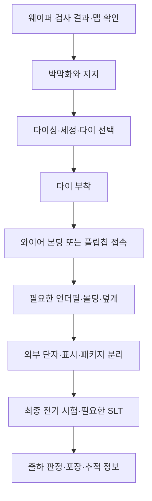

# 패키징과 첨단 집적: 다이 연결, 열, 기계적 신뢰성 | Packaging and Advanced Integration

[공정 목차](README.md) · [이전: 웨이퍼 검사와 수율](07-웨이퍼검사와수율_eds-yield.md)

패키징(packaging)은 반도체 다이를 기기에서 사용할 수 있도록 연결하고 지지하며 보호하는 기술입니다. 외부 단자만 붙이는 작업으로 이해하면 패키지 내부의 미세 배선·전원 공급·열 방출·재료 응력·다중 다이 시험을 놓치게 됩니다. 칩 내부 회로를 만드는 기술과 패키지에서 여러 칩을 연결하는 기술은 설계 제약을 함께 결정합니다.

다이(die)는 개별 반도체 회로가 만들어진 조각이고, 패키지(package)는 다이와 접속·지지·보호 구조를 포함하는 조립 단위입니다. 기판(substrate)은 다이를 지지하면서 내부의 미세한 접속을 외부 단자로 이어 줍니다. 완성 패키지를 다시 올리는 시스템 PCB와 패키지 기판은 크기·배선 밀도·역할이 같지 않습니다.

이 글의 공정 순서는 대표적인 구조를 이해하기 위한 것입니다. 모든 반도체가 같은 재료와 순서로 만들어지지는 않습니다. 수치 예제는 직접 정한 가정이며 실제 제품의 제조 조건·수율·실측 결과가 아닙니다.

## 1. 패키지에 필요한 네 가지 경로

패키지를 읽을 때에는 다음 경로를 따로 살펴보면 구조를 이해하기 쉽습니다.

| 경로 | 필요한 기능 | 잘못 설계되었을 때의 예 |
|---|---|---|
| 신호 | 칩과 외부 또는 칩과 칩 사이의 데이터를 전달합니다. | 반사·누화·손실·지연으로 데이터가 잘못 전달될 수 있습니다. |
| 전원·접지 | 필요한 전류를 공급하고 기준 전위를 유지합니다. | 저항성 전압 강하와 순간 전압 변동으로 동작 여유가 줄어듭니다. |
| 열 | 접합에서 나온 열을 기판·덮개·방열 장치 등으로 이동시킵니다. | 국부 과열과 온도 상승으로 특성·수명이 달라질 수 있습니다. |
| 힘·환경 | 다이를 지지하고 외부 충격·수분·온도 변화에 대응합니다. | 균열·박리·솔더 피로·부식이 발생할 수 있습니다. |

신호 경로를 짧게 만드는 것만으로 네 경로가 동시에 해결되지는 않습니다. 예를 들어 다이를 위로 쌓으면 평면 면적과 다이 간 배선 길이를 줄일 수 있지만 내부 열원에서 냉각면까지의 경로와 시험 접근은 복잡해질 수 있습니다. 이런 상호 제약 때문에 칩·패키지·보드를 함께 설계합니다. Amkor도 WLSiP 설명에서 초기 단계의 chip-package-board 공동 설계를 강조합니다. [Amkor, WLSiP/WL3D의 Tailored Design](https://amkor.com/packaging/wafer-level-packaging/wlsip-wl3d-2/)

## 2. 전통적인 기판 패키지의 전체 흐름

기판 위에 다이를 붙이고 와이어로 연결하는 플라스틱 패키지의 대표 흐름입니다. 웨이퍼 검사 결과를 이용하여 조립 대상 다이를 고르고, 각 단계에서 필요한 검사와 추적 정보를 연결합니다. SK hynix의 전통 패키지 설명도 웨이퍼 박막화·절단·다이 부착·접속·몰딩·표시·솔더볼·개별 분리의 흐름을 제시합니다. [SK hynix, Back-End Process Episode 6의 Overview](https://news.skhynix.com/en/semiconductor-back-end-process-episode-6-conventional-packages/)



이 그림은 유일한 제조 순서를 뜻하지 않습니다. 플립칩에서는 범프 형성이 다이싱보다 먼저 이루어질 수 있고, 팬아웃에서는 절단한 다이를 다시 웨이퍼나 패널 형태로 배열한 뒤 배선을 형성할 수 있습니다. 웨이퍼 수준 접합·적층은 개별 패키지 조립보다 먼저 이루어지기도 합니다. 접속·열·보호 구조가 달라지면 단계의 위치와 검사가 달라집니다.

## 3. 웨이퍼 박막화와 지지

웨이퍼 박막화(thinning)는 뒤쪽 실리콘을 제거해 필요한 두께로 만드는 과정입니다. 패키지 높이를 줄이고 여러 다이를 쌓기 쉽게 하며, TSV가 있는 구조에서는 뒤쪽 연결을 드러내는 공정과 연결될 수 있습니다. 회로가 있는 면을 보호 테이프나 임시 캐리어로 지지하고, 뒤쪽을 연삭(grinding)한 뒤 필요에 따라 미세 연삭·연마·식각으로 손상층을 줄입니다.

두께만 목표값에 맞추면 충분하지 않습니다. 면내 두께 차이인 TTV(Total Thickness Variation), 표면 거칠기, 휨, 가장자리 깨짐, 내부 미세 균열을 함께 관리해야 합니다. 얇아진 다이는 휘기 쉬우므로 반송·박리·픽업 과정도 수율에 영향을 줍니다. DISCO는 박막 연삭을 장비·휠·보호 테이프·공정 조건의 조합으로 다루며, 가장자리 깨짐과 연삭 손상 제거를 설명합니다. [DISCO, Ultra-Thin Grinding의 Wheels·Stress Relief](https://www.disco.co.jp/eg/solution/library/grinder/thin.html)

임시 접합재는 후속 온도·화학 처리를 견디면서도 마지막에 오염과 손상을 남기지 않고 떨어져야 합니다. “잘 붙습니다”와 “잘 떼어집니다”를 동시에 만족해야 하는 재료입니다. 범프가 있는 얇은 웨이퍼를 지지할 때에는 기포·박리·접착재의 흐름과 잔류물도 문제가 됩니다. [SK hynix, Episode 10의 Wafer Support System](https://news.skhynix.com/en/semiconductor-back-end-process-episode-10-roles-of-materials-in-wafer-level-packaging/)

박막화는 모든 다이에 같은 최종 두께를 적용하는 과정이 아닙니다. 요구 높이, 기계적 강도, 뒤쪽 전극, 열 경로, TSV 구조에 따라 조건을 결정합니다. 실제 두께와 공정 순서는 제품 도면과 승인된 공정 조건을 확인해야 합니다.

## 4. 다이싱, 다이 선택, 부착

다이싱(dicing)은 웨이퍼를 개별 다이로 나누는 과정입니다. 스크라이브 레인(scribe lane)은 회로 사이의 절단 통로이고, kerf는 절단하면서 제거되는 폭입니다. 회로를 피해 절단하더라도 가장자리의 깨짐과 미세 균열이 다이 강도·후속 공정에 영향을 줄 수 있습니다.

블레이드 다이싱은 회전하는 미세 절단 휠을 사용합니다. 입도·이송 속도·회전 속도·냉각·절단 깊이의 조합이 중요합니다. 입자를 더 미세하게 하면 충격을 줄일 수 있지만 절삭력·막힘·표면 재료의 영향도 함께 봐야 합니다. DISCO의 얇은 웨이퍼 절단 설명은 이러한 변수의 상호작용을 보여 줍니다. [DISCO, Dicing Thin Wafers의 Blades·Processing Conditions](https://www.disco.co.jp/eg/solution/library/dicing/dicing_thin.html)

레이저·플라즈마 방식 등도 사용하며 재료·막 구조·손상·절단 폭·처리량에 따라 선택합니다. 레이저가 비접촉이라는 이유만으로 열 영향이나 손상이 항상 없다고 할 수는 없습니다. DBG(Dicing Before Grinding)는 먼저 부분 절단한 뒤 뒤쪽 연삭으로 다이를 분리하는 순서입니다. 따라서 “항상 먼저 얇게 갈고 나중에 자릅니다”라는 설명에는 예외가 있습니다. [DISCO, Ultra-Thin Grinding의 DBG 설명](https://www.disco.co.jp/eg/solution/library/grinder/thin.html)

다이 부착(die attach)은 선택한 다이를 기판·리드프레임·다른 다이에 고정하는 과정입니다. 웨이퍼 맵을 따라 필요한 다이를 픽업하고 방향·위치를 맞춘 뒤 접착재나 금속 접합 등을 사용합니다. 와이어 본딩 구조에서는 다이의 뒷면이 지지부에 붙는 경우가 흔하고, 플립칩에서는 회로 면의 범프가 아래를 향하여 전기적·기계적 접속을 만듭니다. 두 구조에서 “붙이는 면”과 전류·열 경로가 다릅니다.

접착층의 빈 공간인 void, 두께 불균일, 기울기, 위치 오차, 경화 상태를 확인해야 합니다. 전력 소자의 다이 부착층은 열뿐 아니라 전기 전도 경로가 될 수 있으므로 절연 접착재를 사용하는 로직 패키지와 동일하게 취급하지 않습니다. 접착재에도 전도성·비전도성 분류가 있습니다. [Sumitomo Bakelite, Die Bonding Paste FAQ의 Q1–Q2](https://www.sumibe.co.jp/english/question/product/it-materials/)

## 5. 와이어 본딩과 플립칩

### 5.1 와이어 본딩

와이어 본딩(wire bonding)은 다이의 패드와 기판의 접속부를 가는 금속선으로 잇습니다. 볼 본딩의 한 예에서는 와이어 끝에 작은 볼을 만들고 다이 패드에 접합한 뒤, 와이어를 루프 모양으로 이동시켜 다른 접속부에 연결합니다. 열·압력·초음파 에너지의 조합을 사용하지만 세부 방식은 재료와 공정에 따라 다릅니다.

와이어는 모두 금으로 만들어지지 않습니다. 금·구리·알루미늄 및 합금 등을 용도에 맞게 선택합니다. Amkor의 구리 와이어 자료는 구리가 금보다 저항률이 낮다는 점과 여러 패키지에서의 사용을 설명합니다. 같은 재료 비교라도 와이어의 길이·굵기·접합부 상태와 신뢰성 조건을 함께 확인해야 합니다. [Amkor, Copper Wirebonding 기술 자료 1쪽](https://amkormarcomexternal.blob.core.windows.net/amkordotcom/wp-content/uploads/2018/02/CopperWirebond_TS105.pdf)

와이어 길이가 길어지면 저항과 기생 인덕턴스가 문제가 될 수 있습니다. 루프 높이와 간격이 작으면 몰딩 흐름에 따른 와이어 변형·접촉, 패드 손상, 접합부 박리 등을 관리해야 합니다. 와이어 본딩은 성숙한 제조 기반과 다양한 구조에 장점이 있으며, 최신 기술이 등장했다는 이유만으로 모든 용도에서 사라지는 방식은 아닙니다.

### 5.2 플립칩과 범프

플립칩(flip chip)은 다이의 회로 면을 뒤집어 범프(bump)로 아래 기판이나 다른 다이와 연결합니다. 범프는 작게 솟은 전도성 접속 구조입니다. 솔더 범프, 구리 기둥(copper pillar)과 솔더 접속 등 여러 구성이 있습니다. UBM(Under-Bump Metallization)은 패드와 범프 사이에서 접착·확산 방지·젖음 등 필요한 역할을 맡는 금속층입니다.

플립칩은 면 전체에 접속을 배치할 수 있고 긴 와이어 루프를 줄일 수 있습니다. 그러나 범프 피치·정렬·평탄도·기판 배선·전원·열 설계를 맞춰야 합니다. 범프의 존재만으로 전기적 성능이 항상 더 좋다고 단정하기보다는 같은 I/O 수·주파수·전류·면적 조건에서 경로를 비교해야 합니다.

솔더를 녹여 접속하는 reflow와 열·힘을 이용하는 thermocompression 등 방식이 있으며, 구리 기둥과 접합재·언더필을 조합할 수 있습니다. 접합 온도와 힘을 높이는 것이 항상 해결책은 아닙니다. 정렬 오차·솔더 넘침·다이 손상·재료 반응을 함께 관리해야 합니다. [Amkor, Flip Chip BGA 기술 자료의 TCNCP·Cu Pillar](https://amkor.com/wp-content/uploads/2018/02/Flip_Chip_TS102.pdf)

### 5.3 언더필은 범프 사이의 기계적 환경을 바꿉니다

언더필(underfill)은 다이와 기판 또는 다이 사이의 틈을 채우는 재료입니다. 실리콘과 기판은 온도가 변할 때 서로 다른 정도로 늘어나므로, 작은 접합부에 반복 변형이 집중될 수 있습니다. 언더필은 접합부 주변의 하중 전달과 보호 조건을 바꾸지만, 재료가 맞지 않거나 기포·박리가 있으면 다른 문제가 생깁니다.

접합 뒤 측면에서 모세관 작용으로 채우는 CUF(Capillary Underfill), 몰딩재를 활용하는 MUF(Molded Underfill), 미리 적용하는 NCP·NCF 등은 공정 순서와 재료 형태가 다릅니다. 열전도율·열팽창계수·탄성 특성·접착·수분 흡수·틈 채움성을 함께 봅니다. 모든 패키지에 같은 언더필과 공급 방식을 쓰는 것은 아닙니다. [SK hynix, Episode 10의 Underfills](https://news.skhynix.com/en/semiconductor-back-end-process-episode-10-roles-of-materials-in-wafer-level-packaging/)

## 6. 몰딩, 덮개, 외부 단자

몰딩(molding)은 EMC(Epoxy Molding Compound) 같은 재료로 다이와 접속부 주변을 감싸는 과정입니다. EMC는 에폭시 수지와 무기 충전재 등으로 특성을 맞추는 복합 재료입니다. 단순히 녹인 플라스틱으로 칩을 완전히 밀봉하면 끝나는 과정이 아닙니다. 흐름·압력·경화·수축·흡습·열팽창이 내부 접속과 휨에 영향을 줍니다. [Sumitomo Bakelite, 반도체 EMC FAQ의 Q1·Q5–Q8](https://www.sumibe.co.jp/english/question/product/it-materials/)

transfer molding과 compression molding 등 서로 다른 충전 방식을 사용할 수 있습니다. 좁은 틈을 채워야 하므로 충전 불량·기포·와이어 변형·계면 박리를 관리합니다. [SK hynix, Encapsulation Process의 몰딩 방식](https://news.skhynix.com/en/encapsulation-process-a-way-of-sealing-packages/)

고성능 플립칩 패키지 중에는 다이 위에 열전달재와 금속 덮개를 설치하거나 다이를 노출하는 구성도 있습니다. 모든 패키지가 같은 몰드 외형을 갖는 것은 아닙니다. [Amkor, Flip Chip BGA의 Bare Die·Lid 단면](https://amkor.com/wp-content/uploads/2018/02/Flip_Chip_TS102.pdf)

BGA(Ball Grid Array)는 외부 솔더볼을 격자 형태로 배치한 단자 구조입니다. 볼은 기판의 패드와 시스템 PCB 사이를 연결합니다. 범프와 외부 솔더볼은 모두 접속 구조이지만 위치·크기·역할이 다릅니다. 리드프레임 패키지는 외부 리드를 자르고 도금·성형하는 흐름을 사용할 수 있으며, 기판 패키지의 볼 부착과 동일한 공정은 아닙니다.

외관·단자·치수·표시를 확인하고 패키지를 개별 단위로 나눈 뒤 시험·포장·추적 정보를 연결합니다. 수분 민감 제품은 보관·건조·방습 포장과 보드 조립의 reflow 조건을 관리해야 합니다. 포장은 이미 형성된 내부 접속 불량을 고치는 단계가 아닙니다.

## 7. 웨이퍼 수준 패키징과 RDL

RDL(Redistribution Layer)은 원래 패드 위치에서 다른 접속 위치로 신호·전원을 다시 배선하는 층입니다. 칩의 패드가 책상 가장자리에 몰려 있는데 외부 접속은 바닥 전체에 배치해야 한다면, RDL은 그 사이에 길을 다시 내는 역할을 합니다. 접속 위치를 바꾼다는 기능이지 외부 신호를 무조건 증폭하는 회로가 아닙니다.

RDL과 범프 형성에는 절연막·포토리소그래피·시드 금속 증착·전해도금·레지스트 제거·불필요한 시드층 식각 등을 조합할 수 있습니다. 전해도금은 전기화학 반응으로 금속 이온을 환원하여 금속을 쌓는 방식입니다. 포토 공정이 있다고 해서 이 단계에서 트랜지스터를 새로 만든다는 뜻은 아닙니다. 패키지의 배선과 접속을 만드는 데 웨이퍼 공정의 여러 기술이 다시 사용되는 것입니다. [SK hynix, Episode 7의 Five Fundamental Processes](https://news.skhynix.com/en/semiconductor-back-end-process-episode-7-the-wafer-level-packaging-process/)

| 구조 | 배선·단자 영역 | 주요 제약 |
|---|---|---|
| 팬인 WLCSP | 대체로 다이의 평면 면적 안에서 RDL·단자를 구성합니다. | 다이가 작아질수록 외부 단자 수·간격을 확보하기 어렵습니다. |
| 팬아웃 패키지 | 다이 바깥의 재구성 영역까지 배선을 펼칠 수 있습니다. | 다이 이동·휨·몰드와 배선의 정렬·계면을 관리해야 합니다. |
| 기판 기반 플립칩 | 다이의 범프를 별도 패키지 기판에 연결합니다. | 기판 배선 밀도·층수·비아·외부 단자와의 연결을 설계해야 합니다. |

팬아웃의 대표적인 chip-first 흐름은 절단한 다이를 캐리어 위에 배열하고 주변을 몰드로 채운 뒤 RDL을 형성합니다. 따라서 팬아웃 전체를 “원래 웨이퍼를 자르지 않고 진행합니다”라고 설명하면 재구성 웨이퍼 흐름을 놓칩니다. RDL-first 또는 chip-last 계열처럼 배선을 먼저 만들고 다이를 연결하는 흐름도 있습니다. [ASE, Fan-Out Packaging의 What Is Fan-Out?·Structures/Processes](https://ase.aseglobal.com/fan-out-packaging/)

Amkor의 2020 ECTC 저자 논문은 RDL-first PoP 팬아웃의 한 공정과 시험용 구조를 다룹니다. 그 시험 구조의 치수·신뢰성 결과를 모든 팬아웃 제품의 보증값으로 일반화하지 않습니다. [Son 외, A New RDL-First PoP Fan-Out…, I–II절](https://amkor.com/cn/wp-content/uploads/2020/11/A-New-RDL-First-PoP-Fan-Out-Wafer-Level-Package-Process-with-Chip-to-Wafer-Bonding-Technology.pdf)

## 8. SiP, PoP, 칩렛은 같은 분류가 아닙니다

SiP(System in Package)는 여러 기능을 한 패키지 안에 구성하는 접근입니다. 로직·메모리·RF·전력 관리·센서·수동소자 등을 조합할 수 있습니다. 하나의 실리콘 다이에 기능을 통합하는 SoC(System on Chip)와 구별하지만, SiP 안에 SoC가 들어갈 수도 있습니다. Amkor의 WLSiP 사례에는 나란히 배치한 여러 다이와 수동소자 통합이 포함됩니다. [Amkor, WLSiP/WL3D Features](https://amkor.com/packaging/wafer-level-packaging/wlsip-wl3d-2/)

PoP(Package on Package)는 패키지를 다른 패키지 위에 쌓고 패키지 사이를 연결하는 구조입니다. 각각의 다이를 직접 위아래로 접합하는 적층과 구별합니다. 하부 로직 패키지와 상부 메모리 패키지를 결합하는 구성이 대표적이며, 패키지별 조달·시험·조합에 유연성이 있지만 높이·휨·열·패키지 사이 단자를 관리해야 합니다. [Amkor, Package-on-Package](https://amkor.com/technology/package-on-package/)

칩렛(chiplet)은 전체 시스템의 일부 기능을 담당하도록 나누고 다른 다이와 통합하는 설계 단위입니다. 여러 개의 기존 칩을 한 공간에 넣었다고 해서 모두 같은 칩렛 인터페이스나 재사용 조건을 갖는 것은 아닙니다. 서로 다른 공정의 다이를 선택하거나, 큰 다이를 나누어 제조·설계 비용을 다룰 수 있지만 다이 간 I/O와 패키지 비용이 추가됩니다.

분류 기준을 함께 적으면 혼동을 줄일 수 있습니다. 예를 들어 “여러 기능을 한 패키지로 통합한 SiP이며, 로직 칩렛을 인터포저 위에 나란히 놓고 HBM 스택과 연결한 2.5D 구조입니다”라는 설명은 기능·설계 분할·물리적 배치를 각각 나타냅니다.

## 9. 2D, 2.5D 인터포저, 브리지

2D 다중 다이 패키지는 여러 다이를 기판 위에 나란히 배치하고 기판 배선 등으로 연결하는 구조를 가리킬 수 있습니다. 2.5D는 보통 다이 사이에 더 미세한 연결을 제공하는 인터포저(interposer) 또는 브리지(bridge)를 두고 나란히 통합하는 구조를 가리킵니다. 제품 마케팅에서는 분류 범위가 달라질 수 있으므로 숫자보다 실제 단면과 연결 경로를 확인합니다.

인터포저는 다이와 기판 사이의 연결판입니다. 실리콘 인터포저에는 미세 배선과 TSV를 넣을 수 있습니다. RDL·유기 재료·유리 등을 활용하는 다른 구현도 가능하므로 모든 인터포저를 실리콘이라고 부르지 않습니다. 수동(passive) 인터포저는 기본적으로 배선과 수동 구조를 제공하며, 능동(active) 인터포저·베이스 다이는 트랜지스터 회로로 버퍼·제어·캐시 등 기능을 포함할 수 있습니다. 수동 구조에 커패시터가 들어 있다는 사실만으로 능동 연산 다이가 되는 것은 아닙니다.

TSMC의 CoWoS 계열에서도 구조가 다릅니다. CoWoS-S는 큰 실리콘 인터포저, CoWoS-R은 폴리머·구리 배선의 RDL 인터포저, CoWoS-L은 RDL 기반 구조와 국부 실리콘 연결인 LSI 등을 결합합니다. 따라서 “CoWoS는 항상 한 장의 큰 실리콘 판입니다”라는 설명은 정확하지 않습니다. [TSMC, CoWoS-S·R·L 기술 설명](https://3dfabric.tsmc.com/english/dedicatedFoundry/technology/cowos.htm)

브리지는 다이의 인접한 경계 등 필요한 구간에 고밀도 연결을 제공하는 작은 연결 구조입니다. Intel의 EMIB는 기판에 다이 간 실리콘 브리지를 넣는 방식으로 설명됩니다. 전체 면적을 덮는 인터포저와는 배선·조립·전원 경로가 다릅니다. 브리지가 작다고 해서 기판 배선과 정렬, 시험 문제가 자동으로 없어지는 것은 아닙니다. [Intel, Accelerating HPC and AI…, EMIB 2.5D, PDF 5쪽](https://www.intel.com/content/dam/www/central-libraries/us/en/documents/2025-11/intel-foundry-hpc-ai-brief.pdf)

```text
2.5D의 한 개념도: 다이들이 나란히 놓입니다.

       로직 다이          HBM 스택
      ┌────────┐        ┌────────┐
      │        │        │ 메모리 │
      └────────┘        └────────┘
       미세 접속          미세 접속
  ────────────────────────────────
        인터포저 또는 국부 연결 구조
  ────────────────────────────────
               패키지 기판
  ────────────────────────────────
               외부 단자

실제 범프·TSV·기판·단자 비율을 나타내는 도면은 아닙니다.
```

## 10. 3D 적층, TSV, 하이브리드 본딩

3D 집적은 다이를 위아래로 쌓아 연결하는 접근입니다. 와이어 본딩으로 쌓은 다이, 미세 범프와 TSV를 사용한 적층, 직접 접합하는 하이브리드 본딩은 연결 밀도와 제조 방법이 다릅니다. “위에 쌓았습니다”라는 말만으로 연결 방식까지 결정되지 않습니다.

TSV(Through-Silicon Via)는 실리콘을 관통하여 위아래를 연결하는 도체 구조입니다. 구멍을 식각한 뒤 절연층·확산 방지막·도전 재료 등을 형성하고, 필요하면 뒤쪽 박막화로 연결을 노출합니다. TSV는 수직 경로이고, 다이와 다이가 맞닿는 면의 접합 방식은 별개의 선택입니다. 따라서 TSV와 하이브리드 본딩은 서로의 동의어도, 언제나 배타적인 대안도 아닙니다. TSV·RDL·범프·본딩을 조합하여 경로를 구성할 수 있습니다. [SK hynix, Episode 7의 TSV 정의와 WLP 범위](https://news.skhynix.com/en/semiconductor-back-end-process-episode-7-the-wafer-level-packaging-process/)

하이브리드 본딩(hybrid bonding)은 금속-금속 접속과 주변 절연체-절연체 접합을 함께 형성하는 방식입니다. 대표적인 구리·산화막 표면에서는 구리 접속이 전류를 전달하고 절연체 접합이 구조의 접착에 참여합니다. 솔더 미세 범프의 높이를 그대로 유지하면서 단순히 더 세게 누르는 공정으로 설명하면 안 됩니다. NIST는 수 µm 수준 피치의 금속·절연체 직접 접속과 그 표면의 기계적 특성을 연구 대상으로 설명합니다. [NIST, Nanoscale Mechanical Characterization…, 본문](https://www.nist.gov/news-events/news/2026/01/nanoscale-mechanical-characterization-hybrid-bonding-ready-structures)

미세 접합에서는 평탄도·표면 거칠기·구리 높이·입자·청정도·정렬이 중요합니다. 큰 입자 하나가 넓은 비접합 영역을 만들거나, 작은 정렬 오차가 접속 면적을 줄일 수 있습니다. 접합 전 표면 준비·계측과 접합 후 빈 공간·전기적 연결을 함께 확인해야 합니다. 실제 허용값과 열처리 조건은 구조·재료·장비에 따라 다르므로 보편적 레시피로 제시하지 않습니다.

| 적층 접근 | 장점이 생기는 조건 | 함께 커지는 제약 |
|---|---|---|
| die-to-wafer | 웨이퍼 위에 선별한 개별 다이를 배치하고 서로 다른 크기를 조합할 수 있습니다. | 다이 픽업·정렬·표면 오염·처리량을 관리해야 합니다. |
| wafer-to-wafer | 웨이퍼 전체를 맞추어 접합하는 흐름을 활용할 수 있습니다. | 다이 배열·크기·수율의 조합과 불량 위치 상관관계가 중요합니다. |
| 미세 범프 접속 | 범프·솔더·언더필의 제조 기반을 활용할 수 있습니다. | 피치·솔더 거동·틈 충전·접합부 응력을 관리해야 합니다. |
| 하이브리드 본딩 | 짧고 미세한 직접 접속으로 높은 연결 밀도를 추구합니다. | 표면 준비·평탄도·청정도·정렬·접합 품질 관리가 엄격해집니다. |

TSMC의 SoIC 설명은 서로 다른 크기·기능·공정의 KGD 통합과 chip-on-wafer·wafer-on-wafer를 구분합니다. 같은 자료에서 3 nm 칩 적층의 2025년 양산 진입은 공급사의 양산 설명이며, N2 이후를 위한 Gen-2는 진행 중인 개발 항목입니다. 서로 다른 상태를 모두 현재 이용 가능한 양산 사양으로 묶지 않습니다. [TSMC-SoIC의 Features와 진행 중 개발](https://3dfabric.tsmc.com/english/dedicatedFoundry/technology/SoIC.htm)

Intel의 2025년 자료도 Foveros 2.5D의 수동 베이스와 Foveros Direct 3D의 능동 베이스를 구분합니다. 해당 자료의 대형 AI 칩 그림은 제조 공정을 시험하는 test vehicle로 설명되어 있으므로 실제 출하되는 작동 제품의 사진이나 확정 로드맵 실적으로 간주하지 않습니다. [Intel, Foveros·Figure 7 설명, PDF 5쪽](https://www.intel.com/content/dam/www/central-libraries/us/en/documents/2025-11/intel-foundry-hpc-ai-brief.pdf)

## 11. HBM 적층과 로직 3D 집적의 관계

HBM(High Bandwidth Memory)은 여러 DRAM 다이를 수직으로 쌓고 넓은 병렬 데이터 경로를 사용하는 메모리 구조입니다. 개별 스택 안의 메모리 적층과, 로직 다이 옆에 HBM 스택을 배치하여 연결하는 패키지 구조를 나누어 보아야 합니다. HBM 스택 자체는 수직 구조이며 로직과 HBM이 인터포저 위에 나란히 놓인 전체 패키지는 2.5D로 설명할 수 있습니다.

로직 3D 적층은 연산·캐시·I/O 등 기능을 위아래 다이에 분담하는 설계입니다. HBM의 반복 메모리 층 적층과 목표·회로·전력 밀도·시험·연결 구성이 같지 않습니다. HBM에도 베이스 다이와 제어·인터페이스 회로가 있을 수 있으므로 “HBM에는 로직 회로가 전혀 없습니다”라는 반대의 단순화도 피해야 합니다.

HBM의 용량·대역폭·층수·전체 높이·접합 피치·열·수율은 함께 설계해야 합니다. 층수만 늘리면 용량은 늘릴 수 있지만 박막 다이의 취급, 접합부 수, 공통 고장 원인, 열 경로와 검사 접근이 어려워질 수 있습니다. [SK hynix, Advanced Memory Package Architecture의 연구 범위](https://research.skhynix.com/research-areas/advanced-package/advanced-memory-package-architecture)

MR-MUF, 열압착과 NCF, 하이브리드 본딩 같은 이름은 적층·틈 채움·접합의 서로 다른 흐름을 가리킵니다. HBM 세대 이름만으로 모든 공급사가 같은 접합 방식을 사용한다고 판단할 수 없습니다. 특히 하이브리드 본딩을 설명하면서 모든 현행 HBM이 이미 그 방식을 사용한다고 쓰면 개발·샘플·양산 상태가 뒤섞입니다.

2026-10-26 기준으로 확인한 공식 발표의 상태는 다음처럼 구분합니다. 아래 표는 시장 전체의 출하량이나 우열을 비교하는 표가 아닙니다.

| 발표 자료 | 자료에서 확인한 상태 | 해석 범위 |
|---|---|---|
| 삼성전자, 2026-02-12 HBM4 발표 | HBM4 양산 시작과 고객 대상 상용 제품 출하를 발표했습니다. | 공급사의 출하 발표입니다. 이 글에서 개별 고객 검증·성능을 직접 확인한 것은 아닙니다. |
| SK hynix, 2026-06-18 HBM4E 발표 | 12단 HBM4E 샘플 출하와 Advanced MR-MUF 적용을 발표했습니다. | 샘플 출하를 양산 출하와 동일하게 쓰지 않습니다. |
| TSMC SoIC 기술 페이지 | 3 nm 칩 적층의 2025년 양산 진입과 이후 개발 항목을 구분합니다. | 특정 로직 적층의 상태를 모든 HBM 접합 기술의 상태로 옮기지 않습니다. |

[삼성 HBM4 공식 발표](https://news.samsungsemiconductor.com/global/samsung-ships-industry-first-commercial-hbm4-with-ultimate-performance-for-ai-computing/), [SK hynix HBM4E 공식 발표](https://news.skhynix.com/en/sk-hynix-ships-samples-of-12-layer-next-gen-hbm4e-2/), [TSMC-SoIC 기술 페이지](https://3dfabric.tsmc.com/english/dedicatedFoundry/technology/SoIC.htm)

## 12. 칩렛 인터페이스와 UCIe 판본

다이 사이에 금속선을 만들었다고 해서 서로 대화할 규칙까지 결정되는 것은 아닙니다. 전압·속도·클록·초기화·오류 처리·프로토콜·관리 기능을 맞춰야 합니다. 동일한 패키지 기술을 사용해도 인터페이스가 다르면 칩렛을 임의로 교체할 수 없습니다.

UCIe(Universal Chiplet Interconnect Express)는 패키지 내부의 다이 간 연결을 위한 표준 계열입니다. UCIe Consortium의 공식 Specifications 페이지는 물리 계층·다이 간 프로토콜·소프트웨어 스택을 범위로 설명합니다. 2026-10-26에 확인한 공식 페이지에는 3.0이 제시되어 있으며, 공식 보도자료의 발표일은 2025-08-05입니다. 3.0의 48/64 GT/s 지원은 UCIe-S·UCIe-A에 대해 발표된 항목입니다. 이를 모든 3D 접합이나 모든 제품의 실제 동작 속도로 일반화하지 않습니다. [UCIe Specifications의 3.0 항목](https://www.uciexpress.org/specifications), [UCIe 3.0 공식 보도자료](https://www.uciexpress.org/_files/ugd/8dc731_ae67289d0ec646cdba5c1aee245538b3.pdf)

GT/s는 초당 전송 횟수이고 GB/s는 초당 바이트 수입니다. 레인 수·전송당 정보량·인코딩·프로토콜·양방향 여부를 정하지 않으면 서로 바로 환산할 수 없습니다. 또한 UCIe 지원이라는 표기만으로 패키지 기계 치수·전력·열·전체 기능·펌웨어 호환성이 모두 보장되는 것도 아닙니다. 표준의 상세 요구를 적용하려면 해당 판본·프로파일·선택 기능과 적합성 시험을 확인해야 합니다. 이 글은 공개 개요와 발표를 읽은 설명이며 요청 절차를 거치는 전체 규격 본문을 모두 검토한 준수 판정서는 아닙니다.

## 13. 주요 변수와 계측

패키징은 온도 하나로 성패를 정하는 공정이 아닙니다. 형상·재료·접속·열·힘을 함께 기록해야 합니다.

| 변수 | 단위의 예 | 관련 판단 |
|---|---|---|
| 다이·웨이퍼 두께, TTV | µm | 높이·강도·뒤쪽 연결·접합 평탄도에 영향을 줍니다. |
| 범프·본딩 피치, RDL 선폭·간격 | µm | I/O 밀도·정렬·배선 저항·절연 간격을 결정합니다. 피치와 선폭은 다른 값입니다. |
| 다이 위치·회전 오차 | µm, ° | 접속 겹침과 배선 정렬, 다이 간 간격에 영향을 줍니다. |
| 접합 온도·시간·힘 | °C, s, N | 젖음·접합 반응·변형·손상에 영향을 줍니다. |
| 접합 압력 | Pa, MPa | 힘을 실제 가압 면적으로 나눈 값입니다. 같은 N이라도 면적이 다르면 압력이 다릅니다. |
| 휨·평탄도 | µm, 측정 온도 | 온도에 따라 달라질 수 있으므로 상온 수치만으로 reflow 접촉을 보장할 수 없습니다. |
| 열전도율·열저항 | W/(m·K), K/W | 재료 특성과 전체 구조의 온도 차이를 구분합니다. |
| 열팽창계수, CTE | ppm/K | 온도 변화에서 재료 간 변형 불일치를 평가합니다. |
| 전기 저항·전류·전력 | Ω, A, W | 접속의 전압 강하·발열·허용 전류에 영향을 줍니다. |
| void·박리·접합 면적 | %, µm² 등 | 위치와 연결성도 중요합니다. 같은 면적률이라도 열·전류 경로에 미치는 영향이 다릅니다. |

X선은 내부 금속·솔더 형상과 빈 공간을 살피는 데 사용하고, 초음파 현미경은 계면 박리·빈 공간을 살피는 데 사용합니다. 광학 계측·표면 형상 측정·단면 분석·전기적 연결 시험·인장·전단 시험 등은 서로 다른 정보를 줍니다. 어떤 검사도 혼자 모든 결함을 보여 주지는 않습니다. 해상도·침투 깊이·재료 대비·검사 시간·파괴 여부에 따라 관측 범위가 달라집니다.

| 증상·결함 | 가능한 원인 | 함께 확인할 정보 |
|---|---|---|
| 다이 가장자리 균열 | 절단·연삭 손상, 반송·픽업 하중입니다. | 가장자리·뒤쪽 표면, 공정 전후 강도와 위치 분포입니다. |
| 범프 미접속·단락 | 정렬·휨·오염·솔더량·열 조건 문제입니다. | 전기적 연속성, X선, 접합 단면과 위치 오차입니다. |
| 와이어 박리·변형 | 패드·접합 에너지·오염·몰드 흐름 문제입니다. | 접합 강도·단면·루프 형상·몰딩 전후 비교입니다. |
| 언더필 void·계면 박리 | 젖음·점도·경화·오염·열팽창 불일치 문제입니다. | 초음파·단면·재료 이력·열 사이클 후 변화입니다. |
| 큰 휨 | 비대칭 층 구조·경화 수축·CTE 불일치입니다. | 온도별 형상과 기판·몰드·다이의 층 구성을 확인합니다. |
| 고부하에서만 실패 | 전원 강하·접속 발열·냉각·신호 여유 문제입니다. | 온도·전류·전압·동작 패턴·실패 위치를 함께 확인합니다. |

표의 원인은 후보입니다. 사진 한 장이나 전기적 실패 코드 하나만으로 근본 원인을 확정하지 않습니다. 관측 위치와 공정 이력을 연결하고, 필요하면 비파괴 검사 후 단면·재료 분석을 수행합니다.

## 14. 자체 계산: 열전달재의 두께와 온도 차이

평평한 단일 열전달층에 열이 수직으로 균일하게 흐른다고 가정합니다. 열전도율이 `k`, 두께가 `t`, 면적이 `A`이면 그 층의 전도 열저항은 `R = t/(kA)`입니다. 실제 접촉 열저항·옆으로 퍼지는 열·기판·냉각기는 이 예제에서 제외합니다.

1. 두께 `50 µm = 5.0 × 10⁻⁵ m`입니다.
2. 면적 `100 mm² = 1.0 × 10⁻⁴ m²`입니다.
3. 열전도율을 직접 정한 `5 W/(m·K)`로 놓으면 `R = 5.0×10⁻⁵ / (5×1.0×10⁻⁴) = 0.10 K/W`입니다.
4. 이 층을 통과하는 열전달률, 즉 단위시간당 이동하는 열이 50 W이면 온도 차이는 `ΔT = PR = 50×0.10 = 5 K`입니다.
5. 다른 조건을 그대로 두고 두께만 100 µm로 늘리면 이 층의 열저항은 0.20 K/W, 온도 차이는 10 K입니다.

이 계산의 5 K는 접합 온도나 주변 공기 대비 상승 전체가 아닙니다. 그 층 양면 사이의 차이입니다. 더 얇게 만들면 항상 좋은 것도 아닙니다. 표면 높이 차이를 메우지 못하거나 void가 생기면 접촉 조건이 나빠질 수 있습니다. 실제 온도 예측에는 위치별 전력 밀도·열 확산·재료 계면·냉각 경계 조건을 포함해야 합니다.

## 15. 자체 계산: 열팽창 불일치

실리콘의 CTE를 `3 ppm/K`, 기판의 CTE를 `15 ppm/K`, 길이를 `10 mm`, 온도 상승을 `100 K`로 단순 가정합니다. 이 값은 특정 제품의 측정값이 아닙니다. 두 재료가 자유롭게 팽창할 때의 길이 차이를 계산합니다.

```text
Δα = (15 - 3) × 10⁻⁶ /K = 12 × 10⁻⁶ /K
ΔL = Δα × L × ΔT
   = 12 × 10⁻⁶ × 10 mm × 100
   = 0.012 mm = 12 µm
```

12 µm는 접합부가 실제로 그대로 미끄러진 거리도, 정해진 응력값도 아닙니다. 접합된 구조는 서로를 구속하며 기판·언더필·솔더·다이의 강성, 중립점 위치, 두께, 온도 의존성에 따라 변형을 분담합니다. 이 단순 계산은 작은 CTE 차이도 온도 범위와 길이가 커지면 무시하기 어렵다는 점을 보여 줍니다. 피로 수명은 온도 사이클·재료의 점탄성·소성·계면 상태를 포함한 별도 평가가 필요합니다.

## 16. 자체 계산: 대역폭과 조립 수율

대역폭 예제에서는 1,024개의 데이터 비트 경로가 각각 `3.2 Gbit/s`로 전달하고, 모든 경로를 동시에 사용한다고 가정합니다. 주소·제어 경로는 1,024개에 넣지 않습니다.

```text
총 데이터율 = 1,024 × 3.2 = 3,276.8 Gbit/s
바이트 환산 = 3,276.8 / 8 = 409.6 GB/s
```

여기서 GB는 10⁹ byte입니다. 이 값은 가상 인터페이스의 이론적인 단방향 데이터율이며 특정 HBM 제품의 사양이 아닙니다. 리프레시·프로토콜·접근 패턴·컨트롤러·연산기 이용률 때문에 응용 프로그램이 관측하는 대역폭은 달라집니다. 경로 수만 늘리면 접속 수·전력·배선·시험 부담도 커집니다.

조립 수율 예제에서는 세 단계의 조건부 성공률을 직접 정합니다. 1단계 투입 후 성공률이 99%, 그 통과품의 2단계 성공률이 98%, 그 통과품의 3단계 성공률이 99.5%라고 가정합니다.

1. 1,000개를 투입하면 기대 통과 수는 `1,000×0.99 = 990개`입니다.
2. 다음 단계의 기대 통과 수는 `990×0.98 = 970.2개`입니다.
3. 마지막 단계의 기대 통과 수는 `970.2×0.995 = 965.349개`입니다.
4. 누적 성공률은 `0.99×0.98×0.995 = 96.5349%`입니다. 소수의 제품 수는 기대값이며 실제 관측 개수는 정수입니다.

여기서 각 비율은 이전 단계 통과를 조건으로 정의했습니다. 모든 물리적 결함이 독립이라는 가정을 추가한 계산이 아닙니다. 실제 재작업·폐기·등급 전환이 있으면 별도 경로를 반영해야 합니다. 여러 다이를 동시에 조립하는 예제에서 KGD의 잔류 불량과 공통 원인을 다루는 방법은 [웨이퍼 검사와 수율의 조건부 계산](07-웨이퍼검사와수율_eds-yield.md)을 참고합니다.

## 17. 검사와 신뢰성은 조립 전체를 따라갑니다

다이 부착·접속·몰딩·적층이 끝날 때마다 이전에 없던 결함이 생길 수 있습니다. 고가의 다이와 HBM을 한 번에 조립한 뒤에만 검사하면 원인 구분과 손실 관리가 어려울 수 있으므로, 제품에 맞는 중간 검사를 설계합니다. Amkor는 2.5D·3D에서 웨이퍼·주요 조립 단계 사이·최종 ATE·SLT로 시험을 분산하는 흐름을 설명합니다. [Amkor, Test Services의 HPC & AI](https://amkor.com/test-services/)

패키지 최종 시험은 정한 전기·기능 사양을 확인하고, SLT는 필요한 시스템 상호작용을 시험합니다. 신뢰성 평가는 시간·온도·습도·기계적 응력 아래에서 실패 기구가 어떻게 나타나는지 살핍니다. 모든 출하품에 파괴적 분석과 수명 시험을 적용할 수는 없으므로 설계 검증·qualification·공정 관리·표본 모니터링·전수 선별의 역할을 구분합니다.

온도 사이클은 재료 간 팽창 차이와 접합 피로를, 습도·바이어스 시험은 수분과 전기장에 관련된 열화를, 고온 동작 수명 시험은 전기·열 스트레스 아래의 열화를 살핍니다. 보드 수준 충격·굽힘·진동 평가는 부품 내부의 전기적 시험과 다른 경계를 가집니다. 어떤 시험을 통과했는지에는 표준 판본·조건·표본·실패 판정·전처리를 함께 적어야 합니다. [SK hynix, Episode 11의 Lifetime·Environmental·Mechanical Reliability](https://news.skhynix.com/en/semiconductor-back-end-process-episode-11-reliability-tests-and-standards-for-semiconductor-packages/)

한 조건의 가속 시험 결과를 사용 기간으로 환산하려면 고장 기구와 가속 모형이 맞아야 합니다. 무고장 표본도 무한한 수명을 증명하지 않습니다. 패키징이 열과 기계적 신뢰성에 중요하다는 설명과, 특정 구조가 실제 환경에서 이미 검증되었다는 주장은 구별해야 합니다.

## 18. 구조 선택의 비교와 오해

| 선택 | 얻을 수 있는 이점 | 추가로 감당할 조건 |
|---|---|---|
| 와이어 본딩 | 성숙한 제조 기반과 다양한 다이·기판 조합입니다. | 와이어 길이·루프·패드·몰딩 영향입니다. |
| 플립칩 | 면배열 접속과 짧은 연결 경로입니다. | 범프·기판 미세 배선·언더필·정렬·휨입니다. |
| 팬아웃 | 다이 바깥까지 배선을 펼치고 얇은 구성을 설계할 수 있습니다. | 다이 이동·몰드·RDL 정렬·재구성체의 휨입니다. |
| 실리콘 인터포저 | 높은 배선 밀도로 여러 다이를 나란히 연결할 수 있습니다. | 인터포저 면적·TSV·조립·열·비용입니다. |
| 국부 브리지 | 필요한 구간에 미세 연결을 집중할 수 있습니다. | 브리지 위치·기판·접속 경계의 설계와 조립입니다. |
| 3D 적층 | 짧은 수직 연결과 평면 점유 면적 감소를 추구합니다. | 열·전원·수율 결합·시험 접근·접합 품질입니다. |

“첨단 패키징이면 항상 더 빠르고 싸다”는 결론은 조건이 빠져 있습니다. 같은 기능·성능·물량·수율·신뢰성 조건에서 다이 비용, 접속 I/O 면적, 패키지·시험·냉각·설계 비용을 합쳐 비교해야 합니다. 큰 다이를 나누어 얻는 제조상의 이익과 다이 간 통신 비용이 동시에 존재합니다.

“패키징은 다이를 만든 다음 외주 업체가 맡는 단순 작업입니다”라는 설명도 현재의 설계 관계를 담지 못합니다. 파운드리·메모리 업체·OSAT·기판·재료·장비 업체가 서로 다른 역할로 참여할 수 있고, 고밀도 집적은 설계 초기부터 공정·시험·열의 조건을 맞춰야 합니다. 업체의 역할과 기술 우열을 하나로 묶어 판단하지 않습니다.

## 19. 확인 문제와 정답

1. 다이 내부 배선, RDL, 패키지 기판, 시스템 PCB의 역할을 구분합니다.
2. 범프와 BGA 솔더볼이 같은 위치의 부품인지 설명합니다.
3. 팬아웃을 원래 웨이퍼를 자르기 전 공정만으로 설명할 수 없는 이유를 적습니다.
4. 수동 인터포저와 능동 베이스 다이의 차이를 설명합니다.
5. HBM 스택이 있는 패키지를 무조건 로직 3D 적층이라고 부를 수 있는지 판단합니다.
6. TSV와 하이브리드 본딩이 동의어가 아닌 이유를 설명합니다.
7. 두께 100 µm, 면적 200 mm², 열전도율 4 W/(m·K)인 균일층의 열저항을 구합니다. 열전달률이 40 W일 때 양면 온도 차이도 구합니다.
8. UCIe 3.0 지원 표기만으로 64 GB/s의 실효 대역폭을 확정할 수 있는지 판단합니다.
9. 두 단계의 조건부 성공률이 각각 98%, 97%일 때 누적 성공률을 구합니다.

정답은 다음과 같습니다.

1. 다이 내부 배선은 칩 회로를 연결하고, RDL은 접속 위치를 다시 배치하며, 패키지 기판은 다이·패키지 단자를 연결하고 지지하며, 시스템 PCB는 패키지와 다른 부품을 시스템으로 연결합니다.
2. 다이 쪽 범프와 패키지 외부 BGA 볼은 위치·크기·접속 대상이 다릅니다. 제품 구조에 따라 어느 쪽을 사용하는지도 달라집니다.
3. 절단한 다이를 재배열하고 몰드로 주변 영역을 만든 뒤 배선을 형성하는 재구성 공정이 있기 때문입니다.
4. 수동 인터포저는 주로 배선과 수동 구조를 제공하고, 능동 베이스 다이는 트랜지스터로 구현한 기능 회로를 포함합니다.
5. 부를 수 없습니다. HBM 내부 메모리 적층, 로직과 HBM 사이의 2.5D 배치, 로직 다이의 수직 적층을 구분해야 합니다.
6. TSV는 실리콘을 관통하는 전기 경로이고, 하이브리드 본딩은 금속·절연체 표면의 접합 방식입니다. 한 구조 안에 함께 사용할 수 있습니다.
7. `R = 1.0×10⁻⁴ / (4×2.0×10⁻⁴) = 0.125 K/W`, `ΔT = 40×0.125 = 5 K`입니다. 전체 접합-주변 열저항은 아닙니다.
8. 확정할 수 없습니다. GT/s와 GB/s가 다르고, 적용 프로파일·레인 수·전송당 정보량·오버헤드·이용률이 필요합니다.
9. `0.98×0.97 = 0.9506`, 즉 95.06%입니다. 각 비율이 앞 단계 통과품에 대한 값이라는 조건이 필요합니다.

## 20. 출처와 읽은 범위

확인 기준일은 2026-10-26입니다. 공급사 자료는 그 회사의 구조·제조 서비스·발표 상태를 확인하는 데 사용했습니다. 보도자료의 성능 비교나 우월성을 독립 측정 결과로 사용하지 않았으며, 이 글은 실물 제조·보드 조립·열 측정을 수행한 기록이 아닙니다.

| 자료 | 확인한 절·쪽과 사용 범위 |
|---|---|
| [SK hynix, Back-End Process Episode 6](https://news.skhynix.com/en/semiconductor-back-end-process-episode-6-conventional-packages/) | 2023-08-03, Overview·Die Attach·Interconnection·Molding·외부 단자 흐름입니다. 전통적인 기판·리드프레임 구조의 범위를 확인했습니다. |
| [DISCO, Ultra-Thin Grinding](https://www.disco.co.jp/eg/solution/library/grinder/thin.html) | Machines·Wheels·Grinding Conditions·Stress Relief·DBG 정의입니다. 박막화·가장자리 손상·지지·순서 예외를 확인했습니다. |
| [DISCO, Dicing Thin Wafers](https://www.disco.co.jp/eg/solution/library/dicing/dicing_thin.html) | Blades·Processing Conditions입니다. 입도·이송·회전·막힘·깨짐의 상호작용을 확인했습니다. |
| [Amkor, Copper Wirebonding](https://amkormarcomexternal.blob.core.windows.net/amkordotcom/wp-content/uploads/2018/02/CopperWirebond_TS105.pdf) | 기술 자료 1쪽입니다. 구리 와이어의 사용과 저항률·다양한 패키지 적용을 확인했습니다. |
| [Amkor, Flip Chip BGA](https://amkor.com/wp-content/uploads/2018/02/Flip_Chip_TS102.pdf) | TCNCP·Cu Pillar·Wafer Bumping입니다. 플립칩 접합·재료 조합을 확인했습니다. |
| [SK hynix, Episode 10](https://news.skhynix.com/en/semiconductor-back-end-process-episode-10-roles-of-materials-in-wafer-level-packaging/) | 2023-12-11, Underfills·Wafer Support System입니다. CUF·MUF·NCP·NCF와 지지재를 확인했습니다. |
| [Sumitomo Bakelite, 반도체 재료 FAQ](https://www.sumibe.co.jp/english/question/product/it-materials/) | EMC의 Q1·Q5–Q8, Die Bonding Paste의 Q1–Q2입니다. 복합 재료·휨·몰딩용 재료와 전도성/비전도성 접착재를 확인했습니다. 제품 예시의 온도·압력 수치를 보편적 제조 조건으로 옮기지 않았습니다. |
| [SK hynix, Encapsulation Process](https://news.skhynix.com/en/encapsulation-process-a-way-of-sealing-packages/) | transfer/compression molding의 구분입니다. 재료 충전 방식과 보호 구조를 확인했습니다. |
| [SK hynix, Episode 7](https://news.skhynix.com/en/semiconductor-back-end-process-episode-7-the-wafer-level-packaging-process/) | 2023-09-04, WLP 범위·TSV 정의·포토·스퍼터·도금·제거·식각 과정입니다. 팬아웃의 재구성 흐름은 별도 저자 논문과 함께 설명했습니다. |
| [Son 외, RDL-First PoP Fan-Out 논문](https://amkor.com/cn/wp-content/uploads/2020/11/A-New-RDL-First-PoP-Fan-Out-Wafer-Level-Package-Process-with-Chip-to-Wafer-Bonding-Technology.pdf) | ECTC 2020, DOI 10.1109/ECTC32862.2020.00298, I–II절·공정 설명입니다. 한 시험용 구조의 결과를 보편 사양으로 옮기지 않았습니다. |
| [ASE, Fan-Out Packaging](https://ase.aseglobal.com/fan-out-packaging/) | What Is Fan-Out?·Fan-Out Structures/Processes의 chip-first·chip-last입니다. 재구성체·다이 위치 변화·RDL 선행 공정을 확인했습니다. |
| [Amkor, WLSiP/WL3D](https://amkor.com/packaging/wafer-level-packaging/wlsip-wl3d-2/) | Tailored Design·Features입니다. 공동 설계·다중 다이·수동소자·패키지 적층을 확인했습니다. |
| [Amkor, Package-on-Package](https://amkor.com/technology/package-on-package/) | stacked package·하부 플립칩·패키지 간 연결의 구조입니다. 페이지에 남아 있는 예전 메모리 세대 사양을 최신 제품 사양으로 사용하지 않았습니다. |
| [TSMC, CoWoS](https://3dfabric.tsmc.com/english/dedicatedFoundry/technology/cowos.htm) | CoWoS-S·R·L의 구조 설명입니다. 실리콘·RDL·LSI 구현의 차이를 확인했습니다. |
| [Intel, Accelerating HPC and AI…](https://www.intel.com/content/dam/www/central-libraries/us/en/documents/2025-11/intel-foundry-hpc-ai-brief.pdf) | 2025-11 자료 PDF 5쪽, EMIB·Foveros·Figure 7입니다. 수동/능동 베이스와 test vehicle의 범위를 확인했습니다. |
| [TSMC-SoIC](https://3dfabric.tsmc.com/english/dedicatedFoundry/technology/SoIC.htm) | Features·SoIC-X wafer-on-wafer·개발 항목입니다. KGD와 2025년 양산 언급을 확인했습니다. |
| [NIST, Hybrid-Bonding-Ready Structures](https://www.nist.gov/news-events/news/2026/01/nanoscale-mechanical-characterization-hybrid-bonding-ready-structures) | 금속-금속·절연체-절연체 접합과 표면 기계적 계측의 연구 본문입니다. |
| [SK hynix, Advanced Memory Package Architecture](https://research.skhynix.com/research-areas/advanced-package/advanced-memory-package-architecture) | 대역폭·용량·열·높이·TSV 밀도·접합 피치·신뢰성의 동시 설계 범위입니다. |
| [삼성전자, HBM4 공식 발표](https://news.samsungsemiconductor.com/global/samsung-ships-industry-first-commercial-hbm4-with-ultimate-performance-for-ai-computing/) | 2026-02-12 본문의 양산·상용 제품 출하 상태입니다. 최초·최고라는 홍보 비교는 독립 검증하지 않았습니다. |
| [SK hynix, HBM4E 공식 발표](https://news.skhynix.com/en/sk-hynix-ships-samples-of-12-layer-next-gen-hbm4e-2/) | 2026-06-18 본문의 샘플 출하·12단·Advanced MR-MUF 적용입니다. 양산으로 바꾸어 쓰지 않았습니다. |
| [UCIe Specifications](https://www.uciexpress.org/specifications)·[3.0 공식 발표 PDF](https://www.uciexpress.org/_files/ugd/8dc731_ae67289d0ec646cdba5c1aee245538b3.pdf) | 공개 규격 개요의 3.0 항목과 2025-08-05 발표 PDF 1쪽입니다. 48/64 GT/s의 UCIe-S·A 범위와 공개 개요의 한계를 확인했습니다. |
| [Amkor, Test Services](https://amkor.com/test-services/) | HPC & AI의 distributed test입니다. 조립 단계 사이·최종 ATE·SLT를 확인했습니다. |
| [SK hynix, Episode 11](https://news.skhynix.com/en/semiconductor-back-end-process-episode-11-reliability-tests-and-standards-for-semiconductor-packages/) | 2023-12-20, 신뢰성 정의·수명·환경·기계 시험 분류입니다. 표준의 상세 현행 판본을 검토한 것으로 표현하지 않았습니다. |

열 경로와 실장 조건을 더 공부하려면 [패키징·열 설계 분야](../분야_topics/36-패키징열설계_packaging-thermal/README.md)를 함께 읽을 수 있습니다.
