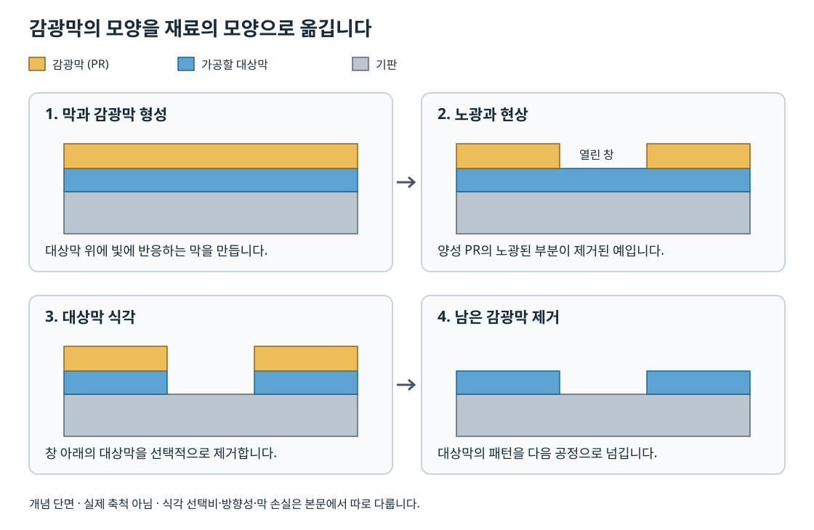

# 공정 통합과 품질 관리 | Process integration and control

[공정 목차](README.md) · [로직·DRAM·NAND·HBM의 공정 차이](10-로직과메모리의공정차이_logic-memory-integration.md)

포토·식각·증착을 각각 잘한다고 해서 회로가 저절로 완성되지는 않습니다. 앞 공정의 표면·형상·잔류물·열 이력이 다음 공정에 맞아야 합니다. 공정 통합, process integration은 이 연결을 설계하고 전기적 성능·수율·신뢰성·비용을 함께 만족시키는 일입니다.

## 1. FEOL·MOL·BEOL과 조립

| 구간 | 주된 결과물 | 앞뒤 공정과의 관계 |
| --- | --- | --- |
| FEOL, Front End of Line | 트랜지스터 등 소자의 구조 | 채널·접합·절연·게이트·응력을 형성합니다. |
| MOL, Middle of Line | 소자 단자와 배선의 접속 | 작고 저항이 낮은 contact가 필요하며 정렬·재료 계면이 중요합니다. |
| BEOL, Back End of Line | 소자 위의 다층 금속배선 | 층간 절연, via, 배선과 평탄화를 반복합니다. |
| assembly·packaging | 개별 die와 패키지의 전기·기계적 연결 | 절단·접합·외부 연결·보호·방열을 구성합니다. |

구간의 세부 경계는 사용하는 공정과 설명 체계에 따라 다를 수 있습니다. 특히 금속배선을 뜻하는 BEOL도 웨이퍼 가공이라는 큰 범위에서는 ‘전공정’에 포함될 수 있습니다. 조립·패키징을 뜻하는 후공정과 BEOL을 같은 작업으로 읽지 않습니다. [SK하이닉스의 FEOL·BEOL과 8대 공정 설명](https://news.skhynix.com/en/semiconductor-front-end-process-episode-2/)에서 이 문맥 차이를 확인할 수 있습니다.

## 2. 하나의 소자를 따라가는 공정 흐름

다음 표는 평면형 CMOS를 이해하기 위한 대표 작업의 연결입니다. 실제 업체의 양산 순서나 공정 레시피를 복제한 것이 아닙니다. 예를 들어 gate-first와 replacement metal gate는 게이트 재료를 형성하는 순서가 다릅니다.

| 단계 | 만드는 것·바꾸는 것 | 이 단계에서 다음 단계로 넘기는 조건 |
| --- | --- | --- |
| 웨이퍼 준비 | 결정·방향·도핑·표면 | 필요한 기판 성질, 평탄도와 청정도 |
| well·영역 분리 | n/p 영역과 소자 간 절연 | 접합·절연의 위치와 깊이 |
| 게이트 절연·전극 형성 | 채널을 제어하는 구조 | 계면·두께·전기적 특성 |
| 게이트 패터닝 | 게이트의 위치와 형상 | CD·overlay·잔류물·손상 |
| spacer 형성 | 게이트 옆의 간격·절연 구조 | 이후 접합·접촉과의 상대 위치 |
| 소스·드레인 형성 | 운반자를 공급·수집하는 영역 | 농도·활성화·접합·응력 |
| 접촉면·절연막 준비 | 소자 위 접속 영역 | 접촉 저항·표면·평탄도 |
| contact 형성 | 소자 단자와 초기 배선 접속 | 연결 완전성·정렬·저항 |
| 배선층 형성 | 신호와 전력의 수평 경로 | 폭·두께·간격·누설 |
| via와 다음 배선층 형성 | 층 사이의 수직 경로 | 연결 면적·충전·평탄도 |
| 보호막·외부 pad | 웨이퍼 표면과 외부 접속 | 보호·접합·검사 접근 |
| 웨이퍼 전기 검사 | die별 결과와 분류 | die 식별, 조건과 판정 이력 |
| 조립·패키징 | 패키지와 die의 연결 | 접합·열·기계적 건전성 |
| 최종 검사 | 조립 후 동작과 제품 분류 | 출하 조건과 추적 가능한 결과 |

실제 흐름을 볼 때는 순서를 외우기보다 ‘현재 노출된 재료’, ‘이번 단계가 바꾸는 치수’, ‘뒤에서 더 허용할 수 있는 온도’를 함께 표시하는 것이 유용합니다. 개별 작업의 원리는 [식각](04-식각과선택비_etching.md), [증착·이온주입](05-증착과이온주입_deposition-implantation.md), [배선](06-금속배선과평탄화_interconnect-cmp.md)에서 이어집니다.

같은 소자의 단면 변화는 [단면 아틀라스](11-단면으로보는공정흐름_cross-section-atlas.md)에서 게이트·소스·드레인·층간절연막·contact·금속 연결 순서로 비교하실 수 있습니다. 각 공정의 단면과 장비·재료·불량 사례도 이어서 연결합니다.

## 3. 감광막의 모양을 실제 재료에 옮기기

1. 기판 위에 가공할 막과 감광막을 형성합니다.
2. 양성 감광막의 예에서는 빛에 노출된 부분이 현상액에 더 잘 제거되도록 성질이 변합니다.
3. 현상으로 연 부분을 통해 아래 막을 식각합니다.
4. 남은 감광막을 제거하고 필요한 재료 패턴을 얻습니다.

그림에서 감광막이 창문 틀이고 아래 막이 가공 대상이라고 생각하시면 됩니다. 감광막 패턴이 맞아도 식각 선택비·방향성·잔류물에 따라 실제 재료의 모양은 달라집니다. [포토 장](03-포토와노광_photolithography.md)과 [식각 장](04-식각과선택비_etching.md)은 이 차이를 각각 설명합니다.

하드마스크를 쓰면 감광막의 패턴을 중간 막에 한 번 옮긴 뒤 더 깊은 구조를 식각할 수 있습니다. 추가 패턴 전사에는 선택비와 오차가 다시 누적되므로 중간 막을 쓴다는 사실만으로 최종 형상이 보장되지는 않습니다.

## 4. CD·overlay·막 두께는 다른 변수입니다

| 변수 | 뜻 | 이상이 생겼을 때 볼 현상 |
| --- | --- | --- |
| CD, critical dimension | 선폭·구멍 지름 등 기능에 중요한 치수 | 저항·누설·문턱전압·미충전·단락 |
| overlay | 서로 다른 층의 패턴이 목표 위치에 맞는 정도 | contact·via가 연결 영역을 벗어남 |
| 막 두께 | 수직 방향의 재료 두께 | 절연·저항·정전용량·응력 변화 |
| 측벽 형상 | 벽의 기울기·거칠기·국소 팽창 | 다음 막의 피복·충전·전계 집중 |
| 표면 평탄도 | 다음 공정이 만나는 높이 분포 | 초점·연마·접합의 불균일 |

한 개의 상면 SEM 사진만으로 이 변수를 모두 알 수는 없습니다. NIST의 [SEM 기반 overlay·CD 계측 연구](https://www.nist.gov/programs-projects/overlay-metrology-using-physics-and-ai-based-scanning-electron-microscopy)는 물리 모형·계측 방법·검출 한계를 함께 다룹니다. AI를 사용한 영상 판정도 어떤 결함과 크기를 검출하는지 확인해야 합니다.

## 5. 공정 사이에서 전파되는 문제

### 정렬 문제에서 접촉 저항으로

via의 지름이 규격 안에 들어와도 아래 금속과 어긋나면 실제 접촉 면적이 줄어들 수 있습니다. 이때 지름만 재는 계측으로는 원인을 놓칠 수 있습니다. overlay·접촉 저항·단면을 연결해 보아야 합니다.

### 식각 형상에서 충전 결함으로

입구가 좁고 안쪽이 넓은 구조는 입구 쪽 막이 먼저 닫히면서 내부에 void가 남기 쉽습니다. 식각 후 형상, 증착 방식과 두께, 후속 전기적 연결을 함께 비교합니다. 최종 저항이 높다는 관측만으로 증착 장비가 원인이라고 확정하지 않습니다.

### CMP에서 배선 저항으로

구리와 절연막의 제거 정도가 다르면 dishing·erosion 등으로 배선의 유효 단면이나 평탄도가 달라질 수 있습니다. 같은 저항률·길이를 가정하면 단면이 작아진 배선의 저항은 커집니다. 구체적인 CMP 현상과 재료는 [배선 장](06-금속배선과평탄화_interconnect-cmp.md)에 정리했습니다.

다음은 이 마지막 관계만 계산한 자체 예입니다. 배선의 폭과 길이·저항률은 같고 두께만 80 nm에서 60 nm로 감소한다고 가정합니다.

    R = ρL / (w × t)
    R_after / R_before = 80 / 60 = 1.333…

저항은 약 33.3% 커집니다. 이는 일정 단면·저항률을 가정한 비례 계산입니다. 실제 미세 배선의 크기 효과·접촉·방지막과 공간적인 형상 변화는 따로 평가해야 합니다.

## 6. 세정과 오염 관리

| 오염·잔류물 | 영향을 받을 수 있는 항목 | 조사할 연결 |
| --- | --- | --- |
| 입자 | 패턴 전사·국소 식각·막의 연속성 | 공정 전후 입자 검사, 위치와 크기 |
| 유기 잔류물 | 접착·막 성장·접촉 | 감광막 제거·세정 전후의 표면 |
| 금속 오염 | 누설·소자 특성·신뢰성 | 재료 이력, 표면 분석, 전기적 특성 |
| 수분·표면 산화 | 접합·접촉·전처리 | 대기 노출 시간과 다음 막 형성 |
| 공정 부산물 | 미세 구조의 막힘·잔류 연결 | 식각·세정·단면 분석 |

세정은 본체 재료를 많이 제거하지 않으면서 불필요한 물질을 제거해야 합니다. 좁고 높은 구조에서는 세정·건조 과정 자체의 표면력과 기계적 안정성도 문제가 될 수 있습니다. 용액 이름만으로 모든 오염을 같은 방법으로 처리한다고 외우지 않습니다.

웨이퍼는 운반·보관·대기 중에도 표면 상태가 바뀔 수 있습니다. 공정 이력에는 장비 안의 조건뿐 아니라 운반·보관·공정 간 대기 정보도 포함해야 합니다. 특정 약품 농도나 장비 조작 순서 대신, 이 글에서는 오염과 후속 공정의 관계를 설명합니다.

## 7. 측정 방법을 고르는 기준

| 방법 | 주로 확인하는 대상 | 해석할 때 함께 볼 조건 |
| --- | --- | --- |
| 광학 계측·타원측정 | 막 두께·광학 특성 | 재료의 광학 모형, 다층 구조, 기준 시편 |
| SEM | 상면·단면의 형상과 치수 | 충전·검출 방식·영상 모형·시편 준비 |
| TEM | 국소 단면과 계면·결정 구조 | 작은 관찰 영역, 시편 준비와 대표성 |
| AFM | 표면 높이·거칠기 | 탐침 형상·스캔 범위·표면 접근성 |
| 전기적 구조 | 접촉·배선 저항, 누설·정전용량 | 구조의 설계값, 온도, 접촉·배선 보정 |
| 성분·깊이 분석 | 원소 분포·계면·잔류물 | 분해능, 표준 시료, 파괴 여부 |

측정값은 장비 화면에 나온 숫자 하나로 끝나지 않습니다. 동일한 위치·방향·분석 모형에서 비교하는지, 표본이 웨이퍼 전체와 여러 lot를 대표하는지, 측정 오차와 공정 변동을 구분할 수 있는지가 중요합니다. [NIST의 계측 불확도와 공정 제어 설명](https://www.nist.gov/publications/metrology-and-process-control-dealing-measurement-uncertainty)은 측정 오차가 합격·불합격 판단과 피드백에 미치는 영향을 다룹니다.

## 8. 규격 한계와 관리 한계

규격 한계, specification limits는 제품이나 다음 공정이 허용하는 범위입니다. 관리 한계, control limits는 안정된 공정의 변동을 바탕으로 이상 변화를 감시하기 위해 정합니다. 두 범위는 같은 목적이 아닙니다.

규격 안의 값도 공정 평균의 이동을 알리는 신호일 수 있습니다. 반대로 안정적으로 반복되는 공정도 요구 규격을 만족하지 못할 수 있습니다. 관측한 이상 신호에 어떻게 대응할지 조사·보류·재측정·원인 확인의 기준을 정해야 합니다. [NIST 관리도 분류](https://www.itl.nist.gov/div898/handbook/pmc/section3/pmc3.htm)는 연속형·계수형·다변량 자료에 맞는 방법을 나눕니다.

### 공정능력의 자체 계산

막 두께 규격을 97~103 nm, 안정된 공정의 평균을 101 nm, 공정 표준편차를 0.5 nm라고 가정합니다. 정규분포와 신뢰할 수 있는 추정이라는 조건에서 단순 지수를 계산합니다.

    Cp = (USL − LSL) / (6σ)
       = (103 − 97) / (6 × 0.5) = 2

    Cpk = min[(USL − μ)/(3σ), (μ − LSL)/(3σ)]
        = min[2/1.5, 4/1.5] = 1.333…

Cp는 규격 폭과 분포 폭의 비를, Cpk는 평균이 가까운 규격 경계까지의 여유도 함께 나타냅니다. 같은 표준편차에서 평균이 102 nm로 이동하면 Cpk는 약 0.667로 감소합니다.

이 예의 표준편차는 원자료에서 추정한 값이 아니라 가정한 입력입니다. 실제 분석에서는 시간 흐름·하위집단·표본 수·독립성·분포를 먼저 확인해야 합니다. 지수 하나를 전체 제품 수율이나 장기 불량률로 곧바로 바꾸지 않습니다. 정의와 조건은 [NIST Process Capability](https://www.itl.nist.gov/div898/handbook/pmc/section1/pmc16.htm)의 양측 규격 지수 부분에 근거합니다.

## 9. 측정 불확도가 있는 경계값

선폭 규격이 30~33 nm이고 측정값이 32.8 nm라고 가정합니다. 그 결과에 붙는 확장불확도가 ±0.4 nm이면 단순 구간은 32.4~33.2 nm입니다. 중심값은 규격 안이지만 이 구간은 상한을 넘습니다.

이 경우 ‘소자가 확실히 규격 밖’이나 ‘확실히 합격’이라고 단정하는 대신 적용한 판정 규칙이 필요합니다. 보수적인 수락 구간, 재측정, 추가 계측, 보류 중 무엇을 사용할지 요구사항과 오수락·오거절 위험에 맞춰 정합니다. 불확도 구간을 가능한 모든 참값의 절대 경계라고 읽어서도 안 됩니다.

숫자는 경계 판단을 설명하기 위해 구성했습니다. 계측의 정밀도·오차·교정·불확도는 [단위와 측정 불확도 해설](../전자컴퓨터공학_ece/06-수식과코드_math-to-code/해설_notes/단위차원측정불확도_units-dimensional-analysis-uncertainty.md)로 이어서 공부하실 수 있습니다.

## 10. 원인을 분리하는 기록과 비교

최종 불량을 공정에 연결하려면 아래 정보를 같은 식별 체계로 묶어야 합니다.

- lot·wafer·die·측정 위치와 공정 시점
- 장비·chamber·소모품과 정비 이력
- recipe와 분석 모형의 판본
- 입력 재료·이전 공정과 대기 이력
- 측정 조건·판정 기준·원자료
- 재작업·재검사·제외 자료의 이유

‘새 장비를 쓴 lot의 수율이 높다’는 관측만으로 장비 효과라고 확정하지 않습니다. 제품 설계·재료·다른 공정·시험 기준이 함께 바뀌었을 수 있습니다. 비교할 요인을 나누고 동일 조건의 대조, 반복, 위치·lot 간 변동을 확인해야 합니다.

작은 표본으로 lot를 수락하는 목적과 전체 공정의 품질을 추정하는 목적도 구별합니다. [NIST Acceptance Sampling](https://www.itl.nist.gov/div898/handbook/pmc/section2/pmc21.htm)은 표본에 따른 lot 처분 결정과 품질 추정의 차이를 설명합니다.

## 11. 확인 문제와 해답

1. BEOL과 패키징을 같은 단계로 부르면 무엇을 구별하기 어려워지나요?
2. via 지름이 정상이지만 저항이 높습니다. 추가로 볼 변수 두 가지를 골라 보세요.
3. 폭·길이·저항률이 같은 배선의 두께가 절반이 되면 저항은 어떻게 되나요?
4. 관리도에 이상 신호가 없으면 제품 규격을 반드시 만족하나요?
5. 앞의 Cp·Cpk 계산에서 평균이 100 nm이면 Cpk는 얼마인가요?
6. 측정값 32.8 ± 0.4 nm를 실제 선폭이 반드시 그 구간 안에 있다는 뜻으로 읽을 수 있나요?

해답

1. 웨이퍼 위의 다층 배선 형성과 die 조립·외부 연결·보호를 혼동하게 됩니다.
2. 아래 금속과의 overlay, 접촉면·잔류물, 내부 void·단면, 시험 접촉 조건 등이 후보입니다. 관측만으로 단일 원인을 확정하지 않습니다.
3. 일정 단면 모형에서는 두 배입니다.
4. 아닙니다. 안정성과 규격 적합성은 다른 질문입니다.
5. min[3/1.5, 3/1.5] = 2입니다. 분포가 규격 중앙에 놓입니다.
6. 아닙니다. 불확도의 정의·포함 조건과 판정 규칙을 확인해야 합니다.

## 출처와 확인 범위

| 자료 | 읽은 범위 |
| --- | --- |
| [SK hynix, Front-End Process Episode 2, 2022-12-21](https://news.skhynix.com/en/semiconductor-front-end-process-episode-2/) | FEOL·BEOL, 반복 작업과 8개 분류 |
| [NIST, Overlay Metrology Using Physics and AI-Based SEM](https://www.nist.gov/programs-projects/overlay-metrology-using-physics-and-ai-based-scanning-electron-microscopy) | Overview·Approach의 계측 대상과 검출 한계 |
| [NIST, Metrology and process control](https://www.nist.gov/publications/metrology-and-process-control-dealing-measurement-uncertainty) | 공개 초록의 불확도·규격·오판정·피드백 관계 |
| [NIST e-Handbook 6.3](https://www.itl.nist.gov/div898/handbook/pmc/section3/pmc3.htm) | 관리도 자료형 분류 |
| [NIST e-Handbook 6.1.6](https://www.itl.nist.gov/div898/handbook/pmc/section1/pmc16.htm) | Cp·Cpk 정의와 안정성·정규성 조건 |
| [NIST e-Handbook 6.2.1](https://www.itl.nist.gov/div898/handbook/pmc/section2/pmc21.htm) | acceptance sampling의 목적 |

확인일은 2026-10-26입니다. 개별 공정의 재료·장비 근거는 각 공정 장으로 연결했습니다. 비례·공정능력·불확도 예제는 가정한 입력으로 구성한 계산입니다.

## English

Process integration connects material, geometry, thermal history and surface conditions across FEOL, MOL, BEOL and assembly. This chapter follows a conceptual CMOS flow, distinguishes CD, overlay and thickness, and traces faults across pattern transfer, fill and CMP. Worked examples separate resistance scaling, capability indices and uncertain measurements. Control limits, specification limits and lot-acceptance decisions answer different questions.
