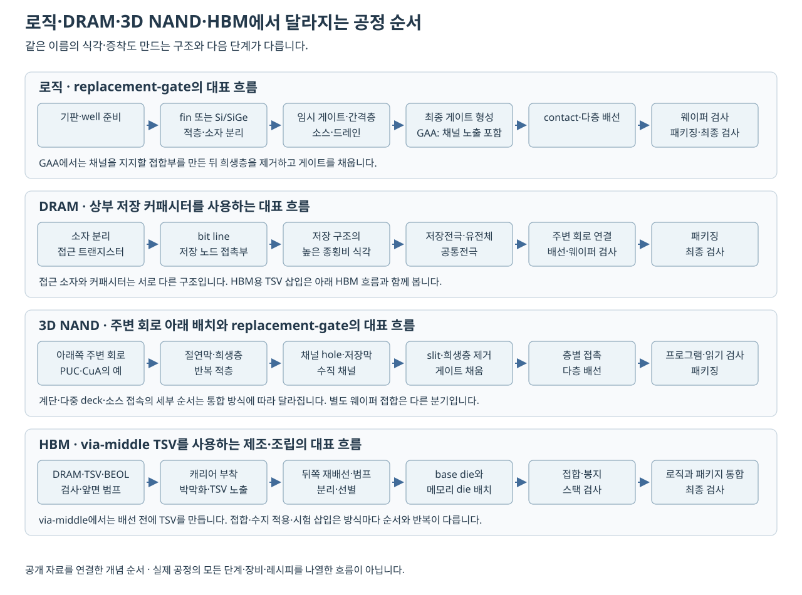

# 로직·DRAM·NAND·HBM의 공정과 단면 비교 | Logic, DRAM, NAND and HBM process comparison

[공정 목차](README.md) · [공정 통합과 품질 관리](09-공정통합과품질관리_integration-process-control.md)

CPU·DRAM·NAND는 모두 포토·식각·증착·배선 등을 이용하지만, 만들려는 구조와 성능 목표가 다릅니다. 이 차이를 알면 ‘모든 반도체는 평면형 트랜지스터를 같은 순서로 만든다’는 오해를 피할 수 있습니다.

HBM은 DRAM 셀을 만드는 공정에 TSV·박막화·다이 접합·검사가 더해진 제품입니다. 따라서 로직·DRAM·NAND의 소자 제조와 HBM의 적층·패키지 통합을 같은 높이의 단일 작업으로 비교하기보다, 어느 단계까지의 구조를 보는지 먼저 맞추어야 합니다.

이 글에서는 전체 차이를 먼저 보고 다음 본문에서 단계별 단면과 공식 도면을 읽습니다.

| 자세히 볼 대상 | 이어서 읽을 본문 |
| --- | --- |
| fin과 sheet의 게이트 단면, 임시 게이트 교체와 채널 노출 | [FinFET·GAA 공정과 단면](12-FinFET과GAA의공정단면_finfet-gaa-integration.md) |
| 접근 트랜지스터·커패시터, 수직 채널·저장막·계단 | [DRAM·3D NAND 공정과 단면](13-DRAM과3DNAND의공정단면_dram-3d-nand-integration.md) |
| TSV를 만드는 시점, 뒤쪽 노출, 접합·봉지와 로직 연결 | [HBM의 TSV·적층 공정](14-HBM의TSV와적층공정_hbm-tsv-stacking.md) |

## 1. 무엇을 만드는지 먼저 비교합니다

| 대상 | 대표적인 핵심 구조 | 제조에서 중요해지는 문제 |
| --- | --- | --- |
| 디지털 로직 | 논리 게이트·레지스터·배선 | 전류 구동·누설·지연·전력·배선 밀도 |
| SRAM | 여러 트랜지스터로 구성한 상태 유지 셀 | 셀 면적·읽기/쓰기 안정성·소자 간 변동 |
| DRAM | 접근 트랜지스터와 저장 커패시터 | 작은 면적의 정전용량·누설·접근 저항·균일성 |
| NAND | 전하 저장에 따라 문턱전압이 바뀌는 셀과 직렬 string | 저장막·깊은 채널·층별 접속·분포와 신뢰성 |
| HBM 패키지 | DRAM die와 연결·적층·외부 인터페이스 | TSV·접합·전력·열·검사·조립 수율 |

DRAM의 1T1C 구조와 refresh는 [삼성전자 DRAM 설명](https://semiconductor.samsung.com/dram/)에서, NAND의 셀·적층·주변 회로 구조는 [SK하이닉스 4D NAND 기술 설명](https://news.skhynix.com/en/how-sk-hynixs-advanced-4d-nand-technologies-are-overcoming-stacking-limitations/)에서 확인했습니다. 위 표는 구조와 공정의 연결을 학습하기 위해 정리한 것입니다.

### 대표 공정의 순서를 나란히 보면

그림은 공개 자료의 공정 모듈을 연결한 대표 예입니다. 로직은 임시 게이트를 최종 게이트로 교체하는 흐름, DRAM은 소자 위에 저장 커패시터를 만드는 흐름, NAND는 주변 회로를 아래에 두고 희생층을 게이트로 바꾸는 흐름, HBM은 via-middle TSV를 사용하는 흐름입니다. 세부 패턴·세정·열처리·검사는 묶어서 표시했습니다. 실제 순서의 분기는 위 심화 본문에서 따로 설명합니다.

| 대상 | 순서가 달라지는 핵심 이유 | 앞 단계에서 넘겨야 할 구조·조건 |
| --- | --- | --- |
| FinFET·GAA 로직 | 최종 게이트를 넣을 공간과 소스·드레인 접합을 준비해야 합니다. GAA에서는 임시 구조가 지지하던 채널도 노출해야 합니다. | 채널 형상, 간격층, 소스·드레인, 선택 식각으로 보존할 표면과 게이트 충전 공간입니다. |
| DRAM | 접근 소자와 작은 면적에 큰 정전용량을 확보할 저장 구조를 연결해야 합니다. | bit line과 저장 노드가 서로 다른 경로로 접속하고, 높은 저장 전극의 모양·유전체·누설이 맞아야 합니다. |
| 3D NAND | 반복 적층 안의 많은 셀을 수직 채널과 층별 게이트에 연결해야 합니다. | 깊은 hole의 형상, 채널·저장막의 연속성, 옆에서 희생층을 제거할 접근로, 각 층 접촉부입니다. |
| HBM | DRAM 다이 내부의 회로와 다이 사이 접속을 함께 준비해야 합니다. | TSV 충전·뒤쪽 노출, 얇은 다이의 취급, 선별 결과·정렬·접합면과 스택 검사 접근입니다. |

공정 모듈의 근거는 [imec의 nanosheet 통합 설명](https://www.imec-int.com/en/articles/entering-nanosheet-transistor-era-0), [Micron의 charge-trap·replacement-gate·CuA 설명](https://www.micron.com/products/storage/nand-flash/176-layer-nand), [SK하이닉스의 TSV 패키지 공정 설명](https://news.skhynix.com/en/semiconductor-back-end-process-episode-8-the-process-stages-of-wafer-level-packages/)과 각 심화 본문의 원논문·공식 도면입니다. TSV 공정 설명의 via-middle 예에서는 TSV 식각·Cu 충전·CMP가 BEOL 금속배선 전에 들어갑니다.

### 같은 단면 방향에서 비교해야 보이는 차이

| 도면 | 잘라서 보거나 확대할 위치 | 읽을 때 구분할 부분 |
| --- | --- | --- |
| FinFET·GAA | 게이트 위치에서 전류 방향에 수직인 면과, 소스–드레인 방향의 면 | 전자는 채널을 감싸는 면을, 후자는 채널·접합·spacer의 상대 위치를 보여 줍니다. |
| DRAM | 접근 소자·저장 노드 접촉부·저장 커패시터의 각 단면 | 서로 다른 절단 위치를 한 그림에 모은 설명도 있습니다. bit line과 저장 노드가 같은 금속선이라는 뜻은 아닙니다. |
| 3D NAND | 여러 word line을 가로지르는 수직 채널 단면과 한 셀 높이의 가로 단면 | 세로로는 string과 층별 게이트를, 가로로는 채널 둘레의 터널 절연막·전하 저장막·게이트 관계를 봅니다. |
| HBM | 여러 다이·TSV·접합부를 지나는 패키지 단면 | 한 DRAM 셀의 확대도와 축척이 다릅니다. TSV는 다이 안, 접합부는 다이 사이에 있습니다. |

이 구분은 공식 그림을 읽기 위한 관찰 기준입니다. FinFET의 fin, NAND의 수직 채널, HBM의 TSV가 모두 길고 가늘게 보이더라도 각각 트랜지스터 몸체·전류 통로·금속 접속이라는 역할은 다릅니다.

## 2. 로직: 전기장을 제어하면서 연결 밀도를 높입니다

로직은 원하는 논리 상태를 정해진 시간 안에 전달해야 합니다. 트랜지스터가 충분한 전류를 흘리는지, 꺼진 상태의 누설이 적은지, 배선과 다음 게이트의 정전용량을 얼마나 빨리 충·방전하는지가 함께 중요합니다.

평면형 채널을 짧게 만들면 게이트 이외의 전극도 채널 전위에 더 큰 영향을 줄 수 있습니다. FinFET·GAA는 채널을 여러 방향에서 둘러싸 게이트의 제어력을 확보하려는 구조입니다. 채널을 입체적으로 만든 만큼 형상·계면·막 두께·응력의 제어가 더 어려워집니다.

GAA nanosheet의 대표적인 설명에서는 서로 다른 재료를 교대로 형성한 구조에서 일부 재료를 선택적으로 제거해 채널을 노출합니다. 이후 좁은 공간에 게이트 절연막과 전극을 형성합니다. 이때 아래 조건이 함께 필요합니다.

- 제거하려는 재료와 남길 채널 사이의 충분한 식각 선택비
- 채널 두께·폭·표면 손상과 기계적 안정성
- 위·옆·아래 면을 따라 필요한 성질로 형성되는 절연막과 전극
- 소스·드레인·spacer·contact와의 정렬 및 저항

공정 간 관계는 [선택적 식각](04-식각과선택비_etching.md), [단차 피복과 증착](05-증착과이온주입_deposition-implantation.md), [게이트 절연막](02-산화와게이트절연막_oxidation-gate-dielectrics.md)에서 다룹니다.

### 공식 적용 이력과 공정 원리

삼성전자는 [2022-06-30 공식 발표](https://semiconductor.samsung.com/news-events/news/samsung-begins-chip-production-using-3nm-process-technology-with-gaa-architecture/)에서 nanosheet 기반 GAA의 초기 생산을 알렸습니다. TSMC는 [2025 연차보고서의 주주서한](https://investor.tsmc.com/static/annualReports/2025/english/index.html)에서 N2가 2025년 4분기에 대량생산에 들어갔다고 보고했습니다.

이는 각각의 공개된 적용 이력입니다. 같은 노드 이름을 가진 서로 다른 회사 공정의 소자 크기·수율·비용이 같다는 근거가 되지는 않습니다. 신뢰할 수 있는 비교에는 실제 구조·설계 조건·측정 항목이 필요합니다.

## 3. SRAM: 공정 변동이 상태 안정성과 만납니다

일반적인 6T SRAM 셀은 두 인버터와 접근 트랜지스터를 이용합니다. 전원이 공급되는 동안 피드백으로 상태를 유지합니다. DRAM의 저장 커패시터와 같은 방식으로 주기적인 refresh를 하는 구조는 아닙니다.

셀을 작게 만들면 밀도는 높아질 수 있지만, 읽는 동안 원래 상태를 유지하는 힘과 쓰는 동안 상태를 바꾸는 힘의 관계를 맞추어야 합니다. 같은 설계값을 목표로 해도 실제 소자의 문턱전압·전류·기생 성분이 분포하므로 대표 소자 한 개만으로 전체 배열의 안정성을 판단할 수 없습니다.

이 관점에서는 ‘더 작은 트랜지스터를 만들었다’와 ‘수많은 SRAM 셀이 필요한 전압에서 동작한다’가 다른 성과입니다. 재료·공정·회로 설계·검사를 함께 보아야 합니다. SRAM과 DRAM의 기본 역할 차이는 [삼성전자 DRAM의 SRAM 비교 부분](https://semiconductor.samsung.com/dram/)과 연결됩니다.

## 4. DRAM: 작은 바닥 면적에서 전하를 저장합니다

대표적인 DRAM 셀은 접근 트랜지스터 하나와 커패시터 하나로 구성합니다. word line으로 접근을 제어하고 bit line을 통해 작은 전하 차이를 읽습니다. 읽기에는 감지와 복원이 필요하며, 누설 때문에 저장 상태를 주기적으로 복원하는 refresh가 필요합니다.

정전용량의 단순 평행판 모형은 다음과 같습니다.

    C = εA / t

ε는 유전율, A는 마주 보는 유효 면적, t는 유전체 두께입니다. 실제 커패시터는 입체 구조이고 전계도 균일하지 않을 수 있지만, 작은 평면 면적에서 C를 확보해야 하는 이유를 이해하는 데 도움이 됩니다.

공정에서는 유전체만 계속 얇게 만드는 대신 입체적인 표면적·재료·전극을 함께 설계합니다. 깊거나 높은 구조에서는 식각 형상, ALD 피복, 막 결함, 기계적 안정성, 누설이 서로 연결됩니다. ‘게이트를 잘 만들면 DRAM도 완성된다’고 할 수 없는 이유입니다.

### 전하와 유지 시간의 자체 계산

C = 20 fF, 전압 차이 1 V를 가정하면 저장 전하량은 다음과 같습니다.

    Q = CV = 20 × 10⁻¹⁵ C

전자 전하량 크기를 약 1.60 × 10⁻¹⁹ C로 두면 약 125,000개 전자의 전하에 해당합니다.

이번에는 허용 전압 감소를 0.1 V, 일정한 누설 전류를 100 fA라고 가정합니다.

    Δt = CΔV / I
       = (20 × 10⁻¹⁵ × 0.1) / (100 × 10⁻¹⁵)
       = 0.02 s = 20 ms

이 값은 실제 DRAM의 refresh 규격이 아닙니다. 일정한 C와 누설을 정한 교육용 계산이며, 실제 판단에는 온도·셀 분포·감지 여유·동작 이력·제품 규격이 필요합니다. 누설을 200 fA로 바꾸면 같은 모형의 시간은 10 ms로 줄어듭니다.

## 5. 3D NAND: 깊은 채널과 많은 층을 함께 만듭니다

NAND는 저장된 전하에 따라 달라진 문턱전압을 읽는 비휘발성 메모리입니다. floating-gate와 charge-trap 같은 구현을 구별해야 합니다. 모든 세대의 저장 구조를 같은 금속 부유 게이트라고 설명하지 않습니다.

3D NAND에서는 여러 층을 쌓은 구조를 관통하는 수직 채널과 각 층의 게이트를 형성합니다. 한 셀씩 별도 칩으로 만든 뒤 쌓는 방식과 다릅니다. 층수가 늘어나면 다음 문제가 중요해집니다.

| 공정 문제 | 생기는 이유 | 이어지는 요구 |
| --- | --- | --- |
| 깊은 구멍의 형상 | 입구와 바닥의 반응·수송 조건이 다릅니다. | 종횡비·측벽·바닥 도달·선택비 제어 |
| 내부 막의 균일성 | 좁은 공간 전체에 재료가 도달해야 합니다. | 피복·막 결함·두께 분포 제어 |
| 층별 접속 | 각 word line에 전압을 연결해야 합니다. | 계단형 접속 등 구조와 정렬 |
| 다중 deck 연결 | 한 번에 가공하기 어려운 높이를 나누어 형성합니다. | deck 사이 정렬·채널 연결 |
| 응력·휨 | 많은 막과 열 이력이 기계적으로 상호작용합니다. | 웨이퍼 형상·막 응력·후속 공정 여유 |

SK하이닉스의 [2023년 적층 기술 설명](https://news.skhynix.com/en/how-sk-hynixs-advanced-4d-nand-technologies-are-overcoming-stacking-limitations/)은 plug·word-line staircase·PUC와 CTF 관련 구조를 다룹니다. 그 문서의 특정 층수나 한 번에 식각하는 층수를 모든 제품·시대에 적용하는 장비 한계로 일반화하지 않습니다.

[SK하이닉스의 차세대 메모리 연구 소개](https://research.skhynix.com/research-areas/future-memory-technologies/revolutionary-memory)는 고종횡비 가공과 막 응력을 NAND의 연구 과제로 설명합니다. 연구 방향과 특정 제품의 양산 결과는 구분해야 합니다.

### 종횡비의 자체 계산

깊이 8 µm, 지름 80 nm인 구멍을 가정합니다.

    8 µm = 8,000 nm
    AR = 8,000 / 80 = 100

같은 지름으로 깊이만 16 µm가 되면 AR은 200입니다. 깊이뿐 아니라 반응물의 도달, 부산물의 배출, 측벽 보호, 이온 방향성과 charging도 고려해야 하므로 공정 시간을 두 배로 늘리는 것만으로 같은 형상을 얻는다고 할 수 없습니다.

### 한 셀에 여러 비트를 저장할 때

b비트를 저장하려면 구별 가능한 상태가 2의 b제곱 개 필요합니다. SLC는 2개, TLC는 8개, QLC는 16개입니다.

첫 상태와 마지막 상태의 문턱전압 중심 간 거리를 2.8 V로 고정하고 중심을 등간격으로 둔 교육용 모형을 가정합니다.

    TLC: 2.8 / (8 − 1) = 0.4 V
    QLC: 2.8 / (16 − 1) ≈ 0.187 V

같은 폭에 더 많은 상태를 넣을수록 상태 간 간격이 작아집니다. 실제 분포는 이 예처럼 선형·등간격일 필요가 없으며, 프로그램·보존·읽기·오류정정과 함께 설계합니다. 공정 변동을 평균 하나만으로 판단하기 어려운 이유를 보여 주는 계산입니다.

## 6. HBM의 적층과 NAND의 적층

왼쪽은 charge-trap NAND의 저장막과 수직 채널을, 오른쪽은 세 장의 메모리 다이와 base die를 가정한 HBM을 단순화한 자체 그림입니다. 오른쪽의 실리콘 인터포저는 HBM 스택을 옆의 로직과 연결하는 한 가지 패키지 예입니다. 그 인터포저를 각 메모리 다이 사이의 접합층으로 읽으면 안 됩니다.

| 비교 | 3D NAND | HBM |
| --- | --- | --- |
| 쌓는 대상 | 웨이퍼 내부의 메모리 셀 구조·층 | 제조한 DRAM die 등 |
| 핵심 연결 | 수직 채널·층별 word line·주변 회로 | TSV·die 간 접합·패키지 연결 |
| 주요 제조 문제 | 깊은 식각·내부 막·접속·응력 | 박막화·정렬·접합·열·전기 검사 |
| 제품 성격 | 비휘발성 저장 메모리 | 넓은 인터페이스로 연결한 DRAM 계열 |

‘3D’라는 말만으로 두 기술을 같은 공정이라고 이해하지 않습니다. HBM의 접합 구조와 제품별 공식 적용은 [첨단 패키징 장](08-패키징과첨단집적_packaging.md)에서, 시스템 관점은 [HBM 용량과 열 리뷰](../제품기술분석_product-technology/반도체와산업컴퓨팅_chips-industrial/고대역폭메모리의용량과열_hbm.md)에서 이어집니다.

NAND의 층수는 반복되는 word-line 셀 구조와 관련되고, HBM의 8H·12H 같은 표기는 메모리 다이 적층 수와 관련됩니다. GAA에서 여러 sheet를 쌓는 것은 한 트랜지스터의 채널 구성입니다. DRAM 커패시터가 높아지는 것도 여러 완성 다이를 쌓는 작업과 다릅니다. 또한 별도 웨이퍼에서 NAND 배열과 주변 회로를 만든 뒤 접합하는 방식은, 배열 자체의 셀 적층과 추가로 구분해야 합니다. 도면별로 무엇을 세는지 확인해야 같은 ‘적층’이라는 말을 혼동하지 않습니다.

## 7. 같은 공정 이름, 다른 목표

| 공정 | 로직의 예 | DRAM의 예 | NAND의 예 | HBM에서 더해지는 예 |
| --- | --- | --- | --- | --- |
| 포토 | 게이트·contact·미세 배선의 패턴 | 반복 셀·주변 회로·접속 | channel hole·계단·주변 회로 | TSV·RDL·범프의 위치 |
| 식각 | fin·spacer·선택적 채널 노출 | 저장 구조·접촉 형성 | 높은 종횡비의 채널·slit | TSV 구멍·뒤쪽 노출과 절연막 개방 |
| 증착·충전 | high-k·금속 게이트·절연막 | 커패시터 유전체·전극 | 반복 적층·전하 저장 관련 막 | TSV 절연막·배리어·시드·Cu와 접속 금속 |
| 도핑·열처리 | 접합·접촉·소자 특성 | 접근 소자·주변 회로·접촉 | 주변 회로·접촉 등 | DRAM 회로 제조와 접합 이후의 열예산을 함께 봅니다. |
| 검사 | 기능·지연·전력·결함 모델 | 셀 동작·유지·속도·수리 가능성 | 프로그램·읽기·분포·오류 특성 | 선별 다이·TSV·다이 간 연결·스택 동작·열과 조립 후 변화 |

각 칸은 대표적인 연결이지 공정 전체 목록은 아닙니다. 센서·아날로그·고전압·전력반도체에는 또 다른 재료·치수·절연·신뢰성 목표가 있습니다. 모든 제품에 가장 작은 로직 노드를 적용하는 것이 최선이라는 결론은 나오지 않습니다.

## 8. 공정·설계·검사의 공동 판단

더 얇은 막, 더 높은 구조, 더 작은 pitch는 각각 장점과 비용을 만듭니다. 설계가 요구하는 성능과 공정이 안정적으로 만드는 분포가 맞아야 하며, 시험에서 그 차이를 확인할 수 있어야 합니다.

검토할 때는 목표 항목을 구분해 적는 것이 좋습니다.

1. 로직에서는 어떤 전압·부하·배선 조건의 지연과 전력을 줄이려는지 적습니다.
2. DRAM에서는 어떤 면적·온도·유지 조건에서 전하와 감지 여유를 확보하려는지 적습니다.
3. NAND에서는 어떤 상태 수·적층·보존·읽기 조건의 분포를 관리하려는지 적습니다.
4. 패키징에서는 어떤 die 조합·연결·전력·열 조건에서 조립과 검사를 구성하는지 적습니다.

이렇게 목적을 정하면 노드 이름·층수·대역폭 중 하나만 보고 기술 전체를 평가하는 일을 줄일 수 있습니다.

## 9. 확인 문제와 해답

1. 로직용 GAA를 만들 수 있으면 DRAM 커패시터 공정도 저절로 해결되나요?
2. 앞의 DRAM 계산에서 누설 전류가 절반이 되면 모형의 유지 시간은 어떻게 되나요?
3. 깊이 12 µm, 지름 60 nm인 구멍의 종횡비는 얼마인가요?
4. TLC가 3비트를 저장할 때 문턱전압 상태가 3개가 아닌 이유는 무엇인가요?
5. NAND 셀의 수직 적층과 HBM die 적층의 차이를 설명해 보세요.
6. N2 대량생산이라는 공식 보고로 다른 회사의 비슷한 이름 공정보다 높은 수율이라고 판단할 수 있나요?

해답

1. 아닙니다. 저장 정전용량·누설·입체 형상·전극·유전체와 배열 특성을 별도로 만족해야 합니다.
2. 일정 누설 모형에서는 20 ms에서 40 ms로 두 배가 됩니다.
3. 12,000/60 = 200입니다.
4. 3비트 조합이 000부터 111까지 8개이기 때문입니다.
5. 웨이퍼 내부의 셀 구조 형성과 제조한 die들의 접합을 구분합니다.
6. 아닙니다. 발표한 적용 단계와 회사 간 동일 조건의 수율 비교는 다른 근거가 필요합니다.

## 출처와 확인 범위

| 자료 | 확인한 부분 |
| --- | --- |
| [Samsung DRAM](https://semiconductor.samsung.com/dram/) | FAQ의 1T1C·refresh·SRAM 차이 |
| [Samsung GAA 발표, 2022-06-30](https://semiconductor.samsung.com/news-events/news/samsung-begins-chip-production-using-3nm-process-technology-with-gaa-architecture/) | nanosheet GAA 적용과 초기 생산 |
| [TSMC 2025 Annual Report](https://investor.tsmc.com/static/annualReports/2025/english/index.html) | 주주서한의 N2 대량생산 시점 |
| [SK hynix 4D NAND 설명, 2023-12-19](https://news.skhynix.com/en/how-sk-hynixs-advanced-4d-nand-technologies-are-overcoming-stacking-limitations/) | 적층·plug·계단·주변 회로·CTF 관련 구조 |
| [SK hynix Revolutionary Memory](https://research.skhynix.com/research-areas/future-memory-technologies/revolutionary-memory) | Future DRAM·Future NAND의 구조·재료·공정 연구 과제 |
| [Micron 176-layer NAND](https://www.micron.com/products/storage/nand-flash/176-layer-nand) | 본문의 replacement-gate·charge-trap·CMOS-under-array 결합입니다. 해당 세대의 기술 설명이며 최신 층수 순위로 사용하지 않았습니다. |
| [imec, Entering the nanosheet transistor era](https://www.imec-int.com/en/articles/entering-nanosheet-transistor-era-0) | 2022-02-11, Critical nanosheet building blocks의 Si/SiGe·inner spacer·release·RMG 연결입니다. |
| [SK hynix Episode 8](https://news.skhynix.com/en/semiconductor-back-end-process-episode-8-the-process-stages-of-wafer-level-packages/) | 2023-10-05, TSV Package Process·Figure 6의 via-middle 정의와 앞면 범프·캐리어·뒤쪽 가공 순서입니다. |

확인일은 2026-10-26입니다. 제조·접합의 세부 근거는 연결한 공정 본문에도 있습니다. 전하·누설·종횡비·상태 간격 계산은 이 글에서 구성한 가정 예제입니다.

## English

Logic, SRAM, DRAM and NAND share fabrication methods but target different structures and distributions. The comparison connects replacement gates, storage capacitors, vertical NAND strings and via-middle TSV integration in HBM. Separate guides examine FinFET/GAA sections, DRAM/3D NAND integration, and HBM thinning, bonding and package assembly with official figures. Worked examples use stated assumptions rather than product specifications.
