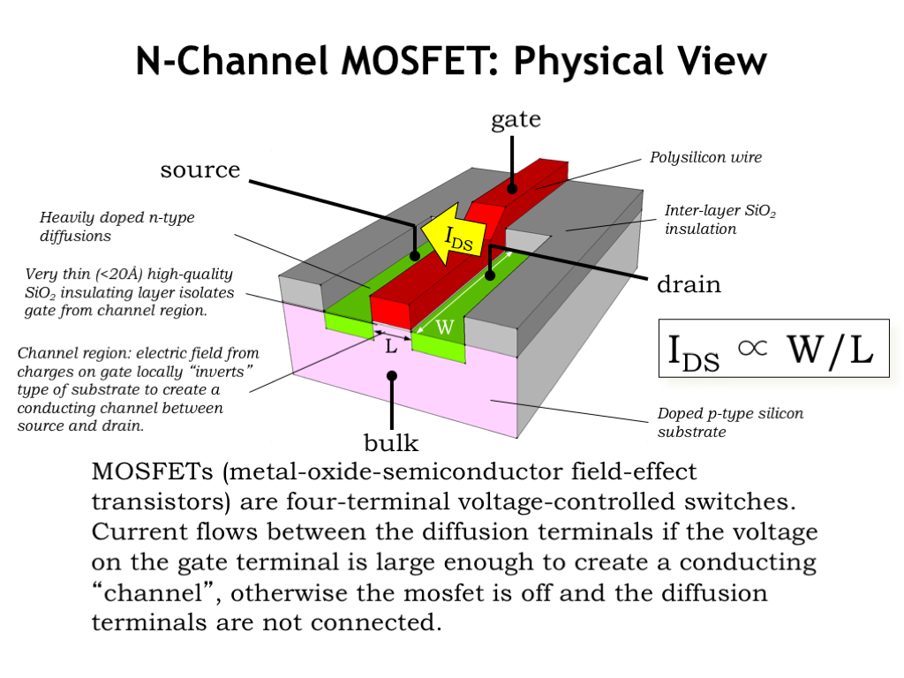
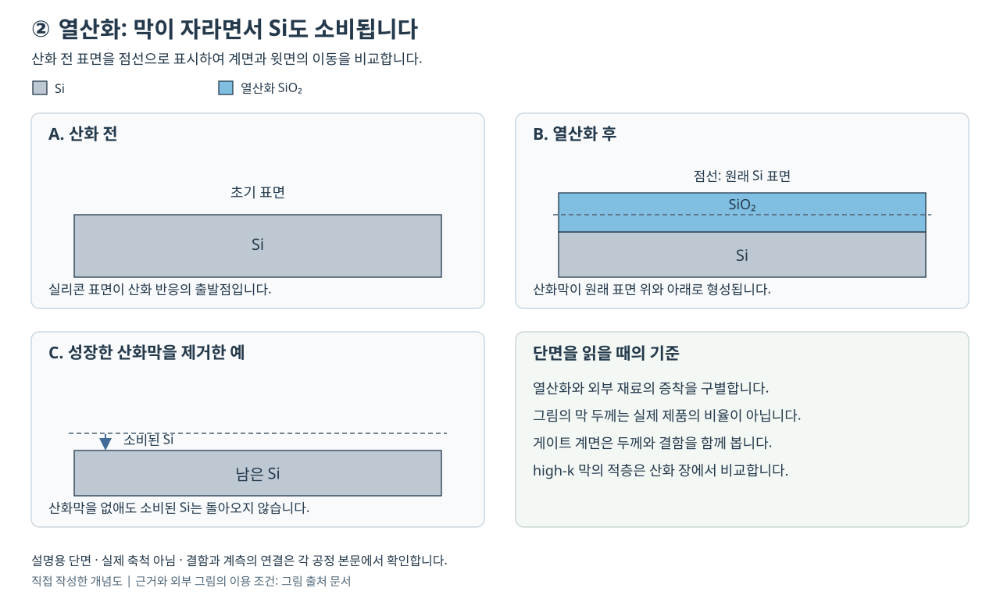
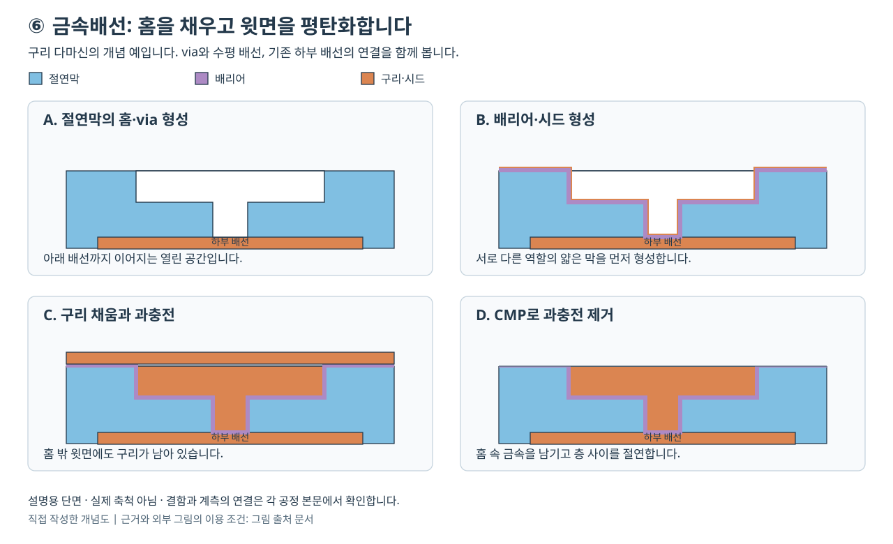
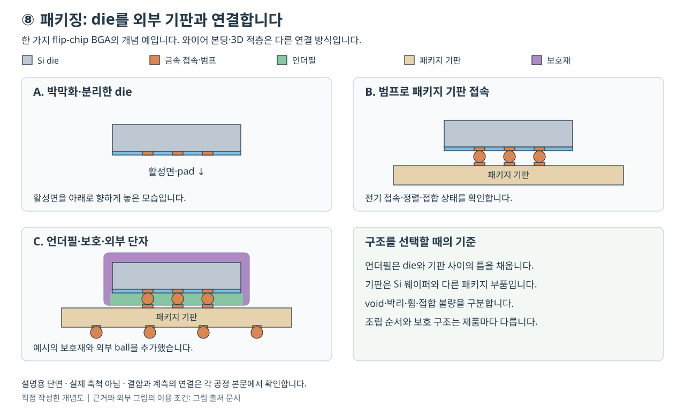

# 단면으로 보는 공정 흐름 | Fabrication cross-section atlas

[공정 목차](README.md) · [공정 통합과 품질 관리](09-공정통합과품질관리_integration-process-control.md) · [그림 출처와 원문](그림_figures/출처와이용조건_SOURCES.md)

어떤 막이 늘고 줄었는지, 어느 영역이 열렸는지, 어떤 단자가 연결되었는지를 단면으로 따라갑니다. 먼저 같은 평면형 소자에서 이어지는 변화를 보고, 각 공정의 대표 단면과 장비·재료·결함 사례를 연결합니다.

이 예와 다른 제품 구조는 [로직·DRAM·NAND·HBM의 공정과 단면 비교](10-로직과메모리의공정차이_logic-memory-integration.md)에서 이어집니다. [FinFET·GAA](12-FinFET과GAA의공정단면_finfet-gaa-integration.md), [DRAM·3D NAND](13-DRAM과3DNAND의공정단면_dram-3d-nand-integration.md), [HBM 적층](14-HBM의TSV와적층공정_hbm-tsv-stacking.md)의 본문에는 각 구조의 공식 그림과 단계별 공정 설명을 연결했습니다.

## 한 소자에서 게이트·접촉·배선이 이어지는 모습

이 그림은 같은 소자의 위치를 유지한 자체 개념도입니다. A의 얇은 절연막 위에 B의 게이트 전극을 만들고, C에서 소스·드레인 영역을 형성합니다. D에서는 소자를 덮는 절연막과 평탄한 공정 표면을 준비합니다. E의 창은 각 단자로 연결되는 통로이며, F에서 금속으로 접촉부와 초기 배선을 형성합니다.

F의 세 금속 접속부는 서로 다른 단자입니다. 그림에서 나란히 보인다고 모두 연결된 도체는 아닙니다. 추가 배선층을 만들 때에도 절연막·포토·식각·채움·평탄화가 반복됩니다.

소자 분리, spacer, silicide, 바디 접속과 여러 세부 작업은 생략했습니다. 평면형 소자를 설명하는 그림이며 GAA·replacement metal gate의 양산 순서를 그대로 나타내지 않습니다. 전기적 관계는 [소자 기초](00-소자와공정의기초_devices-process-basics.md), 실제 작업들의 연결은 [통합 흐름](09-공정통합과품질관리_integration-process-control.md), 현대 구조는 [로직·메모리 비교](10-로직과메모리의공정차이_logic-memory-integration.md)에서 이어집니다.

## 공식 대학 원도면과 비교

Chris Terman / MIT OpenCourseWare, 6.004 Computation Structures, Spring 2017, L03의 “N-Channel MOSFET: Physical View” 원도면입니다. [강좌 원문](https://ocw.mit.edu/courses/6-004-computation-structures-spring-2017/pages/c3/c3s1/) · [원본 이미지](https://ocw.mit.edu/courses/6-004-computation-structures-spring-2017/d18fcd081f55667ad0111c80b6173df6_Slide03.png) · [CC BY-NC-SA 4.0](https://creativecommons.org/licenses/by-nc-sa/4.0/) · [MIT 이용 조건](https://ocw.mit.edu/pages/privacy-and-terms-of-use/). 원본 파일은 수정하지 않았습니다.

그림의 source·drain은 채널 양쪽의 영역이고, gate는 절연막 위의 전극, bulk는 기판 접속입니다. 이 원도면은 poly-Si 게이트·SiO₂를 사용하는 평면형 구조의 설명입니다. 원도면에 적힌 막 두께와 W/L 비례식은 해당 기초 모형의 맥락으로 읽으며 현재 모든 제품의 재료·치수·전류식을 뜻하지 않습니다.

## ① 웨이퍼 제조

여기서는 아직 회로를 만들지 않습니다. 잉곳을 절단한 뒤 표면의 거칠기·손상·오염을 줄이고 필요한 두께·형상·전기적 성질을 갖춘 기판을 준비합니다. 그림 C가 평평하다는 이유로 내부 결함까지 모두 없다는 결론은 나오지 않습니다.

[웨이퍼 본문](01-웨이퍼제조_wafer-manufacturing.md#공정-전후-단면)에서 실제 절단 장비와 표면·형상 검사 장비, 슬러리·연마재, 결함 분류와 절단 손상 조사 사례를 연결합니다. 그 공정에서 바뀌는 표면과 원래 결정의 품질을 나누어 보시면 좋습니다.

## ② 산화

점선은 산화 전 표면입니다. 산화막은 외부에 얹힌 판처럼 자라는 것이 아니라 Si를 소비하면서 계면을 이동시킵니다. 이후 산화막을 제거해도 이미 소비된 Si의 높이는 되돌아오지 않습니다.

[산화·게이트 절연막 본문](02-산화와게이트절연막_oxidation-gate-dielectrics.md#공정-전후-단면)에서 batch furnace와 단일 웨이퍼 처리 장비, 계면·누설·EOT, high-k·금속 게이트의 보고 사례를 비교합니다. 열산화와 증착막은 재료 이름이 같더라도 형성 경로를 구별합니다.

## ③ 포토

빛을 받은 PR은 먼저 화학적 성질이 달라집니다. 그림은 양성 PR을 현상하여 창을 연 예이며, C에서 파란 대상막은 그대로 남아 있습니다. 실리콘이나 산화막을 실제로 제거하는 단계는 뒤의 식각입니다.

[포토·노광 본문](03-포토와노광_photolithography.md#공정-전후-단면)에서 scanner와 coater/developer의 역할, PR·현상액·하부막, 도포 결함의 공급사 보고와 overlay·초점의 조사 경로를 연결합니다. 마스크와 광학계는 그림의 단순한 창보다 복잡하며 DUV·EUV·High-NA별 차이는 본문에서 설명합니다.

## ④ 식각

열린 창으로 대상막을 제거하고, 필요하면 남은 마스크를 별도 작업으로 제거합니다. B와 C의 차이는 대상막의 추가 식각이 아니라 PR 제거입니다. 최종 선폭·잔막·바닥 손실을 각각 확인해야 합니다.

[식각 본문](04-식각과선택비_etching.md#공정-전후-단면)에서 실제 식각 플랫폼과 선택적 제거 장비, 가스·마스크·부산물의 역할, 고종횡비 식각 보고와 과식각·바닥 손실의 조사 사례를 연결합니다. 목표막을 없애는 속도와 보호층 손실은 서로 다른 지표입니다.

## ⑤ 증착과 이온주입

A→B는 빈 공간의 면을 덮는 박막 예입니다. 막이 필요한 면을 잘 덮어도 중앙 통로가 좁아지거나 입구가 먼저 닫힐 수 있습니다. 컨포멀 피복과 void 없는 채움은 같은 조건이 아닙니다.

C→D는 별도의 주입·열처리 예입니다. 주입된 원자가 전부 전기적으로 활성화되는 것은 아니며, 열처리는 활성화·손상 회복·확산을 함께 바꿀 수 있습니다. 파란 점은 원자의 정확한 수나 농도 분포를 나타내지 않습니다.

[증착·이온주입 본문](05-증착과이온주입_deposition-implantation.md#공정-전후-단면)에서 ALD·갭필·이온주입 장비, 전구체·도펀트·퍼지 기체, SiC 주입 손상의 공급사 보고와 트렌치 채움 결함을 연결합니다.

## ⑥ 금속배선과 CMP

그림 A의 수직 통로는 기존 하부 배선과 만납니다. B에서 계면막을 형성하고 C에서 금속을 채우면 홈 밖에도 구리가 남습니다. D에서는 그 과충전을 제거해 배선 사이를 절연합니다.

배리어·시드·구리의 두께는 실제 비율보다 크게 표시했습니다. 배리어가 전도 경로의 일부라는 점과 절연막이 배선 사이에 남는다는 점을 구별합니다. dishing·erosion·void·접촉 저항은 같은 불량 이름이 아닙니다.

[금속배선·CMP 본문](06-금속배선과평탄화_interconnect-cmp.md#공정-전후-단면)에서 PVD·도금·CMP 장비, 실제 재료의 역할, Mo 접촉부의 공정·계측 개발 보고와 W CMP 연구, 구리 채움의 진단 경로를 연결합니다.

## ⑦ 웨이퍼 검사

검사는 소자의 설계 단면을 새로 형성하는 공정이 아닙니다. pad에 접근해 전기적 상태를 판단하고 결과를 좌표와 연결합니다. 접촉 자국·오염·손상은 생길 수 있으므로, ‘검사는 어떤 물리적 영향도 주지 않는다’는 뜻으로 이해하지 않습니다.

C는 실제 측정 자료가 아닌 설명용 판정 맵입니다. [웨이퍼 검사 본문](07-웨이퍼검사와수율_eds-yield.md#공정-전후-단면-회로를-바꾸지-않고-접촉하여-판정합니다)에서 ATE와 prober, probe card·세정 매체, 접촉저항 관련 실제 청소 매체 평가와 고전류 site 편차의 조사 경로를 읽으실 수 있습니다.

## ⑧ 패키징

이 그림은 flip-chip BGA의 한 가지 예입니다. A는 활성면이 아래를 향한 die이며, B에서 내부 범프로 패키지 기판에 접속합니다. C의 언더필은 die와 기판 사이를 채우고, 아래쪽 ball은 패키지 외부의 접속 단자입니다.

내부 범프와 보드에 실장되는 외부 ball은 다른 접속부입니다. 와이어 본딩·2.5D·3D 접합에 이 그림의 구조와 조립 순서를 그대로 적용하지 않습니다.

[패키징 본문](08-패키징과첨단집적_packaging.md#공정-전후-단면-분리한-다이를-기판과-외부-단자로-연결합니다)에서 절단·몰딩 장비와 재료, 실제 언더필 토출 연구의 void 관찰, 외부 BGA의 휨·젖음 조사 사례를 연결합니다.

## 출처를 읽는 방법

각 장의 장비 이름은 해당 업체가 공개한 제품군과 기능을 확인한 것입니다. 특정 팹의 실제 설치 목록이나 검증된 장비 간 우열 순위는 아닙니다. 공개된 해결 사례는 그 자료가 시험한 시편·재료·조건과 비교 대상을 함께 적었습니다.

이 페이지의 자체 개념도는 원자료의 도안을 복제하지 않고 공정 원리로 구성했습니다. 외부 원도면은 저작자·강좌·원문·이용 조건을 그림 바로 아래와 [그림 출처 문서](그림_figures/출처와이용조건_SOURCES.md)에 따로 적었습니다. 실제 장비 사진은 각 장의 공식 제품 페이지에서 확인하실 수 있습니다. 확인일은 2026-10-26입니다.

## English

The atlas pairs before-and-after process sections with equipment, materials and fault-investigation examples. A continuous planar nMOS sequence connects gate, junction, dielectric, contact and metal formation. Eight process-specific figures distinguish pattern transfer, deposition, implantation, wafer probing and one flip-chip BGA assembly example. The unmodified MIT OCW illustration retains its attribution and CC BY-NC-SA 4.0 terms; supplier photographs are linked at their official pages.
