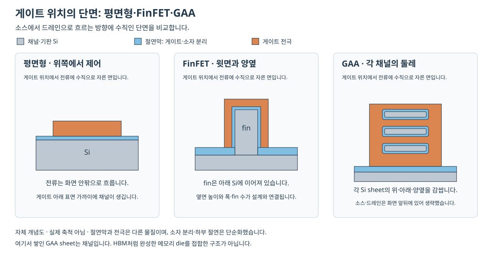

# FinFET과 GAA의 공정 단면 | FinFET and nanosheet GAA integration

[공정 목차](README.md) · [로직·메모리 공정 비교](10-로직과메모리의공정차이_logic-memory-integration.md) · [기초 공정 단면](11-단면으로보는공정흐름_cross-section-atlas.md)

로직 공정에서는 전류가 흐르는 채널, 채널을 제어하는 게이트, 소스·드레인과 배선을 함께 만듭니다. FinFET에서 나노시트 GAA로 바뀌면 채널의 모양뿐 아니라 채널을 드러내고 게이트를 채우는 순서도 달라집니다. 이 글은 공개된 연구·장비 자료의 대표적인 교체 금속 게이트 흐름을 비교합니다. 확인일은 2026-10-26입니다.

## 1. 전류 방향을 먼저 정하고 단면을 읽습니다

위 그림은 게이트가 있는 위치를 전류 방향에 수직으로 자른 자체 개념도입니다. 소스와 드레인은 화면 앞뒤에 있습니다. 채널과 게이트 전극 사이에는 절연막이 있으며, 게이트가 채널을 감싼다는 말은 두 재료를 직접 붙인다는 뜻이 아닙니다.

| 구조 | 채널과 게이트가 만나는 형태 | 설계와 공정에서 달라지는 점 |
| --- | --- | --- |
| 평면형 MOSFET | 넓은 기판 표면 위에 게이트가 놓입니다. | 채널 폭은 평면 방향의 길이이며, 게이트 길이를 줄일수록 드레인이 채널 전위에 주는 영향도 관리해야 합니다. |
| 대표적인 tri-gate FinFET | 가늘고 높은 Si 핀의 윗면과 양쪽 옆면을 게이트가 제어합니다. | 핀 폭은 채널의 얇은 정도에, 높이·핀 개수는 사용할 수 있는 채널 둘레에 영향을 줍니다. 바닥은 기판·분리 구조와 연결됩니다. |
| 수평 나노시트 GAA | 얇은 Si 시트의 위·아래·옆을 절연막과 게이트가 둘러쌉니다. | 시트 두께·폭·개수·수직 간격과 그 사이 게이트막의 연속성이 모두 중요합니다. |

FinFET의 세 면을 보여 주는 공식 예는 [Intel의 2011년 Tri-Gate 설명, PDF 10·12쪽](https://www.intel.com/content/dam/www/public/us/en/documents/backgrounders/standards-22nm-3d-tri-gate-transistors-presentation.pdf#page=10)입니다. 나노와이어와 나노시트의 폭 차이는 [삼성전자의 MBCFET 구조 그림](https://semiconductor.samsung.com/news-events/tech-blog/samsung-opens-the-gate-to-transistor-performance-power-and-area-improvements-with-mbcfet/)의 첫 비교 그림에서 보실 수 있습니다.

GAA의 ‘all-around’는 게이트가 채널 둘레를 감싸는 형태를 뜻합니다. 보통 하나의 연결된 게이트 전극에 전압을 가하며, 네 면이 각각 독립적인 입력 단자가 되는 것은 아닙니다. 또한 세 장의 수평 시트를 쌓은 한 트랜지스터는 서로 연결된 소스·드레인 사이의 병렬 채널을 가질 수 있습니다. 여러 메모리 셀을 직렬로 연결한 NAND string이나 완성 DRAM 다이를 쌓은 HBM과 구별해야 합니다.

### 폭과 길이는 어느 방향인가요

게이트 길이 `Lg`는 소스에서 드레인으로 흐르는 방향의 길이입니다. 시트 폭은 그 방향에 수직인 가로 길이이며, 시트 두께는 위아래 두께입니다. 전류 방향으로 자른 단면에는 게이트·spacer·소스·드레인이 보이고, 게이트 아래를 가로로 자르면 시트와 이를 감싼 막이 보입니다. 두 단면에서 재는 치수를 섞으면 ‘막이 두꺼워졌다’와 ‘게이트가 길어졌다’를 잘못 연결할 수 있습니다.

실제 방향별 관찰은 [Loubet 외의 2017년 원논문, 2쪽 Fig. 8과 Fig. 11b](https://s3.us.cloud-object-storage.appdomain.cloud/res-files/1114-Stacked%20Nanosheet%20Gate-All-Around%20Transistor%20to%20Enable%20Scaling%20Beyond%20FinFET.pdf#page=2)의 서로 다른 TEM 단면을 비교하면 이해하기 좋습니다. TEM은 얇게 준비한 시료를 투과한 전자로 국소 내부 구조를 보는 방법입니다.

## 2. 핀 개수와 시트 폭은 서로 다른 설계 선택입니다

같은 공정에서 핀 높이·폭이 고정되어 있다면 FinFET의 구동 크기는 핀을 한 개, 두 개처럼 늘리는 방식으로 조절합니다. 나노시트에서는 폭도 조절할 수 있어 전류와 정전용량의 절충에 선택지가 생깁니다. 실제 설계에 허용되는 폭은 제조사가 제공하는 설계 규칙과 소자 모델을 따라야 합니다.

[삼성전자의 MBCFET 설명 중 DTCO 부분](https://semiconductor.samsung.com/news-events/tech-blog/samsung-opens-the-gate-to-transistor-performance-power-and-area-improvements-with-mbcfet/)은 용도에 맞춘 채널 폭 선택을 설명합니다. DTCO는 공정과 회로 배치를 함께 설계하는 방식입니다. 넓은 채널의 큰 전류가 회로 속도에 유리할 수 있어도, 함께 늘어나는 정전용량·접촉·배선 부담까지 포함해야 합니다.

### 둘레만 비교하는 자체 계산

직사각형 단면과 모든 면의 동일한 기여를 가정하면 다음처럼 기하학적 유효 폭을 근사할 수 있습니다. 모서리 효과·이동도·접촉 저항을 무시한 계산이며 제품 성능을 예측하는 식은 아닙니다.

    FinFET: W_eff ≈ 핀 개수 × (2 × 핀 높이 + 핀 윗면 폭)
    GAA:    W_eff ≈ 시트 개수 × 2 × (시트 폭 + 시트 두께)

| 설명용 가정 | 계산 결과 |
| --- | --- |
| 핀 높이 40 nm·윗면 폭 8 nm·핀 2개 | `2 × (2 × 40 + 8) = 176 nm`입니다. |
| 시트 폭 25 nm·두께 5 nm·시트 3개 | `3 × 2 × (25 + 5) = 180 nm`입니다. |

숫자가 비슷하다는 것은 이 단순 모형의 둘레 합이 비슷하다는 뜻입니다. 두 소자의 바닥 면적·핀 간격·게이트 길이·구동 전류·속도가 같다는 결론은 나오지 않습니다. 공식 연구의 면적·폭 비교는 [Loubet 외, Fig. 2–4](https://s3.us.cloud-object-storage.appdomain.cloud/res-files/1114-Stacked%20Nanosheet%20Gate-All-Around%20Transistor%20to%20Enable%20Scaling%20Beyond%20FinFET.pdf#page=2)처럼 같은 active 영역과 배치 조건을 함께 제시하는 방식으로 읽습니다.

## 3. FinFET에서는 핀 형성을 어디에 넣나요

대표적인 bulk FinFET 흐름에서는 기판의 Si를 가늘고 높은 핀으로 가공한 뒤, 핀 사이를 절연재로 채우고 필요한 높이만큼 다시 드러냅니다. STI(shallow trench isolation)는 이웃 소자를 분리하는 얕은 트렌치 절연 구조입니다. 핀 높이는 최초 식각 깊이만으로 정하지 않고 절연막을 채우고 되깎은 뒤의 노출 높이까지 확인합니다.

이후 임시 게이트로 위치를 정하고 spacer·소스·드레인을 형성합니다. spacer는 게이트 옆에서 간격과 절연을 유지하는 구조입니다. 최종 게이트를 교체하는 방식에서는 임시 게이트를 제거한 공간에 절연막·금속을 형성하고, contact와 다층 배선을 연결합니다. 이 연결을 공정별로 풀어 쓴 내용은 [공정 통합](09-공정통합과품질관리_integration-process-control.md), [교체 금속 게이트](02-산화와게이트절연막_oxidation-gate-dielectrics.md#8-금속-게이트와-3차원-채널이-연결되는-이유)에서 이어집니다.

[Intel 2012년 22 nm SoC 논문](https://people.eecs.berkeley.edu/~pister/147fa14/Resources/Intel22nm.pdf)의 Transistor Architecture and Process Flow는 이전 평면형 SoC와 유사한 전체 흐름에 핀 관련 가공을 더한 관계를 설명합니다. 해당 연구는 로직·저전력·고전압 소자를 함께 다루며, 같은 웨이퍼 안에서도 게이트 적층과 치수가 하나로 통일되지 않습니다.

## 4. GAA에서는 채널 재료를 먼저 쌓고 나중에 드러냅니다

아래 표는 Si 채널·SiGe 희생층을 사용하는 수평 나노시트의 대표적인 교체 금속 게이트 흐름입니다. 에피택시는 바탕 결정의 배열을 이어 새 결정막을 성장시키는 방법입니다. 희생층은 중간 형상을 만들기 위해 쌓았다가 필요한 위치에서 제거하는 재료입니다.

| 순서 | 단면에서 달라지는 것 | FinFET과 비교한 핵심 차이 |
| --- | --- | --- |
| 1. Si/SiGe 교대 에피택시 | 채널로 남길 Si와 사이를 띄울 SiGe가 번갈아 쌓입니다. | 시트 두께와 간격의 출발점이 성장막 두께에 들어 있습니다. |
| 2. 적층 패터닝·분리 | 전체 적층을 핀 모양으로 가공하고 STI로 이웃 영역을 나눕니다. | 적층 가장자리와 계면을 함께 보존해야 합니다. |
| 3. 임시 게이트·바깥 spacer | 미래 게이트 위치를 임시 재료로 정하고 양옆 간격을 확보합니다. | 아직 SiGe가 남아 있어 시트들이 서로 떨어져 있지 않습니다. |
| 4. S/D 영역 가공 | 게이트 양옆을 열어 소스·드레인을 성장시킬 공간을 만듭니다. | 각 Si 시트 끝이 이후 S/D와 연결되어야 합니다. |
| 5. 부분 SiGe 후퇴 | 노출된 적층 끝의 SiGe만 옆 방향으로 조금 제거합니다. | 나중의 전체 채널 릴리스와 목적·제거 범위가 다릅니다. |
| 6. inner spacer | 작은 후퇴 공간을 절연재로 채워 게이트와 S/D 사이 경계를 만듭니다. | 시트 사이에도 절연 구조가 필요합니다. |
| 7. S/D 선택 에피택시 | 열린 영역에서 도핑한 결정막을 성장시켜 시트 끝과 연결합니다. | 채널의 최초 교대 성장과 다른 위치·목적의 에피택시입니다. |
| 8. 층간 절연·평탄화 | S/D 주변을 절연하고 임시 게이트를 꺼낼 수 있는 표면을 준비합니다. | 이후 제거 작업이 다른 노출 재료를 손상하지 않아야 합니다. |
| 9. 임시 게이트 제거·채널 릴리스 | 게이트 공간의 SiGe를 제거해 개별 Si 시트의 아래·옆을 드러냅니다. | 최종 게이트가 들어갈 빈 공간이 생깁니다. |
| 10. 계면층·high-k·금속 게이트 | 각 시트 둘레를 절연막과 여러 전극층이 감쌉니다. | 시트 사이의 좁은 공간까지 막이 이어져야 합니다. |
| 11. contact·MOL·BEOL | 게이트와 S/D에 접촉하고 신호·전원 배선을 연결합니다. | 채널의 제어력이 좋아져도 접촉·배선의 저항은 별도로 관리합니다. |

순서 1–6은 [Applied Materials의 2022년 공정 설명, PDF 19–20쪽](https://ir.appliedmaterials.com/static-files/f2fbf48d-a761-4c4f-ab4c-73f312ab1ebc#page=19), 7의 선택 성장은 [ASM의 Selective epitaxy](https://www.asm.com/our-technology-products/epitaxy), 9–10은 [Loubet 외의 본문과 Fig. 8](https://s3.us.cloud-object-storage.appdomain.cloud/res-files/1114-Stacked%20Nanosheet%20Gate-All-Around%20Transistor%20to%20Enable%20Scaling%20Beyond%20FinFET.pdf#page=2)을 연결했습니다. 8·11의 일반 역할은 [공정 통합](09-공정통합과품질관리_integration-process-control.md)에서 설명합니다. air spacer·wrap-around contact는 모든 GAA의 필수 단계로 넣지 않았습니다.

### 부분 후퇴와 전체 릴리스가 다른 이유

부분 후퇴는 S/D 쪽 끝에서 절연재를 넣을 작은 자리를 만드는 작업입니다. 전체 릴리스는 임시 게이트를 제거한 뒤 게이트 아래의 희생층을 없애는 작업입니다. 후자를 먼저 크게 진행하면 뒤의 구조를 지지하고 접속하는 방법도 달라지므로 두 작업을 바꾸어 적으면 공정의 의미가 달라집니다.

[Lam의 선택 식각 설명](https://newsroom.lamresearch.com/accelerating-the-path-to-3d-introducing-lam-precision-selective-etch-solutions)은 SiGe의 부분·전체 등방성 제거를 구분합니다. 등방성은 여러 방향으로 반응이 진행하는 성질입니다. 깊은 수직 구멍을 만드는 식각과 달리, 여기서는 시트 사이로 들어가 옆 방향으로 제거하면서 인접 Si를 남기는 능력이 중요합니다.

### 게이트막의 순서와 빈 공간

high-k는 유전율이 높은 절연재이며, 일함수 금속은 문턱전압 조절에 관여하는 전극층입니다. 채널 둘레에 필요한 막을 형성할수록 시트 사이의 남은 공간은 줄어듭니다. ALD는 반응물 공급·퍼지를 나누어 표면 반응을 반복하며 얇은 컨포멀 막을 형성하는 데 사용합니다. 컨포멀은 형상을 따라 두께가 이어지는 피복을 뜻합니다. [ASM, ALD의 Pulsing and purging·Precise control·Applications](https://www.asm.com/our-technology-products/ald)

윗면 두께가 맞아도 아래면의 계면층·high-k·금속이 끊겼다면 의도한 게이트 절연과 제어 특성을 얻기 어렵습니다. 반대로 막을 두껍게 하여 절연 특성을 맞추면 게이트 채움 공간이나 정전용량이 달라집니다. 각 재료의 의미와 EOT는 [게이트 절연막](02-산화와게이트절연막_oxidation-gate-dielectrics.md#7-high-k와-eot-물리적으로-두껍게-전기적으로-강하게-결합합니다)에 정리했습니다.

## 5. 열 이력은 최종 단계만의 조건이 아닙니다

Si/SiGe 계면을 만든 뒤의 열처리는 계면 확산·형상·도핑과 연결됩니다. thermal budget, 열예산은 한 번의 최고 온도만이 아니라 시간과 이후 반복 작업을 포함해 구조가 감당해야 하는 열 이력을 뜻합니다. 최종 금속 게이트를 나중에 넣는 흐름에서도 그 전에 만든 적층과 spacer가 모든 열 영향을 피하는 것은 아닙니다.

imec은 STI 라이너와 낮은 열예산으로 산화에 따른 적층 변형을 억제한 연구를 소개합니다. [Entering the nanosheet transistor era의 Critical nanosheet building blocks와 Fig. 3](https://www.imec-int.com/en/articles/entering-nanosheet-transistor-era-0)에서 단면 형상과 시트 간 공간의 변화를 보실 수 있습니다. 이는 해당 연구의 형상·전기 특성 연결 사례이며 온도 하나를 낮추면 모든 공정 문제가 풀린다는 의미는 아닙니다.

S/D 선택 에피택시에서는 표면 준비·조성·도핑도 함께 다룹니다. 예를 들어 도핑한 Si와 SiGe는 운반자 농도뿐 아니라 변형률을 설계하는 데 쓰입니다. 변형률은 결정의 원자 간격을 늘이거나 줄인 정도입니다. [ASM의 Epitaxy for advanced transistors·Selective epitaxy·Surface preclean](https://www.asm.com/our-technology-products/epitaxy)는 이 역할을 설명합니다.

## 6. 공식 그림에서 실제로 비교할 위치

아래 링크는 기업·연구기관의 구조 그림과 저자 원논문입니다. 그림을 저장소에 복제하지 않고 공식 원문과 원본 이미지로 연결했습니다. 모식도·TEM·성능 그래프를 구분해 읽습니다.

| 공식 그림·원문 | 읽을 위치와 비교할 내용 |
| --- | --- |
| [Intel 22 nm Tri-Gate 발표 PDF](https://www.intel.com/content/dam/www/public/us/en/documents/backgrounders/standards-22nm-3d-tri-gate-transistors-presentation.pdf#page=10) | PDF 10–12쪽의 핀·게이트와 평면형/3D 비교입니다. 2011년의 구조 설명이며 당시의 비용·성능 비율을 현행 GAA 사양으로 옮기지 않습니다. |
| [삼성 MBCFET 나노와이어·나노시트 원본 그림](https://image.semiconductor.samsung.com/image/samsung/p6/semiconductor/newsroom/tech-blog/samsung-opens-the-gate-to-transistor-performance-power_1_pc.png) · [본문](https://semiconductor.samsung.com/news-events/tech-blog/samsung-opens-the-gate-to-transistor-performance-power-and-area-improvements-with-mbcfet/) | 첫 비교 그림의 Cross Section과 Gate 표시입니다. 두 쪽 모두 GAA 계열이며, 왼쪽을 FinFET으로 읽지 않습니다. |
| [imec 핀 개수와 셀 높이 원본 그림](https://drupal.imec-int.com/sites/default/files/2022-02/Figure%202%20-%20Fin%20depopulation.JPG) · [본문](https://www.imec-int.com/en/articles/entering-nanosheet-transistor-era-0) | Fig. 2의 7.5T/3 fins → 6T/2 fins → 5T/1 fin입니다. T는 이 그림에서 배선 track에 따른 셀 높이이며, 트랜지스터 개수나 시트 두께가 아닙니다. |
| [imec 시트 형상·간격 TEM 원본 그림](https://drupal.imec-int.com/sites/default/files/2022-02/Figure%203%20-%20NSH%20-%20shape%20control%20and%20space%20reduction.JPG) · [본문](https://www.imec-int.com/en/articles/entering-nanosheet-transistor-era-0) | Fig. 3의 왼쪽은 시트 형상, 오른쪽은 HfO₂·WFM과 수직 공간입니다. 확대 비율·표시 대상이 다른 값을 그대로 제품 세대의 치수로 비교하지 않습니다. |
| [Loubet 외 원논문 2쪽](https://s3.us.cloud-object-storage.appdomain.cloud/res-files/1114-Stacked%20Nanosheet%20Gate-All-Around%20Transistor%20to%20Enable%20Scaling%20Beyond%20FinFET.pdf#page=2) · [IBM 서지·DOI](https://research.ibm.com/publications/stacked-nanosheet-gate-all-around-transistor-to-enable-scaling-beyond-finfet) | Fig. 7은 inner spacer, Fig. 8은 공정 순서와 TEM, Fig. 11b는 완성 소자의 길이 방향 단면, Fig. 12는 시트의 붙음·변형 비교입니다. 연구 시편과 고객 양산 제품을 구분합니다. |

## 7. 형상 이상을 전기적 실패와 연결합니다

아래 표는 앞의 공정 원리로 구성한 자체 진단 경로입니다. 실제 생산 라인에서 수행한 오류 재현이나 개선 실측 기록은 아닙니다.

| 증상 | 나누어 볼 원인 | 확인과 조치 방향 | 다시 확인할 결과 |
| --- | --- | --- | --- |
| 릴리스 뒤 시트가 붙거나 휘어집니다. | 표면력·기계적 지지·시트 두께·앞선 적층 변형을 나눕니다. | 릴리스 전후 단면을 비교하고 계면 처리·지지·건조 방식의 영향을 분리합니다. | 위·중간·아래 시트의 간격·형상과 누설·전류 분포를 함께 봅니다. |
| 일부 SiGe가 남는데 Si 시트도 얇아집니다. | 국소 공급 부족·조성 차이와 Si에 대한 선택성 부족을 구별합니다. | 위치별 Ge 조성과 시트 두께를 대조한 뒤 공급·표면 준비·반응 선택성 중 해당 단계로 돌아갑니다. | 잔류 Ge와 Si 손실을 따로 수치화하고 후속 게이트 누설을 확인합니다. |
| gate–S/D 누설이 늘어납니다. | inner spacer 두께·연속성, 게이트막 결함, 금속 잔류·접속 경로가 후보입니다. | 누설 단자와 전압 의존성을 먼저 나눈 뒤 해당 절연 경로의 단면·조성을 확인합니다. | 초기 누설과 전압·시간에 따른 절연 열화를 구분합니다. |
| 시트 폭은 맞는데 구동 전류가 작습니다. | 도핑·응력·접촉 저항·게이트 계면과 폭·두께의 국소 분포를 나눕니다. | 채널의 기하학적 폭만으로 판단하지 않고 접촉 저항과 전기 특성·단면을 연결합니다. | 접촉·채널 성분과 최종 회로 지연·전력을 같은 비교 조건에서 봅니다. |

시트 붙음에 대한 실제 연구 근거는 [Loubet 외 Fig. 12](https://s3.us.cloud-object-storage.appdomain.cloud/res-files/1114-Stacked%20Nanosheet%20Gate-All-Around%20Transistor%20to%20Enable%20Scaling%20Beyond%20FinFET.pdf#page=2)입니다. 저자들은 최적화한 계면층 형성 뒤 긴 채널 시편에서 붙음·휘어짐이 관찰되지 않았다고 보고합니다. 원논문의 관찰 범위를 다른 모든 시트 폭·길이의 보증으로 넓히지는 않습니다.

gate–S/D 절연 경로를 따로 볼 필요는 [Shen 외, IRPS 2020의 inner spacer TDDB 연구 초록](https://research.ibm.com/publications/a-new-technique-for-evaluating-stacked-nanosheet-inner-spacer-tddb-reliability)과 연결됩니다. TDDB는 전압 스트레스가 지속될 때 유전체가 시간이 지나 파괴되는 현상입니다. 연구는 Si 채널을 산화한 시험 구조로 해당 경로를 평가했습니다. 여기서 읽은 범위는 공식 초록이며 상세 가속 조건·수명 수치를 사용하지 않았습니다.

### 평균 후퇴량이 같아도 층별 결과는 다를 수 있습니다

평균값 하나로 inner spacer 자리를 관리하면 위·아래 시트의 차이가 가려질 수 있습니다. Schmidt 외의 연구는 평균 SiGe 후퇴량과 시트별 후퇴량을 구분하고, 광학 산란 계측과 X선 형광을 평가했습니다. 기계학습을 사용하는 시트별 추정에는 단면 TEM 기준 데이터가 필요하다는 점도 제시합니다. [2022년 저자 원고 v2의 초록·서지](https://arxiv.org/abs/2201.04725v2)

예를 들어 세 층의 후퇴량이 `4, 5, 6 nm`인 경우와 `5, 5, 5 nm`인 경우는 평균이 모두 `5 nm`입니다. 이 숫자는 자체 계산 예이며 논문의 실측값이 아닙니다. 한 층의 과도한 후퇴와 다른 층의 부족이 평균 안에서 상쇄될 수 있으므로, 평균 적합과 층별 균일성을 별도로 확인해야 합니다.

## 8. GAA와 적층 패키지를 구분해 연결합니다

MBCFET와 RibbonFET은 각 회사의 GAA 구현을 가리키는 명칭입니다. 둘레를 감싸는 원리가 같아도 시트 수·막 조합·분리·접촉과 배선의 세부 흐름이 같다는 뜻은 아닙니다. [삼성의 로직 노드 분류](https://semiconductor.samsung.com/foundry/process-technology/logic-node/), [Intel의 RibbonFET 구조 설명](https://www.intel.com/content/www/us/en/foundry/library/advanced-process-technologies-for-data-center.html)에서 각 명칭을 확인할 수 있습니다.

후면 전력 공급은 전원 경로를 웨이퍼 뒤쪽으로 옮기는 통합 방식이며, 게이트가 채널을 감싸는 GAA와 다른 축의 선택입니다. [배선 장의 후면 전력 공급](06-금속배선과평탄화_interconnect-cmp.md#10-후면-전력-공급)에서 박막화·뒤쪽 연결을 설명합니다. GAA라는 이름만으로 앞면 배선이 없어지거나, 위아래 소자가 별도 완성 다이로 쌓였다고 판단하지 않습니다.

## 출처와 확인 범위

| 원자료 | 발표·판본과 읽은 범위 |
| --- | --- |
| [Intel, 22 nm 3-D Tri-Gate 발표](https://www.intel.com/content/dam/www/public/us/en/documents/backgrounders/standards-22nm-3d-tri-gate-transistors-presentation.pdf) | 2011년 발표 PDF의 10–12·16쪽 구조 설명을 확인했습니다. 장기 비용·성능 수치를 현재 제품에 옮기지 않았습니다. |
| [Jan 외, A 22nm SoC Platform Technology…, 대학 공개 원고](https://people.eecs.berkeley.edu/~pister/147fa14/Resources/Intel22nm.pdf) | IEDM 2012의 Transistor Architecture and Process Flow·Fig. 1–2를 다룹니다. 확인 범위는 웹에서 추출된 본문과 그림 설명입니다. |
| [삼성전자, MBCFET와 DTCO](https://semiconductor.samsung.com/news-events/tech-blog/samsung-opens-the-gate-to-transistor-performance-power-and-area-improvements-with-mbcfet/) | SAFE Forum 2022 발표를 다룬 본문의 Building on GAA·DTCO와 첫 비교 그림을 확인했습니다. 각 그림의 원본을 별도로 열었습니다. |
| [Loubet 외, Stacked nanosheet gate-all-around transistor to enable scaling beyond FinFET](https://doi.org/10.23919/VLSIT.2017.7998183) · [저자 원논문 공개본](https://s3.us.cloud-object-storage.appdomain.cloud/res-files/1114-Stacked%20Nanosheet%20Gate-All-Around%20Transistor%20to%20Enable%20Scaling%20Beyond%20FinFET.pdf) | VLSI Technology 2017, 인쇄 T230–T231, 본문과 Fig. 2–4·7–13을 읽고 2쪽을 렌더링해 도면을 확인했습니다. IBM·삼성·GLOBALFOUNDRIES 저자들의 연구 시편입니다. |
| [Applied Materials, New Ways to Shrink Master Class](https://ir.appliedmaterials.com/static-files/f2fbf48d-a761-4c4f-ab4c-73f312ab1ebc) | 2022-04-21 Prepared Remarks, PDF 19–22쪽의 GAA 순서를 확인했습니다. 당시 사업 전망·향후 양산 일정·홍보 성능 배수는 사용하지 않았습니다. |
| [imec, Entering the nanosheet transistor era](https://www.imec-int.com/en/articles/entering-nanosheet-transistor-era-0) | 2022-02-11, Why moving…·Critical nanosheet building blocks와 Fig. 2–3을 확인했습니다. 후속 forksheet·CFET 설명을 현재 모든 양산 GAA의 구조로 섞지 않았습니다. |
| [Lam Research, Precision selective etch](https://newsroom.lamresearch.com/accelerating-the-path-to-3d-introducing-lam-precision-selective-etch-solutions) | 2022-02-09, The need for precision의 부분·전체 SiGe 제거와 Selis 설명을 확인했습니다. 고객별 제거율·허용 손실·수율은 제시하지 않았습니다. |
| [ASM, Epitaxy](https://www.asm.com/our-technology-products/epitaxy) · [ALD](https://www.asm.com/our-technology-products/ald) | 현재 공식 본문의 재료·선택 성장·표면 준비와 ALD의 공급·퍼지·포화·응용을 읽었습니다. 업체의 시장 순위·무결함 표현은 일반 결과로 옮기지 않았습니다. |
| [Shen 외, Inner spacer TDDB reliability](https://research.ibm.com/publications/a-new-technique-for-evaluating-stacked-nanosheet-inner-spacer-tddb-reliability) | IRPS 2020, IBM 공식 초록·서지의 gate–epitaxial S/D 절연 경로와 시험 구조를 확인했습니다. 전문의 상세 시험 조건은 확인 범위에 없습니다. |
| [Schmidt 외, SiGe Indentation Process Control](https://arxiv.org/abs/2201.04725v2) | 2022-04-20 v2의 초록·서지, 관련 출판 DOI 10.1109/TSM.2022.3168585를 확인했습니다. 평균·층별 추정과 기준 TEM 필요성만 사용했습니다. |
| [삼성 로직 노드](https://semiconductor.samsung.com/foundry/process-technology/logic-node/) · [Intel RibbonFET](https://www.intel.com/content/www/us/en/foundry/library/advanced-process-technologies-for-data-center.html) | GAA·MBCFET·RibbonFET 구조 명칭을 확인했습니다. 노드 명칭을 실제 게이트 길이로 환산하지 않았습니다. |

## English

The chapter compares cross-sections perpendicular and parallel to source–drain current, then follows a representative replacement-gate nanosheet flow. Alternating Si/SiGe growth, partial SiGe recess for inner spacers, source/drain epitaxy and later channel release serve different purposes. Official diagrams and original research distinguish idealized structures from TEM evidence. Geometry calculations and fault-investigation paths are explicitly educational examples; they do not reproduce a commercial process recipe or measured fab result.
