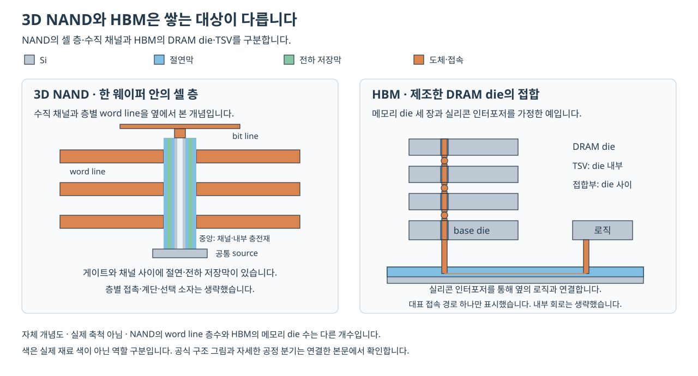

# DRAM과 3D NAND의 공정 단면 | DRAM and 3D NAND integration

[공정 목차](README.md) · [로직과 메모리 비교](10-로직과메모리의공정차이_logic-memory-integration.md) · [공정별 단면](11-단면으로보는공정흐름_cross-section-atlas.md)

DRAM과 NAND는 전하를 이용하지만 전하를 놓는 위치와 읽는 방식이 다릅니다. 이 차이가 접근 트랜지스터·커패시터를 만드는 흐름과 수직 채널·저장막·여러 게이트를 만드는 흐름으로 이어집니다. 여기서는 커패시터가 트랜지스터 위에 있는 DRAM과 전하 포획형 replacement-gate 3D NAND의 대표 구조를 비교합니다. 확인 기준일은 2026-10-26입니다.

## 1. 전하가 있는 위치부터 구분합니다

| 비교 항목 | 1T1C DRAM | 전하 포획형 3D NAND |
| --- | --- | --- |
| 저장 위치 | 커패시터의 두 전극 사이 전압에 대응하는 전하입니다. | 채널과 게이트 사이 절연성 저장막의 포획 준위에 전자를 보관합니다. |
| 접근 소자 | 접근 트랜지스터가 bit line과 저장 노드를 연결합니다. | 저장 상태에 따라 문턱전압이 달라지는 셀들이 string으로 직렬 연결됩니다. |
| word line의 역할 | 접근 트랜지스터의 게이트를 제어합니다. | 해당 높이의 셀 게이트를 제어합니다. |
| 읽는 대상 | 커패시터와 bit line이 전하를 나누면서 생기는 작은 신호입니다. | 정해진 읽기 전압에서 string에 전류가 흐르는지입니다. |
| 제조의 중심 과제 | 작은 바닥 면적에서 필요한 정전용량과 낮은 누설을 확보합니다. | 깊은 채널과 여러 높이의 저장막·게이트 특성을 고르게 만듭니다. |

DRAM의 1T1C와 refresh는 [삼성전자 DRAM FAQ](https://semiconductor.samsung.com/dram/), DRAM의 접근·감지·복원은 [Nam 외, DRAMScope, II-A·II-C절](https://scale.snu.ac.kr/papers/2024-04-Conference-ISCA-DRAMScope.pdf#page=3), NAND의 막 배치는 [Applied Materials, 3D NAND Anatomy](https://www.appliedmaterials.com/us/en/semiconductor/markets-and-inflections/memory/3d-nand.html)와 연결됩니다. 1T1C는 트랜지스터 1개와 커패시터 1개라는 뜻입니다.

DRAM에서 전하가 많다는 사실과 논리값 1이 항상 일치하는 것은 아닙니다. 회로의 데이터 대응 방식이 다를 수 있습니다. NAND도 전자 수를 직접 세어 숫자를 출력하지 않고 문턱전압 구간을 읽습니다. 따라서 저장된 전하·전기적 신호·논리값을 구분해야 합니다.

## 2. DRAM 단면: 아래의 스위치와 위의 저장 공간

먼저 [DRAMScope의 Figure 2(b), PDF 3쪽](https://scale.snu.ac.kr/papers/2024-04-Conference-ISCA-DRAMScope.pdf#page=3)을 보시면 buried wordline, bitline contact, storage node와 capacitor의 위치가 구분됩니다. buried wordline은 실리콘 표면 아래로 들어간 게이트선입니다. storage node는 저장 커패시터의 셀별 전극에 연결되는 노드이며 bitline contact와 다른 접속부입니다.

이 논문의 예에서는 두 셀이 bitline contact를 공유합니다. word line 방향과 bit line 방향의 절단면이 보여 주는 이웃 관계도 다릅니다. 한 단면에서 가까이 보이는 전극을 전부 같은 전기적 노드로 묶으면 셀 회로를 잘못 읽게 됩니다. [DRAMScope, II-B절·Figure 2](https://scale.snu.ac.kr/papers/2024-04-Conference-ISCA-DRAMScope.pdf#page=3)

위쪽의 길고 가는 구조는 커패시터 전극의 표면적을 확보하기 위한 것입니다. 단순 평행판 관계 `C ≈ εA/t`에서 A가 커지면 같은 유전체 두께에서도 정전용량을 키울 수 있습니다. 아래의 트랜지스터는 전류 통로를 여닫고 위쪽의 커패시터는 전하를 저장하므로, 두 구조는 모양뿐 아니라 최적화할 항목도 다릅니다. 계산 예제는 [기존 비교 글의 DRAM 절](10-로직과메모리의공정차이_logic-memory-integration.md#4-dram-작은-바닥-면적에서-전하를-저장합니다)에서 이어집니다.

### 대표 공정의 연결

다음은 공개된 구조를 공정의 의존 관계로 풀어 쓴 설명입니다. 실제 제조에서는 주변 회로 형성, 주입·열처리·세정과 패턴 작업이 사이에 들어갑니다. 표의 화살표는 한 회사의 전체 양산 레시피를 뜻하지 않습니다.

| 구간 | 단면에서 생기는 변화 | 다음 단계로 넘기는 조건 |
| --- | --- | --- |
| ① 활성 영역·소자 분리 | Si 안에 소자가 놓일 영역과 절연 경계를 정합니다. | 셀 간 절연과 접근 소자의 채널 위치를 확보합니다. |
| ② 접근 트랜지스터·buried wordline | 대표적인 매립 게이트 구조에서는 게이트가 들어갈 홈과 절연막·전극을 형성합니다. | 저장 노드와 bit line 사이를 제어할 채널과 접합이 필요합니다. |
| ③ bitline·저장 노드 접속 | bitline contact와 커패시터로 올라갈 storage-node contact를 서로 절연하여 연결합니다. | 접촉 저항·정렬·노드 간 누설을 관리합니다. |
| ④ 커패시터용 높은 형상 | 희생 틀에 깊은 구멍을 만들고 하부 전극이 놓일 표면을 준비합니다. | 구멍의 높이·지름·간격과 바닥 접속을 확보합니다. |
| ⑤ 하부 전극 형성·분리 | 각 저장 노드에 연결되는 전극을 만들고 셀끼리 분리합니다. 선택한 구조에 따라 희생 틀을 제거하며 필요한 지지를 남깁니다. | 인접 전극의 단락을 막고 필요한 표면적을 유지합니다. |
| ⑥ 유전체·상부 전극 | 전극을 따라 high-k 절연막과 반대쪽 전극을 형성합니다. | 정전용량, 절연 연속성, 누설과 항복 특성을 함께 확인합니다. |
| ⑦ 주변 회로·상부 배선·검사 | 셀 배열을 감지·주소·외부 I/O 회로와 연결합니다. | 읽기·쓰기·유지 시간·동작 조건별 분포로 완성 제품을 평가합니다. |

커패시터의 개구부→하부 전극→유전체→상부 전극이라는 재료 형성 관계는 [Chun-Chuan Chien의 2006년 국립교통대 학위논문, 제1장 1.3절·인쇄 5–6쪽](https://ir.lib.nycu.edu.tw/bitstream/11536/80450/3/153903.pdf#page=5)에서도 확인할 수 있습니다. 이 자료는 과거 eDRAM·MIM 연구의 설명이며, 그 온도나 당시 로드맵을 현재 범용 DRAM의 조건으로 옮기지 않습니다. 셀·core·periphery의 구분은 [Applied Materials, DRAM Anatomy](https://www.appliedmaterials.com/us/en/semiconductor/markets-and-inflections/memory/dram.html)에 있습니다.

하부 전극·유전체·상부 전극의 metal–insulator–metal 구성을 MIM이라고 합니다. 금속을 두 겹 쌓되 그 사이에는 전류를 막는 유전체가 있어야 합니다. ‘금속이 잘 채워졌다’만으로 성공을 판단하면 유전체의 국소 결함을 놓칠 수 있습니다. high-k는 같은 형상에서 정전용량을 확보하는 데 유리하지만, 재료의 유전율만 높다고 누설·계면·신뢰성까지 함께 해결되는 것은 아닙니다.

### 높게 만든 뒤에도 구조가 서 있어야 합니다

원통·기둥형 전극에서는 희생 재료 제거 뒤의 기계적 지지가 중요합니다. 구조를 더 높게 만들면 면적을 늘릴 수 있지만 휘어짐·인접 전극 접촉·공정 중 붕괴가 새로운 불량 후보가 됩니다. 지지 구조가 남아 있는 단면과 제거 후 단면을 구분해야 합니다. [TEL Investor Guide, 2026-09-15, 63쪽](https://www.tel.com/ir/library/investors-guide/hq95qj0000000734-att/InvestorsGuide_E20260915_rev00.pdf#page=63)의 6F² 구조에는 높은 커패시터와 가로 지지 구조가 함께 표시되어 있습니다.

같은 페이지의 4F²·3D DRAM 그림과 미래 연도 표는 TEL의 일반화한 전망입니다. 높은 커패시터 하나를 가진 현재의 셀, 수직 접근 트랜지스터를 연구하는 셀, 여러 셀층을 만드는 3D DRAM을 서로 같은 구조로 읽지 않습니다. HBM의 여러 DRAM die 적층과도 구분합니다.

## 3. 3D NAND 단면: 높이별 게이트와 공통 수직 채널

평면 NAND는 셀들을 기판 표면 방향으로 나란히 배치합니다. 대표적인 수직 채널형 3D NAND에서는 채널이 막 적층을 관통하고, 서로 다른 높이의 게이트가 같은 string의 셀들을 제어합니다. 많은 층을 한 웨이퍼에서 가공하는 것이므로 완성된 NAND die 수백 장을 쌓았다는 뜻은 아닙니다.

[SK하이닉스의 Figure 1, The NAND Flash Cell-formation Process](https://d18r0a86za96sg.cloudfront.net/wp-content/uploads/2026/07/20050427/Inside-the-Research_ep1_01_ect_Infographic_2026.jpg)을 보시면 적층→채널 구멍→안쪽 막과 채널이 이어집니다. 이 그림은 셀 형성의 일부를 설명하며 금속 게이트 치환·층별 접속까지 모두 표시한 완성 공정도는 아닙니다. [해당 공식 본문](https://news.skhynix.com/en/research-inside-ep1/)

### 가로 단면과 세로 단면을 함께 읽습니다

| 자르는 방향 | 보이는 구조 | 그 그림으로 확인할 항목 |
| --- | --- | --- |
| 수직 채널을 길게 자른 세로 단면 | 여러 높이에 반복되는 word line과 길게 이어지는 채널입니다. | 상·중·하부 구멍 폭, 층 높이, deck 연결과 게이트 채움입니다. |
| 특정 셀 높이의 가로 단면 | 채널 둘레를 둘러싼 터널 절연막·저장막·차단막·게이트입니다. | 층별 재료의 두께·연속성과 셀의 반경 방향 전계입니다. |
| 계단·접촉 영역의 세로 단면 | 높이가 다른 word line의 접속 면과 contact입니다. | 셀을 저장하는 채널이 아닌 게이트 전압 전달 경로입니다. |

가로 단면에서는 채널에서 바깥 방향으로 터널 절연막→전하 포획막→차단 절연 구조→게이트 전극이라는 역할을 읽습니다. 반대로 채널 구멍 벽에서 안쪽으로 재료를 형성할 때에는 순서가 반대입니다. 채널은 얇은 원통 벽 형태가 될 수 있고 중심을 절연재로 채우는 방식도 있으므로, 구멍 전체를 하나의 두꺼운 Si 도체로 생각하지 않습니다. [Applied Materials, 3D NAND Anatomy의 구성 재료](https://www.appliedmaterials.com/us/en/semiconductor/markets-and-inflections/memory/3d-nand.html)

### 같은 질화물도 제거할 층과 남길 층이 다릅니다

| 재료가 있는 위치 | 역할 | gate replacement에서의 의미 |
| --- | --- | --- |
| 적층의 수평 희생 SiN 층 | 나중에 게이트가 들어갈 높이와 공간을 정합니다. | slit을 통해 선택적으로 제거하고 도체로 바꾸는 대상입니다. |
| 채널 주변의 전하 포획 질화막, CTN | 전자를 포획하여 저장 상태를 만듭니다. | 유지해야 하는 저장 재료입니다. 수평 희생층과 같은 물체가 아닙니다. |
| 층 사이·저장 구조의 산화막 | 층간 절연·전하 이동 억제·형상 유지 등을 맡습니다. | 위치에 따라 보호·지지·전기적 역할이 다릅니다. |

CTN은 charge-trap nitride입니다. ‘질화막을 제거한다’는 문장에서는 어느 위치의 막인지가 중요합니다. 모든 질화막을 한꺼번에 없애는 흐름으로 이해하면 셀의 저장 원리를 잃게 됩니다. 희생층 교체는 [Lam의 How Memory Layers Are Made](https://newsroom.lamresearch.com/semulator3d-sheds-light-on-tier-bending-in-3d-nand-flash-memory), 저장막의 역할은 [SK하이닉스 CTI의 기초 설명과 Figure 1·2](https://news.skhynix.com/en/research-inside-ep1/)에서 구분할 수 있습니다.

### replacement-gate 흐름의 대표적인 의존 관계

| 구간 | 단면의 변화 | 공정상 핵심 연결 |
| --- | --- | --- |
| ① 적층과 하부 연결 준비 | 절연층과 희생층을 반복 형성합니다. | 층 두께·응력·아래쪽 채널 연결과 주변 회로 배치를 함께 정합니다. |
| ② 채널 구멍 형성 | 적층을 관통하는 깊고 좁은 구멍을 만듭니다. | 깊이만 아니라 바닥 도달·측벽 형상·반경별 분포가 필요합니다. |
| ③ 저장막·채널 형성 | 구멍 벽을 따라 저장용 절연 구조와 채널을 만듭니다. | 높이별 피복·조성·막 결함과 하부 source 연결을 관리합니다. |
| ④ slit 형성 | 적층 옆으로 깊은 접근 통로를 만듭니다. | 채널 구멍과 다른 통로이며, 수평 희생층에 접근하는 경로가 됩니다. |
| ⑤ 희생층 선택 제거 | 수평 SiN 자리에 옆으로 긴 빈 공간이 생깁니다. | 남겨야 할 절연 구조·저장막을 보존하고 층의 휨·붕괴를 억제합니다. |
| ⑥ 게이트 재료 채움·분리 | 빈 공간에 게이트용 계면층·금속 등을 형성합니다. | 옆으로 긴 공간의 공급·채움·잔류 연결을 제어합니다. |
| ⑦ 층별 gate contact 완성 | 각 높이의 게이트에 전압을 전달할 접속을 완성합니다. | staircase의 각 층을 다른 층과 단락 없이 연결해야 합니다. |
| ⑧ 상부 bit line·배선·검사 | string을 읽기·쓰기·선택 회로에 연결합니다. | 층별 문턱전압·유지·disturb·접속 분포를 함께 평가합니다. |

이 표는 [SK하이닉스 셀 형성 설명](https://news.skhynix.com/en/research-inside-ep1/), [Lam의 희생층 제거·금속 치환 설명](https://newsroom.lamresearch.com/semulator3d-sheds-light-on-tier-bending-in-3d-nand-flash-memory), [Applied의 staircase·replacement gate·contact 설명](https://www.appliedmaterials.com/us/en/semiconductor/markets-and-inflections/memory/3d-nand.html)을 공정의 의존 관계로 연결한 것입니다. 계단 패턴 형성·절연재 채움, 하부 source 연결, 다중 deck 작업을 실제로 끼워 넣는 위치와 차단막을 완성하는 방법은 구조마다 달라집니다. 표의 ⑦은 접속 완성을 묶은 항목이며 계단의 모양 자체를 항상 금속 치환 후에 처음 만든다는 뜻은 아닙니다.

word line staircase는 각 층의 게이트에 따로 접근하도록 끝부분의 높이를 달리한 접속 영역입니다. 깊은 채널 구멍을 잘 만들었더라도 계단 contact가 다른 층과 연결되거나 채워지지 않으면 해당 층에 원하는 전압을 전달할 수 없습니다. 수직 채널과 층별 접촉을 다른 구조로 나누어야 하는 이유입니다.

## 4. 주변 회로의 위치가 바뀌면 공정 순서도 바뀝니다

주변 CMOS는 셀의 주소·읽기·쓰기 전압·I/O를 다루는 회로입니다. 셀 옆에 놓는 방법, 같은 웨이퍼에서 셀 아래에 만드는 방법, 별도의 웨이퍼에서 만든 뒤 접합하는 방법은 공정 통합의 조건이 다릅니다.

| 구성 | 흐름과 단면의 차이 | 얻는 것과 새로 관리할 항목 |
| --- | --- | --- |
| 주변 회로가 옆에 있는 구조 | 주변 CMOS와 셀 적층이 평면상 다른 영역을 차지합니다. | 연결을 만들 수 있지만 셀 외의 바닥 면적도 필요합니다. |
| PUC·CuA 계열 | 주변 CMOS를 먼저 만들고 그 위에 셀 배열을 형성하는 대표적인 흐름입니다. | 평면 면적을 줄이면서 이미 만든 CMOS가 뒤의 열·응력 이력을 견뎌야 합니다. |
| 별도 웨이퍼 접합 | CMOS 웨이퍼와 배열 웨이퍼를 따로 가공하고 접합 면의 금속을 연결합니다. | 각각에 맞는 공정 조건을 쓸 수 있지만 접합 정렬·표면·접속 수율이 추가됩니다. |

PUC는 peri under cell, CuA는 CMOS under array라는 표현입니다. 물리적 배치가 비슷하더라도 업체의 상세 공정·셀 구조까지 같은 뜻은 아닙니다. SK하이닉스는 [2023년 All PUC 설명](https://news.skhynix.com/en/how-sk-hynixs-advanced-4d-nand-technologies-are-overcoming-stacking-limitations/)에서 아래쪽 주변 회로를 셀 면적에 맞게 배치하는 방향을 설명합니다.

KIOXIA의 CBA는 CMOS directly Bonded to Array라는 고유 기술 명칭입니다. [공식 CBA 설명의 Table 1·Figure 1](https://www.kioxia.com/en-jp/rd/technology/cba.html)은 동일 웨이퍼에서 연속 형성하는 CUA와 별도 웨이퍼의 Cu 접합을 비교합니다. Figure 4는 BiCS FLASH gen. 8의 사진과 단면 SEM을 보여 줍니다. 이 접합은 HBM처럼 여러 완성 DRAM die를 쌓아 넓은 병렬 인터페이스를 만드는 경우와 대상·공정 단계가 다릅니다.

또한 GAA 로직의 gate replacement와 3D NAND의 gate replacement는 같은 장면이 아닙니다. 전자는 채널 둘레의 임시 게이트 공간을 최종 게이트로 바꾸는 통합을, 여기서 설명한 NAND는 여러 수평 희생층을 금속 게이트로 바꾸는 작업을 가리킵니다. 소자 모양이 다르면 선택적으로 남길 재료와 반응물이 들어갈 경로도 다릅니다.

## 5. 층수·deck·비트·die 적층을 구분합니다

같은 높이 방향의 그림이어도 세는 대상이 다릅니다. 왼쪽은 한 NAND die 내부의 셀층, 오른쪽은 별도로 제조한 DRAM die의 접합입니다. 실제 제품의 층수나 축척을 나타내는 그림은 아닙니다.

| 표현 | 세는 대상 | 다른 표현과의 차이 |
| --- | --- | --- |
| NAND word-line 층수 | 수직 방향으로 배치한 셀 게이트의 층입니다. | 선택 게이트·dummy 층 등을 포함하는 세부 집계는 자료를 확인해야 합니다. |
| 다중 deck·plug 형성 | 높이를 나누어 적층·구멍 형성을 연결하는 공정 구간입니다. | deck 2개가 곧 die 2개는 아닙니다. |
| TLC·QLC | 한 셀의 문턱전압 상태로 표현하는 논리 비트입니다. | TLC의 3비트는 3층이 아니라 8개 상태를 뜻합니다. |
| HBM의 DRAM die 층수 | 별도로 만든 메모리 die의 적층 수입니다. | 한 die 안의 NAND 셀층 수와 단위가 다릅니다. |
| 3D DRAM 연구의 셀층 | DRAM 셀 자체를 수직으로 반복 배치하는 접근입니다. | HBM의 패키지 적층이나 단일 DRAM 셀의 높은 커패시터와 구분합니다. |

SK하이닉스의 3-Plug 설명은 [2023년 공개된 특정 적층 전략](https://news.skhynix.com/en/how-sk-hynixs-advanced-4d-nand-technologies-are-overcoming-stacking-limitations/)입니다. 당시 설명의 한 번에 가공하는 층수를 모든 시대·장비의 고정 한계로 사용하지 않습니다. 같은 층수라도 층의 피치, 평면 채널 밀도, 셀당 비트, 주변 회로 면적에 따라 전체 용량과 제조 난도가 달라집니다.

## 6. 단면과 전기적 실패를 연결하는 방법

다음 표는 공개된 구조·공정 원리로 구성한 자체 진단 예시입니다. 특정 업체의 양산 불량 기록이나 직접 제조·측정한 결과는 아닙니다.

| 증상 | 먼저 나눌 원인 | 필요한 대조와 조치 방향 |
| --- | --- | --- |
| DRAM 유지 시간이 짧습니다. | 작은 C, 커패시터 유전체 누설, 접근 트랜지스터의 꺼짐 누설, 접합·접촉·동작 조건을 나눕니다. | C·누설·온도별 retention 분포와 단면을 연결합니다. 누설 위치가 다르면 유전체·채널·접합 중 돌아갈 공정도 다릅니다. |
| 높은 DRAM 커패시터가 서로 붙습니다. | 형상 편차, 지지 구조, 희생재 제거·건조 중의 변형을 나눕니다. | 제거 전후 형상과 인접 전극 단락을 비교합니다. 높이 증가만 계속하기보다 지지·간격·막 응력의 영향을 확인합니다. |
| NAND의 아래층에서만 읽기 분포가 나빠집니다. | 구멍 테이퍼, 내부 막 피복·조성, 채널·게이트 채움, 접촉 차이를 나눕니다. | 층별 전기 분포와 상·중·하부 단면을 대조합니다. 입구 CD 하나나 평균 막 두께만으로 종료하지 않습니다. |
| NAND 금속 치환 뒤 일부 층에 void가 남습니다. | 금속 공급·성장 문제와 치환 중 절연층 휨·붕괴를 구분합니다. | 치환 전후의 층 간격·응력과 금속 결손 위치를 비교한 뒤 형상 유지 또는 채움 조건을 평가합니다. |

Lam의 [2025-07-29 SEMulator3D 연구 설명, Figure 1·3](https://newsroom.lamresearch.com/semulator3d-sheds-light-on-tier-bending-in-3d-nand-flash-memory)은 희생층 제거 뒤 지지되지 않은 산화막이 변형되고 금속 치환에 영향을 주는 문제를 다룹니다. 공개 글의 DOE 결과는 공정 모델의 가상 실험입니다. 이를 실제 양산 lot의 수정 전후 수율이나 실물 측정값으로 바꾸지 않습니다.

SK하이닉스의 [2026-07-22 CTI 연구 소개, Figure 2·5](https://news.skhynix.com/en/research-inside-ep1/)는 저장 질화막의 연속성과 인접 셀 간 전하 이동·간섭을 다룹니다. 채널 구멍을 작게 만드는 일과 저장막을 층별로 분리하는 일 사이에 공정 제약이 생기는 사례입니다. 원논문은 IEDM 2025의 176층 구조 연구로 연결되어 있으며, 이 소개를 모든 제품의 현행 CTI 양산 적용 목록으로 읽지 않습니다.

## 7. 공식 그림에서 확인할 위치

다음 링크는 해당 기관의 원문이나 공식 이미지로 이동합니다. 기업 원도면을 이 저장소의 새 그림으로 바꾸어 표시하지 않았습니다.

| 공식 자료·그림 | 바로 보기 | 그림에서 읽을 내용 |
| --- | --- | --- |
| 서울대·UIUC, DRAMScope Figure 2 | [논문 PDF 3쪽](https://scale.snu.ac.kr/papers/2024-04-Conference-ISCA-DRAMScope.pdf#page=3) | 상면의 WL·BL 관계와 saddle-fin의 단면, 매립 게이트·저장 노드·공유 접촉을 구분합니다. |
| TEL, DRAM Technology Roadmap 63쪽 | [공식 PDF 63쪽](https://www.tel.com/ir/library/investors-guide/hq95qj0000000734-att/InvestorsGuide_E20260915_rev00.pdf#page=63) | 왼쪽 6F²의 높은 커패시터·지지 구조와 오른쪽 3D DRAM 개념을 비교합니다. 연도별 수치는 TEL 전망입니다. |
| SK하이닉스, Cell-formation Figure 1 | [공식 원도면](https://d18r0a86za96sg.cloudfront.net/wp-content/uploads/2026/07/20050427/Inside-the-Research_ep1_01_ect_Infographic_2026.jpg) · [설명](https://news.skhynix.com/en/research-inside-ep1/) | 적층, 구멍, blocking oxide·CTN·tunnel oxide·polysilicon의 위치를 읽습니다. |
| SK하이닉스, Conventional CTI Figure 2 | [공식 원도면](https://d18r0a86za96sg.cloudfront.net/wp-content/uploads/2026/07/20050429/Inside-the-Research_ep1_02_ect_Infographic_2026.jpg) | 포켓 형성→저장막 분리의 예입니다. Figure 5의 새 방식과 구분합니다. |
| Lam, Tier bending Figure 1a·1b | [공식 원도면](https://newsroom.lamresearch.com/image/Figure+1+-+3D+NAND+Flash+Memory++A+Study+of+Tier+Bending+using+SEMulator3D.jpg) · [설명](https://newsroom.lamresearch.com/semulator3d-sheds-light-on-tier-bending-in-3d-nand-flash-memory) | contact와 slit 사이 지지되지 않은 층, 원문이 인용한 붕괴 SEM을 비교합니다. 뒤의 DOE 그래프는 가상 실험입니다. |
| KIOXIA, CBA Figure 1·4 | [접합 순서 원도면](https://www.kioxia.com/content/dam/kioxia/en-jp/rd/technology/cba/img/cba_img_002_en.png) · [제품 단면 원도면](https://www.kioxia.com/content/dam/kioxia/en-jp/rd/technology/cba/img/cba_img_005_en.png) · [설명](https://www.kioxia.com/en-jp/rd/technology/cba.html) | Figure 1의 두 웨이퍼 Cu 접합과 Figure 4의 제품 단면 SEM을 이어 봅니다. |

## 8. 출처와 읽은 범위

| 출처 | 자료 시점·확인 범위 |
| --- | --- |
| [삼성전자 DRAM](https://semiconductor.samsung.com/dram/) | 2026-10-26 확인입니다. FAQ의 1T1C·refresh를 사용했습니다. |
| [Nam 외, DRAMScope](https://scale.snu.ac.kr/papers/2024-04-Conference-ISCA-DRAMScope.pdf) | ISCA 2024 저자 공개본입니다. II-A–C절·Figure 2의 조직·6F²·접근·복원을 확인했습니다. 제조 레시피 논문이나 모든 제품의 내부 도면으로 제시하지 않았습니다. |
| [Applied Materials, DRAM](https://www.appliedmaterials.com/us/en/semiconductor/markets-and-inflections/memory/dram.html) | 2026-10-26 확인입니다. Anatomy·Cell Array Scaling·Periphery Logic Scaling 본문을 읽었습니다. |
| [Chun-Chuan Chien, Study on Electrical Characteristics of High-k Metal-Insulator-Metal Capacitors](https://ir.lib.nycu.edu.tw/handle/11536/80450) | 국립교통대 2006년 학위논문이며 현재 NYCU 공식 저장소에 있습니다. 본문 파일의 인쇄 5–6쪽 1.3절에서 MIM 공정·재료 구성 설명을 읽었습니다. ITRS 2005 등의 당시 전망·조건은 현재 사양으로 사용하지 않았습니다. |
| [TEL Investor Guide](https://www.tel.com/ir/library/investors-guide/hq95qj0000000734-att/InvestorsGuide_E20260915_rev00.pdf) | 2026-09-15 판의 인쇄/PDF 63쪽을 렌더링하여 확인했습니다. 오른쪽 위의 기준 시점은 2026-08-06이며 표는 TEL의 일반 전망입니다. |
| [Applied Materials, 3D NAND](https://www.appliedmaterials.com/us/en/semiconductor/markets-and-inflections/memory/3d-nand.html) | 2026-10-26 확인입니다. Anatomy·Lateral Scaling·Vertical Scaling의 재료·계단·주변 CMOS·희생층 교체와 contact를 확인했습니다. |
| [SK하이닉스, CTI 연구 소개](https://news.skhynix.com/en/research-inside-ep1/) | 2026-07-22입니다. 셀 형성·CTN·CTI Figure 1–3·5와 IEDM 2025 원논문 연결을 확인했습니다. Figure 1–3 원도면을 직접 보았습니다. 성능 배수를 별도 검증한 결과로 쓰지 않았습니다. |
| [SK하이닉스, 4D NAND 적층 설명](https://news.skhynix.com/en/how-sk-hynixs-advanced-4d-nand-technologies-are-overcoming-stacking-limitations/) | 2023-12-19입니다. 3-Plug·Sideway Source·All PUC의 본문을 확인했습니다. 당시 장비·층수 설명을 고정 한계로 일반화하지 않았습니다. |
| [Lam, SEMulator3D와 tier bending](https://newsroom.lamresearch.com/semulator3d-sheds-light-on-tier-bending-in-3d-nand-flash-memory) | 2025-07-29입니다. How Memory Layers Are Made·Figure 1·DOE·결론을 확인했습니다. Figure 1의 원도면을 직접 보았고 시뮬레이션과 인용된 SEM을 구분했습니다. |
| [KIOXIA, CBA Technology](https://www.kioxia.com/en-jp/rd/technology/cba.html) | 2026-10-26 확인입니다. What is CBA Technology?·Table 1·Figure 1–4 설명과 제품 적용 구분을 읽었습니다. Figure 1·4의 원도면도 직접 보았습니다. BiCS gen. 8 적용은 해당 공급사의 공개 설명입니다. |

박막 형성·채움은 [증착](05-증착과이온주입_deposition-implantation.md), 깊은 구멍·희생층 제거는 [식각](04-식각과선택비_etching.md), 층별 연결은 [배선·CMP](06-금속배선과평탄화_interconnect-cmp.md), 적층 후 접합·시험은 [패키징](08-패키징과첨단집적_packaging.md)에서 이어집니다.

## English

The representative DRAM flow connects an access transistor, separate bitline and storage-node contacts, and a tall MIM capacitor. The representative replacement-gate NAND flow connects a sacrificial stack, vertical memory channels, slit access, selective layer removal, gate fill and staircase contacts. A sacrificial nitride tier and the charge-trap nitride are different structures. Monolithic array growth, multi-deck formation, CMOS-array bonding and HBM die stacking also count different objects and impose different integration constraints. Official diagrams are linked with their locations and source scope.
