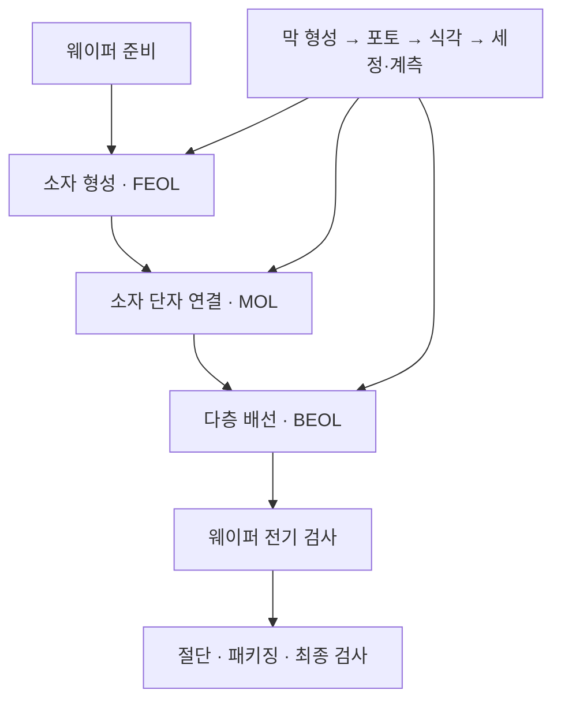
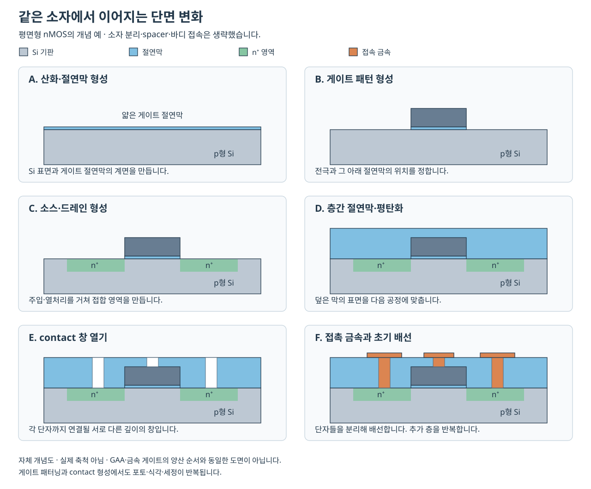

# 반도체 제조 공정 | Semiconductor fabrication

실리콘 기판 위에 소자를 만들고, 배선으로 연결하고, 검사와 패키징을 거쳐 제품으로 완성하는 과정을 공부합니다. 8대 공정을 중심으로 재료·장비·물리 원리·결함·계측을 연결하며, 로직·DRAM·NAND에서 공정의 목적이 어떻게 달라지는지도 다룹니다.

[저장소 첫 화면](../README.md) · [전체 분야별 목차](../분야별목차_CATALOG.md)

## 읽는 순서

처음 공부하신다면 [소자와 공정의 기초](00-소자와공정의기초_devices-process-basics.md)에서 전자·정공, 도핑, 접합, MOSFET, 길이와 농도 단위를 먼저 읽으시면 좋습니다. 이어서 [단면으로 보는 공정 흐름](11-단면으로보는공정흐름_cross-section-atlas.md)과 아래 공정별 본문을 읽고, [공정 통합과 품질 관리](09-공정통합과품질관리_integration-process-control.md)에서 각 단계가 다음 단계에 주는 영향을 살펴봅니다.

| 공정 | 본문에서 다루는 내용 |
| --- | --- |
| [① 웨이퍼 제조](01-웨이퍼제조_wafer-manufacturing.md) | 원료 정제, 단결정 성장, 결정 방향·도핑, 절단·연마·세정, 평탄도와 결정 결함 |
| [② 산화와 게이트 절연막](02-산화와게이트절연막_oxidation-gate-dielectrics.md) | 열산화, 막 성장과 실리콘 소비, Deal–Grove 모형, 계면, high-k와 등가 산화막 두께 |
| [③ 포토와 노광](03-포토와노광_photolithography.md) | 감광막·현상, CD·overlay·초점, DUV·EUV·High-NA, 해상도와 공정 여유 |
| [④ 식각과 선택비](04-식각과선택비_etching.md) | 습식·건식, 방향성·선택비, 플라즈마, 종횡비·패턴 밀도, ALE와 선택적 제거 |
| [⑤ 증착과 이온주입](05-증착과이온주입_deposition-implantation.md) | PVD·CVD·ALD·에피택시, 단차 피복, 주입량·에너지, 활성화·열처리 |
| [⑥ 금속배선과 평탄화](06-금속배선과평탄화_interconnect-cmp.md) | contact·via·배선, 구리 다마신, 방지막·도금·CMP, RC 지연과 신뢰성 |
| [⑦ 웨이퍼 검사와 수율](07-웨이퍼검사와수율_eds-yield.md) | EDS·ATE·probe card, 전기적 검사·binning·wafer map, 수율·coverage·재검사 |
| [⑧ 패키징과 첨단 집적](08-패키징과첨단집적_packaging.md) | 절단·접합·외부 연결, wire bond·flip-chip, 2.5D·3D·TSV·hybrid bonding, 열과 기계적 신뢰성 |

각 본문에는 용어 설명, 공정의 입력과 출력, 주요 변수, 결함과 검사 방법, 방식별 비교, 계산 예제와 해답을 넣었습니다. 수치 예제는 본문에 명시한 가정으로 구성한 교육용 계산입니다. 공개 사양·회사 발표와 구분하여 읽으실 수 있습니다.

## 8대 공정과 실제 제조 흐름

8대 공정은 공정을 이해하기 위한 분류입니다. 실제 칩은 여덟 작업을 한 번씩 거쳐 완성되지 않습니다. 막을 형성하고, 패턴을 만들고, 재료를 제거하고, 표면을 정리하는 작업을 여러 층에서 반복합니다. 검사와 계측도 완성 직전에만 하지 않습니다.

SK하이닉스의 [산화 공정 설명 중 제조 흐름 부분](https://news.skhynix.com/en/semiconductor-front-end-process-episode-2/)은 이 분류가 절대적이지 않으며, 금속배선·검사·패키징은 여러 작업을 묶은 범주라고 설명합니다.

FEOL은 트랜지스터 같은 소자를 형성하는 구간, MOL은 소자 단자를 배선과 이어 주는 구간, BEOL은 소자 위에 다층 배선을 만드는 구간입니다. BEOL의 ‘back end’와 조립·패키징을 가리키는 ‘후공정’은 문맥이 다릅니다. [통합 흐름의 단계별 설명](09-공정통합과품질관리_integration-process-control.md)에 이 구분을 정리했습니다.

## 공정 사이의 관계

같은 평면형 nMOS에서 게이트 절연막·게이트·접합·층간절연막·접촉·초기 배선이 이어지는 자체 개념도입니다. 소자 분리·spacer·바디 접속 등은 생략했습니다. [공정별 전후 단면과 공식 원도면](11-단면으로보는공정흐름_cross-section-atlas.md), [그림 출처와 이용 조건](그림_figures/출처와이용조건_SOURCES.md)을 함께 읽으실 수 있습니다.

- 포토가 정한 모양은 식각을 거치면서 재료의 모양으로 바뀝니다.
- 식각된 구멍과 홈은 다음 증착·도금에서 채워야 할 공간이 됩니다.
- 채운 막의 두께와 평탄도는 다음 노광의 초점과 배선 저항에 영향을 줍니다.
- 최종 검사에서 발견한 전기적 이상은 앞선 공정 이력과 계측값을 함께 보아야 원인을 좁힐 수 있습니다.

이 관계는 [공정 통합과 품질 관리](09-공정통합과품질관리_integration-process-control.md), 제품별 차이는 [로직·DRAM·NAND의 공정 차이](10-로직과메모리의공정차이_logic-memory-integration.md)에서 이어서 다룹니다.

## 평면형 소자에서 이어지는 기술

기초 공정은 평면형 MOSFET을 예로 설명할 수 있지만, 그 예 하나로 모든 제품을 설명할 수는 없습니다.

| 변화 | 공정에서 달라지는 문제 | 연결할 본문 |
| --- | --- | --- |
| SiO₂ 중심의 게이트에서 high-k·금속 게이트로 이동 | 전기적 제어력, 누설 전류, 계면 품질과 열처리의 조합 | [산화·절연막](02-산화와게이트절연막_oxidation-gate-dielectrics.md), [증착](05-증착과이온주입_deposition-implantation.md) |
| 평면형에서 FinFET·GAA로 구조 확장 | 입체 채널 형상, 선택적 재료 제거, 좁은 공간의 균일한 막 형성 | [식각](04-식각과선택비_etching.md), [제품별 통합](10-로직과메모리의공정차이_logic-memory-integration.md) |
| DUV에서 EUV·High-NA로 노광 방식 확장 | 마스크·광학계·감광막·초점·정렬·생산성의 공동 설계 | [포토·노광](03-포토와노광_photolithography.md) |
| 미세 배선과 후면 전력 공급 | 배선 저항·절연막·방지막의 비중, 전력과 신호 경로 분리 | [금속배선](06-금속배선과평탄화_interconnect-cmp.md) |
| 고종횡비 메모리 구조 | 깊은 구멍의 균일한 식각, 막 두께·응력, 층별 접속 | [제품별 통합](10-로직과메모리의공정차이_logic-memory-integration.md) |
| 단일 die 중심에서 chiplet·적층으로 확장 | die 간 연결 밀도, 접합 수율, 전력·열·기계적 신뢰성 | [패키징](08-패키징과첨단집적_packaging.md) |

공정별 최신 사례에는 공식 자료의 발표 시점과 적용 범위를 적었습니다. 회사가 보고한 양산, 장비 출하, 연구 시연과 향후 계획을 구분합니다.

## 관련 학습 자료

- [반도체 소자와 MOS 전기장](../분야_topics/10-반도체소자_semiconductors/README.md): 소자의 전기적 특성과 회로 동작을 더 공부합니다.
- [DFT·반도체 테스트·제조](../분야_topics/51-반도체테스트제조_test-manufacturing/README.md): scan·ATPG·fault coverage와 검사 설계를 연결합니다.
- [패키징·chiplet·열 설계](../분야_topics/36-패키징열설계_packaging-thermal/README.md): 전원·열·시스템 설계를 이어서 읽습니다.
- [EUV 노광의 해상도와 생산량](../제품리뷰_reviews/반도체와산업컴퓨팅_chips-industrial/극자외선노광의해상도와생산량_euv-lithography.md): 장비 기술과 생산 조건을 살펴봅니다.
- [전기·전자·통신 과목별 공개 강의](../학습사이트와채널_learning-resources/전기전자통신과목_ece-courses.md): 소자·공정·재료·계측의 대학 강의를 찾습니다.

## 영상과 출처

입문 영상은 bRd 3D의 [반도체의 기본원리와 8대 공정](https://www.youtube.com/watch?v=bAXxxmXCk1o)입니다. 영상의 한국어 자동 자막을 확인해 다루는 범위를 파악했으며, 본문은 제조사·장비사·대학·측정기관의 자료와 대조해 별도로 작성했습니다. 영상 설명에는 『진짜 하루만에 이해하는 반도체 산업』 일부를 바탕으로 제작했다고 밝혀져 있습니다.

공식 자료의 개념 설명과 현대 기술 사례는 각 장의 주장 가까이 연결했습니다. 자료를 확인한 기준일은 2026-10-26입니다. 본문은 자체 설명·개념도·가정한 계산으로 구성했습니다. MIT 공개 강의의 원도면은 확인한 이용 조건에 따라 저작자·강좌·라이선스를 표시하여 원본 그대로 실었습니다. 기업의 장비 사진과 연구 단면은 본문의 공식 원문 링크로 연결합니다.

## English

This guide connects eight common fabrication categories with device physics, materials, equipment, process variables, defects and metrology. The process chapters cover wafer manufacturing, oxidation and gate dielectrics, lithography, etching, deposition and implantation, interconnects and CMP, wafer testing, and packaging. Additional chapters explain prerequisites, integration and process control, and the different requirements of logic, DRAM and NAND. Worked examples use stated educational assumptions. Dated supplier reports, production milestones, research demonstrations and plans are identified separately.
