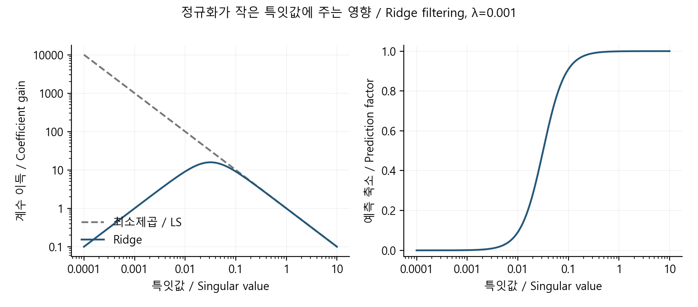

# 작은 특잇값이 오차를 키울 때: ridge 정규화

[분야 목차](../README.md) · [구현](../../../예제_examples/심화_advanced/math_reasoning/models.py) · [검증](../../../예제_examples/심화_advanced/math_reasoning/test_models.py)

## 한국어

### 1. 잘 맞는 답과 믿을 만한 계수

최소제곱은 관측값과 예측값의 차이를 줄인다. 그런데 두 입력 열이 거의 같으면, 한 계수를 크게 올리고 다른 계수를 크게 내려도 예측은 비슷할 수 있다. 결과 그래프는 잘 맞는데 계수는 작은 잡음에 크게 달라지는 상황이다. 저울의 눈금이 흐릿한 방향으로 아주 작은 차이까지 읽으려는 모습과 비슷하다. 이 문제는 단순히 컴퓨터의 속도나 소수점 자릿수만 늘려 해결되지 않는다.

Ridge는 잔차와 계수 크기를 함께 평가한다. 이 글의 입력은 이미 필요한 중심화·스케일링을 마친 행렬이며, 별도 절편은 두지 않는다. 절편을 추가해도 일반적으로 절편까지 같은 방식으로 벌점을 주는 것은 별도 선택이다. 입력의 단위를 바꾸면 계수의 크기도 바뀌므로, 정규화 전 스케일과 벌점의 의미를 먼저 정해야 한다. [MIT의 ridge·표준화 설명, pp. 4–5](https://ocw.mit.edu/courses/18-642-topics-in-mathematics-with-applications-in-finance-fall-2024/14S_E88WE3WkoIxxEUDt7A1ifKOugzJPE_transcript.pdf).

### 2. 목적함수에서 선형계까지

관측 행렬을 $`A\in\mathbb R^{m\times n}`$, 관측값을 $`y`$, 계수를 $`\theta`$라 하자. 여기서는 합계 제곱오차를 쓰며, 평균 제곱오차를 쓰는 문헌과는 $`\lambda`$의 배율이 달라질 수 있다.

```math
J(\theta)=\Vert A\theta-y\Vert_2^2+\lambda\Vert\theta\Vert_2^2,
\qquad \lambda\gt0.
```

첫 항을 전개하면 $`\theta^TA^TA\theta-2\theta^TA^Ty+y^Ty`$다. 대칭행렬의 이차형식을 미분하면 두 배가 나오므로

```math
\nabla J=2A^T(A\theta-y)+2\lambda\theta=0,
\qquad (A^TA+\lambda I)\hat\theta=A^Ty.
```

이 선형계가 최소값을 주는 이유도 확인할 수 있다. 임의의 0이 아닌 $`z`$에 대해 $`z^T(A^TA+\lambda I)z=\Vert Az\Vert^2+\lambda\Vert z\Vert^2\gt0`$다. 따라서 Hessian은 양의 정부호이고 해는 유일하다. 이 관계는 [Stanford EE269, slides 5–9](https://web.stanford.edu/class/ee269/Lecture13.pdf)의 목적함수와 대조했다. 역행렬 기호는 해의 성질을 나타내지만, 구현에서는 역행렬을 만들지 않고 분해한 선형계를 푼다.

### 3. SVD로 보는 잡음 증폭과 억제

$`A=U\Sigma V^T`$로 쓰고 $`\theta=Vz`$를 대입하면, 직교변환이 길이를 보존하므로 각 특잇값 방향의 독립적인 일변수 문제가 된다. 특잇값 $`\sigma_i`$와 관측 성분 $`c_i=u_i^Ty`$에 대해

```math
\min_{z_i}(\sigma_i z_i-c_i)^2+\lambda z_i^2
\quad\Longrightarrow\quad
z_i=\frac{\sigma_i}{\sigma_i^2+\lambda}c_i.
```

정규화가 없는 비영 특잇값 방향에서는 $`z_i=c_i/\sigma_i`$다. 작은 $`\sigma_i`$로 나누면 관측 잡음도 크게 증폭된다. Ridge의 계수 전달 이득은 $`\sigma_i/(\sigma_i^2+\lambda)`$이며, 예측 $`A\hat\theta`$의 축소 계수는 $`\sigma_i^2/(\sigma_i^2+\lambda)`$다. 둘은 다르다. 작은 방향을 약하게 반영하면서 잡음 민감도를 줄이지만, 그 방향의 실제 신호도 줄어들어 편향이 생긴다. 이득의 최댓값은 $`\sigma_i=\sqrt\lambda`$에서 $`1/(2\sqrt\lambda)`$다.

### 4. 구현과 계산 예

`ridge2`는 두 열을 받는 작은 구현이다. Gram 행렬과 우변을 합산한 뒤 2×2 Cholesky 분해와 전진·후진 대입을 사용한다. 관측 수가 $`m`$이면 연산량은 $`O(m)`$, 추가 공간은 $`O(1)`$이다. 이 구현은 해석과 검증을 위한 제한된 크기의 예다. 큰 문제나 심하게 나쁜 조건에서는 QR·SVD를 제공하는 검증된 수치 라이브러리가 적절하다. Gram 행렬을 구성하는 단계 자체가 조건수와 반올림의 영향을 받기 때문이다.

```bash
python 예제_examples/심화_advanced/math_reasoning/demo.py --output results/advanced-math
python -m unittest discover -s 예제_examples/심화_advanced/math_reasoning -p "test_*.py" -v
```

$`A=\mathrm{diag}(1,0.001)`$, $`y=(1,0.002)^T`$, $`\lambda=0.001`$이면 최소제곱 계수는 $`(1,2)`$지만 ridge 계수는 약 $`(0.999001,0.001998)`$이다. 이는 알고리즘이 원래 계수의 정답을 알아냈다는 뜻이 아니다. 작은 특잇값 방향에 대한 강한 벌점이 만든 결과다. 실제 선택에는 훈련 자료만으로 계산한 전처리, 검증 자료와 측정 오차의 구조가 필요하다.

### 5. 무엇으로 확인했는가

테스트는 100개 정수 행렬에서 정확한 `Fraction` 기준해와 대조한다. 대각행렬에서는 SVD 축소식을 직접 계산하고, 해 근처의 중심차분 기울기가 0인지와 곡률이 양수인지 확인한다. 빈 관측, 잘못된 열 수, 비유한 입력과 양수가 아닌 벌점도 거부한다. 정확한 수학에서는 양의 정부호여도 극단적인 부동소수점 입력에서는 계산된 피벗이 무너질 수 있으므로, 코드가 그 상황을 검출해 멈추게 했다.



## English

### 1. A close fit can hide unstable coefficients

Nearly identical columns permit large, opposing coefficient changes with little change in predictions. Small observation noise can then produce large parameter changes. Ridge evaluates residual size and coefficient size together. Here the design matrix has already received the intended centering and scaling, and there is no separate intercept. Whether an intercept is penalized is a separate modeling choice. Changing feature units changes coefficient magnitudes, so scaling and penalty meaning must be fixed first. [MIT, pp. 4–5](https://ocw.mit.edu/courses/18-642-topics-in-mathematics-with-applications-in-finance-fall-2024/14S_E88WE3WkoIxxEUDt7A1ifKOugzJPE_transcript.pdf).

### 2. Deriving the system

For $`A\in\mathbb R^{m\times n}`$, minimize the sum of squared residuals plus $`\lambda\Vert\theta\Vert^2`$, with $`\lambda\gt0`$. A mean-squared formulation rescales the penalty parameter. Expanding the residual gives $`\theta^TA^TA\theta-2\theta^TA^Ty+y^Ty`$. Differentiation yields $`2A^T(A\theta-y)+2\lambda\theta=0`$, hence $`(A^TA+\lambda I)\hat\theta=A^Ty`$. For nonzero $`z`$, the quadratic form is $`\Vert Az\Vert^2+\lambda\Vert z\Vert^2\gt0`$, proving uniqueness. [Stanford EE269, slides 5–9](https://web.stanford.edu/class/ee269/Lecture13.pdf) provides the matching objective. The implementation solves a factorized system rather than explicitly constructing its inverse.

### 3. Spectral filtering

Substitute $`A=U\Sigma V^T`$ and $`\theta=Vz`$. Orthogonal transformations preserve length, leaving independent scalar objectives $`(\sigma_i z_i-c_i)^2+\lambda z_i^2`$, where $`c_i=u_i^Ty`$. Setting each derivative to zero gives $`z_i=\sigma_i c_i/(\sigma_i^2+\lambda)`$. Without regularization, nonzero singular directions divide by $`\sigma_i`$ and amplify noise. The coefficient gain is $`\sigma_i/(\sigma_i^2+\lambda)`$; the prediction shrinkage factor is $`\sigma_i^2/(\sigma_i^2+\lambda)`$. They describe different quantities. The coefficient gain peaks at $`\sqrt\lambda`$ with value $`1/(2\sqrt\lambda)`$. Shrinkage reduces sensitivity but also suppresses real signal and introduces bias.

### 4. Running and verifying

`ridge2` accumulates a two-column Gram matrix and uses 2×2 Cholesky factorization, followed by triangular solves. Work is $`O(m)`$ and additional storage is constant. This bounded teaching implementation is not a large-scale solver: forming the Gram matrix already exposes conditioning and rounding concerns. Large or severely ill-conditioned problems call for established QR/SVD implementations.

The commands above run the example and tests. With $`A=\mathrm{diag}(1,0.001)`$, $`y=(1,0.002)^T`$ and $`\lambda=0.001`$, unregularized coefficients are $`(1,2)`$, while ridge gives approximately $`(0.999001,0.001998)`$. This is the effect of the penalty, not discovery of unknown true coefficients. Data-dependent preprocessing must be fitted on training data, and penalty selection depends on validation and the measurement model.

Tests compare 100 generated integer designs against exact rational solutions, verify diagonal spectral factors, check zero central-difference gradients and positive curvature, and reject malformed inputs. Although the exact matrix is positive definite, extreme floating-point inputs can destroy a computed pivot; the implementation detects that condition.

## 출처 / Sources

Stanford의 목적함수·MAP 관계와 MIT의 표준화·SVD 축소 설명을 대조했다. 2×2 구현과 수치 예는 위 정의에서 직접 계산했다. / The objective, scaling and SVD interpretation were cross-checked; the implementation and examples follow the stated definitions. 확인 / checked: 2026-10-19.
