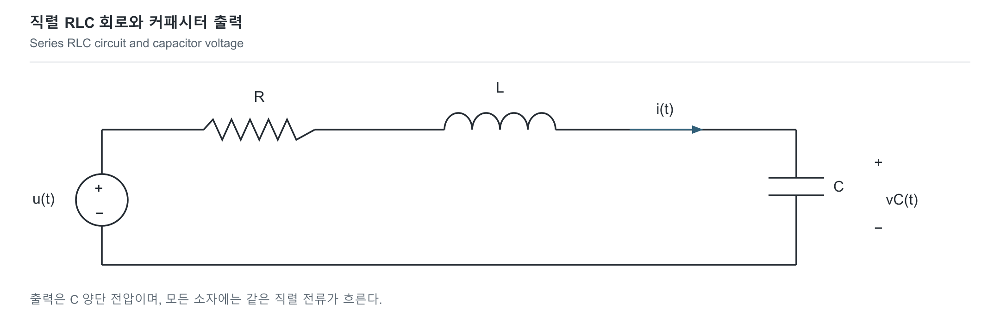

# RC·RLC: 회로 법칙에서 시간·주파수 응답까지

[회로와 전자공학](../README.md) · [모델과 실행 방법](../../../예제_examples/공학기초_foundations/circuits_hardware/README.md)

## 한국어

### 1. 전압이 바로 바뀌지 않는 이유

스위치를 켰다고 모든 회로의 출력이 즉시 입력과 같아지지는 않습니다. 커패시터에 전하가 쌓이고, 인덕터에는 자기장 에너지가 저장되기 때문입니다. 물통을 채우는 데 시간이 걸리는 것처럼 생각하면 첫 직관을 얻을 수 있습니다. 다만 전류가 물 자체라는 뜻은 아니며, 계산은 전하 보존과 소자의 전압·전류 관계로 합니다.

여기서는 배선의 전파 지연을 무시할 수 있는 집중소자 회로, 일정한 양의 R·L·C, 이상적인 전압원, 선형 소자를 가정합니다. 커패시터 출력에는 별도 부하가 없습니다. 커패시터 전압이나 인덕터 전류를 불연속적으로 바꾸려면 이상적인 충격 전류·전압이 필요하므로, 유한한 입력을 다루는 이 모델에서는 초기값이 이어집니다. [MIT 18.03의 RLC 모델](https://www.ocw.mit.edu/courses/18-03sc-differential-equations-fall-2011/035929616dc2553a2fee2aa787a96652_MIT18_03SCF11_s20_1text.pdf)

| 기호 | 의미 | SI 단위 |
|---|---|---|
| v, i | 소자 양단 전압, 양의 단자로 들어가는 전류 | V, A |
| R, C, L | 저항, 정전용량, 인덕턴스 | Ω, F, H |
| t, ω | 시간, 각주파수 | s, rad/s |
| τ, α, ω₀ | 시정수, 감쇠 계수, 무감쇠 고유 각주파수 | s, s⁻¹, rad/s |

수동 부호 규약에서 `vR=Ri`, `iC=C dvC/dt`, `vL=L diL/dt`입니다. 저장 에너지는 `EC=CvC²/2`, `EL=LiL²/2`이고, 저항의 소모 전력은 `Ri²`입니다. KCL은 노드의 전하 보존을, KVL은 이 집중소자 모델에서 폐경로의 전압 합을 표현합니다.

### 2. RC 방정식을 직접 만들기

전압원 u와 저항 R을 직렬로 연결하고 출력 v에 커패시터 C를 접지합니다. 저항 전류가 커패시터로 흐르므로

$$\frac{u-v}{R}=C\frac{dv}{dt},\qquad \tau=RC.$$

t≥0에서 입력이 일정한 U이고 `v(0)=v₀`라면, `e=v-U`를 두어 `de/dt=-e/τ`를 얻습니다. 변수 분리와 초기값 적용으로

$$v(t)=U+(v_0-U)e^{-t/\tau}.$$

처음 0 V에서 U로 충전하면 τ 뒤에는 최종값의 약 63.2%입니다. 5τ에도 정확히 완료되는 것은 아니며 남은 차이가 약 0.674%입니다. R=1 kΩ, C=1 μF라면 τ=1 ms입니다. 출력이 일정 범위 안에 들어가는 시간을 정할 때는 “충전 완료”보다 허용 오차를 명시하는 편이 정확합니다.

초기값 0에서 Laplace 변환하면 `H(s)=V/U=1/(1+sRC)`입니다. s=jω를 넣으면

$$\vert H(j\omega)\vert =\frac{1}{\sqrt{1+(\omega RC)^2}},\quad
\angle H=-\tan^{-1}(\omega RC),\quad f_c=\frac{1}{2\pi RC}.$$

낮은 주파수는 통과하고 빠른 변화는 줄어드는 저역통과 특성입니다. 주파수 응답은 정현파 정상상태의 비율이고, 비영 초기값에서의 전체 과도응답까지 그 비율 하나로 나타내는 것은 아닙니다.

### 3. RLC에서는 왜 흔들릴까요

R·L·C를 직렬로 연결하고 커패시터 전압을 v로 잡으면 `i=Cv'`, `u=Ri+Li'+v`입니다. 따라서

$$LCv''+RCv'+v=u,\quad
\omega_0=\frac1{\sqrt{LC}},\quad \alpha=\frac R{2L},\quad \zeta=\frac\alpha{\omega_0}.$$

무입력 자연응답의 특성근은 `s₁,₂=-α±√(α²-ω₀²)`입니다. 0<ζ<1이면 감쇠 진동, ζ=1이면 중근을 갖는 임계감쇠, ζ>1이면 서로 다른 두 실수 지수항을 갖는 과감쇠입니다. 일반적인 저장 에너지 수지는 `d(EC+EL)/dt=ui−Ri²`입니다. 무입력(u=0)에서 저항이 없으면 이상적인 에너지가 L과 C 사이에서 오가고, 저항이 있으면 `d(EC+EL)/dt=-Ri²≤0`로 감소합니다. [MIT 6.002의 2차 회로 해석](https://ocw.mit.edu/courses/6-002-circuits-and-electronics-spring-2007/34dd2fd3821b725a8b2191558673296b_6002_l15.pdf)

감쇠 진동에서 `ωd=√(ω₀²−α²)`, 초기 기울기를 `d₀=v'(0)=i(0)/C`라 하면

$$v(t)=e^{-\alpha t}\left[v_0\cos(\omega_dt)+\frac{d_0+\alpha v_0}{\omega_d}\sin(\omega_dt)\right].$$

임계감쇠는 `v(t)=e^(−αt)[v₀+(d₀+αv₀)t]`, 과감쇠는 `Ae^(s₁t)+Be^(s₂t)`이며 A+B=v₀, s₁A+s₂B=d₀로 계수를 정합니다. 이 초기값 조건이 빠지면 같은 회로에서도 하나의 응답을 정할 수 없습니다.

[SVG](../../../자료_assets/도식_diagrams/rc-rlc-response.svg) · [그림 원본 / Diagram source](../../../자료_assets/도식_diagrams/rc-rlc-response.mmd)

직접 작성한 직렬 RLC 연결도입니다. 출력은 C 양단입니다. 전달함수는 `Hc(s)=1/(LCs²+RCs+1)`입니다. ω₀를 모든 경우의 출력 공진 주파수라고 부르면 틀립니다. 이 출력의 크기 피크는 `0<ζ<1/√2`일 때 `ωp=ω₀√(1-2ζ²)`에서 생깁니다. 진동 주파수 `ωd=ω₀√(1-ζ²)`와도 다릅니다.

### 4. 코드로 만들고 검증하기

[models.py](../../../예제_examples/공학기초_foundations/circuits_hardware/models.py)의 `rc_step`은 해석해, `rc_euler`는 전진 Euler 적분입니다. 일정 입력 U에 대해 Euler 상태와 평형값의 차이를 `e[k]=v[k]−U`라 두면 `e[k+1]=(1-h/τ)e[k]`입니다. 이 차이가 점근적으로 줄어드는 안정 조건은 `0<h<2τ`입니다. 여기의 e는 해석해와의 수치오차가 아닙니다. 안정하다는 말과 충분히 정확하다는 말은 다르므로 h를 반으로 줄이며 해석해와의 차이도 따로 확인합니다.

RLC는 상태를 `(v,i)`로 두어 `v'=i/C`, `i'=(u-Ri-v)/L`를 RK4로 적분합니다. `rlc_free`의 세 감쇠 영역 해석해와 따로 비교하고, R=0의 에너지 보존과 R>0의 에너지 감소도 검사합니다. 각 모델은 N단계에 O(N) 시간, 현재 상태만 유지하므로 O(1) 추가 공간을 씁니다.

검증 기준은 초기·최종값, RC 시정수, 감쇠 영역별 해석해 오차, 에너지 관계입니다. 포함한 테스트는 `L=C=1`, 여러 R에서 4,000단계 RK4와 해석해의 전압 차이를 2×10⁻¹⁰ 이하로 검사합니다. 이는 정규화된 수치 예제의 기준입니다. 실제 회로 검증에는 부품 허용 오차, 소스·부하 저항, 인덕터 손실, 배선 기생 성분, 프로브 부하를 넣은 SPICE와 측정 불확도를 함께 다룹니다.

## English

### 1. Why a voltage takes time to change

Closing a switch does not make every output equal its input immediately. A capacitor accumulates charge, and an inductor stores magnetic-field energy. Filling a tank offers a useful first intuition, but circuit calculations use charge conservation and element equations rather than treating current literally as water.

This article assumes lumped wiring with negligible propagation delay, positive constant R, L and C, ideal sources, linear elements, and no separate capacitor load. With finite inputs, capacitor voltage and inductor current retain their initial values across a switching instant; discontinuities would require ideal impulse current or voltage. The [MIT 18.03 circuit model](https://www.ocw.mit.edu/courses/18-03sc-differential-equations-fall-2011/035929616dc2553a2fee2aa787a96652_MIT18_03SCF11_s20_1text.pdf) supplies the element-law and differential-equation reference.

Voltage v is in volts, current i in amperes, resistance R in ohms, capacitance C in farads, inductance L in henries, time t in seconds, and angular frequency ω in rad/s. The passive sign convention gives `vR=Ri`, `iC=C dvC/dt`, and `vL=L diL/dt`. Stored energies are `CvC²/2` and `LiL²/2`; resistor dissipation is `Ri²`. KCL expresses node charge conservation; KVL expresses the closed-path voltage relation within this lumped model.

### 2. Deriving RC behavior

For a source u connected through R to an output capacitor C, the common current gives `(u-v)/R=Cv'`. Define `τ=RC`. For a constant input U after t=0 and initial voltage v₀, the error `e=v-U` satisfies `e'=-e/τ`. Separating variables yields

$$v(t)=U+(v_0-U)e^{-t/\tau}.$$

Starting at zero, the output reaches approximately 63.2% of U at τ. At 5τ, approximately 0.674% of the original difference remains. With R=1 kΩ and C=1 μF, τ is 1 ms. A stated error band is more precise than claiming that charging has finished.

For zero initial state, `H(s)=1/(1+sRC)`. Its magnitude is `1/√(1+(ωRC)²)`, phase is `-atan(ωRC)`, and cutoff is `1/(2πRC)`. This is a low-pass response: slow variations pass more readily than fast ones. Frequency response describes sinusoidal steady state, not the entire transient from an arbitrary initial state.

### 3. RLC damping and frequency response

For a series RLC circuit observed across C, `i=Cv'` and `u=Ri+Li'+v`, giving `LCv''+RCv'+v=u`. Define `ω₀=1/√(LC)`, `α=R/(2L)`, and `ζ=α/ω₀`. The unforced characteristic roots are `-α±√(α²-ω₀²)`. Values 0<ζ<1, ζ=1, and ζ>1 produce underdamped, critically damped, and overdamped responses, respectively. The critical case requires a repeated-root solution. [MIT 6.002](https://ocw.mit.edu/courses/6-002-circuits-and-electronics-spring-2007/34dd2fd3821b725a8b2191558673296b_6002_l15.pdf) provides a second circuit-analysis reference.

For underdamping, define `ωd=√(ω₀²−α²)` and initial slope `d₀=v'(0)=i(0)/C`. Then

$$v(t)=e^{-\alpha t}\left[v_0\cos(\omega_dt)+\frac{d_0+\alpha v_0}{\omega_d}\sin(\omega_dt)\right].$$

Critical damping gives `e^(−αt)[v₀+(d₀+αv₀)t]`. Overdamping gives `Ae^(s₁t)+Be^(s₂t)`, with A+B=v₀ and s₁A+s₂B=d₀. Initial conditions are necessary to select a unique response even for the same circuit.

The original diagram above shows the source, dissipative R, magnetic storage L and electric storage C in series; the output is across C. The general stored-energy balance is `dE/dt=ui−Ri²`. With no input (u=0), ideal energy alternates between L and C when R=0; with resistance it decreases according to `dE/dt=-Ri²≤0`.

For this output, `Hc(s)=1/(LCs²+RCs+1)`. The natural frequency ω₀ is not universally the output resonance frequency. A magnitude peak occurs for `0<ζ<1/√2` at `ωp=ω₀√(1-2ζ²)`. That is also distinct from the damped natural-response frequency `ωd=ω₀√(1-ζ²)`.

### 4. Implementation and verification

[models.py](../../../예제_examples/공학기초_foundations/circuits_hardware/models.py) contains the analytical `rc_step` and forward-Euler `rc_euler`. For constant input U, define the Euler state's deviation from equilibrium by `e[k]=v[k]−U`. Then `e[k+1]=(1-h/τ)e[k]`, which decays asymptotically when `0<h<2τ`. This e is not the numerical error against the exact trajectory. Stability alone does not establish accuracy; step refinement separately checks the difference from the analytical solution.

The RLC implementation uses states `(v,i)` with `v'=i/C` and `i'=(u-Ri-v)/L`, integrated by RK4. A separate analytical function covers all three damping regimes. Checks also cover lossless energy conservation and resistive energy decrease. N integration steps cost O(N) time and O(1) extra state storage.

Acceptance checks cover initial and final values, the RC time constant, analytical agreement in each damping regime, and energy relations. For the normalized examples with `L=C=1`, the tests require voltage agreement within 2×10⁻¹⁰ after 4,000 RK4 steps for several R values. That criterion belongs to this numerical example. Physical validation additionally needs component tolerances, source and load resistance, inductor losses, parasitics, probe loading, SPICE models, and measurement uncertainty.

## 출처와 대조한 내용 | Sources and cross-checks

- MIT 18.03SC, *RLC Circuits*, pp. 1–2: 소자 관계·직렬 회로 방정식·복소 임피던스 / element relations, series-circuit equations, complex impedance.
- MIT 6.002, *Lecture 15: Second-order systems*: 초기값·특성근·감쇠 응답 / initial conditions, characteristic roots and damping. 두 강의의 방정식을 같은 C 출력으로 정리해 부호와 계수를 대조했다 / equations were expressed for the same capacitor output to check signs and coefficients.
- 그림·수치 예제·테스트는 이 문서의 모델에서 작성했다 / the diagram, numerical examples and tests were constructed for this model. 출처 확인 / sources checked: 2026-10-19.
