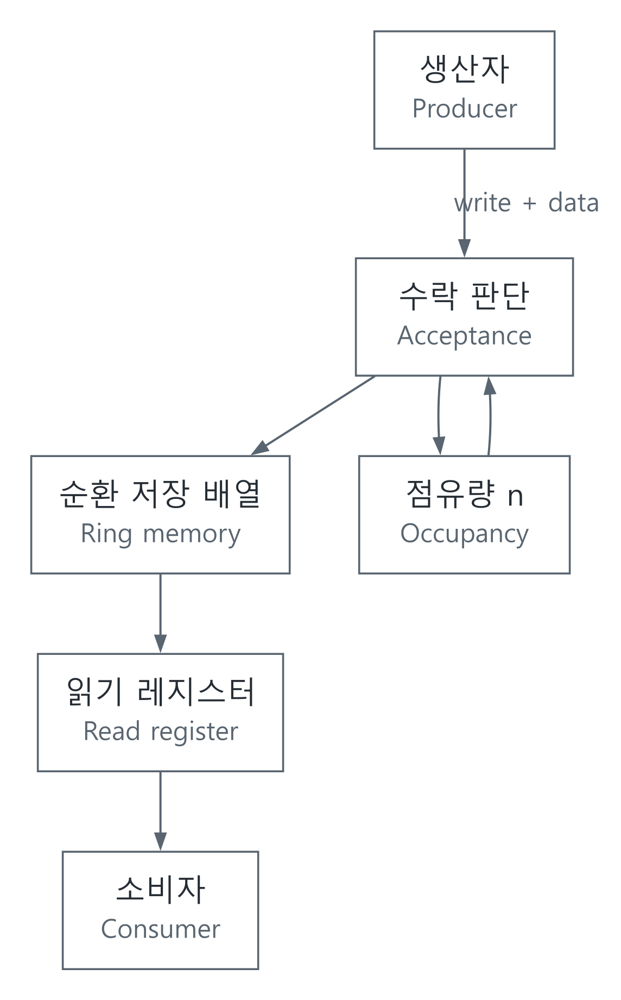

# FSM과 FIFO: 요청과 실제 전송을 구분하기

[Verilog와 SystemVerilog](../README.md) · [코드와 실행 방법](../../../예제_examples/공학기초_foundations/circuits_hardware/README.md)

## 한국어

### 1. 줄을 세워 잠깐의 속도 차이를 받아 준다

센서가 데이터를 만드는 순간과 처리기가 가져가는 순간은 다를 수 있다. FIFO는 먼저 들어온 데이터를 먼저 내보내는 저장 공간이다. 매표소의 대기 줄과 비슷하지만, 저장 칸에는 한계가 있다. 소비자가 영원히 느리면 어떤 유한한 FIFO도 넘침을 막을 수 없다. 생산자에게 기다리라는 신호를 주거나, 데이터 손실을 명세로 정해야 한다.

FSM은 현재 상태와 입력으로 다음 상태를 결정하는 유한 상태 기계다. 동기식 회로에서는 클록 에지에서 상태를 갱신한다. 입력과 현재 상태로 만든 조합 논리가 에지 전에 안정되어야 하므로 setup·hold와 클록 주기 조건도 지켜야 한다. 기능적으로 맞는 상태표만으로 타이밍까지 보장되지는 않는다. [MIT 6.004 FSM 강의](https://ocw.mit.edu/courses/6-004-computation-structures-spring-2009/13f0393a7c56840b8d15efb89f84fe65_MIT6_004s09_lec06.pdf)

### 2. 먼저 전송 규칙을 정한다

여기서는 하나의 클록, 같은 입출력 폭 W, 깊이 D≥1인 FIFO를 구현한다. n은 상승 에지 직전의 저장 개수다. `write`, `read`는 요청이고 실제 수락 `w`, `r`은 다음과 같다.

$$w=write\land(n<D),\quad r=read\land(n>0),\quad n'=n+w-r.$$

write와 read는 같은 에지 이전의 n을 보고 각각 판단한다. 빈 FIFO에서 쓰기와 읽기가 동시에 들어오면 쓰기만 수락한다. 가득 찬 FIFO에서는 읽기만 수락한다. 새 입력을 바로 출력으로 보내는 bypass나, full에서 읽는 자리를 같은 에지의 쓰기에 재활용하는 기능은 이 설계에 없다. 이 선택은 단순하고 명확한 동작을 위한 명세이며, 모든 상용 FIFO의 동작을 정의하는 법칙은 아니다. [AMD PG327의 읽기 모드와 빈 상태 동시 요청](https://docs.amd.com/r/en-US/pg327-emb-fifo-gen/Read-Operation)을 대조하면, 읽기 지연과 FWFT 여부를 별도로 확인해야 하는 이유를 볼 수 있다.

| 에지 직전 상태 | 쓰기·읽기 동시 요청 | 다음 점유량 |
|---|---|---|
| n=0 | 쓰기 수락, 읽기 거절 | 1 |
| 0<n<D | 둘 다 수락 | n |
| n=D | 쓰기 거절, 읽기 수락 | D−1 |

깊이가 1이면 가운데 행은 없다. 따라서 이 보수적인 설계는 깊이 1에서 매 클록 입력을 계속 수락하는 파이프라인 레지스터와 다르다.

### 3. 수식이 RTL의 상태로 바뀌는 과정

state는 저장 배열, read pointer, write pointer, 점유량으로 구성된다. pointer는 수락한 동작에서만 증가하고 D−1 다음에는 0으로 돌아온다. D가 2의 거듭제곱이 아니어도 명시적으로 wrap한다. pointer 폭은 최소 1비트로 `max(1,ceil(log₂D))`, 점유량 폭은 0부터 D까지 표현하도록 `ceil(log₂(D+1))`다.

[SVG](../../../자료_assets/도식_diagrams/synchronous-fifo-invariants.svg) · [도식 원본 / Diagram source](../../../자료_assets/도식_diagrams/synchronous-fifo-invariants.mmd)

직접 작성한 동기 FIFO 도식이다. `sync_fifo.sv`는 수락한 상승 에지 뒤에 `rd_data`와 `rd_valid`를 내보낸다. `rd_valid=0`일 때 `rd_data`에 이전 값이 남아도 새로운 데이터가 아니다. `wr_ack` 역시 그 에지에서 쓰기가 수락되었음을 나타낸다. reset은 동기식 active-high이며 pointer·점유량·출력 유효 신호를 초기화한다. 메모리 전체를 0으로 지우지 않아도 점유량이 0이면 이전 데이터는 읽힐 수 없다.

### 4. 무엇을 검증해야 할까

기본 불변식은 `0≤n≤D`다. reset 이후 누적 수락 쓰기 수를 A, 읽기 수를 B라고 하면 `n=A−B`도 성립해야 한다. 하지만 점유량만 맞는 회로도 데이터를 바꿔치기할 수 있다. 출력열이 수락된 입력열과 같은 순서를 유지하며, 중복·누락이 없는지도 확인한다.

[Python 모델](../../../예제_examples/공학기초_foundations/circuits_hardware/models.py)은 배열과 pointer로 구현하고 테스트 기준은 독립적인 `deque`를 쓴다. 깊이 1·2·3·4에서 네 요청 조합의 길이 6인 모든 열을 검사하고, 깊이 1·3·8·17에서는 무작위 wrap·reset을 추가한다. 한 cycle은 O(1) 시간, 저장 공간은 O(D)다. RTL은 고정 크기의 병렬 회로이므로 이 소프트웨어 복잡도를 FPGA 동작 시간으로 그대로 읽지는 않는다.

`tb_sync_fifo.sv`는 입력을 하강 에지에서 바꾸고, 다음 상승 에지 뒤에 점유량·flags·ack·출력 순서를 점검한다. Python 테스트 통과와 RTL 실행 통과는 별도다. RTL 시뮬레이션, 합성 후 메모리 추론, setup·hold 분석, 보드 검증은 각 단계의 증거를 남겨야 한다. 특히 이 단일 클록 설계를 서로 다른 두 클록에 나누어 연결하면 안전한 비동기 FIFO가 되지 않는다. 비동기 FIFO는 pointer 동기화와 clock-domain별 flag 지연을 별도로 다룬다. [AMD PG327 독립 클록 구조](https://docs.amd.com/r/en-US/pg327-emb-fifo-gen/Independent-Clocks-Block-RAM-and-Distributed-RAM)

## English

### 1. Buffering a temporary rate mismatch

A sensor may produce data at a different instant from when a processor consumes it. A FIFO stores data in first-in, first-out order. Like a ticket queue, it has finite capacity. If the consumer remains slower indefinitely, no finite FIFO can prevent overflow; the interface needs backpressure or an explicit data-loss policy.

An FSM maps the current state and inputs to a next state. A synchronous implementation updates state on clock edges. Its combinational logic must settle before the sampling edge, with setup, hold and clock-period requirements satisfied. A correct transition table does not by itself establish timing correctness. [MIT 6.004 FSM lecture](https://ocw.mit.edu/courses/6-004-computation-structures-spring-2009/13f0393a7c56840b8d15efb89f84fe65_MIT6_004s09_lec06.pdf)

### 2. Define accepted transfers first

This example has one clock, equal input/output width W, and depth D≥1. Let n be occupancy immediately before a rising edge. Requests `write` and `read` become accepted transfers

$$w=write\land(n<D),\quad r=read\land(n>0),\quad n'=n+w-r.$$

Both acceptance decisions use the same pre-edge occupancy. Simultaneous requests while empty accept only the write and change occupancy to one. In the interior, both are accepted and occupancy stays unchanged. While full, only the read is accepted and occupancy becomes D−1. There is neither empty-state bypass nor full-state replacement using the space freed by a simultaneous read. This is a deliberately simple contract, not a universal rule for vendor FIFOs. [AMD PG327 read-operation documentation](https://docs.amd.com/r/en-US/pg327-emb-fifo-gen/Read-Operation) helps cross-check why read latency and FWFT mode must be specified independently.

Depth one has no interior state. Consequently, this conservative FIFO is not equivalent to a pipeline register that can continuously accept one new item per clock.

### 3. Turning the contract into RTL

State comprises a memory array, read pointer, write pointer and occupancy. Pointers advance only for accepted operations and explicitly wrap from D−1 to zero, including non-power-of-two depths. The pointer width is `max(1,ceil(log₂D))`; occupancy needs `ceil(log₂(D+1))` bits to represent every value from zero through D.

The original diagram shows producer requests, acceptance logic, ring memory, a read register and consumer, with occupancy feeding acceptance. In `sync_fifo.sv`, `rd_data` becomes valid with `rd_valid` after the accepting rising edge. If `rd_valid=0`, a retained `rd_data` value does not represent another transfer. `wr_ack` reports a write accepted on that edge. Synchronous active-high reset clears pointers, occupancy and output-valid signals. Clearing every memory location is unnecessary for this contract: zero occupancy prevents stale data from being read.

### 4. Verification targets

The first invariant is `0≤n≤D`. If A and B are the accumulated accepted writes and reads since reset, then `n=A−B`. Occupancy alone is insufficient: an incorrect circuit could preserve the count while corrupting data. The output sequence must preserve the accepted input order without duplication or loss.

The [Python model](../../../예제_examples/공학기초_foundations/circuits_hardware/models.py) uses an array and pointers, while the independent reference uses `deque`. Tests enumerate every length-six sequence of the four request combinations for depths 1, 2, 3 and 4, then add randomized wraparound and reset checks for depths 1, 3, 8 and 17. A model cycle costs O(1) time and storage is O(D). These software complexity statements do not directly specify the execution time of a fixed parallel RTL circuit.

`tb_sync_fifo.sv` drives requests on falling edges and checks occupancy, flags, acknowledgements and output ordering after rising edges. Python-model success and RTL-simulation success are separate evidence. RTL execution, synthesized memory inference, setup/hold analysis and board behavior each need their own checks. Splitting this single-clock design across unrelated clocks does not create a safe asynchronous FIFO. That requires separate pointer synchronization and domain-specific flag-latency analysis, as described in [AMD PG327's independent-clock architecture](https://docs.amd.com/r/en-US/pg327-emb-fifo-gen/Independent-Clocks-Block-RAM-and-Distributed-RAM).

## 출처와 대조한 내용 | Sources and cross-checks

- MIT 6.004: 상태·조합 논리·클록 및 타이밍 전제 / state, combinational logic, clock and timing assumptions.
- AMD PG327, *Read Operation* and *Independent Clocks*: 수락과 읽기 모드·클록 경계 / acceptance, read modes and clock boundaries. 예제는 자체 명세이며 AMD IP와의 비트 단위 동등성을 주장하지 않는다 / the example has its own contract and does not claim bit-level equivalence with AMD IP.
- 코드·상태 도식·시험열은 직접 작성했다 / code, state diagram and stimulus sequences constructed here. 출처 확인 / sources checked: 2026-10-19.
