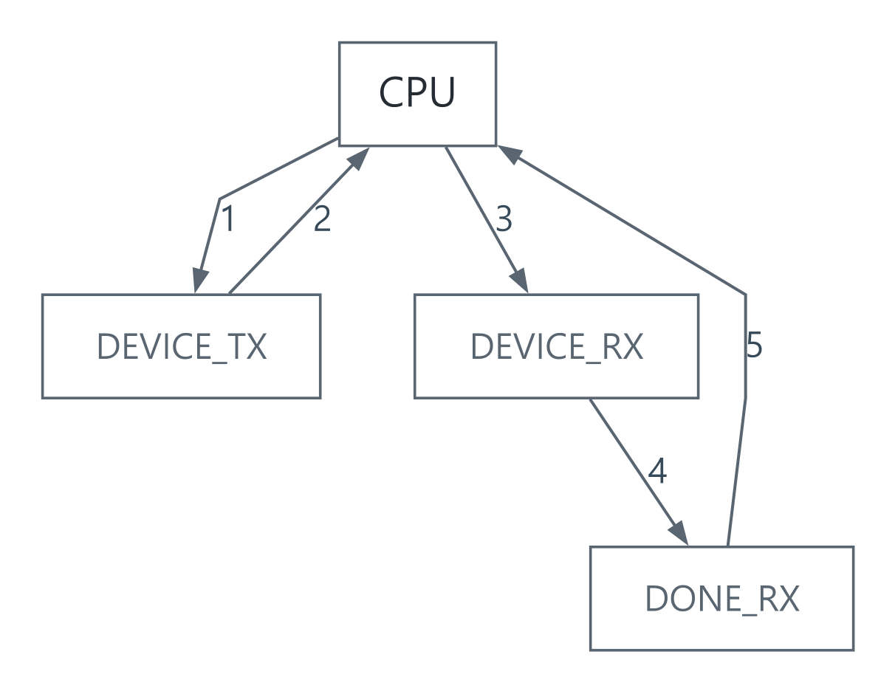

# CPU와 장치가 같은 데이터를 다룰 때: MMIO, 인터럽트, DMA

[상위 주제](../README.md) · [실행 모델](../../../예제_examples/공학기초_foundations/systems/systems_models.py) · [검증 코드](../../../예제_examples/공학기초_foundations/systems/test_systems_models.py)

## 한국어

### 계산보다 데이터 이동이 먼저 문제가 될 수 있습니다

센서의 값을 CPU가 한 바이트씩 읽으면 전송 내내 CPU가 관여합니다. DMA는 전송 규칙을 설정해 두고 장치가 메모리로 데이터를 옮기게 합니다. CPU는 다른 일을 하다가 완료 이벤트를 처리할 수 있습니다. 다만 복사가 끝났다는 사실, CPU가 보는 값이 최신이라는 사실, 다른 코드가 버퍼를 덮어쓰지 않는다는 사실은 서로 다른 조건입니다.

MMIO는 장치 레지스터에 메모리 주소를 부여해 접근하는 방식입니다. 레지스터는 일반 RAM과 다릅니다. 읽는 순간 상태가 지워지거나, 1을 써서 비트를 지우거나, 특정 폭의 접근만 허용할 수 있습니다. 주소·비트 의미·읽기와 쓰기 부작용은 해당 부품의 reference manual에 따릅니다. Linux 드라이버에서는 직접 일반 포인터로 다루기보다 `readl()`·`writel()` 같은 I/O 접근자를 사용합니다. [Linux memory barriers, Kernel I/O barrier effects](https://docs.kernel.org/core-api/wrappers/memory-barriers.html)

### volatile이 해결하는 것과 별도로 필요한 것

`volatile`은 구현이 정한 volatile 접근을 유지하도록 컴파일러의 최적화를 제한합니다. 그러나 `count++`를 원자적 연산으로 만들거나 스레드 간 happens-before를 만들어 주지 않습니다. 잠금, atomic, RTOS 동기화와 장치용 메모리 순서를 각각 구분합니다. Linux 커널의 `volatile` 지침도 이를 동기화 수단으로 사용하는 문제를 설명합니다. [Linux, Why volatile should not be used](https://docs.kernel.org/process/volatile-considered-harmful.html)

인터럽트는 실행 흐름을 처리 함수로 전환합니다. ISR에서는 장치 상태 확인과 필요한 응답을 처리하고, 긴 연산은 큐나 알림으로 넘기는 구성이 흔합니다. 인터럽트를 잠깐 막는 것만으로 다른 CPU 코어까지 멈추지는 않습니다. DMA도 계속 동작할 수 있습니다. 단일 코어인지, 다중 코어인지, ISR에서 사용할 수 있는 API인지에 따라 보호 방법이 달라집니다.

### 캐시와 메모리는 같은 장소가 아닙니다

CPU가 write-back 캐시에 새 값을 써도 RAM에는 아직 옛 값이 있을 수 있습니다. 비일관성 DMA가 RAM을 읽으면 옛 값을 가져갑니다. 반대로 DMA가 RAM을 바꿔도 CPU 캐시에는 옛 값이 남을 수 있습니다. clean은 수정된 캐시 내용을 메모리에 반영하고, invalidate는 해당 캐시 내용을 버려 다음 접근에서 다시 읽게 합니다. 메모리 배리어만으로 dirty cache line이 자동 정리된다고 가정하지 않습니다. [Linux DMA API HOWTO](https://docs.kernel.org/core-api/dma-api-howto.html)

| 방향 | 소유권을 넘기기 전에 | 완료 확인 뒤 |
| --- | --- | --- |
| CPU → DMA 송신 | 버퍼 작성, 필요한 clean·순서 보장 | DMA가 더 이상 읽지 않으면 CPU가 재사용 |
| DMA → CPU 수신 | 전용 버퍼 준비, 필요한 clean/invalidate·순서 보장 | 필요한 invalidate 후 CPU가 읽음 |

이는 개념적 순서입니다. 실제 cache API, 배리어, 정렬 조건은 플랫폼에 따릅니다. 캐시 라인을 다른 데이터와 공유하면 invalidate가 이웃 데이터에 영향을 줄 수 있습니다. 수신 중 CPU가 버퍼에 접근하지 않게 하고, 필요한 범위·방향의 DMA API를 사용합니다.

ST AN4839는 STM32F7/H7의 Cortex-M7 캐시와 DMA 예를 제공합니다. Espressif의 아래 문서는 ESP32-P4, ESP-IDF v5.5.5의 `esp_cache_msync()`와 정렬 조건을 설명합니다. “STM32”나 “ESP32”라는 계열 이름만으로 같은 캐시·DMA 동작을 가정하지 않습니다. [ST AN4839 §3.2·§4](https://www.st.com/resource/en/application_note/DM00272913-.pdf), [Espressif ESP32-P4 memory synchronization](https://docs.espressif.com/projects/esp-idf/en/v5.5.5/esp32p4/api-reference/system/mm_sync.html)

### 소유권 상태로 모델링하기

[SVG](../../../자료_assets/도식_diagrams/mmio-interrupt-dma.svg) · [그림 원본 / Diagram source](../../../자료_assets/도식_diagrams/mmio-interrupt-dma.mmd)

| 번호 / No. | 출발 / From | 도착 / To | 조건·동작 / Condition and action |
| --- | --- | --- | --- |
| 1 | CPU | DEVICE_TX | 작성·clean 후 송신 시작 / Prepare and start TX |
| 2 | DEVICE_TX | CPU | 송신 완료 / TX complete |
| 3 | CPU | DEVICE_RX | 수신 버퍼 준비 / Prepare RX |
| 4 | DEVICE_RX | DONE_RX | 수신 완료 / RX complete |
| 5 | DONE_RX | CPU | invalidate 후 반환 / Invalidate and acquire |

이 문서를 위해 작성한 상태도입니다. 핵심 불변조건은 장치 소유인 동안 CPU가 버퍼를 읽거나 쓰지 않는다는 것입니다. 버퍼 길이가 $`N`$, 입력 속도가 $`R`$ byte/s이면 한 버퍼가 담는 시간은 $`T=N/R`$입니다. 두 버퍼를 번갈아 쓰는 경우에도 소비자가 반환하는 최악 시간과 스케줄링 지연이 재사용 시점보다 짧아야 합니다. 평균 처리 속도만 높다고 overrun이 사라지지는 않습니다. 버스 경쟁과 장치 FIFO도 실제 여유를 줄입니다.

### 구현과 검증

`DmaBuffer`는 RAM과 CPU 캐시를 별도 배열로 둡니다. `start_tx()`는 dirty 데이터를 반영한 뒤 소유권을 넘기고, `acquire_rx()`는 수신 완료 확인 뒤 캐시를 무효화합니다. 버퍼 전체가 독립된 캐시 라인 범위라고 가정하며 실제 명령어 배리어나 주변장치 레지스터는 시뮬레이션하지 않습니다. 모델의 복사 비용은 $`O(N)`$이고, 상태 전환만의 비용은 $`O(1)`$입니다.

테스트는 clean 전 RAM이 옛 값임을 확인하고, 장치 소유 중 CPU 접근과 완료 전 반환을 거부하는지 검사합니다. 수신 뒤 최신 값 읽기, 잘못된 길이, 100회의 송수신 반복도 확인합니다. 실제 보드 검증에서는 cache on/off, 다양한 길이와 정렬, 최대 전송률, ISR 지연, 버퍼 overrun 계수를 함께 관찰해야 합니다. Python 통과가 DMA 타이밍이나 MCU 캐시 명령의 적합성을 입증하는 것은 아닙니다.

### PCIe의 첫 Completion과 전체 요청 완료를 구분하기

DMA 엔진이 PCIe Memory Read로 데이터를 가져오는 구성에서는 한 요청이 여러 Completion으로 돌아올 수 있습니다. tag는 미완료 요청을 식별하는 번호입니다. 첫 응답의 도착·전체 데이터 수신·DMA 엔진 작업 완료·CPU가 최신 값을 읽을 준비가 된 상태는 각각 따로 확인해야 합니다. [PCIe 태그와 분할 응답 사례](../../../설계와검증사례_engineering-cases/PCIe의태그와분할응답_pcie-split-completions.md)는 이 중 요청별 데이터 조립만 호스트에서 실행합니다.

자체 예제에서 tag 5는 `0x1070`부터 32바이트를 읽고 16+16바이트로 받습니다. 첫 Byte Count는 현재 조각을 포함한 남은 양인 32, 다음 값은 16입니다. Lower Address는 첫 시작 주소 하위 7비트인 112에서 다음 주소 `0x1080`의 0으로 바뀝니다. 중간에 tag 9의 8바이트가 도착해도 tag 5를 완료로 바꾸지 않습니다. 전체 32바이트를 확인하기 전 CPU 읽기와 tag 재사용을 거부합니다.

| 조건 | 자체 모델의 관측 | 실제 시스템에서 별도로 확인할 내용 |
| --- | --- | --- |
| 첫 Completion 도착 | 받은 16·남은 16·ACTIVE입니다. | controller가 완료를 어떤 단위로 보고하는지 확인합니다. |
| 같은 요청의 나머지 Completion | 받은 32·남은 0·DONE입니다. | DMA 엔진 descriptor와 응용 buffer의 범위를 연결합니다. |
| 틀린 Byte Count·Lower Address | 저장하기 전에 거부하며 앞 16바이트를 유지합니다. | error completion·timeout·abort 정책을 확인합니다. |
| 조립 완료 뒤 CPU 읽기 | 모델의 bytes를 반환합니다. | 필요한 DMA 동기화·cache·메모리 순서를 확인합니다. |

이 모델은 단일 Requester·DW 정렬·전체 byte-enable·SC·MPS 128·RCB 128로 제한합니다. RCB는 중간 분할 위치의 경계이며 MPS와 다릅니다. `0x1070`에서 단일 32바이트 Completion으로 전체 요청을 끝내는 대조도 허용합니다. 원 요청 시작과 끝에 대한 예외를 적용한 것이며 모든 조각을 128바이트 안에 가두는 규칙이 아닙니다. [AMD PG346 3.3의 Memory Read](https://docs.amd.com/r/3.3-English/pg346-cpm-pcie/Completer-Memory-Read-Operation?contentId=HESS8S8G5krVslhhZyT87w), [PG054 3.3의 RCB](https://docs.amd.com/r/en-US/pg054-7series-pcie/Read-Completion-Boundary)

CPU virtual address·물리 주소·장치 DMA 주소도 구별합니다. IOMMU나 host bridge가 있으면 같은 숫자라고 가정할 수 없습니다. coherent DMA 메모리라도 descriptor 내용과 valid 표시의 순서 보장은 별도입니다. Linux 6.12의 DMA 문서에서 CPU and DMA addresses·Types of DMA mappings를 확인했습니다. [Linux 6.12 DMA mapping Guide](https://docs.kernel.org/6.12/core-api/dma-api-howto.html)

새 검사는 해독된 필드의 합성 조립·소유권 계약입니다. 실제 PCIe 링크·root port·DMA mapping·배리어·cache 명령·원시 TLP·하드웨어 시간을 실행하지 않았습니다. 기존 `DmaBuffer`의 cache/RAM 예제와 결과도 별도로 유지합니다. 새 사례의 정상/-O·의도적 변이·실행 해시는 [검증 기록](../../../설계와검증사례_engineering-cases/검증기록_evidence/USB와PCIe전송계약검증_20261021.md)에 있습니다.

## English

### Data movement can dominate the work

Reading a sensor one byte at a time keeps the CPU involved throughout transfer. DMA lets a device move data according to a configured transfer while the CPU performs other work and later handles completion. However, transfer completion, freshness of the CPU's view, and protection against buffer reuse are separate conditions.

MMIO assigns memory addresses to device registers. Registers are not ordinary RAM: reads may clear status, writing one may clear a bit, and only certain access widths may be allowed. The device reference manual defines addresses, bit meanings, and access side effects. Linux drivers use I/O accessors such as `readl()` and `writel()` rather than treating device memory as a normal pointer. [Linux memory barriers, I/O effects](https://docs.kernel.org/core-api/wrappers/memory-barriers.html)

### Volatile and synchronization

`volatile` constrains compiler optimization of implementation-defined volatile accesses. It does not make `count++` atomic or create a happens-before relationship between threads. Locks, atomics, RTOS synchronization, and device-memory ordering solve different problems. [Linux volatile guidance](https://docs.kernel.org/process/volatile-considered-harmful.html)

An interrupt transfers execution to a handler. A common arrangement handles essential device response there and forwards longer work through a queue or notification. Disabling local interrupts does not stop another CPU core, and DMA may continue running. Protection depends on the core count, execution context, and APIs permitted from an ISR.

### Cache versus memory

A CPU write may remain dirty in a write-back cache while RAM still contains the old data. A noncoherent DMA reader can therefore obtain stale bytes. Conversely, a DMA update to RAM can leave an old CPU cache entry. Cleaning writes modified cache content back; invalidation discards cache content so a later access reloads it. A memory barrier alone is not a universal cache-clean operation. [Linux DMA API HOWTO](https://docs.kernel.org/core-api/dma-api-howto.html)

| Direction | Before handing ownership over | After confirmed completion |
| --- | --- | --- |
| CPU → device TX | Write data; perform required cleaning and ordering | Reuse after DMA stops reading |
| Device → CPU RX | Prepare dedicated buffer; required clean/invalidate and ordering | Invalidate as required before CPU reads |

This is a conceptual ordering, not a portable cache-maintenance recipe. APIs, barriers, and alignment are platform-specific. Shared cache lines can make invalidation affect neighboring data. Keep CPU accesses away during receive and use the appropriate DMA API range and direction.

ST AN4839 provides STM32F7/H7 Cortex-M7 examples. The Espressif reference below describes `esp_cache_msync()` and alignment for ESP32-P4 with ESP-IDF v5.5.5. Family labels alone do not establish identical DMA/cache behavior. [ST AN4839 §3.2, §4](https://www.st.com/resource/en/application_note/DM00272913-.pdf), [Espressif memory synchronization](https://docs.espressif.com/projects/esp-idf/en/v5.5.5/esp32p4/api-reference/system/mm_sync.html)

### Model ownership explicitly

The original state diagram above distinguishes CPU ownership, active TX, active RX, and completed RX awaiting acquisition. Its central invariant forbids CPU access while the device owns the buffer. For capacity $`N`$ bytes and input rate $`R`$ byte/s, one buffer spans $`T=N/R`$. Even with double buffering, worst-case consumption time plus scheduling delay must meet the next reuse deadline. High average throughput alone does not prevent overruns; bus contention and device FIFOs affect margin too.

### Implementation and verification

`DmaBuffer` represents RAM and CPU cache as separate arrays. `start_tx()` cleans dirty data before handing ownership over; `acquire_rx()` invalidates after confirmed completion. The whole buffer is assumed to occupy dedicated cache-line ranges. The model does not simulate instruction barriers or actual registers. Copy operations cost $`O(N)`$, whereas ownership changes alone cost $`O(1)`$.

Tests observe stale RAM before cleaning, reject CPU access during device ownership and acquisition before completion, and check received data freshness, invalid lengths, and 100 repeated TX/RX cycles. Board verification additionally examines caches enabled and disabled, lengths, alignment, maximum traffic, ISR delay, and overrun counters. Passing the Python model does not establish real DMA timing or correct target cache instructions.

### PCIe completions and buffer ownership

A separate decoded-field host example assembles a 32-byte read from two 16-byte completions while an unrelated tag completes in between. The first completion does not release the partial buffer or tag. Byte Count includes the current piece in the remaining total; Lower Address follows the next byte address. Completion assembly, DMA-engine completion, and CPU cache visibility remain distinct. The example models no PCIe link, DMA mapping, actual barrier, or cache instruction.

## 출처와 교차 확인 / Sources and cross-check

- Linux memory barriers·volatile·DMA API: 접근 순서, 동기화와 캐시 일관성의 구분 / distinctions among ordering, synchronization, and coherence.
- ST AN4839와 Espressif ESP32-P4 문서: 서로 다른 MCU에서의 캐시 관리 조건 / platform-specific cache maintenance on different MCUs.
- 모델의 상태 전이·데이터 검사는 개념적 소유권 규약을 확인합니다. / State and data checks verify the conceptual ownership contract.
- AMD PG346 3.3 Memory Read·Completion descriptor, PG054 3.3 RCB, Linux 6.12 DMA 주소·mapping 구분을 2026-10-21에 확인했습니다. 새 PCIe 사례는 정렬된 일부 요청의 합성 필드를 사용합니다. / The PCIe addition uses a restricted aligned-request host contract.
