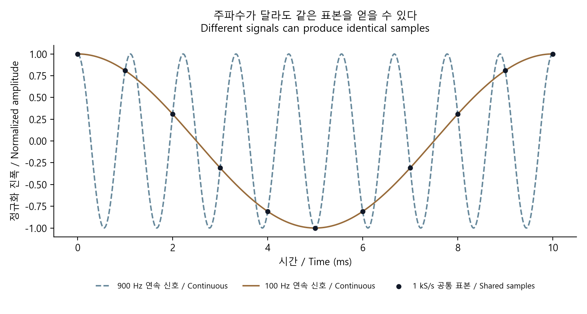
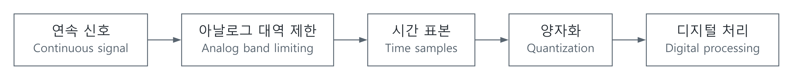

# 샘플링과 aliasing: 숫자로 바꾼 뒤에는 되돌릴 수 없는 정보

[신호·제어](../README.md) · [기초부터 읽기](../../../문서_docs/공학기초_FOUNDATIONS.md) · [English](#english)



서로 다른 두 코사인이 같은 표본을 만든다. 점은 1 kS/s 표본이다. / Two different cosines share the same 1 kS/s samples.

직접 계산해 그린 원본 도표 · [생성 코드](../../../예제_examples/공학기초_foundations/make_figures.py). / Original plot calculated for these notes; [generation code](../../../예제_examples/공학기초_foundations/make_figures.py).

## 먼저 그림으로 생각하기

동영상을 찍을 때 빠르게 도는 바퀴가 느리게 돌거나 거꾸로 도는 것처럼 보이기도 한다. 카메라는 움직임 전체가 아니라 일정한 순간의 장면만 기록하기 때문이다. 센서와 ADC도 마찬가지다. 표본 사이에 어떤 일이 있었는지 알려면 신호의 변화 속도에 대한 조건이 필요하다.

샘플링은 시간을 골라 값을 읽는 일이고, 양자화는 읽은 값을 유한한 숫자로 반올림하는 일이다. 표본율을 높이는 것과 ADC 비트 수를 늘리는 것은 서로 다른 문제를 해결한다. [MIT의 sampling 강의](https://ocw.mit.edu/courses/res-6-007-signals-and-systems-spring-2011/resources/lecture-16-sampling/)는 시간 표본과 연속 신호의 관계를, [TI의 anti-aliasing 강의](https://www.ti.com/video/5831231183001)는 ADC 앞단의 필터를 다룬다.



[SVG](../../../자료_assets/도식_diagrams/sampling-aliasing.svg) · [그림 원본 / Diagram source](../../../자료_assets/도식_diagrams/sampling-aliasing.mmd)

이 문서의 그림은 설명을 위해 직접 구성했다.

## 정의와 수식

표본 간격을 $`T_s`$ [s], 표본율을 $`f_s=1/T_s`$ [Hz]라 두면 $`x[n]=x(nT_s)`$다. $`n`$은 정수이고 $`x[n]`$의 단위는 원래 신호와 같다. Hz와 rad/s를 혼동하지 않도록 각주파수는 $`\omega=2\pi f`$로 따로 쓴다.

코사인 $`x(t)=A\cos(2\pi ft+\phi)`$를 읽으면

$$
x[n]=A\cos(2\pi fn/f_s+\phi).
$$

$`f`$를 $`f+kf_s`$로 바꿔도 정수 $`k,n`$에 대해 위상이 $`2\pi kn`$만큼 달라질 뿐이므로 표본은 같다. 실수 코사인의 주파수 크기를 첫 Nyquist 구간으로 접으면

$$
f_a=\left\vert ((f+f_s/2)\bmod f_s)-f_s/2\right\vert ,\qquad 0\le f_a\le f_s/2.
$$

이는 주파수 크기다. 일반적인 사인·위상 표현까지 동일하게 쓰려면 부호와 위상 변화를 함께 추적해야 한다. 예를 들어 위상 0인 900 Hz와 100 Hz 코사인은 1 kS/s에서 같은 숫자 열을 만든다. 표본만 보고 어느 쪽이 원래 신호였는지 구별할 수 없다.

대역이 $`\vert f\vert \le B`$로 제한된 이상적인 기저대역 신호는 $`f_s>2B`$일 때 이상적인 재구성이 가능하다. 경계의 주파수 성분이나 위상까지 고려하면 단순히 등호를 넣는 것은 안전하지 않다. $`\sin(2\pi(f_s/2)n/f_s)=0`$이라는 반례가 있다. 이는 [MIT 강의 노트 §16](https://ocw.mit.edu/courses/res-6-007-signals-and-systems-spring-2011/8708ec068ebdea2c4ee2f38fad39fb83_MITRES_6_007S11_lec16.pdf)의 대역 제한 가정과 함께 읽어야 한다.

## 모델과 구현

위상 0인 코사인을 생성하고 두 표본 열을 직접 비교한다. [참조 구현](../../../예제_examples/공학기초_foundations/signals_ai/models.py)의 `sample_cosine`은 $`O(N)`$ 시간·출력 공간, `alias_frequency`는 고정 개수의 산술 연산을 사용한다.

```python
from signals_ai.models import sample_cosine, alias_frequency

high = sample_cosine(900.0, 1000.0, 100)
low = sample_cosine(100.0, 1000.0, 100)
# 서로 다른 연속 주파수가 같은 표본을 만드는지 확인한다.
print(max(abs(a - b) for a, b in zip(high, low)))
print(alias_frequency(900.0, 1000.0))
```

저장소 루트에서 `PYTHONPATH=예제_examples/foundations`를 설정하거나 해당 폴더에서 실행한다. 전체 실행 명령은 [예제 안내](../../../예제_examples/공학기초_foundations/README.md)에 있다.

## 검증과 현실의 차이

| 확인할 것 | 기준 |
| --- | --- |
| 900 Hz와 100 Hz 코사인의 동일 표본 | 100개 표본 최대 차이 $`<10^{-12}`$ |
| Nyquist 경계에서 정보 손실 | 위상 $`\pi/2`$인 코사인의 표본이 수치 오차 범위에서 0 |
| 주파수 접기 | 음수·여러 Nyquist 구간·DC를 포함해 범위와 예상값 검사 |

이 검사는 표본 계산을 확인한다. 실제 ADC에서는 입력 대역, 아날로그 필터의 유한한 감쇠, aperture jitter, 샘플 유지 회로와 구동기의 settling도 확인해야 한다. 디지털 필터는 이미 같은 숫자로 겹쳐 버린 두 성분을 일반적으로 분리하지 못한다. 원하는 대역과 $`f_s/2`$ 사이에 실제 필터가 줄어들 공간을 확보해야 한다. 대역통과 샘플링에는 별도 조건이 있으므로 기저대역의 $`2B`$ 규칙을 그대로 적용하지 않는다.

## English

### Intuition and definitions

A filmed wheel can appear to turn slowly or backward because the camera records selected instants. An ADC also needs a condition on what can happen between observations. Sampling selects times; quantization maps amplitudes to a finite set. More samples and more bits solve different problems. The original diagram above separates analog band limiting, time sampling, quantization, and digital processing.

Let $`T_s`$ [s] be the interval and $`f_s=1/T_s`$ [Hz] the sample rate. Then $`x[n]=x(nT_s)`$, with integer $`n`$ and the original amplitude unit. Angular frequency is $`\omega=2\pi f`$ [rad/s]. For a cosine,

$$
x[n]=A\cos(2\pi fn/f_s+\phi).
$$

Adding an integer multiple of $`f_s`$ changes phase by $`2\pi kn`$, so it leaves the samples unchanged. Folding the frequency magnitude of a real cosine into the first Nyquist interval gives

$$
f_a=\left\vert ((f+f_s/2)\bmod f_s)-f_s/2\right\vert .
$$

This gives a magnitude; signed frequency and phase must also be tracked for a general sinusoid. At 1 kS/s, zero-phase 900 Hz and 100 Hz cosines give identical samples. The samples alone cannot identify the original frequency.

An ideally band-limited baseband signal with support $`\vert f\vert \le B`$ can be reconstructed ideally if $`f_s>2B`$. Equality is insufficient when a component lies exactly at the boundary: $`\sin(2\pi(f_s/2)n/f_s)=0`$ loses its amplitude information. The [MIT notes](https://ocw.mit.edu/courses/res-6-007-signals-and-systems-spring-2011/8708ec068ebdea2c4ee2f38fad39fb83_MITRES_6_007S11_lec16.pdf) support these assumptions and reconstruction conditions.

### Implementation and verification

The code above compares two generated sample sequences. `sample_cosine` takes $`O(N)`$ time and output storage; `alias_frequency` uses a fixed number of arithmetic operations. The [implementation](../../../예제_examples/공학기초_foundations/signals_ai/models.py) is checked by a maximum sequence difference below $`10^{-12}`$, a zero-valued boundary-frequency counterexample, and signed/multiple-zone frequency cases. See the [run instructions](../../../예제_examples/공학기초_foundations/README.md).

These tests verify sample calculations. A physical ADC also requires checks of input bandwidth, finite analog-filter attenuation, aperture jitter, sample-and-hold behavior, and driver settling. A digital filter generally cannot separate components that already produced the same samples. Practical filtering needs a transition band between the useful signal and $`f_s/2`$; [TI's lesson](https://www.ti.com/video/5831231183001) covers this analog requirement. Bandpass sampling needs additional conditions rather than a direct reuse of the baseband rule.

## 출처 / Sources

- [MIT OCW, Lecture 16: Sampling](https://ocw.mit.edu/courses/res-6-007-signals-and-systems-spring-2011/resources/lecture-16-sampling/) — 표본의 비유일성, 대역 제한, 재구성 / non-unique samples, band limitation, reconstruction.
- [TI Precision Labs: Aliasing and anti-aliasing filters](https://www.ti.com/video/5831231183001) — ADC 입력에서 aliasing을 줄이는 필터 / filtering at the ADC input.

두 자료의 샘플링 조건을 대조하고, 위상 경계 반례와 동일 표본 계산으로 확인했다. / Sampling conditions were cross-checked against both sources and tested using a boundary-phase counterexample and identical sample sequences.
