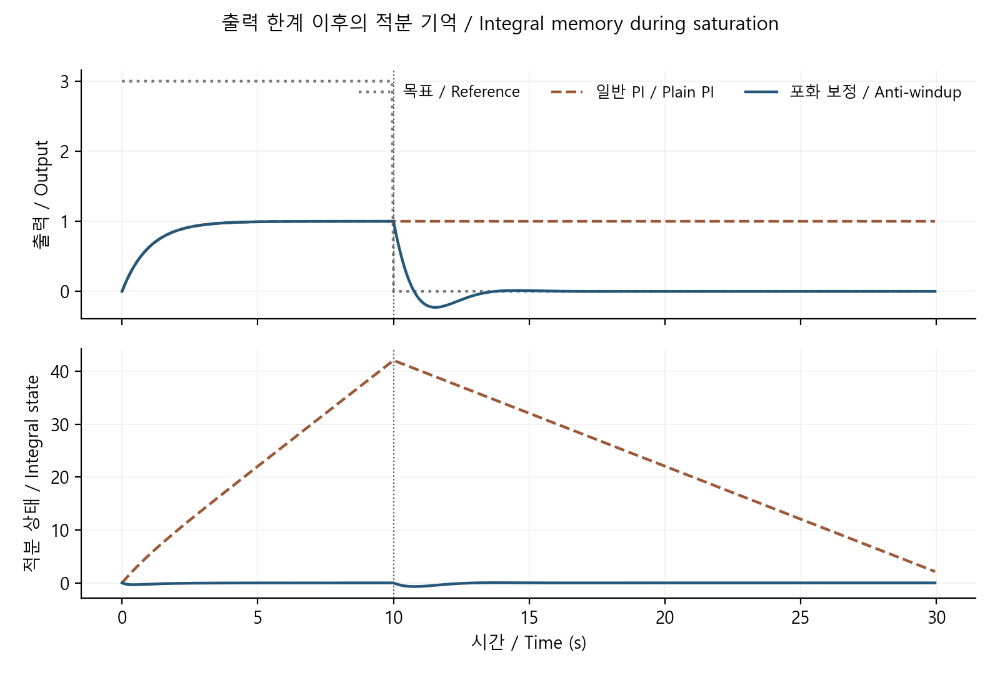

# 이산 PI 제어: 표본 주기, 안정성과 적분 포화

[분야 목차](../README.md) · [실행 구현](../../../예제_examples/심화_advanced/math_reasoning/models.py) · [검증](../../../예제_examples/심화_advanced/math_reasoning/test_models.py)

## 한국어

### 1. 적분기는 지나간 오차를 기억한다

PI 제어의 P 항은 지금의 오차에 반응하고 I 항은 오차를 시간에 따라 모은다. 약한 힘이 오래 필요할 때 적분 상태는 유용하다. 하지만 모터나 전원 장치가 이미 낼 수 있는 최대 출력을 내는 동안에도 적분기를 계속 키우면, 목표가 낮아진 뒤에도 큰 출력 요구가 남는다. 이 현상이 적분 포화, 즉 windup이다. 장치 출력에 한계가 있다는 것과 제어기 내부 기억이 커진다는 것을 구분하면 원리가 쉽게 보인다.

여기서는 단위 정상상태 이득의 1차 플랜트 $`\tau\dot x=-x+u`$, 양의 시정수 $`\tau`$, 일정한 표본 주기 $`T_s`$, 출력 한계 $`-L\le u\le L`$를 사용한다. 센서 지연·잡음·통신 지터·속도 한계는 포함하지 않는다. [MathWorks의 anti-windup 설명](https://www.mathworks.com/help/simulink/slref/anti-windup-control-using-a-pid-controller.html)과 [PID Controller의 이산 적분·back-calculation 규약](https://www.mathworks.com/help/simulink/slref/pidcontroller.html)을 함께 확인했다. 아래 식은 그 개념을 이 글의 실행 순서로 정한 구현이다.

### 2. 플랜트의 이산식은 어디서 나오는가

입력이 한 표본 구간 동안 일정한 ZOH를 가정한다. 미분방정식의 해를 구간 끝까지 적분하면

```math
x_{k+1}=e^{-T_s/\tau}x_k+
\int_0^{T_s}\frac1\tau e^{-(T_s-s)/\tau}u_k\,ds
=a x_k+b u_k,
\quad a=e^{-T_s/\tau},\quad b=1-a.
```

이 플랜트 식은 해당 가정 아래 정확하다. 반면 적분기의 갱신은 전진 Euler로 구현한다. 한 반복에서 먼저 현재 출력과 적분 상태로 제어량을 계산하고, 플랜트와 적분 상태를 다음 시점으로 옮긴다.

```math
e_k=r_k-x_k,\qquad v_k=K_p e_k+I_k,\qquad
u_k=\min(L,\max(-L,v_k)),
```

```math
I_{k+1}=I_k+T_s\left[K_i e_k+K_{aw}(u_k-v_k)\right].
```

$`I_k`$는 이미 출력과 같은 단위를 갖는다. 따라서 $`K_{aw}`$의 단위는 초의 역수다. 상한에 걸려 $`v_k\gt u_k`$이면 보정 항은 음수가 되어 과도한 적분 상태를 되돌린다. $`K_{aw}=0`$이면 일반적인 적분이다. 적분 상태를 먼저 갱신하고 그 값을 같은 시점의 출력에 사용하면 다른 이산 제어기가 된다. 코드와 유도에서 순서를 일치시키는 이유다.

### 3. 포화가 없는 구간의 안정성

상수 목표에 대한 평형점 주위에서 오차 좌표를 쓰면, 포화가 없는 폐루프 행렬은

```math
\begin{bmatrix}x_{k+1}\\I_{k+1}\end{bmatrix}
=\begin{bmatrix}a-bK_p&b\\-K_iT_s&1\end{bmatrix}
\begin{bmatrix}x_k\\I_k\end{bmatrix}.
```

이때 $`x,I`$는 평형값에서의 편차다. 행렬의 trace를 $`t=1+a-bK_p`$, determinant를 $`d=a-bK_p+bK_iT_s`$라 하면 특성식은 $`z^2-tz+d=0`$다. 실수 계수 2차식의 두 근이 모두 단위원 안에 놓이는 Jury 조건은

```math
1-t+d\gt0,\qquad1+t+d\gt0,\qquad1-d\gt0.
```

이 세 부등식도 변환으로 확인할 수 있다. $`z=(1+s)/(1-s)`$는 s의 좌반평면을 z의 단위원 내부로 옮긴다. 특성식에 대입하고 $`(1-s)^2`$을 곱하면

```math
(1+t+d)s^2+2(1-d)s+(1-t+d)=0.
```

실수 2차식에서 세 계수가 모두 양수이면 두 근의 실수부가 음수다. 이를 각 계수에 적용한 것이 위 조건이다. 역방향에서는 단위원 안의 두 근에 대해 $`p(1)=1-t+d`$와 $`p(-1)=1+t+d`$가 양수이고 $`d\lt1`$임을 확인할 수 있다. 경계의 등호는 엄밀한 안정 조건에서 제외한다.

첫 조건은 $`bK_iT_s\gt0`$로 정리된다. 나머지 두 조건에도 표본 주기와 이득이 함께 들어간다. 연속시간에서 쓸 수 있는 이득이라고 해서 임의의 큰 표본 주기에서도 안정적인 것은 아니다. 이 조건은 포화가 없는 선형 모델의 조건이며, 포화와 anti-windup을 포함한 전체 비선형 동작의 전역 안정성을 입증하지는 않는다.

### 4. 실행 예와 결과

`simulate_pi`는 요청 출력 $`v_k`$와 실제 적용 출력 $`u_k`$를 따로 기록한다. 작은 $`T_s/\tau`$에서 $`1-e^{-T_s/\tau}`$의 뺄셈 오차를 줄이도록 `expm1`을 사용했다. 실행 결과의 한 행은 갱신 전 상태를 의미한다.

```bash
python 예제_examples/심화_advanced/math_reasoning/demo.py --output results/advanced-math
```

`pi_control.csv`는 $`T_s=0.05`$, $`\tau=1`$, $`K_p=1`$, $`K_i=2`$, $`L=1`$에서 목표를 3으로 200회 유지한 뒤 0으로 바꾼 계산이다. 3은 이 플랜트의 지속 가능한 출력보다 커 포화가 유지된다. 전환 직전 일반 적분 상태는 약 42.05까지 커지지만, $`K_{aw}=4`$의 보정 상태는 거의 0에 머문다. 이것이 해당 입력과 이득에서 얻은 결과다. 다른 지연·한계·이득에서 같은 수치를 기대하는 규칙은 아니다.



### 5. 검증과 장치 연결

Jury 판정은 여러 이득 조합에서 복소수 이차방정식의 두 근을 직접 구한 결과와 비교한다. 출력이 계속 1로 고정되는 경우에는 플랜트 응답을 해석해 $`1-e^{-t}`$와 대조한다. 포화 해제 후 오차 누적량과 적분 상태, 출력 한계를 확인하고 영 입력 평형도 검사한다. 실제 MCU에서는 표본 시점, 센서·구동기 단위, 제어 계산 지연, 출력 rate limit과 비상 정지를 추가로 다뤄야 한다. 출력 경로에 다른 제어 항이나 구동기 동특성이 있으면 anti-windup에 되먹이는 신호도 실제 적용 출력을 반영해야 한다.

## English

### 1. Integral memory and actuator limits

The proportional term responds to present error; the integral state accumulates error over time. If an actuator is already saturated while the integral continues to grow, a large command can remain after the reference falls. This is windup. The model here is $`\tau\dot x=-x+u`$ with unit DC gain, positive time constant, fixed sample period and symmetric limits. Noise, delay, jitter and rate limits are outside this calculation. [MathWorks anti-windup](https://www.mathworks.com/help/simulink/slref/anti-windup-control-using-a-pid-controller.html) and the [PID block specification](https://www.mathworks.com/help/simulink/slref/pidcontroller.html) were compared; the equations above fix this example's particular update order.

### 2. Deriving the updates

For a constant input during each sample interval, integrating the differential equation gives $`x_{k+1}=a x_k+b u_k`$, with $`a=e^{-T_s/\tau}`$ and $`b=1-a`$. This is the exact ZOH plant update under those assumptions. The integral state instead uses forward Euler. First compute $`e_k=r_k-x_k`$, $`v_k=K_pe_k+I_k`$ and clipped $`u_k`$. Then update the plant and set $`I_{k+1}=I_k+T_s[K_ie_k+K_{aw}(u_k-v_k)]`$.

$`I_k`$ has output units, so $`K_{aw}`$ has inverse-time units. At the upper limit, $`u_k-v_k`$ is negative and unwinds the state. Setting $`K_{aw}=0`$ restores ordinary integration. Updating the integral before forming the same sample's output defines a different discrete controller, which is why implementation order matters.

### 3. Unsaturated stability

In deviation coordinates about an equilibrium for a constant reference, the unsaturated state matrix is $`[[a-bK_p,b],[-K_iT_s,1]]`$. Its trace is $`t=1+a-bK_p`$ and determinant is $`d=a-bK_p+bK_iT_s`$. The characteristic polynomial is $`z^2-tz+d`$. Its real-coefficient second-order Jury conditions are $`1-t+d\gt0`$, $`1+t+d\gt0`$ and $`1-d\gt0`$. The first reduces to $`bK_iT_s\gt0`$. The other conditions also couple sampling and gains. Continuous-time tuning does not imply stability at arbitrary sample periods. These conditions address the unsaturated linear model, not global stability of the saturated anti-windup system.

The substitution $`z=(1+s)/(1-s)`$ maps the open left half-plane to the open unit disk. After multiplying by $`(1-s)^2`$, the characteristic equation becomes

```math
(1+t+d)s^2+2(1-d)s+(1-t+d)=0.
```

A real quadratic with three positive coefficients has both roots in the left half-plane; applying that criterion gives the three inequalities. Conversely, roots in the open unit disk make $`p(1)=1-t+d`$ and $`p(-1)=1+t+d`$ positive and give $`d\lt1`$. Equality is excluded for strict stability.

### 4. Implementation and evidence

`simulate_pi` separately records requested and applied outputs and stores the pre-update state in each row. `expm1` improves the small-argument evaluation of $`1-e^{-T_s/\tau}`$. The command generates `pi_control.csv`: the reference is 3 for 200 samples and then zero, with $`T_s=0.05`$, $`\tau=1`$, $`K_p=1`$, $`K_i=2`$ and $`L=1`$. The unreachable initial reference maintains saturation. At release, ordinary integration has accumulated about 42.05, while back-calculation with $`K_{aw}=4`$ leaves a state near zero. The figure shows this particular calculation rather than a universal performance claim.

Tests compare Jury decisions with independently computed quadratic roots, check a continuously saturated plant against $`1-e^{-t}`$, examine post-release error accumulation and output limits, and verify zero-input equilibrium. An MCU implementation must also account for sampling instants, units, computational delay, actuator rate limits and emergency stopping. Additional feedforward terms or actuator dynamics change which applied signal must enter the anti-windup tracking path.

## 출처 / Sources

공식 자료의 back-calculation 방향·이산 시간 배율을 대조하고, ZOH 해와 특성식은 명시한 상태 갱신에서 유도했다. / Back-calculation sign and discrete scaling were cross-checked; the ZOH update and characteristic polynomial were derived for the stated timing convention. 확인 / checked: 2026-10-19.
