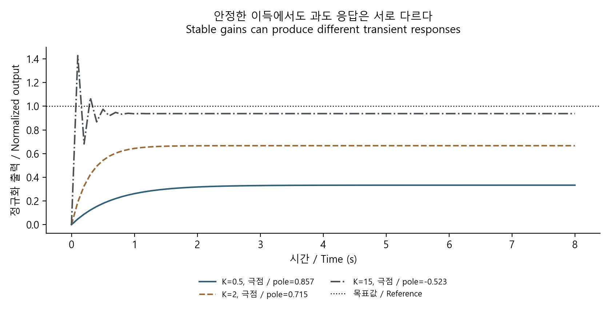
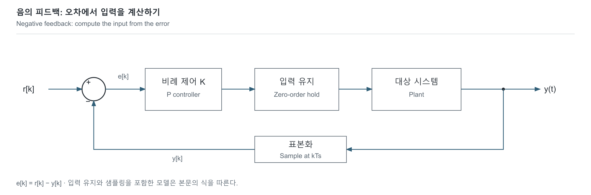

# 피드백 제어: 오차를 줄이는 힘에도 한계가 있습니다

[신호·제어](../README.md) · [기초부터 읽기](../../../공학기초_foundations/README.md) · [English](#english)



같은 1차 시스템에서도 이득에 따라 수렴값과 진동이 달라집니다. / Gain changes both equilibrium and oscillation for the same first-order plant.

직접 계산해 그린 원본 도표 · [생성 코드](../../../예제_examples/공학기초_foundations/make_figures.py). / Original plot calculated for these notes; [generation code](../../../예제_examples/공학기초_foundations/make_figures.py).

## 제어할 대상과 입력

샤워 물이 차가우면 온수를 늘리고, 뜨거우면 줄입니다. 현재 값과 원하는 값의 차이를 보고 입력을 바꾸는 것이 피드백입니다. 반응이 늦는 시스템에서 손잡이를 크게 돌리기만 하면 온도가 오르내릴 수 있습니다. 제어에서는 오차뿐 아니라 반응 속도, 지연, 입력 한계도 모델에 넣습니다.

여기서는 한 개의 상태를 가진 선형 모델에서 출발합니다. 값은 기준값으로 나눈 무차원 변수로 두고, 시간은 초로 씁니다. 입력 $`u`$, 출력 $`y`$, 정상상태 이득 $`g`$와 시정수 $`\tau>0`$에 대해

$$
\tau\dot y(t)+y(t)=g u(t).
$$

$`\tau`$는 변화가 얼마나 빠른지 정합니다. 이 모델은 RC, 온도, 속도 등 서로 다른 시스템의 일부 동작을 근사할 수 있지만 매개변수와 유효 범위는 각각 다릅니다.

## 연속 식을 디지털 갱신식으로

컨트롤러가 $`T`$ [s]마다 값을 읽고 다음 표본까지 입력 $`u_k`$를 유지한다고 하겠습니다. 이 유지 방식이 zero-order hold입니다. [MIT의 digital control 강의](https://ocw.mit.edu/courses/16-30-feedback-control-systems-fall-2010/25129dabd19249e15c1df8034335aafa_MIT16_30F10_lec20.pdf)는 표본·유지·계산 지연을 구분합니다.

입력을 상수로 놓고 한 구간을 정확히 적분하면

$$
y(t_k+s)=g u_k+(y_k-g u_k)e^{-s/\tau},\quad 0\le s\le T,
$$
$$
y_{k+1}=a y_k+b u_k,\quad a=e^{-T/\tau},\quad b=g(1-a).
$$

이는 주어진 1차 모델과 hold 조건의 표본 시점에 대한 정확한 식입니다. Euler 근사와 다르며, 표본 사이가 직선이라는 뜻도 아닙니다.

비례 제어 $`u_k=K(r-y_k)`$를 적용하면

$$
y_{k+1}=p y_k+bKr,\quad p=a-bK.
$$

평형에서의 차이 $`\delta y_k=y_k-y_*`$는 $`\delta y_{k+1}=p\delta y_k`$입니다. 따라서 이 스칼라 선형 모델이 초기 오차를 없애려면 $`\vert p\vert <1`$이어야 합니다. $`p<0`$이면 오차의 부호가 번갈아 바뀝니다. [Illinois의 state feedback 설명](https://courses.grainger.illinois.edu/ece486/sp2025/documentation/handbook/lec21.html)과 비교하면 연속계의 $`A-BK`$가 이산계에서는 표본 전이 행렬에 대응합니다.

$$
y_* = \frac{bKr}{1-a+bK},\qquad g=1\Rightarrow y_* = \frac{K}{1+K}r.
$$

비례 제어만으로는 일반적으로 step 입력의 정상상태 오차가 남습니다. 적분 제어를 더하는 이유 중 하나지만, 포화가 있으면 적분 누적과 anti-windup도 함께 다뤄야 합니다.



[SVG](../../../자료_assets/도식_diagrams/feedback-discrete-model.svg) · [그림 원본 / Diagram source](../../../자료_assets/도식_diagrams/feedback-discrete-model.mmd)

직접 구성한 그림이며 피드백 입력의 부호는 $`r-y`$입니다.

## 구현과 검증

[모델 코드](../../../예제_examples/공학기초_foundations/signals_ai/models.py)의 `first_order_zoh`는 작은 $`T/\tau`$에서 $`1-e^{-T/\tau}`$의 뺄셈 손실을 줄이려고 `expm1`을 씁니다. `feedback_response`는 표본당 $`O(1)`$ 연산과 상태를 사용합니다. 반환 파형을 모두 저장하므로 전체 공간은 $`O(N)`$입니다.

아래 코드는 저장소의 `예제_examples/공학기초_foundations` 폴더에서 실행합니다.

```python
from signals_ai.models import first_order_zoh, feedback_response  # from/import로 이산화·응답 계산 함수를 가져옵니다.
a, b = first_order_zoh(tau=1.0, sample_period=0.1)  # 이름=값으로 인수를 지정하고 반환한 계수 둘을 a, b에 나눠 담습니다.
gain = 2.0  # =로 비례 이득 K를 저장합니다.
print("pole", a - b * gain)  # *는 곱셈이며, print로 닫힌 루프 극 a−bK를 표시합니다.
print(feedback_response(a, b, gain, reference=1.0, steps=100)[-1])  # [-1]로 반환된 응답의 마지막 값을 골라 표시합니다.
```

$`r=1,y_0=0,K=2,g=1`$이면 $`y_*=2/3`$이고, 해석 수열은 $`y_k=y_*(1-p^k)`$입니다. 테스트는 모든 표본을 이 식과 절대 오차 $`10^{-12}`$ 수준으로 비교합니다. 별도로 일정 입력의 연속 해와 ZOH 갱신을 비교합니다. $`T=0.1,\tau=1,K=25`$에서는 $`\vert p\vert >1`$인 발산 반례도 검사합니다. [실행 안내](../../../예제_examples/공학기초_foundations/README.md).

포화를 추가한 코드는 입력 범위를 제한하는 비선형 모델입니다. 선형계에서 얻은 극 하나만으로 포화된 계의 안정성을 증명할 수 없습니다. 센서 잡음, 샘플링 jitter, 계산 지연, 마찰·dead zone·온도 변화도 실제 제어에서는 따로 확인합니다. 특히 한 표본 늦게 적용하는 제어 입력은 여기의 즉시 갱신 모델과 다른 상태방정식을 갖습니다.

## English

### From error to a dynamic model

Feedback changes an input using the difference between a desired and observed value. Turning a shower valve too aggressively can make a delayed temperature response oscillate. A controller therefore needs a model of response speed, delay, and actuator limits as well as error.

Use normalized, dimensionless input/output values and time in seconds. A first-order linear plant is

$$
\tau\dot y+y=gu,\qquad \tau>0.
$$

The time constant sets response speed; the DC gain sets the final input/output ratio. Such a model can approximate part of a circuit, thermal, or speed response, with different parameters and validity ranges.

If the controller holds $`u_k`$ for $`T`$ seconds, exact integration over that interval gives

$$
y(t_k+s)=gu_k+(y_k-gu_k)e^{-s/\tau},\qquad
y_{k+1}=a y_k+b u_k,
$$
$$
a=e^{-T/\tau},\quad b=g(1-a).
$$

This is exact at sample instants for the specified plant and hold, rather than an Euler approximation or a straight-line inter-sample trajectory. [MIT's notes](https://ocw.mit.edu/courses/16-30-feedback-control-systems-fall-2010/25129dabd19249e15c1df8034335aafa_MIT16_30F10_lec20.pdf) separate sampling, holding, and computing delays.

With $`u_k=K(r-y_k)`$,

$$
y_{k+1}=p y_k+bKr,\quad p=a-bK,\quad
y_* =\frac{bKr}{1-a+bK}.
$$

Deviations satisfy $`\delta y_{k+1}=p\delta y_k`$, so this scalar linear system removes initial deviations when $`\vert p\vert <1`$. Negative $`p`$ produces alternating error signs. For $`g=1`$, $`y_*=Kr/(1+K)`$, leaving a step-tracking error with proportional control. Integral control can address this, but saturation also introduces windup concerns. [Illinois' state-feedback notes](https://courses.grainger.illinois.edu/ece486/sp2025/documentation/handbook/lec21.html) provide the corresponding continuous-time $`A-BK`$ viewpoint. The original diagram above uses negative feedback through $`r-y`$.

### Implementation and verification

The [code](../../../예제_examples/공학기초_foundations/signals_ai/models.py) uses `expm1` to reduce cancellation in $`1-e^{-T/\tau}`$. Each response update uses constant arithmetic and state; storing the complete trace takes $`O(N)`$ space.

With $`r=1,y_0=0,K=2,g=1`$, the independent analytical sequence is $`y_k=(2/3)(1-p^k)`$. Tests compare every sample at about $`10^{-12}`$ absolute tolerance and compare constant-input updates against the continuous analytical solution. They also include an unstable case, $`T=0.1,\tau=1,K=25`$. See [run instructions](../../../예제_examples/공학기초_foundations/README.md).

Input clipping makes the model nonlinear; its stability cannot be proved using the linear pole alone. Physical control also involves sensor noise, sampling jitter, computation delay, friction, dead zones and parameter drift. Applying an input one sample later requires a different state equation from this immediate-update example.

## 출처 / Sources

- [MIT 16.30, Topic 20: Digital Control Basics](https://ocw.mit.edu/courses/16-30-feedback-control-systems-fall-2010/25129dabd19249e15c1df8034335aafa_MIT16_30F10_lec20.pdf) — 표본·유지·지연과 차분식 / sampling, hold, delay and difference equations.
- [University of Illinois ECE486, Lecture 21](https://courses.grainger.illinois.edu/ece486/sp2025/documentation/handbook/lec21.html) — 상태 피드백과 닫힌 루프 극 / state feedback and closed-loop poles.

두 관점을 대조하고, 이 글의 1차 모델은 직접 적분한 해와 기하 수열로 확인했습니다. / The two viewpoints were cross-checked; this first-order example was independently derived by integration and checked as a geometric sequence.
