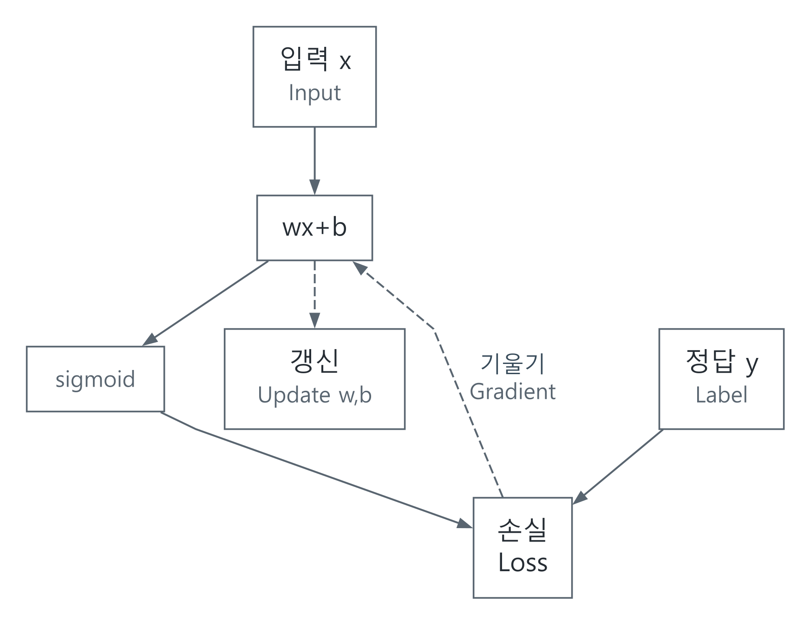

# 미분에서 학습까지: 모델이 바뀌는 이유

[AI와 머신러닝](../README.md) · [기초부터 읽기](../../../공학기초_foundations/README.md) · [English](#english)

## 기울기와 매개변수 갱신

언덕의 기울기는 조금 움직였을 때 높이가 얼마나 바뀌는지 말해 줍니다. 학습에서는 높이 대신 예측의 손실, 위치 대신 조정할 수 있는 매개변수를 둡니다. 기울기는 가까운 곳의 변화 방향을 알려 줍니다. 먼 곳까지 같은 기울기라고 보장하지는 않습니다.

여기서는 입력 숫자 하나를 두 종류로 구분하는 logistic regression을 만듭니다. 작은 모델이지만 미분, 손실, 역전파, 갱신, 검증을 모두 연결할 수 있습니다. $`x`$는 정규화한 입력, $`y\in\{0,1\}`$는 목표값, $`w,b`$는 학습할 수입니다.

$$
z=wx+b,\qquad p=\sigma(z)=\frac1{1+e^{-z}}.
$$

$`p`$는 모델이 내는 확률값입니다. 실제 빈도와 잘 맞는지, 즉 calibration은 별도의 평가 문제입니다.

## 손실과 미분 유도

한 표본의 binary cross entropy를

$$
\ell=-y\ln p-(1-y)\ln(1-p)
$$

로 둡니다. $`\sigma'(z)=p(1-p)`$이고

$$
\frac{\partial\ell}{\partial p}=-\frac y p+\frac{1-y}{1-p},\qquad
\frac{\partial\ell}{\partial z}=p-y.
$$

연쇄 법칙을 한 번 더 적용하면

$$
\frac{\partial\ell}{\partial w}=(p-y)x,\qquad
\frac{\partial\ell}{\partial b}=p-y.
$$

$`M`$개 표본의 평균 손실 $`L=M^{-1}\sum_i\ell_i`$는 각 미분을 평균하면 됩니다. 역전파는 이렇게 중간 연산의 국소 미분을 뒤로 연결합니다. optimizer는 그 기울기로 매개변수를 바꿉니다. 두 개념을 구분하는 것이 중요합니다. [Stanford CS231n](https://cs231n.github.io/optimization-2/)과 [Stanford CS224n Part III](https://web.stanford.edu/class/cs224n/readings/cs224n-2019-notes03-neuralnets.pdf)의 연쇄 법칙 설명을 대조했습니다.



[SVG](../../../자료_assets/도식_diagrams/gradients-and-learning.svg) · [그림 원본 / Diagram source](../../../자료_assets/도식_diagrams/gradients-and-learning.mmd)

직접 구성한 그림입니다. 여러 경로가 같은 변수로 돌아오면 기울기는 더합니다.

## 수학적으로 같은 식도 코드에서는 다릅니다

$`p`$를 먼저 계산하고 `log(p)`를 취하면 큰 $`\vert z\vert `$에서 $`p`$가 0이나 1로 반올림될 수 있습니다. 다음과 같이 logits에서 직접 계산합니다.

$$
\ell=\max(z,0)-yz+\ln(1+e^{-\vert z\vert }).
$$

이는 같은 손실의 안정적인 표현입니다. 지수의 인자가 양수가 되지 않고, `log1p`로 작은 증가분을 다룹니다. [참조 구현](../../../예제_examples/공학기초_foundations/signals_ai/models.py)은 sigmoid도 $`z`$의 부호에 따라 계산 경로를 나눕니다.

평균 기울기로 $`w\leftarrow w-\eta\partial L/\partial w`$, $`b\leftarrow b-\eta\partial L/\partial b`$를 반복합니다. $`\eta>0`$는 학습률입니다. 너무 큰 값은 발산을 부를 수 있습니다. 표본 $`M`$개, 반복 $`E`$회의 계산량은 $`O(EM)`$입니다. 현재 코드는 정확한 합산을 위해 한 번의 gradient 계산에 $`O(M)`$ 임시 공간을 쓰며, 큰 데이터에는 mini-batch와 텐서 라이브러리가 맞습니다.

```python
from signals_ai.models import train_logistic

xs, ys = [-2.0, -1.0, 1.0, 2.0], [0, 0, 1, 1]
# 작은 자료에서 갱신 방향과 손실 감소를 확인한다.
weight, bias, loss = train_logistic(xs, ys, iterations=200, rate=0.1)
print(weight, bias, loss)
```

## 미분 계산과 학습 성능의 검증 범위

구현의 미분은 독립적인 중심 차분으로 검사합니다.

$$
g_j^{num}=\frac{L(\theta+h e_j)-L(\theta-h e_j)}{2h}.
$$

테스트는 $`h=10^{-5}`$, float64 수준 계산의 작은 예에서 analytic gradient와의 절대 차이 $`10^{-9}`$ 이하를 요구합니다. $`h`$를 무작정 줄이면 반올림 오차가 커집니다. 미분 불가능한 지점이 있는 모델은 그 지점을 따로 다뤄야 합니다. [CS231n gradient checks](https://cs231n.github.io/neural-networks-3/)의 주의점과 함께 확인합니다.

큰 logits $`\pm1000`$에서 NaN·overflow 없이 계산되는지, 작은 대칭 자료에서 손실이 줄고 bias가 대칭을 유지하는지도 검사합니다. [실행 안내](../../../예제_examples/공학기초_foundations/README.md).

이것은 계산 검증입니다. 실제 예측 성능은 학습에 쓰지 않은 자료로 측정합니다. 자료 분리 전에 전체 데이터로 정규화 통계를 구하면 누출이 생길 수 있습니다. 서로 관련된 사람·장치·시간대가 양쪽에 섞이지 않도록 분리 기준도 정합니다. 선형 분리가 가능한 이 예에서는 규제가 없을 때 유한한 최적 가중치가 존재하지 않을 수 있으므로, 정해진 반복 수의 손실 감소를 확인하는 것과 최적점 수렴을 증명하는 것은 다릅니다.

## English

### Why gradients change a model

A slope describes a small local change in height. Learning replaces height with prediction loss and position with adjustable parameters. A local gradient does not promise the same behavior far away.

Consider one normalized input $`x`$, a binary target $`y`$, and trainable $`w,b`$:

$$
z=wx+b,\quad p=\sigma(z)=1/(1+e^{-z}),\quad
\ell=-y\ln p-(1-y)\ln(1-p).
$$

The model emits a probability; whether it matches observed frequencies is a separate calibration question. Since $`\sigma'(z)=p(1-p)`$,

$$
\partial\ell/\partial p=-y/p+(1-y)/(1-p),\quad
\partial\ell/\partial z=p-y,
$$
$$
\partial\ell/\partial w=(p-y)x,\qquad\partial\ell/\partial b=p-y.
$$

For $`M`$ samples, average these gradients for $`L=M^{-1}\sum_i\ell_i`$. Backpropagation chains local derivatives backward; an optimizer uses them to update parameters. Contributions add when paths meet. The original diagram above shows these separate roles. [CS231n](https://cs231n.github.io/optimization-2/) and [CS224n Part III](https://web.stanford.edu/class/cs224n/readings/cs224n-2019-notes03-neuralnets.pdf) provide cross-checks of the chain rule.

### Stable implementation

Computing `log(p)` after sigmoid can fail when a large logit rounds $`p`$ to 0 or 1. The equivalent expression

$$
\ell=\max(z,0)-yz+\ln(1+e^{-\vert z\vert })
$$

keeps the exponential argument nonpositive. The [implementation](../../../예제_examples/공학기초_foundations/signals_ai/models.py) uses `log1p` and splits sigmoid by the sign of $`z`$. Gradient descent updates $`w\leftarrow w-\eta\partial L/\partial w`$ and $`b\leftarrow b-\eta\partial L/\partial b`$. An excessive learning rate can diverge. For $`E`$ iterations and $`M`$ samples, the cost is $`O(EM)`$; this implementation uses $`O(M)`$ temporary storage per gradient for accurate summation. Large datasets call for mini-batches and tensor libraries. The code above runs a small symmetric example.

### Verification versus prediction quality

The independent numerical check is

$$
g_j^{num}=[L(\theta+h e_j)-L(\theta-h e_j)]/(2h).
$$

For the small double-precision example, tests use $`h=10^{-5}`$ and require absolute derivative differences below $`10^{-9}`$. Smaller $`h`$ eventually worsens roundoff; nondifferentiable points require special handling, as discussed in [CS231n's gradient-check notes](https://cs231n.github.io/neural-networks-3/). Tests also cover logits of $`\pm1000`$, decreasing loss and the symmetry of bias. See [run instructions](../../../예제_examples/공학기초_foundations/README.md).

Those tests verify computation. Predictive performance requires held-out data. Computing normalization statistics on all data before splitting can leak information, as can placing related people, devices or time periods on both sides. The separable example can lack a finite optimum without regularization; loss reduction after a fixed number of updates is not a proof of convergence to a finite optimum.

## 출처 / Sources

- [Stanford CS231n: Backpropagation](https://cs231n.github.io/optimization-2/) — 국소 미분과 연쇄 법칙 / local derivatives and chain rule.
- [Stanford CS224n: Neural Networks and Backpropagation](https://web.stanford.edu/class/cs224n/readings/cs224n-2019-notes03-neuralnets.pdf) — 연산 그래프와 gradient / computation graphs and gradients.
- [Stanford CS231n: Learning](https://cs231n.github.io/neural-networks-3/) — 중심 차분 검사와 수치 조건 / centered checks and numerical caveats.

연쇄 법칙을 두 강의에서 대조하고, 이 글의 손실을 직접 미분한 결과를 중심 차분과 비교했습니다. / The chain rule was cross-checked across two courses, and the derivative derived here was compared with centered differences.
