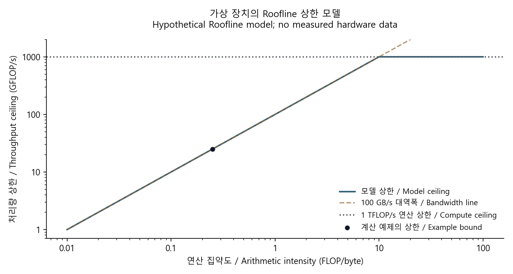

# 계산 병목과 데이터 대기: Roofline과 병렬화

[CUDA & GPU Optimization](../README.md) · [기초부터 읽기](../../../공학기초_foundations/README.md) · [English](#english)



가상의 장치에 대한 성능 상한. 점은 본문 예제의 상한이며 측정값이 아닙니다. / A hypothetical performance ceiling; the point is the worked example bound, not a measurement.

직접 계산해 그린 원본 도표 · [생성 코드](../../../예제_examples/공학기초_foundations/make_figures.py). / Original plot calculated for these notes; [generation code](../../../예제_examples/공학기초_foundations/make_figures.py).

## 주방으로 생각하는 성능

요리사가 빨라도 재료가 늦게 오면 일을 못 합니다. GPU도 연산기만 빠르다고 프로그램 전체가 빨라지지는 않습니다. 계산할 양과 이동할 데이터 양, 작업 크기와 지연을 함께 봐야 합니다. Roofline은 연산 처리량과 메모리 대역폭으로 성능의 상한을 그리는 단순한 모델입니다. [Berkeley의 원 보고서](https://www2.eecs.berkeley.edu/Pubs/TechRpts/2008/EECS-2008-134.html)와 [NVIDIA의 성능 설명](https://docs.nvidia.com/deeplearning/performance/dl-performance-gpu-background/index.html)을 대조했습니다.

## 단위부터 맞추기

| 기호 | 뜻 | 단위 |
| --- | --- | --- |
| $`F`$ | 연산량 | FLOP |
| $`D`$ | 선택한 메모리 계층에서 이동한 양 | byte |
| $`P`$ | 해당 정밀도·명령 경로의 연산 처리량 상한 | FLOP/s |
| $`B`$ | 같은 계층의 메모리 대역폭 | byte/s |
| $`I=F/D`$ | arithmetic intensity | FLOP/byte |

FLOP는 작업 개수, FLOP/s는 초당 처리량입니다. FMA를 2 FLOP로 셌다면 분자와 장치 성능에도 같은 규칙을 사용합니다. FP32·FP64·Tensor Core 경로, dense·sparse 성능도 섞지 않습니다. 입력 배열 크기와 실제 DRAM traffic은 cache와 재사용 때문에 다를 수 있습니다.

연산과 전송이 이상적으로 겹친다고 해도 실행 시간은

$$
t\ge\max(F/P,D/B)
$$

이므로 달성 처리량은

$$
P_{achieved}=F/t\le\min(P,BI).
$$

두 상한이 만나는 ridge point는 $`I_*=P/B`$입니다. $`I<I_*`$이면 이 단순 모델의 대역폭 상한이 낮고, $`I>I_*`$이면 연산 상한이 낮습니다. 실제 측정점이 낮은 원인은 instruction dependency, launch overhead, occupancy, 동기화, 작은 병렬성 등일 수도 있습니다. 그래프의 어느 쪽에 있다는 이유만으로 병목 진단을 끝내지 않습니다.

## 간단한 계산 예

가상의 장치가 $`P=1`$ TFLOP/s, $`B=100`$ GB/s라고 하겠습니다. 실제 GPU 사양을 인용한 수치는 아닙니다. $`F=10^6`$ FLOP, $`D=4\times10^6`$ byte 작업에서는 $`I=0.25`$ FLOP/byte이고, 연산 최소 시간은 $`1`$ μs, 전송 최소 시간은 $`40`$ μs입니다. 따라서 하한은 $`40`$ μs, 처리량 상한은 $`25`$ GFLOP/s입니다. 이동량을 줄이면 이 상한이 올라갈 수 있습니다.

큰 행렬곱 $`C=AB`$에서 $`A:M\times K`$, $`B:K\times N`$라면 대표적인 연산량은 약 $`2MNK`$ FLOP입니다. 각 입력을 한 번씩 읽고 출력을 한 번 쓰는 이상적인 최소 traffic을 원소당 $`s`$ byte일 때 $`s(MK+KN+MN)`$으로 놓을 수 있습니다. 실제 traffic은 tiling, cache, write 정책, 기존 $`C`$를 읽는지 여부에 달려 있습니다. 이 최소값을 측정 traffic으로 둔갑시키지 않습니다.

## 병렬 처리기를 늘려도 남는 부분

단일 처리기 실행 시간 중 병렬화 가능한 비율을 $`f`$, 처리기 수를 $`p`$라 하겠습니다. 고정 크기 작업에서 그 부분만 이상적으로 $`p`$배 빨라지고 추가 비용이 없다면

$$
S(p)=\frac1{(1-f)+f/p}.
$$

이는 [LLNL의 병렬 계산 교재](https://hpc.llnl.gov/documentation/tutorials/introduction-parallel-computing-tutorial)에서도 다루는 Amdahl의 단순 모델입니다. $`f=0.9`$면 $`p=10`$에서 약 5.26배, 무한히 늘려도 10배가 상한입니다. 통신·동기화·부하 불균형이 있으면 실제 값은 더 낮아질 수 있습니다. Cache 변화나 작업량 변화가 있으면 이 고정 조건부터 다시 확인합니다.

## 구현과 검증

[참조 코드](../../../예제_examples/공학기초_foundations/signals_ai/models.py)의 `roofline`과 `amdahl`은 상수 개수의 산술 연산으로 이 식을 계산합니다.

```python
from signals_ai.models import roofline, amdahl

# 수치는 모델의 계산 예시이며 특정 GPU의 측정값이 아니다.
print(roofline(1e6, 4e6, peak_flops=1e12, bandwidth_byte_s=1e11))
print(amdahl(parallel_fraction=0.9, workers=10))
```

테스트는 위 수치, 연산 상한이 낮은 별도 사례, $`F/t_{min}`$과 처리량 상한의 일치, 이동량 감소 효과, $`f=0`$·$`f=1`$ 극한을 검사합니다. [실행 안내](../../../예제_examples/공학기초_foundations/README.md).

실제 GPU에서는 먼저 CPU·GPU 계산 결과를 정한 오차 범위로 비교합니다. 이후 warm-up을 거치고, 비동기 실행이 끝나는 시점을 포함해 시간을 재며, 반복 분포와 transfer 포함 여부를 기록합니다. [Nsight Compute §Roofline Charts](https://docs.nvidia.com/nsight-compute/ProfilingGuide/index.html#roofline-charts)는 메모리 계층과 연산 경로에 맞춘 측정 해석을 설명합니다. 이 예제의 식 검사는 실제 장치의 대역폭 측정이나 kernel benchmark를 대신하지 않습니다.

## English

### A resource-bound model

A fast cook cannot work without ingredients. A GPU likewise needs both compute and data delivery. Roofline combines compute throughput and memory bandwidth to bound performance. It was cross-checked against the [Berkeley report](https://www2.eecs.berkeley.edu/Pubs/TechRpts/2008/EECS-2008-134.html) and [NVIDIA's background guide](https://docs.nvidia.com/deeplearning/performance/dl-performance-gpu-background/index.html).

Let $`F`$ be work [FLOP], $`D`$ traffic at a chosen memory level [byte], $`P`$ the matching compute ceiling [FLOP/s], and $`B`$ that level's bandwidth [byte/s]. Arithmetic intensity is $`I=F/D`$. FLOP counts and FLOP/s rates are different quantities. FMA counting, precision, dense/sparse paths and tensor instructions must be consistent. Array size is not necessarily measured DRAM traffic.

Even with ideal compute/transfer overlap,

$$
t\ge\max(F/P,D/B),\qquad F/t\le\min(P,BI),\qquad I_*=P/B.
$$

Below $`I_*`$ the bandwidth ceiling is lower; above it the compute ceiling is lower. Dependencies, launch overhead, occupancy, synchronization or insufficient parallel work can place measurements far below either ceiling. Position in the chart alone does not finish a bottleneck diagnosis.

### Worked examples and parallel limits

Use a hypothetical device with $`P=1`$ TFLOP/s and $`B=100`$ GB/s, not a measured GPU specification. For $`F=10^6`$ and $`D=4\times10^6`$, $`I=0.25`$ FLOP/byte, compute time is at least 1 μs and transfer time at least 40 μs. The combined lower time bound is 40 μs and the throughput ceiling 25 GFLOP/s. Reducing traffic can raise that ceiling.

For matrix multiplication with shapes $`M\times K`$ and $`K\times N`$, work is approximately $`2MNK`$ FLOP. Reading each input once and writing the output once gives an ideal minimum traffic of $`s(MK+KN+MN)`$ bytes for $`s`$-byte elements. Tiling, cache, write policy and reading an existing $`C`$ change actual traffic; a theoretical minimum must not be presented as measured traffic.

If fraction $`f`$ of a fixed single-worker runtime parallelizes ideally across $`p`$ workers with no added overhead, Amdahl's model gives

$$
S(p)=1/[(1-f)+f/p].
$$

The [LLNL parallel-computing tutorial](https://hpc.llnl.gov/documentation/tutorials/introduction-parallel-computing-tutorial) also explains this model. At $`f=0.9`$, ten workers give about 5.26×, with a 10× infinite-worker limit. Communication, synchronization and imbalance can lower performance. Changes in cache behavior or workload size require revisiting the fixed assumptions.

### Calculation and measurement

The [code](../../../예제_examples/공학기초_foundations/signals_ai/models.py) computes both models with a constant number of operations. Tests check the worked example, a compute-limited case, equality of $`F/t_{min}`$ and the ceiling, reduced traffic, and $`f=0`$/$`f=1`$ limits. See [run instructions](../../../예제_examples/공학기초_foundations/README.md).

A physical GPU benchmark first compares results with a reference at specified numerical tolerances, then uses warm-up, timing that accounts for asynchronous completion, repetitions, and an explicit transfer scope. [Nsight Compute's roofline section](https://docs.nvidia.com/nsight-compute/ProfilingGuide/index.html#roofline-charts) discusses matching memory levels and compute paths. Formula checks here are not bandwidth measurements or kernel benchmarks.

## 출처 / Sources

- [Williams, Waterman & Patterson, UC Berkeley, 2008](https://www2.eecs.berkeley.edu/Pubs/TechRpts/2008/EECS-2008-134.html) — Roofline의 상한 모델 / Roofline performance bounds.
- [NVIDIA GPU Performance Background](https://docs.nvidia.com/deeplearning/performance/dl-performance-gpu-background/index.html) — 연산량·전송량·지연과 병목 / work, traffic, latency and limitations.
- [NVIDIA Nsight Compute Profiling Guide, Roofline Charts](https://docs.nvidia.com/nsight-compute/ProfilingGuide/index.html#roofline-charts) — 계층과 측정 해석 / hierarchy and measurement interpretation.
- [Lawrence Livermore National Laboratory: Introduction to Parallel Computing](https://hpc.llnl.gov/documentation/tutorials/introduction-parallel-computing-tutorial) — Amdahl의 법칙, 통신·동기화 비용 / Amdahl's law and communication/synchronization costs.

단위와 상한 관계를 대조하고 수치 예와 극한 조건으로 계산을 검사했습니다. / Units and bounds were cross-checked and tested using worked examples and limiting cases.
