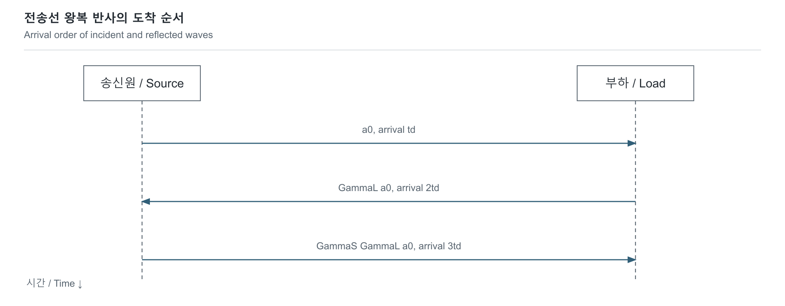

# 전송선과 반사: 배선도 신호를 저장하고 전달합니다

[전자기학과 RF](../README.md) · [모델과 테스트](../../../예제_examples/공학기초_foundations/circuits_hardware/README.md)

## 한국어

### 1. 짧아 보이는 배선이 문제가 되는 순간

긴 줄의 한쪽을 흔들면 움직임이 반대쪽에 즉시 도착하지 않습니다. 배선의 전압·전류 변화도 유한한 속도로 전파됩니다. 디지털 신호가 1 MHz로 반복되어도 에지가 매우 빠르면 배선을 단순한 0 Ω 연결로 볼 수 없을 수 있습니다. 반복 주파수만이 아니라 상승·하강 시간과 전파 시간을 비교해야 합니다. [TI AN-807의 전송선과 반사 해석](https://www.ti.com/lit/an/snla027b/snla027b.pdf)

여기서는 균일한 두 도체의 무손실 선로, 일정한 특성 임피던스 Z₀>0, 저항성 source·load, 이상적인 step을 가정합니다. 실제 PCB의 분기, via, 주파수 의존 손실, 분산, 결합과 입력 정전용량은 뒤에 더할 항목입니다. 이 모델을 모든 배선에 그대로 적용하지 않습니다.

### 2. 분포된 L과 C에서 파동이 나옵니다

길이당 인덕턴스 L′의 단위는 H/m, 정전용량 C′는 F/m입니다. 길이 dx인 작은 구간에 KVL·KCL을 적용하고 dx→0으로 보내면

$$\frac{\partial v}{\partial x}=-L'\frac{\partial i}{\partial t},\qquad
\frac{\partial i}{\partial x}=-C'\frac{\partial v}{\partial t}.$$

한 번 더 미분하고 대입하면 `∂²v/∂x²=L′C′∂²v/∂t²`입니다. 따라서 전파 속도와 특성 임피던스, 길이 ℓ의 편도 지연은

$$v_p=\frac1{\sqrt{L'C'}},\quad Z_0=\sqrt{L'/C'},\quad t_d=\ell/v_p.$$

Z₀는 DC로 재는 배선 저항이 아니라 진행파의 전압·전류 비입니다. 무손실 선로에서도 0이 아닐 수 있습니다. 전압은 정방향·역방향 파의 합이고, +x 방향 전류는 `i=(v⁺−v⁻)/Z₀`입니다. 역방향 파의 전류 부호를 빠뜨리면 반사식이 틀어집니다. [Analog Devices의 선로 모델](https://www.analog.com/en/resources/technical-articles/interfacing-highspeed-signals.html)

### 3. 경계에서 전압과 전류가 맞아야 합니다

load에서 `vL=v⁺+v⁻`, `iL=(v⁺−v⁻)/Z₀`, `vL=RLiL`를 동시에 만족해야 합니다. 이 식을 정리하면

$$\Gamma_L=\frac{v^-}{v^+}=\frac{R_L-Z_0}{R_L+Z_0},\qquad
v_L=v^+(1+\Gamma_L).$$

| 끝단 | ΓL | 처음 도착한 전압에 대한 load 변화 |
|---|---:|---|
| RL=Z₀ | 0 | 진행파와 같은 크기 |
| open, RL→∞ | +1 | 전압이 두 배, 순전류는 0 |
| short, RL=0 | −1 | 전압은 0, 전류가 두 배 |

open에서 전압이 두 배가 되는 것은 에너지가 생겼다는 뜻이 아닙니다. 전류 조건도 함께 바뀌고, 반사파가 에너지를 되돌립니다. 실수 Z₀인 무손실 선로의 저항성 load에서는 반사 전력 비가 ΓL²이고, 흡수 전력 비는 `1−ΓL²`입니다. 복소 load에는 복소 반사 계수를 쓰며, 여기의 실수 step 모델을 그대로 쓰지 않습니다. TI의 경계 조건 유도와 ADI의 source/load 반사 설명을 이 부호 규약으로 대조했습니다.

### 4. source에서도 다시 반사합니다

source는 Thevenin step VS와 저항 RS로 나타냅니다. 아직 load의 정보가 돌아오기 전 source가 보는 진행파 관계는 Z₀이므로 처음 출발하는 파는 `a₀=VSZ₀/(RS+Z₀)`입니다. 되돌아온 파의 source 반사 계수는 `ΓS=(RS−Z₀)/(RS+Z₀)`입니다. load에 k번째 도착하는 파와 누적 전압은

$$a_k=a_0(\Gamma_L\Gamma_S)^k,\qquad
\Delta v_{L,k}=a_k(1+\Gamma_L),\quad t_k=(2k+1)t_d.$$

[SVG](../../../자료_assets/도식_diagrams/transmission-lines-reflections.svg) · [그림 원본 / Diagram source](../../../자료_assets/도식_diagrams/transmission-lines-reflections.mmd)

직접 작성한 첫 반사들의 시간 그림입니다. VS=3.3 V, RS=Z₀=50 Ω, open load이면 a₀=1.65 V가 td 뒤 load에서 3.3 V가 됩니다. 돌아온 파는 ΓS=0인 source에서 흡수됩니다. 반대로 load도 50 Ω로 종단하면 load의 정상 전압은 1.65 V입니다. 종단 저항의 분압과 전력도 설계에 포함해야 합니다.

`|ΓLΓS|<1`일 때 등비급수를 더하면, 유한한 저항 load의 정상 전압이 `VSRL/(RS+RL)`로 DC 분압과 일치합니다. 이상적인 무손실·무감쇠 경계에서는 이 수렴 조건이 성립하지 않을 수 있습니다.

### 5. 모델 선택과 검증

`td/tr`가 충분히 작으면 집중소자 근사가 유용할 수 있지만, “몇 cm부터 무조건 전송선”이라는 보편 기준은 없습니다. 허용되는 overshoot·지연·입력 임계값, 분기와 source/load 조건에 따라 필요한 정확도가 달라집니다. 가장 빠른 관련 에지, 왕복 지연 2td, 실제 stack-up의 전파 속도를 함께 봅니다.

`load_steps`는 load 도착 사건만 추적해 K번 반사를 O(K) 시간, O(1) 추가 공간으로 만듭니다. 테스트는 open·short·정합 경계, 저항 load의 전력 보존, td·3td 도착 시간, source 정합, 여러 저항 조합의 DC 수렴을 확인합니다. 이 결과는 이상적인 bounce 모델입니다. 실제 선로 검증에는 임피던스·delay를 확인하는 TDR, 충분한 대역폭의 파형, probe 부하, IBIS·SPICE 또는 전자기 해석과의 비교가 필요합니다.

## English

### 1. When a wire stops behaving like an ideal connection

A disturbance sent down a long rope does not arrive immediately. Electrical voltage and current changes also propagate at finite speed. A digital signal repeating at only 1 MHz may still need transmission-line treatment if its edges are sufficiently fast. Compare propagation delay with rise and fall times, rather than using repetition frequency alone. [TI AN-807](https://www.ti.com/lit/an/snla027b/snla027b.pdf)

This model assumes a uniform lossless two-conductor line, constant real Z₀>0, resistive source and load, and an ideal step. Branches, vias, frequency-dependent loss, dispersion, coupling and receiver capacitance require model extensions. It is not a universal model of PCB wiring.

### 2. From distributed inductance and capacitance to waves

Let L′ be inductance per length in H/m and C′ capacitance per length in F/m. Applying KVL and KCL to a differential segment gives `∂v/∂x=-L′∂i/∂t` and `∂i/∂x=-C′∂v/∂t`. Combining them yields `∂²v/∂x²=L′C′∂²v/∂t²`. Hence

$$v_p=1/\sqrt{L'C'},\quad Z_0=\sqrt{L'/C'},\quad t_d=\ell/v_p.$$

Z₀ is the traveling-wave voltage/current ratio, not the wire's DC resistance. It remains nonzero for an ideal lossless line. Voltage is the sum of forward and reverse waves, while current referenced in +x is `i=(v⁺−v⁻)/Z₀`. The reverse-current sign is essential. [Analog Devices transmission-line model](https://www.analog.com/en/resources/technical-articles/interfacing-highspeed-signals.html)

### 3. Satisfying the load boundary

At the load, `vL=v⁺+v⁻`, `iL=(v⁺−v⁻)/Z₀`, and `vL=RLiL`. Solving gives `ΓL=(RL−Z₀)/(RL+Z₀)` and `vL=v⁺(1+ΓL)`. A matched load gives zero reflection. An open gives ΓL=+1, doubled voltage and zero net current. A short gives ΓL=−1, zero voltage and doubled current.

Voltage doubling at an open does not create energy: the current condition changes and a reverse wave returns energy. For a real Z₀ and resistive load on a lossless line, reflected power fraction is ΓL² and absorbed fraction is `1−ΓL²`. Complex loads require a complex reflection coefficient and cannot be inserted unchanged into this real step model. The signs above were cross-checked against TI's boundary derivation and ADI's source/load treatment.

### 4. Reflection at the source

Represent the source as a Thevenin step VS with series RS. Before information from the load returns, the launched wave is `a₀=VSZ₀/(RS+Z₀)`. A reverse wave sees source reflection coefficient `ΓS=(RS−Z₀)/(RS+Z₀)`. The kth load arrival is `aₖ=a₀(ΓLΓS)^k`, adding `aₖ(1+ΓL)` at time `(2k+1)td`. The original sequence diagram shows the first arrivals at td, 2td and 3td.

For VS=3.3 V, RS=Z₀=50 Ω and an open load, the launched 1.65 V wave reaches the load at td and produces 3.3 V there. The return wave is absorbed at the source because ΓS=0. If the load is also terminated in 50 Ω, its final voltage is instead 1.65 V. Termination design must include this divider and power cost.

When `|ΓLΓS|<1`, summing the geometric series gives `VSRL/(RS+RL)` for a finite resistive load, matching the DC divider. Ideal undamped boundaries can violate that convergence condition.

### 5. Choosing and checking the model

A lumped approximation can be useful when `td/tr` is sufficiently small, but no universal wire-length cutoff applies. Required fidelity depends on allowed overshoot, delay, receiver thresholds, branches and terminations. Consider the fastest relevant edge, round-trip delay 2td and propagation speed for the actual stack-up.

`load_steps` tracks only load-arrival events, using O(K) time and O(1) extra state for K reflections. Tests cover open, short and matched limits, resistive-load power conservation, td/3td timing, source matching and convergence to the DC divider. These are ideal bounce-model results. Physical validation additionally needs TDR impedance/delay data, sufficient waveform bandwidth, probe-loading analysis, and comparison with IBIS, SPICE or electromagnetic models.

## 출처와 대조한 내용 | Sources and cross-checks

- Texas Instruments, *AN-807 Reflections: Computations and Waveforms*, SNLA027B (May 2004), §§3–7: 경계 조건·반사 계수·lattice 계산 / boundary conditions, reflection coefficients and lattice computation.
- Analog Devices, *Interfacing High-Speed Signals*: 분포 L′·C′, 무손실 가정과 source/load 반사 / distributed L′/C′, lossless assumptions and source/load reflection. 두 문서의 부호·정합 및 open 극한을 대조했습니다 / signs, matched boundaries and open-load limits cross-checked between the documents.
- 그림·파동 합산·테스트는 직접 구성했습니다 / diagram, wave summation and tests constructed here. 출처 확인 / sources checked: 2026-10-19.
