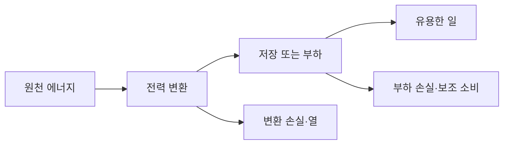

# 전력전자와 에너지 | Power Electronics & Energy

[전체 목차](../../분야별목차_CATALOG.md) · [처음으로](../../README.md)

전력전자는 반도체 스위칭과 수동소자를 이용해 전기 에너지를 필요한 전압·전류·주파수로 바꿉니다. DC/DC·AC/DC 변환기, 인버터, 충전기, 모터 구동기, PMIC와 연결됩니다.

## 변환기와 스위칭

Buck은 강압, boost는 승압의 기본 구조입니다. 이상적인 연속전도 buck의 정상상태에서는 `Vout = D*Vin`으로 듀티비에 따른 출력 전압을 구할 수 있습니다. 실제 회로에는 도통 손실·스위칭 손실·리플·제어 지연이 있습니다. LLC는 공진을 이용하는 변환기 구조입니다.

## 소자와 구동

MOSFET·IGBT·SiC·GaN 소자는 전압·전류·스위칭 주파수·손실 특성에 따라 사용 영역이 달라집니다. 게이트 드라이버는 게이트 전하를 충·방전하고, dead time은 상하 스위치의 동시 도통을 방지하는 데 관여합니다. 배선의 기생 인덕턴스는 ringing과 과전압을 만들 수 있습니다.

배터리 시스템의 BMS는 전압·전류·온도 관측과 상태 추정·보호를 담당합니다. 효율은 출력 전력을 입력 전력으로 나눈 값입니다. 같은 회로에서도 부하 조건에 따라 달라집니다. PLECS·PSIM·LTspice·Simulink는 전력단과 제어 동작을 모델링하는 도구입니다. 열과 보호 동작도 전기적 성능의 일부입니다.

## 전력과 전력량은 다른 질문입니다

전력 W는 지금 에너지가 얼마나 빨리 이동하는지 나타냅니다. 전력량 Wh는 그 흐름을 시간에 걸쳐 합친 값입니다. 물탱크의 물이 빠지는 속도와 총 물의 양을 나누어 보는 것과 같습니다. 100 W 장치를 3시간 쓰면 300 Wh이며, 1 kW 장치를 0.3시간 써도 같은 전력량입니다. 그러나 배선·전원장치가 견뎌야 할 순간 출력은 다릅니다.

효율 95% 변환기에서 출력 100 W를 얻으려면 입력은 100/0.95≈105.26 W입니다. 차이 약 5.26 W는 정상상태에서 열 등으로 나갑니다. `100×0.05=5 W`를 입력·출력 관계를 구분하지 않고 손실이라고 쓰면 분모가 달라집니다. 아래 숫자는 부품을 직접 측정한 자료가 아니라 단위와 경계를 익히는 자체 예제입니다.

부하가 바뀌면 효율도 바뀝니다. 무부하에서도 제어기와 게이트 구동이 소비하는 전력이 있고, 큰 전류에서는 도통 손실이 커질 수 있습니다. 따라서 최고 효율 하나보다 자주 쓰는 부하에서의 곡선과 대기 소비가 유용합니다. 충전기와 저장 설비도 정격 출력의 효율을 일 년 전체에 그대로 적용하지 않습니다.

## 에너지수지로 변환 단계를 연결합니다

가상 배터리에서 1,000 Wh를 꺼내 DC/DC 95%, 인버터 96%, 모터 90%를 거쳐 일을 한다면 최종 에너지는 1,000×0.95×0.96×0.90=820.8 Wh입니다. 단계별 손실률을 단순히 더하지 않고 앞 단계에서 남은 에너지에 다음 비율을 곱합니다. 이때 1,000 Wh가 배터리의 명목 용량인지, 단자에서 실제 꺼낸 에너지인지도 먼저 정해야 합니다.

```math
\eta_{total}=\prod_i\eta_i,
\qquad E_{useful}=E_{input}\eta_{total}
```

같은 일을 820.8 Wh만큼 하더라도 보조 펌프가 20 W로 2시간 작동하면 별도로 40 Wh를 씁니다. 보조 부하를 포함한 계량 경계에 따라 총효율이 달라집니다. 기능별 전원선을 따로 재거나 전체 접속점에서 재는 이유는 손실이 어디서 생기는지 확인하기 위해서입니다.



직접 그린 이 그림에서 열은 항상 쓸모없다는 뜻은 아닙니다. 공장의 난방에 회수할 수 있지만 필요한 온도와 시간이 맞아야 합니다. 낮은 온도로 퍼진 열과 고품질 전력을 같은 1 Wh라는 이유만으로 같은 서비스로 더하면 에너지의 이용 가능성을 놓칩니다.

## 전류를 줄이면 어떤 손실이 달라지나요?

저항 R에서 생기는 도통 손실은 단순 모델에서 I²R입니다. 가상 배선 저항 0.02 Ω에 10 A가 흐르면 2 W, 20 A면 8 W입니다. 전류 두 배가 손실 네 배가 되는 관계입니다. 전압을 높여 같은 전력을 낮은 전류로 전달하는 이유를 여기서 이해할 수 있습니다. 다만 높은 전압은 절연·안전·소자 정격의 부담을 늘립니다.

스위칭 손실은 켜고 끄는 과도 구간에 전압과 전류가 동시에 걸리는 것과 관련됩니다. 아주 단순한 근사 `Psw≈0.5×V×I×(tr+tf)×fs`에서 V=48 V, I=10 A, 상승·하강 시간의 합 40 ns, 주파수 100 kHz를 넣으면 0.96 W입니다. 주파수만 두 배면 1.92 W입니다. 실제 회로는 출력 정전용량·역회복·게이트 구동·공진과 기생성분을 더 봐야 합니다.

주파수가 높으면 작은 자기부품과 빠른 제어를 얻을 여지가 있지만 손실과 전자파 문제가 커질 수 있습니다. SiC·GaN이라는 소재 이름만으로 최적 회로가 정해지지 않습니다. 필요한 전압·전류, 소자의 전하·저항과 드라이버, 열 경로를 함께 맞춥니다. 유리한 소자를 넣어도 긴 배선의 기생 인덕턴스가 과전압을 만들면 이득을 잃을 수 있습니다.

## 저장은 전력과 에너지 제한을 모두 가집니다

배터리 2 kWh에 1 kW 인버터를 연결했다고 4 kW 부하를 30분 공급할 수 있는 것은 아닙니다. 총에너지는 맞아도 출력 정격을 넘습니다. 반대로 4 kW 인버터를 달아도 배터리가 그 전류를 공급하지 못하면 같은 문제가 생깁니다. 보호회로와 BMS는 상태를 관측하고 정격을 지키도록 동작하지만 손실·열·열화를 없애지는 않습니다.

충전 상태 SOC는 기준 용량에 대해 얼마나 충전되어 있는지를 나타내는 추정치입니다. 전류를 적분해 출입 전하를 세는 방법은 센서 오차가 누적될 수 있습니다. 전압만 보는 방법도 부하와 온도, 화학계에 영향을 받습니다. 가상 100 Ah 배터리에 전류 센서의 일정한 오차 0.1 A가 10시간 누적되면 1 Ah, 기준 용량의 1%가 됩니다. 작은 오차라도 오래 누적되면 상태 추정과 운전 여유에 영향을 줍니다.

배터리 내부 온도가 높은 상태에서 더 큰 전류를 허용하면 순간 출력을 늘릴 수 있어도 수명이나 보호 조건이 달라집니다. 전력전자·제어·열은 별개의 마지막 검사 목록이 아니라 같은 설계의 연결된 상태입니다. [열망의 에너지수지](../36-패키징열설계_packaging-thermal/해설_notes/두노드의열흐름_thermal-network.md)를 함께 읽으시면 좋습니다.

## 실제 에너지 시스템으로 이어 읽기

태양광의 셀 효율, 인버터 변환 효율과 발전소의 설비 이용률은 각각 다른 비율입니다. 태양이 없는 밤에는 고효율 인버터도 발전 에너지를 만들지 못합니다. 저장 설비의 지속시간, 계통 연결과 수요 시간대를 연결해야 실제 공급을 설명할 수 있습니다. [에너지·물 기술 리뷰](../../제품리뷰_reviews/에너지와물_energy-water/README.md)에서는 이 관계를 난방·풍력·지열·담수화·저장 사례로 다룹니다.

계량값을 비교할 때는 입력·출력 위치, 시간 간격, 부하와 온도, 보조 소비를 먼저 적습니다. 정격 100 W라는 이름보다 20 W 부하에서의 실제 입력과 온도 상승이 사용 목적에 더 중요할 수 있습니다. 회로 모의는 조건을 빠르게 바꾸는 도구이며, 사용하지 않은 부품의 실측 결과를 대신하지는 않습니다.

### 확인 문제

1. 출력 100 W·효율 95%에서 입력과 손실은 각각 얼마인가요?
2. 2 kWh 배터리와 1 kW 인버터로 4 kW를 30분 공급할 수 있나요?
3. 전류 센서 오차 0.1 A가 10시간 누적되면 얼마나 달라지나요?

<details><summary>해설 보기</summary>

1. 입력 약 105.26 W, 손실 약 5.26 W입니다.
2. 총에너지와 별개로 인버터 출력 정격을 넘으므로 보장할 수 없습니다.
3. 1 Ah이며, 100 Ah 기준이면 1%입니다. 실제 SOC 오차에는 다른 원인도 있습니다.

</details>

## 관련 기술

PLECS, PSIM, LTspice, Simulink, Buck/Boost, LLC, BMS, PMIC

## 참고 자료

- [LTspice](https://www.analog.com/en/resources/design-tools-and-calculators/ltspice-simulator.html)

## 기초 해설

- [스위칭으로 낮은 전압 만들기: buck의 CCM과 ripple](해설_notes/스위칭으로낮은전압만들기_buck-ccm-ripple.md)

## English

### Power electronics and energy

Power electronics uses semiconductor switching and passive components to convert electrical energy to the required voltage, current, and frequency. Applications include DC/DC and AC/DC converters, inverters, chargers, motor drives, and PMICs.

### Converters and switching

Buck and boost converters provide basic step-down and step-up structures. For an ideal buck converter in steady-state continuous conduction, `Vout = D*Vin` relates duty cycle to output voltage. Real circuits also have conduction and switching losses, ripple, and control delay. LLC converters use resonance in their conversion stage.

### Devices and gate driving

MOSFET, IGBT, SiC, and GaN devices suit different voltage, current, switching-frequency, and loss requirements. A gate driver charges and discharges the gate. Dead time helps prevent the upper and lower switches from conducting together, while parasitic wiring inductance can cause ringing and overvoltage.

A battery management system monitors voltage, current, and temperature, estimates battery state, and provides protection. Efficiency is output power divided by input power and needs to be read alongside the load conditions. PLECS, PSIM, LTspice, and Simulink model power stages and their controls. Thermal behavior and protection are also part of the circuit's electrical performance.

### Foundation article

- [스위칭으로 낮은 전압 만들기: buck의 CCM과 ripple](해설_notes/스위칭으로낮은전압만들기_buck-ccm-ripple.md#english)


## 심화 해설 | Advanced article

- [부하가 갑자기 바뀔 때: buck의 평균 과도모델](해설_notes/부하변화의과도응답_buck-transient.md) · [English](해설_notes/부하변화의과도응답_buck-transient.md#english)
