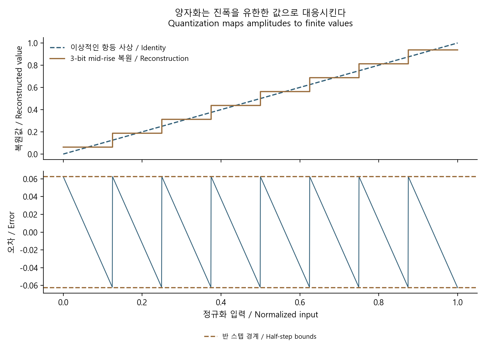

# ADC 양자화: 비트 수와 정확도를 구분하기

[Data converters](../README.md) · [기초부터 읽기](../../../공학기초_foundations/README.md) · [English](#english)



3 bit mid-rise 양자화의 복원값과 오차. 범위 안의 오차는 반 구간 이내입니다. / Reconstruction and error of a 3-bit mid-rise quantizer; in-range error stays within half a step.

직접 계산해 그린 원본 도표 · [생성 코드](../../../예제_examples/공학기초_foundations/make_figures.py). / Original plot calculated for these notes; [generation code](../../../예제_examples/공학기초_foundations/make_figures.py).

## 작은 눈금으로 읽는 전압

자를 더 촘촘하게 나누면 읽을 수 있는 길이 간격이 작아집니다. 그렇다고 자가 휘었거나 기준점이 잘못된 문제까지 사라지지는 않습니다. ADC의 비트 수는 출력 코드의 개수를 정합니다. 실제 측정 정확도에는 기준 전압, 잡음, offset·gain error, 비선형성, 입력 회로도 관여합니다.

[Analog Devices MT-001](https://www.analog.com/media/en/training-seminars/tutorials/MT-001.pdf)은 이상적인 양자화 잡음의 가정을 설명합니다. [TI의 ADC 잡음 설명](https://www.ti.com/document-viewer/lit/html/SSZT554/GUID-5FCFDA62-4CDD-403A-969C-EB377113CA8A)은 비트 수 외에 실제 회로의 잡음을 함께 다룹니다.

## 구간, 코드, 복원값

입력 범위를 $`[V_{min},V_{max}]`$ [V], 비트 수를 $`N`$이라 두겠습니다. 코드 개수는 $`L=2^N`$, 이상적인 구간 폭은

$$
\Delta=\frac{V_{max}-V_{min}}{2^N}\quad[\mathrm V].
$$

여기서는 구간 중앙을 복원값으로 쓰는 mid-rise 모델을 정합니다.

$$
c=\mathrm{clip}\!\left(\left\lfloor\frac{x-V_{min}}{\Delta}\right\rfloor,0,L-1\right),\qquad
\hat{x}=V_{min}+(c+1/2)\Delta.
$$

범위 안에서는 $`\vert \hat{x}-x\vert \le\Delta/2`$입니다. 범위를 넘는 입력은 최하위·최상위 코드로 포화되며 이 오차 경계가 더 이상 성립하지 않습니다. 실제 부품의 첫·마지막 코드 전이와 출력 형식은 데이터시트가 기준입니다. 위 식은 모든 ADC의 transfer curve를 대신하는 규격이 아닙니다.

| 예시 | 값 |
| --- | --- |
| 범위 | 0–3.3 V |
| 분해능 | 12 bit, 4096 codes |
| 이상적인 구간 폭 | 약 0.806 mV |
| 구간 내 최대 양자화 오차 | 약 0.403 mV |

## $`6.02N+1.76`$은 어디서 나옵니까

양자화 오차 $`e`$를 $`[-\Delta/2,\Delta/2]`$의 균일 분포로 근사하면 평균은 0이고

$$
\sigma_e^2=\frac{1}{\Delta}\int_{-\Delta/2}^{\Delta/2}e^2\,de=\frac{\Delta^2}{12}.
$$

전체 입력 폭을 $`V_{pp}=2^N\Delta`$라 하면 full-scale 정현파의 AC RMS는 $`V_{pp}/(2\sqrt2)`$입니다. 따라서

$$
\mathrm{SNR}_{dB}=20\log_{10}\frac{V_{pp}/(2\sqrt2)}{\Delta/\sqrt{12}}
=20N\log_{10}2+10\log_{10}(3/2)\approx6.02N+1.76.
$$

이는 이상적인 양자화, full-scale 정현파, 전체 Nyquist 대역의 잡음에 대한 식입니다. 오차가 입력과 강하게 연관되면 백색 잡음이라는 해석이 맞지 않습니다. DC나 작은 주기 신호가 대표적입니다. [MT-001 pp.1–3,5–7](https://www.analog.com/media/en/training-seminars/tutorials/MT-001.pdf)의 가정과 대역 설명을 함께 확인합니다. 여기서 ENOB를 부품의 DC 절대 정확도나 입력 전압의 유효 자릿수로 바꿔 해석하지 않습니다.

SNR은 통상 고조파를 제외하고 SINAD(SNDR)는 왜곡까지 포함하므로, 실제 SNR을 그대로 ENOB로 바꾸면 왜곡을 놓칩니다. Full-scale 정현파의 `ENOB=(SINAD_dB−1.76)/6.02`는 동적 성능의 환산값입니다. 작은 입력은 진폭 정규화가 필요하며 주파수·대역·제조사 정의도 확인합니다. [ADI MT-003, Rev. A(10/08), pp.5–6, 식 1–2](https://www.analog.com/media/en/training-seminars/tutorials/MT-003.pdf)

## 구현과 검사

[참조 코드](../../../예제_examples/공학기초_foundations/signals_ai/models.py)의 `adc_midrise`는 입력 하나를 상수 개수의 연산으로 코드와 복원값으로 바꿉니다. 1–24 bit 범위의 작은 계산 모델입니다. 실제 ADC와 통신하는 코드는 아닙니다.

```python
from signals_ai.models import adc_midrise, ideal_snr_db  # from/import는 모델 함수를 가져옵니다.

code, restored = adc_midrise(1.0, bits=12, lower=0.0, upper=3.3)  # 두 반환값을 코드와 복원 전압에 나눠 담습니다.
print(code, restored, restored - 1.0)  # print는 코드·복원값·모델의 양자화 오차를 출력합니다.
print(ideal_snr_db(12))  # 12비트 이상 모델의 SNR을 dB로 계산해 출력합니다.
```

검사는 범위의 양 끝·모든 코드 구간·포화를 확인하고, 균일한 구간 중점 표본으로 $`\Delta^2/12`$ 적분을 독립적으로 근사합니다. 4 bit, 구간당 200개 표본에서는 상대 오차 $`3\times10^{-5}`$ 이하를 기준으로 삼습니다. 별도로 12 bit의 이상적인 SNR이 약 74.008 dB인지 확인합니다. [실행 방법](../../../예제_examples/공학기초_foundations/README.md).

실제 장치 검증에서는 DC sweep으로 전이·offset·gain·INL/DNL을, 동적 입력으로 SNR·SINAD·왜곡을 평가합니다. 기준원과 신호 발생기, 입력 구동기, clock, FFT의 대역·window·coherence가 결과에 영향을 줍니다. 비트 수 하나만으로 이 성능을 보장하지 않습니다.

## English

### Resolution is not accuracy

Finer ruler marks improve resolution but cannot fix a bent ruler or a wrong zero point. An ADC's bit count sets its number of codes. Reference-voltage error, noise, offset, gain error, nonlinearity, and input circuitry also affect measurement accuracy. [TI's noise overview](https://www.ti.com/document-viewer/lit/html/SSZT554/GUID-5FCFDA62-4CDD-403A-969C-EB377113CA8A) provides the physical context; [ADI MT-001](https://www.analog.com/media/en/training-seminars/tutorials/MT-001.pdf) describes the ideal quantization approximation.

### Model and derivation

For an input span $`[V_{min},V_{max}]`$ [V] and $`N`$ bits, $`L=2^N`$ and $`\Delta=(V_{max}-V_{min})/2^N`$. Our mid-rise model uses

$$
c=\mathrm{clip}\!\left(\left\lfloor\frac{x-V_{min}}{\Delta}\right\rfloor,0,L-1\right),\qquad
\hat{x}=V_{min}+(c+1/2)\Delta.
$$

Inside the range, $`\vert \hat{x}-x\vert \le\Delta/2`$. Clipped out-of-range inputs do not satisfy that bound. Actual endpoint transitions and output formats belong to the device datasheet. At 12 bits over 0–3.3 V, the ideal step is about 0.806 mV and the in-range error bound about 0.403 mV.

Approximating error as uniform on $`[-\Delta/2,\Delta/2]`$ gives

$$
E[e]=0,\qquad E[e^2]=\frac1\Delta\int_{-\Delta/2}^{\Delta/2}e^2de=\Delta^2/12.
$$

A full-scale sinusoid has AC RMS $`V_{pp}/(2\sqrt2)`$ where $`V_{pp}=2^N\Delta`$. Its ideal SNR is

$$
20\log_{10}\frac{V_{pp}/(2\sqrt2)}{\Delta/\sqrt{12}}
=20N\log_{10}2+10\log_{10}(3/2)\approx6.02N+1.76\ \mathrm{dB}.
$$

This assumes ideal quantization, a full-scale sinusoid, and noise integrated over the Nyquist band. Error correlated with a DC or small periodic input need not behave as white noise. ENOB must not be read as DC absolute accuracy or guaranteed significant input digits.

SNR conventionally excludes harmonics; SINAD (SNDR) includes distortion. Using SNR for ENOB can hide distortion. For a full-scale sinusoid, `ENOB=(SINAD_dB−1.76)/6.02` expresses dynamic performance. Reduced amplitudes require normalization; also check frequency, bandwidth and manufacturer definitions. [ADI MT-003, Rev. A (10/08), pp.5–6, equations 1–2](https://www.analog.com/media/en/training-seminars/tutorials/MT-003.pdf)

### Implementation and verification

The [implementation](../../../예제_examples/공학기초_foundations/signals_ai/models.py) converts one input using a constant number of arithmetic operations for a 1–24-bit teaching model. It is not an ADC driver. The example above prints its code, reconstructed voltage, error, and ideal SNR.

Tests check endpoints, code intervals, clipping, and a numerical second-moment integration. A 4-bit quantizer with 200 midpoint samples per interval must match $`\Delta^2/12`$ within $`3\times10^{-5}`$ relative error; the 12-bit SNR is approximately 74.008 dB. See [execution instructions](../../../예제_examples/공학기초_foundations/README.md).

Physical characterization instead uses DC sweeps for transitions, offset, gain and INL/DNL, plus dynamic tests for SNR, SINAD and distortion. The reference source, signal generator, driver, clock, FFT bandwidth, window and coherence affect those results. Code resolution alone does not guarantee them.

## 출처 / Sources

- [Analog Devices, Walt Kester, MT-001](https://www.analog.com/media/en/training-seminars/tutorials/MT-001.pdf) — 오차 적분·SNR·상관·대역 조건 / error integration, SNR, correlation and bandwidth conditions.
- [Analog Devices, Walt Kester, MT-003, Rev. A(10/08), pp.5–6](https://www.analog.com/media/en/training-seminars/tutorials/MT-003.pdf) — SINAD·SNR의 구분과 ENOB의 진폭 조건 / SINAD versus SNR and ENOB amplitude assumptions.
- [TI, How much noise does your ADC really produce?](https://www.ti.com/document-viewer/lit/html/SSZT554/GUID-5FCFDA62-4CDD-403A-969C-EB377113CA8A) — 양자화와 열잡음, 실제 ADC 해석 / quantization, thermal noise and physical ADC interpretation.

이상 모델의 가정을 실제 잡음 설명과 대조하고, 코드 경계 및 오차 적분으로 계산을 확인했습니다. / The ideal assumptions were cross-checked against the physical noise discussion and verified using code boundaries and error integration.
