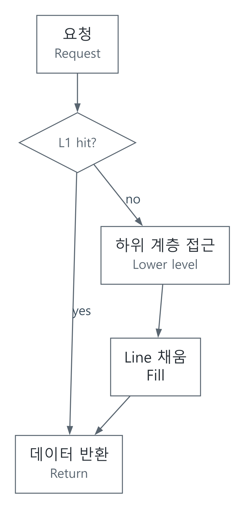

# 메모리 지역성과 캐시: 평균 지연과 대역폭을 나눠 보기

[메모리와 저장장치](../README.md) · [모델과 테스트](../../../예제_examples/공학기초_foundations/circuits_hardware/README.md)

## 한국어

### 1. 큰 창고와 작은 책상

책상에는 자주 쓰는 책을, 먼 창고에는 많은 책을 둔다고 생각해 보겠습니다. 캐시도 비슷합니다. 전체 데이터를 모두 빠른 메모리에 둘 수 없으므로, 곧 다시 쓸 가능성이 큰 일부를 가까이에 보관합니다. 최근 사용한 주소를 다시 쓰는 것이 시간 지역성, 가까운 주소를 함께 쓰는 것이 공간 지역성입니다. 이 성질은 프로그램의 경향이지 모든 입력에 대한 보장은 아닙니다. [CMU 캐시 강의, pp. 7–8](https://www.cs.cmu.edu/afs/cs/academic/class/15213-s25/www/lectures/10-cache-memories.pdf)

SRAM·DRAM은 저장 셀과 접근 구조가 다른 메모리 기술이고, 캐시는 배치·태그·교체 정책을 포함하는 계층 구조의 역할입니다. 흔히 캐시에 SRAM을 쓰더라도 “SRAM은 모두 캐시”인 것은 아닙니다. 메모리 용량, 한 요청의 지연, 단위 시간당 전송량, 에너지는 서로 다른 설계 지표입니다.

### 2. 주소를 캐시에 배치하는 수식

간단한 direct-mapped 캐시를 만듭니다. 한 line의 크기는 B byte, line 수는 S, 바이트 주소는 a≥0입니다.

$$b=\lfloor a/B\rfloor,\quad index=b\bmod S,\quad tag=\lfloor b/S\rfloor.$$

offset은 `a mod B`입니다. 해당 index의 valid bit가 켜져 있고 저장 tag가 같으면 hit, 아니면 miss입니다. 한 블록을 가져오면 B byte를 담기 때문에 인접 데이터가 다음 접근에서 hit가 될 수 있습니다. 서로 다른 블록이 같은 index를 번갈아 쓰면 용량이 남아 보여도 conflict miss가 발생합니다. [CMU 강의의 주소 분해·읽기 추적](https://www.cs.cmu.edu/afs/cs/academic/class/15213-s25/www/lectures/10-cache-memories.pdf)

| B=2 byte, S=4인 경우 | 블록 b | index | tag | 초기 빈 캐시에서 결과 |
|---|---:|---:|---:|---|
| a=0 | 0 | 0 | 0 | miss |
| a=1 | 0 | 0 | 0 | hit |
| a=7 | 3 | 3 | 0 | miss |
| a=8 | 4 | 0 | 1 | miss, 블록 0 교체 |
| a=0 | 0 | 0 | 0 | miss |

B와 S가 2의 거듭제곱이면 이 분해를 주소 비트로 구현하기 쉽습니다. Python 모델은 나눗셈과 나머지를 사용하므로 다른 양의 정수 크기도 다룹니다. 이는 교육용 매핑이며 특정 CPU의 실제 인덱스 해시를 재현하지 않습니다.

### 3. AMAT는 가중 평균에서 나옵니다

hit time을 h, miss 비율을 m, miss 때문에 추가로 드는 시간을 p라 하겠습니다. 모든 접근이 h를 내고 miss만 p를 더 내는 직렬·blocking 모델이면

$$AMAT=(1-m)h+m(h+p)=h+mp.$$

p를 miss의 전체 시간으로 정의했다면 식은 `(1-m)h+mp`가 됩니다. 두 정의를 섞으면 h를 두 번 더하거나 빼게 됩니다. 예를 들어 h=2 ns, m=0.05, 추가 p=80 ns이면 AMAT=6 ns입니다. 95%가 hit라는 숫자만으로 지연이 거의 2 ns라고 결론 내릴 수 없습니다. [CMU 15-740 메모리 계층 강의](https://www.cs.cmu.edu/afs/cs/academic/class/15740-f19/www/lectures/02-03-memory-hierarchy.pdf)

2단계 계층에서 L2 miss 비율 m₂를 “L1에서 miss여서 L2까지 온 요청 중 비율”로 정하면 `AMAT=h₁+m₁(h₂+m₂pMem)`입니다. L2의 전체 요청 대비 miss 비율을 넣는 식과 구분해야 합니다. 이 단순식은 겹치는 요청, prefetch, write-back, 큐 대기, 캐시 일관성 비용을 자동으로 포함하지 않습니다.

### 4. 지연을 줄이는 일과 전송량을 늘리는 일

[SVG](../../../자료_assets/도식_diagrams/locality-cache-amat.svg) · [그림 원본 / Diagram source](../../../자료_assets/도식_diagrams/locality-cache-amat.mmd)

직접 작성한 blocking 읽기 경로입니다. latency는 한 요청이 끝날 때까지 걸리는 시간이고 bandwidth는 일정 기간에 옮긴 byte 수를 시간으로 나눈 값입니다. line이 64 byte인데 4 byte만 쓴다면 유효 데이터와 실제 전송량이 다를 수 있습니다. GPU에서는 여러 thread의 인접 접근을 적은 transaction으로 합치는 coalescing이 이 낭비를 줄입니다. [NVIDIA의 global memory 접근 분석](https://developer.nvidia.com/blog/unlock-gpu-performance-global-memory-access-in-cuda/)

읽은 데이터를 기다려야 다음 주소를 알 수 있는 pointer chasing은 지연을 드러내기 쉽습니다. 독립적인 큰 배열 stream은 여러 요청이 겹치면서 대역폭의 영향을 더 크게 받을 수 있습니다. 어느 경우든 장치·배열 크기·접근 순서·동시성·warm/cold 상태를 기록해야 비교가 가능합니다. 한 CPU의 지연 수치를 모든 GPU·메모리에 적용하지 않습니다.

### 5. 구현과 검증

`direct_mapped_hits`는 초기 빈 캐시에서 한 번에 한 byte 주소를 읽는 trace를 처리합니다. 데이터 값, write, prefetch, 다중 core 일관성은 모델에 없습니다. N개 주소에 O(N) 시간, S개 tag에 O(S) 공간입니다. 테스트는 위의 손 계산 trace, 연속 주소의 공간 지역성, 같은 index를 오가는 충돌, 독립적인 블록 번호 모델을 비교합니다.

AMAT 검증에서는 실제 hit마다 h, miss마다 h+p를 더해 N으로 나눈 결과를 공식과 대조합니다. 이는 모델 계산의 확인입니다. 실제 성능 검증에서는 결과가 사용되도록 한 benchmark, 반복 측정, cache miss·전송량 counter, 컴파일러 최적화와 타이머 오버헤드를 함께 확인합니다. 추상 모델의 miss 수가 실제 CPU 실행 시간과 같다고 가정하지 않습니다.

### 6. 캐시 성능과 DDR 자료 검증을 나누어 관측합니다

같은 CPU 주소를 반복해서 읽는 시험은 cache hit를 관측할 수 있지만, 각 반복이 DDR까지 내려갔는지를 자동으로 보장하지 않습니다. AMAT는 접근 지연의 모델이고, 쓴 자료의 보존·주소선 구분·DRAM 명령 간격은 별도의 검사 대상입니다. 실제 시험에서는 시험 영역의 소유권, 플랫폼의 캐시 정책·DMA 동기화, controller/PHY에서 얻은 관측값을 함께 구분해야 합니다.

[DDR 명령·메모리 패턴 실습](../../../예제_examples/실무검증_practical-validation/ddr_validation/README.md)은 캐시를 제외한 고정 명령·배열 fixture를 실제 Icarus에서 실행합니다. Python은 ACT 뒤 WR/RD의 간격, PRE·REF 조건, 예정한 읽기 응답의 cycle·tag·값을 따로 검사합니다. AL=0, tRCD=3 등 수치는 자체 cycle 계약이며 특정 부품의 정격이 아닙니다. REF 발행 간격 최대 40cycle도 실제 tREFI의 평균·연기 정책을 대체하지 않습니다.

정상 주소 패턴은 32개의 16비트 논리 주소를 쓰고 읽어 32응답을 확인했습니다. column 주소 bit1을 지워 주소0/2를 겹치게 하면 기대한 A500 대신 A702가 돌아옵니다. 전체 0만 쓰면 같은 alias가 있어도 값이 일치합니다. 또한 모든 읽기 응답을 없애면 관측값 불일치는 0건이지만 예정 응답 32건이 누락되어 실패합니다. 표본 개수와 값의 일치를 함께 확인해야 하는 이유입니다.

[원리·오류·수정 흐름](../../../설계와검증사례_engineering-cases/DDR명령간격과메모리패턴_ddr-command-pattern-checks.md)과 [일반 실행·-O 대조 기록](../../../설계와검증사례_engineering-cases/검증기록_evidence/DDR명령과패턴검증_20261021.md)을 연결했습니다. 이 실습에는 DDR 핀·burst·PHY training·셀 retention·ECC·실제 보드 시험이 없으므로 cache 성능, 명령 계약, 자료 패턴, 물리 신호 검증의 결과를 서로 대신하지 않습니다.

## English

### 1. A small desk and a large warehouse

Keeping frequently used books on a desk and many others in a warehouse gives a useful cache analogy. A cache holds a nearby subset of data likely to be reused. Temporal locality means reusing recently accessed locations; spatial locality means using nearby locations. Locality is a program tendency, not a guarantee for every input. [CMU cache lecture, pp. 7–8](https://www.cs.cmu.edu/afs/cs/academic/class/15213-s25/www/lectures/10-cache-memories.pdf)

SRAM and DRAM describe storage-cell technologies and access structures. A cache describes a hierarchy role with placement, tags and replacement policies. Even though caches commonly use SRAM, not all SRAM is a cache. Capacity, individual-request latency, transfer bandwidth and energy are distinct design metrics.

### 2. Mapping byte addresses

For a direct-mapped cache with B bytes per line and S lines, a nonnegative byte address a maps to block `b=floor(a/B)`, index `b mod S`, tag `floor(b/S)`, and offset `a mod B`. A hit requires both a valid entry and a matching tag at that index. Fetching an entire line can make subsequent neighboring accesses hit. Alternating different blocks at the same index causes conflict misses even when other entries are unused. [CMU's address decomposition and trace examples](https://www.cs.cmu.edu/afs/cs/academic/class/15213-s25/www/lectures/10-cache-memories.pdf)

For B=2 and S=4, the initially cold address sequence `0,1,7,8,0` produces `miss,hit,miss,miss,miss`. Addresses 0 and 1 share block zero; address 8 replaces that block at index zero. The last access to zero consequently misses. The table above gives the complete block, index and tag calculation.

Power-of-two dimensions allow convenient address-bit fields. The Python model uses integer division and remainder and also supports other positive dimensions. It is an educational mapping, not a reproduction of a particular processor's index hashing.

### 3. Deriving average access time

Let h be hit time, m the miss fraction, and p the additional miss penalty. In a serialized blocking model where every access pays h and misses additionally pay p,

$$AMAT=(1-m)h+m(h+p)=h+mp.$$

If p instead denotes the total miss time, the formula is `(1-m)h+mp`. Mixing these conventions double-counts or omits h. For h=2 ns, m=0.05 and additional p=80 ns, AMAT is 6 ns. A 95% hit rate therefore does not imply access time close to 2 ns. [CMU 15-740 memory-hierarchy lecture](https://www.cs.cmu.edu/afs/cs/academic/class/15740-f19/www/lectures/02-03-memory-hierarchy.pdf)

With L2 local miss rate m₂ defined over requests that missed L1, a simple serial hierarchy gives `AMAT=h₁+m₁(h₂+m₂pMem)`. A miss rate measured over all original requests requires a different substitution. This expression does not automatically capture overlapping requests, prefetching, write-back traffic, queueing or coherence.

### 4. Latency is different from bandwidth

The original diagram depicts a blocking read, L1 lookup, optional lower-level fetch and fill. Latency is the completion time of one request; bandwidth is bytes transferred per unit time. Using only 4 bytes of a fetched 64-byte line can make useful traffic much smaller than actual traffic. GPU coalescing can combine nearby thread accesses into fewer memory transactions. [NVIDIA global-memory analysis](https://developer.nvidia.com/blog/unlock-gpu-performance-global-memory-access-in-cuda/)

Pointer chasing, where the next address depends on the previous result, tends to expose latency. A large stream of independent accesses can overlap requests and reveal bandwidth limits more strongly. Comparisons need the device, array size, access pattern, concurrency, and warm/cold state recorded. A latency measured on one CPU cannot be applied universally to GPUs or memory systems.

### 5. Implementation and verification

`direct_mapped_hits` processes single-byte read addresses from an initially empty cache. It does not model data values, writes, prefetch or multicore coherence. N addresses cost O(N) time; S tags require O(S) space. Tests compare the hand-worked trace, sequential spatial locality, index conflicts, and an independent block-number reference.

AMAT is checked against an explicit trace sum: h for every hit and h+p for every miss, divided by N. This verifies the abstract calculation. Physical performance experiments additionally require an observable benchmark result, repeated timing, miss and traffic counters, and control of compiler optimization and timer overhead. A model miss count is not assumed to equal processor runtime.

### 6. Separating cache observations from DDR checks

Repeated CPU reads may hit in cache, so they do not establish that each access reached DDR. AMAT models access latency; data preservation, address distinction and command legality require different evidence. Physical experiments must distinguish ownership of the test region, platform-specific cache/DMA behavior and controller/PHY observations.

The [runnable DDR-style command fixture](../../../예제_examples/실무검증_practical-validation/ddr_validation/README.md) excludes caches and executes a fixed command/array model with Icarus. Python independently checks timing gaps, bank state and scheduled read responses. Its AL=0 timing rules and strict REF issue deadline are educational contracts rather than device ratings or JEDEC refresh policy. Address-dependent data detects a controlled alias that all-zero traffic misses. Suppressing all responses produces zero observed value mismatches but thirty-two missing-response failures. See the linked [case](../../../설계와검증사례_engineering-cases/DDR명령간격과메모리패턴_ddr-command-pattern-checks.md) and [evidence](../../../설계와검증사례_engineering-cases/검증기록_evidence/DDR명령과패턴검증_20261021.md). Neither this fixture nor cache timing establishes PHY training, cell retention, ECC or measured board behavior.

## 출처와 대조한 내용 | Sources and cross-checks

- CMU 15-213/14-513/15-513, *Cache Memories* (2025): 지역성·주소 분해·직접 매핑·추가 miss penalty / locality, address decomposition, direct mapping and additional miss penalty.
- CMU 15-740, *Memory Hierarchy* (2019): 계층 성능·AMAT 정의 / hierarchy performance and AMAT convention. 두 자료의 평균 시간 정의를 대조했다 / average-time conventions cross-checked between both lectures.
- NVIDIA, *Unlock GPU Performance: Global Memory Access in CUDA*: 전송 단위·coalescing·counter 관점 / transaction granularity, coalescing and counters. CPU와 GPU의 세부 캐시가 같다고 가정하지 않았다 / no assumption of identical CPU and GPU cache details.
- 그림·trace·테스트는 직접 구성했다 / diagram, traces and tests constructed here. 출처 확인 / sources checked: 2026-10-19.
