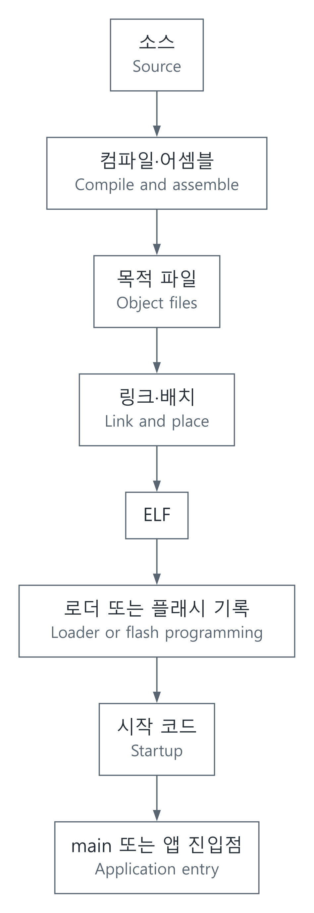

# C 코드가 실행되기까지: 컴파일, 링크, 리셋과 main

[상위 주제](../README.md) · [Firmware & RTOS](../../17-펌웨어-RTOS_firmware-rtos/README.md) · [메모리 초기화 모델](../../../예제_examples/공학기초_foundations/systems/systems_models.py)

## 한국어

### 소스 파일은 곧바로 CPU에 들어가지 않는다

도면만으로 건물이 서지 않듯, C 파일도 실행 위치와 준비 과정이 있어야 동작한다. 컴파일러는 프로그램의 의미를 목표 명령어로 바꾸고, 어셈블러는 목적 파일을 만든다. 링커는 여러 목적 파일의 심볼과 참조를 연결하고 주소를 배치한다. 실제 도구에서는 이 단계들이 하나의 명령 뒤에 묶일 수 있다.

ABI(Application Binary Interface)는 서로 따로 만든 코드가 만나는 약속이다. 인자를 어느 레지스터나 스택 위치로 넘기는지, 어떤 레지스터를 호출 전후에 보존하는지, 데이터와 스택을 어떻게 정렬하는지 등이 여기에 속한다. 예를 들어 Arm AAPCS32에는 32비트 Arm의 호출 규약이 정리되어 있다. 이를 모든 CPU의 호출 규약으로 일반화하면 안 된다. [Arm AAPCS32](https://github.com/ARM-software/abi-aa/blob/main/aapcs32/aapcs32.rst)

[SVG](../../../자료_assets/도식_diagrams/reset-to-main-and-toolchain.svg) · [그림 원본 / Diagram source](../../../자료_assets/도식_diagrams/reset-to-main-and-toolchain.mmd)

그림은 이 문서를 위해 작성한 흐름도다. OS 로더와 MCU 플래시 부팅은 같은 절차가 아니며, ELF 파일 자체가 MCU 리셋 회로의 동작을 결정하지도 않는다.

### 섹션과 주소를 나눠 보는 이유

ELF(Executable and Linkable Format)는 코드뿐 아니라 섹션, 심볼, 재배치와 디버그 정보를 담을 수 있다. 실행 파일에서는 로더가 사용하는 segment와 링커가 다루는 section을 구분한다. 디버그 정보를 제거한 실행 파일도 실행될 수 있다.

| 흔한 섹션 이름 | 보통 담는 것 | MCU에서 흔한 배치 |
| --- | --- | --- |
| `.text` | 명령어 | Flash에서 직접 실행하거나 RAM으로 복사 |
| `.rodata` | 읽기 전용 상수 | Flash 또는 읽기 전용 영역 |
| `.data` | 초기값이 있는 쓰기 가능 정적 데이터 | 초기값은 Flash, 실행 중 값은 RAM |
| `.bss` | 0으로 초기화할 정적 저장소 | RAM을 확보하고 시작 코드가 초기화 |

이름은 관례이며 최종 배치는 링커 스크립트와 툴체인에 달려 있다. 변수의 모든 0 초기화가 `.bss`의 바이트 0 채우기로 구현된다는 것은 C 전체에 대한 보장이 아니다. 여기서는 0 비트가 필요한 0 값 표현인 일반적인 MCU 환경을 가정한다.

VMA는 실행 중 접근할 주소, LMA는 초기 데이터를 적재해 둔 주소다. Flash의 `.data` 초기값을 RAM으로 옮기는 경우 두 주소가 다르다. GNU ld 문서는 `AT`와 `AT>`로 이 관계를 지정하는 방법을 설명한다. [GNU ld, Output Section LMA](https://sourceware.org/binutils/docs/ld/Output-Section-LMA.html)

### Cortex-M의 한 가지 시작 경로

Arm CMSIS의 Cortex-M 예에서는 벡터 테이블에 초기 MSP 값과 `Reset_Handler`를 두고, 리셋 처리에서 시스템 준비 뒤 C/C++ 런타임으로 넘어간다. 런타임은 초기화를 수행한 뒤 사용자 `main()`으로 들어간다. `.data` 복사나 C++ 생성자 호출이 어느 함수 안에 있는지는 런타임 구현에 따라 다르다. [Arm CMSIS startup 설명](https://github.com/ARM-software/CMSIS_6/blob/main/CMSIS/Documentation/Doxygen/Core/src/core_startup_c.md)

리셋 직후 일반적인 C 함수를 실행하려면 그 함수가 사용하는 스택과 메모리가 먼저 준비되어 있어야 한다. 또한 부트로더, 보안 상태, watchdog, 클럭과 RAM 제어기의 초기화 순서를 확인해야 한다. ESP32나 Linux 사용자 프로그램에 Cortex-M 벡터 규칙을 그대로 적용하지 않는다. 보존용 `.noinit` 영역은 `.bss`와 별도로 취급한다.

### 메모리 초기화의 작은 모델

Flash 초기값의 시작을 $`L`$, RAM 목적지 시작을 $`D`$, 크기를 $`N`$이라 하면 복사는

$$\mathrm{RAM}[D+i]\leftarrow\mathrm{Flash}[L+i],\quad0\le i<N$$

이다. BSS는 별도의 $`B,M`$에 대해 $`\mathrm{RAM}[B+j]\leftarrow0`$으로 둔다. 모델의 불변조건은 모든 접근이 유효 범위 안에 있고, `.data`와 `.bss`가 겹치지 않으며, 지정한 영역 바깥은 변하지 않는 것이다. 복사·0 초기화 연산은 $`O(N+M)`$ 시간이다. 예제 함수는 RAM 전체 $`R`$바이트를 배열로 만드므로 전체 모델의 시간은 $`O(R+N+M)`$, 공간은 $`O(R)`$이다. 실제 시작 코드의 복사 루프는 별도 전체 배열을 만들 필요가 없다.

`initialize_ram()`은 Flash 경계, RAM 경계, 음수 크기와 겹침을 먼저 검사한다. 테스트는 복사 결과와 BSS뿐 아니라 손대지 않아야 할 바이트도 확인한다. 크기 0과 마지막 주소 경계도 포함한다.

실제 빌드에서는 map 파일과 `readelf -S -l`, `objdump -h -d`, `nm` 같은 도구로 배치와 진입점을 확인하고, 디버거에서 리셋부터 중단점을 걸어 초기값과 스택을 살펴볼 수 있다. 이 저장소의 Python 테스트는 초기화 모델 검증이며 실제 ELF 생성, 특정 ABI 적합성, 보드 부팅 성공을 대신하지 않는다. [실행법과 검증 범위](../../../예제_examples/공학기초_foundations/systems/README.md)

## English

### A source file needs an execution environment

A drawing alone does not build a house. Likewise, a C file needs an address layout and preparation before it can execute. The compiler translates program meaning into target instructions, the assembler produces object files, and the linker resolves symbols and references and places content at addresses. Toolchains may combine these stages behind one command.

An ABI (Application Binary Interface) is the agreement between separately built pieces of code: where arguments go, which registers survive a call, and how data and the stack are aligned. Arm AAPCS32 defines such rules for 32-bit Arm; it is not a universal convention for every processor. [Arm AAPCS32](https://github.com/ARM-software/abi-aa/blob/main/aapcs32/aapcs32.rst)

The original diagram above connects source, compilation, objects, linking, ELF, loading or programming, startup, and application entry. OS loading and MCU Flash boot are different mechanisms. An ELF file does not itself define a microcontroller's hardware reset behavior.

### Sections and addresses

ELF (Executable and Linkable Format) can carry sections, symbols, relocation records, and debugging information in addition to instructions. Sections used by a linker differ from loadable segments used by a loader. Removing debugging information need not make an executable unexecutable.

| Common section | Typical content | Common MCU placement |
| --- | --- | --- |
| `.text` | Instructions | Execute from Flash or copy to RAM |
| `.rodata` | Read-only constants | Flash or another read-only region |
| `.data` | Writable static data with initial values | Initial image in Flash, live values in RAM |
| `.bss` | Static storage requiring zero initialization | Reserve RAM and initialize during startup |

Names are conventions; the linker script and toolchain determine placement. C does not universally guarantee that every zero initialization is implemented by filling a BSS region with zero bytes. This model assumes a common MCU environment where the required zero values have all-zero representations.

VMA is the runtime access address; LMA identifies where an initial image is loaded. They differ when initialized data is stored in Flash but used in RAM. GNU ld describes setting this relationship with `AT` and `AT>`. [GNU ld, Output Section LMA](https://sourceware.org/binutils/docs/ld/Output-Section-LMA.html)

### One Cortex-M startup path

The Arm CMSIS Cortex-M example places the initial MSP value and `Reset_Handler` in the vector table. Reset handling prepares the system and enters the C/C++ runtime, which performs initialization before calling user `main()`. The exact location of data copying or C++ constructor invocation depends on the runtime. [Arm CMSIS startup description](https://github.com/ARM-software/CMSIS_6/blob/main/CMSIS/Documentation/Doxygen/Core/src/core_startup_c.md)

Before an ordinary C function executes, the stack and memory it uses must be ready. Bootloaders, security state, watchdogs, clocks, and RAM-controller initialization can also constrain ordering. Do not apply Cortex-M vector rules directly to ESP32 or Linux user programs. Retained `.noinit` storage is distinct from `.bss`.

### A small initialization model

For a Flash source $`L`$, RAM destination $`D`$, and length $`N`$, copying means

$$\mathrm{RAM}[D+i]\leftarrow\mathrm{Flash}[L+i],\quad0\le i<N.$$

For a separate BSS interval $`B,M`$, set $`\mathrm{RAM}[B+j]\leftarrow0`$. The model's invariants are valid address ranges, nonoverlapping data and BSS destinations, and unchanged bytes elsewhere. Copying and clearing take $`O(N+M)`$ time. Creating the observable $`R`$-byte RAM array makes the full model $`O(R+N+M)`$ time and $`O(R)`$ space; a real startup loop does not need a second whole-RAM array.

`initialize_ram()` checks Flash and RAM bounds, negative sizes, and overlap before modifying the model. Tests check copied bytes, zeroed bytes, untouched bytes, empty intervals, and end boundaries.

For a real build, map files and tools such as `readelf -S -l`, `objdump -h -d`, and `nm` expose placement and entry points. A debugger can stop from reset and inspect initial data and stack state. The Python checks validate the initialization model, rather than ELF generation, ABI conformance, or successful board boot. [Commands and verification scope](../../../예제_examples/공학기초_foundations/systems/README.md)

## 출처와 교차 확인 / Sources and cross-check

- Arm CMSIS: Cortex-M 시작 경로 / Cortex-M startup path.
- GNU ld: 적재 주소와 실행 주소의 구분 / load versus runtime addresses.
- Arm AAPCS32: 호출 규약·정렬 조건 / calling convention and alignment.
- 시작 경로와 데이터 배치를 서로 다른 문서로 확인하고, 복사·초기화 범위는 독립적인 바이트 검사를 사용했다. / Startup and placement are checked against separate documents; byte-level tests independently check initialization ranges.
