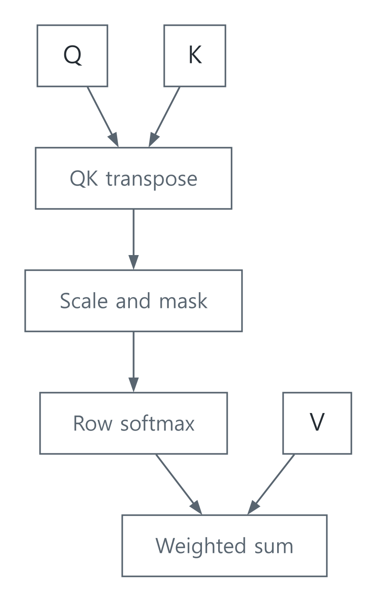

# Attention: 필요한 정보를 가중합으로 모으기

[Language & Multimodal AI](../README.md) · [기초부터 읽기](../../../문서_docs/공학기초_FOUNDATIONS.md) · [English](#english)

## 질문, 색인, 꺼낼 내용

영어의 attention에는 ‘어디에 주의를 기울이는가’라는 일상적인 느낌이 있다. 한국어로 ‘집중’이라고만 옮기면 한 곳만 골라 보거나 사람이 의식적으로 판단하는 동작을 떠올리기 쉽다. 여기서 다루는 연산은 현재 항목을 기준으로 다른 항목을 참고할 비율을 계산하고, 그 비율로 정보를 섞는 것이다. 여러 항목을 동시에 참고할 수 있다. 예를 들어 값 10과 20을 각각 0.8과 0.2의 비율로 섞으면 출력은 12다.

도서관에서 찾고 싶은 내용을 질문으로 만들고, 책의 색인을 비교한 뒤, 관련된 책에서 내용을 가져온다고 생각해 보자. 이 비유에서 찾는 기준은 query, 비교할 표식은 key, 가져올 내용은 value에 해당한다. 이름의 뉘앙스를 잡기 위한 비유이고, 실제 모델에서는 벡터와 행렬의 계산이다.

| 이름 | 영어에서 떠올릴 수 있는 느낌 | 이 계산에서의 역할 |
| --- | --- | --- |
| Query | 묻거나 찾아보는 기준 | 현재 위치가 비교에 사용할 벡터. 사용자가 쓴 질문 문장 자체를 뜻하지 않는다 |
| Key | 찾아갈 내용을 식별하는 표식 | query와 비교해 점수를 만드는 벡터. 암호 키나 반드시 유일한 식별자는 아니다 |
| Value | 꺼내 쓸 내용 | 점수가 정한 비율로 섞을 벡터. 좋고 나쁨이나 가격을 매기는 ‘가치’가 아니다 |
| Attention weight | 참고할 몫 | 해당 입력에서 계산되는 혼합 비율. 학습 뒤 고정해 두는 parameter weight와 구분한다 |

Self-attention의 self는 한 항목이 자기 자신만 본다는 뜻이 아니라, Q/K/V를 같은 입력 시퀀스에서 만든다는 뜻이다. 현재 위치는 마스크가 허용하는 다른 위치도 참고한다. [용어의 뜻과 뉘앙스](../../../문서_docs/용어와직관_TERMS_AND_INTUITION.md)에는 다른 문서에서 자주 만나는 비슷한 표현도 모았다.

이 글은 Transformer 전체가 아니라 scaled dot-product attention 한 head의 핵심 계산을 다룬다. 선형 투영, 여러 head, 위치 정보, residual connection, normalization과 feed-forward layer가 더해져야 전체 블록이 된다. [원 논문 §3.2](https://papers.nips.cc/paper/7181-attention-is-all-you-need.pdf)과 [Stanford CS224n의 2021 강의](https://web.stanford.edu/class/archive/cs/cs224n/cs224n.1234/slides/cs224n-2021-lecture09-transformers.pdf)를 대조했다.

## 모양부터 맞추기

질의 수를 $m$, 키·값 수를 $n$, query/key 차원을 $d_k$, value 차원을 $d_v$라 두자.

| 변수 | 모양 | 의미 |
| --- | --- | --- |
| $Q$ | $m\times d_k$ | 질의 벡터를 행으로 모음 |
| $K$ | $n\times d_k$ | 비교할 키 |
| $V$ | $n\times d_v$ | 가중합할 값 |
| $S$ | $m\times n$ | 질의와 키의 점수 |
| $O$ | $m\times d_v$ | 출력 |

$$
S=QK^\top/\sqrt{d_k},\qquad A_{ij}=\frac{e^{S_{ij}}}{\sum_l e^{S_{il}}},\qquad O=AV.
$$

softmax는 행마다 적용한다. 각 행의 가중치는 음수가 아니며 합이 1이므로 출력은 허용된 value들의 가중 평균이다. 확률처럼 정규화된 가중치가 나온다는 사실만으로 이를 정답 확률이나 설명의 신뢰도로 해석하지 않는다.

## 왜 $\sqrt{d_k}$로 나누는가

초기화를 이해하기 위한 단순화로 $q_l,k_l$가 서로 독립이고 평균 0, 분산 1이라고 하자. 그러면

$$
E[q_lk_l]=0,\quad\operatorname{Var}(q_lk_l)=1,\quad
\operatorname{Var}\!\left(\sum_{l=1}^{d_k}q_lk_l\right)=d_k.
$$

표준편차는 $\sqrt{d_k}$이므로 나누어 점수 크기를 조절한다. 학습 뒤 모든 벡터가 이 독립성 가정을 만족한다는 뜻은 아니다. 이 스케일은 벡터 길이를 각각 1로 만드는 cosine normalization과도 다르다.

마스크는 허용하지 않는 위치의 점수를 $-\infty$로 취급해 softmax 가중치를 0으로 만든다. 인과적 self-attention은 $j\le i$만 허용하여 미래 입력을 보지 않게 한다. 한 행이 전부 금지되면 softmax를 그대로 계산할 수 없으므로 예제는 이를 오류로 처리한다.



[SVG](../../../자료_assets/도식_diagrams/attention-from-equations.svg) · [도식 원본 / Diagram source](../../../자료_assets/도식_diagrams/attention-from-equations.mmd)

직접 구성한 계산 도식이다.

## 구현: 점수 행렬을 통째로 저장하지 않기

큰 양수 점수에서 지수가 overflow하지 않도록 각 행의 최댓값 $c$를 뺀다.

$$
\frac{e^{s_j-c}}{\sum_l e^{s_l-c}}=\frac{e^{s_j}}{\sum_l e^{s_l}}.
$$

[참조 구현](../../../예제_examples/공학기초_foundations/signals_ai/models.py)은 질의 한 행씩 점수와 가중치를 계산한다. 연산량은 $O(mn(d_k+d_v))$, 입력·출력을 제외한 임시 공간은 $O(n+d_v)$다. 전체 $m\times n$ 점수 행렬을 유지하지 않는다. 일반적인 self-attention에서 $m=n$이므로 계산량은 길이에 대해 여전히 제곱으로 늘어난다. 실제 대형 모델은 최적화된 텐서 kernel을 사용한다. 이 작은 Python 모델을 GPU용 효율적인 kernel과 동일하게 보지는 않는다.

```python
from signals_ai.models import attention

q = [[1.0], [1.0]]
k = [[1.0], [1.0]]
v = [[2.0], [4.0]]
# 첫 위치는 자기 자신, 두 번째 위치는 앞의 두 값을 볼 수 있다.
mask = [[True, False], [True, True]]
print(attention(q, k, v, mask))
```

예상 출력은 `[[2.0], [3.0]]`다. 같은 점수의 허용된 값들은 같은 가중치를 갖는다.

## 검증 기준

테스트는 키가 하나일 때 그 value가 그대로 나오는지, query가 0일 때 평균이 되는지, 작은 2-key 예제가 손계산과 맞는지 확인한다. 키와 값을 같은 순열로 바꿔도 출력이 같아야 한다. value 한 성분의 출력은 그 성분의 최솟값과 최댓값 사이여야 한다. 인과 마스크의 미래 value를 바꿔도 앞선 출력은 바뀌면 안 된다. 큰 점수에서의 수치 안정성, 잘못된 shape와 전부 금지된 행도 검사한다. [실행 안내](../../../예제_examples/공학기초_foundations/README.md).

이 검사는 attention 연산을 확인한다. 언어 이해, 생성 품질, 편향이나 사실성은 별도 데이터와 평가 설계가 필요하다. Attention weight만으로 모델의 최종 판단 원인을 완전히 설명할 수 있다고 가정하지 않는다.

## English

### A weighted retrieval operation

In everyday English, attention suggests directing awareness toward something. A Korean translation such as ‘집중’ can suggest choosing only one place or making a conscious judgment. The operation here instead computes how much to draw from each permitted item, then mixes their information. It can use several items at once: weights 0.8 and 0.2 applied to values 10 and 20 give 12.

Imagine forming a library query, matching it against indexes, and collecting contents. This analogy motivates the names query, key and value; the actual operation uses vectors and matrices.

| Term | Everyday association | Role in this calculation |
| --- | --- | --- |
| Query | A criterion for asking or searching | The current position's comparison vector, not necessarily a user's question sentence |
| Key | A marker for identifying content | A vector compared with the query; neither a cryptographic key nor necessarily a unique identifier |
| Value | Content to retrieve | The vector being mixed, not a judgment of worth or price |
| Attention weight | A share of the retrieved information | An input-dependent mixing coefficient, distinct from a fixed learned parameter weight |

In self-attention, self means Q/K/V originate from the same input sequence, not that each item can attend only to itself. Other positions remain available when the mask permits them. The [terminology guide](../../../문서_docs/용어와직관_TERMS_AND_INTUITION.md#english) covers similar distinctions used elsewhere in these notes.

This note covers one scaled dot-product attention head. A complete Transformer block additionally includes projections, multiple heads, positional information, residual paths, normalization and feed-forward layers. The [original paper §3.2](https://papers.nips.cc/paper/7181-attention-is-all-you-need.pdf) and [Stanford's archived 2021 lecture](https://web.stanford.edu/class/archive/cs/cs224n/cs224n.1234/slides/cs224n-2021-lecture09-transformers.pdf) provide cross-checks.

Let $Q\in\mathbb R^{m\times d_k}$, $K\in\mathbb R^{n\times d_k}$ and $V\in\mathbb R^{n\times d_v}$. Then

$$
S=QK^\top/\sqrt{d_k}\in\mathbb R^{m\times n},\quad
A_{ij}=\frac{e^{S_{ij}}}{\sum_l e^{S_{il}}},\quad O=AV\in\mathbb R^{m\times d_v}.
$$

Softmax operates across each row. Nonnegative weights summing to one make each output a weighted average of permitted values. These normalized weights are not automatically correctness probabilities or explanation confidence scores.

Under the simplifying assumption of independent zero-mean, unit-variance query/key components, each product has variance 1 and their $d_k$-term sum has variance $d_k$. Dividing by $\sqrt{d_k}$ controls that scale. Learned vectors need not retain those assumptions. This is also different from normalizing each vector to unit length for cosine similarity.

Masking treats forbidden scores as $-\infty$. A causal self-attention mask permits $j\le i$ to exclude future inputs. An entirely forbidden row has no defined normalized distribution; the example rejects it. The original diagram above shows the computation.

### Streaming rows and verifying behavior

Subtracting a row maximum $c$ keeps the weights unchanged:

$$
e^{s_j-c}/\sum_l e^{s_l-c}=e^{s_j}/\sum_l e^{s_l}.
$$

The [code](../../../예제_examples/공학기초_foundations/signals_ai/models.py) computes one query row at a time, avoiding a stored $m\times n$ score matrix. It costs $O(mn(d_k+d_v))$ arithmetic and $O(n+d_v)$ temporary storage excluding input/output. Self-attention with $m=n$ still has quadratic arithmetic in sequence length. Large models use optimized tensor kernels; this scalar Python reference is not such a GPU kernel. The example above returns `[[2.0], [3.0]]` under a causal mask.

Tests cover a single key, uniform averaging for zero queries, a hand-calculated two-key case, and invariance under joint key/value permutations. Every output component must lie within the permitted value range. Changing a future value must leave earlier causal outputs unchanged. Large scores, invalid shapes, and entirely masked rows are also tested. See [run instructions](../../../예제_examples/공학기초_foundations/README.md).

These checks verify the attention operation. Language understanding, output quality, bias and factuality require separate datasets and evaluation. Attention weights alone are not assumed to completely explain a model's final decision.

## 출처 / Sources

- [Vaswani et al., Attention Is All You Need, 2017, §3.2](https://papers.nips.cc/paper/7181-attention-is-all-you-need.pdf) — attention 정의, 스케일, 마스크 / definition, scale and masking.
- [Stanford CS224n, 2021 Lecture 9, archived slides](https://web.stanford.edu/class/archive/cs/cs224n/cs224n.1234/slides/cs224n-2021-lecture09-transformers.pdf) — Q/K/V와 Transformer 블록 / Q/K/V and Transformer blocks.

모양과 scaling 식을 대조하고, 작은 계산과 불변 조건으로 구현을 검사했다. / Shapes and scaling were cross-checked; implementation checks use small explicit calculations and invariants.
