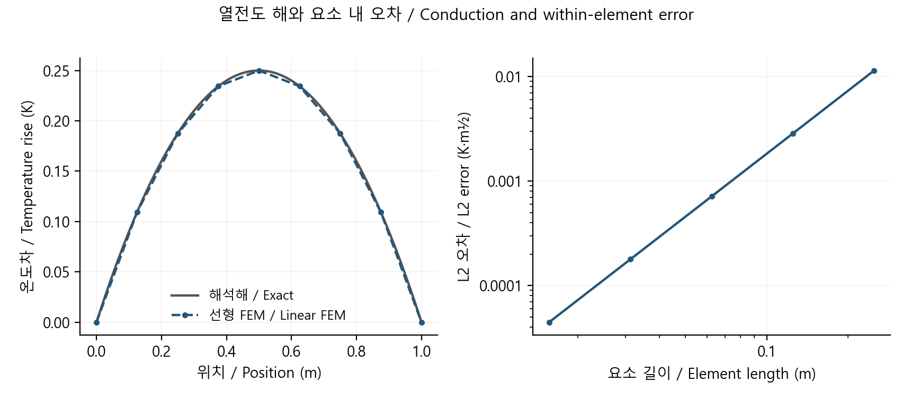

# 미분방정식에서 요소 행렬까지: 1차원 열전도 FEM

[분야 목차](../README.md) · [구현·실행](../../../예제_examples/심화_advanced/math_reasoning/README.md) · [검증 코드](../../../예제_examples/심화_advanced/math_reasoning/test_models.py)

## 한국어

### 1. 각 점을 맞추는 대신 구간의 균형을 맞춘다

유한요소법(FEM)은 작은 구간마다 간단한 함수를 놓고, 이 함수들을 이어 전체 해를 만든다. 직선 여러 개로 곡선을 근사한다고 생각하면 출발점은 어렵지 않다. 다만 점들을 임의로 잇는 것이 아니라, 원래 방정식의 보존 관계에서 직선의 높이를 결정한다. 이때 미분방정식, 약형, 요소 행렬, 경계조건, 선형계 풀이가 차례로 연결된다.

단면적이 1로 정규화된 막대의 정상 열전도를 다룬다. $`k(x)\gt0`$는 열전도율, $`q(x)`$는 체적 발열, $`T(x)`$는 온도다. 끝 온도는 주어진 Dirichlet 조건이다. 실제 단면적이 달라지면 전도 항과 발열 항에 단면적을 반영해야 한다. 이 글에서는 요소 안의 $`k,q`$를 상수로 놓는다.

```math
-\frac{d}{dx}\left(k\frac{dT}{dx}\right)=q,\qquad
T(0)=T_L,\quad T(L)=T_R.
```

[MIT 6.336, slides 15–23](https://ocw.mit.edu/courses/6-336j-introduction-to-numerical-simulation-sma-5211-fall-2003/c9f0e715af0009fa2677b428dbaf3c0a_lec19.pdf)는 기저함수·Galerkin·부분적분의 연결을 설명한다. [University of South Carolina의 FEM1D 자료](https://people.math.sc.edu/burkardt/f_src/fem1d_bvp_linear/fem1d_bvp_linear.html)는 1차원 선형 요소와 정확해·오차 비교를 제공한다. 설명과 계산은 이 두 관점을 대조해 구성했다.

### 2. 부분적분이 필요한 이유

양 끝에서 0인 시험함수 $`v(x)`$를 곱해 적분한다. 미분 항을 한 번 부분적분하면

```math
-[v kT']_0^L+\int_0^L kT'v'\,dx=\int_0^L qv\,dx.
```

시험함수가 경계에서 0이므로 경계 항이 사라진다. 이것이 이 문제의 약형이다. 원래 식은 온도의 두 번째 미분을 요구하지만 약형에는 첫 번째 미분만 남는다. 요소 사이에서 기울기가 달라지는 연속 구간별 직선도 사용할 수 있게 된다. 약형의 “약하다”는 말은 정확성을 대충 다룬다는 뜻이 아니라, 해에 요구하는 미분의 조건을 완화한다는 뜻이다. 다른 경계조건에서는 경계 항이 사라지지 않을 수 있다.

### 3. 선형 요소를 직접 적분한다

한 요소 $`[x_i,x_{i+1}]`$의 길이를 $`h_e`$라 하자. 두 형상함수는 $`N_1=(x_{i+1}-x)/h_e`$, $`N_2=(x-x_i)/h_e`$다. 요소 온도는 $`T_h=N_1T_i+N_2T_{i+1}`$이며 미분은 각각 $`-1/h_e,1/h_e`$다. 약형에 대입하면

```math
K_e=\int_{x_i}^{x_{i+1}} k_e
\begin{bmatrix}N_1'\\N_2'\end{bmatrix}
\begin{bmatrix}N_1'&N_2'\end{bmatrix}dx
=\frac{k_e}{h_e}\begin{bmatrix}1&-1\\-1&1\end{bmatrix}.
```

상수 발열의 하중 벡터도 적분으로 얻는다.

```math
f_e=\int_{x_i}^{x_{i+1}}q_e\begin{bmatrix}N_1\\N_2\end{bmatrix}dx
=\frac{q_e h_e}{2}\begin{bmatrix}1\\1\end{bmatrix}.
```

여러 요소가 공유하는 절점의 행과 열에 값을 더하면 전체 행렬이 조립된다. 1차원 연결에서는 각 절점이 좌우 이웃과만 연결되므로 삼중대각이다. 주어진 경계 온도를 우변으로 옮겨 내부 절점만 풀면, 양의 열전도율과 양 끝 Dirichlet 조건 아래 내부 행렬은 양의 정부호가 된다. 이 구조를 이용한 Thomas 소거는 시간·저장량이 모두 $`O(n)`$이다.

### 4. 다른 재료의 경계도 다룬다

발열이 없는 요소의 열유속은 $`j_e=-k_e(T_{i+1}-T_i)/h_e`$다. 정상상태에서 각 요소의 유속이 같아야 한다. 전체 열저항은 정규화한 단면적에서 $`R=\sum_e h_e/k_e`$이고, 온도차를 이 저항으로 나누어 공통 유속의 크기를 구할 수 있다. 재료 경계가 절점에 맞고 요소별 상수인 경우, 이 식은 FEM 결과를 확인하는 독립적인 기준이 된다. 재료 경계가 요소 내부에 있으면 요소를 나누거나 계수 적분을 제대로 처리해야 한다.

### 5. 실행과 수렴 확인

```bash
python 예제_examples/심화_advanced/math_reasoning/demo.py --output results/advanced-math
```

`fem_heat.csv`는 길이 1, $`k=2`$, $`q=4`$, 양 끝 온도 0인 계산이다. 해석해는 $`T=x(1-x)`$이며 32개 균등 요소의 절점값은 부동소수점 오차 수준에서 일치한다. 이 특별한 경우의 절점 정확성이 구간 전체의 정확성을 뜻하지는 않는다. 절점 사이의 직선은 포물선과 다르다.



테스트는 요소 수 8·16·32에서 구간 안의 $`L^2`$ 오차를 적분해, 요소 길이를 절반으로 줄일 때 오차가 약 4분의 1이 되는지 확인한다. 서로 다른 재료와 비균등 격자에서는 열저항 해와 유속 연속성을 확인한다. 발열 문제에서는 경계 요소의 절반 하중까지 포함해 전체 조립계의 열수지를 검사한다. 경계 기울기만으로 계산한 유속과 반력으로 계산한 유속이 유한 격자에서 같다고 가정하면 열수지를 잘못 해석할 수 있다.

모델 검증에는 잔차·격자 수렴·보존이 각각 필요하다. 잔차가 작으면 이산 선형계를 잘 푼 것이고, 물리적으로 맞는 재료 값과 경계조건을 선택했다는 증거는 별도로 필요하다. 접촉 열저항, 온도에 따른 $`k`$의 변화, 복사와 대류는 이 모델을 확장하는 다른 항이다.

## English

### 1. From a differential equation to a weak form

Linear FEM joins simple functions over small intervals, choosing nodal values through the governing balance rather than arbitrary curve fitting. Consider steady conduction in a rod with unit normalized cross-sectional area: $`-(kT')'=q`$, positive conductivity, and prescribed end temperatures. Conductivity and volumetric source are constant within each element. A different area must enter both conduction and source terms.

[MIT 6.336, slides 15–23](https://ocw.mit.edu/courses/6-336j-introduction-to-numerical-simulation-sma-5211-fall-2003/c9f0e715af0009fa2677b428dbaf3c0a_lec19.pdf) develops basis functions and Galerkin integration by parts; [South Carolina's FEM1D resource](https://people.math.sc.edu/burkardt/f_src/fem1d_bvp_linear/fem1d_bvp_linear.html) independently connects linear elements with exact solutions and error measurements.

Multiply by a test function zero at both ends and integrate. Integration by parts gives $`-[vkT']_0^L+\int kT'v'\,dx=\int qv\,dx`$. The boundary term vanishes under these test-function conditions. Only first derivatives remain, allowing continuous piecewise-linear temperatures with slope jumps. “Weak” refers to relaxed differentiability requirements, not an informal treatment of accuracy. Other boundary conditions may retain boundary terms.

### 2. Element matrices and assembly

On an element of length $`h_e`$, use $`N_1=(x_{i+1}-x)/h_e`$ and $`N_2=(x-x_i)/h_e`$. Their derivatives are $`-1/h_e`$ and $`1/h_e`$. Substituting $`T_h=N_1T_i+N_2T_{i+1}`$ into the weak form and integrating gives $`K_e=(k_e/h_e)[[1,-1],[-1,1]]`$ and $`f_e=(q_eh_e/2)(1,1)^T`$. Add element contributions at shared global nodes. Each node couples only to its neighbors, producing a tridiagonal matrix.

Move known boundary-temperature terms to the right-hand side. With positive conductivity and two fixed end temperatures, the interior matrix is positive definite. Thomas elimination uses $`O(n)`$ work and storage. For zero-source material layers aligned with mesh nodes, element flux is $`-k_e\Delta T_e/h_e`$ and must be constant. The independent thermal resistance $`\sum h_e/k_e`$ predicts the total temperature drop. An interface inside an element instead requires mesh alignment or appropriate coefficient integration.

### 3. Running, error and conservation

The command writes `fem_heat.csv` for length one, $`k=2`$, $`q=4`$ and zero end temperatures. The exact temperature is $`x(1-x)`$. Nodal values on 32 uniform elements agree within rounding error, but the interpolated line between nodes is still different from the parabola. Tests integrate the within-element $`L^2`$ error on 8, 16 and 32 elements; halving the mesh length reduces this error by about four. Other tests compare nonuniform material layers with the resistance solution and flux continuity.

The generated-source test also checks the assembled heat balance, including half-element loads at fixed boundary nodes. Flux estimated only from the first element's slope need not equal the boundary reaction at finite resolution. Confusing them can create a false conservation discrepancy.

Residuals, mesh convergence and conservation answer different questions. A small residual verifies the discrete solve; validation of material parameters and physical boundary conditions needs separate evidence. Contact resistance, temperature-dependent conductivity, convection and radiation require additional model terms. The figure displays the computed solution and mesh error, with its generating code linked from the examples directory.

## 출처 / Sources

약형·기저함수·Galerkin 조립을 대학 자료로 교차 확인하고, 요소 적분·열저항·제조해로 구현을 대조했다. / Weak forms and assembly were cross-checked with university resources; element integrals, resistance and manufactured solutions supply independent checks. 확인 / checked: 2026-10-19.
