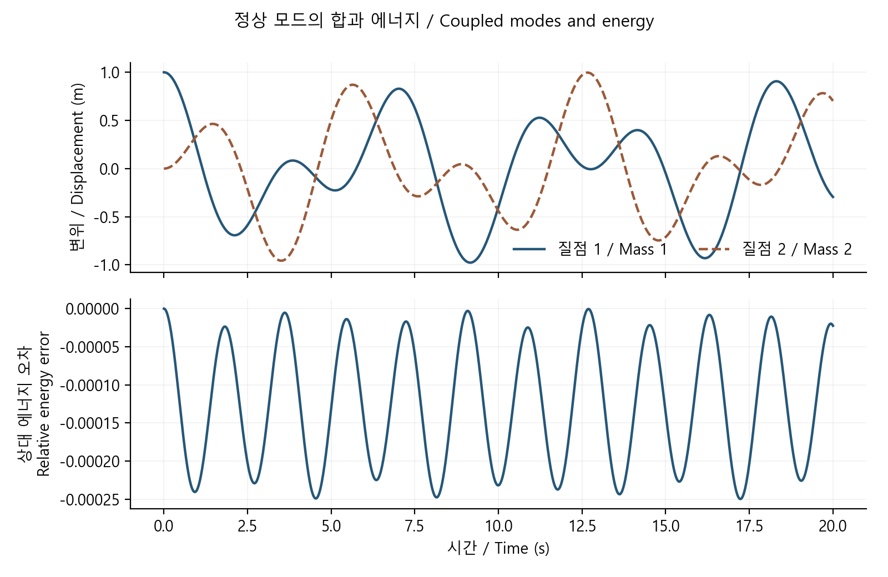

# 두 진동자가 연결되면: 정상 모드와 에너지 검증

[분야 목차](../README.md) · [실행 구현](../../../예제_examples/심화_advanced/math_reasoning/models.py) · [독립 검증](../../../예제_examples/심화_advanced/math_reasoning/test_models.py)

## 한국어

### 1. 여러 움직임을 몇 개의 기본 움직임으로 나눕니다

하나의 진동자는 한 좌표로 설명할 수 있습니다. 두 진동자가 연결되면 한쪽의 움직임이 다른 쪽에 힘을 전달합니다. 각각을 따로 계산해 더하는 것만으로는 이 상호작용을 담을 수 없습니다. 하지만 시스템이 선형이면, 둘이 함께 움직이는 몇 가지 특별한 모양으로 나누어 생각할 수 있습니다. 각 모양은 자기 고유의 주파수로 진동합니다. 이것이 정상 모드입니다.

같은 질량 $`m`$ 두 개를 생각하겠습니다. 각 질량은 강성 $`k`$의 외측 스프링으로 고정 벽에 연결되고, 둘 사이는 강성 $`k_c`$의 스프링으로 연결됩니다. 좌표 $`x_1,x_2`$는 평형 위치에서의 변위입니다. 마찰·외력·스프링 질량을 무시하고 선형 Hooke 법칙이 성립하는 범위를 다룹니다. [MIT 16.07, pp. 4–6](https://ocw.mit.edu/courses/16-07-dynamics-fall-2009/7648a5c6cdbda42f39b05dae04ce2aa9_MIT16_07F09_Lec19.pdf)와 [MIT 8.03SC Lecture 4](https://ocw.mit.edu/courses/8-03sc-physics-iii-vibrations-and-waves-fall-2016/b4f512207b1e991ffdfa8df5f519b6eb_MIT8_03SCF16_Lec4.pdf)의 결합 진동·고유값 접근을 대조했습니다.

### 2. 힘의 부호부터 행렬까지

첫 질량에는 외측 복원력 $`-kx_1`$와 결합 스프링의 힘 $`-k_c(x_1-x_2)`$가 작용합니다. 둘째 질량의 결합력은 반대 방향입니다.

```math
m\ddot x_1=-(k+k_c)x_1+k_cx_2,\qquad
m\ddot x_2=k_cx_1-(k+k_c)x_2.
```

따라서 $`M\ddot x+Kx=0`$이며 $`M=mI`$, $`K=[[k+k_c,-k_c],[-k_c,k+k_c]]`$입니다. $`x(t)=\phi\cos(\omega t)`$를 넣으면 $`(K-\omega^2M)\phi=0`$이 됩니다. 0이 아닌 진동 모양이 존재하려면 determinant가 0이어야 합니다.

```math
(k+k_c-m\omega^2)^2-k_c^2=0,
\quad \omega_+^2=\frac{k}{m},\qquad
\omega_-^2=\frac{k+2k_c}{m}.
```

같은 방향의 모드 $`\phi_+=(1,1)^T`$에서는 가운데 스프링의 길이가 변하지 않아 $`k_c`$가 주파수에 나타나지 않습니다. 반대 방향의 모드 $`\phi_-=(1,-1)^T`$에서는 가운데 스프링도 늘어나 더 높은 주파수가 나옵니다. $`k_c=0`$에서는 두 주파수가 같아져, 연결되지 않은 같은 진동자 두 개로 돌아갑니다.

### 3. 초기조건을 모드 좌표로 옮깁니다

$`q_+=(x_1+x_2)/2`$, $`q_-=(x_1-x_2)/2`$로 정의합니다. 이 정의는 단위 길이로 정규화한 고유벡터 계수와 배율이 다르지만, 역변환 $`x_1=q_++q_-`$, $`x_2=q_+-q_-`$와 함께 쓰면 일관됩니다. 초기 속도도 같은 방식으로 바꿉니다.

```math
q_s(t)=q_s(0)\cos(\omega_st)
+\frac{\dot q_s(0)}{\omega_s}\sin(\omega_st),
\qquad s\in\{+,-\}.
```

`coupled_exact`는 이 해석식을 계산합니다. 예를 들어 $`x(0)=(1,0)`$, 초기 속도 0이면 두 모드가 모두 절반씩 들어갑니다. 두 주파수가 합쳐지며 한쪽의 진동 진폭이 작아지는 동안 다른 쪽이 커지는 모습이 나타날 수 있습니다. 개별 질량의 에너지는 교환되지만 전체 에너지는 보존됩니다.

### 4. 수치 적분은 무엇을 보존해야 합니까

전체 에너지는

```math
E=\frac m2(v_1^2+v_2^2)+\frac k2(x_1^2+x_2^2)
+\frac{k_c}{2}(x_1-x_2)^2.
```

이를 미분하면 $`\dot E=v^T(M\dot v+Kx)=0`$이 됩니다. 내부 결합력의 부호와 스프링 에너지를 확인하는 좋은 기준입니다. 다만 고정 벽이 외력을 전달하므로 질량 두 개의 총운동량은 일반적으로 보존되지 않습니다. 에너지 보존과 운동량 보존을 무조건 함께 요구하면 잘못된 테스트가 됩니다.

구현은 velocity Verlet을 사용합니다. 현재 가속도로 위치를 옮기고 새 위치의 가속도를 구해 두 가속도의 평균으로 속도를 갱신합니다.

```math
x_{n+1}=x_n+h v_n+\frac{h^2}{2}a(x_n),\qquad
v_{n+1}=v_n+\frac h2[a(x_n)+a(x_{n+1})].
```

각 모드가 조화진동자이므로 엄격한 안정 범위는 $`h\omega_{max}\lt2`$입니다. 경계의 중근은 일반적인 초기조건에서 안전한 선택이 아니므로 코드가 거부합니다. 안정한 간격도 원하는 정확도를 보장하지 않습니다. 시간 간격을 줄이며 해석해와 비교해야 합니다. Verlet은 여기서 에너지를 매번 정확히 같게 만드는 방법이 아니라, 작은 간격에서 에너지 오차가 제한된 진동으로 남는 특성을 이용합니다.

### 5. 실행과 검증

```bash
python 예제_examples/심화_advanced/math_reasoning/demo.py --output results/advanced-math
```

`coupled_oscillators.csv`에는 수치 위치와 독립적인 모드 해석해가 함께 저장됩니다. 기본 입력은 $`m=k=k_c=1`$, $`x(0)=(1,0)`$, $`v(0)=(0,0)`$, $`h=0.02`$입니다.



테스트는 같은 방향·반대 방향의 순수 모드, 일반 초기조건, 시간 간격 절반에 따른 약 4배의 오차 감소를 확인합니다. 10,000회 적분에서는 에너지 오차의 최대값을 확인하고, 안정 한계 이상의 간격을 거부하는지도 검사합니다. 실제 구조물에서는 질량과 강성의 비대칭, 감쇠, 경계의 유연성, 비선형 변형을 추가해야 하며 이때 모드와 고유주파수도 달라집니다.

## English

### 1. Modes of a coupled system

Two connected oscillators exchange forces, so their motions cannot be calculated as independent uncoupled trajectories. A linear system can instead be decomposed into special shapes, each oscillating at its own natural frequency. Consider equal masses $`m`$, outer springs of stiffness $`k`$ attached to fixed walls, and a coupling spring $`k_c`$. Coordinates are displacements from equilibrium; damping, forcing and spring mass are absent, within the linear Hooke-law range. The eigenvalue approach was compared across [MIT 16.07, pp. 4–6](https://ocw.mit.edu/courses/16-07-dynamics-fall-2009/7648a5c6cdbda42f39b05dae04ce2aa9_MIT16_07F09_Lec19.pdf) and [MIT 8.03SC Lecture 4](https://ocw.mit.edu/courses/8-03sc-physics-iii-vibrations-and-waves-fall-2016/b4f512207b1e991ffdfa8df5f519b6eb_MIT8_03SCF16_Lec4.pdf).

### 2. Forces, eigenvalues and initial conditions

The first mass receives $`-kx_1-k_c(x_1-x_2)`$ and the second receives the opposite coupling contribution. Thus $`M\ddot x+Kx=0`$, with $`M=mI`$ and diagonal stiffness $`k+k_c`$, off-diagonal stiffness $`-k_c`$. Substituting a cosine motion gives $`(K-\omega^2M)\phi=0`$. Its determinant yields squared frequencies $`k/m`$ and $`(k+2k_c)/m`$. The in-phase shape $`(1,1)`$ leaves the middle spring undeformed; the opposite shape $`(1,-1)`$ deforms it and oscillates faster. At zero coupling the frequencies coincide, recovering independent identical oscillators.

Define $`q_+=(x_1+x_2)/2`$ and $`q_-=(x_1-x_2)/2`$, with the same transformation for velocities. These coefficients are not the coefficients of unit-normalized eigenvectors, but are consistent with $`x_1=q_++q_-`$ and $`x_2=q_+-q_-`$. Each mode follows $`q_s(0)\cos(\omega_st)+\dot q_s(0)\sin(\omega_st)/\omega_s`$. `coupled_exact` evaluates this independent analytical solution. Starting at $`(1,0)`$ with zero velocity excites both modes equally; individual energy exchanges while total energy remains constant.

### 3. Conservation and integration

Total energy is $`m(v_1^2+v_2^2)/2+k(x_1^2+x_2^2)/2+k_c(x_1-x_2)^2/2`$. Differentiating gives $`v^T(M\dot v+Kx)=0`$. This checks force signs and the coupling energy. Total mass momentum is generally not conserved because the fixed walls exert external forces.

Velocity Verlet first updates position using current acceleration, then averages old and new accelerations for velocity, as in the equations above. Each normal mode is harmonic, so the strict stability condition is $`h\omega_{max}\lt2`$. The repeated-root boundary is rejected. Stability alone does not establish accuracy; compare successively smaller steps with the modal solution. Verlet does not preserve the original energy exactly at every step; at small stable steps its energy error stays bounded and oscillatory in this example.

### 4. Running and testing

The command writes `coupled_oscillators.csv`, containing numerical and analytical positions. Defaults are unit mass and spring constants, initial position $`(1,0)`$, zero velocity and step 0.02. Tests cover pure in-phase and opposite modes, general initial conditions, approximately fourfold error reduction when the step halves, bounded energy error over 10,000 steps, and rejection of unstable steps. The figure is generated from these calculations. Unequal parameters, damping, compliant supports and nonlinear deformation require extensions and change the modes and frequencies.

## 출처 / Sources

대학 강의의 힘·고유값·모드 해석과 대조하고 에너지 미분, 독립 해석해, 시간 수렴으로 구현을 검증했습니다. / Forces, eigenvalues and modes were cross-checked; energy differentiation, analytical modes and temporal convergence verify the implementation. 확인 / checked: 2026-10-19.
