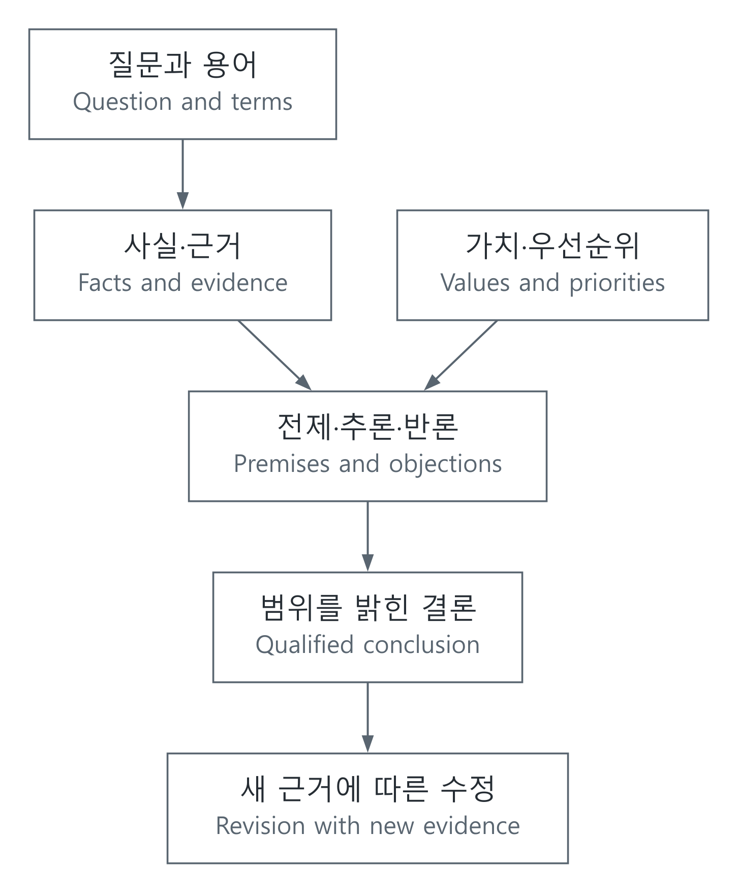

# 안다는 것, 논증한다는 것, 옳다고 판단한다는 것

[철학과 비판적 사고](../README.md)

## 한국어

### 답을 외우는 것에서 이유를 살피는 것으로

같은 자료를 읽어도 사람마다 다른 결론을 내릴 수 있다. 사실을 잘못 읽었을 수도 있고, 말의 뜻이 다르거나 중요하게 여기는 가치가 다를 수도 있다. 철학은 이런 차이를 곧바로 취향으로 넘기기보다 질문과 이유를 분명히 하는 데 도움을 준다. 비판적 사고에서 비판은 상대를 깎아내리는 일이 아니라 주장에 어떤 근거가 필요한지 살피는 일이다.

인식론은 지식과 믿음, 근거의 관계를 다룬다. “나는 그렇게 믿는다”와 “그렇다는 것을 안다”는 같은 말이 아니다. 참인 믿음에 정당화가 더해지면 지식이라는 전통적 분석이 있지만, 우연히 맞은 경우를 어떻게 다룰지에 대한 Gettier 문제 등으로 이것을 최종 정의라고 단정할 수 없다. [Stanford Encyclopedia of Philosophy, Epistemology §2.3](https://plato.stanford.edu/entries/epistemology/)

예를 들어 단위가 잘못된 계산 두 곳이 우연히 상쇄되어 답만 맞았다고 하자. 답의 일치와 계산 과정의 신뢰성은 별도로 평가해야 한다. 이는 개념 설명을 위한 예이며 실제 시험 결과가 아니다. 공학에서 식의 유도와 조건, 독립적인 계산을 함께 남기는 이유도 여기에 있다.

### 전제가 참인가, 결론이 따라오는가

논증은 결론을 뒷받침하는 전제와 추론으로 이루어진다. 고전 연역논리에서 타당성은 전제가 모두 참인데 결론만 거짓인 경우가 불가능하다는 뜻이다. 전제도 실제로 참인 타당한 논증을 건전하다고 한다. 결론이 마음에 들거나 우연히 참이라는 사실만으로 추론이 타당해지지는 않는다. [SEP, Informal Logic §4.1](https://plato.stanford.edu/entries/logic-informal/)

기호 $`P`$를 “이 정수는 4의 배수”, $`Q`$를 “이 정수는 짝수”로 정하자.

$$P\Rightarrow Q,\quad P\quad\therefore Q$$

는 타당하다. 그러나 $`P\Rightarrow Q`$와 $`Q`$만으로 $`P`$를 결론 내릴 수는 없다. 6은 짝수지만 4의 배수는 아니므로 바로 반례가 된다. 일반 주장은 예를 많이 모으는 것만큼, 주장을 깨뜨릴 수 있는 경우를 찾아보는 일도 중요하다. 조건을 “모든 경우”라고 썼는지, “특정 범위”라고 썼는지도 확인한다.

| 확인할 부분 | 쉬운 질문 |
| --- | --- |
| 용어 | 두 사람이 같은 뜻으로 쓰는가? |
| 전제 | 무엇을 이미 참이라고 두었는가? |
| 추론 | 전제가 참이어도 결론이 틀릴 반례가 있는가? |
| 증거 범위 | 관찰한 사례에서 어디까지 말할 수 있는가? |
| 반론 | 가장 강한 반론을 어떻게 설명할 수 있는가? |

귀납은 관찰에서 일반적 경향을 추론하며, 좋은 설명을 찾는 추론은 여러 가설을 비교한다. 둘 다 유용하지만 제한된 관찰에서 나온 결론을 연역적으로 보장된 사실처럼 쓰면 안 된다. 실제 논증의 평가는 형식뿐 아니라 전제의 수용 가능성, 관련성과 충분성도 살핀다. [SEP, Informal Logic §4.2](https://plato.stanford.edu/entries/logic-informal/)

### 사실 판단과 가치 판단을 함께, 그러나 구분해서

“이 설계는 전력을 덜 쓴다”는 측정과 조건을 통해 확인할 수 있는 주장이다. “그러므로 모든 다른 설계보다 우선해야 한다”는 결론에는 가격, 접근성, 안전과 같은 다른 가치보다 전력 절감을 우선한다는 전제가 필요하다. 측정만으로 그 우선순위까지 자동 결정되지는 않는다.

도덕적 숙고에서는 결과와 피해, 권리와 의무, 공정한 절차, 관계와 책임 등 서로 다른 고려가 충돌할 수 있다. 어떤 관점이든 이름만 붙이는 것으로 판단이 끝나지는 않는다. 누구의 이익과 부담을 세었는지, 놓친 사람이 없는지, 비교한 대안이 실제로 가능한지 설명해야 한다. [SEP, Moral Reasoning §2](https://plato.stanford.edu/entries/reasoning-moral/)

[SVG](../../../자료_assets/도식_diagrams/knowledge-arguments-values.svg) · [도식 원본 / Diagram source](../../../자료_assets/도식_diagrams/knowledge-arguments-values.mmd)

이 문서를 위해 작성한 논증 검토 흐름도다. 가치가 들어간다는 이유로 사실 확인을 포기할 필요도, 사실을 안다는 이유로 가치 선택을 숨길 필요도 없다.

### 출처를 확인한다는 것은 무엇인가

논문 원문, 공식 통계와 데이터 설명, 법령 본문은 주장으로 거슬러 올라갈 출발점이다. 다만 유명 기관의 자료도 특정 시점과 가정, 측정 범위를 갖는다. 같은 보도자료를 옮긴 기사 두 개는 독립적인 교차 확인 두 건이 아니다. 원자료의 정의와 다른 방법의 설명을 비교하고, 일치하지 않으면 차이가 생긴 조건을 남기는 편이 낫다.

검토 기록에는 주장, 근거 위치, 적용 조건, 남은 반례를 연결한다. 수학적 주장은 증명이나 반례, 경험적 주장은 수집·분석 과정, 규범적 주장은 원칙과 이유를 중심으로 평가한다. 모든 질문을 숫자 하나로 해결하려 하거나, 모든 판단이 주관적이라고 끝내는 두 방식 모두 이유를 충분히 드러내지 못한다. 좋은 설명은 무엇을 알게 되었는지와 결론을 바꿀 근거가 무엇인지 독자가 함께 살필 수 있게 한다.

## English

### From remembering answers to examining reasons

People can read the same evidence and reach different conclusions because they misread facts, use terms differently, or prioritize different values. Philosophy helps clarify these differences instead of immediately dismissing them as taste. Critical thinking examines what supports a claim; it need not demean the person making it.

Epistemology studies knowledge, belief, and justification. Believing something is not identical to knowing it. A traditional analysis combines truth, belief, and justification, but Gettier problems about accidentally true beliefs prevent treating that account as a settled final definition. [SEP, Epistemology §2.3](https://plato.stanford.edu/entries/epistemology/)

Suppose two unit errors accidentally cancel and leave a correct answer. Agreement of the answer and reliability of the reasoning deserve separate evaluation. This is a conceptual example, not an actual test result. It explains why engineering accounts preserve derivations, conditions, and independent calculations.

### Are the premises true, and does the conclusion follow?

An argument supports a conclusion using premises and inference. In classical deductive logic, validity means that true premises and a false conclusion are impossible together. A valid argument with true premises is sound. A pleasing or accidentally true conclusion does not establish validity. [SEP, Informal Logic §4.1](https://plato.stanford.edu/entries/logic-informal/)

Let $`P`$ mean “this integer is divisible by four” and $`Q`$ mean “this integer is even.” Then $`P\Rightarrow Q`$, together with $`P`$, entails $`Q`$. However, $`P\Rightarrow Q`$ and $`Q`$ do not entail $`P`$: six supplies a counterexample. Besides collecting supporting cases, look for a case that could refute a general claim. The difference between all cases and a specified range matters.

Useful questions concern whether terms keep the same meaning, which premises are assumed, whether a counterexample breaks the inference, how far the observations support generalization, and how to state the strongest objection fairly.

Induction infers patterns from observations; inference to a good explanation compares hypotheses. Both are useful without making a limited observation deductively conclusive. Evaluating real arguments also examines the acceptability, relevance, and sufficiency of their premises. [SEP, Informal Logic §4.2](https://plato.stanford.edu/entries/logic-informal/)

### Distinguish facts and values while reasoning with both

“This design consumes less power” is a claim to examine through measurements and conditions. “It should therefore outrank every alternative” adds a priority among energy, price, accessibility, safety, and other considerations. Measurement does not automatically supply that priority.

Moral deliberation can involve competing consequences and harms, rights and duties, fair procedures, relationships, and responsibilities. Naming a perspective does not finish the reasoning. Explain whose benefits and burdens count, who may have been omitted, and whether the alternatives are feasible. [SEP, Moral Reasoning §2](https://plato.stanford.edu/entries/reasoning-moral/)

The original diagram above combines factual evidence and value priorities with premises, objections, a qualified conclusion, and revision. Values do not remove the need for factual checking; factual knowledge does not remove the need to disclose value choices.

### What does checking a source involve?

Original research, official statistics and metadata, and legislative texts help trace a claim to its basis. Even a respected institution's material has a date, assumptions, and a scope. Two articles copying one press release are not two independent checks. Compare definitions in the original material with a different explanation or method, and preserve the conditions behind disagreements.

A review record connects each claim to evidence locations, applicability conditions, and remaining counterexamples. Mathematical claims call for proof or counterexample; empirical claims require collection and analysis methods; normative claims require principles and reasons. Neither forcing every question into one number nor dismissing all judgment as subjective makes those reasons adequately visible. A useful account shows what has been learned and what evidence could change the conclusion.

## 출처와 대조 / Sources and cross-check

- Stanford SEP, *Epistemology*, §2.3: 지식의 전통적 분석과 Gettier 문제 / traditional analysis and Gettier problems.
- Stanford SEP, *Informal Logic*, §§4.1–4.2: 타당성·건전성과 실제 논증 평가 / validity, soundness, and argument evaluation.
- Stanford SEP, *Moral Reasoning*, §2: 도덕적 고려와 숙고 / moral considerations and deliberation.

각 문서의 질문 범위를 구분해 논리적 타당성, 경험적 근거, 가치 판단을 같은 기준으로 취급하지 않았다. 반례와 흐름도는 개념을 설명하기 위해 직접 구성했다. / The distinct scopes keep logical validity, empirical support, and value judgment from being treated as one test. The counterexample and diagram were constructed for explanation. 확인 / checked: 2026-10-19.
