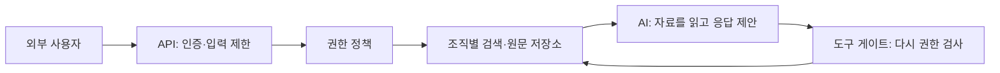

# 위협 모델과 설계 경계 | Threat modeling

[분야 목차](README.md) · [용어](용어_glossary.md) · [출처와 판본](출처_sources.md)

## 시스템을 그린 뒤 공격 가정을 정합니다

위협 모델은 누가 어떤 입력·권한을 갖고 어떤 자산을 해칠 수 있는지 정리한 설계 모델입니다. 모든 것을 공격할 수 있다고 가정하면 설계 결정을 할 수 없습니다. 외부 사용자, 다른 고객 계정, 내부 운영자, 탈취된 CI 토큰처럼 서로 다른 출발 권한을 구분합니다.

문서 검색 서비스를 예로 들면 브라우저→API→인증 계층→검색 인덱스→원문 저장소의 흐름을 먼저 적습니다. 검색 인덱스가 문서의 조직 ID를 잃어버렸다면 최종 화면에서 숨기기 전에 이미 다른 조직의 내용이 모델 입력으로 들어갈 수 있습니다. 데이터 흐름 그림은 화면보다 먼저 자료가 노출되는 지점을 찾는 데 도움이 됩니다. [OWASP Threat Modeling의 시스템 모델·위협 식별 절](https://cheatsheetseries.owasp.org/cheatsheets/Threat_Modeling_Cheat_Sheet.html)

## STRIDE는 질문을 빠뜨리지 않는 도구입니다

| 범주 | 의미 | 자체 설계 질문과 대응 |
| --- | --- | --- |
| Spoofing | 신원 위조입니다. | 요청의 user 필드를 신뢰하지 않고 검증된 세션에서 주체를 정합니다. |
| Tampering | 자료 변조입니다. | 서명·인증 태그의 범위에 대상·버전·본문을 함께 넣습니다. |
| Repudiation | 행위 부인입니다. | 누구의 어떤 권한으로 무엇을 했는지 감사 기록을 남깁니다. |
| Information disclosure | 정보 노출입니다. | 결과뿐 아니라 로그·캐시·모델 입력의 권한도 확인합니다. |
| Denial of service | 서비스 거부입니다. | 입력 크기·실행 시간·동시 요청·비용에 한도를 둡니다. |
| Elevation of privilege | 권한 상승입니다. | 일반 작업과 관리 작업의 자격증명을 분리합니다. |

STRIDE의 범주를 모두 채웠다고 안전성이 증명되지는 않습니다. 사업 규칙도 살펴야 합니다. ‘환불은 구매액 이하’라는 규칙은 메모리 오류가 없어도 동시에 두 요청이 승인되면 깨질 수 있습니다. DB 트랜잭션·고유 제약·중복 키를 사용해 여러 실행이 합쳐졌을 때의 결과를 검토합니다.

## 요구사항을 시험 가능한 문장으로 바꿉니다

‘자료를 안전하게 보호합니다’ 대신 ‘다른 tenant의 문서 ID를 보낸 요청은 본문을 반환하지 않습니다’라고 적습니다. 정상·권한 없음·없는 ID·삭제된 계정·권한 변경 뒤의 캐시를 시험합니다. 위험 기록에는 자산, 공격자 권한, 입력 경로, 영향, 대응 담당자, 완료 판정과 남은 가정을 붙입니다.

신뢰 경계는 ‘외부망과 내부망 사이’만이 아닙니다. 같은 프로세스 안의 모델 출력과 실행기 사이, 고객 A와 B의 인덱스 사이에도 있습니다. 기능이나 연결 도구가 추가되면 모델을 다시 읽습니다. [OWASP ASVS의 검증 요구사항 안내](https://owasp.org/www-project-application-security-verification-standard/)

## 위협 모델의 산출물은 검증 가능한 질문입니다

모델을 작성할 때 다음 항목을 한 장에 연결하면 개발·시험·운영 담당자가 같은 범위를 봅니다.

1. 보호할 자료와 기능, 손상됐을 때의 영향
2. 사용자·운영자·서비스·제3자와 각자의 권한
3. 자료의 생성·저장·복사·삭제·외부 전송 경로
4. 신뢰 경계, 공개 입력, 관리자 경로, 백업과 로그
5. 오용 시나리오와 이를 막는 통제의 책임자
6. 수정이 적용되었는지 판정할 정상·거부·경계 시험

예를 들어 문서 검색에서 중요한 질문은 “문서를 찾았는가?”만이 아닙니다. 검색 주체가 그 문서를 읽을 권한이 있었는지, 검색 캐시에 이전 권한이 남았는지, 삭제 요청이 임베딩 인덱스와 복제본까지 반영됐는지 확인해야 합니다. [OWASP 위협 모델링 안내](https://cheatsheetseries.owasp.org/cheatsheets/Threat_Modeling_Cheat_Sheet.html)는 모델링·완화·재검토를 개발 과정에 연결합니다.

## STRIDE와 사업 규칙을 함께 씁니다

STRIDE는 신원 위조, 변조, 행위 부인, 정보 노출, 서비스 거부, 권한 상승을 질문하는 출발점입니다. 여기에 제품 고유 규칙을 더합니다. 예를 들어 “한 주문은 한 번만 환불할 수 있습니다”는 단순 입력 검사가 아니라 동시 요청·재시도·중복 이벤트에서도 지켜져야 하는 불변식입니다. DB의 원자적 상태 변경과 중복 요청 키가 필요한 이유를 이 규칙에서 도출합니다.

| 위협 시나리오 | 시험할 입력·상태 | 통과 조건 |
| --- | --- | --- |
| 다른 조직 문서 열람 | 정상 주체로 타 조직 문서 ID를 요청합니다. | 본문·검색 snippet·캐시에 자료가 들어오지 않습니다. |
| 권한 회수 뒤 재사용 | 세션·캐시·백그라운드 작업에 회수 전 권한이 남습니다. | 정책에서 정한 시점 이후 모든 경로가 거부됩니다. |
| 중복 지급·환불 | 같은 업무 ID를 동시에 두 번 전송합니다. | 한 번만 상태가 바뀌고 두 번째 결과가 일관되게 처리됩니다. |
| 악성 외부 문서 | RAG 자료에 도구 실행을 요구하는 문장이 포함됩니다. | 문서 내용은 근거로만 취급되고 실행 권한을 만들지 않습니다. |

요구사항에는 적용 컴포넌트와 예외를 함께 적습니다. “관리자만 가능”이라고 썼다면 관리자 판정의 근거, 대리 호출, 토큰 만료, 회수 이후 동작까지 확인해야 합니다. ASVS는 요구사항을 고정된 판본으로 인용할 수 있도록 버전을 함께 적는 방법을 안내합니다.

## 원문에서 이어 읽기

- [OWASP Threat Modeling](https://cheatsheetseries.owasp.org/cheatsheets/Threat_Modeling_Cheat_Sheet.html): 시스템 모델·위협 식별·완화·검토의 절입니다.
- [OWASP ASVS](https://owasp.org/www-project-application-security-verification-standard/): 검증 요구사항·판본·프로젝트 목적입니다.

## English

Threat modeling follows data and authority across components. Concrete requirements need negative tests and explicit assumptions.
