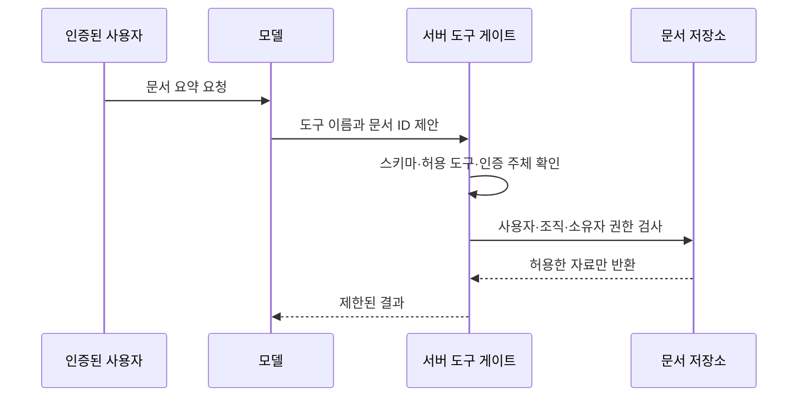

# AI 에이전트와 도구 권한 | Agent tool security

[분야 목차](README.md) · [용어](용어_glossary.md) · [출처와 판본](출처_sources.md)

## 제안과 실행 사이에 서버 경계를 둡니다

에이전트는 모델의 출력으로 도구를 선택하고 결과를 다시 읽는 구조입니다. 도구가 읽기만 하는지, 자료 변경·지급·배포·외부 전송까지 하는지에 따라 영향이 달라집니다. 모델의 자연어 판단과 서비스의 권한 부여를 같은 것으로 취급하지 않습니다. [OWASP AI Agent Security의 도구·최소권한·승인 절](https://cheatsheetseries.owasp.org/cheatsheets/AI_Agent_Security_Cheat_Sheet.html)



## 실제 예제의 규칙

실습의 제안은 `tool`과 `arguments`라는 두 키만 가집니다. 유일한 허용 도구는 `read_document`이며 인수는 `document_id` 하나입니다. user·tenant·approved 같은 필드를 더 넣으면 거부합니다. 서버가 인증한 `Principal`은 모델이 보낸 사전에서 만들지 않습니다.

JSON 모양이 맞아도 권한이 생기는 것은 아닙니다. 읽기 scope와 자료의 조직·소유자를 최종 저장소 경계에서 다시 대조합니다. 모델이 bob의 ID를 제안하면 올바른 도구 이름과 문자열 ID를 사용해도 거부됩니다. 이 시험에는 LLM API·실제 문서·외부 URL 호출이 없습니다. 모델의 잘못된 제안을 직접 만든 자료로 검사합니다.

## 쓰기·지급·배포 도구는 더 많은 결합이 필요합니다

| 통제 | 필요한 이유 |
| --- | --- |
| 대상·행위별 최소권한 | 읽기용 서비스가 임의 삭제·shell을 실행하지 않게 합니다. |
| 실행 예산 | 반복 횟수·요청 비용·시간·응답 크기를 제한합니다. |
| 사람 승인 | 고영향 행위를 실행 전에 확인할 수 있게 합니다. |
| 승인 대상 결합 | 승인한 대상·금액·파일 해시와 실제 실행값이 같아야 합니다. |
| 원자성·중복 방지 | 재시도나 중복 제안으로 같은 지급이 반복되지 않게 합니다. |
| 감사 기록 | 주체·제안·정책 판정·승인·실행 결과를 연결합니다. |

‘사용자가 승인했다’라는 모델 문자열은 서버가 보관한 승인 증표가 아닙니다. 승인 뒤 인수가 바뀌면 새 승인이 필요한지 정책을 정합니다. MCP 같은 연결 방식은 도구 정보를 전달하는 통로이며 연결 자체가 모든 도구의 신뢰를 보장하지 않습니다. 도구 제공자·버전·스키마 변경도 공급망과 함께 관리합니다.

## 실습에서 확인하지 않은 조건

예제는 단일 동기 호출의 읽기 검사입니다. 실제 인증기·네트워크 프록시·sandbox·다중 사용자 서버·DB의 경쟁 상태를 구현하지 않았습니다. 읽기 결과에 민감정보가 섞이는 문제와 외부 전송 정책도 별도입니다. 작은 예제를 정책 엔진 전체로 확대해 표시하지 않고, 어떤 경계를 시험했는지 명시합니다.

## 코드와 줄별 설명

공식 API·설계 원칙을 참고해 직접 작성한 교육 예제입니다. 기업의 내부 코드나 원문 발췌가 아닙니다. [실행 파일](실습_labs/agent_boundary.py) · [검사 방법과 결과](실습_labs/검증기록_validation.md)

```python
"""직접 작성한 교육 예제: 모델의 제안과 서버의 접근 통제를 분리하며 모델은 호출하지 않습니다."""
from access_control import read_document  # 같은 실습 폴더의 서버 측 권한 검사 함수를 가져옵니다.

def dispatch(principal, proposal, documents):  # principal은 서버 인증 계층이 정하며 proposal에서 읽지 않습니다.
    if type(proposal) is not dict or set(proposal) != {"tool", "arguments"}:  # set은 키 집합이며 알 수 없는 추가 필드를 거부합니다.
        raise ValueError("invalid proposal shape")  # 구조가 맞지 않는 제안은 실행하지 않습니다.
    if proposal["tool"] != "read_document":  # !=는 유일하게 허용한 도구 이름과 다른지 검사합니다.
        raise PermissionError("tool denied")  # shell·파일 쓰기·네트워크 전송 도구를 허용하지 않습니다.
    args = proposal["arguments"]  # []는 사전에서 해당 키의 값을 가져옵니다.
    if type(args) is not dict or set(args) != {"document_id"}:  # 인수도 정확히 한 필드만 허용합니다.
        raise ValueError("invalid argument shape")  # user·tenant 같은 권한 위조 필드를 받지 않습니다.
    document_id = args["document_id"]  # 모델이 제안한 ID를 별도 변수로 읽습니다.
    if type(document_id) is not str or not 1 <= len(document_id) <= 64:  # 연쇄 비교로 ID 길이를 제한합니다.
        raise ValueError("invalid document id")  # 잘못된 자료형이나 과도한 길이를 거부합니다.
    return read_document(principal, document_id, documents)  # 최종 허용 여부는 실제 서버의 권한 검사로 정합니다.
```

## 원문에서 이어 읽기

- [OWASP AI Agent Security](https://cheatsheetseries.owasp.org/cheatsheets/AI_Agent_Security_Cheat_Sheet.html): 도구 호출·최소권한·신뢰 경계·승인 절입니다.
- [OWASP Authorization](https://cheatsheetseries.owasp.org/cheatsheets/Authorization_Cheat_Sheet.html): 최소권한·기본 거부·매 요청 검사 절입니다.

## English

A model proposes a tool call; the server validates the schema and enforces object permissions. This offline example tests enforcement, not a model’s injection resistance.
