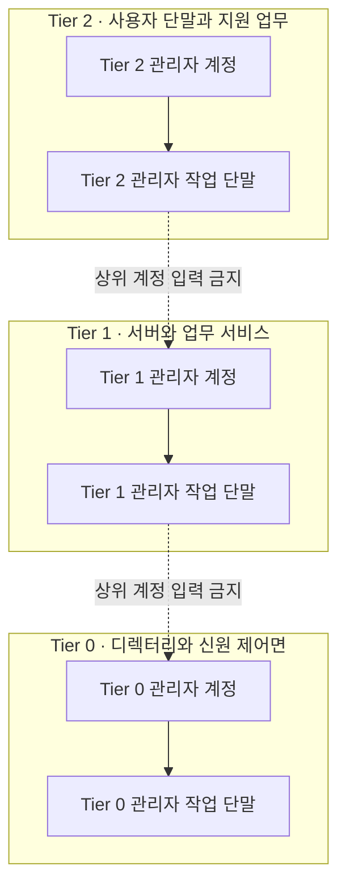

# 기업 계정과 관리자 권한 | Enterprise identities and privileged access

[분야 목차](README.md) · [인증과 권한 검사](04-인증과권한검사_identity-access.md) · [로그와 사고 대응](16-로그탐지와사고대응_detection-response.md) · [허가된 보안 시험](19-허가된보안시험과책임있는제보_authorized-security-testing.md)

## 디렉터리는 계정 목록이 아니라 조직의 제어면입니다

기업 디렉터리와 연동된 ID 시스템은 사용자·컴퓨터·서비스 계정의 신원, 그룹 권한, 인증 정책과 관리 경로를 연결합니다. 이곳의 변경 권한을 얻으면 한 서버에 머무르지 않고 여러 시스템의 접근 권한에 영향을 줄 수 있습니다. 따라서 도메인 컨트롤러만 보호하는 것으로 충분하지 않습니다. 디렉터리를 동기화하거나 인증서를 발급하거나 백업·패치·보안 에이전트를 관리하는 시스템도 실제 권한을 기준으로 분류해야 합니다.

Microsoft의 AD DS 계층 모델은 관리 대상을 Tier 0(조직의 신원 제어면), Tier 1(서버와 업무 애플리케이션), Tier 2(사용자 단말과 지원 업무)로 나눕니다. 이 구분은 Active Directory 환경에 대한 Microsoft의 설계 모델입니다. 다른 디렉터리나 클라우드 IAM에 그대로 적용되는 보편 표준은 아니지만, “어떤 계정이나 장비가 더 높은 권한을 통제하는가?”를 추적하는 데 유용합니다. [Microsoft AD DS 계층 모델](https://learn.microsoft.com/en-us/windows-server/identity/ad-ds/tier-model)

## 무엇을 보호하는지 먼저 그립니다

| 자산·경로 | 왜 민감한가 | 확인할 통제 |
| --- | --- | --- |
| 디렉터리 서버와 최상위 관리자 계정 | 계정·그룹·인증 정책을 바꾸어 조직 전체 접근에 영향을 줄 수 있습니다. | 최소 인원, 별도 관리자 계정, 강한 인증, 변경 감사, 복구 절차를 확인합니다. |
| ID 동기화·연합 인증·인증서 서비스 | 온프레미스와 클라우드의 신원을 연결하거나 인증서를 발급할 수 있습니다. | 해당 서비스와 운영 계정의 실제 권한을 조사해 최고 신뢰 영역에 포함할지 판단합니다. |
| 백업·가상화·패치·보안 관리 서버 | 여러 서버를 한꺼번에 관리할 수 있으므로 침해 시 영향 범위가 큽니다. | 관리 대상, 서비스 계정, 에이전트 권한, 복구용 자격 증명을 확인합니다. |
| 원격 관리 경로와 중계 서버 | 관리자 자격 증명이 입력되거나 세션이 통과하는 지점입니다. | 목적 계층과 같은 신뢰 수준으로 관리하고, 일반 업무용 단말에서 상위 관리 세션을 열지 않습니다. |
| 그룹·정책·위임 권한 | 구성원 추가나 정책 변경 하나가 다수 시스템에 적용될 수 있습니다. | 중첩 그룹, 위임된 권한, 변경 승인자, 적용 대상을 주기적으로 검토합니다. |

관리 도구가 도메인 컨트롤러를 직접 관리하거나 그에 준하는 권한을 가졌다면, 설치 위치가 별도 네트워크라는 이유만으로 낮은 신뢰 영역에 둘 수 없습니다. Microsoft는 계층 경계가 IP 주소나 네트워크 구획만이 아니라 그 자산을 통제하는 자격 증명과 관리 장비에 의해 정해진다고 설명합니다. 네트워크 분리는 계정·관리 경로 분리와 함께 사용해야 합니다.

## 관리자 계정과 작업 단말을 분리합니다

메일·웹 탐색·문서 편집에 사용하는 일상 계정과 서버·디렉터리를 관리하는 계정은 분리합니다. 각 계정에는 필요한 대상과 작업만 부여하고, 관리 권한은 정해진 작업 시간에만 승인해 부여하는 방식을 검토합니다. 최상위 관리 작업은 해당 계층에 맞게 강화한 전용 관리자 작업 단말(PAW)에서 수행합니다. 그 단말에는 일반적인 메일이나 웹 탐색 프로그램을 설치하지 않고, 물리 접근·업데이트·복구 방법도 관리합니다. [Microsoft의 Active Directory 보안 권고](https://learn.microsoft.com/en-us/windows-server/identity/ad-ds/plan/security-best-practices/best-practices-for-securing-active-directory)

계정 수만 세면 권한을 놓칠 수 있습니다. 직접 구성원이 아닌 사용자도 중첩 그룹, 위임 권한, 서비스 계정, 관리 에이전트, 가상화 호스트 등을 통해 높은 권한을 얻을 수 있습니다. “누가 계정에 로그인할 수 있는가?”와 “어떤 시스템이 그 계정의 동작을 대신할 수 있는가?”를 함께 추적해야 합니다.

| 검토 항목 | 기대 상태 | 증거 예시 |
| --- | --- | --- |
| 계정 목적 | 일상 계정과 관리자 계정이 구분되고, 각 계정의 담당자와 사용 목적이 기록됩니다. | 승인된 계정 목록, 역할 설명, 최근 사용 기록입니다. |
| 유효 권한 | 직접·중첩 그룹과 위임 권한을 포함한 실효 권한을 파악합니다. | 권한 그래프 또는 내보낸 그룹·위임 관계와 검토 기록입니다. |
| 관리자 단말 | 높은 권한은 해당 관리 계층의 승인된 장비에서만 사용합니다. | 장비 등록 상태, 로그인 정책, 관리자 세션 기록입니다. |
| 서비스 계정 | 대화형 로그인을 제한하고, 소유자·비밀 교체·사용처를 기록합니다. | 서비스 목록, 권한 범위, 비밀 교체 기록입니다. |
| 긴급 복구 계정 | 평소 사용을 제한하고 접근·사용 여부를 감시합니다. | 보관·승인 정책과 정기 복구 훈련 결과입니다. |

## 하이브리드 환경은 실제 통제 경로를 따라 분류합니다

온프레미스 디렉터리와 클라우드 ID가 동기화되어 있으면 두 환경을 별개로만 보지 않습니다. 동기화 서버, 연합 인증 구성요소, 인증서 발급 시스템, 관리 자동화 계정이 다른 쪽의 신원을 바꿀 수 있는지 확인합니다. Microsoft의 Tier 0 예시에도 AD FS, AD CS, Microsoft Entra Connect와 이들을 관리하는 시스템이 포함됩니다. 제품 이름이나 팀 소속이 아니라 권한과 통제 가능성을 근거로 분류합니다.

클라우드에서는 조직 전체 관리자, ID 앱 등록·동의, 조건부 접근 정책, 동기화·프로비저닝 계정, 복구 역할이 서로 다른 권한일 수 있습니다. 이를 모두 “전역 관리자”로 묶어 단순화하지 말고, 역할별로 누가 어떤 변경을 할 수 있는지 확인합니다. 클라우드 계정과 온프레미스 계정의 MFA·세션 만료·로그 보존·긴급 복구 경로도 각각 검토합니다.

## 변경 기록과 경보를 권한에 맞춥니다

로그는 모든 이벤트를 무조건 오래 보관하는 방식보다 신원 제어에 영향을 주는 변경과 그 행위자를 추적할 수 있도록 설계합니다. 다음 사건은 조직의 감사 정책에서 우선 검토할 대상입니다.

- 최고 권한 그룹과 위임 권한의 구성원 변경
- 도메인 정책, 인증 정책, 신뢰 관계와 인증서 발급 설정의 변경
- 관리자 계정의 새 로그인 위치·장비·시간대 또는 평소와 다른 권한 사용
- 동기화·백업·패치·EDR 계정의 권한 확대나 관리 대상의 갑작스러운 증가
- 비활성 계정의 재활성화, 퇴사자 계정의 로그인, 소유자 없는 서비스 계정의 사용

이 목록은 탐지 규칙을 바로 배포하라는 의미가 아닙니다. 먼저 정상 변경 창, 승인 티켓, 관리 역할과 로그 수집 범위를 대조해 오탐·누락을 확인합니다. Microsoft도 Active Directory의 침해 징후를 찾기 위해 감사 정책을 구성하고 모니터링할 것을 권고합니다. 기존의 [로그 탐지와 사고 대응](16-로그탐지와사고대응_detection-response.md) 장에서 시간 동기화, 로그 무결성, 경보 검증 원칙을 함께 확인합니다.

## 사례: 퇴사자 계정은 막았지만 중첩 권한이 남았습니다

한 직원의 기본 계정을 비활성화했는데, 별도 관리자 계정과 오래된 서버 그룹이 남아 있다고 가정합니다. 계정 상태만 확인하면 종료 처리가 끝난 것처럼 보이지만, 중첩 그룹이나 서비스별 별도 권한이 살아 있으면 데이터와 관리 경로에 계속 접근할 수 있습니다.

안전한 검토 순서는 인사 시스템의 종료 시점과 승인된 계정 목록을 대조하고, 직접·중첩 그룹·애플리케이션 역할·원격 관리 권한을 함께 확인하는 것입니다. 실제 접근을 시험할 때는 사전 승인된 테스트 계정이나 비운영 환경을 사용합니다. 예상 결과는 종료 대상 사용자의 대화형 인증과 승인되지 않은 역할이 모두 차단되고, 필수 업무 계정은 별도 서비스 소유자 승인으로 유지되는 것입니다. 보고서에는 원래 권한, 제거한 권한, 영향받은 서비스, 예외 승인자, 확인 결과와 복구 방법을 적습니다.

## 단계적으로 도입하고 복구까지 확인합니다

1. 디렉터리, 동기화, 인증서, 백업, 가상화, 보안 관리 시스템과 관리자 계정을 목록화합니다.
2. 자산의 이름이 아니라 통제 범위에 따라 권한 계층을 분류합니다.
3. 관리자 계정·관리 단말·서비스 계정의 사용 경로를 확인하고 예외를 기록합니다.
4. 최상위 계층부터 별도 단말·계정·로그 정책을 시범 적용합니다.
5. 그룹과 정책 변경을 승인 기록과 대조하고 경보의 실제 누락·오탐을 확인합니다.
6. 디렉터리·동기화·관리 시스템을 신뢰할 수 있는 백업에서 복구하는 절차를 훈련합니다.

성공 기준은 “Tier 0 OU를 만들었다”가 아닙니다. 상위 자격 증명이 낮은 신뢰 장비에서 사용되지 않고, 예외가 승인·추적되며, 중요 변경의 행위자를 확인하고, 복구 절차가 실제로 작동하는지 증거로 확인해야 합니다.

## 권한 검토표를 실제 운영에 연결합니다

자산과 계정을 정리할 때 아래 열을 하나의 검토 기록에 둡니다. 표를 한 번 채운 것으로 끝내지 말고 조직 개편·시스템 이전·관리 도구 교체·인수합병 때 다시 확인합니다.

| 필드 | 기록할 값 | 판단에 쓰는 질문 |
| --- | --- | --- |
| 자산·서비스 소유자 | 디렉터리 동기화 서버, ID 플랫폼 담당 팀 | 서비스 중단과 권한 변경을 승인할 책임자는 누구입니까? |
| 통제 대상 | 디렉터리 사용자, 업무 서버, 단말 정책 | 이 자산이 무엇을 만들거나 수정하거나 복구할 수 있습니까? |
| 관리자·서비스 계정 | 담당자별 관리 계정, 비대화형 서비스 ID | 소유자·업무 목적·인증 방식·교체 주기가 기록되어 있습니까? |
| 관리 경로 | PAW → 승인된 중계 시스템 → 대상 | 중간 장비와 세션 기록은 대상과 같은 신뢰 수준으로 관리됩니까? |
| 의존 관계 | 백업, 하이퍼바이저, EDR, 인증서 발급 | 이 구성요소가 침해되면 Tier 0을 간접 통제할 수 있습니까? |
| 예외와 만료일 | 레거시 장비의 임시 관리 경로 | 위험 승인자와 예외 종료 조건이 있습니까? |
| 검증 증거 | 접근 검토, 로그, 복구 훈련 ID | 누가 언제 어떤 자료를 확인했습니까? |

업무 역할을 회수한 뒤에는 디렉터리 그룹뿐 아니라 클라우드 역할, 애플리케이션 관리자, VPN, 인증서, 비밀 저장소, 원격 관리 세션과 개인 장치의 업무 등록도 함께 확인합니다. 계정을 비활성화하는 것과 모든 세션·토큰·인증서의 효력을 회수하는 것은 서로 다른 작업입니다. 서비스가 지원하는 폐기 방법과 지연 시간을 문서화합니다.

## 경보가 왔을 때는 변경 주체와 영향 범위를 좁힙니다

최상위 그룹이나 정책 변경 경보가 오면, 변경 자체를 즉시 악성으로 단정하기보다 다음 순서로 확인합니다.

1. 원본 이벤트, 대상 객체, 변경 전후 값, 시간대와 수집 시스템을 보존합니다.
2. 변경 승인 티켓·정기 유지보수 창·자동화 작업과 대조하고, 로그에 티켓이 없으면 담당자 확인을 기록합니다.
3. 행위 계정이 사람인지 서비스인지 확인하고, 평소 사용하는 장비·경로·시간과 비교합니다.
4. 중첩 그룹·위임 권한·정책 연결을 따라 실제 영향받는 사용자와 시스템을 식별합니다.
5. 승인되지 않은 변경이면 사고 절차에 따라 권한을 제한하고, 세션·자격 증명·관리 단말의 노출 가능성을 평가합니다.
6. 변경을 되돌린 뒤 디렉터리 복제·정책 적용·업무 영향과 복구 승인을 기록합니다.

하나의 이벤트나 필드만으로 결론을 내리지 않습니다. 새 관리자 그룹 구성원은 승인된 업무 변경일 수 있고, 변경 로그가 없어도 탈취된 서비스 자격 증명이 기존 권한으로 접근할 수 있습니다. 행위자·대상·기기·승인 기록·후속 권한 사용을 시간순으로 묶어 조사합니다.

## 디렉터리 복구는 서버 한 대 복원과 포리스트 복구를 구분합니다

단일 도메인 컨트롤러 고장과 디렉터리 전체가 침해된 상황은 복구 절차가 다릅니다. 침해가 의심되면 오염되었을 수 있는 복제본을 정상 복구 원본처럼 취급하지 말고, 신뢰할 수 있는 백업과 사전에 정한 계획을 기준으로 복구망에서 검증합니다. Microsoft의 포리스트 복구 지침은 포리스트 루트 도메인의 쓰기 가능한 컨트롤러를 먼저 복구하고, 격리 상태에서 데이터를 확인한 뒤 다음 도메인을 복구하도록 안내합니다. 첫 복구 컨트롤러의 SYSVOL 복구 방식은 후속 컨트롤러와 다를 수 있으므로, 이를 임의로 반복하면 복제 충돌이 생길 수 있습니다. [Microsoft Active Directory 포리스트 복구 안내](https://learn.microsoft.com/en-us/windows-server/identity/ad-ds/manage/forest-recovery-guide/ad-forest-recovery-guide)

보안 침해 뒤에는 관리자 계정·서비스 계정·도메인 신뢰·동기화 비밀의 교체 순서를 계획해야 합니다. Microsoft 절차에는 krbtgt 계정의 암호를 두 차례 재설정하는 등 일반적인 비밀번호 초기화와 다른 작업이 포함됩니다. 적용 조건과 순서는 포리스트 구성과 Windows Server 버전에 따라 달라지므로, 현장 복구 런북은 공식 절차를 바탕으로 만들고 실제 작업은 승인된 담당자가 수행해야 합니다. 이 문서만 보고 운영 도메인에서 복구를 시작하지 않습니다. [Microsoft 초기 포리스트 복구 절차](https://learn.microsoft.com/en-us/windows-server/identity/ad-ds/manage/forest-recovery-guide/ad-forest-recovery-perform-initial-recovery)

복구 훈련은 격리망의 인증·DNS·복제·SYSVOL 상태, 백업 시각과 선택 이유, 관리자 비밀 교체 책임자, 업무 서비스의 로그인·권한 확인, 운영망 재연결 승인자와 감시 기간을 남깁니다. 이 기록이 없으면 백업 보유는 확인할 수 있어도 신원 체계를 복구할 수 있다는 사실은 확인할 수 없습니다.

## 출처의 적용 범위

Microsoft의 AD DS Tier Model과 보안 권고는 Active Directory 환경의 제품 문서입니다. 조직의 클라우드 ID나 타사 디렉터리에서는 각 서비스의 실제 권한 모델에 맞게 다시 설계해야 합니다. 제품 설명은 [출처와 판본](출처_sources.md)을 참고하십시오.
