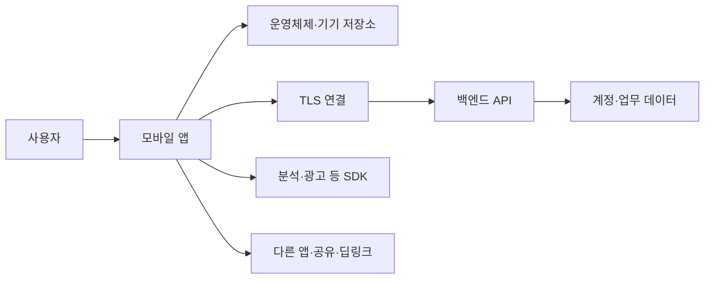

# 모바일 기기와 앱 보안 | Mobile device and app security

[분야 목차](README.md) · [인증과 권한 검사](04-인증과권한검사_identity-access.md) · [웹과 API](05-웹과API의입출력_web-api.md) · [공급망과 배포](09-소프트웨어공급망과배포_software-supply-chain.md)

## 모바일 앱은 앱 파일 하나로 끝나지 않습니다

모바일 서비스는 앱, 운영체제, 기기 저장소, 앱 간 연결, 네트워크, 백엔드 API, 외부 SDK가 함께 동작합니다. 앱 화면에서 버튼을 숨기거나 로컬에서 사용자를 확인해도 서버가 권한을 다시 확인하지 않으면 보호가 되지 않습니다. 반대로 서버가 안전해도 휴대전화 로그·백업·알림·공유 시트에 민감한 정보가 남을 수 있습니다.

NIST SP 800-124 Rev. 2는 조직이 소유한 기기와 개인 소유 기기를 포함해 모바일 기기의 도입·사용·폐기 전 주기를 다룹니다. OWASP MASVS는 앱의 보안 검증 항목을, MASTG는 Android와 iOS 앱을 평가하는 기술 절차를 제공합니다. 이 표준과 가이드는 서로 역할이 다릅니다. [NIST SP 800-124 Rev. 2](https://csrc.nist.gov/pubs/sp/800/124/r2/final) · [OWASP MASVS](https://mas.owasp.org/MASVS/) · [OWASP MASTG](https://mas.owasp.org/MASTG/)

## MASVS의 통제 영역으로 점검합니다

| MASVS 영역 | 확인할 설계 질문 | 흔한 실패 조건 |
| --- | --- | --- |
| STORAGE | 토큰·개인정보·캐시가 어디에 저장되며 로그아웃·폐기 때 지워집니까? | 평문 환경설정, 임시 파일, 로그, 키보드 캐시, 백업에 비밀이 남습니다. |
| CRYPTO | 키가 어디에서 생성·보관되고 용도와 수명이 제한됩니까? | 앱 바이너리에 비밀키를 넣거나 임의 암호 알고리즘을 만듭니다. |
| AUTH | 로그인·세션 만료·재인증·계정 복구가 서버와 일치합니까? | 로컬 화면 잠금이나 생체 인증 결과를 서버 권한으로 오해합니다. |
| NETWORK | 서버 인증서 검증과 민감 데이터 전송이 적절합니까? | 개발용 인증서 허용이나 검증 비활성화가 배포본에 남습니다. |
| PLATFORM | 앱 구성요소, 권한, 인텐트, URL 스킴이 필요한 범위로 제한됩니까? | 내보낸 구성요소가 인증·인가 없이 민감 기능을 수행합니다. |
| CODE | 앱과 라이브러리가 지원되는 버전으로 관리되고 입력을 안전하게 처리합니까? | 취약한 SDK, 디버그 설정, 출처 불명의 바이너리가 포함됩니다. |
| RESILIENCE | 변조·디버깅 방지 기능이 위험 모델에 맞게 적용됩니까? | 난독화나 루팅 탐지를 실제 서버 권한 통제의 대체물로 취급합니다. |
| PRIVACY | 앱이 수집·공유하는 정보가 목적과 사용자 고지에 맞습니까? | 필요 이상의 연락처·위치·식별자를 수집하거나 제3자 SDK로 전달합니다. |

MASVS는 위 영역을 앱 클라이언트의 기준으로 다룹니다. 앱에 연결된 원격 API는 별도의 서버 검증이 필요하며, OWASP는 백엔드에 ASVS와 웹 서비스 시험 가이드를 함께 적용하라고 설명합니다. 자동 분석기는 검토 효율을 높일 수 있지만 앱의 업무 규칙과 구조를 이해하지 못하므로 자동 도구만으로 검증을 완료할 수 없습니다. [OWASP 평가 범위 안내](https://mas.owasp.org/MASVS/04-Assessment_and_Certification/)

## 기기 안의 데이터 흐름을 따라갑니다

민감한 값은 로그인 화면에서만 관리되는 것이 아닙니다. 인증 토큰은 네트워크 응답, 메모리, 키체인·Keystore, 앱 캐시, 진단 로그, 화면 캡처, 클립보드, 백업과 알림에 복사될 수 있습니다. 기능 흐름마다 “어디서 생성되고, 누가 읽으며, 언제 폐기되는가?”를 적어야 합니다.

암호화 저장소를 사용해도 기기가 잠금 해제되고 앱이 실행 중이면 앱 프로세스가 평문을 다룰 수 있습니다. 그러므로 플랫폼 보호 저장소, 짧은 토큰 수명, 서버 측 폐기, 민감 데이터 최소 수집을 함께 사용합니다. 앱 바이너리에서 비밀키를 숨기는 것으로 서버 자격 증명을 보호할 수는 없습니다.

딥링크와 앱 간 호출은 외부 입력으로 취급합니다. URL의 문서 ID나 화면 이름은 사용자가 접근할 권한을 증명하지 않습니다. 앱이 링크를 열 때 형식과 허용된 호스트·작업을 확인하고, 서버는 요청마다 현재 계정의 권한을 다시 검사해야 합니다. OS가 제공하는 앱 권한, 서명된 앱 구성요소, 최소한의 내보내기 설정을 활용하고, 앱에서 받은 문자열을 신뢰해 민감한 작업을 수행하지 않습니다.

## 인증서 고정은 만능 방어가 아닙니다

TLS 연결은 서버 인증서와 호스트 이름을 정상적으로 검증해야 합니다. 인증서 고정(certificate pinning)은 앱이 특정 공개키나 인증서에 추가 조건을 두는 방식이지만, 키 교체·인증서 갱신·장애 복구를 어렵게 만들 수 있습니다. 모든 앱에 무조건 적용하기보다 위협 모델, 운영 가능한 키 회전 계획, 백업 핀과 긴급 업데이트 경로를 고려해야 합니다. 테스트 빌드에서만 인증서 검증을 약화하고 배포 빌드에서는 해당 설정이 켜지지 않도록 자동화된 빌드 검사를 둡니다.

공용 Wi-Fi에서의 위험을 앱의 암호화로 모두 해결한다고 볼 수 없습니다. 잘못된 서버 인증서 허용, 신뢰되지 않은 CA, 평문 로그 전송이나 API 권한 오류는 별도로 남습니다. 네트워크 요청 검토와 서버 인가 검토를 분리해 결과를 기록합니다.

## 사례: 딥링크의 문서 번호만 바꾸면 다른 사람 자료가 보입니다

앱이 `document/123` 같은 딥링크로 문서를 엽니다. 앱에서 로그인 화면을 거쳤더라도 공격자가 문서 번호를 바꿔 요청할 수 있다는 사실만으로 권한이 있다는 뜻은 아닙니다. 안전한 설계에서는 서버가 세션 주체, 문서 소유 조직, 사용자 역할과 작업 범위를 대조합니다. 접근이 거부되면 앱은 문서 본문이나 미리보기·검색 결과·첨부 파일 메타데이터도 함께 숨겨야 합니다.

검증은 소유자 승인을 받은 테스트 계정과 합성 문서로 수행합니다. 한 계정이 자기 문서를 읽는 정상 사례, 다른 조직 문서를 읽으려는 거부 사례, 만료된 세션, 권한 없는 편집, 앱을 거치지 않은 API 요청을 확인합니다. 기대 결과는 모든 경로에서 서버가 동일한 권한 판정을 내리는 것입니다. 실제 고객 데이터로 권한 경계를 시험하지 않습니다.

## 제품 수명 주기와 개인 소유 기기

기기 정책은 새 기기 등록뿐 아니라 분실·퇴사·교체·초기화·재판매까지 다룹니다. 조직 소유 기기와 개인 소유 기기는 사용자의 사생활과 조직 통제 가능성이 다르므로 같은 원격 초기화 정책을 적용하지 않습니다. MDM/EMM은 등록 기기, OS 버전, 암호화·잠금 정책, 업무 앱 배포, 분실 신고와 업무 데이터 제거 절차에 사용될 수 있습니다. 관리 범위와 개인 데이터 접근 범위를 사용자에게 설명하고, 퇴사나 기기 교체 때 업무 계정과 인증서를 회수합니다.

| 단계 | 보안 검토 | 남길 기록 |
| --- | --- | --- |
| 요구사항 | 데이터 민감도, 사용자 역할, API, SDK, 외부 연동을 목록화합니다. | 위협 모델과 적용할 MASVS 통제입니다. |
| 개발 | 보안 저장소, 시스템 암호 API, 서버 인가, 최소 권한을 구현합니다. | 설계 결정, 코드 리뷰, 라이브러리 목록입니다. |
| 출시 | 릴리스 빌드 설정, 데이터 흐름, 권한 요청, SDK 동작을 확인합니다. | 버전·빌드 해시·테스트 범위·예외 승인입니다. |
| 운영 | 취약 라이브러리, 인증 실패, 이상한 권한 사용과 업데이트 상태를 살핍니다. | 로그 접근 통제, 취약점 처리, 업데이트 기록입니다. |
| 폐기 | 기기 등록·인증서·세션·업무 데이터 접근을 회수합니다. | 초기화·폐기 확인, 데이터 보존 요건입니다. |

## 승인된 평가의 진행 순서

1. 앱 버전, 테스트 계정, 서버/API, 시험 환경과 데이터 처리 범위를 서면으로 정합니다.
2. 역할·데이터·외부 연동을 포함한 위협 모델을 작성하고 MASVS 통제와 연결합니다.
3. 정적 검사, 의존성 검사, 구성 검토와 수동 코드 검토를 수행합니다.
4. 승인된 테스트 기기·테스트 계정으로 저장소·인증·플랫폼 연동·네트워크 동작을 확인합니다.
5. API는 앱 클라이언트 검사와 별도로 서버 측 인가·입력·세션을 검증합니다.
6. 각 통제에 통과·실패·해당 없음·검증 불가를 기록하고 증거와 수정 후 확인 조건을 남깁니다.

검토 결과에 “MASVS 인증 완료”라고 적지 않습니다. OWASP는 자체 인증 제도를 제공하지 않으며, 제3자 검증을 주장하는 경우 평가 범위와 통과·실패 항목을 명확하게 보고해야 한다고 설명합니다.

## 플랫폼 보안 API의 보호 범위와 한계를 이해합니다

Android Keystore와 Apple Keychain은 앱이 비밀을 평문 파일에 직접 보관하는 것보다 안전한 플랫폼 경로를 제공합니다. 두 기능의 접근 조건·백업·동기화 동작은 같지 않으므로 한 플랫폼의 설정을 다른 플랫폼에 그대로 옮기지 않습니다.

| 기능 | 제공하는 보호 | 설계·검증할 점 |
| --- | --- | --- |
| Android Keystore | 키 재료를 앱 프로세스 밖에서 사용하고, 지원 기기에서는 TEE나 StrongBox에 키를 결합할 수 있습니다. | 실제 기기·키 알고리즘에서 지원되는 보안 수준을 확인합니다. 앱 프로세스가 침해되면 키 재료를 추출하지 못해도 기기 안에서 키 사용을 악용할 수 있습니다. |
| Apple Keychain | 작은 비밀 정보를 암호화된 키체인 저장소에 두고 접근 조건을 설정합니다. | 접근성 조건, 기기 잠금·재부팅·백업·동기화 정책을 데이터 민감도에 맞춥니다. |
| 앱 내부 저장소 | OS 샌드박스와 앱 UID로 다른 앱의 기본 접근을 제한합니다. | 백업 설정, 로그, 디버그 빌드, 앱의 자체 공유 코드 경로까지 검토합니다. |
| 생체 인증 | 민감 기능에 사용자의 재인증을 요청하는 인터페이스를 제공합니다. | 생체 인증은 서버 인가나 계정 복구가 아닙니다. 민감한 작업은 서버에서 별도로 권한을 확인합니다. |

Android 공식 문서는 Keystore 키를 추출하기 어렵더라도 앱 프로세스가 침해되면 공격자가 그 키를 기기 안에서 사용할 수 있다고 설명합니다. Apple Keychain은 항목별 접근 조건을 제공하지만, 적절한 조건은 사용성·복구·동기화 요구에 달려 있습니다. “OS 보안 저장소를 사용했다”는 체크 하나로 앱 데이터가 완전히 보호되었다고 판정하지 않습니다. [Android Keystore](https://developer.android.com/privacy-and-security/keystore) · [Apple Keychain Services](https://developer.apple.com/documentation/security/keychain-services/)

## 모바일 앱 출시 검토표

| 출시 게이트 | 수행할 확인 | 실패 시 조치 |
| --- | --- | --- |
| 빌드 식별 | 앱 ID·버전·서명 인증서·빌드 해시가 승인된 릴리스와 일치하는지 확인합니다. | 출처를 확인할 수 없는 바이너리는 배포하지 않고 빌드 경로를 조사합니다. |
| 개발 설정 | 디버그 플래그·테스트 서버·진단 화면·샘플 계정·임시 인증서가 없는지 확인합니다. | 릴리스 구성을 수정하고 동일 설정이 재발하지 않도록 빌드 검사를 둡니다. |
| 권한과 컴포넌트 | 앱 권한·Android exported component·URL scheme·공유 경로를 기능별로 검토합니다. | 불필요한 권한을 제거하고 외부 진입점마다 인증·인가·입력 검사를 추가합니다. |
| 외부 SDK | 버전·수집 데이터·전송 목적지·업데이트 담당자를 확인합니다. | 목적과 출처를 설명할 수 없는 SDK를 제외하거나 위험 승인과 근거를 기록합니다. |
| 비밀정보 | 앱 패키지, 소스, 빌드 로그와 crash report에 서버 비밀·개인정보가 없는지 확인합니다. | 이미 배포된 비밀은 코드에서 삭제하는 데 그치지 말고 서버에서 회수·교체합니다. |
| 권한 회귀 | 정상 역할·다른 역할·다른 조직·만료 계정으로 API 권한을 확인합니다. | UI 수정만으로 끝내지 않고 서버 인가를 고친 뒤 테스트 계정으로 재검증합니다. |
| 개인정보 | 앱 마켓 고지·실제 SDK 전송·OS 권한 요청이 기능과 일치하는지 확인합니다. | 수집을 줄이고 고지·동의·보존 기간을 수정합니다. |

Android의 `android:exported`는 앱 구성요소를 다른 앱에서 실행할 수 있는지 결정합니다. 인텐트 필터가 있다는 이유만으로 안전한 외부 호출이라고 가정하지 말고, 외부 진입점에서 호출 주체와 전달 데이터, 필요한 사용자 상태를 확인합니다. [Android 보안 체크리스트](https://developer.android.com/privacy-and-security/security-tips) · [Android exported 구성요소 위험](https://developer.android.com/privacy-and-security/risks/android-exported)

## 딥링크 점검을 서버 인가 시험과 묶습니다

딥링크가 `myapp://invoice/8451`처럼 문서 번호를 담으면, 앱이 받는 값은 외부에서 전달된 문자열입니다. 검토할 때는 적어도 다음 경계를 나누어 확인합니다.

1. scheme·host·경로가 등록된 형식과 일치하는지 확인합니다.
2. 잘못된 인코딩·중복 매개변수·빈 값에 앱이 안전하게 실패하는지 확인합니다.
3. 링크 진입만으로 로그인·결제·삭제·파일 열람이 실행되지 않는지 확인합니다.
4. 앱이 요청을 서버로 보내면 서버가 해당 계정의 현재 권한을 다시 검사하는지 확인합니다.
5. 거부 응답에 본문·미리보기·검색 요약·첨부 파일 URL이 남지 않는지 확인합니다.
6. 로그아웃·계정 전환 뒤 이전 사용자의 캐시나 화면 상태가 다시 나타나지 않는지 확인합니다.

검증 결과는 정상 소유자의 읽기 성공, 같은 조직의 권한 없는 사용자의 거부, 다른 조직 사용자의 거부, 만료 세션, 삭제된 리소스와 잘못된 링크 형식으로 나누어 기록합니다. 응답·서버 권한 판정·사용자 화면을 함께 보관합니다. 기존의 [객체 권한 교육 예제](실습_labs/access_control.py)는 합성 문서의 서버 측 소유자·조직 검사를 보여주는 참조 자료이며 실제 앱 백엔드 구현은 아닙니다.

## 개인정보와 분석 SDK는 데이터 흐름으로 검토합니다

광고·분석·충돌 보고 SDK는 앱 코드와 별도의 실행 주체일 수 있습니다. 앱이 위치를 직접 사용하지 않아도 포함된 SDK가 식별자·진단 정보·IP 주소를 외부로 전송할 수 있습니다. SDK별 버전·초기화 조건·전송 필드·목적·보유 기간·옵트아웃 동작을 기록하고 실제 테스트 트래픽과 앱 마켓의 고지를 비교합니다.

인증 토큰·비밀번호·결제 정보·전체 문서 본문은 로그에 기록하지 않습니다. 장애 원인에 필요한 식별자도 원문 대신 단기 가명 식별자를 사용할 수 있는지 검토합니다. 화면 캡처·알림 미리보기·클립보드·앱 전환기의 민감 화면 노출도 기능별로 점검합니다.

## 평가 보고서에는 검증 범위가 드러나야 합니다

OWASP는 모바일 앱 평가가 클라이언트에 한정되며 연동 서버는 별도 기준으로 검증해야 한다고 설명합니다. 자동 분석기는 누락과 오탐이 가능하므로, 보고서에는 앱 버전, 운영체제·기기, 계정 역할, 테스트 서버, MASVS 통제, 수동 확인 범위와 미검증 기능을 기록합니다. “도구에서 경고가 없었다”와 “보안 요구사항을 검증했다”는 같은 말이 아닙니다.

## 출처의 적용 범위

NIST SP 800-124 Rev. 2는 2023년 5월 발행된 기업 모바일 기기 관리 지침입니다. MASVS·MASTG는 공개 웹 문서이므로 보고서에는 실제 사용한 통제·시험 ID와 확인일을 기록합니다. 프레임워크의 체크 항목을 서비스의 안전성 인증으로 해석하지 않습니다.
