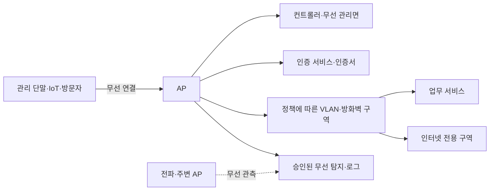

# 무선랜과 기업 Wi-Fi 보안 | Wireless LAN and enterprise Wi-Fi security

[분야 목차](README.md) · [Linux와 네트워크 경계](06-Linux와네트워크경계_linux-network.md) · [임베디드와 산업 시스템](10-임베디드와산업시스템_embedded-ot.md) · [허가된 보안 시험](19-허가된보안시험과책임있는제보_authorized-security-testing.md)

## 전파가 건물 밖으로 나가므로 경계가 유선과 다릅니다

무선 LAN은 단말, 액세스 포인트(AP), 무선 컨트롤러, 인증 서비스, 스위치, DNS·DHCP와 방화벽이 함께 만드는 시스템입니다. 전파는 벽을 따라 멈추지 않으므로 사무실 안의 좌석 배치만으로 접근 경계를 정할 수 없습니다. SSID는 네트워크 이름이지 사용자 인증 정보가 아니며, 단말의 MAC 주소도 신원을 증명하지 않습니다.

무선망을 기업망에 연결할 때는 누가 접속할 수 있는지만 보지 말고 접속 뒤 어떤 서버·데이터·관리망에 도달하는지 확인합니다. 무선 네트워크는 인증·암호화, 네트워크 분리, 기기 관리, AP 관리면 보호와 이상 징후 감시가 함께 맞아야 합니다.

## 인증 방식과 네트워크 분리를 구분합니다

| 네트워크 용도 | 설계 선택 | 확인할 점 |
| --- | --- | --- |
| 직원용 업무망 | 기업의 인증 체계와 기기 상태 정책에 연결합니다. 인증서 기반 EAP-TLS를 선택하면 사용자·장치 인증서의 발급·갱신·폐기 절차까지 운영해야 합니다. | 인증 서버 인증서 검증, 사용자·기기 식별, 인증서 만료·폐기, 방문자와의 분리입니다. |
| 방문자망 | 업무 시스템과 분리하고 인터넷으로 필요한 경로만 허용합니다. | 방문자 기기 간 통신, 내부 DNS·관리 페이지 접근, 사용 기간과 계정 만료입니다. |
| IoT·제조 장비망 | 장치가 실제로 필요한 서버·포트·관리 경로만 허용합니다. | 장치 식별, 취약한 구형 장비의 별도 격리, 업데이트·교체 계획입니다. |
| AP 관리망 | 승인된 관리자와 관리 시스템만 접근하게 분리합니다. | 기본 관리자 계정 변경, 관리 인터페이스 노출, 펌웨어 업데이트, 관리 로그입니다. |

WPA2·WPA3 지원 여부만으로 보안 상태를 단정하지 않습니다. 인증 방식, 암호 제품군, 호환 모드, 단말 지원, AP 설정, 서버 인증서 검증과 업데이트 상태를 함께 확인합니다. 오래된 NIST SP 800-153은 2012년 지침이고, CISA의 Wi-Fi 가이드는 2017년 판입니다. 두 자료는 무선 구성요소의 수명 주기와 탐지 원칙을 이해하는 배경으로만 사용하며 현재 암호 설정을 결정하는 최신 표준으로 취급하지 않습니다. 실제 배포에서는 현재 적용되는 IEEE·Wi-Fi Alliance 규격, 기기 제조사 지원 범위와 조직의 정책을 확인해야 합니다. [NIST SP 800-153](https://csrc.nist.gov/pubs/sp/800/153/final) · [CISA Wi-Fi 보안 가이드, 2017](https://www.cisa.gov/sites/default/files/publications/A_Guide_to_Securing_Networks_for_Wi-Fi.pdf)

## AP와 접속 기록을 함께 모니터링합니다

승인된 AP 목록에 없는 장치가 보이면 곧바로 악성이라고 단정하지 않습니다. 이웃 사무실·방문자의 장비, 테스트 장비, 잘못 등록된 AP도 탐지될 수 있습니다. 관리형 AP·무선 컨트롤러의 접속 기록과 무선 센서 관측, 스위치 포트·자산 목록을 함께 비교해 조직 소유 여부와 연결 경로를 확인합니다. CISA의 2017년 가이드는 무선 관측과 유선 관측을 조합해 비인가 AP를 분류하는 접근을 설명합니다. 현재 장비와 정책에 맞게 탐지 기준을 재검토해야 합니다.

무선 침입 방지 기능을 켜면 자동 차단이 주변 장치나 업무 연결에 영향을 줄 수 있습니다. 차단 기능은 소유권·승인·법적 요구와 오탐 대응을 검토한 뒤 운영자가 승인한 범위에 적용합니다. 타인의 무선 장치에 접속하거나 연결을 끊는 능동 시험을 하지 않습니다.

| 관측 항목 | 정상 기준의 예 | 조사할 이상 징후 |
| --- | --- | --- |
| AP 인벤토리 | AP 모델·위치·소유자·관리 버전이 자산 목록과 일치합니다. | 승인되지 않은 AP, 오래된 펌웨어, 중복 관리 주소입니다. |
| 인증 | 사용자·기기·역할에 맞는 인증 결과와 정책이 기록됩니다. | 인증 실패 급증, 예외 인증 방식, 폐기된 인증서 사용입니다. |
| 네트워크 구역 | 같은 SSID여도 업무·게스트·IoT의 정책 경계가 분명합니다. | 게스트에서 내부 관리면 접근, IoT에서 불필요한 서버 접근입니다. |
| 관리 경로 | AP·컨트롤러 관리 기능은 전용 관리망과 승인된 계정에서만 접근됩니다. | 외부 노출 관리 페이지, 공유 관리자 계정, 변경 주체가 없는 설정입니다. |
| 무선 탐지 | 센서와 컨트롤러의 시각·위치·장치 식별 정보가 맞습니다. | 무선 관측만 있고 유선 자산과 일치하지 않거나, 탐지 사각이 생깁니다. |

## 사례: 회의실에서 승인되지 않은 AP가 발견됐습니다

담당자가 회의실에서 조직 인벤토리에 없는 SSID를 발견했다고 가정합니다. SSID 이름이 회사 이름과 비슷하다는 이유만으로 내부 시스템이나 장치에 연결하지 않습니다. 먼저 승인된 무선 관측 기록에서 위치·시간·BSSID·보안 모드 등 비밀 정보가 아닌 식별 정보를 보존하고, AP 인벤토리와 방문자·회의실 장비 목록을 대조합니다. 이어 무선 컨트롤러와 스위치 자산 기록을 담당자가 승인한 조사 절차로 확인합니다.

장비가 조직 소유로 확인되면 담당자·업무 목적·설정 변경 이력을 확인하고 정책에 맞게 등록합니다. 제3자 소유 장비로 보이거나 업무망과 연결된 정황이 있으면 직접 접속·차단하지 않고 무선망 운영자와 보안 사고 담당자에게 전달합니다. 기대 결과는 소유자와 연결 경로가 확인되고, 승인되지 않은 업무망 접근이 차단되며, 조치 결정의 근거가 기록되는 것입니다.

## 설계 검토와 운영 지표

- 직원·방문자·IoT·관리망마다 허용해야 하는 업무 흐름을 다이어그램으로 남깁니다.
- AP·컨트롤러·인증 서버의 소프트웨어 버전, 지원 종료일, 설정 백업과 관리자 역할을 관리합니다.
- 직원망의 인증서 발급·갱신·폐기와 단말 분실 시 차단 절차를 확인합니다.
- 방문자망에서 사내 주소 공간과 장치 간 통신이 차단되는지 승인된 테스트 장비로 확인합니다.
- 센서 위치와 사각, 로그 보존·시각 동기화, 인시던트 담당자와 오탐 처리 방법을 기록합니다.
- 복구 훈련에서 AP 컨트롤러 설정과 인증서 기반 접속을 복원할 수 있는지 확인합니다.

운영 지표는 승인된 AP 인벤토리와 실제 자산의 차이, 지원 종료 펌웨어 비율, 만료 예정 인증서 수, 예외 인증 구성 수, 게스트·IoT 구역에서 승인되지 않은 내부 경로의 존재 여부처럼 조치로 이어지는 값으로 정합니다. 단순 접속자 수를 보안 상태의 대리 지표로 삼지 않습니다.

## 출처의 적용 범위

NIST SP 800-153은 2012년, CISA Wi-Fi 가이드는 2017년 자료입니다. 이 장에서는 무선 장비 수명 주기·구성 점검·탐지 관점만 사용합니다. 현재 암호 제품군, Wi-Fi 세대, 인증 호환성을 결정하는 근거로 이 오래된 판본을 인용하지 않습니다.
