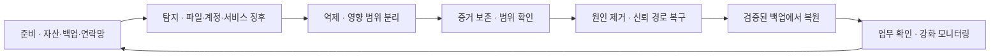

# 랜섬웨어와 악성코드 대응 | Ransomware and malware response

[분야 목차](README.md) · [로그 탐지와 사고 대응](16-로그탐지와사고대응_detection-response.md) · [소프트웨어 공급망](09-소프트웨어공급망과배포_software-supply-chain.md) · [기업 계정과 관리자 권한](20-기업계정과관리자권한_enterprise-identity.md)

## 랜섬웨어는 파일 암호화만으로 끝나지 않습니다

랜섬웨어 사고에서는 파일을 사용할 수 없게 만드는 암호화 외에도 정보 탈취와 공개 협박, 백업·복구 방해, 계정·관리 시스템 침해가 함께 나타날 수 있습니다. 따라서 확장자가 바뀐 파일만 찾아 삭제하면 사고 대응이 끝나지 않습니다. NIST IR 8374 Rev. 1은 2026년 6월 발행된 CSF 2.0 커뮤니티 프로필로, 거버넌스·식별·보호·탐지·대응·복구 결과를 랜섬웨어 위험 관리에 연결합니다. [NIST IR 8374 Rev. 1](https://csrc.nist.gov/pubs/ir/8374/r1/final)

MITRE ATT&CK의 T1486은 데이터를 암호화해 시스템·서비스의 가용성을 방해하는 기법을 분류합니다. 이 분류는 관찰된 행위를 설명하기 위한 지식 기반이며, 특정 사고의 공격자·악성코드·피해 범위를 단독으로 판정하는 증거는 아닙니다. [MITRE ATT&CK T1486](https://attack.mitre.org/techniques/T1486/)



## 초기 대응은 안전과 증거 보존을 함께 고려합니다

1. 사고 지휘자와 업무·안전 담당자에게 알리고, 실제 영향받는 시스템과 시간 범위를 파악합니다.
2. 조직의 사고 절차와 운영 안전 요구에 따라 의심 단말·서버를 격리합니다. 제조·의료·운송 등 안전 기능이 있는 시스템은 임의로 전원을 끄거나 네트워크를 차단하지 말고 시스템 책임자와 안전한 격리 방법을 결정합니다.
3. 로그·경보·시스템 시각·파일 식별 정보와 대응 조치 기록을 보존합니다. 증거 수집이 서비스 안정성을 해칠 수 있으면 우선순위를 사고 지휘자가 정합니다.
4. 의심 파일을 일반 업무용 컴퓨터에서 열거나 실행하지 않습니다. 파일은 승인된 격리 절차에 따라 다루고, 공개 악성코드 분석 사이트에 조직 자료를 업로드하지 않습니다.
5. 영향을 받은 계정·관리 경로·원격 관리 도구·백업 상태를 확인합니다. 상위 권한 계정이 노출됐을 가능성이 있으면 깨끗한 관리자 장비에서 자격 증명 회수·교체 순서를 정합니다.
6. 업무 책임자가 데이터 복구 우선순위와 허용 가능한 중단 시간을 확인한 뒤 복원 계획을 실행합니다.

무작정 모든 장비를 끄면 메모리·네트워크 상태나 조사에 필요한 로그를 잃을 수 있고, 반대로 연결을 유지하면 추가 피해가 이어질 수 있습니다. 조직의 사고 지휘 체계와 산업 안전 제약에 따라 격리 결정을 기록합니다. NIST SP 800-61 Rev. 3의 사고 대응 원칙과 [로그 탐지·대응 장](16-로그탐지와사고대응_detection-response.md)을 함께 참고합니다.

## 백업이 있다는 사실과 복구할 수 있다는 사실은 다릅니다

복구 계획은 데이터 파일만이 아니라 신원 시스템, 업무 설정, 암호화 키, 인증서, 빌드·배포 산출물과 운영 문서를 고려합니다. 백업 계정이 운영 도메인의 관리자 계정과 같거나 백업 저장소가 항상 쓰기 가능한 상태라면, 운영 환경 침해가 백업에도 영향을 줄 수 있습니다. 백업 사본의 분리·불변성, 별도 인증 경로, 복구 계정 보호와 실제 복원 훈련을 함께 설계합니다.

| 복구 점검 | 확인 질문 | 합격 근거 |
| --- | --- | --- |
| 복구 지점 | 어느 시점의 정상 데이터로 돌아갈 수 있습니까? | 업무별 RPO와 실제 복원 지점 기록입니다. |
| 복구 시간 | 핵심 서비스를 언제까지 다시 제공해야 합니까? | 업무별 RTO와 복원 훈련의 실제 소요 시간입니다. |
| 백업 격리 | 운영 관리자나 감염된 단말이 백업을 수정·삭제할 수 있습니까? | 별도 권한·저장소·불변성 정책의 확인 기록입니다. |
| 무결성 | 복원한 데이터와 구성에 손상이 없습니까? | 체크섬·애플리케이션 검증·업무 담당자의 샘플 확인입니다. |
| 복구 순서 | ID·DNS·네트워크·핵심 애플리케이션의 의존성을 고려했습니까? | 서비스 의존도와 순서를 기록한 복구 시나리오입니다. |
| 침해 제거 | 복원 후 공격자가 썼던 계정·토큰·원격 경로가 남지 않습니까? | 자격 증명 회수, 시스템 재구축, 접근 정책 검토 결과입니다. |

백업 파일의 체크섬 일치만으로 복구 준비가 검증되지는 않습니다. 파일이 읽히더라도 필요한 키·설정·계정·소프트웨어 버전이 없어 서비스를 다시 띄우지 못할 수 있습니다. 격리된 복구 환경에서 실제 복원과 업무 검증을 해보고, 발견한 실패를 백업 설계에 반영합니다.

## 안전한 파일 식별 예시

아래 명령은 지정한 파일을 실행하지 않고 SHA-256 해시를 계산합니다. 해시는 동일한 바이트 파일을 비교하고 증거 목록을 기록하는 데 쓸 수 있지만, 해당 파일이 악성인지 안전한지를 판정하지 않습니다. 출처와 취득 시각, 시스템, 파일 경로, 수집 담당자를 함께 기록하고 원본은 조직의 증거 보관 절차에 따릅니다. Microsoft 문서는 `Get-FileHash`의 기본 해시가 SHA-256이라고 설명합니다. [Get-FileHash 공식 문서](https://learn.microsoft.com/en-us/powershell/module/microsoft.powershell.utility/get-filehash?view=powershell-7.5)

```powershell
Get-FileHash -LiteralPath 'C:\Evidence\sample.bin' -Algorithm SHA256
```

경로는 승인된 증거 사본으로 바꿉니다. 격리된 사본을 검사할 때도 자동 실행·미리 보기 기능이 파일을 열지 않도록 주의하고, 의심 파일을 평소 사용하는 PC에서 분석하지 않습니다. 악성코드의 동작 분석은 조직의 법적 승인과 격리된 실험 환경, 전담 인력과 절차가 있을 때만 수행합니다.

## 악성코드 분석에서 증거와 추정을 나눕니다

파일명·확장자·아이콘·해시 하나만으로 악성 여부나 공격자 신원을 단정하지 않습니다. 정적 분석은 파일을 실행하지 않고 형식·문자열·서명·메타데이터와 알려진 식별자를 비교하는 단계입니다. 동적 분석은 격리된 환경에서 동작을 관찰하지만, 샘플이 분석 환경을 감지하거나 특정 조건에서만 동작할 수 있으므로 관찰되지 않았다고 안전하다고 결론내릴 수 없습니다.

분석 기록에는 원본 해시와 수집 위치, 보존 사본 해시, 환경·도구 버전, 시각 기준, 관찰 결과, 미관찰 항목과 한계를 적습니다. 공개 서비스에 샘플을 제출하면 기밀 정보와 개인정보가 제3자에게 전달될 수 있으므로, 조직의 승인과 자료 분류를 확인하기 전에는 업로드하지 않습니다. ATT&CK 기법 태그는 관찰 근거를 설명하는 보조 분류로만 사용합니다.

## 사례: 파일 암호화 경보가 연속으로 발생합니다

여러 파일 서버에서 짧은 시간에 비정상적으로 많은 파일 변경이 보고되고, 사용자들이 파일을 열지 못한다고 알립니다. 파일 확장자만 기준으로 자동 삭제하거나 서버 전체를 재부팅하는 대신, 경보 시각·사용자·호스트·파일 서버·백업 상태를 묶어 영향 범위를 확인합니다. 대량 쓰기를 일으킨 정상 백업·동기화 작업인지, 승인되지 않은 계정이나 프로세스인지 운영 담당자와 대조합니다.

악성 행위가 확인되면 사고 절차에 따라 영향 시스템을 분리하고, 백업과 관리자 계정의 독립성을 점검합니다. 복구 전에는 감염 경로가 제거되었는지, 관리자 비밀·세션·토큰을 회수했는지, 복원 데이터가 실제 업무에서 열리는지 확인합니다. 합격 판정은 “파일 확장자가 원래대로 보인다”가 아니라, 정상 사용자 권한으로 핵심 업무가 동작하고 데이터 무결성·복구 시점·지속 감시가 확인된 상태입니다.

## AI 활용은 대응자의 판단과 자료 보호를 함께 설계합니다

AI는 경보 묶음, 로그 요약, 문서 분류나 대응 절차 검색을 도울 수 있습니다. 다만 모델이 누락한 로그를 보충해 사실처럼 말하거나, 신뢰할 수 없는 로그·문서 안의 지시를 따르거나, 민감한 사고 자료를 외부 서비스에 전송할 위험이 있습니다. AI가 만든 조사 요약은 원본 이벤트 ID와 시각으로 되돌아가 확인하고, 격리·계정 차단·복구처럼 영향이 큰 조치는 담당자의 승인과 기존 사고 절차를 거치게 합니다.

사고 자료를 외부 모델에 보내기 전에 데이터 분류·계약·보존·학습 사용 정책을 확인합니다. AI 응답은 증거가 아니라 조사 보조 결과로 남기고, 근거가 된 원본 로그와 사람이 수정한 내용을 구분합니다. 자세한 위협 모델은 [AI가 바꾸는 공격과 방어](11-AI가바꾸는공격과방어_ai-enabled-threats.md), [에이전트 도구 권한](13-AI에이전트와도구권한_agent-tool-security.md)을 참고합니다.

## 사후 검토에서 고칠 수 있는 통제를 찾습니다

- 최초 침해를 막거나 영향 범위를 줄일 수 있었던 통제가 실제로 작동했는지 확인합니다.
- 탐지 시각, 첫 대응, 격리 완료, 복구 시작·완료 시각을 기록해 지연 원인을 찾습니다.
- 경보 중복·오탐·누락을 분류하고 담당자·로그 소스·임계값·절차를 수정합니다.
- 백업 복원과 자격 증명 회수가 계획대로 됐는지 근거를 남깁니다.
- 외부 공개나 법적 통지 의무는 관할 법률과 조직의 법무·개인정보 담당자 판단을 따릅니다.

## 출처의 적용 범위

NIST IR 8374 Rev. 1은 2026년 6월 발행된 CSF 2.0 커뮤니티 프로필입니다. MITRE ATT&CK T1486은 행동 분류이며 특정 악성코드 분석 결과가 아닙니다. Microsoft `Get-FileHash` 예시는 파일 식별과 무결성 확인용으로만 제시했습니다. 명령은 악성 파일을 실행하거나 치료하지 않습니다.
