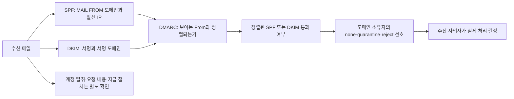
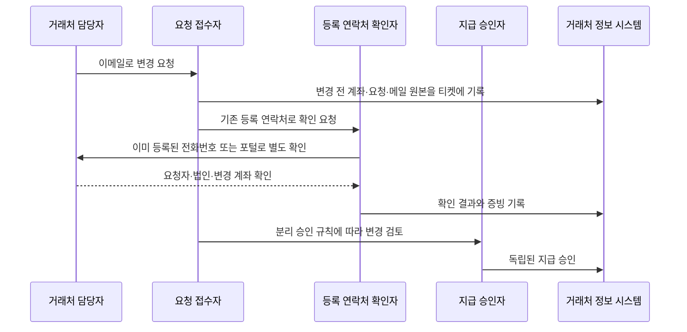

# 메일 인증과 업무 메일 침해 | Email authentication and business email compromise

[분야 목차](README.md) · [인증과 권한 검사](04-인증과권한검사_identity-access.md) · [기업 계정과 관리자 권한](20-기업계정과관리자권한_enterprise-identity.md) · [로그 탐지와 사고 대응](16-로그탐지와사고대응_detection-response.md)

## 메일 발신 인증은 송금 요청의 진위를 보증하지 않습니다

메일 보안은 표시된 보낸 사람 이름만 확인하는 문제가 아닙니다. 메일에는 SMTP 전송 과정에서 쓰이는 발신 도메인과 사용자가 메일 프로그램에서 보는 `From` 주소가 함께 있습니다. 공격자는 비슷한 도메인으로 새 주소를 만들거나, 실제 직원의 메일 계정을 탈취해 평소 대화의 맥락을 이용할 수 있습니다. 첫 경우에는 도메인 사칭 탐지가 중요하고, 두 번째 경우에는 정상 계정에서 온 메일도 인증에 통과할 수 있으므로 계정·거래 절차를 함께 봐야 합니다. FBI는 BEC(업무 메일 침해)를 가짜 주소 사칭, 피싱으로 얻은 계정 접근, 정상 메일 대화와 송금 요청의 악용 등으로 설명합니다. [FBI, Business Email Compromise](https://www.fbi.gov/how-we-can-help-you/common-frauds-and-scams/business-email-compromise)

SPF, DKIM, DMARC는 서로 다른 정보를 검사합니다. 세 항목이 모두 “통과”해도 메일 본문에 적힌 계좌 변경이나 긴급 결재가 사실이라는 뜻은 아닙니다.

| 기술 | 수신 측이 확인하는 것 | 확인하지 않는 것 |
| --- | --- | --- |
| SPF | SMTP `MAIL FROM`에 제시된 도메인이 현재 전송 서버의 IP 주소 사용을 허용하는지 확인합니다. | 사용자가 보는 `From` 이름·주소의 실제 작성자나 본문 내용을 증명하지 않습니다. |
| DKIM | 서명자가 선택한 헤더와 본문이 서명 후 바뀌지 않았는지, DNS에서 확인한 공개키로 서명이 검증되는지 확인합니다. | 서명에 쓰인 계정이 탈취되지 않았는지, 요청 내용이 업무상 정당한지는 판정하지 않습니다. |
| DMARC | 보이는 `From` 도메인과 SPF 또는 DKIM으로 인증된 도메인이 정렬되는지 확인하고, 정렬된 인증이 없을 때 도메인 소유자가 공표한 처리 선호를 수신 측에 전달합니다. | 수신자가 요청한 정책을 반드시 그대로 적용한다고 보장하지 않으며, 진짜 계정에서 발송된 사기 메일을 식별하지 않습니다. |

SPF의 발신 도메인은 보통 수신자가 보는 `From`과 다를 수 있습니다. 따라서 SPF만 통과해도 DMARC가 통과하는 것은 아닙니다. DKIM도 서명 도메인(`d=`)이 `From` 도메인과 DMARC 규칙에 따라 정렬되어야 합니다. 정렬은 정확히 같은 도메인인지 확인하는 엄격 모드와 같은 조직 도메인에 속하는지 확인하는 완화 모드가 있습니다. [RFC 7208](https://www.rfc-editor.org/rfc/rfc7208.html), [RFC 6376](https://www.rfc-editor.org/rfc/rfc6376.html), [RFC 9989](https://www.rfc-editor.org/rfc/rfc9989.html)



DMARC의 `p=none`, `p=quarantine`, `p=reject`는 수신 측에 전달하는 도메인 소유자의 처리 선호입니다. 최종 수신 사업자는 전달·목록·업무상 예외 등 맥락을 고려해 다르게 처리할 수 있습니다. RFC 9989는 2026년 5월 공개된 현재 DMARC 표준이며 RFC 7489를 대체했습니다. 이전 예제에서 흔히 보이는 `pct` 태그는 새 표준에서 제거되었으므로, 새 설정 예시에 옮기지 않습니다. 실제 DNS 변경 전에는 공급자 문서와 현재 표준을 다시 대조해야 합니다. [RFC 9989, §3.2.8–3.2.9, §5.1, 부록 C](https://www.rfc-editor.org/rfc/rfc9989.html)

## 발신 도메인을 보호하는 설정은 발신 경로 목록에서 시작합니다

첫 단계는 DNS 레코드를 바로 강하게 바꾸는 것이 아니라 조직이 메일을 보내는 모든 경로를 찾는 일입니다. 사람의 메일함, 웹 사이트의 알림, 급여·청구 서비스, CRM, 고객 지원 도구, 프린터·업무 장비가 서로 다른 발송 서비스를 사용할 수 있습니다. 한 경로라도 빠지면 정상 메일이 차단되거나 스팸함으로 이동할 수 있습니다.

| 적용 순서 | 해야 할 일 | 확인할 근거 |
| --- | --- | --- |
| 1. 도메인 목록화 | 사용 중인 기본 도메인, 하위 도메인, 발신 전용 도메인과 사용 중단 도메인을 구분합니다. | DNS·메일 관리 자료와 업무 서비스 담당자의 확인 기록입니다. |
| 2. 발신 경로 수집 | 각 서비스의 `MAIL FROM`, DKIM 서명 도메인, 발송 IP·위탁 사업자를 확인합니다. | 실제 수신한 테스트 메일의 신뢰할 수 있는 메일 게이트웨이 인증 결과와 발송 서비스 설정입니다. |
| 3. SPF 정리 | 도메인마다 발신원을 하나의 정책으로 관리하고, `include`, `a`, `mx` 등 DNS 조회를 유발하는 메커니즘의 누적을 계산합니다. RFC 7208은 이런 메커니즘·수정자의 조회 제한을 정의합니다. | SPF 평가 결과가 `pass`·`fail`·`softfail`·`permerror` 중 무엇인지와 조회 상한 오류가 없는지 확인합니다. |
| 4. DKIM 발급·회전 | 발송 서비스별 서명 도메인과 selector를 정하고, 공개키 게시·개인키 보호·교체 시점을 담당자와 기록합니다. | 서로 다른 수신 환경에서 서명을 검증하고 키 교체 후 신규 메일과 기존 전송 흐름을 확인합니다. |
| 5. DMARC 관찰 | 우선 보고 기능을 설정해 어떤 발신 경로가 정렬 통과하는지 관찰합니다. 집계 보고에는 실제 합법적 서비스, 위탁 발신, 전달·메일링 리스트의 실패가 섞일 수 있습니다. | 보고 수신함 접근권한·보존기간·개인정보 처리와 보고 파싱의 오류를 함께 확인합니다. |
| 6. 정책 적용 판단 | 모든 합법 발신 경로가 식별되고 수신 결과가 업무상 허용되는 수준인지 확인한 뒤 정책을 단계적으로 정합니다. | 도메인·하위 도메인·위탁 발신·메일링 리스트별 표본 전송 및 차단 영향 검토입니다. |

SPF를 여러 TXT 레코드로 나눠 추가하면 올바른 단일 정책이 되지 않습니다. 이미 발송 플랫폼이 `include`를 요구하는 경우가 많으므로 임의로 합치거나 DNS 조회를 무시하지 말고, 서비스 담당자와 현재 레코드를 확인합니다. SPF를 검사할 때 여러 레코드가 선택되면 `permerror`가 날 수 있습니다. RFC 7208은 한 번의 평가에서 DNS 조회를 일으키는 메커니즘·수정자의 누적 한도를 10회로 정합니다. 조회 한도 안에 넣기 위해 자동으로 레코드를 펼치는 방식은 공급자 IP 변경을 놓칠 수 있으므로 유지보수 책임과 갱신 절차가 있어야 합니다. [RFC 7208, §3.2·§4.5·§4.6.4](https://www.rfc-editor.org/rfc/rfc7208.html)

DKIM은 `d=`에 기록되는 서명 도메인과 `s=` selector를 기준으로 DNS에서 검증 키를 찾습니다. 메일 전달 중 본문이나 서명 대상 헤더가 바뀌면 검증이 실패할 수 있습니다. 키 교체는 새 키 게시, 발신 측 서명 전환, 실제 수신 검증, 이전 키 폐기의 순서와 되돌릴 방법을 마련합니다. 개인키를 여러 발송 사업자와 공유하면 유출 영향 범위가 커지므로 서비스별 키 분리가 가능한지 확인합니다.

DMARC 집계 보고는 발신량, IP, 결과와 정책 처리 정보를 드러낼 수 있습니다. 보고 주소를 외부 사업자로 보낼 경우 외부 수신 도메인의 승인 조건, 보고 자료의 저장 위치, 보존 기간과 접근 권한을 검토합니다. 메일을 보내지 않는 도메인도 사칭 대상으로 쓰일 수 있으므로 “발신하지 않음”을 DNS 정책과 도메인 운영 기록에 어떻게 반영할지 검토하되, 기존 서비스를 조사하기 전에 강한 정책을 적용하지 않습니다.

### 설명용 DNS 예시

아래 레코드는 동작 원리를 보여주는 가상의 예시입니다. `example.test`와 IP 주소는 문서용이며 실제 서비스에 그대로 복사할 수 없습니다. 실제 발신 IP, 공급자별 SPF 문구, 키, selector, 보고 주소는 소유 도메인과 메일 사업자에서 받아야 합니다.

```text
example.test.                    TXT  "v=spf1 ip4:192.0.2.10 -all"
selector1._domainkey.example.test. TXT "v=DKIM1; k=rsa; p=가상의_공개키"
_dmarc.example.test.             TXT  "v=DMARC1; p=none; rua=mailto:dmarc@example.test"
```

### 변경하지 않고 DNS 게시 상태를 읽는 방법

다음 명령은 지정한 도메인의 TXT 레코드를 조회만 합니다. DNS를 바꾸거나 메일을 발송하지 않습니다. `example.test`와 selector는 문서용 값이므로 실제 도메인의 검증 결과로 해석하면 안 됩니다.

```bash
dig +short TXT example.test                         # 문서용 도메인의 SPF TXT 응답을 조회합니다.
dig +short TXT selector1._domainkey.example.test    # 문서용 selector의 DKIM TXT 응답을 조회합니다.
dig +short TXT _dmarc.example.test                  # 문서용 도메인의 DMARC TXT 응답을 조회합니다.
```

첫 번째 조회는 SPF 문자열을 찾는 데 쓰고, 두 번째는 DKIM 공개키 게시 위치를 확인하며, 세 번째는 DMARC 정책을 확인합니다. 결과가 비어 있거나 DNS 캐시와 위임이 예상과 다르면 authoritative DNS, TTL, 레코드 이름과 공급자 설정을 함께 확인합니다. 조회 결과만으로 실제 수신자의 SPF·DKIM·DMARC 판정을 검증할 수는 없습니다. 전달, 서명, 도메인 정렬과 수신 사업자의 처리가 반영된 메시지 표본도 따로 확인해야 합니다.

첫 줄은 문서용 IP 하나만 보내는 경로로 허용한다는 가정입니다. 둘째 줄은 DNS 레코드 위치와 필드 형태만 보여주며 가짜 공개키이므로 검증에 쓸 수 없습니다. 셋째 줄은 관찰 정책과 집계 보고 주소의 예입니다. `p=none`은 차단 정책이 아니며, 보고서를 받을 주소를 실제로 운영하고 보고 자료를 안전하게 보관해야 합니다. 보고 시스템이 준비되지 않았거나 발신 도메인 목록이 미완성이면 이 예시조차 실제 DNS에 올리지 않습니다.

## 정상 계정에서 보낸 사기 메일은 도메인 인증만으로 막기 어렵습니다

BEC는 위조 주소만 쓰지 않습니다. 공격자가 실제 메일 계정이나 세션을 장악하면, 평소 쓰던 대화 흐름과 발신 도메인을 그대로 이용할 수 있습니다. 메일이 SPF·DKIM·DMARC 검사를 통과해도 계정 탈취 여부와 요청의 타당성은 남은 문제입니다.

| 상황 | 인증 결과만으로 해결되지 않는 이유 | 업무 통제 |
| --- | --- | --- |
| 임원·거래처 주소와 한 글자만 다른 도메인 | 수신자는 공격자의 새 도메인에 대해 설정된 SPF·DKIM이 정상으로 보일 수 있습니다. | 결제 요청은 표시 이름이 아니라 실제 주소와 등록된 거래처 정보를 대조합니다. |
| 실제 직원 계정에서 온 계좌 변경 메일 | 정식 발신 서비스와 인증된 키를 사용하면 세 가지 메일 인증을 모두 통과할 수 있습니다. | 이미 등록된 전화번호·거래처 포털처럼 이메일과 독립된 경로로 변경을 확인하고, 등록 변경과 지급 실행을 서로 다른 담당자가 승인합니다. |
| 메일 전달 후 인증 실패 | 전달 서버의 IP는 원 발신 도메인의 SPF 허용 목록에 없을 수 있으며, 일부 전달·목록 시스템은 서명 대상 내용을 바꿀 수 있습니다. | 실패 메일을 무조건 허용하지 말고 발신 사업자·목록·전달 경로와 정렬 결과를 조사합니다. 정식 발신에는 도메인에 맞는 DKIM을 적용합니다. |
| 피싱으로 비밀번호나 일회용 코드를 입력 | 수신 메일을 인증하는 표준은 로그인 세션의 강도를 바꾸지 않습니다. | 중요 계정에는 피싱 저항성 인증을 제공하고, 복구·등록·세션 취소·관리자 접근도 같은 위협 모델로 검토합니다. |
| 메일함에 숨은 자동 전달·규칙 | 계정이 살아 있는 동안 공격자는 정상 메일을 읽거나 답장을 숨길 수 있습니다. | 새 전달 주소·받은편지함 규칙·OAuth 앱 동의·세션·로그인 위험을 감시하고 변경 이력을 보존합니다. |

NIST SP 800-63B-4는 AAL2 서비스가 피싱 저항성 인증 옵션을 제공하도록 요구하고, 수동 입력 OTP와 대역 외 인증은 피싱 저항성이 없다고 구분합니다. 보안 키·패스키 등 특정 구현은 기기·동기화·복구·계정 생태계에 따라 성질이 달라질 수 있으므로 제품 명칭만으로 인증 강도를 판정하지 않습니다. [NIST SP 800-63B-4, §2.2, §3.2.5](https://pages.nist.gov/800-63-4/sp800-63b.html)

FBI는 지급 요청이나 계좌번호 변경을 요청자가 제시한 번호가 아니라 직접 확인한 연락처로 검증하고, 긴급성을 내세운 요구에 주의할 것을 권고합니다. 조직에서는 이 원칙을 개인 주의에 맡기지 말고 구매·거래처 등록·계좌 변경·송금 승인 단계에 넣습니다. 예를 들어 거래처 변경 요청이 오면 기존 거래처 정보에 등록된 연락처로 되묻고, 전화 확인자와 시스템 변경자, 실제 지급 승인자를 분리합니다. [FBI BEC 예방 권고](https://www.fbi.gov/how-we-can-help-you/common-frauds-and-scams/business-email-compromise)

## 의심 메일을 검토하는 순서

메일을 신고받았을 때는 링크를 열거나 첨부 파일을 실행하기 전에 다음을 기록합니다.

1. 메일 원본의 `From`, `Reply-To`, `Return-Path`, 수신 시각과 전달 경로를 보존합니다. 메일 프로그램 화면의 표시 이름만으로 발신자를 확정하지 않습니다.
2. 조직의 신뢰할 수 있는 메일 게이트웨이가 추가한 인증 결과를 확인합니다. `Authentication-Results` 필드는 어디서든 표시될 수 있고, 그 존재만으로 내용이 유효해지지 않습니다. 현재 조직의 신뢰 경계 안에서 검증한 결과인지 확인하고, 공격자가 원문에 삽입한 문자열이나 전달된 이전 홉의 결과를 현재 수신 서버의 판단으로 혼동하지 않습니다. [RFC 8601, §1.1–1.2·§7.1](https://www.rfc-editor.org/rfc/rfc8601.html)
3. SPF 결과의 도메인이 실제 `MAIL FROM`인지 확인하고, DKIM의 `d=`가 어느 조직인지, 유효 서명이 보이는 `From`과 정렬되는지 확인합니다.
4. 정렬 실패 원인을 정상 위탁 발신, 전달, 메일링 리스트, 발신 정책 누락, 사칭 시도로 나눠 조사합니다. 하나의 실패만으로 악성 메일이라고 판정하지 않습니다.
5. 지급·비밀번호 재설정·비밀 정보 공유 요청은 기존 등록된 업무 경로로 다시 확인합니다. 메일에 적힌 전화번호·링크·회신 주소를 검증에 사용하지 않습니다.
6. 계정 침해 가능성이 있으면 로그인·MFA 변경·세션 생성·규칙·전달·OAuth 동의와 관리 작업 기록을 사고 대응 절차에 따라 보존합니다.

원본 메일은 개인정보와 계약 정보가 포함될 수 있습니다. 원본을 외부 분석 서비스에 업로드하기 전에 조직의 자료 분류, 법무·개인정보 요구사항과 승인 절차를 확인합니다. 메일 헤더의 `Authentication-Results`는 수신 시스템의 위치와 신뢰 경계를 같이 보아야 합니다. 신뢰되지 않은 외부 헤더는 발신자가 임의로 넣을 수 있습니다.

### 계좌 변경 요청의 승인 흐름



확인 결과가 불일치하거나 기존 연락처로 확인할 수 없으면 변경을 보류하고 정해진 책임자에게 올립니다. 발신자의 메일 회신만으로 검증을 끝내지 않습니다. 승인 흐름은 실제 조직의 회계 규정·거래 계약·비상 연락 절차에 맞게 정해야 합니다.

## 운영 중 확인할 지표와 시험

| 확인 항목 | 계산·증거 방법 | 해석할 때 주의할 점 |
| --- | --- | --- |
| 발신 경로 인벤토리 | 등록된 메일 발신 서비스와 최근 관측된 발신 도메인·사업자를 대조합니다. | 관측 기간이 짧으면 계절성·연간 발송·장기 미사용 서비스를 놓칠 수 있습니다. |
| SPF/DKIM/DMARC 정렬 | 내부 통제 메일을 여러 수신 환경으로 보내 신뢰할 수 있는 수신 측 인증 결과와 보고서를 비교합니다. | 통과율이 높아도 계정이 안전하다거나 업무 요청이 정당하다는 뜻은 아닙니다. |
| 합법 발신 누락 | 새 결재·급여·고객지원·웹 알림 서비스를 등록할 때 승인 전용 테스트 수신함에서 인증을 확인합니다. | 공급자 안내의 레코드 한 줄만 복사하지 말고 발신 도메인과 서명 도메인을 확인합니다. |
| BEC 결재 통제 | 합성 계좌 변경 시나리오에서 기존 연락처 확인, 독립 승인, 기록·보류가 작동하는지 점검합니다. | 실제 지급정보 변경이나 실제 거래처 대상 피싱으로 시험하지 않습니다. |
| 계정 침해 대응 | 모의 사고에서 세션 취소, 자격 증명 변경, 메일 규칙 확인, 증거 보존의 담당·순서를 확인합니다. | 계정 비밀번호 변경만 하고 OAuth 토큰·앱 권한·세션을 놓치지 않습니다. |

처음에는 DMARC 관찰 모드와 제한된 수신함으로 합법 발송을 분류할 수 있습니다. 정식 발신을 모두 확인하기 전에는 강제 차단 정책을 적용하지 않습니다. RFC 9989는 집계 보고를 검토해 합법적인 메일 흐름을 정리하고 정책 전환을 판단하는 절차를 설명합니다. 전환 기간은 도메인의 발송 주기와 보고 품질에 따라 달라지며, 달력상 고정된 일수만 채웠다고 준비가 끝나는 것은 아닙니다. [RFC 9989, §5.1](https://www.rfc-editor.org/rfc/rfc9989.html)

메일 인증과 거래 절차를 함께 설계하면 도메인 사칭 위험을 줄이고, 정상 계정 탈취에서 발생하는 위조 지급 요청도 다른 경로로 검증할 수 있습니다. 둘 중 하나만으로 모든 사기 메일을 차단한다고 약속할 수는 없습니다.

## 근거 자료

- [RFC 7208: SPF](https://www.rfc-editor.org/rfc/rfc7208.html): SPF 처리와 DNS 조회 제한을 확인했습니다.
- [RFC 6376: DKIM](https://www.rfc-editor.org/rfc/rfc6376.html): 서명·selector·서명 도메인의 기본 구조를 확인했습니다.
- [RFC 9989: DMARC](https://www.rfc-editor.org/rfc/rfc9989.html): 2026년 5월 최종 표준의 정렬, 정책, 보고와 배포 절차를 확인했습니다. RFC 7489는 이 문서로 대체되었습니다.
- [RFC 8601: Authentication-Results](https://www.rfc-editor.org/rfc/rfc8601.html): 인증 결과 필드의 신뢰 경계와 위조 헤더 위험을 확인했습니다.
- [NIST SP 800-63B-4](https://pages.nist.gov/800-63-4/sp800-63b.html): 피싱 저항성 인증의 요구와 수동 입력 OTP의 한계를 확인했습니다.
- [FBI: Business Email Compromise](https://www.fbi.gov/how-we-can-help-you/common-frauds-and-scams/business-email-compromise): BEC의 유형과 지급·계좌 변경 독립 확인 권고를 확인했습니다.

설정 예시와 지급 절차 예시는 원리를 설명하기 위해 구성한 교육용 가정입니다. 특정 도메인의 DNS 레코드나 실제 기업의 내부 처리 절차가 아닙니다.

## English

SPF checks whether an SMTP envelope sender domain authorizes the sending host. DKIM verifies a domain signature over selected message content. DMARC requires alignment with the visible author domain and communicates a domain owner's handling preference; a receiver may apply its own policy. None of these mechanisms proves that a mailbox is uncompromised or that a payment request is legitimate. BEC controls therefore combine sender authentication, phishing-resistant account protection, independent verification of payment changes, separation of duties, and incident evidence preservation. The DMARC references use RFC 9989, published in May 2026, which obsoletes RFC 7489.
